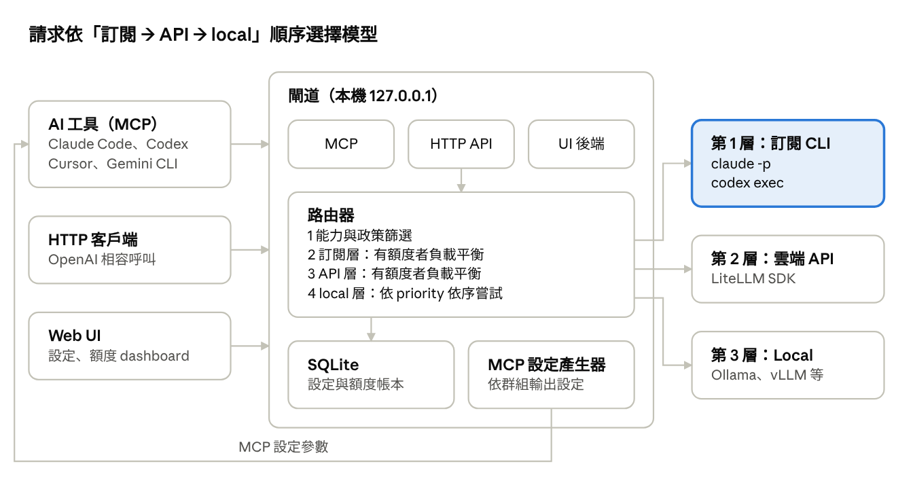

# Spillway

**溢流閘**：依額度溢流的個人 LLM 路由閘道（credit-aware LLM router）。

訂閱方案附贈的 credit 優先用完，用完才溢流到 API，最後才是 local 模型。對外只暴露 route 名稱，由閘道決定實際使用哪個模型與 effort，並提供 dashboard 顯示各成員的剩餘額度。

## 狀態

規格階段（M1）。程式尚未開始。

## 核心概念

| 概念 | 說明 |
| --- | --- |
| 成員 | 一個可呼叫的模型：訂閱 CLI（`claude -p`、`codex exec`）、雲端 API、local 模型 |
| 群組 / Tag | 群組是有名稱的 tag 選擇器；route 可指向群組或直接指向 tag |
| Route | 對外呼叫名稱；可拖曳設定使用順位（slot），並為每個成員設定 effort 與優先權重（高、中、低） |
| 路由順序 | 手動排序優先；未排序時依「訂閱 → API → local」，同一 slot 內的雲端成員依權重負載平衡 |
| 額度 | 美元預算、訂閱額度池、無預算；呼叫前預估 token 與花費，route 可勾選預估額度檢查 |
| Context 記錄 | 預設記錄每次呼叫的請求與回應，保存 7 天（可調整） |
| MCP | 每個群組一個 MCP 端點，並輸出 Claude Code、Codex、Cursor、Gemini CLI 的設定 |

## 文件

- [企劃書](docs/proposal.md)：背景、目標、範圍、技術選型、合規邊界、里程碑、風險
- [規格書](docs/spec.md)：資料模型、路由規則、額度與預估、effort、adapter、MCP、HTTP API、驗收標準
- [UI layout](docs/ui/)：7 個畫面的設計稿

## 技術選型

Python · FastAPI · LiteLLM SDK · SQLite（WAL）

## 使用範圍

僅供擁有者本人在本機使用。訂閱帳號只透過官方 CLI 呼叫，不讀取、不轉發 OAuth token，不集中多個帳號。
