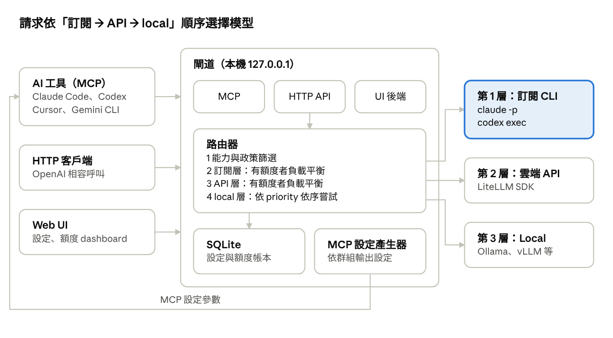

# Spillway

**溢流閘**：依額度溢流的個人 LLM 路由閘道（credit-aware LLM router）。

訂閱方案附贈的 credit 優先用完，用完才溢流到 API，最後才是 local 模型。對外只暴露 route 名稱，由閘道決定實際使用哪個模型與 effort，並提供 dashboard 顯示各成員的剩餘額度。



## 狀態

M2 路由核心已完成(CHG-20261030-02、整理 CHG-20261101-02)。M3 分兩部分：M3a（CHG-20261101-03）加入訂閱 CLI 成員（claude-cli、codex-cli）、CLI 併發上限、schema v2、存取 token 與 `spillway init`、graceful shutdown；M3b（CHG-20261102-01）加入 MCP server、`mcp-stdio`、MCP 設定輸出與全端點 Host／Origin 檢查，M3 閘門已通過（ACC-20261102-01）。M4 分兩部分：M4a（CHG-20261102-02，後端）加入設定匯入匯出（含 `dry_run` 預覽與 replace 自動備份）、帳本 CSV 匯出、設定總覽與群組名稱規則；M4b（CHG-20261103-01）加入 Web UI 8 個畫面（UI-1–UI-8）與首次設定精靈，以及畫面需要的讀取端點；M4 閘門於 ACC-20261103-01 驗收。

## 核心概念

| 概念 | 說明 |
| --- | --- |
| 成員 | 一個可呼叫的模型：訂閱 CLI（`claude -p`、`codex exec`）、雲端 API、local 模型 |
| 群組 / Tag | 群組是有名稱的 tag 選擇器；route 可指向群組或直接指向 tag |
| Route | 對外呼叫名稱；可拖曳設定使用順位（slot），並為每個成員設定 effort 與優先權重（高、中、低） |
| 路由順序 | 手動排序優先；未排序時依「訂閱 → API → local」，同一 slot 內的雲端成員依權重負載平衡 |
| 額度 | 美元預算、訂閱額度池、無預算；呼叫前預估 token 與花費，route 可勾選預估額度檢查 |
| Context 記錄 | 預設記錄每次呼叫的請求與回應，保存 7 天（可調整） |
| MCP | 每個群組一個 MCP 端點，並輸出 Claude Code、Codex、Cursor、Gemini CLI 的設定 |

## 文件

- [企劃書](docs/proposal.md)：背景、目標、範圍、技術選型、合規邊界、里程碑、風險
- [規格書](docs/spec.md)：資料模型、路由規則、額度與預估、effort、adapter、MCP、HTTP API、驗收標準
- [UI layout](docs/ui/)：UI-1–UI-7 的設計稿（UI-8「API 參考」沒有設計稿，版面為頂端群組選單、左側可折疊索引、右側內容）；實作與設計稿的差異見 `sdlc_docs/structure/design.md`「設計差異」

## 技術選型

Python · FastAPI · LiteLLM SDK · SQLite（WAL）

## 初始化與啟動

```bash
spillway init            # 建立資料目錄（含 work/claude、work/codex）、建立或升級資料庫、產生存取 token
spillway serve           # 只綁 127.0.0.1:8787
```

- 資料目錄為環境變數 `SPILLWAY_HOME`，未設定時為作業系統慣例位置（`platformdirs.user_data_dir("spillway")`）。
- 存取 token 只在產生當下顯示一次，資料庫只存 SHA-256 雜湊。`spillway init` 把 token 印在 stdout（其他訊息走 stderr，可用 `TOKEN=$(spillway init)` 取得）；已有 token 時只提示「已存在，未變更」並以 0 結束，要重新產生請執行 `spillway init --rotate` 或呼叫 `POST /api/settings/token/rotate`（回應 `{"token": "..."}`，舊 token 失效）。沒執行過 `init` 時，`serve` 首次啟動會產生 token 並在 stderr 印一行；若把 stderr 導到檔案，檔案中會留有這一次明文。token 用於 `/mcp/*` 的 `Authorization: Bearer`（見「MCP 連線」）；`/v1`、`/api` 在只綁 127.0.0.1 時不驗證 token。
- `serve` 啟動前會先確認埠可綁定，再取得資料目錄鎖 `spillway.lock`；任一失敗即結束，不開啟資料庫。同一個資料目錄同時只能有一個 `serve`（`init` 也需要這把鎖，`serve` 執行中時請改用 rotate API）。

## Web UI

`spillway serve` 啟動後，以瀏覽器開啟 `http://127.0.0.1:8787/`（轉址到 `/ui/`）。

| 畫面 | 網址 | 內容 |
| --- | --- | --- |
| UI-1 總覽 | `/ui/` | 各成員剩餘額度或冷卻至、預估可用天數、近 7 天日均、近 24 小時請求數；清除冷卻 |
| UI-2 成員 | `/ui/members.html` | 以連動選單（類型 → 供應商 → 模型）新增與編輯成員、測試呼叫、啟用切換、刪除；`#<id>` 直接開啟該成員 |
| UI-3 群組與 Tag | `/ui/groups.html` | 以 all／any／none 編輯選擇器並即時預覽；列出各 tag 的成員（tag 改名尚未提供） |
| UI-4 Route | `/ui/routes.html`、`/ui/route.html?name=<route>` | 拖曳（或以「移到…」選單、上移／下移按鈕）調整 slot 與成員順序，逐成員選 effort 與權重；還原預設、dry-run |
| UI-5 MCP 設定 | `/ui/mcp.html` | 選群組與工具，複製或下載設定內容 |
| UI-6 帳本 | `/ui/ledger.html` | 篩選、分頁、匯出 CSV；點選列查看該次的請求與回應（純文字） |
| UI-7 設定 | `/ui/settings.html` | 設定總覽、context 記錄設定、匯出與匯入設定、重新產生存取 token |
| UI-8 API 參考 | `/ui/api-reference.html` | MCP 介面的連線、工具、通知、錯誤碼（可折疊索引；不含 `/api` 與 `/v1`） |

- **首次設定精靈**（`/ui/wizard.html`）：資料庫沒有成員也沒有 route 時，開啟畫面會自動導向精靈（`/ui/?skip_wizard=1` 可略過一次）。四步：加入成員 → 測試呼叫（會實際呼叫上游一次並記一列帳本）→ 建立 route → 完成（顯示 `curl` 範例）。每步完成即寫入；中途離開後再開啟精靈，會從尚未完成的步驟繼續。憑證欄只填參照（`env:NAME` 或 `keyring:服務:帳號`），不要填金鑰本身；環境變數必須在啟動 `serve` 前設定。MCP 用戶端需要的存取 token 請到 UI-7 產生（`/ui/settings.html#token`）。
- **匯入設定**：在 UI-7 選檔與 `mode` 後按「預覽匯入」，畫面先以 `dry_run=true` 預覽，確認對話框列出新增、更新、刪除的數量與 `privileged` 成員；按「匯入」才寫入（`replace` 會先備份到 `backups/`）。
- **存取 token**：UI-7 的「重新產生 token」只在對話框顯示新 token 一次，關閉後無法再次查看；舊 token 立即失效。
- 畫面是靜態 HTML、CSS 與 JavaScript，所有資料經 `/api` 取得；不載入任何外部資源（使用系統字型）。畫面回應帶 Content-Security-Policy 等安全標頭，`/api` 回應一律 `Cache-Control: no-store`。與 `/api` 相同，在只綁 127.0.0.1 時不需登入，本機任何程式都能開啟。
- 畫面只在 macOS 的 Chromium 驗證；Safari、Firefox 與其他平台尚未驗證。

## CLI 成員（訂閱）

閘道以官方 CLI 子行程使用訂閱額度：claude-cli 成員執行 `claude -p --output-format json`（prompt 經 stdin），codex-cli 成員執行 `codex exec --json`。每個 provider 只能建立 1 個成員（第二個回 409 `provider_single`）。

1. 先以官方 CLI 自行登入訂閱（`claude`、`codex` 的登入流程）。閘道不讀取、不解析、不轉發任何 OAuth token 或 CLI 憑證檔，只呼叫官方 CLI；官方登入用的環境變數照常傳給子行程。
2. 在管理 API 建立成員（`kind: cli`、`provider: claude-cli` 或 `codex-cli`）。claude-cli 的花費取回應的 `total_cost_usd`，額度類型用 `credit_pool`；codex-cli 不回報金額（`cost_usd` 為 NULL），額度類型用 `none`，可用性只依上游的用完或限流訊號。
3. CLI 成員只用於 task 模式（`chat` route 不選 CLI 成員；請求可帶 `metadata.mode = task`）。
4. codex-cli 成員的 `model` 必須明確填寫，且用小寫的模型 ID（例如 `gpt-6.1-sol`；`/status` 顯示的 `GPT-6.1-Sol` 會被拒）；閘道的 codex 子行程不讀 `~/.codex/config.toml`，該檔的預設模型不會套用。

子行程的環境以閘道的環境為底，並：

| 項目 | 處理 |
| --- | --- |
| claude 子行程移除 | `ANTHROPIC_API_KEY`、`ANTHROPIC_AUTH_TOKEN`、`ANTHROPIC_BASE_URL`、`CLAUDE_CODE_USE_BEDROCK`、`CLAUDE_CODE_USE_VERTEX`、`CLAUDE_CODE_USE_FOUNDRY` |
| codex 子行程移除 | `OPENAI_API_KEY`、`CODEX_API_KEY`、`OPENAI_BASE_URL` |
| 兩者另移除 | 所有成員 `credential_ref` 為 `env:<變數名>` 的變數；這些變數的值也會在帳本與 payload 中被遮罩 |
| 兩者設定 | `SPILLWAY_DEPTH=1`（避免遞迴呼叫本閘道） |
| MCP | claude 固定加 `--strict-mcp-config`；codex 固定加 `--ignore-user-config` 與 `-c mcp_servers={}`，用意是不載入任何 MCP；`params.extra_args` 無法移除這些旗標，也不可以 `-c` 設定 `mcp_servers`、`profile`、`features`，或用 `--enable`、`-p`/`--profile`。擁有者冒煙證實不加 `--ignore-user-config` 時 codex 會載入 config.toml 的 MCP 與 ChatGPT 帳號的 `codex_apps`（含 GitHub 寫入等工具），加上後兩者皆不載入。codex 的 `-c mcp_servers={}` 經擁有者冒煙證實會與 `~/.codex/config.toml` 合併而非取代，所以閘道的 codex 子行程不讀 config.toml（登入不受影響，但 config.toml 中的其他設定也不套用）。擁有者冒煙證實 `--strict-mcp-config` 也排除 plugin 提供的 MCP；**待確認**：claude.ai connector 提供的 MCP（CHG-20261101-03 已知限制） |

其他說明：

- 未設定 `params.cwd` 時，工作目錄為資料目錄下的 `work/claude`、`work/codex`。逾時預設 600 秒（`params.timeout`），逾時時整個子行程群組（含它啟動的程式）會被終止。
- 每個 CLI 成員同時執行的子行程數上限為 `params.max_concurrency`（預設 1）；額滿時本次跳過、由下一個成員接手，不排隊、不寫帳本。
- 上游回報額度用完時冷卻到下一個重置點，限流時冷卻 60 秒；冷卻狀態顯示在 `/api/deployments`、`/api/dashboard` 的 `cooling_until`、`cooling_reason`（到期後為 null），可用 `POST /api/deployments/{id}/clear-cooldown` 手動清除。
- 已知限制：codex 的 prompt 放在命令列引數，`ps` 可看見，過長時該次呼叫失敗；子行程仍繼承上表以外的環境變數。

## MCP 連線

每個群組一個 MCP 端點（Streamable HTTP）：`http://127.0.0.1:8787/mcp/<群組>`；`/mcp/all` 暴露全部 route。工具有 `ask`（以 route 處理 prompt，回傳回應文字、實際處理的成員、slot、花費）、`list_routes`、`quota_status`。

- 驗證：每個請求帶 `Authorization: Bearer <token>`。設定檔一律以環境變數 `SPILLWAY_TOKEN` 參照 token，不寫入明文；請先在啟動工具的 shell 設定 `SPILLWAY_TOKEN`。rotate 後舊 token 下一次請求即回 401 `unauthorized`，已設定的其他工具也要換新 token。
- 設定輸出：`GET /api/mcp/config?group=<群組>&tool=<工具>`，`tool` 為 `claude-code`、`codex`、`cursor`、`gemini`、`stdio`。回應的 `variants` 列出各種放置方式（第一項為建議做法），每項含 `content`、建議路徑 `path` 與 `format`；`notes` 列出注意事項。格式與範例見規格書 8.2。
  - Claude Code：建議用專案 `.mcp.json`；命令版的 header 以單引號傳入，套用後以 `claude mcp get` 確認顯示的是字面 `${SPILLWAY_TOKEN}`。
  - Codex：`~/.codex/config.toml` 的 `[mcp_servers.spillway-<群組>]`，`tool_timeout_sec = 600`。
  - Gemini CLI：`headers` 內的環境變數展開未見官方記載；若 401 或 `gemini mcp list` 顯示未連線，改用 `variants[1]`（stdio）。
  - stdio 設定的 `command` 是此台機器上 `spillway` 的絕對路徑，換機器或重裝後須重新產生。
- 群組名稱規則（建立與匯入時檢查，違反回 422）：不可為 `.`、`..` 或保留字 `all`（`/mcp/all`），不可含 `/`、空白、控制字元、雙向控制字元與私用或未指派字元，長度 1–200，且須為 Unicode NFC（不自動正規化）。既有不符規則的群組仍可查詢、修改選擇器與刪除。
- 新增、修改、刪除 route 或群組後，閘道送出 `notifications/tools/list_changed`；只有開啟通知串流（GET）的連線收得到，其他連線在下次列出工具時取得新清單。
- 遞迴防護：請求帶 `X-Spillway-Depth` 且值不是 0 時回 403 `recursion_blocked`。

### `spillway mcp-stdio`

給只支援 stdio 的工具：

```bash
SPILLWAY_TOKEN=... spillway mcp-stdio --group coding [--port 8787]
```

stdin／stdout 為換行分隔的 JSON-RPC，轉送到 `http://127.0.0.1:<port>/mcp/<群組>`（主機固定）。不開啟資料庫、不經系統代理、stderr 不印 token、prompt 與回應。環境變數 `SPILLWAY_DEPTH` 有值時轉為 `X-Spillway-Depth` header。`SPILLWAY_TOKEN` 的前後空白（含結尾換行）會先去除。被閘道拒絕時（POST 的回應是閘道自己的錯誤格式，且錯誤碼與狀態碼成對：401 `unauthorized`、403 `recursion_blocked`／`host_not_allowed`／`origin_not_allowed`、404 `not_found`、503 `shutting_down`），每個未回應的請求收到 JSON-RPC 錯誤，`error.data.code` 為該錯誤碼，結束碼 3。其他 HTTP 錯誤只回 `error.data.http_status`（不帶 `code`、不轉印對方訊息），結束碼 1。

| 結束碼 | 情況 |
| --- | --- |
| 0 | stdin 結束，請求皆已回應 |
| 1 | 閘道未啟動或其他連線錯誤；不是閘道拒絕的 HTTP 錯誤（例如 MCP session 數達上限的 503「Too many open sessions」、session 不存在的 404，或錯誤碼與狀態碼不成對）；通知串流（GET）被拒，例如閘道停機時重連；stdin 結束後 5 秒內未收到回應 |
| 2 | `SPILLWAY_TOKEN` 未設定、空白或含換行，或 `SPILLWAY_DEPTH` 含 CR／LF（未連線） |
| 3 | 被閘道拒絕（見上，錯誤碼與狀態碼成對） |
| 130 | Ctrl-C |

注意：真實工具通常不會把 `SPILLWAY_DEPTH` 傳給它啟動的 stdio server，實際有效的遞迴防線是 CLI 成員的子行程不載入任何 MCP。MCP session 存在記憶體，`serve` 重啟後用戶端須重新 initialize。

## 設定匯入匯出

成員、群組、route（含拖曳順序）與三個 context 設定可匯出成 YAML 版控，再匯入同一台或另一台機器的閘道（格式見規格書第 3 節）。

```bash
# 匯出（不含任何憑證值，只有 credential_ref；不含 token 雜湊、冷卻、帳本、payload、埠號）
curl -fsS -o spillway-config.yaml http://127.0.0.1:8787/api/config/export

# 預覽：完整驗證並套用後回滾，不寫入、不備份
curl -fsS -X POST --data-binary @spillway-config.yaml -H 'Content-Type: application/yaml' \
  'http://127.0.0.1:8787/api/config/import?mode=replace&dry_run=true'

# 匯入
curl -fsS -X POST --data-binary @spillway-config.yaml -H 'Content-Type: application/yaml' \
  'http://127.0.0.1:8787/api/config/import?mode=replace'
```

- **設定檔等同程式碼，只匯入可信來源。** 匯入可改變成員的 `credential_ref`、供應商（`provider`）、上游位址（`params.api_base` 等）與 CLI 參數（`extra_args`、`effort_args`、`cwd`）；例如把 `api_base` 指向外部主機並把 `credential_ref` 設成任意環境變數，下一次呼叫就會把該變數的值送出去。匯入前先以 `dry_run=true` 預覽：回應的 `privileged` 列出會新增或變更這類欄位的成員 id（不含值；既有成員的 `provider` 改變也列入）。UI-7 的匯入一律先預覽並顯示確認對話框。伺服端不另外要求確認。
- `mode` 必填：`merge` 只新增或整筆取代檔案中的成員、群組、route（檔案外的不動；route 的 `targets` 一併取代，沒列則回到預設順序；settings 只改檔案中出現的鍵）；`replace` 另外刪除檔案外的成員、群組、route，檔案沒有的 context 設定回到預設值（例如 `context_retention_days` 回到 7，下一次清理就會刪除較舊的 payload）。帳本、payload、存取 token 都不受影響；仍存在的成員保留冷卻狀態。
- 任何欄位不合法時整批不寫入，回 422 `validation_error`，訊息列出欄位路徑（一次最多 20 筆，不回顯值）；匯入後有兩個以上同一個訂閱 CLI provider 的成員時回 409 `provider_single`。
- curl 必須用 `--data-binary`（`-d` 會剝掉換行）並帶 `Content-Type: application/yaml`（也接受 `application/x-yaml`、`text/yaml`；其他型別回 422，這也讓網頁無法以跨站表單送出匯入）。檔案上限 1 MiB；YAML 的 anchor／alias、明確 tag（如 `!!binary`）與重複鍵都會被拒。
- 回應：`{mode, dry_run, created, updated, deleted, backup, privileged}`，計數各為 `{deployments, groups, routes}`。
- 既有成員的 `params` 含疑似憑證的鍵名（較早版本寫入）時匯出回 422，先以管理 API 改用 `credential_ref` 再匯出。

### 備份與還原

`replace`（非 `dry_run`）在寫入前自動把目前設定備份到資料目錄下的 `backups/config-<UTC 時間戳記>.yaml`（檔案 0600；同名時加 `-2`、`-3`…，不覆寫），回應的 `backup` 為檔名。還原：以 `replace` 匯入該備份檔即可，例如

```bash
curl -fsS -X POST --data-binary @"$SPILLWAY_HOME/backups/<backup>" -H 'Content-Type: application/yaml' \
  'http://127.0.0.1:8787/api/config/import?mode=replace'
```

備份不含帳本與 payload，也不會自動清理。

`replace` 在刪除任何資料前，會先檢查「目前的設定」能否通過匯出的憑證鍵名掃描與匯入解析器；不能通過時回 HTTP 422 `validation_error`，只列出位置、不含值，不刪除、不寫備份；`dry_run=true` 同樣回此 422。因此 `replace` 寫下的備份一定可還原。要繼續，請先用管理 API 修正所列的資料列，再重試。

已知限制：① 本機其他程式（非瀏覽器）可直接呼叫匯入，備份是唯一的復原手段；匯入不檢查 `credential_ref` 指向的環境變數或 keyring 項目是否存在；② 資料庫內既有的違規資料（例如 route 指向不存在的群組、單一 provider 群組有兩個成員）會讓每一次 `merge` 匯入都被擋下（最終狀態檢查涵蓋整個資料庫）。

## 帳本 CSV 與設定總覽

- `GET /api/ledger/export.csv`：篩選參數與 `GET /api/ledger` 相同（`from`、`to`、`deployment`、`route`、`status`、`min_depth`：只列 `fallback_depth` 不小於此值的列，`1` 即「只看 fallback」），不分頁，最多 100,000 列（超過回 422，請縮小範圍）。UTF-8 BOM、欄位與帳本列相同，不含 prompt 與回應；以 `=`、`+`、`-`、`@`、Tab、CR 開頭的文字欄位前面會加 `'`，避免試算表當成公式。下載期間閘道持有一份讀取快照。
- `GET /api/settings`：埠號、資料目錄、版本、token 是否已產生（不含 token）、是否首次使用（`first_run`：沒有成員也沒有 route）、成員／群組／route／成功帳本列數與 context 設定。
- 畫面另用的讀取端點（格式見規格書 9.2.8）：`POST /api/groups/preview`（以未儲存的選擇器預覽成員）、`GET /api/routes/{name}/effective-order`（目前生效的順序，含停用與冷卻中的成員）、`GET /api/mcp/catalog?group=`（UI-8 的資料）；`GET /api/dashboard` 每個成員另帶 `daily_spend_7d`（近 7 天日均花費）。

## Host 與 Origin 檢查

所有端點（`/v1`、`/api`、`/mcp`、`/ui`）只接受 `Host` 為 `127.0.0.1` 或 `localhost`（可帶埠號）的請求，其他回 403 `host_not_allowed`（包括 `[::1]`）；請以 `http://127.0.0.1:8787` 或 `http://localhost:8787` 連線。請求帶 `Origin` 時必須是 `http://127.0.0.1:<埠>` 或 `http://localhost:<埠>`（serve 實際的埠），否則回 403 `origin_not_allowed`；CLI 與 SDK 不送 `Origin`，不受影響。帶兩個 `Host` header 的請求由伺服器（uvicorn）直接回 400。這擋住網頁發起的跨站請求與 DNS rebinding；本機其他程式（非瀏覽器）仍可呼叫 `/api`。

## 升級與備份（schema）

新版會在 `serve` 或 `init` 開啟資料庫時自動把 schema v1 升級為 v2（冷卻改存 `cooldowns` 表）：

1. 升級前**先停止舊版 `serve`**（舊版不使用 `spillway.lock`，無法偵測）。
2. 升級前會以 SQLite backup API 備份為 `spillway.db.v1.bak`（已存在時另存 `spillway.db.v1.bak.<UTC 時間戳記>`，不覆寫）；資料庫已有外鍵違反、備份失敗或升級失敗時都不會改動原檔，並以非 0 結束（訊息含備份位置）。
3. 回滾：停止 `serve`，刪除 `spillway.db`、`spillway.db-wal`、`spillway.db-shm`，把 `spillway.db.v1.bak` 改名為 `spillway.db`，並回退到舊版程式。v2 期間寫入的資料會遺失；v2 資料庫無法由舊版開啟。

## 停機

按 Ctrl-C 或送 SIGTERM 時，閘道停止接受新請求，MCP 的通知串流立即關閉（進行中的工具呼叫不受影響），最多等約 30 秒讓進行中的請求完成；在寬限期滿前（約 28.5 秒時）仍未完成的請求會被取消，終止仍在執行的 CLI 子行程（連同它們啟動的程式），該次嘗試記為 `error="shutdown"`，`/v1` 回 503 `shutting_down`（JSON），MCP `ask` 回錯誤結果 `shutting_down`。停機中再按一次 Ctrl-C 會立即終止子行程並結束（該次帳本列可能來不及寫入）。以 Ctrl-C 結束時不印 traceback，結束碼為 130；SIGTERM 時行程以該訊號結束（shell 看到 143）。環境變數 `SPILLWAY_TEST_GRACEFUL_TIMEOUT` 僅供測試，正式使用請勿設定。

## 相容性

`/v1/chat/completions` 除了 `model`、`messages`、`stream`、`max_tokens`、`reasoning_effort`、`tools`、`metadata` 這些明列欄位，其他參數只轉交白名單內的 OpenAI 標準參數（`spillway.api.ALLOWED_CHAT_PARAMS`），名單外的鍵一律靜默丟棄、不報錯。

| 參數 | 處理 |
| --- | --- |
| `functions`、`function_call`（OpenAI 舊版函式呼叫） | 丟棄，不轉交上游；請改用 `tools` 與 `tool_choice` |
| 其他不在白名單內的參數 | 丟棄，不轉交上游 |

## 開發與測試

```bash
uv pip install --python .venv/bin/python -e '.[dev]'   # dev 相依含 pytest、behave、playwright==1.64.1
export PYTHONPATH=src LITELLM_LOCAL_MODEL_COST_MAP=True
.venv/bin/python -m pytest -q                          # 全量（含 tests/ui 的畫面測試）
.venv/bin/python -m pytest tests/ui -q                 # 只跑畫面測試（Playwright、headless Chromium）
.venv/bin/python -m behave tests/features
```

畫面測試使用 Playwright 1.64.1 對應的 Chromium 1248（headless），可先以 `.venv/bin/python -m playwright install --dry-run chromium` 確認安裝位置；瀏覽器不存在時畫面測試會失敗（不會略過），需要時以 `.venv/bin/python -m playwright install chromium` 安裝（會下載瀏覽器）。畫面測試以暫存資料目錄執行，不讀寫實際的資料目錄，也不連外。

## 使用範圍

僅供擁有者本人在本機使用。訂閱帳號只透過官方 CLI 呼叫，不讀取、不轉發 OAuth token，不集中多個帳號。
