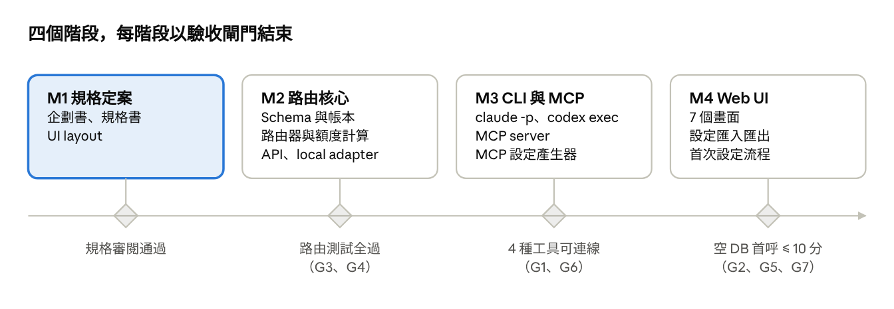

# Spillway — 企劃書

2026-10-29 · Weiss Lin

## 一、專案摘要

Spillway（溢流閘）是一套單人使用、本機執行的 LLM 路由閘道：把訂閱 CLI、雲端 API key 與 local 模型納入同一套群組與 tag，對外只暴露 route 名稱，由閘道依「訂閱 → API → local」順序選模型，並以 dashboard 顯示各成員的剩餘額度。

**專案目的**：用足訂閱方案附贈的程式化額度（如 Claude Agent SDK credit），並與其他公司的模型及工具混用。所有呼叫皆經由官方 CLI 或官方 API，符合各家現行政策。

| 欄位 | 內容 |
| --- | --- |
| 使用者 | 單一個人（擁有者即管理者） |
| 執行環境 | 個人電腦，預設只綁 127.0.0.1 |
| 資料庫 | SQLite，初始為空（只有表結構） |
| 對外介面 | OpenAI 相容 HTTP API、MCP server、Web UI |
| 主要交付 | 路由引擎、額度帳本、設定匯入匯出、各 AI 工具的 MCP 設定產生器、Web UI |

## 二、背景與問題

現行作法的核心問題是：三種計費來源各自分散，沒有單一入口決定「這次該用哪個模型」。

| 問題 | 現況 | 影響 |
| --- | --- | --- |
| 計費來源分散 | 訂閱（Claude、ChatGPT）、API key、local 模型各自獨立 | 訂閱額度用不完時仍在花 API 費用 |
| 額度不透明 | 剩餘額度要到各家後台分別查 | 無法在呼叫前判斷哪個來源還能用 |
| 模型與 effort 寫死在工具內 | 每個 AI 工具各自指定模型 | 更換模型需逐一修改各工具設定 |
| MCP 設定分散 | Claude Code、Codex、Cursor、Gemini CLI 的設定格式各不相同 | 同一組模型要手寫多份設定 |
| 現有閘道不符個人用途 | LiteLLM Proxy 需 Postgres + Redis；Portkey 預算上限只開放給 Enterprise 與部分 Pro | 部署成本高於個人需求 |

## 三、目標與量化指標

以下指標為本企劃提出的驗收目標，數值於規格書定案後以規格書為準。

| 編號 | 目標 | 指標 | 目標值 |
| --- | --- | --- | --- |
| G1 | 訂閱額度優先用完 | 訂閱成員有額度時，task 類請求由訂閱成員處理的比例 | 100% |
| G2 | 額度可見 | dashboard 顯示剩餘額度的成員比例（設有預算者） | 100% |
| G3 | 路由不拖慢呼叫 | 路由決策耗時（不含上游）P95 | < 20 ms |
| G4 | 自動 fallback | 一層全部失敗或無額度時，由下一層完成且客戶端不需重送 | 100% |
| G5 | 縮短上手時間 | 從空資料庫到第一次成功呼叫的操作時間 | ≤ 10 分鐘 |
| G6 | MCP 設定一鍵產生 | 支援輸出設定的 AI 工具數 | ≥ 4（Claude Code、Codex、Cursor、Gemini CLI） |
| G7 | 設定可重建 | 匯出後於空資料庫匯入，群組、route、tag 一致 | 100%，且匯出檔不含任何憑證 |

## 四、範圍

第一版只服務單一使用者、單一機器；多人與對外服務不在範圍內。

**納入範圍**

1. 成員管理：三種成員類型 — 訂閱 CLI（`claude -p`、`codex exec`）、雲端 API、local 模型（Ollama、vLLM、llama.cpp 等 OpenAI 相容端點）
2. 群組與 tag：群組即命名的 tag 選擇器，route 可指定群組或直接指定 tag
3. Route：每個 route 可指定成員清單與各成員的 effort
4. 路由：訂閱 → API → local 三層；負載平衡只在訂閱層與 API 層內部進行；`local/` 前綴可直接呼叫 local 模型
5. 額度：美元預算、額度池（如 Agent SDK credit）、無預算三種；上游回報用完時以上游為準；呼叫前預估 token 與花費，route 可個別勾選「預估額度檢查」，未勾選時用完才跳過、到下次可用時自動恢復
6. MCP：閘道本身提供 MCP server，並依群組產生各 AI 工具的 MCP 設定參數
7. Web UI：總覽、成員、群組與 tag、route、MCP 設定、帳本、初始設定、匯入匯出；帳本可檢視每次呼叫的請求與回應內容（預設開啟，保存天數於設定頁調整，預設 7 天）

**不納入範圍**

1. 多使用者、帳號共享、對外開放的服務
2. 擷取訂閱 OAuth token、模擬官方客戶端的請求格式
3. 同一家多個訂閱帳號的輪替或集中
4. 模型訓練、微調、向量庫
5. 第一版不做 streaming（列為後續項目）

## 五、解決方案概要

閘道位於 AI 工具與模型之間：對外只認 route，對內依三層順序挑選有額度的成員。

訂閱層與 API 層各自在有額度的成員之間負載平衡；一層全部不可用才進入下一層。model 以 `local/` 開頭的請求直接送往 local 模型，不經路由。

**群組與 tag**：群組是有名稱的 tag 選擇器（all、any、none）。route 可指定群組，也可直接指定 tag；日後不用群組時只改 route 目標，資料結構不變。

**Route 設定**：成員清單、各成員 effort（none、low、medium、high、max；不支援的等級自動降一級）、各成員的優先權重（高、中、低三級，用於同一順位內的負載平衡）、route 自身的 tag、模式（chat 或 task；訂閱 CLI 只服務 task）。

**手動優先順序**：使用者可在後台以拖曳調整 route 內成員的使用順位；手動設定的順位優先於「訂閱 → API → local」的預設順序，未手動設定時才套用預設。

**MCP 設定輸出**：建立群組後，閘道為每個群組提供一個 MCP 端點（只暴露該群組的 route），並產生 Claude Code、Codex、Cursor、Gemini CLI 可直接套用的設定，另附通用 JSON。

## 六、技術選型與權衡

採用 Python + FastAPI + LiteLLM SDK + SQLite：以 SDK 處理各家 API 與 effort 轉換，自建的部分只有路由層、CLI adapter 與 MCP 介面。

| 方案 | 優點 | 缺點 | 結論 |
| --- | --- | --- | --- |
| **LiteLLM SDK + 自建路由層** | 涵蓋 100+ 供應商與 `reasoning_effort` 轉換；不需 Postgres；路由模型可依需求設計 | 路由、額度、UI 需自建 | **採用** |
| LiteLLM Proxy | 路由、預算、UI、MCP gateway 現成 | 需 Postgres + Redis；預算以美元為中心，額度池與算力需額外改造 | 不採用 |
| New API | 額度制、渠道與分組現成 | Go 專案，改造成本高；訂閱套餐無法綁定指定渠道 | 不採用 |
| Portkey | Config 定義 fallback 與 loadbalance | SaaS；預算上限限 Enterprise | 不採用 |

**其他決策**

- 資料庫：SQLite（WAL 模式），單一檔案、免服務；單人使用的寫入量不需要 Postgres
- 憑證：不存入資料庫，只存參照（環境變數名或作業系統 keychain 項目）；CLI 成員沿用 CLI 自己的登入狀態
- 前端：伺服端渲染加少量 JavaScript，不引入前端建置流程（細節於規格書定案）

## 七、合規邊界

本專案使用的是訂閱附贈、供程式化使用的 credit，呼叫經由官方 CLI，僅供擁有者本人使用，符合現行政策；下表是維持合規的條件。

| 來源 | 呼叫方式 | 依據 | 專案限制 |
| --- | --- | --- | --- |
| Claude 訂閱 | 官方 `claude -p` | 2026-06-15 起，`claude -p` 與 Agent SDK 使用每月獨立的 Agent SDK credit（[Techsy](https://techsy.io/en/blog/claude-agent-sdk-credit)） | 啟動子行程前清除 `ANTHROPIC_API_KEY`；不讀取、不轉發 OAuth token |
| ChatGPT 訂閱 | 官方 `codex exec` | 官方 CLI 支援以 ChatGPT 帳號登入 | 不模擬 Codex 請求格式；不集中多帳號 |
| Gemini 訂閱 | 待確認 | 2026-02 Google 曾收緊 Gemini CLI 的第三方使用 | 接入前需先確認最新條款 |
| API key | 各家 API | 標準按量計費 | 無額外限制 |
| Local 模型 | OpenAI 相容端點 | 本機執行 | 無額外限制 |

**系統面的強制措施**

- HTTP 與 MCP 預設只綁 127.0.0.1，改綁其他位址需設定存取 token
- 每家訂閱只允許一個 CLI 成員，建立第二個時拒絕

## 八、里程碑與交付物

開發分四個階段，每階段以一個可驗證的閘門結束；目前處於 M1。

閘門括號內是對應的第三節指標。各階段日期尚未排定，待規格書定案後訂定。

## 九、風險與對策

最大的風險來自上游：CLI 參數與訂閱政策可能變動，因此 adapter 與額度類型都以設定驅動，不寫死在程式內。

| 風險 | 觸發條件 | 對策 |
| --- | --- | --- |
| CLI 參數或輸出格式變更 | `claude` 或 `codex` 版本更新 | effort 參數、輸出解析規則放在成員設定；解析失敗視為該成員錯誤並 fallback |
| 訂閱政策變動 | 各家調整 credit 金額或使用範圍 | 額度類型與上限可於 UI 修改；成員可一鍵停用 |
| 額度估算與上游不一致 | 本地帳本低估用量 | 上游回報用完時設定冷卻至下一個重置點，以上游為準 |
| Local 模型能力不足 | 請求需要長 context 或 tool calling | 成員標註 capabilities，路由前先做能力篩選 |
| 遞迴呼叫 | AI 工具透過 MCP 呼叫閘道，閘道又呼叫同一個 CLI | 子行程帶深度標記，超過 1 層即拒絕 |
| 憑證外洩 | 匯出設定或日誌含金鑰 | 資料庫與匯出檔只存參照；context 記錄寫入前遮罩疑似金鑰字串，預設保存 7 天後刪除 |

## 十、相關文件

| 文件 | 內容 |
| --- | --- |
| [規格書](spec.md) | 資料模型、路由規則、額度、effort、adapter、MCP、HTTP API、驗收標準 |
| [UI layout](ui/) | 7 個畫面：總覽、成員、群組與 Tag、Route、MCP 設定、帳本、設定 |
