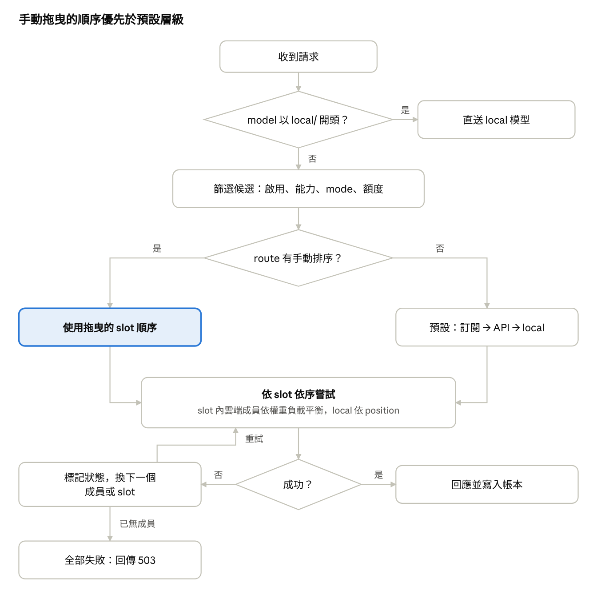

# Spillway — 規格書

2026-10-29 · Weiss Lin

修訂：2026-10-29 CHG-20261029-01（adapter 模組化、可用模型清單、後台選單、模組唯一或多個）

修訂：2026-10-30 CHG-20261030-02（7.1 Adapter 介面改為非同步）

## 1 範圍與名詞定義

本規格定義單人使用的 LLM 路由閘道之資料模型、路由規則、介面與驗收標準；目的、選型與風險見企劃書。

### 1.1 本規格不涵蓋

1.1.1 多使用者、權限角色、對外開放的服務。

1.1.2 訂閱 OAuth token 的讀取、轉發，或模擬官方客戶端請求格式。

1.1.3 Streaming 回應（第一版）。

### 1.2 名詞

| 名詞 | 定義 |
| --- | --- |
| 成員（deployment） | 一個可呼叫的模型實體：類型、供應商、上游模型 id、額度、tag |
| 類型（kind） | `cli`（訂閱，經官方 CLI）、`api`（雲端 API key）、`local`（本機模型） |
| Tag | 附在成員上的字串標籤，用於選取成員 |
| 選擇器 | `{all, any, none}` 三個 tag 清單組成的條件 |
| 群組 | 有名稱的選擇器 |
| Route | 對外呼叫的名稱；指定群組或選擇器，及各成員的 effort 與優先順序 |
| 優先級（slot） | Route 內的一個順位，由使用者拖曳決定；不同 slot 依序嘗試，同一 slot 內的雲端成員依優先權重（high、medium、low 三級）負載平衡 |
| Effort | 統一等級 `none`、`low`、`medium`、`high`、`max` |
| 額度類型 | `usd`（美元預算）、`credit_pool`（訂閱附贈額度池）、`none` |
| Adapter 模組 | 一種 AI、一種接入方式一個模組（例：Claude 訂閱 CLI 與 Anthropic API 是兩個模組）；自帶 manifest 與可用模型清單，啟動時自動發現（7.6） |
| 可用模型清單 | 模組宣告的可選模型與各模型的能力預設，供後台選單使用（7.6.4） |
| Cardinality | 模組宣告同一 `provider` 可建立的成員數：`single`（至多 1 個）或 `multiple`（不限） |

## 2 資料模型

資料庫為單一 SQLite 檔案，初始化時只建立表結構，不寫入任何資料列。

### 2.1 建置規則

2.1.1 連線後必須執行 `PRAGMA journal_mode=WAL` 與 `PRAGMA foreign_keys=ON`。

2.1.2 時間欄位必須以 UTC ISO 8601 字串儲存（精度至秒）。

2.1.3 憑證不可寫入資料庫；`credential_ref` 只存 `env:變數名` 或 `keyring:服務:帳號`。

2.1.4 同一 `provider` 的成員數由處理該 `provider` 的模組所宣告的 cardinality 決定：`single` 至多 1 筆，`multiple` 不限；系統必須於建立成員與匯入設定時，在同一交易內檢查（7.6.5）。

2.1.5 `usage_ledger` 不可存入 prompt 或回應內容；內容只可存於 `usage_payloads`（2.4）。

### 2.2 表關係

| 表 | 用途 | 關聯 |
| --- | --- | --- |
| `deployments` | 成員 | — |
| `deployment_tags` | 成員的 tag | N:1 `deployments` |
| `budgets` | 成員的額度設定與冷卻狀態 | 1:1 `deployments` |
| `groups` | 命名選擇器 | — |
| `routes` | 對外名稱、目標、context 記錄與預估檢查設定 | `target` 參照 `groups.name` 或內嵌選擇器 |
| `route_targets` | Route 內各成員的 slot、順位、effort、優先權重 | N:1 `routes`、N:1 `deployments` |
| `usage_ledger` | 每次嘗試的紀錄，含預估與實際 token、花費 | 以 `deployment_id` 對應成員 |
| `usage_payloads` | 每次嘗試的請求與回應內容 | 1:1 `usage_ledger` |
| `settings` | 存取 token 雜湊、埠號、context 記錄預設與保存天數 | — |

### 2.3 DDL

```sql
CREATE TABLE deployments (
  id             TEXT PRIMARY KEY,
  model_name     TEXT NOT NULL,
  kind           TEXT NOT NULL CHECK (kind IN ('cli','api','local')),
  provider       TEXT NOT NULL,
  model          TEXT NOT NULL,
  params         TEXT NOT NULL DEFAULT '{}',   -- JSON
  credential_ref TEXT,
  capabilities   TEXT NOT NULL DEFAULT '{}',   -- JSON {ctx, tools, vision, efforts[]}
  enabled        INTEGER NOT NULL DEFAULT 1
);

CREATE TABLE deployment_tags (
  deployment_id TEXT NOT NULL REFERENCES deployments(id) ON DELETE CASCADE,
  tag           TEXT NOT NULL,
  PRIMARY KEY (deployment_id, tag)
);

CREATE TABLE budgets (
  deployment_id   TEXT PRIMARY KEY REFERENCES deployments(id) ON DELETE CASCADE,
  type            TEXT NOT NULL CHECK (type IN ('usd','credit_pool','none')),
  limit_amount    REAL,
  window          TEXT NOT NULL DEFAULT 'monthly'
                  CHECK (window IN ('monthly','weekly','daily','none')),
  reset_anchor    INTEGER,          -- monthly 的重置日，1–28
  exhausted_until TEXT              -- 上游回報用完或限流時設定
);

CREATE TABLE groups (
  name     TEXT PRIMARY KEY,
  selector TEXT NOT NULL            -- JSON {all[], any[], none[]}
);

CREATE TABLE routes (
  name   TEXT PRIMARY KEY,
  target TEXT NOT NULL,             -- JSON {group} | {tags:{all,any,none}}
  mode   TEXT NOT NULL DEFAULT 'chat' CHECK (mode IN ('chat','task')),
  tags   TEXT NOT NULL DEFAULT '[]',
  record_context  INTEGER,            -- NULL = 沿用全域；1 開；0 關
  budget_precheck INTEGER NOT NULL DEFAULT 0  -- 1 = 啟用預估額度檢查（4.2.5）
);

CREATE TABLE route_targets (
  route_name    TEXT NOT NULL REFERENCES routes(name) ON DELETE CASCADE,
  deployment_id TEXT NOT NULL REFERENCES deployments(id) ON DELETE CASCADE,
  slot          INTEGER NOT NULL,   -- 使用者拖曳決定的優先級，小者先
  position      INTEGER NOT NULL,   -- slot 內的顯示與 local 嘗試順序
  effort        TEXT CHECK (effort IN ('none','low','medium','high','max')),
  weight        TEXT NOT NULL DEFAULT 'medium'
                CHECK (weight IN ('high','medium','low')),
  PRIMARY KEY (route_name, deployment_id)
);

CREATE TABLE usage_ledger (
  id             INTEGER PRIMARY KEY,
  ts             TEXT NOT NULL,
  route_name     TEXT,
  deployment_id  TEXT,
  effort         TEXT,
  tokens_in      INTEGER,
  tokens_out     INTEGER,
  cost_usd       REAL,
  status         TEXT NOT NULL,     -- ok | error | quota_exhausted | rate_limited | skipped_precheck
  slot           INTEGER,
  fallback_depth INTEGER NOT NULL DEFAULT 0,
  latency_ms     INTEGER,
  est_tokens_in      INTEGER,
  est_tokens_out_p50 INTEGER,
  est_tokens_out_p90 INTEGER,
  est_cost_usd_p90   REAL,
  error          TEXT
);
CREATE INDEX ix_ledger_dep_ts ON usage_ledger(deployment_id, ts);

CREATE TABLE usage_payloads (
  ledger_id     INTEGER PRIMARY KEY REFERENCES usage_ledger(id) ON DELETE CASCADE,
  ts            TEXT NOT NULL,
  request_json  TEXT NOT NULL,      -- 實際送出的 messages；CLI 為轉換後的 prompt
  response_text TEXT,
  bytes         INTEGER NOT NULL,
  truncated     INTEGER NOT NULL DEFAULT 0,
  redacted      INTEGER NOT NULL DEFAULT 0
);
CREATE INDEX ix_payloads_ts ON usage_payloads(ts);

CREATE TABLE settings (
  key   TEXT PRIMARY KEY,
  value TEXT NOT NULL
);
```

### 2.4 Context 記錄

2.4.1 全域預設由 `settings.record_context_default` 決定，初始值為 `1`（開啟）。

2.4.2 Route 的 `record_context` 為 NULL 時沿用全域；為 0 或 1 時以 route 為準。`local/` 直呼與隱含 route 沿用全域。

2.4.3 每次嘗試（含 fallback 中失敗者）各存一列；單筆上限為 `settings.context_max_bytes`，初始值 262,144 bytes，超過時截斷並設 `truncated = 1`。

2.4.4 寫入前必須以遮罩規則取代疑似金鑰字串（預設：`sk-` 開頭的字串、` Bearer  ` 之後的值、`credential_ref` 解析出的值）；有命中時設 `redacted = 1`。

2.4.5 保存天數由 `settings.context_retention_days` 決定，初始值為 7，於 UI-7 設定；系統必須每小時刪除 `ts` 早於保存期限的列。設為 0 表示不保存內容。

2.4.6 CLI 成員只記錄送入的 prompt 與最終結果文字，不記錄工具呼叫過程。

2.4.7 匯出設定檔不可包含 `usage_payloads`。

## 3 設定檔格式

設定檔為 YAML，用於匯入、匯出與版控；內容與資料庫一一對應，帳本不在其中。

### 3.1 規則

3.1.1 匯出檔不可含任何憑證值，只可含 `credential_ref`。

3.1.2 匯入必須在單一交易內完成；任一欄位驗證失敗時整批不寫入，並回傳錯誤欄位路徑。

3.1.3 匯入模式必須二擇一：`merge`（以 id 或 name 為鍵更新）、`replace`（先清空設定表再寫入，帳本保留）。

3.1.4 `targets` 的外層清單順序即 slot 順序；內層清單順序即 `position`。

3.1.5 未列 `targets` 的 route，系統依 4.3 的預設順序產生 slot。

### 3.2 範例

```yaml
version: 1
settings:
  record_context_default: true    # 預設開啟
  context_retention_days: 7       # 預設 7 天
deployments:
  - id: claude-sub
    model_name: sonnet
    kind: cli
    provider: claude-cli
    model: claude-sonnet-5-5
    tags: [coding, review]
    capabilities: {ctx: 200000, tools: true, efforts: [low, medium, high, max]}
    budget: {type: credit_pool, limit: 100, window: monthly, reset_anchor: 1}
  - id: anthropic-api
    model_name: sonnet
    kind: api
    provider: anthropic
    model: claude-sonnet-5-5
    credential_ref: env:ANTHROPIC_API_KEY
    tags: [coding, review]
    budget: {type: usd, limit: 30, window: monthly}
  - id: deepseek-api
    model_name: deepseek
    kind: api
    provider: deepseek
    model: deepseek-chat
    credential_ref: keyring:spillway:deepseek
    tags: [coding, cheap]
    budget: {type: usd, limit: 10, window: monthly}
  - id: qwen-local
    model_name: qwen-coder
    kind: local
    provider: ollama
    model: qwen3-coder:30b
    params: {api_base: http://127.0.0.1:11434}
    tags: [coding, private-ok]

groups:
  coding: {all: [coding]}

routes:
  review:
    target: {group: coding}
    mode: task
    tags: [daily]
    record_context: true            # 省略 = 沿用全域
    budget_precheck: true           # 啟用預估額度檢查（4.2.5）
    targets:                       # 外層 = slot，內層 = position
      - [{deployment: claude-sub, effort: high}]
      - [{deployment: anthropic-api, effort: medium},
         {deployment: deepseek-api, effort: medium, weight: high}]
      - [{deployment: qwen-local}]
  quick:
    target: {tags: {all: [coding], none: [review]}}
```

## 4 路由規則

使用者拖曳設定的 slot 順序優先於預設層級順序；同一 slot 內的雲端成員依優先權重負載平衡。



### 4.1 請求解析

4.1.1 `model` 以 `local/` 開頭時，系統必須直接呼叫其後指定的 local 成員（以 id 或 `model_name` 比對），不可經過路由與 fallback。

4.1.2 `model` 等於 route 名稱（可帶 `route:` 前綴）時，必須使用該 route。

4.1.3 `model` 等於成員的 `model_name` 時，系統必須以全部同名成員組成隱含 route（mode 為 `chat`，採預設順序）。

4.1.4 皆不符時必須回傳 HTTP 404，錯誤碼 `route_not_found`。

### 4.2 候選篩選

4.2.1 成員必須 `enabled = 1`。

4.2.2 估算 token 數（字元數 ÷ 4）不可超過 `capabilities.ctx`；請求含 tools 時 `capabilities.tools` 必須為 true；含圖片時 `capabilities.vision` 必須為 true。

4.2.3 `chat` route 不可選用 `cli` 成員；請求帶 `metadata.mode = task` 時視同 `task`。

4.2.4 `cli` 與 `api` 成員必須剩餘額度大於 0 且不在冷卻期（第 5 節）；`local` 成員不檢查額度，改檢查健康狀態（端點 2 秒內回應）。

4.2.5 Route 勾選預估額度檢查（`budget_precheck = 1`）時，`cli` 與 `api` 成員的 `est_cost_usd_p90`（5.4）不可超過該成員剩餘額度；超過者本次跳過，ledger 記為 `skipped_precheck`，不設冷卻。

4.2.6 Route 未勾選（`budget_precheck = 0`，預設）時不做預估檢查：成員持續被選用，直到上游回報額度用完或本地計算剩餘為 0；之後依 5.3.2 冷卻至下一個可用時間，到期自動恢復為候選，不需人工操作。

### 4.3 順序決定

4.3.1 順序來源的優先序（高至低）：① 使用者於 UI 拖曳設定並儲存於 `route_targets` 的 slot 順序；② 預設層級順序。

4.3.2 預設層級順序：slot 1 為全部 `cli` 成員，slot 2 為全部 `api` 成員，每個 `local` 成員各佔一個 slot，依 id 字母序接在後面；優先權重預設 `medium`。

4.3.3 Route 已有手動排序，而目標新增未出現於 `route_targets` 的成員時，新成員必須依 4.3.2 的層級接在手動 slot 之後，不可插入手動 slot 之間；UI 必須標示為「未排序」。

4.3.4 使用者「還原預設」時，系統必須刪除該 route 的全部 `route_targets`，回到 4.3.2。

### 4.4 Slot 內選擇

4.4.1 Slot 內先選雲端成員（`cli`、`api`），以加權隨機選一個：權重 = 優先權重值 × 剩餘額度比例。

| 優先權重 | 權重值 |
| --- | --- |
| high | 3 |
| medium | 2 |
| low | 1 |

4.4.2 剩餘額度比例為 0–1；額度類型 `none` 的成員以 1 計。

4.4.3 被選中的成員失敗後，必須移出本次候選，再於同 slot 剩餘雲端成員中重新加權選擇。

4.4.4 雲端成員用盡後，依 `position` 依序嘗試同 slot 的 `local` 成員。

4.4.5 Slot 內成員全部失敗或不可用時，進入下一個 slot。

### 4.5 失敗處理

4.5.1 每次嘗試必須寫入 `usage_ledger` 一列（含 `slot`、`fallback_depth`、`latency_ms`）。

4.5.2 上游結果與處置：

| 上游結果 | ledger status | 處置 |
| --- | --- | --- |
| 成功 | `ok` | 回應客戶端 |
| 額度用完（見 5.3） | `quota_exhausted` | `exhausted_until` 設為下一個重置點 |
| 限流（HTTP 429） | `rate_limited` | `exhausted_until` 設為現在 + 60 秒 |
| 其他錯誤或逾時 | `error` | 換下一個成員 |

4.5.3 全部 slot 皆失敗時必須回傳 HTTP 503，錯誤碼 `no_candidate`，body 列出每次嘗試的成員與狀態。

## 5 額度計算與上游訊號

剩餘額度 = 上限 − 本期帳本 `cost_usd` 加總；上游明確回報用完時，以上游為準。

### 5.1 計算期間

| window | 本期起點 | 下一個重置點 |
| --- | --- | --- |
| `daily` | 當日 00:00 UTC | 次日 00:00 UTC |
| `weekly` | 本週一 00:00 UTC | 下週一 00:00 UTC |
| `monthly` | 本月 `reset_anchor` 日 00:00 UTC（尚未到則取上月） | 下月同日 |
| `none` | 無起點（累計） | 現在 + 1 小時（用於重新探測） |

### 5.2 各類型的花費來源

5.2.1 `api`：必須使用 LiteLLM `completion_cost()` 的結果寫入 `cost_usd`；無定價的模型寫入 NULL 並於 UI 標示「未計價」。

5.2.2 `cli`（claude-cli）：必須使用 `claude -p --output-format json` 回應中的 `total_cost_usd` 寫入 `cost_usd`，扣抵 `credit_pool` 類型的額度。

5.2.3 `cli`（codex-cli）：輸出不含金額時寫入 token 數，`cost_usd` 為 NULL；額度類型應設為 `none`，可用性只依 5.3 的上游訊號判斷。

5.2.4 `local`：`cost_usd` 寫入 0。

### 5.3 上游訊號判定

5.3.1 判定規則必須存於成員 `params.signals`，可於 UI 修改；未設定時使用模組 manifest 的 `default_signals`（7.6.2）。下表為內建模組的預設值。

| 成員 | 額度用完 | 限流 |
| --- | --- | --- |
| claude-cli | JSON `is_error = true` 且訊息符合 `credit\|usage limit\|extra usage` | 訊息符合 `rate limit\|overloaded` |
| codex-cli | 結束碼 ≠ 0 且 stderr 符合 `usage limit\|quota` | stderr 符合 `rate limit\|429` |
| api | HTTP 402，或錯誤碼 `insufficient_quota` | HTTP 429 |

5.3.2 判定為額度用完時，系統必須將 `budgets.exhausted_until` 設為 5.1 的下一個重置點，即使本地計算仍有剩餘。

5.3.3 使用者可於 UI 手動清除 `exhausted_until`。

### 5.4 Token 與花費預估

5.4.1 每次嘗試呼叫前，系統必須計算並寫入 `est_tokens_in`、`est_tokens_out_p50`、`est_tokens_out_p90`、`est_cost_usd_p90`。

5.4.2 輸入 token：以 `litellm.token_counter()` 依成員模型計算；CLI 成員另加 `params.cli_overhead_tokens`（初始 0，依帳本的預估與實際差異調整）。

5.4.3 輸出 token：請求帶 `max_tokens` 時，P50 與 P90 皆取 `max_tokens`；否則取同一 route 與成員最近 50 筆 `ok` 紀錄之 `tokens_out` 的 P50 與 P90；不足 5 筆時 P50 取 500、P90 取 2,000。

5.4.4 花費：以 LiteLLM 價格表計算；無定價的模型與 codex-cli 寫入 NULL，且不參與 4.2.5 的檢查。

5.4.5 預估值必須出現於：dry-run 結果、帳本、`/v1/chat/completions` 回應 header `X-Spillway-Est-Cost`、MCP `ask` 與 `quota_status` 的輸出。

5.4.6 總覽的「預估可用天數」= 剩餘額度 ÷ 最近 7 天日均實際花費；最近 7 天無花費時顯示「—」。

## 6 Effort 對應

系統內部只使用五個等級；各 adapter 負責轉換成上游參數。

### 6.1 來源優先序

6.1.1 Effort 必須依下列順序取第一個非空值：① `route_targets.effort`；② 請求的 `reasoning_effort`；③ 不傳（上游預設）。

### 6.2 降級

6.2.1 成員 `capabilities.efforts` 不含所需等級時，必須往下降至最近的支援等級；無任何較低等級時不傳。

6.2.2 實際使用的等級必須寫入 `usage_ledger.effort`。

### 6.3 預設對應表

各內部等級對應的上游參數由模組 manifest 的 `effort_map` 宣告（7.6.2）；下表為內建模組的宣告值。

| 內部等級 | anthropic_api、openai_api、litellm 模組 | codex-cli | claude-cli |
| --- | --- | --- | --- |
| `none` | 不傳 `reasoning_effort` | `minimal` | 依 `params.effort_args` |
| `low` | `low` | `low` | 依 `params.effort_args` |
| `medium` | `medium` | `medium` | 依 `params.effort_args` |
| `high` | `high` | `high` | 依 `params.effort_args` |
| `max` | `max`（模型不支援時依 6.2 降級） | `xhigh` | 依 `params.effort_args` |

6.3.1 codex-cli 必須以 `-c model_reasoning_effort=<值>` 傳遞。

6.3.2 claude-cli 的參數必須由 `params.effort_args`（字串模板清單，例如 `["--effort", "{effort}"]`）決定；未設定時不傳。實作前需以當時安裝的 CLI 版本確認參數名稱。

## 7 Adapter 規格

每種 AI 的每種接入方式以一個 adapter 模組實作同一介面（7.6），路由器不可依賴任何 adapter 的內部細節。

### 7.1 介面

```python
class Adapter(Protocol):
    async def call(self, dep: Deployment, req: ChatRequest, effort: str | None) -> CallResult: ...
    async def health(self, dep: Deployment) -> bool: ...

@dataclass
class CallResult:
    ok: bool
    text: str
    tokens_in: int | None
    tokens_out: int | None
    cost_usd: float | None
    status: str          # ok | error | quota_exhausted | rate_limited
    error: str | None
```

7.1.1 系統啟動時必須自動發現全部 adapter 模組，並依 manifest 的 `providers` 註冊；沒有任何模組宣告的 `provider`，依 `kind` 使用通用 `litellm` 模組（`api`、`local`）。

7.1.2 新增一種 AI 或一種接入方式，只可新增一個 adapter 模組資料夾，不可修改路由器或任何既有檔案。

### 7.2 LiteLLM 呼叫（anthropic_api、openai_api、litellm 模組）

LiteLLM 呼叫為上述三個模組共用的函式，不是獨立模組；7.2.1–7.2.3 適用於使用它的模組。

7.2.1 模型字串必須為 `<provider>/<model>`；`params.api_base` 存在時傳入。

7.2.2 憑證必須於呼叫當下依 `credential_ref` 解析，不可寫入日誌。

7.2.3 逾時預設 120 秒，可由 `params.timeout` 覆寫。

### 7.3 claude-cli adapter

7.3.1 命令：`claude -p --output-format json --model <model>` 加 `params.effort_args` 與 `params.extra_args`；prompt 必須經 stdin 傳入。

7.3.2 子行程環境必須移除 `ANTHROPIC_API_KEY` 與 `ANTHROPIC_AUTH_TOKEN`，確保使用訂閱登入與 Agent SDK credit。

7.3.3 子行程必須以不載入本閘道 MCP 的方式啟動（預設 `--strict-mcp-config`），並設定環境變數 `SPILLWAY_DEPTH=1`。

7.3.4 工作目錄必須為 `params.cwd`，未設定時使用閘道資料目錄下的空目錄 `work/claude`。

7.3.5 回應文字取 JSON `result`；token 取 `usage`；花費取 `total_cost_usd`。

7.3.6 逾時預設 600 秒。

### 7.4 codex-cli adapter

7.4.1 命令：`codex exec --json --skip-git-repo-check -m <model> -o <暫存檔>` 加 effort 參數與 `params.extra_args`，prompt 為最後一個引數。

7.4.2 回應文字取暫存檔內容；token 取 JSONL 事件中的 usage 欄位。

7.4.3 子行程必須設定 `SPILLWAY_DEPTH=1`，並以 `params.extra_args` 停用本閘道 MCP。

### 7.5 Messages 轉為 CLI prompt

7.5.1 `system`、`user`、`assistant` 訊息必須依序串成純文字，每段以 `[System]`、`[User]`、`[Assistant]` 標頭開頭。

7.5.2 含 tools 或圖片的請求不可送往 CLI 成員（由 4.2.2 的 capabilities 篩除）。

### 7.6 Adapter 模組

7.6.1 每個模組必須是 `adapters/<module>/` 下的一個子套件，包含 `__init__.py`（匯出 `MANIFEST` 與 `create()`）、`adapter.py`、`models.yaml`、`README.md`。

7.6.2 `MANIFEST` 必須宣告下列欄位：

| 欄位 | 內容 |
| --- | --- |
| `providers` | 此模組處理的 `provider` 值 |
| `kinds` | 支援的 `kind` |
| `access` | `subscription-cli`、`api`、`local` |
| `cardinality` | `single` 或 `multiple` |
| `effort_map` | 五個內部等級各自對應的上游值；不傳時為 null |
| `default_signals` | 額度用完與限流的判定規則（5.3.1） |
| `default_capabilities` | 能力預設 |
| `default_params` | 參數預設，例如 `timeout`、`effort_args` |
| `requires` | 需要的執行檔或環境變數 |
| `contract_version` | 模組契約版本，第一版為 1 |

7.6.3 模組只可引用共用契約（Adapter 介面、`CallResult`、`AdapterManifest`、子行程執行器、LiteLLM 呼叫），不可引用路由、資料庫、HTTP 或 MCP 程式。

7.6.4 可用模型清單：`models.yaml` 每筆必須含 `id`、`label`、`capabilities`（`ctx`、`tools`、`vision`、`efforts`）；`efforts` 只可含 6 節的五個等級。模組可另提供 `list_models()` 於執行期查詢上游，結果與 `models.yaml` 合併，同 `id` 以 `models.yaml` 的能力為準；查詢失敗時只回傳 `models.yaml` 並附原因。可用模型清單不寫入資料庫，也不寫入匯出檔。

7.6.5 Cardinality：`provider` 屬於 `single` 模組且已有 1 個成員時，建立或匯入第二個成員必須整筆失敗，回傳 HTTP 409，錯誤碼 `provider_single`。

7.6.6 同一 `provider` 被兩個模組宣告時，系統必須拒絕啟動並列出兩個模組。

7.6.7 模組載入失敗（無法 import、manifest 不合法、`contract_version` 不支援）時，該模組不註冊；使用其 `provider` 的成員於候選篩選時視為不可用（原因 `adapter_unavailable`），其他模組照常運作。

7.6.8 每個模組必須通過共用合約測試：manifest 欄位完整且合法、`effort_map` 五個等級皆有定義、`models.yaml` 可解析，以及 `call` 對成功、額度用完、限流、錯誤四種上游輸出回傳對應的 `status`。

7.6.9 內建模組：

| 模組 | provider | access | cardinality |
| --- | --- | --- | --- |
| `claude_cli` | `claude-cli` | `subscription-cli` | `single` |
| `codex_cli` | `codex-cli` | `subscription-cli` | `single` |
| `anthropic_api` | `anthropic` | `api` | `multiple` |
| `openai_api` | `openai` | `api` | `multiple` |
| `litellm` | 其他未被宣告的 `api`、`local` provider | `api`、`local` | `multiple` |

## 8 MCP 介面與設定輸出

每個群組對應一個 MCP 端點，只暴露該群組的 route；系統依群組與工具種類產生可直接套用的設定。

### 8.1 MCP server

8.1.1 傳輸：Streamable HTTP，端點 `http://127.0.0.1:<port>/mcp/<group>`；`/mcp/all` 暴露全部 route。

8.1.2 不支援 HTTP 的工具必須使用 stdio 橋接命令 `spillway mcp-stdio --group <group>`，橋接將請求轉發至 8.1.1 的端點。

8.1.3 驗證：請求必須帶 `Authorization: Bearer <token>`；token 於首次設定時產生，`settings` 只存其 SHA-256 雜湊。

8.1.4 群組端點暴露的 route：`target.group` 等於該群組名稱者。

8.1.5 Route 或群組變更後，系統必須發送 `notifications/tools/list_changed`。

8.1.6 遞迴防護：請求帶 `X-Spillway-Depth` 且值 ≥ 1 時必須拒絕，錯誤碼 `recursion_blocked`；stdio 橋接必須將環境變數 `SPILLWAY_DEPTH` 轉為此 header。

| Tool | 輸入 | 輸出 |
| --- | --- | --- |
| `ask` | `route`（enum，該群組的 route）、`prompt`、`effort`（選填，enum） | 回應文字、實際處理的成員、slot、`cost_usd` |
| `list_routes` | 無 | route 名稱、mode、各 slot 的成員順序 |
| `quota_status` | 無 | 群組內各成員的額度類型、剩餘、冷卻至 |

### 8.2 設定輸出

8.2.1 介面：`GET /api/mcp/config?group=<group>&tool=<tool>`，回傳設定內容、建議放置的檔案路徑、所需環境變數。

8.2.2 設定內容預設以環境變數 `SPILLWAY_TOKEN` 參照 token；使用者開啟「內嵌 token」時才可輸出明文，UI 必須同步顯示警告。

8.2.3 每種工具的格式必須以模板檔 `templates/mcp/<tool>.j2` 維護；新增工具只新增模板檔。

8.2.4 各工具的欄位名稱以實作當時該工具的官方文件為準；下表為初版模板。

| 工具 | 放置位置 | 形式 |
| --- | --- | --- |
| Claude Code | 執行命令，或專案 `.mcp.json` | `claude mcp add --transport http` |
| Codex | `~/.codex/config.toml` | `[mcp_servers.<name>]` |
| Cursor | `~/.cursor/mcp.json` 或專案 `.cursor/mcp.json` | `mcpServers` JSON |
| Gemini CLI | `~/.gemini/settings.json` | `mcpServers` JSON（`httpUrl`） |
| 通用 stdio | 任何支援 stdio 的工具 | `command` + `args` |

群組 `coding`、埠號 8787 的輸出範例：

```bash
# Claude Code
claude mcp add --transport http spillway-coding http://127.0.0.1:8787/mcp/coding \
  --header "Authorization: Bearer ${SPILLWAY_TOKEN}"
```

```toml
# Codex — ~/.codex/config.toml
[mcp_servers.spillway-coding]
url = "http://127.0.0.1:8787/mcp/coding"
bearer_token_env_var = "SPILLWAY_TOKEN"
```

```json
{
  "mcpServers": {
    "spillway-coding": {
      "url": "http://127.0.0.1:8787/mcp/coding",
      "headers": { "Authorization": "Bearer ${env:SPILLWAY_TOKEN}" }
    }
  }
}
```

```json
{
  "mcpServers": {
    "spillway-coding": {
      "httpUrl": "http://127.0.0.1:8787/mcp/coding",
      "headers": { "Authorization": "Bearer $SPILLWAY_TOKEN" }
    }
  }
}
```

```json
{ "command": "spillway", "args": ["mcp-stdio", "--group", "coding"] }
```

上述三個 JSON 依序為 Cursor、Gemini CLI、通用 stdio。

## 9 HTTP API

對外呼叫採 OpenAI 相容格式；管理介面以 `/api` 為前綴，由 Web UI 使用。

### 9.1 通用規則

9.1.1 預設只綁 127.0.0.1；綁定其他位址時，所有端點必須驗證 Bearer token。

9.1.2 錯誤回應格式：`{"error": {"code": "<錯誤碼>", "message": "<說明>"}}`。

9.1.3 `/v1/chat/completions` 回應必須帶 header `X-Spillway-Served-By`（成員 id）與 `X-Spillway-Slot`。

### 9.2 端點

| 方法 | 路徑 | 用途 |
| --- | --- | --- |
| POST | `/v1/chat/completions` | 呼叫；`model` 依 4.1 解析 |
| GET | `/v1/models` | 列出 route、`model_name`、`local/<id>` |
| GET | `/api/dashboard` | 各成員額度、本期花費、冷卻狀態、近 24 小時請求數 |
| GET / POST / PUT / DELETE | `/api/deployments[/{id}]` | 成員 CRUD（含 tag、額度） |
| POST | `/api/deployments/{id}/test` | 送出一次測試呼叫並回傳結果 |
| POST | `/api/deployments/{id}/clear-cooldown` | 清除 `exhausted_until` |
| GET / POST / PUT / DELETE | `/api/groups[/{name}]` | 群組 CRUD；GET 含符合的成員預覽 |
| GET / POST / PUT / DELETE | `/api/routes[/{name}]` | Route CRUD |
| PUT | `/api/routes/{name}/order` | 儲存拖曳結果：body 為 slot 清單，每個 slot 含成員 id、effort、優先權重 |
| DELETE | `/api/routes/{name}/order` | 還原預設順序（4.3.4） |
| POST | `/api/routes/{name}/dry-run` | 以範例請求模擬路由，回傳候選與順序，不呼叫上游 |
| GET | `/api/ledger` | 帳本查詢；參數 `from`、`to`、`deployment`、`route`、`status`、`page` |
| GET | `/api/mcp/config` | MCP 設定輸出（8.2） |
| POST | `/api/config/import` | 匯入 YAML；參數 `mode=merge\|replace` |
| GET | `/api/config/export` | 匯出 YAML |
| POST | `/api/settings/token/rotate` | 重新產生存取 token |

9.2.1 Context 與預估相關端點：

| 方法 | 路徑 | 用途 |
| --- | --- | --- |
| GET | `/api/ledger/{id}/payload` | 該次嘗試的請求與回應內容；已過保存期限回傳 410，錯誤碼 `payload_expired` |
| GET / PUT | `/api/settings/context` | `record_context_default`、`context_retention_days`、`context_max_bytes` |
| POST | `/api/estimate` | 以請求 body 回傳各候選成員的預估 token 與花費，不呼叫上游 |

9.2.2 Adapter 模組端點：

| 方法 | 路徑 | 用途 |
| --- | --- | --- |
| GET | `/api/adapters` | 列出已發現的模組：`providers`、`kinds`、`access`、`cardinality`、現有成員數、是否可用與原因、可用模型清單（7.6.4）；供 UI-2、UI-4 選單使用 |

9.2.3 `POST /api/deployments` 與 `POST /api/config/import` 違反 7.6.5 時回傳 HTTP 409，錯誤碼 `provider_single`。

### 9.3 拖曳儲存格式

```json
PUT /api/routes/review/order
{
  "slots": [
    [{"deployment": "claude-sub", "effort": "high", "weight": "high"}],
    [{"deployment": "anthropic-api", "effort": "medium", "weight": "medium"},
     {"deployment": "deepseek-api", "effort": "medium", "weight": "high"}],
    [{"deployment": "qwen-local"}]
  ]
}
```

9.3.1 Body 中的成員必須屬於該 route 目標；否則回傳 422，錯誤碼 `member_not_in_target`。

9.3.2 儲存必須以單一交易取代該 route 的全部 `route_targets`。

## 10 Web UI 畫面清單

Web UI 共 7 個畫面，左側固定導覽；各畫面 layout 見 [UI layout 設計稿](ui/)；目的與範圍見 [企劃書](proposal.md)。

| 編號 | 畫面 | 用途 | 主要操作 |
| --- | --- | --- | --- |
| UI-1 | 總覽 | 各成員剩餘額度、預估可用天數、冷卻狀態、近 24 小時請求 | 清除冷卻、跳至成員 |
| UI-2 | 成員 | 成員清單與編輯（類型、供應商、模型以選單選取；能力、額度、tag、憑證參照） | 新增、測試呼叫、啟用切換 |
| UI-3 | 群組與 Tag | 以 all、any、none 編輯選擇器，即時預覽符合的成員 | 新增群組、編輯 tag |
| UI-4 | Route | Route 清單；編輯頁以拖曳調整 slot 與成員順序，逐成員以選單設定 effort 與優先權重（高、中、低）；route 層級勾選「預估額度檢查」與「記錄 context」 | 拖曳、還原預設、dry-run |
| UI-5 | MCP 設定 | 選群組與工具，顯示設定內容與放置路徑 | 複製、下載、內嵌 token 切換 |
| UI-6 | 帳本 | 每次嘗試的紀錄，含預估與實際 token、花費；點選列開啟請求與回應內容 | 篩選、匯出 CSV |
| UI-7 | 設定 | 首次設定精靈、YAML 匯入匯出、存取 token、埠號、context 記錄預設與保存天數 | 匯入、匯出、重新產生 token |

### 10.1 拖曳規則（UI-4）

10.1.1 成員卡片可拖至既有 slot 或「新 slot」區；slot 本身可整列拖曳改變順序。

10.1.2 拖曳後 slot 為空時必須自動移除。

10.1.3 未儲存的變更必須標示於畫面頂端，離開頁面前提示。

10.1.4 每個 slot 必須顯示內部成員的類型標籤與剩餘額度，讓使用者在拖曳時看得到可用狀態。

### 10.2 選單規則（UI-2、UI-4）

10.2.1 選單內容必須取自 `GET /api/adapters`（9.2.2），不可寫死在畫面中。

10.2.2 UI-2 建立與編輯成員時，必須依序以連動選單選取類型（`kind`）、供應商（`provider`）、模型（`model`）：供應商選單只列支援所選類型的模組；模型選單只列該模組的可用模型清單，以 `label` 顯示、以 `id` 寫入。

10.2.3 選定模型後，系統必須以該模型的 `capabilities` 帶入能力欄位；使用者仍可修改。

10.2.4 不可用的模組（7.6.7）必須在供應商選單中停用並顯示原因；`single` 模組已有成員時亦須停用，並註明「已有 1 個，僅限 1 個」。

10.2.5 模型選單最後一項為「其他（手動輸入）」，選取後可輸入模型 `id`，能力欄位須手動填寫。

10.2.6 UI-4 的 effort 選單只可列出該成員 `capabilities.efforts` 所含等級與「不指定」；優先權重選單為高、中、低。

## 11 非功能需求

| 編號 | 項目 | 要求 | 量測方式 |
| --- | --- | --- | --- |
| NFR-1 | 路由決策耗時 | P95 < 20 ms（不含上游呼叫） | 100 個成員、當月 10,000 列帳本，連續 1,000 次 dry-run |
| NFR-2 | Dashboard 載入 | `/api/dashboard` P95 < 200 ms | 同 NFR-1 資料量 |
| NFR-3 | 網路暴露 | 預設只綁 127.0.0.1 | 啟動後檢查監聽位址 |
| NFR-4 | 憑證 | 資料庫、匯出檔、日誌不含任何金鑰或 token 明文 | 以已知金鑰字串搜尋三者的內容，命中數必須為 0 |
| NFR-5 | 帳本內容 | `usage_ledger` 不存 prompt 與回應；內容只存於 `usage_payloads`，過期後 1 小時內刪除 | 檢查 `usage_ledger` 欄位；保存天數設為 1 並推進系統時間 2 天，確認過期列已刪除 |
| NFR-6 | 並行 | CLI 成員同時執行數上限預設 1，可由 `params.max_concurrency` 調整；超過時視為不可用、不排隊 | 同時送出 2 個 task 請求，第 2 個必須由下一個成員處理 |
| NFR-7 | 執行環境 | Python 3.11 以上；macOS、Linux、Windows | 三平台各執行驗收測試一次 |

## 12 驗收標準

每條驗收項對應企劃書第三節的目標編號；全部通過才算完成。

| 編號 | 對應 | 前置條件 | 操作 | 預期結果 |
| --- | --- | --- | --- | --- |
| AC-1 | G1 | route `review` 為預設順序，claude-sub 有額度 | 送出 10 次 task 請求 | 10 次皆由 claude-sub 處理 |
| AC-2 | G1 | 同上，使用者將 deepseek-api 拖至 slot 1 並儲存 | 送出 10 次 task 請求 | 10 次皆由 deepseek-api 處理 |
| AC-3 | G4 | slot 1 成員皆設為冷卻中 | 送出 1 次請求 | 由 slot 2 成員完成，客戶端只送 1 次 |
| AC-4 | 4.4 | slot 內 A 為 high、B 為 low，兩者額度比例皆為 1 | 送出 400 次 dry-run | A 被選比例介於 70% 至 80%（理論值 75%） |
| AC-5 | 4.1.1 | 有 local 成員 qwen-local | 送出 `model=local/qwen-local` | 由 qwen-local 處理，ledger `slot` 為 NULL |
| AC-6 | G2 | 每個成員皆設有額度 | 開啟 UI-1 | 每個成員顯示剩餘額度或冷卻至 |
| AC-7 | G3 | NFR-1 資料量 | 執行 1,000 次 dry-run | P95 < 20 ms |
| AC-8 | G5 | 空資料庫 | 依首次設定精靈加入 1 個 API 成員並呼叫 | 計時 ≤ 10 分鐘 |
| AC-9 | G6 | 群組 `coding` 已建立 | 將 UI-5 輸出套用到 Claude Code、Codex、Cursor、Gemini CLI | 四者皆能列出並呼叫 `ask` |
| AC-10 | G7 | 已有完整設定 | 匯出後於空資料庫匯入 | 成員、群組、route、拖曳順序一致；匯出檔無憑證 |
| AC-11 | 8.1.6 | claude-sub 的 CLI 設定了本閘道 MCP | 經 MCP 呼叫 route `review` | 子行程內的再次呼叫被拒，錯誤碼 `recursion_blocked` |
| AC-12 | 2.1.4 | 已有 claude-cli 成員 | 再新增一個 claude-cli 成員 | 建立失敗，HTTP 409，錯誤碼 `provider_single`，並顯示原因 |

### 12.1 Context 記錄與預估

| 編號 | 對應 | 前置條件 | 操作 | 預期結果 |
| --- | --- | --- | --- | --- |
| AC-13 | 2.4.1 | 空資料庫、未改設定 | 送出 1 次請求 | `usage_payloads` 有 1 列，含請求與回應 |
| AC-14 | 2.4.5 | 保存天數 7 | 推進系統時間 8 天後執行清理 | 該列已刪除；`/api/ledger/{id}/payload` 回傳 410 |
| AC-15 | 2.4.4 | prompt 含 `sk-test-0000` | 送出請求 | 儲存內容中該字串已遮罩，`redacted = 1` |
| AC-16 | 4.2.5 | route 勾選預估檢查；claude-sub 剩餘 $0.01；請求預估 P90 為 $0.05 | 送出請求 | claude-sub 記為 `skipped_precheck`，由下一個成員處理 |
| AC-17 | 4.2.6 | route 未勾選；claude-sub 接近用完 | 持續送出請求至上游回報用完，再推進至重置點 | 用完後跳過並冷卻；重置後自動恢復被選用 |
| AC-18 | 5.4.3 | 某 route 與成員已有 50 筆 `ok` 紀錄 | 執行 dry-run | 顯示的 P50、P90 與帳本計算值一致 |

### 12.2 Adapter 模組與選單

| 編號 | 對應 | 前置條件 | 操作 | 預期結果 |
| --- | --- | --- | --- | --- |
| AC-19 | 7.1.2、7.6 | 內建模組皆可用 | 新增一個符合 7.6.1 的測試模組資料夾（宣告新 `provider`），不修改任何既有檔案，重新啟動 | `GET /api/adapters` 列出該模組；以該 `provider` 建立的成員可被路由呼叫；合約測試對它通過 |
| AC-20 | 7.6.4、10.2 | 內建模組皆可用 | 於 UI-2 依序選類型 `cli`、供應商 `claude-cli`、任一模型 | 供應商選單只列 `cli` 模組；模型選單與 `claude_cli` 的 `models.yaml` 一致；能力欄位帶入該模型的值 |
| AC-21 | 7.6.7 | 有一個 `__init__.py` 無法 import 的模組 | 啟動系統並開啟 UI-2 | 系統正常啟動；該模組於供應商選單停用並顯示原因；其成員候選篩選原因為 `adapter_unavailable` |
