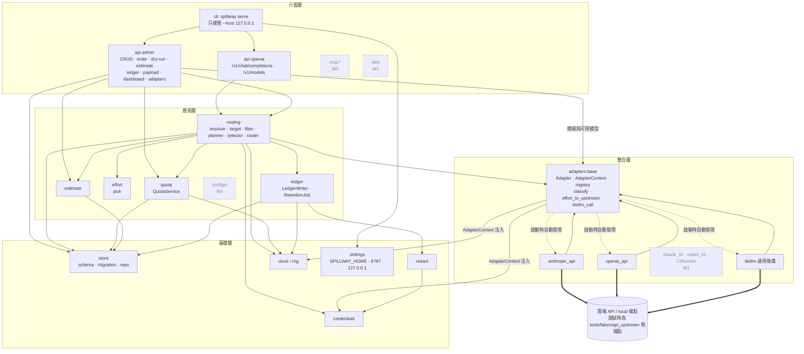
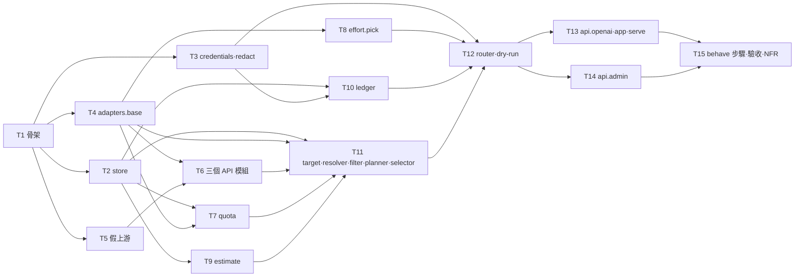

# CHG-20261030-02 — M2 路由核心:資料庫、adapter 模組框架與 API 模組、路由、額度、預估、context 記錄、HTTP API

- 專案:spillway
- 分支(Branch):`chg-20261030-02`(自 main 分出;驗收通過並經使用者確認後一次合回 main,見 B5)
- 日期:2026-10-30(UTC+0)
- 類型:新功能
- Template: plan
- 提出者:擁有者(使用者)
- 實作者:claude-opus-5-5(主 session agent;平行 task 由其派出的子 agent 施工,見「平行施工」)
- 風險分級:高——命中資料模型(schema v1)、跨模組介面(Adapter 契約、RouteOutcome、Plan)、安全(憑證解析、金鑰遮罩、綁定位址)、刪除/不可逆(RetentionJob、ON DELETE CASCADE)、認證授權(管理 API 在 M2 無驗證,前提為只綁 127.0.0.1)
- Commit/PR:`chg-20261030-02` 分支上訊息以 `CHG-20261030-02:` 開頭的 commit(`git log --grep CHG-20261030-02`);合回 main 後回填
- 重複性檢查(Recurrence check):(收尾時填)
- Diagrams:見「## 設計圖」節
- Security-impact:見「## 安全影響」節
- Skill: ai-sdlc-autopilot v1.69
- 關聯:Guideline v1.4 第 7 節 M2 閘門;FR-1–FR-14、FR-23、FR-24(端點)、FR-25(api 與 litellm 部分);spec 2、4、5、6、7.1、7.2、7.6、9、11、12;structure/design.md D1–D15;knowledge DIR-1、DIR-2、DIR-3;決策審議見「## 審議紀錄」

## 動機

Guideline 第 7 節把 M2 定為第一個程式里程碑:路由核心要能在不碰訂閱 CLI 的前提下,以 api 與 local 成員完成「解析 → 篩選 → 排序 → slot 內選擇 → 呼叫與 fallback → 帳本」整條路徑,並通過 AC-3、4、5、7、13、14、15、18、19 與 NFR-1、2、3、5。目前 repo 只有文件、沒有任何程式碼;M3(CLI 成員與 MCP)、M4(Web UI 與匯入匯出)都建立在本筆產出的資料庫、adapter 契約與路由之上,必須先完成。

## 使用者故事

1. 作為擁有者,我要對閘道送出一次 OpenAI 相容請求,當 slot 1 的成員都在冷卻時由 slot 2 的成員自動接手,以便我的客戶端只送一次就拿到結果(AC-3)。
2. 作為擁有者,我要同一 slot 內的成員依優先權重與剩餘額度比例分攤請求,以便較想用的成員被多選、但不會把一個成員用乾(AC-4)。
3. 作為擁有者,我要用 `local/<成員>` 直接呼叫指定的 local 成員,不經過路由與 fallback,以便確定請求只會送到我指定的那個端點(AC-5;是否離開本機取決於該成員的 `api_base`)。
4. 作為擁有者,我要每次嘗試(含失敗)都留下一列帳本,並在 context 記錄開啟時保存請求與回應,以便事後查看實際送了什麼、拿回什麼(AC-13)。
5. 作為擁有者,我要保存期限到了的請求與回應內容被自動刪除、查詢時明確告知已過期,以便內容不會無限期留在磁碟上(AC-14、NFR-5)。
6. 作為擁有者,我要 prompt、回應與錯誤訊息裡疑似金鑰的字串在寫入前被遮罩並標記,以便資料庫與回應裡不會留下金鑰明文(AC-15)。
7. 作為擁有者,我要在不呼叫上游的情況下 dry-run 一個 route,看到候選順序、被篩掉的成員與原因、每個成員的預估 token 與花費,以便調整順序前先知道結果(AC-4、AC-18)。
8. 作為擁有者,我要路由決策夠快、總覽 API 夠快,以便閘道不成為延遲來源(AC-7、NFR-1、NFR-2)。
9. 作為擁有者,我要只新增一個 adapter 模組資料夾就能接入新的 AI,不修改任何既有檔案,以便之後加 AI 不怕弄壞現有的(AC-19)。
10. 作為擁有者,我要 api 成員在上游回報額度用完時冷卻到下一個重置點、限流時冷卻 60 秒,到期自動恢復;route 勾選預估檢查時,預估花費超過剩餘的成員被跳過,以便我不用手動切換成員(4.2.5、4.2.6、4.5.2;以 api 成員驗證,cli 版的 AC-16、AC-17 屬 M3)。
11. 作為擁有者,我要閘道只在 127.0.0.1 上監聽,指定其他位址時拒絕啟動,以便同網段的其他機器連不到它(NFR-3)。
12. 作為擁有者,我要以管理 API 建立、修改、刪除成員、群組、route 與拖曳順序,並在違反模組 cardinality、格式錯誤或群組仍被參照時得到明確的錯誤碼與原因,以便 M4 的畫面有可用的後端(FR-13、FR-25)。
13. 作為擁有者,我要客戶端送出串流請求時得到明確的錯誤,而不是格式不符的回應,以便我知道第一版不支援串流(spec 1.1.3,B4)。

## 決策與取捨

| # | 決策 | 選項 | 前提假設(此決策建立在什麼之上) | 為何這樣選 |
|---|------|------|----------------------------------|------------|
| 1 | M2 用一筆 CHG、15 個 task | 一筆 vs 拆成「基礎層」與「路由 + API」兩筆 | 每個 task 夠小、能由一個 agent 一次完成;閘門只有一個(M2) | 拆兩筆會讓第一筆沒有任何可操作面,獨立驗收只能驗單元測試;一筆可以用 M2 閘門的 AC 整體驗收。**代使用者決定**。 |
| 2 | claude_cli、codex_cli 模組與 `CliRunner` 放 M3 | M2 先做 vs M3 | Guideline FR-15、FR-16、FR-17 標 M3;M3 閘門的 AC 前置條件都用到 claude-sub | 本筆的「內建模組」只有 anthropic_api、openai_api、litellm;AC-19 的「內建模組皆可用」在 M2 指這三個(與 Guideline v1.3 把 AC-19 列入 M2 一致),M3 補驗含 CLI 模組的版本。 |
| 3 | 本筆提供最小的 `spillway serve`;`mcp-stdio`、`init` 放 M3 | serve 放 M2 vs 整個 `cli.py` 放 M3 | 操作驗收與 NFR-3 需要真的啟動伺服器 | 沒有 serve 就無法做 L4 與操作驗收。**代使用者決定**。 |
| 4 | **(B1,使用者決定 2026-10-30)** M2 只綁 127.0.0.1,其他位址拒絕啟動;存取 token 的產生與驗證整個延到 M3;管理 API 在 M2 無驗證 | (a) 只綁本機、token 延 M3 / (b) M2 完整做 token / (c) 先產生 token 不驗證 | spec 9.1.1 只在綁定其他位址時要求 token | 使用者選 (a)。**這修改了已確認的 D9**:D9 原文「token 於 `spillway init` 或首次啟動產生」改為「M3 起於 `init` 或首次啟動產生」;data.md `access_token_sha256` 列同步修訂(見「結構文件更新」)。 |
| 5 | **(B2,使用者決定 2026-10-30)** Adapter 的 `call`、`health`,以及 `litellm_call`、`Router.route`、`Router.dry_run` 一律 `async def`;本筆修訂 spec 7.1 的簽名 | (a) async 並修訂 spec 7.1 / (b) 先同步、M3 再改 / (c) async 不改 spec | spec 7.1 寫同步,design D1(已確認)寫 async | 使用者選 (a)。現在定案,M3 的 CliRunner(NFR-6 非阻塞 semaphore)不必回頭改契約。spec 7.1 的修訂是本筆唯一允許的規格書改動。async 測試用 anyio 隨附的 pytest 外掛(anyio 隨 httpx 安裝,不新增相依)。 |
| 6 | **(B3,使用者決定 2026-10-30)** `usd`/`credit_pool` 成員的 `limit_amount` 為 NULL,或 api 成員沒有 budgets 列時,視為無上限:剩餘視為無限、比例 1、不因額度被篩;上限為 0 時剩餘 ≤ 0、比例 0、被 4.2.4 篩掉;剩餘 < 0 時比例夾到 0 | (a) 無上限,只記 design / (b) 視為不可用 / (c) 同 (a) 並改 spec | spec 4.4.2 只定義 0–1 與 `none` 以 1 計 | 使用者選 (a),只記入 design D19,不改 spec。 |
| 7 | **(B4,使用者決定 2026-10-30)** 請求帶 `stream: true` 時回 HTTP 400,錯誤碼 `streaming_unsupported`(9.1.2 格式) | (a) 400 / (b) 忽略回 JSON / (c) 包成單一 SSE chunk | spec 1.1.3 第一版不支援 streaming,未規定回應 | 使用者選 (a)。新增錯誤碼寫入 design.md 錯誤碼表。 |
| 8 | **(B5,使用者決定 2026-10-30)** 在 `chg-20261030-02` 分支施工;子 worktree 由它分出、合回它;T15 驗收通過後停下,經使用者確認再一次合回 main | (a) CHG 分支 / (b) main 逐 task 合回多停點 / (c) main 逐 task 只在收尾停 | repo 公開、main 為預設分支;高風險、task 互相相依 | 使用者選 (a)。main 上不會出現半成品,回滾就是不合併。 |
| 9 | 假 API 上游用本機假 HTTP 端點,提供 OpenAI 相容 `/v1/chat/completions` 與 Anthropic `/v1/messages` 兩種協定,LiteLLM 以 `api_base` 指向它 | 本機假端點 vs LiteLLM `mock_response` | D5 列這兩個選項 | `mock_response` 會跳過 LiteLLM 的 HTTP 錯誤對應,402、429、`insufficient_quota` 的分類(5.3.1)就沒被真的走過;anthropic_api 走 Messages 協定,所以兩種都要有。**代使用者決定**(D5 的兩個選項之一),記為 D17。 |
| 10 | 測試與驗收的 local 成員以 provider `hosted_vllm`(LiteLLM 以 OpenAI 相容協定呼叫)指向假端點;local 健康檢查 = 對 `api_base` 發 `GET`,2 秒內收到任何 HTTP 回應即健康 | 指定 `ollama` vs OpenAI 相容 provider | spec 4.2.4 只說「端點 2 秒內回應」 | `ollama` 走原生 API,假端點要再多一套協定;健康檢查不依 provider 路徑,任何 local 端點都適用。真實 ollama 由擁有者冒煙驗證。**代使用者決定**,記為 D18。 |
| 11 | L3 行為情境用 `behave` 執行 `tests/features/*.feature`;步驟檔與 `environment.py` 全部由 T15 撰寫,T9–T14 的 L3 標為「於 T15 執行」 | behave vs pytest-bdd;步驟分散到各 task vs 集中 T15 | runner 的 verify 以 `--gherkin-cmd` 直接執行 `.feature` 路徑;情境大多需要 HTTP 入口(T13、T14) | behave 以 feature 檔路徑為入口。集中在 T15 避免平行波次重複定義步驟(behave 的 AmbiguousStep)與「task 完成當下 L3 跑不起來」。新增開發相依 `behave`。**代使用者決定**。 |
| 12 | SignalMatcher 改為 `adapters.base` 的純函式 `classify(raw, signals)`;effort 上游值轉換 `effort_to_upstream(manifest, level)` 也放 `adapters.base`;adapter 在 `call()` 內自行歸類並回傳 status | 放應用層(原 design)vs 放 adapters.base | spec 7.6.3 模組只可引用共用契約;spec 7.6.8 要求 `call` 回傳對應 status | 應用層的 SignalMatcher 無法被 adapter 呼叫。`quota.py` 只保留 QuotaService。design.md、logical.md、directory.md 同步修訂。審議 A2。 |
| 13 | adapter 經 `create(context)` 取得 `AdapterContext`(欄位:`credentials` 解析器、`clock`、`cli_runner`〔M2 為 None〕);新增欄位不算破壞契約、不升 `contract_version` | 模組直接 import credentials vs context 注入 | DIR-3 規則 1、design.md「Adapter 模組契約」 | 依 design 原意,本筆補出型別。API 模組一律以解析值明確傳入 `api_key`;`credential_ref` 為空時回 `error`,不讓 LiteLLM 隱式讀環境變數。審議 A3。 |
| 14 | 無法 import 的模組,其 provider 依序由 (1) 以 `ast` 讀 `__init__.py` 中 `MANIFEST` 的 `providers` 字面值、(2) 資料夾名 `_` 轉 `-` 推得;推得的 provider 列入 `unavailable()`,不落到 litellm 後備 | ast 讀取 vs 只用資料夾名 vs 另加靜態宣告檔 | spec 7.6.7 要求使用其 provider 的成員為 `adapter_unavailable`;spec 7.6.1 已固定模組檔案清單 | 資料夾名規則對內建模組不成立(`anthropic_api` 的 provider 是 `anthropic`),所以先讀字面值;不新增檔案,不違反 7.6.1。**代使用者決定**,記為 D21。審議 A5。 |
| 15 | `AdapterRegistry.discover(extra_paths=())` 可接受額外的套件搜尋路徑;測試的模組放在 `tmp_path`,不寫入 `src/` | 額外路徑參數 vs 測試時寫入 src/ | AC-19 要求「新增資料夾、重新啟動」 | 以額外路徑模擬新增資料夾,repo 工作樹不被測試修改;合約測試的參數化也涵蓋額外路徑。審議 A6。 |
| 16 | 管理 API 新增錯誤碼 `validation_error`(422)、`not_found`(404)、`conflict`(409),加上 B4 的 `streaming_unsupported`(400);422 一律轉成 9.1.2 格式,欄位路徑寫在 `message` | 新增錯誤碼 vs 沿用 FastAPI 預設 | spec 9.1.2 規定錯誤格式但未列這些情況的錯誤碼 | FastAPI 預設的 `{"detail": [...]}` 不符 9.1.2。寫入 design.md 錯誤碼表,並補上原本漏列的 `provider_single`。**代使用者決定**,記為 D22。審議 A11。 |
| 17 | `GET /api/ledger/{id}/payload`:以 `usage_ledger.ts` + 保存天數判斷;已過期回 410 `payload_expired`,從未記錄(route 關閉、保存天數 0)回 404 `not_found` | — | spec 9.2.1 只定義過期回 410 | 刪除後無法以 payload 列是否存在區分兩種情況。**代使用者決定**,併入 D22。 |
| 18 | `local/` 直呼:`X-Spillway-Slot` 回 `direct`,帳本 `route_name` 為 NULL;隱含 route(4.1.3):帳本 `route_name` 寫入該 `model_name` | — | spec 9.1.3 要求一律帶 Slot header;5.4.3 依「同一 route」統計 | 讓 header 必帶且可辨識;隱含 route 有穩定的統計鍵。**代使用者決定**,記為 D23。 |
| 19 | 帳本寫入:呼叫前計算預估,呼叫後與結果同列一次寫入 | 先插入再更新 vs 一次寫入 | `usage_ledger.status` 為 NOT NULL,五個值沒有 pending | 對 spec 5.4.1「呼叫前計算並寫入」的解讀;崩潰時不留下不完整的列。並行請求可能同時看到同一份剩餘額度而超支,記為已知限制(單人使用)。**代使用者決定**,記為 D24。審議 A18。 |
| 20 | local 健康檢查結果快取 10 秒;冷快取時 `route()` 同步探測一次(2 秒上限),`dry_run()` 不探測、將該成員標「健康未知」並照樣列為候選;誤判健康 → 呼叫失敗走 fallback 並寫帳本;誤判不健康 → 最多 10 秒不被選 | 每次探測 vs 短暫快取 | NFR-1 路由決策 P95 < 20 ms,探測逾時上限 2 秒 | 每次探測會讓 local 成員多的 route 超過 NFR-1;NFR-1 量測前先暖快取。**代使用者決定**,記為 D20。審議 A19。 |
| 21 | 綁定位址的唯一來源:`serve --host`(預設 127.0.0.1)與 `--port`(預設 8787)加 settings.py 常數;M2 不讀 settings 表的 `bind_host`、`port` 鍵;允許集合只有 `127.0.0.1`,`localhost`、`::1`、`::`、`0.0.0.0`、LAN IP 一律拒絕並以非 0 退出 | — | B1 結論;data.md 列有 `bind_host`、`port` 表鍵 | 單一來源避免三處不一致;只接受字面 `127.0.0.1` 讓判斷沒有解析歧義。**代使用者決定**,記為 D16。審議 A20。 |
| 22 | 管理 API 寫入時驗證:`credential_ref` 必須為 `env:…` 或 `keyring:…:…`,否則 422 且訊息不回顯值;`params` 任何值命中 Redactor 樣式回 422 且不回顯;刪除仍被 route 參照的群組回 409 `conflict`;`PUT` 變更 provider 時於同一交易依 cardinality 檢查,違反回 409 `provider_single`;`reset_anchor` 須為 1–28 | — | spec 2.1.3、2.1.4、2.3;data.md 的群組參照規則 | 擋住金鑰本體被存進資料庫;spec 2.1.4 只寫「建立與匯入」,PUT 變更 provider 也檢查是補漏。**代使用者決定**(PUT 部分)。審議 A13。 |
| 23 | 匯入匯出(ConfigIO)不在本筆;測試資料以管理 API 或 `store.repo` 建立 | 本筆先做匯入 vs M4 | FR-21 標 M4 | `POST /api/config/import` 的 cardinality 檢查(9.2.3)隨 M4 實作。 |
| 24 | 設定預設值(`record_context_default`、`context_retention_days`、`context_max_bytes`)以程式常數提供,資料庫 `settings` 表缺鍵時取常數 | 初始化寫入預設列 vs 讀取時套用常數 | spec 2「初始化時只建立表結構,不寫入任何資料列」 | 寫入預設列會違反 spec。 |
| 25 | **(U1,使用者決定 2026-10-30)** litellm 模組 `list_models(context, api_base=None)` 暫時保留環境變數 `SPILLWAY_LOCAL_API_BASE`(未設時查 Ollama 預設 `http://127.0.0.1:11434/v1`) | (a) 暫留、M4 再改 / (b) 改用既有 local 成員的 api_base / (c) 只查 Ollama 預設 | `list_models` 只收 context,拿不到成員的 api_base | 使用者選 (a)。M4 UI-2 改為以既有 local 成員的 api_base 查詢。寫入 design 與契約清單。 |
| 26 | **(U2,使用者決定 2026-10-30)** Anthropic 開推理時 `max_tokens` ≤ 推理預算會被上游回 400:記為已知限制,寫入 anthropic_api README,遇到時由 fallback 接手 | (a) 已知限制 / (b) 不送 effort / (c) 抬高 max_tokens | — | 使用者選 (a)。 |
| 27 | **(U3,使用者決定 2026-10-30)** 修訂 spec 5.3.1:anthropic 另加「HTTP 400 且訊息符合 `credit balance`」為額度用完、「HTTP 529」為限流,放進 anthropic_api 的 `default_signals` | (a) 只寫 README / (b) 修訂 spec | 真實 Anthropic 額度用完回 400、過載回 529 | 使用者選 (b);本筆第二處 spec 修訂。 |
| 28 | **(U4,使用者決定 2026-10-30)** `CallResult` 加可選欄位 `tool_calls`、`finish_reason`,修訂 spec 7.1;比照決策 13 不升 `contract_version`;`/v1/chat/completions` 依此回傳 OpenAI 相容的 `message.tool_calls` 與 `finish_reason` | (a) 加欄位 / (b) 已知限制 / (c) 含 tools 回 400 | 原 CallResult 只有 text,只回工具呼叫時客戶端拿到空字串 | 使用者選 (a);本筆第三處 spec 修訂。 |
| 29 | **(U5,使用者決定 2026-10-30)** 請求的 `reasoning_effort` 先正規化:不分大小寫,`minimal` 對應 `none`;其他不在五級內的值回 422 `validation_error`(T13 實作) | (a) 一律 422 / (b) 當作沒帶 / (c) 正規化,其餘 422 | spec 6.3 codex 欄以 `minimal` 對應 `none` | 使用者選 (c)。 |

## 設計圖

### 圖 1:本筆範圍的架構(實線為本筆新增,虛線為 M3/M4 才做)



`SE`(settings.py)在 M2 只有常數與環境變數,不依賴 store;M3 加入 token 時才讀 settings 表。

### 圖 2:一次 `/v1/chat/completions` 在本筆的處理流程

```mermaid
sequenceDiagram
  participant C as 客戶端
  participant O as api.openai
  participant R as Router
  participant A as adapter(api / litellm)
  participant Q as QuotaService
  participant L as LedgerWriter
  C->>O: POST model=review
  alt stream = true
    O-->>C: 400 streaming_unsupported
  end
  O->>R: await route(req, ctx)
  R->>R: Resolver.resolve(model)
  alt local/ 前綴(4.1.1)
    R->>R: 單一 local 成員,slot = NULL,不 fallback
    R->>A: await call(dep, req, effort)
    A-->>R: CallResult(status 由 adapter 依 signals 歸類)
    R->>L: record(attempt, 遮罩用 extra_secrets)
  else route / model_name(4.1.2、4.1.3)
    R->>R: target 解析 → CandidateFilter(enabled、能力、mode、額度、冷卻、健康、預估)
    R->>Q: remaining、ratio、is_cooling
    R->>R: OrderPlanner → slots;SlotSelector(Rng)
    loop 每個 slot,雲端加權抽選,再依 position 試 local
      R->>A: await call(dep, req, effort)
      A-->>R: CallResult
      R->>L: record(attempt)(帳本一列 + 遮罩後 payload;遮罩先於截斷)
      alt quota_exhausted / rate_limited
        R->>Q: mark → exhausted_until
      end
    end
  else 都不符
    R-->>O: route_not_found
  end
  R-->>O: RouteOutcome(result 或 no_candidate,attempts[])
  O-->>C: 200 + X-Spillway-Served-By / X-Spillway-Slot / X-Spillway-Est-Cost,或 404 / 503(error 欄位已遮罩)
```

帳本、冷卻與憑證解析都在 Router 內;api.openai 只做 HTTP 轉換。`dry_run()` 走同一條路徑到 SlotSelector 為止(依注入的 Rng 每次重抽),不呼叫 adapter、不寫帳本,回傳 `Plan`。

### 圖 3:平行施工波次(task 相依)



## 安全影響

範圍依 knowledge DIR-2:威脅模型只有擁有者本人在本機使用;下表回答四類永遠停點是否被本筆觸及。

| 類別 | 是否觸及 | 影響範圍 / 理由 |
|------|----------|-----------------|
| irreversible-delete | 是(產品功能,非 agent 動作) | (1) `RetentionJob` 依 spec 2.4.5 每小時刪除過期的 `usage_payloads` 列;`PUT /api/settings/context` 把保存天數調小時,下一輪清理會溯及刪除更多既有 payload。(2) `DELETE /api/deployments/{id}` 依 DDL `ON DELETE CASCADE` 連帶刪除 tag、budget、route_targets;`usage_ledger` 對成員沒有外鍵,帳本列保留為孤兒列(data.md),`/api/dashboard` 只列現存成員,孤兒列不計入任何成員的 `remaining()`,仍可在 `/api/ledger` 查詢。(3) `DELETE /api/groups/{name}` 在仍被 route 參照時拒絕。以上都只作用於擁有者自己的本機資料庫。施工與測試只在暫存 `SPILLWAY_HOME` 執行;`tests/conftest.py` 在 `SPILLWAY_HOME` 未指向 pytest 暫存目錄時直接 fail;agent 不對擁有者的實際資料目錄執行刪除。 |
| payments | 否 | 本筆只計算與記錄花費(LiteLLM 本地價格表、帳本 `cost_usd`),不發起任何付款或訂閱變更。自動測試只打本機假端點(Guideline Q1)。M2 閘門的真實冒煙由擁有者本人執行;agent 不代為執行真實冒煙,也不持有真實金鑰。`POST /api/deployments/{id}/test` 會以該成員的真實憑證呼叫上游一次,只在擁有者操作時發生。 |
| prod-migration | 否(本筆) | 目前沒有任何既有資料庫;本筆建立 schema 第 1 版(`PRAGMA user_version = 1`),migration 只在空資料庫上套用 v1。**擁有者完成 M2 真實冒煙後,其資料目錄即有真實資料庫,之後任何 schema 變更都屬此類永遠停點**,須另開 CHG 並停下交人。 |
| security-boundary | 是 | (a) 網路暴露:`serve` 只接受 `--host 127.0.0.1`,其他位址拒絕啟動(NFR-3,決策 4、21)。(b) 管理 API 在 M2 無驗證,前提是只綁 loopback;M3 加入 token 後才允許其他位址(決策 4,修訂 D9)。(c) 憑證:`credential_ref` 只存參照、寫入時驗證格式;於呼叫當下經 `AdapterContext` 解析(spec 2.1.3、7.2.2);API 模組明確傳入 `api_key`,不讓 LiteLLM 隱式讀環境變數。(d) 遮罩:Redactor 套用到 payload 的請求與回應、`usage_ledger.error`、`CallResult.error`、503 body;先遮罩再截斷;Router 把當次解析的憑證值作為 `extra_secrets` 傳入。(e) 日誌:不開 LiteLLM verbose、不註冊會印 kwargs 的 callback;設定 `LITELLM_LOCAL_MODEL_COST_MAP=True`、關閉 LiteLLM 遙測;測試以已知金鑰跑完整流程後掃描 caplog。(f) 產物:`artifacts/m2/http-log.jsonl` 只記 method、path、status、耗時,寫入前經 Redactor;真實冒煙只把遮罩後的結論記入 ACC。(g) 不讀取、不轉發訂閱 OAuth token(1.1.2)——本筆不含 CLI 模組。 |

已知限制(DIR-2 範圍內,只記錄、不實作):長度不足 4 字元(strip 後)的 `extra_secrets` 不遮罩,以免誤遮一般文字;非 `sk-` 格式的金鑰只能靠 `extra_secrets` 遮罩;fallback 中前一個成員的憑證不在本次嘗試的 `extra_secrets` 內(各嘗試分別以自己的憑證遮罩);`keyring:` 可指向任意 Keychain 項目,由擁有者自負;本機其他程式可對 127.0.0.1:8787 發請求(DNS rebinding、CSRF),屬 DIR-2 範圍外,M3 加 token 時參考。

## 修改指引

### 目標

完成 Guideline 第 7 節 M2 閘門:AC-3、AC-4、AC-5、AC-7、AC-13、AC-14、AC-15、AC-18、AC-19 通過;NFR-1、NFR-2、NFR-3、NFR-5 量測達標;4.2.5、4.2.6 的邏輯以 api 成員驗證。

### 影響範圍

| 受影響項 | 類型 | 改動 | 連帶影響 |
|----------|------|------|----------|
| `pyproject.toml`、`.gitignore`、`src/spillway/__init__.py`、`__main__.py`、`clock.py`、`settings.py` | 目錄 | 新建套件骨架(src layout) | 之後所有 CHG 的施工基礎 |
| `src/spillway/store/` | 資料 | 建立 schema v1(與 spec 2.3 逐欄一致)、migration、repo | M3、M4 讀寫同一份 schema |
| `src/spillway/credentials.py`、`redact.py` | 設計 | 新建 | ledger、Router、admin 寫入驗證 |
| `src/spillway/adapters/base/` 與三個 API 模組 | 設計 | Adapter 契約(async)、AdapterContext、manifest 驗證、自動發現、classify、effort 轉換、共用 LiteLLM 呼叫 | M3 的 CLI 模組照同一契約加入;M4 的選單讀 `GET /api/adapters` |
| `src/spillway/routing/`、`quota.py`、`estimate.py`、`effort.py`、`ledger.py` | 邏輯 | 新建 | M3 的 MCP `ask` 重用 `Router` |
| `src/spillway/api/openai.py`、`api/admin.py`、`app.py`、`cli.py` | 介面 | 新建;`cli.py` 只有 `serve` | M3 補 `mcp-stdio`、`init`、token;M4 的畫面只呼叫這些端點 |
| `tests/`(fakes、contract、unit、integration、features、acceptance)、`artifacts/`(不進版控) | 目錄 | 新建 | directory.md 需同步 |
| `docs/spec.md` 7.1 | 規格 | Adapter `call`、`health` 改為 `async def`(決策 5) | 規格書修訂行 |
| sdlc_docs/structure/design.md、directory.md、logical.md、data.md | 文件 | 見「結構文件更新」 | 無 |

### Global Constraints(全域約束——每個 task 都要遵守)

- 語言與版本:Python ≥ 3.11;套件名 `spillway`,src layout(`src/spillway/`);模組名小寫底線;路徑一律用 `pathlib`,不寫死分隔符(NFR-7)。
- 相依套件一律只用 T1 在 `pyproject.toml` 列出的清單;要新增相依時停下回報,不自行加入。
- 規格依據:行為一律以 `docs/spec.md` 條文與本 CHG 決策表為準;除決策 5、27、28 指定的 spec 7.1 與 5.3.1 修訂外,不修改 `docs/spec.md`、`docs/proposal.md`。條文與本 CHG 衝突時停下回報。
- 分層:相依只可由上往下(介面層 → 應用層 → 整合層 → 基礎層,見 sdlc_docs/structure/logical.md);`spillway.adapters.<module>` 只可 import `spillway.adapters.base`、標準庫與 `pyyaml`,不可 import `spillway.credentials`、`spillway.clock` 或直接 import `litellm`(LiteLLM 呼叫一律經 `adapters.base.litellm_call`)。`tests/contract/test_layering.py` 檢查。
- 非同步:上游呼叫、`Adapter.call`/`health`、`litellm_call`、`Router.route`/`dry_run` 一律 `async def`;測試用 anyio 的 pytest 外掛。
- 時間與亂數:一律經 `spillway.clock` 的 `Clock`、`Rng` 注入;`clock.py` 以外不可呼叫 `datetime.now()`、`datetime.utcnow()`、`time.time()` 取業務時間,也不可使用 `random` 模組(D4)。時間以 UTC ISO 8601 字串存到秒(spec 2.1.2)。
- 測試上游:自動測試一律只打 `tests/fakes/api_upstream/` 的假端點,不可連任何真實雲端 API 或本機模型(Guideline Q1)。
- 秘密:API key、token 只經 `credential_ref` 在呼叫當下解析;不可寫入 repo、資料庫、日誌、帳本、payload、錯誤訊息、測試輸出或 `artifacts/`(spec 2.1.3、7.2.2、knowledge DIR-2)。測試金鑰一律用明顯假值(`sk-test-0000`),`env:` 只讀測試專用變數名(`SPILLWAY_TEST_KEY` 等);`tests/conftest.py` 清除 `OPENAI_API_KEY`、`ANTHROPIC_API_KEY`。不開 LiteLLM verbose、不註冊 LiteLLM callback;啟動時設定 `LITELLM_LOCAL_MODEL_COST_MAP=True` 並關閉 LiteLLM 遙測。
- 網路:伺服器只接受綁定 `127.0.0.1`,預設埠 8787(D9、決策 4、21)。
- 資料目錄:`SPILLWAY_HOME`,未設時 `platformdirs.user_data_dir("spillway")`(D8)。測試一律以 pytest `tmp_path` 為 `SPILLWAY_HOME`;不可讀寫使用者的實際資料目錄。
- 錯誤回應:一律 spec 9.1.2 格式 `{"error": {"code", "message"}}`;錯誤碼只用 spec、design.md 與本 CHG 決策 7、16 列出的值。
- 範圍:不實作 claude_cli、codex_cli、`CliRunner`、MCP、Web UI、匯入匯出、存取 token(屬 M3、M4)。
- 每個 task 的測試必須能以 `python -m pytest <該 task 的測試路徑> -q` 獨立執行並全綠。L3 情境(`python -m behave tests/features`)只在 T15 執行。
- 既有的 `tests/features/m2_*.feature` 情境文字只能經修改治理變更;施工者只寫步驟檔。
- commit 訊息以 `CHG-20261030-02:` 開頭,結尾依當次 session 的署名規則加上 Co-Authored-By 行。
- 驗收平台為 macOS;Linux、Windows 在 ACC 標「未涵蓋」(Guideline Q2)。

### 契約清單

| 契約 | 提供方 | 讀取方 | 本筆變更 | 契約測試(路徑/無) |
|------|--------|--------|----------|----------------------|
| `Adapter` Protocol(`async call(dep, req, effort) -> CallResult`、`async health(dep) -> bool`)、模組 `create(context)`、`AdapterContext`(credentials、clock、cli_runner) | T4 adapters.base | T6 三個模組、AdapterRegistry、Router(T12);M3 CLI 模組 | 新增(spec 7.1 改 async) | tests/contract/test_adapter_contract.py(提供方);tests/unit/routing/test_router.py(讀取方) |
| `MANIFEST`(spec 7.6.2 欄位,另含可選 `fallback_for_kinds`;可選的模組層級函式 `list_models(context)`) | 各 adapter 模組 | AdapterRegistry、`effort_to_upstream`、`classify`、`GET /api/adapters`;M3 CLI 模組 | 新增 | tests/contract/test_adapter_contract.py |
| `models.yaml` 結構(spec 7.6.4) | 各 adapter 模組 | AdapterRegistry、`GET /api/adapters`;M4 UI-2 選單 | 新增 | tests/contract/test_adapter_contract.py;tests/integration/admin/test_admin_adapters.py |
| `CallResult`(spec 7.1;status 四值) | 各 adapter 模組 | Router(T12) | 新增 | tests/contract/test_call_status.py(提供方,四種上游輸出);tests/unit/routing/test_router.py(讀取方:CallResult.status → ledger status,`skipped_precheck` 由 Router 產生) |
| `classify(raw, signals)` 與 `default_signals`/`params.signals` 規則格式(5.3.1) | T4 adapters.base | 各 adapter 模組;M3 CLI 模組;M4 UI-2 編輯 signals | 新增 | tests/unit/adapters_base/test_classify.py;tests/contract/test_call_status.py |
| `ChatRequest`、`Deployment` 值物件(定義於基礎層 `spillway/domain.py`,`adapters.base` 轉匯出;施工審議 M1 依使用者決定 2026-10-30 修正);store 列 → `Deployment` 的轉換函式 `repo.load_deployment()`(歸 T2,型別定義歸 T4) | T4(型別)、T2(轉換) | T6–T14;M3 MCP `ask` | 新增 | tests/unit/store/test_repo.py(轉換往返);tests/contract/test_adapter_contract.py(型別欄位) |
| `AdapterRegistry`(`discover(extra_paths)`、`get(dep)`、`unavailable() -> dict[provider, reason]`、`cardinality_of(provider)`、`modules()`) | T4 | T11、T12、T13 lifespan、T14;M4 configio | 新增 | tests/unit/adapters_base/test_registry.py;tests/integration/admin/test_admin_adapters.py |
| `QuotaService`(`period_start`、`next_reset`、`remaining`、`ratio`、`is_cooling`、`mark`、`clear`) | T7 | T11、T12、T14 dashboard 與 clear-cooldown;M3 MCP `quota_status` | 新增 | tests/unit/test_quota.py;tests/integration/admin/test_admin_dashboard.py |
| `Estimate`(`tokens_in`、`out_p50`、`out_p90`、`cost_usd_p90`) | T9 | T11 precheck、T12 帳本、T13 `X-Spillway-Est-Cost`、T14 `/api/estimate` 與 dry-run;M3 MCP | 新增 | tests/unit/test_estimate.py;tests/integration/admin/test_admin_routes.py |
| `Attempt`(Router 交給 LedgerWriter:ts、route_name、deployment_id、effort、tokens、cost、status、slot、fallback_depth、latency_ms、est_*、error、request/response 內容、extra_secrets) | T10(型別) | T12(產生) | 新增 | tests/unit/test_ledger.py;tests/unit/routing/test_router.py |
| `usage_ledger.status` 值(`ok`、`error`、`quota_exhausted`、`rate_limited`、`skipped_precheck`) | T12 Router(產生)、T10(寫入) | T9 Estimator(只取 `ok`)、`/api/dashboard`、`/api/ledger`;M4 UI-6 | 新增 | tests/unit/routing/test_router.py;tests/unit/test_estimate.py |
| `RouteOutcome`(`result \| no_candidate`、`attempts[]`;每筆 attempt 含 deployment、status、slot、error) | T12 | T13(200 回應與 503 body);M3 MCP `ask` | 新增 | tests/unit/routing/test_router.py(提供方);tests/integration/test_openai_api.py(讀取方) |
| `Plan`(dry-run 結果:slots〔每個候選含 deployment、kind、weight、effort、Estimate、健康狀態〕、`excluded[]`〔deployment、原因,含 `adapter_unavailable`、`skipped_precheck`〕、`unsorted[]`、依 Rng 本次抽出的第一順位) | T12 | T14 dry-run 端點;M4 UI-4 | 新增 | tests/unit/routing/test_router.py;tests/integration/admin/test_admin_routes.py |
| 資料庫 schema v1(spec 2.3 DDL) | T2 `store/schema.sql` | `store.repo`;M3、M4 全部讀寫者 | 新增 | tests/unit/store/test_schema.py;tests/unit/store/test_repo.py(各表往返) |
| `/v1/chat/completions` 回應與 header `X-Spillway-Served-By`、`X-Spillway-Slot`(`local/` 直呼為 `direct`)、`X-Spillway-Est-Cost`(9.1.3、5.4.5) | T13 | OpenAI 相容客戶端 | 新增 | tests/integration/test_openai_api.py |
| `/v1/models` 清單格式 | T13 | OpenAI 相容客戶端 | 新增 | tests/integration/test_openai_api.py |
| `api.openai` 錯誤碼:`route_not_found`、`no_candidate`(body 列出每次嘗試的「成員:狀態」)、`streaming_unsupported` | T13 | 客戶端 | 新增 | tests/integration/test_errors_openai.py |
| `api.admin` 錯誤碼:`member_not_in_target`、`payload_expired`、`provider_single`、`validation_error`、`not_found`、`conflict` | T14 | M4 Web UI | 新增 | tests/integration/admin/test_errors_admin.py |
| 管理 API 回應與 body(deployments、groups、routes、dashboard、ledger 分頁、payload、settings/context、estimate、dry-run);權威來源為 `api/admin.py` 的 Pydantic 模型 | T14 | M4 Web UI | 新增 | tests/integration/admin/test_admin_*.py |
| `GET /api/adapters` 回應(9.2.2) | T14 | M4 UI-2、UI-4 選單 | 新增 | tests/integration/admin/test_admin_adapters.py |
| `PUT /api/routes/{name}/order` body(spec 9.3) | spec 9.3 / T14 api.admin(驗證) | M4 UI-4(送出方;讀取側斷言延到 M4) | 新增 | tests/integration/admin/test_admin_routes.py |
| 環境變數 `SPILLWAY_LOCAL_API_BASE`(litellm 模組 `list_models` 的 local 端點;M2 暫行,決策 25) | T6 | `GET /api/adapters`(T14);M4 UI-2 改用成員 api_base | 新增 | tests/unit/adapters/test_litellm_module.py |
| settings.py:環境變數 `SPILLWAY_HOME`、預設埠 8787、綁定 127.0.0.1、`serve --host/--port` | T1(常數)、T13(旗標) | `serve`;M3 `init`、MCP 設定輸出的 URL | 新增 | tests/unit/test_settings.py;tests/integration/test_serve.py |
| settings 表鍵(`record_context_default`、`context_retention_days`、`context_max_bytes`;缺鍵取常數) | T2 repo | T10、T14 `/api/settings/context`;M4 UI-7 | 新增 | tests/unit/store/test_repo.py;tests/integration/admin/test_admin_settings.py |

### Tasks(checkbox=續作點)

- [x] T1. 專案骨架、`Clock`/`Rng`、settings 與測試護欄
  - interfaces: consumes design D4、D8、D9;決策 4、21 / produces `pyproject.toml`(相依:fastapi、uvicorn、litellm、pyyaml、pydantic、platformdirs、keyring、httpx;開發相依:pytest、behave)、`.gitignore`(`.venv/`、`__pycache__/`、`*.egg-info/`、`.pytest_cache/`、`artifacts/`)、`src/spillway/__init__.py`、`__main__.py`、`clock.py`(`Clock`、`SystemClock`、`FakeClock.advance()`、`Rng`、`SystemRng(seed=None)`、`SeqRng`)、`settings.py`(資料目錄解析、預設埠、允許的綁定位址常數)、`tests/conftest.py`(`tmp_path` 當 `SPILLWAY_HOME` 並在未指向暫存目錄時 fail、清除真實 API key 環境變數、注入 `FakeClock`)
  - test: `python -m pip install -e '.[dev]' && python -m pytest tests/unit/test_clock.py tests/unit/test_settings.py -q`
  - L1: `FakeClock.advance(days=8)` 後 `now()` 正好多 8 天且為 UTC;`SystemRng(seed=1)` 兩次建立產生相同序列;`settings.data_dir()` 在設了 `SPILLWAY_HOME` 時回傳該路徑、未設時等於 `platformdirs.user_data_dir("spillway")`;預設埠 8787、允許的綁定位址只有 `127.0.0.1`
  - L2: 不適用(本 task 只有基礎單元,還沒有任何讀取方模組可做雙側斷言)
  - L3: 不適用(骨架與時鐘沒有使用者看得到的行為;資料目錄與綁定的行為在 T13 的 serve 測試中出現)
  - L4: 不適用(還沒有可啟動的產品)
- [x] T2. store:schema v1、migration、repo
  - interfaces: consumes T1;spec 2.1、2.3;design D2、D3;決策 24 / produces `store/__init__.py`、`store/schema.sql`(與 spec 2.3 逐欄一致)、`store/db.py`(`connect(path)` 設 WAL 與 `foreign_keys=ON`;依 `PRAGMA user_version` 套用 migration,空庫只建表不寫列)、`store/repo.py`(各表存取;`replace_route_targets()` 單一交易取代;`load_deployment()` 把成員列與 tags、budget 轉成 T4 的 `Deployment`;settings 缺鍵時回傳常數預設值)、`tests/unit/conftest.py`(共用的已 migration `db` fixture)
  - test: `python -m pytest tests/unit/store -q`
  - L1: 對空檔案 `connect()` 後 `PRAGMA journal_mode` 為 `wal`、`foreign_keys` 為 1、`user_version` 為 1,9 張表、2 個索引的欄位定義與 spec 2.3 相同(以 `PRAGMA table_info` 逐欄比對),所有表 0 列;重複 `connect()` 不重建;刪除 deployment 連帶刪除 tags、budget、route_targets,`usage_ledger` 列保留
  - L2: 每張表經 repo 寫入再讀回的往返一致;`load_deployment()` 產出的 `Deployment` 欄位與 T4 型別定義一致;`replace_route_targets()` 中途丟例外時舊資料完整保留(讀取方:T14 的 order 儲存)
  - L3: 不適用(資料層沒有直接的使用者操作;其行為經 T15 的帳本與 context 情境驗證)
  - L4: 不適用(還沒有可啟動的產品)
- [x] T3. credentials 與 redact
  - interfaces: consumes T1;spec 2.1.3、2.4.4、7.2.2 / produces `credentials.py`(`resolve(ref) -> str`,支援 `env:VAR`、`keyring:服務:帳號`;`validate_ref(ref)` 只驗格式不解析;錯誤丟 `CredentialError`,訊息不含值)、`redact.py`(`Redactor.redact(text, extra_secrets=()) -> (text, hit)`,遮罩 `sk-` 開頭字串、`Bearer`〔不分大小寫〕之後到空白、引號或換行為止的值、`extra_secrets` 中的每個值;`Redactor.matches(text) -> bool` 供寫入驗證)
  - test: `python -m pytest tests/unit/test_credentials.py tests/unit/test_redact.py -q`
  - L1: `resolve("env:SPILLWAY_TEST_KEY")` 讀環境變數;`keyring:` 以測試用 keyring 後端讀值;`validate_ref("sk-abc")` 失敗且例外訊息不含 `sk-abc`;`redact("key sk-test-0000 ok")` 不含 `sk-test-0000` 且 `hit=True`;`bearer xyz`、`"Bearer xyz"`、JSON 字串內、換行前後的 Bearer 值皆被遮罩;`extra_secrets=("AIzaFAKE",)` 時該值被遮罩;沒有命中時原文不變、`hit=False`
  - L2: 不適用(讀取方 ledger、Router、admin 尚未存在;雙側斷言放在 T10、T12、T14)
  - L3: 不適用(遮罩的使用者行為由 T15 的 AC-15 情境驗證)
  - L4: 不適用(還沒有可啟動的產品)
- [x] T4. adapters.base:契約、AdapterContext、manifest 驗證、自動發現、classify、effort 轉換、共用 LiteLLM 呼叫
  - interfaces: consumes T1;spec 7.1(async)、7.2、7.6.1–7.6.8、5.3.1、6.3;design「Adapter 模組契約」D11、D12、D14、D15;決策 5、12、13、14、15 / produces `adapters/__init__.py`(T4 擁有,之後的模組不得修改)、`adapters/base/`:`Adapter` Protocol(async)、`CallResult`、`ChatRequest`、`Deployment`、`AdapterContext`、`AdapterManifest` 與驗證(`list_models` 為模組層級可選函式、`fallback_for_kinds` 為可選欄位)、`load_models_yaml()`、`classify(raw, signals)`、`effort_to_upstream(manifest, level)`、`litellm_call()`(async;明確傳入 `api_key`、`api_base`、`timeout`;關閉 verbose 與 callback)、`AdapterRegistry`(`discover(extra_paths=())`、`get(dep)`、`unavailable()`、`cardinality_of()`、`modules()`;import 失敗時依決策 14 推得 provider);`tests/contract/test_adapter_contract.py`(對所有被發現的模組參數化:manifest 欄位、`effort_map` 五級、`models.yaml` 可解析且 `efforts` 只含五級)、`tests/contract/test_layering.py`
  - test: `python -m pytest tests/unit/adapters_base tests/contract/test_adapter_contract.py tests/contract/test_layering.py -q`
  - L1: manifest 缺欄位、`cardinality` 非 single/multiple、`contract_version` ≠ 1 時驗證失敗並給欄位名;`models.yaml` 的 `efforts` 含第六種值時失敗;`classify()` 對 HTTP 402、`insufficient_quota`、429、其他錯誤分別歸為 `quota_exhausted`、`quota_exhausted`、`rate_limited`、`error`,傳入覆寫規則時以覆寫為準;`effort_to_upstream()` 對 `effort_map["none"] = null` 回傳 None
  - L2: 以 `tmp_path` 下的假模組測 `discover(extra_paths=[...])`:合法模組被註冊;`__init__.py` 內 import 不存在套件的模組進 `unavailable()`,其 provider 由 `MANIFEST` 字面值推得且不落到 litellm 後備,其他模組照常註冊(7.6.7);兩個模組宣告同一 provider 時丟出含兩個模組名的錯誤(7.6.6);未宣告的 api/local provider 由 `litellm` 模組處理(7.1.1);`test_layering.py` 以 tmp 假模組 import `spillway.credentials` 時報錯
  - L3: 不適用(「新增模組即可被路由呼叫」需要 router 與 HTTP,於 T15 的 AC-19 情境驗證)
  - L4: 不適用(還沒有可啟動的產品)
- [x] T5. 假 API 上游
  - interfaces: consumes T1;design D5;決策 9、10 / produces `tests/fakes/__init__.py`、`tests/fakes/api_upstream/`:可在測試中於 127.0.0.1 隨機埠啟動的假端點,同時提供 OpenAI 相容 `/v1/chat/completions`、`/v1/models` 與 Anthropic `/v1/messages`;依 fixture 設定或 model 名稱回傳成功(含 usage)、HTTP 402、錯誤碼 `insufficient_quota`、HTTP 429、HTTP 500、指定延遲、「錯誤 body 回顯 Authorization 或 x-api-key」;對 `GET /` 回 200 作為健康檢查;記錄收到的請求(method、path、model)供斷言;pytest fixture `fake_api`(以 `tests/fakes/conftest.py` 提供,經 `pytest_plugins` 由 `tests/conftest.py` 載入的那一行由 T1 預留)
  - test: `python -m pytest tests/fakes -q`
  - L1: 以 httpx 打兩種協定的端點,各模式回傳設定的狀態碼與符合該協定的錯誤 body;延遲模式的回應時間 ≥ 設定值;回顯模式的錯誤 body 含請求的 Authorization 值;收到的請求可被讀回
  - L2: 不適用(讀取方是 T6 的 adapter,雙側斷言放在 T6)
  - L3: 不適用(測試支援設施,不是產品行為)
  - L4: 不適用(測試支援設施,不是產品行為)
- [x] T6. 三個內建 API 模組:anthropic_api、openai_api、litellm
  - interfaces: consumes T4、T5;spec 5.2.1、5.2.4、5.3.1 api 列、6.3、7.2、7.6.9;決策 10、13 / produces `adapters/anthropic_api/`、`adapters/openai_api/`、`adapters/litellm/`,各含 `__init__.py`(`MANIFEST`、`create(context)`)、`adapter.py`、`models.yaml`、`README.md`;provider 依 7.6.9;cardinality 皆 multiple;`effort_map` 依 6.3 第二欄;`requires` 不列 API key 環境變數;憑證經 `context.credentials` 解析並明確傳入,`credential_ref` 為空時回 `error`(local 成員除外);`call()` 內以 `classify()` 依 `params.signals` 或 `default_signals` 歸類;effort 以 `effort_to_upstream()` 轉換,`none` 不傳;`cost_usd` api 用 `completion_cost()`、local 為 0;litellm 模組的 `health()` 對 local `api_base` 發 `GET`,2 秒內有任何 HTTP 回應即健康;litellm 模組提供 `list_models(context)` 查 local 端點並與 `models.yaml` 合併;`tests/contract/test_call_status.py`(對所有被發現的模組參數化四種上游輸出)
  - test: `python -m pytest tests/contract tests/unit/adapters -q`
  - L1: 每個模組的 `effort_map["none"]` 為 null、`"max"` 為 `max`;`models.yaml` 每筆含 `id`、`label`、`capabilities`;`credential_ref` 為空的 api 成員 `call()` 回 `error` 且未發出任何請求
  - L2: 以 T5 假端點,三個模組的 `call()` 對成功、402、`insufficient_quota`、429、500、逾時(`params.timeout` 覆寫預設 120 秒)分別回傳 `ok`、`quota_exhausted`、`quota_exhausted`、`rate_limited`、`error`、`error`;成功時 `tokens_in`/`tokens_out` 取自 usage,api 成員以 LiteLLM 有定價的模型名測得 `cost_usd` 非 None,local 成員 `cost_usd` 為 0;模型字串為 `<provider>/<model>` 且帶 `api_base`;成員 `params.signals` 覆寫時 status 依覆寫;回顯模式下 `CallResult.error` 不含金鑰值;effort `high` 送出 `reasoning_effort=high`、`none` 不送;`list_models()` 查詢失敗時只回 `models.yaml` 並附原因
  - L3: 不適用(單一 adapter 呼叫沒有獨立的使用者情境;經路由的呼叫在 T15 情境驗證)
  - L4: 不適用(還沒有可啟動的產品)
- [x] T7. quota:QuotaService
  - interfaces: consumes T2、T4;spec 5.1、5.2、5.3.2、5.3.3、4.2.4、4.2.6、4.5.2;決策 6 / produces `quota.py`(`QuotaService`:`period_start(budget, now)`、`next_reset(budget, now)` 涵蓋 daily、weekly、monthly〔`reset_anchor`,未到則取上月〕、none〔現在 + 1 小時〕;`remaining(dep, now)` = 上限 − 本期 `cost_usd` 加總,無上限依決策 6;`ratio(dep, now)`;`is_cooling(dep, now)`;`mark(dep, status, now)` 依 4.5.2 設 `exhausted_until`;`clear(dep)`)
  - test: `python -m pytest tests/unit/test_quota.py -q`
  - L1: monthly `reset_anchor=1` 在 2026-10-30 的期間起點為 2026-10-01、下一重置點為 2026-11-01;`reset_anchor=28` 在 2027-02-10 的起點為 2027-01-28、下一重置點為 2027-02-28;weekly 起點為週一 00:00 UTC;`quota_exhausted` 設到下一重置點、`rate_limited` 設到現在 + 60 秒;`exhausted_until` 過了以後 `is_cooling` 為 False(4.2.6 自動恢復);上限 NULL 或無 budgets 列時 `ratio` 為 1 且不被視為用完;上限 0 時 `remaining` ≤ 0、`ratio` 為 0
  - L2: 以 T2 repo 寫入本期與上期各數列後,`remaining()` 只加總本期;`mark()` 後重新讀取 budgets 列的 `exhausted_until` 與回傳值一致;`clear()` 後為 NULL
  - L3: 不適用(冷卻與恢復的使用者情境需要路由,於 T15 情境驗證)
  - L4: 不適用(還沒有可啟動的產品)
- [x] T8. effort:來源優先序與降級
  - interfaces: consumes T4;spec 6.1、6.2 / produces `effort.py`(`EffortMapper.pick(route_target_effort, req_effort, caps_efforts) -> str | None`)
  - test: `python -m pytest tests/unit/test_effort.py -q`
  - L1: route_targets 有值時優先於請求的 `reasoning_effort`;兩者皆空回傳 None;能力只有 `[low, medium]` 而需要 `max` 時降到 `medium`;需要 `low` 而能力只有 `[high]` 時回傳 None
  - L2: 以 T4 型別建立的假 manifest,`pick()` 的結果經 `effort_to_upstream()` 轉換的值符合假 manifest 的 `effort_map`(實際模組的轉換於 T6、T12 驗證)
  - L3: 不適用(實際使用的等級寫進帳本,於 T15 情境中以帳本欄位驗證)
  - L4: 不適用(還沒有可啟動的產品)
- [x] T9. estimate:token 與花費預估
  - interfaces: consumes T2;spec 5.4.1–5.4.4 / produces `estimate.py`(`Estimate` 型別;`Estimator.estimate(dep, req, route_name) -> Estimate`;輸入以 `litellm.token_counter()`;輸出:有 `max_tokens` 時 P50=P90=`max_tokens`,否則取同 route 與成員最近 50 筆 `ok` 的 `tokens_out` 的 P50、P90〔百分位定義寫在 docstring〕,不足 5 筆時 500 與 2,000;花費以 LiteLLM 本地價格表,無定價時 None)
  - test: `python -m pytest tests/unit/test_estimate.py -q`
  - L1: 帶 `max_tokens=300` 時 P50=P90=300;帳本只有 4 筆時回 500/2,000;無定價模型 `cost_usd_p90` 為 None
  - L2: 以 T2 repo 寫入 60 筆 `ok`、10 筆 `error` 與 5 筆 `skipped_precheck`,只取最近 50 筆 `ok`,P50、P90 與另行以 docstring 定義計算的值一致
  - L3: 不適用(dry-run 情境需要 T12 與 T14,於 T15 執行 m2_estimate.feature)
  - L4: 不適用(dry-run 端點在 T14;端到端在 T15)
- [x] T10. ledger:LedgerWriter 與 RetentionJob
  - interfaces: consumes T2、T3;spec 2.1.5、2.4、4.5.1;決策 19 / produces `ledger.py`(`Attempt` 型別;`LedgerWriter.record(attempt) -> ledger_id`:寫 `usage_ledger` 一列,`error` 先經 Redactor;依 2.4.1–2.4.2 決定是否寫 `usage_payloads`;請求與回應**先遮罩再截斷**至 `context_max_bytes`,設 `redacted`、`truncated`;保存天數 0 時不寫 payload;`RetentionJob.run_once(now)` 刪除 `ts` 早於保存期限的 payload;`payload_status(ledger_id, now) -> ok | expired | never_recorded`)
  - test: `python -m pytest tests/unit/test_ledger.py -q`
  - L1: `record()` 後 `usage_ledger` 該列沒有任何內容欄位(2.1.5);payload 超過上限時長度等於上限且 `truncated=1`;含 `sk-test-0000` 時已遮罩且 `redacted=1`;金鑰跨越截斷邊界時截斷後的內容不含金鑰任何前綴片段;`error` 含 `extra_secrets` 值時寫入的是遮罩後字串
  - L2: route `record_context=0` 時不寫 payload、NULL 時沿用全域;`FakeClock` 推進 8 天後 `run_once()` 刪除過期列、保留未過期列,`payload_status()` 分別回 `expired`、`ok`,未記錄者回 `never_recorded`;刪除 ledger 列時 payload 連帶刪除
  - L3: 不適用(context 情境需要 HTTP 與 payload 端點,於 T15 執行 m2_context.feature)
  - L4: 不適用(端到端在 T15)
- [ ] T11. 路由元件:target、Resolver、CandidateFilter、OrderPlanner、SlotSelector
  - interfaces: consumes T2、T4、T6、T7、T9;spec 1.2、4.1–4.4、5.4.4;決策 6、14、20 / produces `routing/__init__.py`(T11 擁有)、`routing/target.py`(`members_of(target, deployments)`:`{group}` 與 `{tags:{all,any,none}}` 比對)、`routing/resolver.py`(4.1.1–4.1.4)、`routing/filter.py`(4.2.1–4.2.6;回傳候選與每個被篩成員的原因,含 `adapter_unavailable`、`skipped_precheck`;`cost_usd_p90` 為 None 時不參與 precheck;local 健康依決策 20 快取)、`routing/planner.py`(4.3.1–4.3.4,標示未排序成員)、`routing/selector.py`(4.4.1–4.4.5,權重 = 優先權重值 × `ratio()`,用注入的 `Rng`)
  - test: `python -m pytest tests/unit/routing -q`
  - L1: `members_of()` 對 all、any、none 與 group 參照的組合正確;`local/qwen-local` 以 id 或 model_name 皆可解析;`route:review` 與 `review` 等價;`model_name` 對應隱含 route;無符合時 `route_not_found`;`chat` route 篩掉 cli、`metadata.mode=task` 視同 task;估算 token(字元數 ÷ 4)超過 `ctx` 被篩;含 tools 的請求篩掉 `tools=false`;含圖片的請求篩掉 `vision=false`;planner 對無手動順序的 route 產生「cli slot、api slot、每個 local 各一 slot(依 id 字母序)」;新成員接在手動 slot 之後並標未排序
  - L2: selector 以 `SeqRng` 給定序列時選出的順序可預測;A high、B low、比例皆 1 時以 `SystemRng(seed=7)` 抽 10,000 次,A 的比例落在 0.73–0.77(單元層較嚴的檢查;驗收門檻為 AC-4 的 400 次 0.70–0.80);被選者失敗後不再出現;雲端用盡後依 position 試 local;filter 讀 T7 的冷卻與 T9 的預估,`budget_precheck=1` 且 P90 > 剩餘時原因為 `skipped_precheck`;registry `unavailable()` 中的 provider 原因為 `adapter_unavailable`;冷快取時 dry-run 模式不探測並標「健康未知」
  - L3: 不適用(AC-4 情境需要 T12 的 dry_run 與 T14 端點,於 T15 執行 m2_routing.feature)
  - L4: 不適用(還沒有 HTTP 入口;端到端在 T15)
- [ ] T12. Router:呼叫、fallback、帳本、冷卻、遮罩傳遞、dry-run
  - interfaces: consumes T3、T4、T6、T7、T8、T9、T10、T11;spec 4.5、5.4.1、5.4.5、6.2.2;決策 18、19、20 / produces `routing/router.py`(`Router.route(req, ctx) -> RouteOutcome`〔async〕:依 slot 嘗試;每次嘗試呼叫前以 Estimator 計算預估、以 `credentials.resolve()` 取得當次憑證值作為 `extra_secrets`;呼叫後以 `Attempt` 交 LedgerWriter 一次寫入〔含 `slot`、`fallback_depth`、`latency_ms`、實際 effort〕;`quota_exhausted`/`rate_limited` 經 `QuotaService.mark()` 設冷卻;`skipped_precheck` 也寫一列;`local/` 直呼不 fallback、`slot` 與 `route_name` 為 NULL;隱含 route 的 `route_name` 為 model_name;全部失敗回 `no_candidate` 與 `attempts[]`,每筆 error 已遮罩。`Router.dry_run(route, req) -> Plan`〔async〕:不呼叫 adapter、不寫帳本,依注入 Rng 抽出第一順位)
  - test: `python -m pytest tests/unit/routing/test_router.py -q`
  - L1: slot 1 兩成員皆冷卻時由 slot 2 完成,帳本該次 `fallback_depth` 正確;slot 1 回 429 時該成員 `exhausted_until` = 現在 + 60 秒並改由下一位處理;回 402 時冷卻到下一重置點;全部失敗時 `attempts` 依嘗試順序列出成員與狀態;`CallResult.status` 四值與 ledger status 對應正確
  - L2: 以 T6 adapter + T5 假端點跑完整 `route()`:帳本列數等於嘗試次數、payload 依設定寫入、回顯模式下 `usage_ledger.error` 與 `attempts[].error` 不含金鑰;帳本 `effort` 欄為 T8 降級後的值且送出的上游參數符合 T6 的 `effort_map`;`dry_run()` 前後帳本列數不變,`Plan` 含 excluded 與 unsorted;`FakeClock` 推進過 `exhausted_until` 後同一成員重新被選用(4.2.6)
  - L3: 不適用(AC-3、AC-5 情境需要 T13 的 HTTP 入口,於 T15 執行 m2_routing.feature)
  - L4: 不適用(HTTP 入口在 T13;端到端在 T15)
- [ ] T13. api.openai、app 組裝與 `spillway serve`
  - interfaces: consumes T4、T10、T12;spec 9.1、9.2(`/v1/*`)、1.1.3、5.4.5、NFR-3;design D1、D9;決策 4、7、18、21 / produces `api/__init__.py`(T13 擁有)、`api/openai.py`(`POST /v1/chat/completions`:`stream: true` 回 400 `streaming_unsupported`;依 4.1 解析;成功時 OpenAI 相容 body 與 header `X-Spillway-Served-By`、`X-Spillway-Slot`〔local 直呼為 `direct`〕、`X-Spillway-Est-Cost`;404 `route_not_found`;503 `no_candidate` 的 message 列出每次嘗試「成員:狀態」;`GET /v1/models`)、`app.py`(T13 擁有;`create_app(clock, rng, extra_adapter_paths)`;lifespan 執行 migration 與 `discover()`,7.6.6 衝突時啟動失敗;設定 LiteLLM 本地價格表與關閉遙測;以 Clock 注入的間隔每小時執行 `RetentionJob`)、`cli.py`(`spillway serve --host --port`:host 只接受 `127.0.0.1`,其他值與啟動失敗皆以非 0 退出)、`tests/integration/conftest.py`(T13 擁有;ASGI client fixture)
  - test: `python -m pytest tests/integration/test_openai_api.py tests/integration/test_errors_openai.py tests/integration/test_serve.py tests/integration/test_retention_schedule.py -q`
  - L1: 錯誤回應 body 一律為 9.1.2 格式;`/v1/models` 的清單內容與資料庫一致;`--host` 為 `localhost`、`::1`、`::`、`0.0.0.0`、`192.168.1.10` 時皆拒絕
  - L2: httpx `ASGITransport` 打 `/v1/chat/completions`:成功時三個 header 皆存在且 Served-By 等於帳本該列的 `deployment_id`;local 直呼時 Slot 為 `direct`;503 body 的嘗試清單與 `RouteOutcome.attempts` 一致且不含回顯的金鑰;推進 `FakeClock` 一小時後排程觸發一次清理
  - L3: 不適用(m2_routing.feature 的 HTTP 情境由 T15 撰寫步驟並執行)
  - L4: 以子行程啟動 `python -m spillway serve --port <隨機埠>`(`SPILLWAY_HOME` 為暫存目錄),以 `lsof -nP -iTCP -sTCP:LISTEN` 確認只在 127.0.0.1 監聽,以 httpx 經 TCP 打一次 `/v1/chat/completions` 成功;`--host 0.0.0.0` 以非 0 退出
- [ ] T14. api.admin:管理端點
  - interfaces: consumes T2、T3、T4、T7、T9、T11、T12;spec 9.2(本筆範圍)、9.2.1、9.2.2、9.2.3、9.3;design D13、D15;決策 16、17、22 / produces `api/admin.py`(匯出 `router = APIRouter()`;不修改 `app.py`):`/api/deployments` CRUD(含 tag、額度;寫入驗證依決策 22;POST 與變更 provider 的 PUT 依 `cardinality_of()` 在同一交易內檢查,違反回 409 `provider_single`)、`/api/deployments/{id}/test`、`/clear-cooldown`、`/api/groups` CRUD(GET 含符合成員預覽;仍被參照時 DELETE 回 409 `conflict`)、`/api/routes` CRUD、`PUT/DELETE /api/routes/{name}/order`(9.3;不屬目標回 422 `member_not_in_target`)、`POST /api/routes/{name}/dry-run`(回 `Plan`)、`POST /api/estimate`、`GET /api/ledger`(參數 from、to、deployment、route、status、page)、`GET /api/ledger/{id}/payload`(依決策 17 回 200、410、404)、`GET/PUT /api/settings/context`、`GET /api/dashboard`、`GET /api/adapters`;422 一律轉 9.1.2 格式;`/api/mcp/config`、`/api/config/*`、`/api/settings/token/rotate` 不在本筆;測試放在 `tests/integration/admin/`(含自己的 `conftest.py`,以 `FastAPI()` 掛載 `admin.router` 組 app,不依賴 `app.py`)
  - test: `python -m pytest tests/integration/admin -q`
  - L1: request body 驗證失敗回 422 `validation_error` 並在 message 帶欄位路徑;`credential_ref` 為 `sk-abc` 時回 422 且回應不含 `sk-abc`;`params` 含 `sk-test-0000` 時回 422 且不回顯;`reset_anchor=29` 回 422;不存在的資源回 404 `not_found`;`GET /api/adapters` 每筆含 providers、kinds、access、cardinality、現有成員數、是否可用與原因、可用模型清單
  - L2: 對 multiple 模組 provider 建第二個成員成功;以 `tmp_path` 中的 single 假模組建第二個成員回 409 `provider_single` 且資料庫只有 1 筆;把另一成員 PUT 成該 provider 也回 409;`PUT order` 後 dry-run 依新順序;`DELETE order` 後回到 4.3.2 預設;被 route 參照的群組 DELETE 回 409;`/api/dashboard` 的剩餘額度與 `QuotaService.remaining()` 一致;過期 payload 回 410、未記錄回 404
  - L3: 不適用(m2_adapters.feature 需要 T13 的 `/v1/chat/completions`,由 T15 撰寫步驟並執行)
  - L4: 不適用(管理端點的端到端操作屬 M4 畫面;本筆的 L4 由 T13 的 serve 與 T15 的操作驗收涵蓋)
- [ ] T15. 掛載 admin、behave 步驟、M2 驗收測試與 NFR 量測
  - interfaces: consumes T13、T14;Guideline 第 7 節 M2 閘門;spec 11、12 / produces `app.py` 中 `include_router(admin.router)` 一行(T13 建立的檔案,僅此追加);`tests/features/environment.py`、`tests/features/steps/`(共用步驟一檔 `common_steps.py`,其餘依 feature 分檔;以固定 seed 的 Rng 啟動;不修改既有 feature 情境文字);`tests/features/m2_quota.feature`(新增,見下方 L3);`tests/acceptance/test_ac07_dry_run_p95.py`、`test_nfr1_dry_run_p95.py`(與 AC-7 同一量測)、`test_nfr2_dashboard_p95.py`(100 成員、當月 10,000 列帳本的種子產生器;量測前暖 local 健康快取)、`test_nfr3_bind.py`、`test_nfr5_payload_expiry.py`、`test_nfr4_prescan.py`(以已知金鑰跑完整流程後掃描 `SPILLWAY_HOME`〔含 `-wal`、`-shm`〕、caplog、`artifacts/m2/`,命中數 0;預先量測,不計入 M2 閘門)
  - test: `python -m behave tests/features && python -m pytest tests/acceptance -q`
  - L1: 種子產生器產生正好 100 個成員、10,000 列當月帳本
  - L2: NFR-1:1,000 次 dry-run P95 < 20 ms;NFR-2:`/api/dashboard` P95 < 200 ms;NFR-5:保存天數 1、推進 2 天並執行清理後無過期列,且 `usage_ledger` 無內容欄位;NFR-4 預掃描命中 0
  - L3: 五個 feature 檔全部情境通過——m2_routing(AC-3、AC-4、AC-5、route_not_found、503、限流冷卻)、m2_context(AC-13、AC-14、AC-15、route 關閉記錄)、m2_estimate(AC-18 與兩個預設值情境)、m2_adapters(AC-19、single 409、模組載入失敗)、m2_quota(新增:api 成員 `budget_precheck=1` 且 P90 大於剩餘時記為 `skipped_precheck` 由下一位處理〔AC-16 api 版〕;api 成員回 402 後冷卻到月重置點、推進到重置點後自動恢復〔AC-17 api 版〕)
  - L4: 以 `spillway serve` 子行程 + T5 假端點,執行「Acceptance operation」的操作步驟,將 `http-log.jsonl`(只含 method、path、status、耗時,經 Redactor)存到 `artifacts/m2/`

### Behaviour spec

- feature: tests/features/m2_routing.feature
- feature: tests/features/m2_context.feature
- feature: tests/features/m2_estimate.feature
- feature: tests/features/m2_adapters.feature
- feature: tests/features/m2_quota.feature

### Interaction spec

- kind: service-protocol
- cmd: python -m pytest tests/integration -q --junitxml=artifacts/m2/integration.xml
- artifacts: artifacts/m2/http-log.jsonl, artifacts/m2/integration.xml
- kind: library-api
- cmd: python -m pytest tests/contract -q --junitxml=artifacts/m2/contract.xml
- artifacts: artifacts/m2/contract.xml

### Acceptance operation

- operate:(macOS)建立暫存 `SPILLWAY_HOME`,啟動 T5 假端點與 `python -m spillway serve`;以管理 API 建立兩個 api 成員(slot 1、slot 2)與一個 local 成員(provider `hosted_vllm`,`api_base` 指向假端點)、一個 target 只含這三者的 route;設定假端點對 slot 1 成員回 429,送一次請求使其進入冷卻,再送一次 `/v1/chat/completions`;送一次 `model=local/<id>`;送一次含 `sk-test-0000` 的 prompt;dry-run 該 route;送一次 `stream: true`;以 `lsof -nP -iTCP -sTCP:LISTEN` 檢查監聽位址。
- observe: 冷卻後那次請求的 `X-Spillway-Served-By` 為 slot 2 成員、`X-Spillway-Slot` 為 2,假端點對 slot 1 成員沒有收到第二次請求;local 直呼的 Slot header 為 `direct`、帳本列 `slot` 為 NULL;`/api/ledger/{id}/payload` 的內容不含 `sk-test-0000`;dry-run 前後帳本列數不變;`stream: true` 回 400 `streaming_unsupported`;只有 127.0.0.1:<埠> 在監聽。
- pass: 上述觀察全部成立;`artifacts/m2/` 留有遮罩後的請求紀錄;ACC 標明驗收平台 macOS、Linux 與 Windows 未涵蓋;擁有者以真實帳號執行真實冒煙(anthropic_api、openai_api、litellm〔或一個 local 端點〕各呼叫一次),結果遮罩後以結論形式記入 M2 的 ACC(Guideline Q1)。

### 本機閘

- cmd: python -m pytest -q && python -m behave tests/features
- pass: 兩者 exit 0

### 平行施工

依「設計圖」圖 3 的相依分波次。同一波次內的 task 不改同一個檔案,各自在由 `chg-20261030-02` 分出的 worktree 由子 agent 施工。

| 波次 | task | 前置 |
|------|------|------|
| 1 | T1 | — |
| 2 | T2、T3、T4、T5 | T1 |
| 3 | T6、T7、T8、T9、T10 | T6:T4、T5;T7:T2、T4;T8:T4;T9:T2;T10:T2、T3 |
| 4 | T11 | T2、T4、T6、T7、T9 |
| 5 | T12 | T3、T4、T6、T7、T8、T9、T10、T11 |
| 6 | T13、T14 | T13:T4、T10、T12;T14:T2、T3、T4、T7、T9、T11、T12 |
| 7 | T15 | T13、T14 |

共用檔案擁有者:
- `pyproject.toml`、`.gitignore`、`tests/conftest.py`:T1(T1 預留載入 `tests.fakes` fixture 的 `pytest_plugins` 一行)。
- `store/schema.sql`、`tests/unit/conftest.py`(共用 `db` fixture):T2。
- `adapters/__init__.py`、`adapters/base/`、`tests/contract/test_adapter_contract.py`、`test_layering.py`:T4;T6 只新增自己的三個模組資料夾與 `tests/contract/test_call_status.py`。
- `tests/fakes/`:T5。
- `routing/__init__.py`:T11;T12 只新增 `routing/router.py`。
- `api/__init__.py`、`app.py`、`tests/integration/conftest.py`:T13;T14 只新增 `api/admin.py` 與 `tests/integration/admin/`;T15 只在 `app.py` 追加 `include_router(admin.router)` 一行。
- `tests/features/environment.py`、`tests/features/steps/`、`tests/features/m2_quota.feature`:T15;既有四個 feature 的情境文字不改。

審議與停點:
- 逐 task review:依 DIR-1,至少 3 席(runner 下限)只給位置與意見;高風險依 DIR-1 規則 1 的例外做交叉互讀;由一個未參與該 task 的新 agent 擔任獨立審議席統整並裁決;判決摘要記入本 CHG「## 審議紀錄」的施工審議表。
- 子 agent 遇到需要停下回報的情況(新增相依、規格衝突、範圍外相依)時交回主 agent,由主 agent 向使用者提問;使用者確認前該 task 不合回。
- 合回方式:worktree 分支以 rebase 後 fast-forward 合回 `chg-20261030-02`;worktree 分支是本 CHG 的暫時子分支,不另開 merge-CHG;不使用 merge commit。
- 停點:T15 驗收與獨立驗收通過後停下,由使用者確認,才把 `chg-20261030-02` 合回 main(決策 8)。永遠停點(DIR-1 規則 4)照舊停下交人。

### 規格書與結構文件更新

- [x] docs/spec.md:7.1 介面改為 `async def call`、`async def health`;修訂行加「CHG-20261030-02(Adapter 介面改 async)」
- [x] sdlc_docs/structure/design.md:版本升 v1.2、依據改 Guideline v1.4;元件表同步(`Redactor.redact(text, extra_secrets)`、`EffortMapper.pick` 參數、`Clock`/`Rng` 的 `FakeClock`/`SystemRng(seed)`/`SeqRng`、`AdapterRegistry.discover(extra_paths)` 與 `modules()`、`QuotaService` 的 `ratio`/`is_cooling`/`clear`/`period_start`、SignalMatcher 改為 adapters.base 的 `classify`、`effort_to_upstream`、`AdapterContext`、`Plan`、`Estimate`、`Attempt`)與元件關係圖;介面契約節改為「dry-run 回 Plan」;錯誤碼表補 `provider_single`、`streaming_unsupported`、`validation_error`、`not_found`、`conflict`;合約測試入口 `tests/contract/test_adapter_contract.py` 另加 `test_call_status.py`;假上游位置 `tests/fakes/api_upstream/`;D5 回指 D17;D9 改為「M3 起於 init 或首次啟動產生」並註明 CHG-20261030-02 修訂;新增 D16(綁定位址唯一來源)、D17(假上游)、D18(local 測試 provider 與健康檢查)、D19(額度邊界,B3)、D20(健康快取)、D21(載入失敗的 provider 推得)、D22(管理錯誤碼與 payload 判定)、D23(local 直呼的 Slot header 與 route_name)、D24(帳本一次寫入);CLI 模組與 `CliRunner` 標註 M3
- [x] sdlc_docs/structure/directory.md:樹狀加入 `.gitignore`、`tests/features/`(含 `steps/`、`environment.py`)、`tests/fakes/api_upstream/`、`tests/integration/admin/`、`artifacts/`(不進版控);SignalMatcher 自 `quota.py` 移至 `adapters/base/`;驗收檔名規則加 `test_nfr<n>_<簡述>.py`;「AC-1–18」改為「AC-1–21」;M3/M4 才建立的檔案標註里程碑
- [x] sdlc_docs/structure/logical.md:`quota` 職責移除訊號判定;`adapters.base` 加入 classify、effort 轉換、AdapterContext;`settings` 註明 M2 不依賴 store;`api.openai` 依賴改為 `routing`(帳本經 Router);M3/M4 元件標註里程碑
- [x] sdlc_docs/structure/data.md:`access_token_sha256` 產生時機改為 M3 起(B1);`bind_host`、`port` 鍵註明 M2 不讀取,唯一來源為 `serve` 旗標與 settings.py 常數(D16)

### 風險與回滾

- 風險:schema v1 與 spec 2.3 不一致,M3、M4 建在錯的欄位上。由 T2 的逐欄比對測試攔截。
- 風險:平行施工的 task 修改同一檔案。由「共用檔案擁有者」規則與逐 task 審議的範圍檢查攔截。
- 風險:NFR-1 在 100 成員時超標。決策 20 的快取與 T15 的量測先暴露;超標時回到修改治理調整,不放寬 NFR。
- 風險:LiteLLM 版本變動導致錯誤分類改變。T6 的 L2 以兩種協定的假端點釘住;`pyproject.toml` 以下限版本固定主要版本。
- 風險:async 介面在 M3 加入子行程時才暴露的問題。決策 5 已讓契約一次定案;M3 的 CliRunner 以同一 Protocol 實作。
- 回滾方式:所有施工都在 `chg-20261030-02` 分支,回滾就是不合併該分支(決策 8)。合回 main 後的回滾為 revert 合併範圍內的全部 commit,並把 spec 7.1 與結構文件的本筆修訂一併還原;**回滾時效到 M3 開工為止**,之後 M3 疊在本筆之上即不可單獨回滾。回滾後重新實作前,須請擁有者移走既有資料目錄中的 `spillway.db`(否則 `user_version=1` 會讓 migration 不重建,造成靜默的 schema 不一致);agent 不代為刪除。

## 審議紀錄

### 決策審議(2026-10-30,依 DIR-1)

- 席位:高風險全席六席(risk、impact、drift、compliance、security、consistency),第一階段獨立作答,每席只給位置與意見;模型分布:risk、drift、security 為 claude-sonnet-5-5,impact、compliance、consistency 為 claude-opus-5-5。
- 交叉互讀:未進行。DIR-1 規則 1 對高風險是否保留交叉互讀的文字有歧義;本次由獨立審議席直接統整,此點於確認閘告知使用者。
- 獨立審議席:claude-opus-5-5 的新 agent,未參與撰寫、不屬任何一席。限制:與實作者同模型,可能共享盲點。
- 最終判決:**修訂 A 類後可進確認閘**。理由:骨架健全、範圍與 M2 閘門一致;A2、A4、A5、A7、A8、A9、A12 不改則無法施工;B1–B5 涉及安全邊界、已確認決策、使用者可見行為與合併停點,須問使用者。
- B 類使用者決定(2026-10-30):B1 (a)、B2 (a)、B3 (a)、B4 (a)、B5 (a),全部依建議;落點見決策表 4–8。

| 項 | 主題 | 來源席 | 判定 | 本 CHG 落點 |
|----|------|--------|------|-------------|
| A1 | 風險標頭補列刪除/不可逆與認證授權 | risk | 採納 | 標頭「風險分級」 |
| A2 | SignalMatcher 與 effort 轉換的分層矛盾 | impact、consistency | 採納 | 決策 12;T4、T6、T7、T8;結構文件更新 |
| A3 | adapter 取得憑證的管道(AdapterContext) | compliance、consistency、security、impact | 採納 | 決策 13;Global Constraints 分層;T4、T6 |
| A4 | 假上游涵蓋 anthropic_api 與 local | impact、drift、compliance | 採納 | 決策 9、10;T5;Acceptance operation |
| A5 | import 失敗模組的 provider 推得 | impact | 採納 | 決策 14;T4 L2 |
| A6 | discover 的測試搜尋路徑 | impact、drift、consistency、compliance | 採納 | 決策 15;T4、T14;契約清單 |
| A7 | task 相依與波次修正 | impact、drift、consistency | 採納 | 圖 3;平行施工表;T2、T4、T6、T8、T11、T12 |
| A8 | L3 情境掛在相依元件之前 | impact、drift、compliance、consistency | 採納 | 決策 11;T9–T14 L3;T15 L3 |
| A9 | 共用檔案擁有者 | drift、compliance、consistency、impact | 採納 | 平行施工「共用檔案擁有者」 |
| A10 | 契約清單補列與更正 | consistency、impact、drift | 採納 | 契約清單 |
| A11 | 管理錯誤碼與 payload 判定 | impact、consistency、drift | 採納 | 決策 16、17;T14 |
| A12 | 秘密不落地(遮罩範圍、傳遞、日誌、產物) | security、risk、compliance、impact | 採納 | 安全影響;Global Constraints;T3、T5、T6、T10、T12、T13、T15 |
| A13 | 管理 API 寫入驗證 | security、impact | 採納 | 決策 22;T14 |
| A14 | NFR-4 資料庫與日誌預掃描 | security | 部分採納(不改閘門) | T15 `test_nfr4_prescan.py` |
| A15 | 遺漏的測試項(4.2.5/4.2.6 api 版等) | impact、drift、consistency | 採納 | T15 m2_quota.feature;T6、T7、T11、T13、T2 |
| A16 | route 目標解析為成員集合 | impact | 採納 | T11 `routing/target.py` |
| A17 | feature 檔修訂(target、seed、AC 標註) | impact、drift | 採納 | tests/features/m2_*.feature(見下) |
| A18 | 帳本一次寫入的語意 | risk、impact | 採納 | 決策 19;T12 |
| A19 | local 健康快取的行為描述 | risk、impact、drift | 採納 | 決策 20;T11 |
| A20 | 綁定位址判斷邊界與唯一來源 | risk、security、drift | 採納 | 決策 21;T13 |
| A21 | 安全影響與回滾補充 | risk、security | 採納 | 安全影響;風險與回滾;T1 conftest |
| A22 | 審議、停點、回報路徑、合回方式 | compliance、consistency | 採納 | 平行施工「審議與停點」 |
| A23 | 驗收平台與真實冒煙 | compliance | 採納 | Acceptance operation;Global Constraints |
| A24 | 操作驗收的冷卻觸發方式 | impact | 採納 | Acceptance operation |
| A25 | 結構文件更新列全 | drift、impact、consistency | 採納 | 規格書與結構文件更新 |
| A26 | Global Constraints 細修 | impact、drift | 採納 | Global Constraints |
| A27 | 設計圖修正 | impact、drift | 採納 | 圖 1、圖 2 |
| A28 | 使用者故事 3 範圍與 MANIFEST 可選欄位 | risk、consistency | 部分採納(不加 loopback 驗證) | 使用者故事 3;T4;契約清單 |
| N1 | DNS rebinding、CSRF | risk、security | 不採納(DIR-2 範圍外,記錄) | 安全影響「已知限制」 |
| N2 | 刪除成員連帶刪除帳本 | security | 不採納(與 DDL 不符) | — |
| N3 | serve 啟動提示 context 記錄 | risk | 不採納(超出範圍,屬 M4 UI-7) | — |
| N4 | Skill 與 Guideline 版本 | drift | 不採納(已核對一致) | — |
| N5 | 刪除「假上游收到 1 次請求」 | drift | 不採納(合理的可觀察斷言) | — |
| N6 | 10,000 次與 400 次門檻並存 | drift | 不採納(單元與驗收層級不同) | T11 L2 註明 |
| N7 | AC-19 內建模組的解讀 | impact | 不採納(已揭露且與 Guideline 一致) | 決策 2 |
| N8 | 現在實作 v1→v2 migration | risk | 不採納(無 v2 可測) | 安全影響 prod-migration |
| N9 | keyring 服務名白名單 | security | 不採納(只記錄已知限制) | 安全影響「已知限制」 |

A17 的 feature 檔修訂(已完成;四個 feature 檔隨本 CHG 草稿建立、尚未進版控):route 步驟改為「target 只含所列成員的 route … 順序為」;m2_routing 的 local 成員註明 provider `hosted_vllm` 指向假端點,並加「固定 seed 的亂數來源」;情境標題補 NFR-5 與「AC-12/AC-21 的 M2 邏輯部分,不計入 M2 閘門」;新增 m2_quota.feature(A15)。

### 施工審議

做法說明(與「平行施工」節字面的差異,如實記錄):逐 task 審議改為**每個波次結束後一次審議該波次的全部 task**,每個 task 仍各得一行判定;三席為 conformance、defect、idiom(review_seats.json),只給位置與意見;獨立審議席由未參與施工的新 agent 擔任;未做交叉互讀(DIR-1 對高風險的文字有歧義,沿用決策審議的做法)。

#### 波次 1–2(T1–T5),2026-10-30

- 席位:conformance(claude-sonnet-5-5)、defect(claude-opus-5-5)、idiom(claude-sonnet-5-5);獨立審議席 claude-opus-5-5。
- 初審:T5 通過;T1–T4 有必修項,判 fail。必修 10 項:
  - M1(T2)store import adapters.base 違反分層 → 使用者決定(2026-10-30)值物件移至基礎層 `spillway/domain.py`,adapters.base 轉匯出;logical.md、directory.md、design.md 補列。
  - M2(T2)migration 競態重複建表 → 鎖內重讀 user_version;另修 WAL 切換遇 SQLITE_BUSY 的重試。
  - M3(T2)bool 設定被翻轉 → 寫入 "1"/"0"。
  - M4(T3)JSON 跳脫與 %XX 之後的 sk- 未遮罩 → 放行該類前綴並擴充字元集。
  - M5(T3)憑證帶空白無法遮罩 → resolve strip、Redactor 遮 strip 形式。
  - M6(T4)litellm_call 漏遮 strip/JSON 跳脫後的金鑰 → 遮四種變體。
  - M7(T4)單一模組 SystemExit 或非 UTF-8 models.yaml 拖垮 discover → 只讓該模組失敗。
  - M8(T4)分層檢查放行第三方套件,與 Global Constraints 字面相反 → 白名單;新增 `adapters.base.probe_http` 供 local 健康檢查。
  - M9(T1)測試未設 LITELLM_LOCAL_MODEL_COST_MAP,import litellm 時連網 → tests/conftest.py 頂端設定。
  - M10(T1)naive 時間被靜默換算 → 一律拒絕。
- 回修 commit:3880d2c、59dbbb9、5f3c464、25d5292、f56d43b。
- 複審判定(2026-10-30):

```
[task-review] T1 | arbiter | claude-opus-5-5 | spec: pass | quality: pass | conf: 88 | M9 與 M10 皆已修正,有測試且探測確認
[task-review] T2 | arbiter | claude-opus-5-5 | spec: pass | quality: pass | conf: 87 | M1 值物件移到 domain;M2 鎖內重讀,探測錯誤 0 次;M3 bool 往返正確;WAL 重試只等鎖,可接受
[task-review] T3 | arbiter | claude-opus-5-5 | spec: pass | quality: pass | conf: 88 | M4 JSON 跳脫與 %XX 前綴已遮罩且無誤遮;M5 憑證 strip 且遮 strip 形式
[task-review] T4 | arbiter | claude-opus-5-5 | spec: pass | quality: pass | conf: 85 | M6 金鑰變體全遮;M7 只影響單一模組;M8 白名單符合 Global Constraints;probe_http 屬合理延伸
[task-review] T5 | arbiter | claude-opus-5-5 | spec: pass | quality: pass | conf: 85 | L1 皆有真實 httpx 測試,只綁 127.0.0.1,紀錄不存 auth 值
```

- 帶到後續 task 的建議修:T6 讓合約測試加 `assert MODULES` 守門,確認參數化不再全部 skip;`MIN_SECRET_LEN=4`(長度 < 4 的 extra_secrets 不遮罩)記為已知限制。

#### 波次 3(T6–T10),2026-10-30

- 席位:conformance(claude-sonnet-5-5)、defect(claude-opus-5-5)、idiom(claude-sonnet-5-5);獨立審議席 claude-opus-5-5。
- 施工期間主 agent 的補正(已納入本輪審議):840cc36(T7:無 budgets 列的成員遇 429/額度用完仍冷卻,建 type=none 列;施工審議代決,語意等同無上限)、9b7a12b(T4 測試檔:registry 機制測試隱藏內建模組)。
- 初審:T8 通過;T6、T7、T9、T10 有必修項。必修 5 項:
  - M11(T6)已帶 `<provider>/` 的模型字串不補前綴,違反 7.2.1 → `adapters.base.model_string` 統一規則。
  - M12(T7)mark 讀寫分兩個交易,可能把使用者預算覆寫成 type=none → `repo.mark_exhausted_until` 單一原子 upsert(T7 回修新增 repo 函式)。
  - M13(T9)llama 類模型名觸發 HuggingFace tokenizer 下載,違反不連網 → `adapters.base.load_litellm` 設 `disable_hf_tokenizer_download`。
  - M14(T9)估算的模型字串規則與 adapter 不一致,直通成員 precheck 失效 → 共用 `model_string`。
  - M15(T10)payload_status 未先以時間判斷過期,與決策 17、9.2.1 不符 → 先判過期。
- 使用者決定(2026-10-30):U1–U5 全採建議,見決策 25–29;spec 7.1、5.3.1 隨之修訂。
- 回修 commit:fc49313(決策與 spec)、07b1688→已合併(T7)、ef6d565→已合併(T10)、df99df9(T6/T9)。df99df9 另含超出指示的 T4 檔案改動:`litellm_call._status_of` 沿例外鏈取最內層狀態碼(LiteLLM 對 Anthropic 529 丟 InternalServerError 且狀態碼寫死 500);獨立審議席以 3 協定 × 15 狀態碼共 60 組實測,僅 anthropic 529、413 兩組改變且皆正確,接受。
- 建議修(不擋,已處理或記錄):三份相同 adapter.py 本輪以相同性測試釘住,M3 加 CLI 模組前經治理上移 `LiteLLMAdapter` 至 adapters.base;連線注入方式(連線或工廠)由 T12、T13 統一;`context_max_bytes` 以請求 + 回應合計計算、`request_text` 為 None 不寫 payload 記為施工審議代決(T12 對每個到達 adapter 的嘗試都傳入 request_text);payload 組裝已移到交易外。
- 複審判定(2026-10-30):

```
[task-review] T6 | arbiter | claude-opus-5-5 | spec: pass | quality: pass | conf: 86 | M11 以 base.model_string 統一並實測原樣送達;例外鏈取最內層狀態碼經 60 組實測無誤判
[task-review] T7 | arbiter | claude-opus-5-5 | spec: pass | quality: pass | conf: 88 | M12 改為單一原子 upsert,交錯探測後使用者預算保留且冷卻生效
[task-review] T8 | arbiter | claude-opus-5-5 | spec: pass | quality: pass | conf: 88 | 優先序與降級符合 6.1、6.2;不合法等級依決策 29 由 T13 正規化或回 422
[task-review] T9 | arbiter | claude-opus-5-5 | spec: pass | quality: pass | conf: 87 | M13 不再下載 HF tokenizer,M14 與 adapter 共用模型字串規則
[task-review] T10 | arbiter | claude-opus-5-5 | spec: pass | quality: pass | conf: 87 | M15 先以 ts 判斷過期;payload 失敗不再連帶回滾帳本列
```

## 結構異動摘要

(收尾時填)

## 狀態

草稿——決策審議完成(修訂 A 類後可進確認閘),A 類已修訂、B 類已由使用者決定;待使用者於確認閘確認設計圖與代決事項
