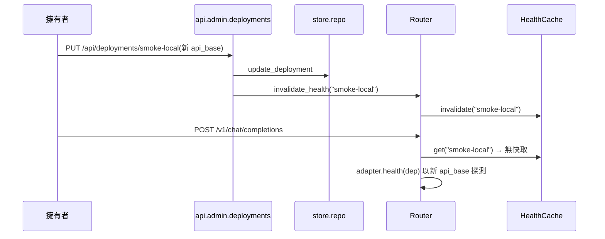
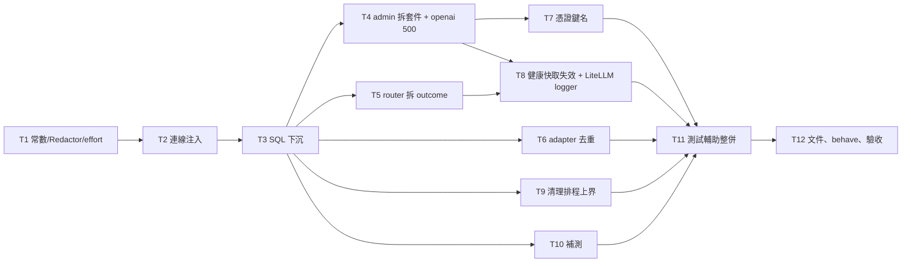

# CHG-20261101-02 — M2 整理:常數與連線注入統一、SQL 下沉、admin/router 拆檔、adapter 去重、憑證鍵名變體阻擋、健康快取失效、清理排程上界與補測

- 專案:spillway
- 分支(Branch):`chg-20261101-02`(自 main 1c8d1a1 分出;驗收通過後依 DIR-4 自動合回 main 並推送)
- 日期:2026-11-01(UTC+0)
- 類型:修改(重構 + 小幅行為修正 + 補測)
- Template: plan
- 提出者:擁有者(使用者,2026-11-01「繼續處理未完成項目」)
- 實作者:claude-opus-5-5(主 session agent;平行 task 由其派出的子 agent 施工,見「平行施工」)
- 風險分級:中——命中跨模組介面(連線注入、`adapters.base` 新增共用 adapter 類別、`api.admin` 改為套件)與安全相關的寫入驗證(憑證鍵名阻擋規則放寬到變體、`params.signals` 改為只做值樣式檢查);不改資料模型(schema 仍為 v1)、不新增相依、不改網路暴露面
- Commit/PR:`chg-20261101-02` 分支上訊息以 `CHG-20261101-02:` 開頭的 commit(`git log --grep CHG-20261101-02`);合回 main 後回填
- 重複性檢查(Recurrence check):無重複(動機為 CHG-20261030-02「下一筆 CHG」整理項與 ACC-20261031-01 追蹤項;與既有 CHG 動機皆不同)
- Diagrams:見「## 設計圖」節
- Security-impact:見「## 安全影響」節
- Skill: ai-sdlc-autopilot v1.69
- 關聯:CHG-20261030-02 第 226、653–656 行(已知限制、驗收追蹤項、下一筆 CHG 整理項)與決策 54、59;ACC-20261031-01 已知限制第 3、4、7、8、9、10 項;knowledge DIR-1、DIR-2、DIR-3、DIR-4

## 動機

M2(CHG-20261030-02)已合回 main。施工審議與獨立驗收留下一批不影響正確性、但會讓 M3 疊上去時變難改的整理項:連線注入有五種寫法、常數與 `Redactor` 散在多處、admin.py 1202 行、三份逐位元相同的 adapter.py、SQL 散在 api 與 quota/estimate;另有幾個小的行為缺口(健康快取在管理 API 修改後最多 10 秒才失效、LiteLLM 在 root logger 為 DEBUG 時會印出 prompt、清理排程最壞間隔約 3600.9 秒、憑證鍵名只擋完全相同的 8 個名稱)與驗收補測。M3 會在 admin、router、adapters.base 上加端點與 CLI 模組,先整理可以讓 M3 的 diff 只含新功能。

## 使用者故事

1. 作為擁有者,我要在成員 `params` 裡誤填 `x-api-key`、`client_secret`、`openai_api_key` 這類變體鍵名時被拒絕並看到不含值的錯誤,以便金鑰不會因為鍵名寫法不同而被存進資料庫(決策 54 延伸,使用者決定 2026-11-01)。
2. 作為擁有者,我要在 `params.signals` 寫判定規則時,不會因為規則裡出現 `token` 之類的鍵名被誤擋,以便能照 spec 5.3.1 覆寫訊號規則。
3. 作為擁有者,我要以管理 API 修改或刪除 local 成員後,下一次請求立即以新設定判斷健康,而不是沿用最多 10 秒的舊結果。
4. 作為擁有者,我要即使把日誌等級開到 DEBUG,LiteLLM 也不會把 prompt 原文印進日誌。
5. 作為擁有者,我要過期的 context 內容在過期後 1 小時內一定被刪除(NFR-5),不因輪詢抖動多拖一秒。
6. 作為擁有者,我要閘道在整理後行為與 M2 完全相同(既有 1089 個 pytest 與 18 個 behave 情境全綠、NFR-1/2 不退步),以便整理不帶來回歸。

## 決策與取捨

| # | 決策 | 選項 | 前提假設(此決策建立在什麼之上) | 為何這樣選 |
|---|------|------|----------------------------------|------------|
| 1 | **(使用者決定 2026-11-01)** 憑證鍵名改為「正規化後比對」:鍵名轉小寫並去掉 `-`、`_`、`.`、空白後,(a) 完全等於 `apikey`、`xapikey`、`key`、`token`、`accesstoken`、`refreshtoken`、`authtoken`、`bearertoken`、`idtoken`、`secret`、`clientsecret`、`password`、`passwd`、`authorization`、`bearer`、`credential`、`credentials` 之一,或 (b) 以 `apikey`、`secret`、`password` 結尾 → 422 `validation_error`,不回顯值 | (a) 擋變體 / (b) 維持完全比對 | 原規則(CHG-20261030-02 決策 54)只擋 8 個完全相同的鍵名;誤擋的代價只是一次明確的 422 | 使用者選 (a)。`token` 只做完全比對、不做結尾比對,避免誤擋 `max_tokens`、`max_token` 類參數;結尾比對只用不會出現在一般參數名的三個字根。 |
| 2 | **(使用者決定 2026-11-01)** 冷卻與預算分開存(schema v2)延到 M3,與存取 token 的 schema 變更合成一次 migration;本筆不改 schema | (a) 延到 M3 / (b) 本筆另開 CHG / (c) 不做 | `~/spillway-smoke` 已有真實資料庫,任何 schema 變更屬永遠停點(正式資料遷移) | 使用者選 (a)。CHG-20261030-02 決策 59 的 `type=none` 暫行列維持。 |
| 3 | **(使用者決定 2026-11-01)** admin.py、router.py 拆檔、SQL 下沉 store/repo、連線注入統一都在本筆做 | (a) 本筆做 / (b) 延到 M3 | 行為不變,由既有測試與 NFR-2 重跑把關 | 使用者選 (a)。M3 開工前完成,M3 的 diff 只含新功能。 |
| 4 | `params.signals` 子樹不做「鍵名」比對,只做 Redactor 值樣式比對(值看起來像金鑰仍擋) | 整棵 params 一律比對 vs signals 子樹豁免鍵名 | signals 規則的鍵是 spec 5.3.1 固定的判定類別與欄位名(`quota`、`rate_limit`、`http_status`、`body_contains`…),不是憑證欄位 | 規則格式由 `validate_signals` 另行驗證;鍵名比對對 signals 只會誤擋。**代使用者決定**。 |
| 5 | 連線注入統一為「連線工廠」:`store.db.ConnSource`(`Connection` 或零參數 callable)與單一 `store.db.use_conn(source)` context manager 取代 resolver、quota、estimate 三份 `_conn()`;FastAPI 端以 `api.deps.get_conn` dependency(每請求開一條、結束關閉)取代 admin `_db(request)` 與 openai.py 直接呼叫 `conn_factory()` | 全部改傳 Connection vs 全部改工廠 vs 保留現狀 | Router 已以 contextvar 管理每請求一條連線(CHG-20261030-02 審議修正) | 保留 Router 的 contextvar(NFR-1 量測依賴它),只把三份重複分派收成一處、API 層改用 dependency。`LedgerWriter`、`RetentionJob` 維持收 Connection(呼叫端都已持有連線)。**代使用者決定**。 |
| 6 | 常數集中到 `spillway/domain.py`:`KINDS`、`CLOUD_KINDS`、`CALL_STATUSES`、`LEDGER_STATUSES`、`COOLING_STATUSES = ("quota_exhausted", "rate_limited")`、`STATUS_SKIPPED_PRECHECK`;其他模組一律 import,admin 的 `Literal` 以 `typing.get_args` 測試與 domain 常數一致 | domain vs 新建 constants.py | domain.py 已是基礎層、store 與 adapters.base 都可 import | 不新增模組;分層不變。**代使用者決定**。 |
| 7 | `Redactor` 改為單一共用實例 `spillway.redact.REDACTOR`(Redactor 無狀態,`extra_secrets` 每次呼叫傳入);`LedgerWriter(redactor=None)` 預設用它 | 共用實例 vs app.state 注入 | Redactor 只持有編譯後的樣式 | 測試仍可傳入自己的實例。**代使用者決定**。 |
| 8 | `normalize_effort`、`InvalidEffort` 移到 `spillway/effort.py`;`spillway.routing` 保留轉匯出(舊 import 路徑不破) | 移動並轉匯出 vs 只移動 | api 層兩處 import `spillway.routing.normalize_effort` | 轉匯出讓本筆不必同步改所有呼叫端,也不破 M3 草稿。**代使用者決定**。 |
| 9 | `api/admin.py` 改為套件 `api/admin/`:`__init__.py`(只組 `router` 並轉匯出既有公開名稱)、`common.py`(錯誤、共用 helper)、`secrets.py`(憑證鍵名與值樣式掃描)、`deployments.py`(含 test-call)、`groups.py`、`routes.py`(含 order)、`planning.py`(dry-run、estimate)、`ledger.py`、`settings.py`、`dashboard.py`、`adapters.py`;`spillway.api.admin.router` 匯入路徑不變 | 套件 vs 多個平行檔 admin_*.py | app.py 只 `include_router(admin.router)` | 依原檔 `# ====` 段落切,純搬移、不改行為。**代使用者決定**。 |
| 10 | `routing/router.py` 拆出 `routing/outcome.py`(`RouteOutcome`、`AttemptInfo`、`Plan`、`PlanSlot`、`PlanEntry` 等回傳 dataclass);`spillway.routing` 轉匯出不變 | 拆 outcome vs 再拆 dry_run | router.py 527 行,dataclass 占約 75 行、effort 正規化約 25 行(決策 8 移走) | 只拆資料型別;Router 的流程留在一個檔案,方便對照 spec 4.x。**代使用者決定**。 |
| 11 | 三份相同的 adapter.py 上移為 `adapters/base/api_adapter.py` 的 `LiteLLMApiAdapter`;各模組 `adapter.py` 保留(DIR-3 規則 1 的檔案結構),內容改為 `class Adapter(LiteLLMApiAdapter): pass` 並附模組說明;`test_builtin_adapter_py_files_are_identical` 改為「三個模組的 Adapter 都是 `LiteLLMApiAdapter` 子類別且未覆寫 call/health」 | 共用基底類別 vs 模組改 import 函式 | 模組只可 import `adapters.base`(DIR-3) | 保留每模組一個 adapter.py 的契約,M3 的 CLI 模組自行實作 Adapter 不受影響。**代使用者決定**。 |
| 12 | 健康快取失效:`HealthCache.invalidate(dep_id)`(新增)與既有 `clear()`;管理 API 對成員 PUT、DELETE、enable 變更成功後呼叫 `app.state.router.invalidate_health(dep_id)` | 管理 API 呼叫失效 vs 快取鍵含成員設定雜湊 | Router 是 app 單例(app.state.router) | 明確失效最簡單,行為可測。**代使用者決定**。 |
| 13 | `load_litellm` 把 `LiteLLM`、`LiteLLM Router`、`LiteLLM Proxy` 三個 logger 的等級設為 `max(目前等級, INFO)`(DEBUG 或 NOTSET 改為 INFO),並設 `propagate` 不變 | 固定 INFO vs 固定 WARNING | LiteLLM 的 prompt 回顯只在 DEBUG 等級 | INFO 保留 LiteLLM 的一般資訊,只擋 DEBUG。**代使用者決定**。 |
| 14 | 清理排程:`due()` 的提前量由 `poll` 改為 `2 × poll`,並在 docstring 改述上界為「兩次清理間隔 ≤ interval」;新增測試以 FakeClock 模擬每次輪詢多睡 `poll` 秒的抖動,斷言間隔仍 ≤ interval;NFR-5 驗收補「過期時刻起 ≤ 1 小時內被刪除」斷言 | 2×poll vs 以單調時鐘排程 | 抖動來自 `asyncio.sleep` 超時與清理本身耗時,量級遠小於一個 poll(30 秒) | 改一個常數即可把上界拉回 1 小時內;清理稍微提早(最多 60 秒)不違反「每小時」。**代使用者決定**。 |
| 15 | `functions`、`function_call`(OpenAI 舊版參數)被丟棄一事寫入 README「相容性」小節與 design.md D22 後的新條目 D25;不改 spec | README + design vs spec 9.1 修訂 | spec 9.1 未列舉白名單;白名單是實作細節(U8) | 不動規格書。**代使用者決定**。 |
| 16 | openai.py 局部的 `except Exception → ApiError(500, internal_error)` 移除,交給全站 handler(`api/__init__.py` 的 `_unhandled`,回應與日誌相同) | 移除 vs 保留 | 兩者輸出逐字相同(已有測試釘住 body 與日誌) | 少一處重複;既有測試繼續釘住行為。**代使用者決定**。 |
| 17 | AC-4 補「無 seed」樣本:新增 `tests/acceptance/test_ac04_unseeded.py`,以未給 seed 的 `SystemRng()` 做 4000 次 dry-run,斷言第一順位比例落在 0.70–0.80(期望 0.75,標準差約 0.0068,區間約 ±7 個標準差,不會偶發失敗);不改 `m2_routing.feature` 情境文字 | acceptance 測試 vs 新 feature 情境 | 既有情境以 seed 20261030 固定 | 情境文字只能經治理變更;acceptance 測試夠用。**代使用者決定**。 |
| 18 | `serve` 的 `timeout_graceful_shutdown` 延到 M3(與 MCP 常駐一起決定) | 本筆 vs M3 | M3 才有常駐的 MCP 連線 | 照 CHG-20261030-02 第 656 行原登記。**代使用者決定**(沿用原登記)。 |
| 19 | 測試輔助整併:`anyio_backend` 移到 `tests/conftest.py` 一處;假金鑰環境變數 fixture、成員/route/app 建構器集中到 `tests/helpers.py`;`tests/integration/admin/conftest.py` 的 `make_app` 改呼叫 `create_app()` 而不是手抄 `app.state` 接線 | 集中 vs 現狀 | 測試數量不變 | 收斂後 M3 的測試直接重用。整併前後 pytest 收集到的測試數相同(1089 + 本筆新增)。**代使用者決定**。 |

## 設計圖

### 圖 1:本筆前後的模組配置(只列有變動的部分)

```mermaid
flowchart TB
  subgraph before[整理前]
    A1[api/admin.py 1202 行<br/>含 SQL、_db(request)、_REDACTOR] --> R1[routing/router.py<br/>含 normalize_effort、outcome dataclass]
    O1[api/openai.py<br/>局部 internal_error、_REDACTOR] --> R1
    R1 --> Q1[quota.py _conn + SQL]
    R1 --> E1[estimate.py _conn + SQL]
    R1 --> S1[resolver.py _conn]
    X1[anthropic_api/adapter.py] -.逐位元相同.- X2[openai_api/adapter.py] -.逐位元相同.- X3[litellm/adapter.py]
  end
  subgraph after[整理後]
    A2[api/admin/ 套件<br/>common secrets deployments groups routes planning ledger settings dashboard adapters] --> D2[api/deps.get_conn]
    O2[api/openai.py] --> D2
    A2 --> R2[routing/router.py + routing/outcome.py]
    O2 --> R2
    R2 --> EF[effort.py<br/>EffortMapper + normalize_effort]
    R2 --> Q2[quota.py] --> REPO[store/repo.py<br/>全部 SQL]
    R2 --> E2[estimate.py] --> REPO
    A2 --> REPO
    Q2 & E2 & S2[resolver.py] --> UC[store/db.use_conn]
    DOM[domain.py 常數] --- RED[redact.REDACTOR]
    B2[adapters/base/api_adapter.LiteLLMApiAdapter] --> Y1[三個模組的 adapter.py:子類別]
  end
```

### 圖 2:管理 API 修改成員後的健康判定



### 圖 3:平行施工波次



## 安全影響

範圍依 knowledge DIR-2:威脅模型只有擁有者本人在本機使用;下表回答四類永遠停點是否被本筆觸及。

| 類別 | 是否觸及 | 影響範圍 / 理由 |
|------|----------|-----------------|
| irreversible-delete | 否 | 不新增任何刪除路徑;`DELETE /api/deployments/{id}` 的連帶刪除行為不變,本筆只補測試(T10)。施工與測試只在 pytest 暫存 `SPILLWAY_HOME`;agent 不碰擁有者的資料目錄(`~/spillway-smoke` 與預設資料目錄)。 |
| payments | 否 | 不發起付款;自動測試只打 `tests/fakes/` 假端點。 |
| prod-migration | 否 | schema 維持 v1、`MIGRATIONS` 不變;冷卻與預算分開存延到 M3(決策 2)。T10 只新增「非空且 user_version=0 的資料庫套用 v1 失敗並回滾」測試,不改 migration 程式。 |
| security-boundary | 否(驗證規則調整,不改邊界) | 綁定位址、管理 API 無驗證的前提、憑證解析方式皆不變。憑證鍵名阻擋**放寬到更多變體**(決策 1,擋得更多);`params.signals` 子樹改為只做值樣式比對(決策 4,值像金鑰仍擋;signals 的鍵由 `validate_signals` 限定為 spec 5.3.1 的固定集合)。LiteLLM logger 下限 INFO(決策 13)減少 prompt 外洩到日誌。秘密不寫入 repo、日誌、context 記錄(DIR-2 規則 2b)與不讀取訂閱 OAuth token(2c,本筆不含 CLI 模組)照舊。 |

已知限制(DIR-2 範圍內,只記錄、不實作):鍵名正規化只處理大小寫與 `-`、`_`、`.`、空白,camelCase 以外的拼法(例如 `api-k3y`)不擋;值樣式比對仍只認得 Redactor 的樣式(`sk-` 等),非樣式金鑰放在任意鍵名下仍無法偵測;`serve` 的 graceful shutdown 上限仍為 adapter 逾時(決策 18,延到 M3)。

## 修改指引

### 目標

不改對外行為(除使用者故事 1–5 的四項修正)完成 CHG-20261030-02 第 656 行的整理項(冷卻與預算分開存、graceful shutdown 兩項除外,決策 2、18)與 ACC-20261031-01 的追蹤補測;既有 1089 個 pytest、18 個 behave 情境全綠,NFR-1、NFR-2 重跑達標。

### 影響範圍

| 受影響項 | 類型 | 改動 | 連帶影響 |
|----------|------|------|----------|
| `src/spillway/domain.py`、`redact.py`、`effort.py` | 設計 | 常數集中、`REDACTOR` 共用實例、`normalize_effort` 移入 | 所有引用處改 import;`spillway.routing` 轉匯出 |
| `src/spillway/store/db.py`、`store/repo.py` | 資料存取 | `ConnSource`、`use_conn`;新增查詢函式承接 admin、quota、estimate 的 SQL | quota、estimate、resolver、api.admin |
| `src/spillway/routing/`(router、outcome〔新〕、filter、selector、resolver、`__init__`) | 邏輯 | 拆 outcome;常數改 import;`invalidate_health` | api.admin、api.openai、M3 MCP `ask` |
| `src/spillway/quota.py`、`estimate.py`、`ledger.py` | 邏輯 | SQL 改呼叫 repo;連線經 `use_conn`;Redactor 預設共用 | 無對外變化 |
| `src/spillway/api/`(`__init__`、`deps.py`〔新〕、`openai.py`、`admin.py` → `admin/` 套件) | 介面 | 拆套件、dependency 注入連線、移除局部 500、鍵名變體阻擋、健康快取失效 | M4 Web UI 呼叫的端點與 body 不變 |
| `src/spillway/adapters/base/`(`api_adapter.py`〔新〕、`litellm_call.py`、`__init__`)、三個模組的 `adapter.py` | 設計 | 共用 `LiteLLMApiAdapter`;logger 下限 | M3 CLI 模組不受影響 |
| `src/spillway/app.py` | 應用 | 清理排程提前量 2×poll | NFR-5 |
| `tests/`(conftest、helpers〔新〕、unit、integration、acceptance、features) | 測試 | 整併與補測;新增 `tests/features/m2c_cleanup.feature` | directory.md |
| `README.md` | 文件 | 「相容性」小節:`functions`/`function_call` 丟棄 | 無 |
| sdlc_docs/structure/design.md、logical.md、directory.md | 文件 | 見「規格書與結構文件更新」 | 無 |

### Global Constraints(全域約束——每個 task 都要遵守)

- 語言與版本:Python ≥ 3.11(驗收平台 3.13);套件名 `spillway`,src layout;路徑一律 `pathlib`。
- 相依套件:不新增任何相依;`pyproject.toml` 不改。要新增相依時停下回報。
- 規格依據:行為以 `docs/spec.md` 與 CHG-20261030-02 決策表為準,本筆決策表只覆寫它列出的項目;不修改 `docs/spec.md`、`docs/proposal.md`。
- **行為不變**:除使用者故事 1–5 與決策 1、4、12、13、14、16 指定的變化外,任何 HTTP 回應、header、錯誤碼、帳本與 payload 內容、日誌文字都不可改變。既有測試不可為了配合重構而修改斷言;只允許改 import 路徑、fixture 來源與檔案位置(T11),以及決策 11 指定替換的那一則 adapter 相同性測試。
- 公開匯入路徑保留:`spillway.api.admin.router`、`spillway.routing` 既有 `__all__` 的每個名稱、`spillway.adapters.base` 既有 `__all__` 的每個名稱;新增的名稱加入對應 `__all__`。
- 分層:相依只可由上往下(sdlc_docs/structure/logical.md);`spillway.adapters.<module>` 只可 import `spillway.adapters.base`、標準庫與 `pyyaml`;`tests/contract/test_layering.py` 檢查。SQL 只可出現在 `src/spillway/store/`(T3 起由 `tests/contract/test_layering.py` 新增的檢查釘住)。
- 非同步、時間與亂數、測試上游、秘密、網路、資料目錄、錯誤格式:沿用 CHG-20261030-02 Global Constraints 同名各條(`Clock`/`Rng` 注入;只打 `tests/fakes/`;測試金鑰 `sk-test-0000`;只綁 127.0.0.1;測試以 `tmp_path` 為 `SPILLWAY_HOME`;錯誤一律 `{"error": {"code", "message"}}`),逐條照舊適用。
- 範圍:不改 schema、不做冷卻與預算分開存、不做 graceful shutdown、不實作任何 M3/M4 功能。
- 每個 task 的測試必須能以該 task 的 `test:` 指令獨立執行並全綠;每個 task 完成時另跑一次全量 `python -m pytest -q` 確認無回歸。L3 情境(`python -m behave tests/features`)在 T7、T8 寫完步驟後於 T12 全量執行。
- 既有的 `tests/features/m2_*.feature` 與本筆新增的 `m2c_cleanup.feature` 情境文字只能經修改治理變更;施工者只寫步驟檔。
- commit 訊息以 `CHG-20261101-02:` 開頭,結尾依當次 session 的署名規則加上 Co-Authored-By 行。
- 驗收平台為 macOS;Linux、Windows 在 ACC 標「未涵蓋」。

### 契約清單

| 契約 | 提供方 | 讀取方 | 本筆變更 | 契約測試(路徑/無) |
|------|--------|--------|----------|----------------------|
| `spillway.domain` 常數 `KINDS`、`CLOUD_KINDS`、`CALL_STATUSES`、`LEDGER_STATUSES`、`COOLING_STATUSES`、`STATUS_SKIPPED_PRECHECK` | T1 domain | routing、quota、ledger、api.admin(`Literal` 一致性)、schema CHECK | 新增集中定義;移除 filter.py、selector.py 的重複 `CLOUD_KINDS` | tests/unit/test_domain_constants.py(新增;含 admin `Literal` 與 schema CHECK 一致性) |
| `spillway.redact.REDACTOR` 共用實例 | T1 redact | ledger、api、routing | 新增 | tests/unit/test_redact.py |
| `spillway.effort.normalize_effort`、`InvalidEffort`(`spillway.routing` 轉匯出) | T1 effort | api.openai、api.admin.planning、Router | 移動 | tests/unit/test_effort.py;tests/contract/test_public_imports.py(新增) |
| `store.db.ConnSource`、`store.db.use_conn(source)` | T2 store.db | resolver、quota、estimate、Router | 新增 | tests/unit/store/test_db_conn.py(新增) |
| `api.deps.get_conn`(FastAPI dependency,每請求一條連線並於回應後關閉) | T2 api.deps | api.admin 各模組、api.openai `/v1/models` | 新增 | tests/integration/test_conn_dependency.py(新增) |
| `store.repo` 新增查詢函式(cardinality 計數、id 存在、帳本計數與篩選、dashboard 彙總、kinds/providers、本期花費 SUM、`tokens_out` 歷史) | T3 repo | api.admin、quota、estimate | 新增(原本 SQL 散在讀取方) | tests/unit/store/test_repo_queries.py(新增);tests/contract/test_layering.py(SQL 只在 store) |
| `spillway.api.admin.router` 與管理 API 全部端點、body、錯誤碼 | T4 api.admin 套件 | app.py;M4 Web UI | 拆檔,契約不變 | tests/integration/admin/test_admin_*.py(既有,不改斷言) |
| `spillway.routing` 匯出的 `RouteOutcome`、`AttemptInfo`、`Plan` 等 | T5 routing.outcome | api、M3 MCP | 移動,型別不變 | tests/unit/routing/test_router.py;tests/contract/test_public_imports.py |
| `adapters.base.LiteLLMApiAdapter`(`__init__(manifest, context)`、`async call`、`async health`,行為與原 adapter.py 相同) | T6 adapters.base | anthropic_api、openai_api、litellm 的 `Adapter` | 新增 | tests/contract/test_adapter_contract.py;tests/unit/adapters/test_builtin_adapters_share_base.py(取代相同性測試) |
| 管理 API 憑證欄位規則:正規化鍵名比對(決策 1);`params.signals` 子樹只做值樣式比對(決策 4);錯誤 422 `validation_error` 不回顯值 | T7 api.admin.secrets | 擁有者、M4 UI-2 | 變更(擋得更多;signals 鍵名豁免) | tests/integration/admin/test_admin_secret_keys.py(新增);tests/features/m2c_cleanup.feature |
| `Router.invalidate_health(dep_id)`、`HealthCache.invalidate(dep_id)` | T8 routing | api.admin.deployments | 新增 | tests/unit/routing/test_filter.py;tests/integration/admin/test_admin_health_invalidate.py(新增) |
| LiteLLM logger 等級下限 INFO | T8 litellm_call | 日誌 | 新增 | tests/unit/adapters_base/test_litellm_logger.py(新增) |
| `RetentionScheduler.due()` 提前量 2×poll;兩次清理間隔 ≤ interval | T9 app.py | NFR-5 | 變更 | tests/integration/test_retention_schedule.py;tests/acceptance/test_nfr5_payload_expiry.py |

### Tasks(checkbox=續作點)

- [ ] T1. 常數集中、共用 Redactor、`normalize_effort` 移到 effort.py
  - interfaces: consumes CHG-20261030-02 決策 31–34、U8 / produces `domain.py` 常數(決策 6)、`redact.REDACTOR`(決策 7)、`effort.normalize_effort`/`InvalidEffort`(決策 8)、`tests/unit/test_domain_constants.py`、`tests/contract/test_public_imports.py`
  - test: `python -m pytest tests/unit/test_domain_constants.py tests/unit/test_redact.py tests/unit/test_effort.py tests/contract/test_public_imports.py -q`
  - L1: `CLOUD_KINDS == ("cli", "api")` 且為 `KINDS` 子集;`COOLING_STATUSES` 為 `LEDGER_STATUSES` 子集;admin `Literal` 的 `get_args` 與 `KINDS`、`LEDGER_STATUSES` 逐值相同;schema.sql 的 kind CHECK 列出的值與 `KINDS` 相同;`normalize_effort("minimal") == "none"`、不合法值丟 `InvalidEffort`;`from spillway.routing import normalize_effort` 與 `from spillway.effort import normalize_effort` 是同一物件
  - L2: `LedgerWriter()` 未傳 redactor 時使用的就是 `redact.REDACTOR`(以身分比對),寫入含 `sk-test-0000` 的 payload 後資料庫內容已遮罩;src 中除 `redact.py` 外沒有任何 `Redactor(` 建構(以 grep 測試斷言)
  - L3: 不適用(常數搬移沒有使用者看得到的行為變化;既有 18 個情境在 T12 全量重跑確認不變)
  - L4: 不適用(本 task 不改任何對外端點或啟動流程,端到端在 T12 的操作驗收一次執行)

- [ ] T2. 連線注入統一:`store.db.use_conn` 與 `api.deps.get_conn`
  - interfaces: consumes T1 / produces `store.db.ConnSource`、`store.db.use_conn`、`api/deps.py` 的 `get_conn`;resolver、quota、estimate 的 `_conn()` 移除;admin `_db(request)` 與 openai.py 直接呼叫 `conn_factory()` 改用 dependency(決策 5)
  - test: `python -m pytest tests/unit/store/test_db_conn.py tests/integration/test_conn_dependency.py tests/unit/routing tests/unit/test_quota.py tests/unit/test_estimate.py -q`
  - L1: `use_conn(conn)` 交回同一連線且離開時不關閉;`use_conn(factory)` 呼叫工廠一次、離開時關閉;傳入其他型別丟 `TypeError`
  - L2: 對 `/api/deployments` 連續 50 次 GET 後,`app.state.conn_factory` 開出的連線全部已關閉(以包裝工廠計數開與關);Router 經 resolver、quota、estimate 一次請求只開一條連線(沿用既有 contextvar 測試並加開啟次數斷言)
  - L3: 不適用(連線注入沒有使用者看得到的行為;既有情境於 T12 重跑)
  - L4: 不適用(端到端由 T12 操作驗收以 `spillway serve` 子行程覆蓋)

- [ ] T3. SQL 下沉到 store/repo,重跑 NFR-2
  - interfaces: consumes T2 / produces `store.repo` 新查詢函式(契約清單第 6 列);admin、quota、estimate 不再含 SQL;`tests/contract/test_layering.py` 新增「`src/spillway/store/` 以外不含 `execute(` 與 SQL 關鍵字字串」檢查
  - test: `python -m pytest tests/unit/store tests/contract/test_layering.py tests/integration/admin tests/acceptance/test_nfr2_dashboard.py -q`
  - L1: 每個新查詢函式以 `db` fixture 建資料後回傳值與搬移前的 SQL 相同(每個函式至少一則,含帳本篩選的空條件、多條件組合;dashboard 彙總含 `type=none` 冷卻列以日曆月計,CHG-20261030-02 決策 59)
  - L2: `/api/dashboard`、`/api/ledger`(含篩選與分頁)、`QuotaService.remaining`、`Estimator` 的結果與搬移前相同(既有整合測試不改斷言全綠);layering 檢查在 store 以外放入一行 `conn.execute("SELECT 1")` 時會失敗(以暫存檔測試檢查器本身)
  - L3: 不適用(SQL 位置沒有使用者看得到的行為變化)
  - L4: NFR-2 重跑:100 成員、10 萬帳本列下 `/api/dashboard` P95 < 200 ms(既有 `tests/acceptance/test_nfr2_dashboard.py`),結果數字記入 ACC

- [ ] T4. `api/admin.py` 拆為 `api/admin/` 套件;openai.py 局部 500 移除
  - interfaces: consumes T3 / produces 決策 9 的模組配置(`secrets.py` 留給 T7 改規則、`deployments.py` 留給 T8 加失效呼叫);openai.py 移除局部 `except Exception`(決策 16)
  - test: `python -m pytest tests/integration/admin tests/integration/test_errors_openai.py tests/integration/test_review_w6_openai.py tests/contract -q`
  - L1: `spillway.api.admin` 匯出的公開名稱與拆檔前相同(`tests/contract/test_public_imports.py` 加一組名稱清單斷言);每個子模組行數 ≤ 400
  - L2: `create_app()` 的 OpenAPI 路徑集合、每個路徑的方法與回應狀態碼和拆檔前完全相同(拆檔前先把集合存成測試內常數);Router 丟出未預期例外時 `/v1/chat/completions` 仍回 500 `internal_error`,body 與日誌行與原本相同(既有兩則測試不改斷言)
  - L3: 不適用(純搬移;管理 API 的使用者行為由既有整合測試與 T12 情境重跑覆蓋)
  - L4: 不適用(端到端由 T12 操作驗收覆蓋)

- [ ] T5. `routing/router.py` 拆出 `routing/outcome.py`
  - interfaces: consumes T3 / produces `routing/outcome.py`(決策 10);`spillway.routing` 匯出不變
  - test: `python -m pytest tests/unit/routing tests/contract/test_public_imports.py -q`
  - L1: `from spillway.routing import RouteOutcome, AttemptInfo, Plan` 仍可用且型別欄位與拆檔前相同(以 `dataclasses.fields` 名稱清單斷言)
  - L2: 既有 `tests/unit/routing/test_router.py` 全綠且不改斷言(Router 產生、api 讀取的 outcome 欄位不變)
  - L3: 不適用(型別搬移沒有使用者看得到的行為)
  - L4: 不適用(端到端由 T12 操作驗收覆蓋)

- [ ] T6. 三份 adapter.py 去重為 `adapters.base.LiteLLMApiAdapter`
  - interfaces: consumes T3 / produces `adapters/base/api_adapter.py`、三個模組的 `adapter.py` 改為子類別(決策 11)、`tests/unit/adapters/test_builtin_adapters_share_base.py`(取代 `test_builtin_adapter_py_files_are_identical`)
  - test: `python -m pytest tests/contract tests/unit/adapters tests/unit/adapters_base -q`
  - L1: 三個模組的 `Adapter` 都是 `LiteLLMApiAdapter` 子類別,且 `call`、`health` 未被覆寫(`Adapter.call is LiteLLMApiAdapter.call`)
  - L2: 合約測試(`tests/contract/test_adapter_contract.py`、`test_call_status.py`)對三個模組全綠且不改斷言;layering 檢查確認模組仍只 import `adapters.base`
  - L3: 不適用(去重沒有使用者看得到的行為;`m2_adapters.feature` 於 T12 重跑)
  - L4: 不適用(端到端由 T12 操作驗收覆蓋)

- [ ] T7. 憑證鍵名變體阻擋與 `params.signals` 豁免鍵名比對
  - interfaces: consumes T4(`api/admin/secrets.py`)/ produces 決策 1、4 的規則;`tests/integration/admin/test_admin_secret_keys.py`;`tests/features/steps/cleanup_secret_steps.py`
  - test: `python -m pytest tests/integration/admin/test_admin_secret_keys.py tests/integration/admin/test_review_w6_admin.py -q`
  - L1: 正規化函式:`"X-Api-Key"`、`"client_secret"`、`"openai_api_key"`、`"Refresh-Token"`、`"db.password"` 判為憑證鍵;`"max_tokens"`、`"max_token"`、`"keyword"`、`"tokenizer"`、`"monkey"` 不判為憑證鍵;原 8 個鍵名照舊判為憑證鍵
  - L2: POST `/api/deployments` 的 `params` 含 `{"x-api-key": "abc"}`、巢狀 `{"headers": {"Client-Secret": "abc"}}`、清單內 `[{"openai_api_key": "abc"}]` 各回 422 `validation_error`,message 含鍵路徑、不含 `abc`,資料庫沒有該成員;`params.signals` 含合法規則(鍵為 spec 5.3.1 類別)時 201;`params.signals` 內放入 `sk-test-0000` 樣式值時仍 422
  - L3: `tests/features/m2c_cleanup.feature` 情境「變體鍵名被拒」與「signals 規則不被鍵名比對誤擋」通過
  - L4: 不適用(管理 API 驗證以 TestClient 與 behave 覆蓋;T12 的操作驗收以 `spillway serve` 子行程再打一次變體鍵名)

- [ ] T8. 健康快取失效與 LiteLLM logger 下限
  - interfaces: consumes T4(`api/admin/deployments.py`)、T5 / produces `HealthCache.invalidate`、`Router.invalidate_health`(決策 12);`load_litellm` logger 下限(決策 13);`tests/integration/admin/test_admin_health_invalidate.py`、`tests/unit/adapters_base/test_litellm_logger.py`、`tests/features/steps/cleanup_health_steps.py`
  - test: `python -m pytest tests/unit/routing/test_filter.py tests/integration/admin/test_admin_health_invalidate.py tests/unit/adapters_base/test_litellm_logger.py -q`
  - L1: `HealthCache.invalidate("a")` 後 `get("a")` 為 None、`get("b")` 不受影響;root logger 設 DEBUG 後呼叫 `load_litellm()`,`logging.getLogger("LiteLLM").getEffectiveLevel() >= INFO`;原本設為 WARNING 的不被降為 INFO
  - L2: local 成員健康結果已快取為不健康後,PUT 改 `api_base` 指向可用的假端點,下一次請求在 FakeClock 未前進的情況下由該成員處理;DELETE 成員後快取中不再有該 id;以 root logger DEBUG 跑一次含已知 prompt 字串的請求,caplog 中沒有該字串
  - L3: `tests/features/m2c_cleanup.feature` 情境「修改 local 成員後立即以新設定判斷健康」通過
  - L4: 不適用(T12 的操作驗收以 `spillway serve` 子行程執行同一步驟)

- [ ] T9. 清理排程上界與 NFR-5 斷言
  - interfaces: consumes T3 / produces `RetentionScheduler.due()` 提前量 2×poll 與 docstring 修正(決策 14);`test_retention_schedule.py` 新增抖動測試;`test_nfr5_payload_expiry.py` 新增「過期起 ≤ 1 小時刪除」斷言
  - test: `python -m pytest tests/integration/test_retention_schedule.py tests/acceptance/test_nfr5_payload_expiry.py -q`
  - L1: FakeClock 下每次輪詢多前進 `poll` 秒(模擬 sleep 超時),連續 100 輪中任兩次清理的間隔 ≤ interval;無抖動時清理不早於 `interval - 2×poll`
  - L2: 保存天數 1,payload 於 T 寫入,FakeClock 推進到 T + 1 天 + 1 小時(以排程實際輪詢推進,不直接呼叫 `run_once`)時該列已刪除,帳本列保留,查詢回 410 `payload_expired`
  - L3: 不適用(`m2_context.feature` 的保存期限情境不變,於 T12 重跑)
  - L4: 不適用(1 小時量級的真實時間不在自動驗收中執行;以 FakeClock 的 L2 覆蓋,ACC 揭露)

- [ ] T10. 驗收追蹤補測:keyring 端到端、DELETE 連帶刪除、非空資料庫 migration、AC-4 無 seed
  - interfaces: consumes T3 / produces `tests/integration/test_keyring_credential.py`、`tests/integration/admin/test_admin_delete_cascade.py`、`tests/unit/store/test_migration_nonempty.py`、`tests/acceptance/test_ac04_unseeded.py`(決策 17);只新增測試,不改 src
  - test: `python -m pytest tests/integration/test_keyring_credential.py tests/integration/admin/test_admin_delete_cascade.py tests/unit/store/test_migration_nonempty.py tests/acceptance/test_ac04_unseeded.py -q`
  - L1: 非空資料庫(已有一張使用者表、`user_version=0`)開啟時丟出錯誤、交易回滾、原表內容不變、`user_version` 仍為 0
  - L2: 以記憶體 keyring 後端存入 `sk-test-0000`,成員 `credential_ref=keyring:spillway-test:acct`,一次 `/v1/chat/completions` 回 200 且假上游收到的 API key 為該值、帳本與 payload 不含該值;DELETE 成員後 deployment_tags、budgets、route_targets 無該 id,usage_ledger 與 usage_payloads 列保留,`/api/dashboard` 不列該 id,`/api/ledger` 仍可查到孤兒列,只含該成員的 route 的 dry-run 回 `no_candidate` 對應的空結果
  - L3: 不適用(補測不改行為;AC-4 的既有情境不改,無 seed 樣本以 acceptance 測試補上)
  - L4: AC-4 無 seed:未給 seed 的 `SystemRng()` 做 4000 次 dry-run,第一順位比例介於 0.70 與 0.80

- [ ] T11. 測試輔助整併
  - interfaces: consumes T6–T10 / produces `tests/conftest.py` 的 `anyio_backend`、`tests/helpers.py`(假金鑰 fixture、成員/route/app 建構器)、`tests/integration/admin/conftest.py` 改用 `create_app()`(決策 19)
  - test: `python -m pytest -q`
  - L1: `tests/helpers.py` 的建構器產生的成員經 `repo.load_deployment` 往返後欄位相同
  - L2: 整併前後 `python -m pytest --collect-only -q` 的測試 id 集合相同(整併前先存成暫存檔比對;只允許檔案位置不變的情況下 fixture 來源改變);`anyio_backend` 在 tests/ 只定義一次(grep 斷言)
  - L3: 不適用(測試輔助沒有使用者看得到的行為)
  - L4: 不適用(全量 pytest 即本 task 的最終檢查)

- [ ] T12. 文件、行為情境全量、操作驗收
  - interfaces: consumes T1–T11 / produces README「相容性」小節(決策 15);design.md、logical.md、directory.md 同步;`artifacts/m2c/`(不進版控)
  - test: `python -m pytest -q && python -m behave tests/features`
  - L1: 不適用(本 task 不新增程式單元)
  - L2: NFR-1:1,000 次 dry-run P95 < 20 ms;NFR-2 沿用 T3 數字;NFR-4 預掃描命中 0;`pytest tests/acceptance -q -rs` 0 skipped(regression R3)
  - L3: 六個 feature 檔全部情境通過(既有五個 m2_* 不改,加 `m2c_cleanup.feature` 三個情境)
  - L4: 以 `spillway serve` 子行程 + 假端點執行「Acceptance operation」,`http-log.jsonl`(只含 method、path、status、耗時,經 Redactor)存到 `artifacts/m2c/`

### Behaviour spec

- feature: tests/features/m2_routing.feature
- feature: tests/features/m2_context.feature
- feature: tests/features/m2_estimate.feature
- feature: tests/features/m2_adapters.feature
- feature: tests/features/m2_quota.feature
- feature: tests/features/m2c_cleanup.feature

### Interaction spec

- kind: service-protocol
- cmd: python -m pytest tests/integration -q --junitxml=artifacts/m2c/integration.xml
- artifacts: artifacts/m2c/integration.xml
- kind: service-protocol
- cmd: python -m pytest tests/acceptance/test_operation.py -q
- artifacts: artifacts/m2c/http-log.jsonl
- kind: library-api
- cmd: python -m pytest tests/contract -q --junitxml=artifacts/m2c/contract.xml
- artifacts: artifacts/m2c/contract.xml

### Acceptance operation

- operate:(macOS)建立暫存 `SPILLWAY_HOME`,啟動假端點與 `python -m spillway serve`;依 CHG-20261030-02 的 Acceptance operation 原步驟執行一次(冷卻後由 slot 2 接手、`local/` 直呼、含 `sk-test-0000` 的 prompt、dry-run、`stream: true`、`lsof` 監聽位址);另外:以管理 API 建立 `params` 含 `x-api-key` 的成員;建立 `params.signals` 含合法覆寫規則的成員;建立一個 `api_base` 指向不存在埠的 local 成員並送一次請求使其健康結果快取為不健康,再 PUT 改 `api_base` 指向假端點後立即送一次 `local/<id>`。
- observe: 原步驟的觀察全部與 CHG-20261030-02 相同;`x-api-key` 成員回 422 `validation_error` 且 message 不含值;signals 成員回 201;PUT 後那次 `local/<id>` 回 200、`X-Spillway-Served-By` 為該成員(未等 10 秒)。
- pass: 上述觀察全部成立;`artifacts/m2c/` 留有遮罩後的請求紀錄;ACC 標明驗收平台 macOS、Linux 與 Windows 未涵蓋。本筆不需要擁有者真實冒煙(不改上游呼叫路徑;openai_api 的補測仍屬 ACC-20261031-01 追蹤項)。

### 本機閘

- cmd: python -m pytest -q && python -m behave tests/features
- pass: 兩者 exit 0

### 平行施工

依「設計圖」圖 3 的相依分波次。同一波次內的 task 不改同一個檔案,各自在由 `chg-20261101-02` 分出的 worktree 由子 agent 施工。

| 波次 | task | 前置 |
|------|------|------|
| 1 | T1 | — |
| 2 | T2 | T1 |
| 3 | T3 | T2 |
| 4 | T4、T5、T6、T9、T10 | T3 |
| 5 | T7、T8 | T7:T4;T8:T4、T5 |
| 6 | T11 | T6–T10 |
| 7 | T12 | T11 |

共用檔案擁有者:
- `src/spillway/domain.py`、`redact.py`、`effort.py`:T1。`store/db.py`、`api/deps.py`:T2。`store/repo.py`、`tests/contract/test_layering.py`:T3。
- `api/admin/` 套件與 `api/openai.py`:T4 建立;波次 5 中 T7 只改 `api/admin/secrets.py`,T8 只改 `api/admin/deployments.py` 與 `routing/filter.py`、`routing/router.py`、`adapters/base/litellm_call.py`。
- `routing/outcome.py`、`routing/__init__.py`:T5。`adapters/base/api_adapter.py`、`adapters/base/__init__.py`、三個模組的 `adapter.py`:T6。`app.py`:T9。T10 只新增測試檔。
- `tests/features/m2c_cleanup.feature`:治理(本 CHG 建立);`tests/features/steps/cleanup_secret_steps.py`:T7;`cleanup_health_steps.py`:T8;`tests/features/environment.py`、`support/`:T12(若需)。
- `tests/conftest.py`、`tests/helpers.py`、各子目錄 conftest:T11。
- `README.md`、sdlc_docs/structure/*:T12。

審議與停點:
- 逐 task review:依 DIR-1,3 席(runner 下限)只給位置與意見,不交叉互讀;由一個未參與該 task 的新 agent 擔任獨立審議席統整並裁決;判決摘要記入「## 審議紀錄」的施工審議表。
- 子 agent 遇到需要停下回報的情況(新增相依、規格衝突、範圍外相依、需要改既有測試斷言)時交回主 agent;屬分歧決策者由主 agent 向使用者提問。
- 合回方式:worktree 分支以 rebase 後 fast-forward 合回 `chg-20261101-02`;不使用 merge commit。
- 停點:開工前的確認閘(本 CHG 經使用者確認才開工)。驗收通過後依 DIR-4 自動以 merge commit 合回 main 並推送 origin;永遠停點(DIR-1 規則 4)照舊停下交人。

### 規格書與結構文件更新

- [ ] docs/spec.md:不修改
- [ ] sdlc_docs/structure/design.md:版本升 v1.3;元件表:`Redactor` 註明共用實例 `REDACTOR`、`EffortMapper` 所在模組加入 `normalize_effort`、新增 `LiteLLMApiAdapter`、`HealthCache.invalidate` 與 `Router.invalidate_health`;新增 D25(`functions`/`function_call` 依 U8 白名單丟棄)、D26(憑證鍵名正規化比對與 signals 豁免,決策 1、4)、D27(連線注入:`use_conn` 與 `get_conn`,決策 5)
- [ ] sdlc_docs/structure/logical.md:`api.admin` 改為套件並列出子模組;新增 `api.deps`;`routing.outcome`;`adapters.base.api_adapter`;SQL 只在 store 的規則寫入分層說明
- [ ] sdlc_docs/structure/directory.md:樹狀加入 `api/admin/`、`api/deps.py`、`routing/outcome.py`、`adapters/base/api_adapter.py`、`tests/helpers.py`、`tests/features/m2c_cleanup.feature`、`artifacts/m2c/`(不進版控)
- [ ] README.md:「相容性」小節

### 風險與回滾

- 風險:重構改到行為。由「行為不變」約束、既有測試不改斷言、T4 的 OpenAPI 路徑集合比對、T11 的測試 id 集合比對攔截。
- 風險:鍵名變體誤擋合法參數。決策 1 只對 `token` 類做完全比對,T7 的 L1 列出不可誤擋的名稱;誤擋時回 422 明確訊息,擁有者可改鍵名。
- 風險:SQL 下沉讓 dashboard 變慢。T3 的 L4 重跑 NFR-2;超標時回到修改治理,不放寬 NFR。
- 風險:平行施工改到同一檔案。由「共用檔案擁有者」與逐 task 審議的範圍檢查攔截。
- 回滾方式:合回 main 前回滾就是不合併 `chg-20261101-02`;合回後回滾為 revert 該 merge commit 並推送(本筆不改 schema,資料庫不需處理)。

## 審議紀錄

(決策審議與施工審議於執行時填入)

## 結構異動摘要

(收尾時填)

## 狀態

草稿——待決策審議後於確認閘由使用者確認才開工。
