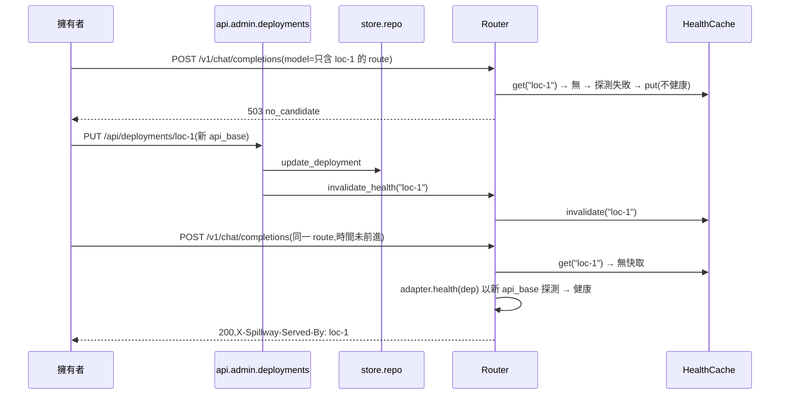
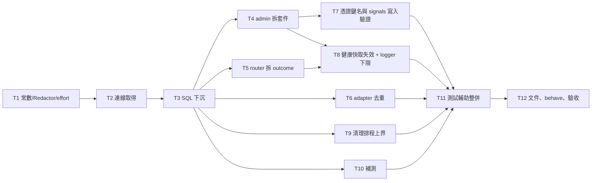

# CHG-20261101-02 — M2 整理:常數與連線取得統一、SQL 下沉、admin/router 拆檔、adapter 去重、憑證鍵名變體阻擋、健康快取失效、清理排程上界與補測

- 專案:spillway
- 分支(Branch):`chg-20261101-02`(自 main 1c8d1a1 分出;驗收通過後依 DIR-4 規則 2、4 自動合回 main 並推送)
- 日期:2026-11-01(UTC+0)
- 類型:修改(重構 + 小幅行為修正 + 補測)
- Template: plan
- 提出者:擁有者(使用者,2026-11-01「繼續處理未完成項目」)
- 實作者:claude-opus-5-5(主 session agent;平行 task 由其派出的子 agent 施工,見「平行施工」)
- 風險分級:中——命中跨模組介面(連線取得、`adapters.base` 新增共用 adapter 基底類別、`api.admin` 改為套件)與安全相關的寫入驗證(憑證鍵名阻擋擴大到變體與複合字根、寫入時驗證 `params.signals`);不改資料模型(schema 仍為 v1)、不新增相依、不改網路暴露面、不新增刪除路徑
- Commit/PR:`chg-20261101-02` 分支上訊息以 `CHG-20261101-02:` 開頭的 commit(`git log --grep CHG-20261101-02`);合回 main 後回填
- 驗收報告(預留):ACC-20261101-01
- 重複性檢查(Recurrence check):無重複(動機為 CHG-20261030-02「下一筆 CHG」整理項與 ACC-20261031-01 追蹤項;與既有 CHG 動機皆不同)
- Diagrams:見「## 設計圖」節
- Security-impact:見「## 安全影響」節
- Skill: ai-sdlc-autopilot v1.69
- 關聯:CHG-20261030-02 第 226、653–656 行(已知限制、驗收追蹤項、下一筆 CHG 整理項)與決策 54、59;ACC-20261031-01 已知限制第 3、4、7、8、9、10 項;knowledge DIR-1、DIR-2、DIR-3、DIR-4

## 動機

M2(CHG-20261030-02)已合回 main。施工審議與獨立驗收留下一批不影響正確性、但會讓 M3 疊上去時變難改的整理項:連線取得有五種寫法、常數與 `Redactor` 散在多處、admin.py 1202 行、三份逐位元相同的 adapter.py、SQL 散在 api 與 quota/estimate;另有幾個小的行為缺口(健康快取在管理 API 修改後最多 10 秒才失效、root logger 為 DEBUG 時 LiteLLM 與底層 SDK 會把 prompt 印進日誌、清理排程最壞間隔約 3600.9 秒、憑證鍵名只擋完全相同的 8 個名稱、寫入時不驗證 `params.signals`)與驗收補測。M3 會在 admin、router、adapters.base 上加端點與 CLI 模組,先整理可以讓 M3 的 diff 只含新功能。

## 使用者故事

1. 作為擁有者,我要在成員 `params` 裡誤填 `x-api-key`、`client_secret`、`openai_api_key`、`secret_key`、`api_token` 這類變體鍵名時被拒絕並看到不含值的錯誤,以便金鑰不會因為鍵名寫法不同而被存進資料庫(決策 1)。
2. 作為擁有者,我要在 `params.signals` 寫入格式不合法的判定規則時當下就得到 422,而合法的 signals 結構(spec 5.3.1 的類別與條件名)不會被鍵名比對誤擋,以便錯誤在寫入時就被發現(決策 4)。
3. 作為擁有者,我要以管理 API 修改或刪除 local 成員後,下一次經 route 的請求立即以新設定判斷健康,而不是沿用最多 10 秒的舊結果(`local/<id>` 直呼本來就不看健康快取)。
4. 作為擁有者,我要即使把日誌等級開到 DEBUG,LiteLLM 與它呼叫的 SDK、HTTP 程式庫也不會把 prompt 原文印進日誌。
5. 作為擁有者,我要過期的 context 內容在過期後 1 小時內被刪除(NFR-5),不因輪詢抖動多拖一秒。
6. 作為擁有者,我要閘道在整理後行為與 M2 完全相同(既有 1089 個 pytest 與 18 個 behave 情境全綠、NFR-1/2 不退步),以便整理不帶來回歸。

## 決策與取捨

| # | 決策 | 選項 | 前提假設(此決策建立在什麼之上) | 為何這樣選 |
|---|------|------|----------------------------------|------------|
| 1 | **(使用者決定 2026-11-01,含決策審議 B2)** 憑證鍵名改為「正規化後比對」:鍵名轉小寫並去掉 `-`、`_`、`.`、空白後,(a) 完全等於 `apikey`、`apikeys`、`xapikey`、`key`、`token`、`secret`、`password`、`passwd`、`passphrase`、`authorization`、`bearer`、`credential`、`credentials` 之一,或 (b) 以下列字根結尾:`apikey`、`apikeys`、`secret`、`password`、`passwd`、`passphrase`、`secretkey`、`privatekey`、`accesskey`、`apitoken`、`accesstoken`、`authtoken`、`sessiontoken`、`refreshtoken`、`idtoken`、`bearertoken` → 422 `validation_error`,不回顯值 | (a) 擋變體 / (b) 維持完全比對;B2:(a) 維持清單 / (b) 加複合字根 / (c) 再加 `key` 結尾 | 原規則(CHG-20261030-02 決策 54)只擋 8 個完全相同的鍵名;誤擋的代價只是一次明確的 422 | 使用者選「擋變體」,決策審議 B2 選 (b)。`key`、`token` 只做完全比對、不做結尾比對,避免誤擋 `max_tokens`、`max_token`、`monkey`、`cache_key`。「供應商名 + key/token」(`openai_key`、`hf_token`、`github_token`)仍不擋,列入已知限制。 |
| 2 | **(使用者決定 2026-11-01)** 冷卻與預算分開存(schema v2)延到 M3,與存取 token 的 schema 變更合成一次 migration;本筆不改 schema | (a) 延到 M3 / (b) 本筆另開 CHG / (c) 不做 | `~/spillway-smoke` 已有真實資料庫,任何 schema 變更屬永遠停點(正式資料遷移) | 使用者選 (a)。CHG-20261030-02 決策 59 的 `type=none` 暫行列維持。 |
| 3 | **(使用者決定 2026-11-01)** admin.py、router.py 拆檔、SQL 下沉 store/repo、連線取得統一都在本筆做 | (a) 本筆做 / (b) 延到 M3 | 行為不變,由既有測試與 NFR-1、NFR-2 重跑把關 | 使用者選 (a)。M3 開工前完成,M3 的 diff 只含新功能。 |
| 4 | **(使用者決定 2026-11-01,決策審議 B1)** `params.signals` **不豁免**鍵名比對:整棵 `params`(含 signals)一律做鍵名比對與值樣式比對;另於管理 API 寫入 `params` 時呼叫 `validate_signals(params["signals"], "params.signals")`,不合法回 422 `validation_error` | (a) 不豁免 / (b) 只豁免結構層 / (c) 整棵豁免 | `validate_signals` 只限定頂層類別與條件名,`match`/`equals` 的欄位名與值不受限;spec 5.3.1 的結構鍵沒有一個會被決策 1 擋到 | 使用者選 (a)。豁免沒有收益且會放寬憑證檢查。代價:`match`/`equals` 若要比對名稱就叫 `token`、`secret` 的上游欄位會 422,列入已知限制。 |
| 5 | 連線取得統一:基礎層 `store.db.ConnSource`(`Connection` 或零參數 callable)與 `store.db.use_conn(source)` context manager 取代 resolver、quota、estimate 三份 `_conn()`。**`use_conn` 一律不關閉連線**——傳入 Connection 時直接交回;傳入 callable 時呼叫一次並交回,關閉責任留在開啟者(Router 的 `close_conn`、API 層的 `request_conn`)。API 層以 `api.deps.request_conn(request)` context manager(每次呼叫讀 `request.app.state.conn_factory()` 開一條、離開時關閉;在 async handler 內於事件迴圈執行緒執行)取代 admin `_db(request)` 與 openai.py 直接呼叫 `conn_factory()`;**不使用 FastAPI `Depends`** | `Depends(get_conn)` vs context manager vs 保留現狀 | 連線以預設 `check_same_thread=True` 開啟(`store/db.py:48`),同步 generator dependency 會在 threadpool 開連線;`test_review_w6_admin.py:94-96` 以 `SimpleNamespace(app=app)` 直接呼叫 handler;`test_review_w6_openai.py:117` 在建 app 後替換 `conn_factory` | context manager 與現行 `_db(request)` 的開關時機相同(回應建立前關閉)、執行緒不變、既有直接呼叫 handler 的測試不受影響。Router 的 contextvar 不動(NFR-1 依賴它)。`LedgerWriter`、`RetentionJob` 維持收 Connection。**代使用者決定**。 |
| 6 | 常數集中到 `spillway/domain.py`:`KINDS`、`CLOUD_KINDS`、`CALL_STATUSES`、`LEDGER_STATUSES`(型別維持 `frozenset`)、`COOLING_STATUSES = ("quota_exhausted", "rate_limited")`、`STATUS_SKIPPED_PRECHECK`;其他模組一律 import;`spillway.ledger.LEDGER_STATUSES`、`spillway.routing.CLOUD_KINDS` 保留為轉匯出(同一物件);admin 的 `Literal` 以 `typing.get_args` 測試與 domain 常數一致 | domain vs 新建 constants.py | domain.py 已是基礎層;`LEDGER_STATUSES` 在 `ledger.__all__` 是 frozenset | 不新增模組;分層不變;型別不變所以 `in`/集合運算的呼叫端行為不變。**代使用者決定**。 |
| 7 | `Redactor` 改為單一共用實例 `spillway.redact.REDACTOR`(Redactor 無狀態,`extra_secrets` 每次呼叫傳入);`LedgerWriter(redactor=None)` 預設用它 | 共用實例 vs app.state 注入 | Redactor 只持有編譯後的樣式 | 測試仍可傳入自己的實例。**代使用者決定**。 |
| 8 | `normalize_effort`、`InvalidEffort` 移到 `spillway/effort.py`;`spillway.routing` 與 `spillway.routing.router` 都保留轉匯出(`routing.router.__all__` 不變) | 移動並轉匯出 vs 只移動 | api 層與 `tests/unit/routing/test_router.py:23-29` 由 `spillway.routing` / `spillway.routing.router` 匯入 | 轉匯出讓舊匯入路徑不破。**代使用者決定**。 |
| 9 | `api/admin.py` 改為套件 `api/admin/`:`__init__.py`(組 `router`;`__all__ == ["router"]` 不變;另轉匯出 `ApiError`、`QuotaService`、`test_deployment`、`TEST_TEXT_PREVIEW`、`ChatBody` 等既有測試讀取的模組屬性)、`common.py`(錯誤、共用 helper)、`models.py`(成員、群組、route 的請求 body 模型,含呼叫憑證掃描與 `validate_signals` 的 validator)、`secrets.py`(憑證鍵名與值樣式掃描)、`deployments.py`(含 test-call)、`groups.py`、`routes.py`(含 order)、`planning.py`(dry-run、estimate)、`ledger.py`、`settings.py`、`dashboard.py`、`adapters.py`;各子模組的 logger 一律 `logging.getLogger("spillway.api.admin")`(logger 名稱不變);`spillway.api.admin.router` 匯入路徑不變 | 套件 vs 多個平行檔 admin_*.py | app.py 只 `include_router(admin.router)`;`test_review_w6_admin.py:29,70,94-96` 讀 `__all__`、monkeypatch `admin.QuotaService.mark`、直接呼叫 `admin.test_deployment` | 依原檔 `# ====` 段落切,純搬移、不改行為。body 模型獨立成 `models.py`,讓 T7 與 T8 在同一波次不改同一檔。**代使用者決定**。 |
| 10 | `routing/router.py` 拆出 `routing/outcome.py`(`RouteOutcome`、`AttemptInfo`、`Plan`、`PlanSlot`、`PlanEntry`、`PlanExcluded` 等 router.py 目前定義的全部回傳 dataclass);`spillway.routing` 與 `spillway.routing.router` 轉匯出不變 | 拆 outcome vs 再拆 dry_run | router.py 527 行,dataclass 占約 75 行、effort 正規化約 25 行(決策 8 移走) | 只拆資料型別;Router 的流程留在一個檔案,方便對照 spec 4.x。**代使用者決定**。 |
| 11 | 三份相同的 adapter.py 上移為 `adapters/base/api_adapter.py` 的 `LiteLLMApiAdapter`(建構子 `(context, manifest)`,行為與原 adapter.py 相同);各模組 `adapter.py` 保留(DIR-3 規則 1 的檔案結構),內容改為 `class LiteLLMAdapter(LiteLLMApiAdapter)` 並附模組說明,類名與建構順序不變,所以三個模組的 `__init__.py` 不需修改;`test_builtin_adapter_py_files_are_identical` 一對一替換為「三個模組的 `LiteLLMAdapter` 都是 `LiteLLMApiAdapter` 子類別且未覆寫 call/health」 | 共用基底類別 vs 模組改 import 函式 | 模組只可 import `adapters.base`(DIR-3);`__init__.py` 以 `LiteLLMAdapter(context, MANIFEST)` 建立;`test_review_w3_fixes.py:130` 讀 `mod.LiteLLMAdapter` | 保留類名避免遮蔽 `adapters.base.Adapter` Protocol 名稱,也不動 `__init__.py`。**代使用者決定**。 |
| 12 | 健康快取失效:`HealthCache.invalidate(dep_id)`(新增)與既有 `clear()`;管理 API 對成員 PUT(含 `enabled` 變更;沒有獨立的啟停端點)、DELETE 成功後呼叫 `app.state.router.invalidate_health(dep_id)` | 管理 API 呼叫失效 vs 快取鍵含成員設定雜湊 | Router 是 app 單例;健康快取只在 route 路徑的 `CandidateFilter` 讀寫(`local/` 直呼不讀) | 明確失效最簡單,行為可測。clear-cooldown、群組與 route 的修改不是健康輸入,不失效。**代使用者決定**。 |
| 13 | `load_litellm` 把 `LiteLLM`、`LiteLLM Router`、`LiteLLM Proxy`、`openai`、`anthropic`、`httpx`、`httpcore` 七個 logger 的等級設為「DEBUG 或 NOTSET 時改為 INFO,其他等級不動」;不修改這些 logger 的 `propagate` 與 handler | 固定 INFO vs 固定 WARNING;只管 LiteLLM vs 連同 SDK 與 HTTP 程式庫 | prompt 回顯與 request options 的輸出只在 DEBUG 等級;LiteLLM 呼叫底層 SDK 與 httpx | INFO 保留一般資訊,只擋 DEBUG。**代使用者決定**。 |
| 14 | 清理排程:`due()` 的提前量由 `poll` 改為 `2 × poll`,docstring 改述上界為「輪詢抖動 ≤ poll 時,兩次清理間隔 ≤ interval」;既有 `test_worst_case_delay_is_at_most_interval` 依新提前量改寫斷言(允許的改寫,見 Global Constraints);新增分辨新舊實作的抖動測試;NFR-5 驗收補「過期時刻起 ≤ 1 小時刪除」斷言 | 2×poll vs 以單調時鐘排程 | 抖動來自 `asyncio.sleep` 超時與清理耗時,量級遠小於一個 poll(30 秒) | 改一個常數即可把上界拉回 1 小時內;清理最多提早 60 秒,不違反「每小時」。清理本身耗時超過 poll 的情況不在上界內,ACC 揭露。**代使用者決定**。 |
| 15 | `functions`、`function_call`(OpenAI 舊版參數)被丟棄一事寫入 README「相容性」小節與 design.md 新條目 D25;不改 spec | README + design vs spec 9.1 修訂 | spec 9.1 未列舉白名單;白名單是實作細節(U8) | 不動規格書。**代使用者決定**。 |
| 16 | (決策審議撤回)openai.py 局部的 `except Exception → ApiError(500, internal_error)` **保留**,不交給全站 handler | 移除 vs 保留 | Starlette `ServerErrorMiddleware` 送出 500 後會 re-raise,uvicorn 會印含例外訊息的 traceback;兩者日誌文字也不同 | 移除會造成秘密進日誌的回歸(DIR-2 2b)與既有測試拋例外。原登記項「交給全站 handler」不做,ACC 記為撤回並附理由。 |
| 17 | AC-4 補「無 seed」樣本:在本筆新建的 `tests/features/m2c_cleanup.feature` 加一個情境(成員 api-a 權重 high、api-b 權重 low,額度比例 1、無 budgets 列,slot 1 "api-a,api-b";未給 seed 的 `SystemRng()`;4000 次 dry-run;第一順位比例介於 0.70 與 0.80;期望 0.75,標準差約 0.0068,區間約 ±7 個標準差);步驟斷言亂數來源的 seed 為 None;既有 `m2_routing.feature` 情境文字不改 | behave 情境 vs acceptance 測試 | 登記項(CHG-20261030-02:655、ACC-20261031-01:151)要求以情境補上;本筆即為治理 | 照登記形式。**代使用者決定**。 |
| 18 | `serve` 的 `timeout_graceful_shutdown` 延到 M3(與 MCP 常駐一起決定) | 本筆 vs M3 | M3 才有常駐的 MCP 連線 | 照 CHG-20261030-02 第 656 行原登記。**代使用者決定**(沿用原登記)。 |
| 19 | 測試輔助整併:`anyio_backend` 移到 `tests/conftest.py` 一處;假金鑰環境變數 fixture、成員/route/app 建構器集中到 `tests/helpers.py`;`tests/integration/admin/conftest.py` 的 `make_app` 改呼叫 `create_app()` 而不是手抄 `app.state` 接線,並以測試確認改用後 `app.state` 的屬性集合與原手抄版本相同 | 集中 vs 現狀 | 測試數量只增不減 | 收斂後 M3 的測試直接重用。**代使用者決定**。 |

## 設計圖

### 圖 1:本筆前後的模組配置(只列有變動的部分)

```mermaid
flowchart TB
  subgraph before[整理前]
    A1[api/admin.py 1202 行<br/>含 SQL、_db(request)、_REDACTOR] --> R1[routing/router.py<br/>含 normalize_effort、outcome dataclass]
    O1[api/openai.py<br/>直接 conn_factory()、_REDACTOR] --> R1
    R1 --> Q1[quota.py _conn + SQL]
    R1 --> E1[estimate.py _conn + SQL]
    R1 --> S1[resolver.py _conn]
    X1[anthropic_api/adapter.py] -.逐位元相同.- X2[openai_api/adapter.py] -.逐位元相同.- X3[litellm/adapter.py]
  end
  subgraph after[整理後]
    A2[api/admin/ 套件<br/>common models secrets deployments groups routes planning ledger settings dashboard adapters] --> D2[api/deps.request_conn]
    O2[api/openai.py] --> D2
    A2 --> R2[routing/router.py + routing/outcome.py]
    O2 --> R2
    R2 --> EF[effort.py<br/>EffortMapper + normalize_effort]
    R2 --> Q2[quota.py] --> REPO[store/repo.py<br/>全部 SQL]
    R2 --> E2[estimate.py] --> REPO
    A2 --> REPO
    Q2 & E2 & S2[resolver.py] --> UC[store/db.use_conn<br/>不關閉連線]
    DOM[domain.py 常數] --- RED[redact.REDACTOR]
    B2[adapters/base/api_adapter.LiteLLMApiAdapter] --> Y1[三個模組的 LiteLLMAdapter:子類別]
  end
```

### 圖 2:管理 API 修改成員後的健康判定(經 route)



### 圖 3:平行施工波次



## 安全影響

範圍依 knowledge DIR-2:威脅模型只有擁有者本人在本機使用;下表回答四類永遠停點是否被本筆觸及。

| 類別 | 是否觸及 | 影響範圍 / 理由 |
|------|----------|-----------------|
| irreversible-delete | 否 | 不新增任何刪除路徑;`DELETE /api/deployments/{id}` 的連帶刪除行為不變,本筆只補測試(T10)。已以變體鍵名存入資料庫的值本筆**不清除**(清除屬不可逆刪除,須另交擁有者),見已知限制。施工與測試只在 pytest 暫存 `SPILLWAY_HOME`;agent 不碰擁有者的資料目錄(`~/spillway-smoke` 與預設資料目錄)。 |
| payments | 否 | 不發起付款;自動測試只打 `tests/fakes/` 假端點。 |
| prod-migration | 否 | schema 維持 v1、`MIGRATIONS` 與 `schema.sql` 不變;冷卻與預算分開存延到 M3(決策 2)。T10 只新增測試(表名衝突的資料庫套用 v1 失敗並回滾;只含無關表的資料庫照現況成功套用 v1),不改 migration 程式。 |
| security-boundary | 否(寫入驗證收緊,不改邊界) | 綁定位址、管理 API 無驗證的前提、憑證解析方式皆不變。憑證鍵名阻擋擴大到變體與複合字根(決策 1),`params.signals` 不豁免並加寫入時格式驗證(決策 4)——兩者都只讓寫入被拒得更多,沒有任何原本會被擋的輸入改為放行。logger 下限(決策 13)減少 prompt 與 request options 外洩到日誌。openai.py 的局部 500 處理保留(決策 16),避免例外訊息經 uvicorn traceback 進日誌。秘密不寫入 repo、日誌、context 記錄(DIR-2 規則 2b)與不讀取訂閱 OAuth token(2c,本筆不含 CLI 模組)照舊。 |

已知限制(DIR-2 範圍內,只記錄、不實作):
- 鍵名正規化只處理大小寫與 `-`、`_`、`.`、空白;「供應商名 + key/token」(`openai_key`、`anthropic_key`、`hf_token`、`github_token`)、`pwd` 與全形或零寬字元等拼法不擋。值樣式比對仍只認得 Redactor 的樣式(`sk-` 等),非樣式金鑰放在未被擋的鍵名下無法偵測。
- `params.signals` 的 `match`/`equals` 若要比對名稱為 `token`、`secret` 等的上游欄位會被 422(決策 4 的代價)。
- 本筆前已以變體鍵名存入的值仍留在資料庫,且 `GET /api/deployments` 會回顯(ACC-20261031-01 #3)。**擁有者提醒**:若曾在 `params` 放過金鑰,請自行以 PUT 改掉該欄位;本筆後對該成員的 PUT 若仍帶著變體鍵名會被 422。
- 健康探測進行中時若管理 API 剛好失效快取,探測完成後仍可能寫回舊結果,最多維持一個 TTL(10 秒)。
- 只含無關表、`user_version=0` 的資料庫會被直接套用 v1(現況,本筆以測試釘住、不改)。
- 清理排程上界只在輪詢抖動 ≤ poll 時成立;單次清理耗時超過 poll 不在上界內。
- `serve` 的 graceful shutdown 上限仍為 adapter 逾時(決策 18,延到 M3)。
- 延續 CHG-20261030-02 第 226 行、本筆不處理:缺 `lsof` 的環境中 NFR-3 與操作驗收測試會跳過;長度不足 4 字元的 `extra_secrets` 不遮罩;fallback 中前一個成員的憑證不在本次嘗試的 `extra_secrets` 內;本機其他程式可對 127.0.0.1:8787 發請求(DNS rebinding、CSRF),M3 加 token 時參考。

## 修改指引

### 目標

除使用者故事 1–5 的行為修正外不改對外行為,完成 CHG-20261030-02 第 656 行的整理項(冷卻與預算分開存、graceful shutdown 延到 M3,決策 2、18;openai.py 局部 500 交給全站 handler 經審議撤回,決策 16)與 ACC-20261031-01 的追蹤補測;既有 1089 個 pytest、18 個 behave 情境全綠,NFR-1、NFR-2 重跑達標。

### 影響範圍

| 受影響項 | 類型 | 改動 | 連帶影響 |
|----------|------|------|----------|
| `src/spillway/domain.py`、`redact.py`、`effort.py` | 設計 | 常數集中、`REDACTOR` 共用實例、`normalize_effort` 移入 | 所有引用處改 import;`spillway.routing`、`spillway.routing.router`、`spillway.ledger` 轉匯出 |
| `src/spillway/store/db.py`、`store/repo.py` | 資料存取 | `ConnSource`、`use_conn`;新增查詢函式承接 admin、quota、estimate 的 SQL | quota、estimate、resolver、api.admin |
| `src/spillway/routing/`(router、outcome〔新〕、filter、selector、resolver、`__init__`) | 邏輯 | 拆 outcome;常數改 import;`invalidate_health` | api.admin、api.openai、M3 MCP `ask` |
| `src/spillway/quota.py`、`estimate.py`、`ledger.py` | 邏輯 | SQL 改呼叫 repo;連線經 `use_conn`;Redactor 預設共用 | 無對外變化 |
| `src/spillway/api/`(`__init__`、`deps.py`〔新〕、`openai.py`、`admin.py` → `admin/` 套件) | 介面 | 拆套件、`request_conn` 取得連線、鍵名變體阻擋、signals 寫入驗證、健康快取失效 | M4 Web UI 呼叫的端點與 body 不變 |
| `src/spillway/adapters/base/`(`api_adapter.py`〔新〕、`litellm_call.py`、`__init__`)、三個模組的 `adapter.py` | 設計 | 共用 `LiteLLMApiAdapter`;logger 下限 | M3 CLI 模組不受影響 |
| `src/spillway/app.py` | 應用 | 清理排程提前量 2×poll | NFR-5 |
| `tests/`(conftest、helpers〔新〕、unit、integration、acceptance、features) | 測試 | 整併與補測;新增 `tests/features/m2c_cleanup.feature` | directory.md |
| `README.md` | 文件 | 「相容性」小節:`functions`/`function_call` 丟棄 | 無 |
| sdlc_docs/structure/design.md、logical.md、directory.md | 文件 | 見「規格書與結構文件更新」 | 無 |

### Global Constraints(全域約束——每個 task 都要遵守)

- 語言與版本:Python ≥ 3.11(驗收平台 3.13);套件名 `spillway`,src layout;路徑一律 `pathlib`。
- 相依套件:不新增任何相依;`pyproject.toml` 不改。要新增相依時停下回報。
- 規格依據:行為以 `docs/spec.md` 與 CHG-20261030-02 決策表為準,本筆決策表只覆寫它列出的項目;不修改 `docs/spec.md`、`docs/proposal.md`。
- **行為不變**:除使用者故事 1–5 與決策 1、4、12、13、14 指定的變化外,任何 HTTP 回應、header、錯誤碼、帳本與 payload 內容、日誌文字與 logger 名稱都不可改變。既有測試不可為了配合重構而修改斷言;只允許 (1) 改 import 路徑、fixture 來源與檔案位置(T11);(2) 一對一替換 `tests/unit/adapters/test_review_w3_fixes.py` 的 `test_builtin_adapter_py_files_are_identical`(決策 11);(3) 改寫 `tests/integration/test_retention_schedule.py` 的 `test_worst_case_delay_is_at_most_interval` 以符合 2×poll 提前量(決策 14)。若有其他既有測試因決策 1、4 的規則而失敗(例如 fixture 的 `params` 用了被擋的鍵名),停下回報,不自行修改。
- 公開匯入路徑保留:`spillway.api.admin.router`(及 `spillway.api.admin.__all__ == ["router"]` 與決策 9 列出的轉匯出屬性)、`spillway.routing` 既有 `__all__` 的每個名稱、`spillway.routing.router` 既有 `__all__` 的每個名稱、`spillway.ledger.LEDGER_STATUSES`、`spillway.adapters.base` 既有 `__all__` 的每個名稱;轉匯出必須是同一物件;新增的名稱加入對應 `__all__`。
- 分層:相依只可由上往下(sdlc_docs/structure/logical.md);`spillway.adapters.<module>` 只可 import `spillway.adapters.base`、標準庫與 `pyyaml`;`tests/contract/test_layering.py` 檢查。T3 起 SQL 只可出現在 `src/spillway/store/`:判定規則為「AST 中不是 docstring 的字串常數、去掉前導空白後以 `SELECT`、`INSERT`、`UPDATE`、`DELETE`、`WITH`、`PRAGMA` 開頭(不分大小寫,後接空白)」與「`.execute(`、`.executemany(`、`.executescript(` 呼叫」,由 `tests/contract/test_layering.py` 檢查。
- 連線:`store.db.use_conn` 不關閉任何連線;關閉責任只在開啟者(Router 的 `close_conn`、`api.deps.request_conn`、`RetentionScheduler`)。連線一律在使用它的執行緒開啟(`check_same_thread` 不改)。
- 非同步、時間與亂數、測試上游、秘密、網路、資料目錄、錯誤格式:沿用 CHG-20261030-02 Global Constraints 同名各條(`Clock`/`Rng` 注入;只打 `tests/fakes/`;測試金鑰 `sk-test-0000`;只綁 127.0.0.1;測試以 `tmp_path` 為 `SPILLWAY_HOME`;錯誤一律 `{"error": {"code", "message"}}`),逐條照舊適用。
- 範圍:不改 schema(`schema.sql` 一個字元都不改)、不做冷卻與預算分開存、不做 graceful shutdown、不實作任何 M3/M4 功能。
- 每個 task 的測試必須能以該 task 的 `test:` 指令獨立執行並全綠;每個 task 完成時另跑一次全量 `python -m pytest -q` 確認無回歸。
- 既有的 `tests/features/m2_*.feature` 與本筆新增的 `m2c_cleanup.feature` 情境文字只能經修改治理變更;施工者只寫步驟檔。
- commit 訊息以 `CHG-20261101-02:` 開頭,結尾依當次 session 的署名規則加上 Co-Authored-By 行。
- 驗收平台為 macOS;Linux、Windows 在 ACC 標「未涵蓋」。

### 契約清單

| 契約 | 提供方 | 讀取方 | 本筆變更 | 契約測試(路徑/無) |
|------|--------|--------|----------|----------------------|
| `spillway.domain` 常數 `KINDS`、`CLOUD_KINDS`、`CALL_STATUSES`、`LEDGER_STATUSES`(frozenset)、`COOLING_STATUSES`、`STATUS_SKIPPED_PRECHECK`;`spillway.ledger.LEDGER_STATUSES`、`spillway.routing.CLOUD_KINDS` 轉匯出 | T1 domain | routing、quota、ledger、api.admin(`Literal` 一致性)、schema CHECK | 新增集中定義;移除 filter.py、selector.py 的重複 `CLOUD_KINDS` | tests/unit/test_domain_constants.py(新增;含 admin `Literal` 與 schema CHECK 一致性) |
| `spillway.redact.REDACTOR` 共用實例 | T1 redact | ledger、api、routing | 新增 | tests/unit/test_redact.py |
| `spillway.effort.normalize_effort`、`InvalidEffort`(`spillway.routing`、`spillway.routing.router` 轉匯出) | T1 effort | api.openai、api.admin.planning、Router | 移動 | tests/unit/test_effort.py;tests/contract/test_public_imports.py(新增,T1) |
| `store.db.ConnSource`、`store.db.use_conn(source)`(不關閉連線) | T2 store.db | resolver、quota、estimate、Router | 新增 | tests/unit/store/test_db_conn.py(新增) |
| `api.deps.request_conn(request)`(每次讀 `request.app.state.conn_factory()`,離開時關閉) | T2 api.deps | api.admin 各模組、api.openai `/v1/models` | 新增 | tests/integration/test_request_conn.py(新增) |
| `store.repo` 新增查詢函式(cardinality 計數、id 存在、帳本計數與篩選、dashboard 彙總〔維持單一 GROUP BY 查詢〕、kinds/providers、本期花費 SUM、`tokens_out` 歷史) | T3 repo | api.admin、quota、estimate | 新增(原本 SQL 散在讀取方) | tests/unit/store/test_repo_queries.py(新增);tests/contract/test_layering.py(SQL 只在 store) |
| `spillway.api.admin.router` 與管理 API 全部端點、body、錯誤碼;`admin.__all__` 與轉匯出屬性 | T4 api.admin 套件 | app.py;M4 Web UI;既有測試 | 拆檔,契約不變 | tests/integration/admin/test_admin_*.py(既有,不改斷言);tests/contract/test_public_imports_admin.py(新增,T4) |
| `spillway.routing` 與 `spillway.routing.router` 匯出的 `RouteOutcome`、`AttemptInfo`、`Plan`、`PlanSlot`、`PlanEntry`、`PlanExcluded` 等 | T5 routing.outcome | api、M3 MCP、既有測試 | 移動,型別不變 | tests/unit/routing/test_router.py;tests/contract/test_public_imports_routing.py(新增,T5) |
| `adapters.base.LiteLLMApiAdapter`(`__init__(context, manifest)`、`async call`、`async health`,行為與原 adapter.py 相同);各模組 `LiteLLMAdapter` 為其子類別 | T6 adapters.base | anthropic_api、openai_api、litellm | 新增 | tests/contract/test_adapter_contract.py;tests/unit/adapters/test_review_w3_fixes.py(相同性測試一對一替換為子類別測試) |
| 管理 API 憑證欄位規則:正規化鍵名比對(決策 1)套用整棵 `params` 與 `capabilities` 額外鍵;寫入時 `validate_signals`(決策 4);錯誤 422 `validation_error` 不回顯值 | T7 api.admin.secrets、api.admin.models | 擁有者、M4 UI-2 | 變更(擋得更多) | tests/integration/admin/test_admin_secret_keys.py(新增);tests/features/m2c_cleanup.feature |
| `Router.invalidate_health(dep_id)`、`HealthCache.invalidate(dep_id)` | T8 routing | api.admin.deployments | 新增 | tests/unit/routing/test_filter.py;tests/integration/admin/test_admin_health_invalidate.py(新增) |
| 七個 logger 的等級下限 INFO(決策 13) | T8 litellm_call | 日誌 | 新增 | tests/unit/adapters_base/test_litellm_logger.py(新增) |
| `RetentionScheduler.due()` 提前量 2×poll;抖動 ≤ poll 時兩次清理間隔 ≤ interval | T9 app.py | NFR-5 | 變更 | tests/integration/test_retention_schedule.py;tests/acceptance/test_nfr5_payload_expiry.py |

### Tasks(checkbox=續作點)

- [x] T1. 常數集中、共用 Redactor、`normalize_effort` 移到 effort.py
  - interfaces: consumes CHG-20261030-02 決策 31–34、U8 / produces `domain.py` 常數(決策 6)、`redact.REDACTOR`(決策 7)、`effort.normalize_effort`/`InvalidEffort`(決策 8)、`tests/unit/test_domain_constants.py`、`tests/contract/test_public_imports.py`
  - test: `python -m pytest tests/unit/test_domain_constants.py tests/unit/test_redact.py tests/unit/test_effort.py tests/contract/test_public_imports.py -q`
  - L1: `CLOUD_KINDS == ("cli", "api")` 且為 `KINDS` 子集;`LEDGER_STATUSES` 是 frozenset 且 `spillway.ledger.LEDGER_STATUSES is spillway.domain.LEDGER_STATUSES`;`COOLING_STATUSES` 為 `LEDGER_STATUSES` 子集;admin `Literal` 的 `get_args` 與 `KINDS`、`LEDGER_STATUSES` 逐值相同;schema.sql 的 kind CHECK 列出的值與 `KINDS` 相同(只讀 schema.sql,不改);`normalize_effort("minimal") == "none"`、不合法值丟 `InvalidEffort`;`spillway.routing.normalize_effort`、`spillway.routing.router.normalize_effort` 與 `spillway.effort.normalize_effort` 是同一物件
  - L2: `LedgerWriter()` 未傳 redactor 時使用的就是 `redact.REDACTOR`(以身分比對),寫入含 `sk-test-0000` 的 payload 後資料庫內容已遮罩;src 中除 `redact.py` 外沒有任何 `Redactor(` 建構(以 grep 測試斷言)
  - L3: 不適用(常數搬移沒有使用者看得到的行為變化;既有 18 個情境在 T12 全量重跑確認不變)
  - L4: 不適用(本 task 不改任何對外端點或啟動流程,端到端在 T12 的操作驗收一次執行)

- [x] T2. 連線取得統一:`store.db.use_conn` 與 `api.deps.request_conn`
  - interfaces: consumes T1 / produces `store.db.ConnSource`、`store.db.use_conn`、`api/deps.py` 的 `request_conn`;resolver、quota、estimate 的 `_conn()` 移除;admin `_db(request)` 與 openai.py 直接呼叫 `conn_factory()` 改用 `request_conn`(決策 5);handler 簽名不變(仍收 `request`)
  - test: `python -m pytest tests/unit/store/test_db_conn.py tests/integration/test_request_conn.py tests/unit/routing tests/unit/test_quota.py tests/unit/test_estimate.py tests/integration/admin/test_review_w6_admin.py tests/integration/test_review_w6_openai.py -q`
  - L1: `use_conn(conn)` 交回同一連線且離開後連線仍可用;`use_conn(factory)` 呼叫工廠一次、交回其結果且離開後連線仍可用;傳入其他型別丟 `TypeError`;以 Router 跑一次完整 `route()`(經 resolver、quota、estimate、ledger),整個過程中 contextvar 的連線一直可用,直到 Router 的 `_close` 才關閉
  - L2: 以包裝後的 `app.state.conn_factory` 計數,對 `/api/deployments` 連續 50 次 GET 後開啟數 = 關閉數 = 50;在建 app 後替換 `app.state.conn_factory`,下一次請求使用新的工廠;`admin.test_deployment(SimpleNamespace(app=app), "a")` 直接呼叫照舊可用;Router 一次請求只開一條連線(沿用既有 contextvar 測試並加開啟次數斷言)
  - L3: 不適用(連線取得沒有使用者看得到的行為;既有情境於 T12 重跑)
  - L4: 不適用(端到端由 T12 操作驗收以 `spillway serve` 子行程覆蓋)

- [ ] T3. SQL 下沉到 store/repo,重跑 NFR-1、NFR-2
  - interfaces: consumes T2 / produces `store.repo` 新查詢函式(契約清單第 6 列;dashboard 彙總維持一條 `GROUP BY deployment_id` 查詢、不與 `QuotaService` 的逐成員查詢共用;帳本清單與 `COUNT(*)` 維持兩條獨立敘述、不包進 `transaction()`);admin、quota、estimate 不再含 SQL;`tests/contract/test_layering.py` 新增 Global Constraints 定義的 SQL 位置檢查
  - test: `python -m pytest tests/unit/store tests/contract/test_layering.py tests/integration/admin tests/acceptance/test_nfr1_dry_run_p95.py tests/acceptance/test_nfr2_dashboard_p95.py -q`
  - L1: 每個新查詢函式以 `db` fixture 建資料後回傳值與搬移前的 SQL 相同(每個函式至少一則,含帳本篩選的空條件、多條件組合;dashboard 彙總含 `type=none` 冷卻列以日曆月計,CHG-20261030-02 決策 59)
  - L2: `/api/dashboard`、`/api/ledger`(含篩選與分頁)、`QuotaService.remaining`、`Estimator` 的結果與搬移前相同(既有整合測試不改斷言全綠);layering 檢查在 store 以外放入 `conn.execute("SELECT 1")` 時失敗、放入 docstring `"""DELETE /api/deployments"""` 時不失敗(以暫存檔測試檢查器本身)
  - L3: 不適用(SQL 位置沒有使用者看得到的行為變化)
  - L4: NFR-1 重跑(1,000 次 dry-run P95 < 20 ms)與 NFR-2 重跑(100 成員、10,000 列帳本下(Guideline 第 6 節) `/api/dashboard` P95 < 200 ms),兩個數字記入 ACC

- [ ] T4. `api/admin.py` 拆為 `api/admin/` 套件
  - interfaces: consumes T3 / produces 決策 9 的模組配置(`secrets.py`、`models.py` 留給 T7,`deployments.py` 留給 T8);`tests/contract/test_public_imports_admin.py`
  - test: `python -m pytest tests/integration/admin tests/integration/test_errors_openai.py tests/integration/test_review_w6_openai.py tests/contract -q`
  - L1: `spillway.api.admin.__all__ == ["router"]`;決策 9 列出的轉匯出屬性存在且與實作所在子模組的物件相同;每個子模組行數 ≤ 400;子模組 logger 名稱為 `spillway.api.admin`
  - L2: `create_app()` 的 OpenAPI 路徑集合、每個路徑的方法與回應狀態碼和拆檔前完全相同(拆檔前先把集合存成測試內常數);`monkeypatch.setattr(admin.QuotaService, "mark", ...)` 的既有測試照舊生效
  - L3: 不適用(純搬移;管理 API 的使用者行為由既有整合測試與 T12 情境重跑覆蓋)
  - L4: 不適用(端到端由 T12 操作驗收覆蓋)

- [ ] T5. `routing/router.py` 拆出 `routing/outcome.py`
  - interfaces: consumes T3 / produces `routing/outcome.py`(決策 10);`spillway.routing` 與 `spillway.routing.router` 匯出不變;`tests/contract/test_public_imports_routing.py`
  - test: `python -m pytest tests/unit/routing tests/contract/test_public_imports_routing.py -q`
  - L1: `from spillway.routing import RouteOutcome, AttemptInfo, Plan, PlanExcluded` 與 `from spillway.routing.router import InvalidEffort, Plan, RouteOutcome, normalize_effort` 仍可用,各型別的 `dataclasses.fields` 名稱清單與拆檔前相同;`spillway.routing.router.__all__` 與拆檔前相同
  - L2: 既有 `tests/unit/routing/test_router.py` 全綠且不改斷言(Router 產生、api 讀取的 outcome 欄位不變)
  - L3: 不適用(型別搬移沒有使用者看得到的行為)
  - L4: 不適用(端到端由 T12 操作驗收覆蓋)

- [ ] T6. 三份 adapter.py 去重為 `adapters.base.LiteLLMApiAdapter`
  - interfaces: consumes T3 / produces `adapters/base/api_adapter.py`、`adapters/base/__init__.py` 新增匯出、三個模組的 `adapter.py` 改為 `class LiteLLMAdapter(LiteLLMApiAdapter)`(決策 11;模組 `__init__.py` 不改);`test_builtin_adapter_py_files_are_identical` 一對一替換
  - test: `python -m pytest tests/contract tests/unit/adapters tests/unit/adapters_base -q`
  - L1: 三個模組的 `LiteLLMAdapter` 都是 `LiteLLMApiAdapter` 子類別,`LiteLLMAdapter.call is LiteLLMApiAdapter.call`、`health` 亦同;替換後 `tests/unit/adapters/test_review_w3_fixes.py` 的測試數與替換前相同
  - L2: 合約測試(`tests/contract/test_adapter_contract.py`、`test_call_status.py`)對三個模組全綠且不改斷言;layering 檢查確認模組仍只 import `adapters.base`
  - L3: 不適用(去重沒有使用者看得到的行為;`m2_adapters.feature` 於 T12 重跑)
  - L4: 不適用(端到端由 T12 操作驗收覆蓋)

- [ ] T7. 憑證鍵名變體阻擋與 `params.signals` 寫入驗證
  - interfaces: consumes T4(`api/admin/secrets.py`、`api/admin/models.py`)/ produces 決策 1、4 的規則;`tests/integration/admin/test_admin_secret_keys.py`;`tests/features/steps/cleanup_admin_steps.py`(本筆 feature 中所有「以管理 API …」「管理 API 回應…」「錯誤訊息…」「資料庫中…」步驟的唯一擁有者)
  - test: `python -m pytest tests/integration/admin/test_admin_secret_keys.py tests/integration/admin/test_review_w6_admin.py -q && python -m behave tests/features/m2c_cleanup.feature -n "變體憑證鍵名" -n "params.signals"`
  - L1: 正規化判定:`"X-Api-Key"`、`"client_secret"`、`"openai_api_key"`、`"Refresh-Token"`、`"db.password"`、`"secret_key"`、`"private_key"`、`"aws_access_key"`、`"api_token"`、`"session_token"`、`"x-auth-token"`、`"passphrase"`、`"api_keys"` 判為憑證鍵;`"max_tokens"`、`"max_token"`、`"keyword"`、`"tokenizer"`、`"monkey"`、`"cache_key"`、`"quota"`、`"rate_limit"`、`"http_status"`、`"error_code"`、`"exit_code"`、`"exit_code_not"`、`"match"`、`"equals"` 不判為憑證鍵;原 8 個鍵名照舊判為憑證鍵
  - L2: POST `/api/deployments` 的 `params` 含 `{"x-api-key": "abc"}`、巢狀 `{"headers": {"Client-Secret": "abc"}}`、清單內 `[{"secret_key": "abc"}]`、`{"signals": {"quota": [{"equals": {"api_key": "abc"}}]}}` 各回 422 `validation_error`,message 含鍵路徑、不含 `abc`,資料庫沒有該成員;`params.signals` 為合法覆寫規則時 201 且讀回內容相同;`params.signals` 格式不合法(例如未知類別鍵)時 422;PUT 同樣套用以上規則
  - L3: `tests/features/m2c_cleanup.feature` 情境「成員 params 含變體憑證鍵名時被拒且不回顯值」與「params.signals 的合法結構可寫入、不合法格式寫入時即被拒」通過
  - L4: 不適用(管理 API 驗證以 TestClient 與 behave 覆蓋;T12 的操作驗收以 `spillway serve` 子行程再打一次變體鍵名)

- [ ] T8. 健康快取失效與 logger 下限
  - interfaces: consumes T4(`api/admin/deployments.py`)、T5 / produces `HealthCache.invalidate`、`Router.invalidate_health`(決策 12);`load_litellm` 七個 logger 的下限(決策 13);`tests/integration/admin/test_admin_health_invalidate.py`、`tests/unit/adapters_base/test_litellm_logger.py`、`tests/features/steps/cleanup_health_steps.py`(只寫健康情境專屬步驟,「以管理 API …」步驟沿用 T7 的 `cleanup_admin_steps.py`)
  - test: `python -m pytest tests/unit/routing/test_filter.py tests/integration/admin/test_admin_health_invalidate.py tests/unit/adapters_base/test_litellm_logger.py -q && python -m behave tests/features/m2c_cleanup.feature -n "api_base"`
  - L1: `HealthCache.invalidate("a")` 後 `get("a")` 為 None、`get("b")` 不受影響;root logger 設 DEBUG 後呼叫 `load_litellm()`,七個 logger 的 `level` 皆為 INFO;事先設為 WARNING 的不被改為 INFO;七個 logger 的 `propagate` 與 handler 清單在呼叫前後相同
  - L2: 只含 local 成員 `loc-1` 的 route,`api_base` 指向沒有服務的埠,第一次請求回 503 且健康快取記為不健康;PUT 改 `api_base` 指向假端點後,FakeClock 未前進的下一次請求回 200 且由 `loc-1` 處理;對照組:把 `invalidate_health` monkeypatch 成不做事時,同樣步驟的第二次請求仍回 503;DELETE 成員後快取中不再有該 id;以 root logger DEBUG 跑一次含已知 prompt 字串的請求,caplog 與 `capfd` 擷取的 stderr 中都沒有該字串
  - L3: `tests/features/m2c_cleanup.feature` 情境「修改 local 成員的 api_base 後,經 route 的下一次請求立即以新設定判斷健康」通過
  - L4: 不適用(T12 的操作驗收以 `spillway serve` 子行程執行同一步驟)

- [ ] T9. 清理排程上界與 NFR-5 斷言
  - interfaces: consumes T3 / produces `RetentionScheduler.due()` 提前量 2×poll 與 docstring 修正(決策 14);`test_retention_schedule.py` 改寫 `test_worst_case_delay_is_at_most_interval` 並新增抖動測試;`test_nfr5_payload_expiry.py` 新增「過期起 ≤ 1 小時刪除」斷言
  - test: `python -m pytest tests/integration/test_retention_schedule.py tests/acceptance/test_nfr5_payload_expiry.py -q`
  - L1: 以整數秒 FakeClock、interval 3600、poll 70(不整除 interval),每次輪詢前進 2×poll(模擬每次多睡一個 poll),連續 200 輪中任兩次清理的間隔 ≤ 3600;對照組:同一測試把提前量換回 1×poll 時間隔會超過 3600(證明測試分辨得出新舊實作);無抖動時清理不早於 `interval − 2×poll`
  - L2: 保存天數 1,payload 於 T 寫入;排程在 T + 1 天前一個 poll 內剛清理過(固定相位),之後 FakeClock 以 poll 步進並由排程本身輪詢觸發清理(不直接呼叫 `run_once`);T + 1 天前該列仍在,T + 1 天 + 1 小時時該列已刪除,帳本列保留,查詢回 410 `payload_expired`
  - L3: 不適用(`m2_context.feature` 的保存期限情境不變,於 T12 重跑)
  - L4: 不適用(1 小時量級的真實時間不在自動驗收中執行;以 FakeClock 的 L1、L2 覆蓋,ACC 揭露)

- [ ] T10. 驗收追蹤補測:keyring 端到端、DELETE 連帶刪除、migration 現況、AC-4 無 seed
  - interfaces: consumes T3 / produces `tests/integration/test_keyring_credential.py`、`tests/integration/admin/test_admin_delete_cascade.py`、`tests/unit/store/test_migration_nonempty.py`、`tests/features/steps/cleanup_ac4_steps.py`(決策 17);只新增測試與步驟檔,不改 src
  - test: `python -m pytest tests/integration/test_keyring_credential.py tests/integration/admin/test_admin_delete_cascade.py tests/unit/store/test_migration_nonempty.py -q && python -m behave tests/features/m2c_cleanup.feature -n "未給 seed"`
  - L1: 預先建好 `deployments` 表(表名衝突)且 `user_version=0` 的資料庫開啟時丟出錯誤、交易回滾、原表內容不變、`user_version` 仍為 0;只含一張無關表且 `user_version=0` 的資料庫開啟後 v1 套用成功、無關表保留(釘住現況,列入已知限制)
  - L2: 以記憶體 keyring 後端存入 `sk-test-0000`,成員 `credential_ref=keyring:spillway-test:acct`,一次 `/v1/chat/completions` 回 200 且假上游收到的 API key 為該值、帳本與 payload 不含該值;DELETE 成員後 deployment_tags、budgets、route_targets 無該 id,usage_ledger 與 usage_payloads 列保留,`/api/dashboard` 不列該 id,`/api/ledger` 仍可查到孤兒列,只含該成員的 route 送請求回 503 `no_candidate`
  - L3: `tests/features/m2c_cleanup.feature` 情境「未給 seed 的亂數來源下,同 slot 權重 high 與 low 的第一順位比例」通過(步驟斷言亂數來源的 seed 為 None)
  - L4: 不適用(補測不改行為;真實 macOS Keychain 路徑不在自動測試中執行,ACC 將 ACC-20261031-01 #7 標為「部分關閉」)

- [ ] T11. 測試輔助整併
  - interfaces: consumes T6–T10 / produces `tests/conftest.py` 的 `anyio_backend`、`tests/helpers.py`(假金鑰 fixture、成員/route/app 建構器)、`tests/integration/admin/conftest.py` 改用 `create_app()`(決策 19)
  - test: `python -m pytest -q`
  - L1: `tests/helpers.py` 的建構器產生的成員經 `repo.load_deployment` 往返後欄位相同
  - L2: T11 開工時(波次 5 合回後)先以 `python -m pytest --collect-only -q` 存下測試 id 集合;整併後的集合為其超集,差集只含 T11 自己新增的測試;`anyio_backend` 在 tests/ 只定義一次(grep 斷言);改用 `create_app()` 後 admin 測試 app 的 `app.state` 屬性名稱集合與原手抄版本相同
  - L3: 不適用(測試輔助沒有使用者看得到的行為)
  - L4: 不適用(全量 pytest 即本 task 的最終檢查)

- [ ] T12. 文件、行為情境全量、操作驗收
  - interfaces: consumes T1–T11 / produces README「相容性」小節(決策 15);design.md、logical.md、directory.md 同步;`artifacts/m2c/`(不進版控)
  - test: `python -m pytest -q && python -m behave tests/features`
  - L1: 不適用(本 task 不新增程式單元)
  - L2: NFR-1 與 NFR-2 沿用 T3 數字並再跑一次確認;NFR-4 預掃描命中 0;`pytest tests/acceptance -q -rs` 0 skipped(regression R3)
  - L3: 六個 feature 檔全部情境通過(既有五個 m2_* 不改,加 `m2c_cleanup.feature` 四個情境)
  - L4: 以 `spillway serve` 子行程 + 假端點執行「Acceptance operation」,`http-log.jsonl`(只含 method、path、status、耗時,經 Redactor)存到 `artifacts/m2c/`

### Behaviour spec

- feature: tests/features/m2_routing.feature
- feature: tests/features/m2_context.feature
- feature: tests/features/m2_estimate.feature
- feature: tests/features/m2_adapters.feature
- feature: tests/features/m2_quota.feature
- feature: tests/features/m2c_cleanup.feature

### Interaction spec

產物供 ACC-20261101-01 引用。

- kind: service-protocol
- cmd: python -m pytest tests/integration -q --junitxml=artifacts/m2c/integration.xml
- artifacts: artifacts/m2c/integration.xml
- kind: service-protocol
- cmd: python -m pytest tests/acceptance/test_operation.py -q
- artifacts: artifacts/m2c/http-log.jsonl
- kind: library-api
- cmd: python -m pytest tests/contract -q --junitxml=artifacts/m2c/contract.xml
- artifacts: artifacts/m2c/contract.xml

### Acceptance operation

- operate:(macOS)建立暫存 `SPILLWAY_HOME`,啟動假端點與 `python -m spillway serve`;依 CHG-20261030-02 的 Acceptance operation 原步驟執行一次(冷卻後由 slot 2 接手、`local/` 直呼、含 `sk-test-0000` 的 prompt、dry-run、`stream: true`、`lsof` 監聽位址);另外:以管理 API 建立 `params` 含 `x-api-key` 的成員;建立 `params` 含 `secret_key` 的成員;建立 `params.signals` 含合法覆寫規則的成員;建立 `api_base` 指向沒有服務的埠的 local 成員 `loc-1` 與只含它的 route,送一次請求,再 PUT 改 `api_base` 指向假端點後立即對同一 route 送一次。
- observe: 原步驟的觀察全部與 CHG-20261030-02 相同;`x-api-key`、`secret_key` 成員各回 422 `validation_error` 且 message 不含值;signals 成員回 201;route 的第一次請求回 503,PUT 後那次回 200、`X-Spillway-Served-By` 為 `loc-1`(未等 10 秒)。
- pass: 上述觀察全部成立;`artifacts/m2c/` 留有遮罩後的請求紀錄;結果記入 ACC-20261101-01,並標明驗收平台 macOS、Linux 與 Windows 未涵蓋。本筆不需要擁有者真實冒煙(不改上游呼叫路徑;openai_api 的補測仍屬 ACC-20261031-01 追蹤項)。

### 本機閘

- cmd: python -m pytest -q && python -m behave tests/features
- pass: 兩者 exit 0

### 平行施工

依「設計圖」圖 3 的相依分波次。同一波次內的 task 不改同一個檔案,各自在由 `chg-20261101-02` 分出的 worktree 由子 agent 施工。

| 波次 | task | 前置 |
|------|------|------|
| 1 | T1 | — |
| 2 | T2 | T1 |
| 3 | T3 | T2 |
| 4 | T4、T5、T6、T9、T10 | T3 |
| 5 | T7、T8 | T7:T4;T8:T4、T5 |
| 6 | T11 | T6–T10 |
| 7 | T12 | T11 |

共用檔案擁有者:
- `src/spillway/domain.py`、`redact.py`、`effort.py`、`tests/contract/test_public_imports.py`:T1。`store/db.py`、`api/deps.py`:T2。`store/repo.py`、`tests/contract/test_layering.py`:T3。
- `api/admin/` 套件:T4 建立(含 `tests/contract/test_public_imports_admin.py`);波次 5 中 T7 只改 `api/admin/secrets.py`、`api/admin/models.py`,T8 只改 `api/admin/deployments.py` 與 `routing/filter.py`、`routing/router.py`、`adapters/base/litellm_call.py`。`api/openai.py`:T2(連線取得);其後不再修改。
- `routing/outcome.py`、`routing/__init__.py`、`tests/contract/test_public_imports_routing.py`:T5。`adapters/base/api_adapter.py`、`adapters/base/__init__.py`、三個模組的 `adapter.py`、`tests/unit/adapters/test_review_w3_fixes.py`:T6。`app.py`、`tests/integration/test_retention_schedule.py`:T9。T10 只新增測試檔與 `cleanup_ac4_steps.py`。
- `tests/features/m2c_cleanup.feature`:治理(本 CHG 建立);`tests/features/steps/cleanup_admin_steps.py`:T7;`cleanup_health_steps.py`:T8;`cleanup_ac4_steps.py`:T10;`tests/features/environment.py`、`support/`:T12(若需)。
- `tests/conftest.py`、`tests/helpers.py`、各子目錄 conftest:T11。
- `README.md`、sdlc_docs/structure/*:T12。

審議與停點:
- 逐 task review:依 DIR-1,3 席(runner 下限)只給位置與意見,不交叉互讀;由一個未參與該 task 的新 agent 擔任獨立審議席統整並裁決;判決摘要記入「## 審議紀錄」的施工審議表。
- 子 agent 遇到需要停下回報的情況(新增相依、規格衝突、範圍外相依、需要改「允許清單」以外的既有測試斷言)時交回主 agent;屬分歧決策者由主 agent 向使用者提問。
- 合回方式:worktree 分支以 rebase 後 fast-forward 合回 `chg-20261101-02`;不使用 merge commit。
- 停點:開工前的確認閘(本 CHG 經使用者確認才開工)。之後依 DIR-4:ACC-20261101-01 結論為「通過」,或「部分通過」且未通過部分只剩擁有者手動測試項目時,自動以 merge commit 合回 main 並推送 origin(規則 2、4);不 force push、不改寫已推送的歷史,推送被拒時停下回報。分歧決策、需要密鑰或手動測試、永遠停點(DIR-1 規則 4)照舊停下交人(規則 3)。

### 規格書與結構文件更新

- [ ] docs/spec.md:不修改
- [ ] sdlc_docs/structure/design.md:版本升 v1.3;元件表:`Redactor` 註明共用實例 `REDACTOR`、`EffortMapper` 所在模組加入 `normalize_effort`、新增 `LiteLLMApiAdapter`、`HealthCache.invalidate` 與 `Router.invalidate_health`;新增 D25(`functions`/`function_call` 依 U8 白名單丟棄)、D26(憑證鍵名正規化比對、複合字根、signals 不豁免與寫入時驗證,決策 1、4)、D27(連線取得:`use_conn` 不關閉、`request_conn` 開關,決策 5)
- [ ] sdlc_docs/structure/logical.md:`api.admin` 改為套件並列出子模組;新增 `api.deps`;`routing.outcome`;`adapters.base.api_adapter`;SQL 只在 store 的規則寫入分層說明
- [ ] sdlc_docs/structure/directory.md:樹狀加入 `api/admin/`、`api/deps.py`、`routing/outcome.py`、`adapters/base/api_adapter.py`、`tests/helpers.py`、`tests/features/m2c_cleanup.feature`、`tests/features/steps/cleanup_*_steps.py`、`artifacts/m2c/`(不進版控)
- [ ] README.md:「相容性」小節

### 風險與回滾

- 風險:重構改到行為。由「行為不變」約束、既有測試只允許清單內的改寫、T4 的 OpenAPI 路徑集合比對、T11 的測試 id 超集比對攔截。
- 風險:鍵名變體誤擋合法參數,或讓既有測試的 fixture 失敗。決策 1 只對 `key`、`token` 做完全比對,T7 的 L1 列出不可誤擋的名稱;既有測試因此失敗時停下回報。
- 風險:SQL 下沉讓 dashboard 或 dry-run 變慢。T3 的 L4 重跑 NFR-1、NFR-2;超標時回到修改治理,不放寬 NFR。
- 風險:連線生命週期改變。`use_conn` 不關閉、`request_conn` 與原 `_db` 開關時機相同、`check_same_thread` 不改;T2 的 L1、L2 釘住。
- 風險:`make_app` 改用 `create_app()` 讓 admin 整合測試多啟動 lifespan(清理排程)。T11 的 L2 比對 `app.state` 屬性集合;若因此改變既有測試行為,停下回報。
- 風險:平行施工改到同一檔案。由「共用檔案擁有者」與逐 task 審議的範圍檢查攔截。
- 回滾方式:合回 main 前回滾就是不合併 `chg-20261101-02`;合回後回滾為 revert 該 merge commit 並推送(本筆不改 schema,資料庫不需處理)。

## 審議紀錄

### 決策審議(2026-11-01,依 DIR-1)

- 席位:中風險五席(architecture、security、testing、data、governance),各自獨立作答,每席只給位置與意見;皆為 claude-opus-5-5 的新 agent。
- 交叉互讀:未進行(DIR-1 規則 1:中風險不做第二階段)。
- 獨立審議席:claude-opus-5-5 的新 agent,未參與撰寫、不屬任何一席。限制:與實作者同模型,可能共享盲點。
- 審議判決(依 DIR-1,五席只給位置與意見、不下判決;唯一判決由獨立審議席給出):

```
[verdict] arbiter | claude-opus-5-5 | concern | 本節 D1–D46(A 類 38 項、B 類 2 項、不採納 6 項) | 須完成 A 類修正並由使用者決定 B1、B2 後才能開工
[verdict] arbiter | claude-opus-5-5 | pass | A 類修正與 B1、B2 使用者決定已併入本 CHG(2026-11-01) | 待使用者於確認閘確認後開工
```

- 最終判決:**修正 A 類後可進確認閘**。理由:方向與分波次健全;但原決策 4(signals 豁免)、16(移除局部 500)與 T10 L1 的前提經查證不成立,連線取得(`use_conn` 關閉、同步 dependency 的執行緒)與健康失效測試(`local/` 直呼不讀快取)會造成回歸或空轉測試。
- B 類使用者決定(2026-11-01):B1 (a) 不豁免、加寫入時 `validate_signals`;B2 (b) 加複合字根。落點見決策表 1、4。

| 項 | 主題 | 來源席 | 判定 | 本 CHG 落點 |
|----|------|--------|------|-------------|
| D1 | `use_conn(factory)` 關閉會關掉 Router 的每請求連線 | architecture、data | 採納 | 決策 5;Global Constraints「連線」;T2 L1 |
| D2 | 同步 dependency 在 threadpool 開連線 | architecture、data | 採納 | 決策 5 改為 `request_conn` context manager,不用 `Depends` |
| D3 | 每請求讀 `app.state.conn_factory`;teardown 時機 | data | 採納 | 決策 5;T2 L2 |
| D4 | `admin.test_deployment(SimpleNamespace(app=app), "a")` 直呼 | architecture | 採納 | 決策 5(handler 簽名不變);T2 L2 |
| D5 | admin 公開名稱定義 | architecture | 採納 | 決策 9;Global Constraints;T4 L1、L2 |
| D6 | 匯入路徑保留範圍(`routing.router`、`ledger.LEDGER_STATUSES`、`routing.CLOUD_KINDS`) | architecture、data | 採納 | 決策 6、8、10;Global Constraints;T1 L1、T5 L1 |
| D7 | adapter 類名與建構參數順序 | architecture | 採納 | 決策 11;契約清單;T6 |
| D8 | SQL 位置檢查會誤判 docstring | architecture | 採納 | Global Constraints「分層」;T3 L2 |
| D9 | body model 歸屬讓 T7、T8 同改一檔 | architecture | 採納 | 決策 9 新增 `models.py`;共用檔案擁有者 |
| D10 | 漏列 `PlanExcluded` | architecture | 採納 | 決策 10;T5 L1 |
| D11 | 沒有 enable 端點 | architecture、data | 採納 | 決策 12 |
| D12 | 拆檔後 logger 名稱改變 | architecture | 採納 | 決策 9;Global Constraints「行為不變」;T4 L1 |
| D13 | 波次一致 | architecture | 不採納(確認性) | — |
| D14 | signals 豁免前提錯誤 | security、governance | 採納(B1) | 決策 4;使用者故事 2;安全影響 |
| D15 | 寫入時不跑 `validate_signals` | security | 採納 | 決策 4;T7 L2 |
| D16 | 決策 1 漏網多 | security | 採納(B2) | 決策 1;T7 L1;已知限制 |
| D17 | Unicode 拼法繞過 | security | 不採納(DIR-2 範圍外) | 已知限制一句 |
| D18 | logger 下限未涵蓋 SDK 與 httpx | security | 採納 | 決策 13;使用者故事 4;T8 L1 |
| D19 | caplog 看不到非 propagate 輸出 | security | 採納 | T8 L2(`capfd`) |
| D20 | 必擋/不可誤擋清單驗算正確 | security | 不採納(確認性) | — |
| D21 | 移除局部 500 會讓秘密經 traceback 進日誌 | data | 採納 | 決策 16 撤回;目標;安全影響 |
| D22 | 健康失效測試用 `local/` 直呼會空轉 | testing、data | 採納 | 使用者故事 3;圖 2;feature 第 3 情境;T8 L2;Acceptance operation |
| D23 | 探測進行中被失效後寫回舊結果 | data | 採納 | 已知限制 |
| D24 | dashboard 彙總不可改成逐成員查詢 | data | 採納 | T3 interfaces;T3 L4 加 NFR-1 |
| D25 | 帳本清單與 COUNT 不包交易 | data | 採納 | T3 interfaces |
| D26 | schema.sql hash 守衛 | data | 不採納(本筆已禁止改 schema) | Global Constraints「範圍」 |
| D27 | T4、T5 同改 `test_public_imports.py` | testing | 採納 | 拆成 `_admin`、`_routing` 兩檔 |
| D28 | NFR-2 測試路徑錯誤 | testing | 採納 | T3 test |
| D29 | 既有排程測試在 2×poll 下必失敗 | testing | 採納 | Global Constraints 允許清單;決策 14;T9 |
| D30 | 抖動測試分辨不出新舊實作 | testing | 採納 | T9 L1 |
| D31 | NFR-5 斷言未固定相位 | testing | 採納 | T9 L2 |
| D32 | T11 id 集合不可能相同 | testing | 採納 | T11 L2(超集) |
| D33 | AC-4 無 seed 的設定與 seed 證明 | testing | 採納 | 決策 17;feature 第 4 情境;T10 L3 |
| D34 | 共用步驟的擁有者 | testing | 採納 | T7、T8 interfaces;共用檔案擁有者 |
| D35 | T7、T8 的 L3 沒有執行指令 | testing | 採納 | T7、T8、T10 test 加 behave `-n` |
| D36 | 其餘測試路徑正確 | testing | 不採納(確認性) | — |
| D37 | 非空資料庫 migration 測試前提錯誤 | governance | 採納 | T10 L1;安全影響 prod-migration;已知限制 |
| D38 | 已存入的變體鍵名秘密 | governance | 採納 | 已知限制與擁有者提醒 |
| D39 | AC-4 無 seed 應照登記形式用 behave | governance | 採納 | 決策 17 |
| D40 | 停點漏列 DIR-4 規則 2、4 | governance | 採納 | 標頭分支;審議與停點 |
| D41 | 記憶體 keyring 未覆蓋真實 Keychain | governance | 採納 | T10 L4 |
| D42 | 中風險分級成立 | governance | 不採納(確認性) | — |
| D43 | 延續的已知限制未列出 | governance | 採納 | 已知限制最後一項 |
| D44 | `make_app` 改用 `create_app()` 的影響 | governance | 採納 | 決策 19;T11 L2;風險與回滾 |
| D45 | propagate 語意不清 | governance | 採納 | 決策 13 |
| D46 | ACC 編號未保留 | governance | 採納 | 標頭「驗收報告(預留)」;Interaction spec;Acceptance operation |

### 施工審議

依 DIR-1:每個 task 3 席(conformance、defect、idiom)只給位置與意見、不交叉互讀;由未參與該 task 的新 agent 擔任獨立審議席裁決。席位模型:conformance、idiom 為 claude-sonnet-5-5,defect 與獨立審議席為 claude-opus-5-5。

| task | 施工 commit | 審議結果 | 修正 commit | 判決 |
|------|-------------|----------|-------------|------|
| T1 | 73b0bc4 | 三席皆無 must-fix;採納 3 項選擇性修正(ledger.py 註解歸位、`CLOUD_KINDS` 重複定義守衛正規式涵蓋型別標註與縮排、`StatusLit` 註明由測試釘住);不採納 7 項(`is not None` 預設較正確、`InvalidEffort` 模組歸屬即 T1 目的、`_REDACTOR` 別名、dashboard SQL 屬 T3、`EXCLUDE_REASONS` 混用、domain 註解密度、StatusLit 重複值已由長度比對涵蓋) | 78d0b66 | pass |

| T2 | e779812 | 三席皆無 must-fix;採納 5 項選擇性修正(openai.py docstring 換行、測試 import 分組、`_alive` 只把「closed database」視為已關閉並在 `/v1/models` 與直呼測試加同執行緒斷言、`use_conn` 註明 isinstance 必須先於 callable、`request_conn` 補 docstring);不採納 3 項(contextvar 身分斷言已由開啟次數涵蓋、`request: Any` 為支援 SimpleNamespace、quota/resolver 意見席位自認無誤) | 3f8ebf1 | pass |

```
[task-review] T1 | pass | 常數集中、共用 REDACTOR、normalize_effort 移入 effort.py 符合決策 6–8,行為不變;全量 pytest 1111 passed
[task-review] T2 | pass | use_conn 不關閉連線、request_conn 與原 _db 開關時機與執行緒相同、handler 簽名不變;全量 pytest 1129 passed
```

## 結構異動摘要

(收尾時填)

## 狀態

施工中——使用者於 2026-11-01 在確認閘確認(「Approve and start」)並開工。
