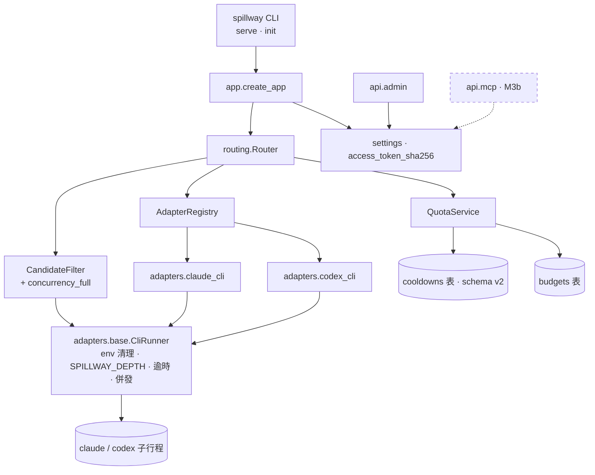
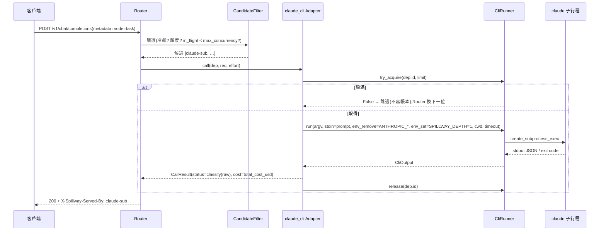
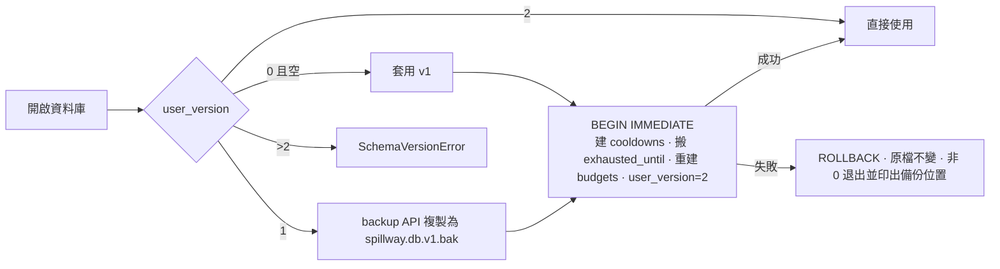
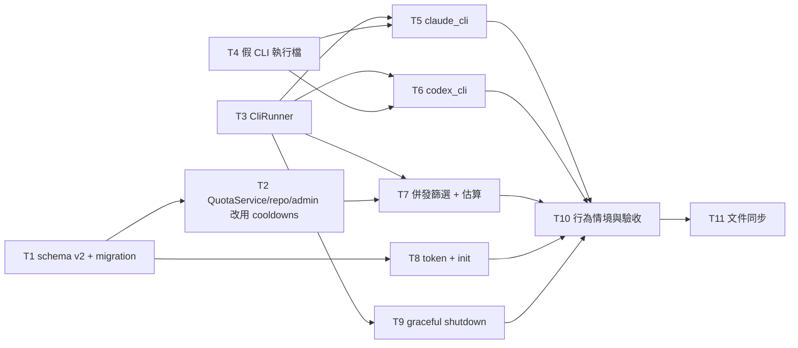

# CHG-20261101-03 — M3a:CLI 成員(CliRunner、claude_cli、codex_cli)、schema v2(冷卻獨立成表)、存取 token 與 init、graceful shutdown

- 專案:spillway
- 分支(Branch):`chg-20261101-03`(自 main fcf020e 分出;驗收通過後依 DIR-4 規則 2、4 自動合回 main 並推送)
- 日期:2026-11-01(UTC+0)
- 類型:新功能(M3 第一部分)+ 資料模型變更
- Template: plan
- 提出者:擁有者(使用者,2026-11-01「Open M3 CHG」;使用者決定 M3 拆為 M3a、M3b 兩筆 CHG)
- 實作者:claude-opus-5-5(主 session agent;平行 task 由其派出的子 agent 施工,見「平行施工」)
- 風險分級:高——命中資料模型(schema v2 與既有資料庫的 migration)、跨模組介面(`AdapterContext.cli_runner`、CliRunner、QuotaService 冷卻存放)、安全(訂閱 CLI 子行程的環境清理與 OAuth token 規則、存取 token 的產生與雜湊)、不可逆(migration 移除 `budgets.exhausted_until` 欄位、停機時終止子行程)
- Commit/PR:`chg-20261101-03` 分支上訊息以 `CHG-20261101-03:` 開頭的 commit(`git log --grep CHG-20261101-03`);合回 main 後回填
- 驗收報告(預留):ACC-20261101-02
- 重複性檢查(Recurrence check):無重複(M3 第一筆;動機與 CHG-20261029-01/02、CHG-20261030-01/02、CHG-20261101-01/02 皆不同)
- Diagrams:見「## 設計圖」節
- Security-impact:見「## 安全影響」節
- Skill: ai-sdlc-autopilot v1.69
- 關聯:Guideline 第 7 節 M3(閘門「4 種工具可連線」於 M3b 結束時驗收);FR-8(CLI)、FR-10(CLI)、FR-15、FR-16、FR-17、FR-25(CLI);AC-1、AC-2、AC-12、AC-16(CLI 版)、AC-17(CLI 版)、AC-19(含 CLI 模組)、NFR-6;spec 1.1.2、2.2、2.3、4.2.3–4.2.6、5.2.2、5.2.3、5.3、5.4.2、5.4.4、6.3、7.3、7.4、7.5、7.6.9、8.1.3、9.2;structure/design.md D1、D5、D9、D15;knowledge DIR-1–DIR-4;CHG-20261101-02 決策 2(schema v2 延到 M3)、決策 18(graceful shutdown 延到 M3)

## 動機

M2 完成了以 api 與 local 成員為主的路由核心。M3 的目標是把擁有者的兩個訂閱 CLI(Claude Code、Codex)納入成員,讓訂閱額度先被用完(G1),並以 MCP 讓 4 種工具連線(G6)。M3 範圍大,使用者決定拆成兩筆:本筆(M3a)做 CLI 成員與它需要的基礎——子行程執行器、兩個 CLI 模組、併發上限、CLI 版的額度與冷卻——以及兩項延到 M3 的整理:冷卻與預算分開存(schema v2,與存取 token 一起處理)、graceful shutdown;另做 MCP 需要的存取 token 與 `spillway init`。MCP server、`mcp-stdio`、設定輸出與 M3 閘門的 AC-9、AC-11 屬 M3b。

## 使用者故事

1. 作為擁有者,我要把 Claude Code 訂閱登記為 cli 成員(provider `claude-cli`),task 模式的請求由它以 `claude -p` 子行程處理,花費依回應的 `total_cost_usd` 扣抵 `credit_pool` 額度,以便訂閱額度先被用完(AC-1、FR-15、5.2.2)。
2. 作為擁有者,我要把 Codex 訂閱登記為 cli 成員(provider `codex-cli`),以 `codex exec` 子行程處理,花費記為 NULL、可用性只依上游訊號判斷(FR-16、5.2.3)。
3. 作為擁有者,我要 CLI 子行程不帶任何 API 金鑰、不載入本閘道的 MCP、帶 `SPILLWAY_DEPTH=1`,且閘道不讀取、不轉發訂閱的 OAuth token,以便訂閱以官方登入方式使用且不會遞迴呼叫自己(spec 1.1.2、7.3.2、7.3.3、7.4.3)。
4. 作為擁有者,我要每個 CLI 成員同時只跑設定數量的子行程(預設 1),額滿時由下一個成員接手而不是排隊,以便請求不卡在單一訂閱(FR-17、NFR-6)。
5. 作為擁有者,我要 CLI 成員在上游回報額度用完時冷卻到下一個重置點、限流時冷卻 60 秒、勾選預估檢查時預估花費超過剩餘就跳過,與 api 成員行為一致(AC-16、AC-17 的 CLI 版)。
6. 作為擁有者,我要第二個 claude-cli 或 codex-cli 成員建立時被拒絕(409 `provider_single`),以便每個訂閱只有一個成員(AC-12、FR-25)。
7. 作為擁有者,我要冷卻狀態與額度設定分開存放,沒有設定額度的成員遇到限流時不再自動產生假的額度列,以便額度畫面只顯示我設定的內容(CHG-20261101-02 決策 2)。
8. 作為擁有者,我要升級時資料庫自動從 v1 遷移到 v2,遷移前先備份,失敗時原檔不變,以便我的冒煙資料庫可以直接沿用(使用者決定 2026-11-01)。
9. 作為擁有者,我要以 `spillway init` 或首次啟動產生 MCP 存取 token,只印出一次、資料庫只存雜湊,並可經管理 API 重新產生,以便 M3b 的 MCP 端點有驗證依據(spec 8.1.3、D9)。
10. 作為擁有者,我要按 Ctrl-C 或送 SIGTERM 時閘道最多等 30 秒讓進行中的請求完成,之後終止仍在跑的 CLI 子行程,以便停機不會卡十分鐘(使用者決定 2026-11-01)。

## 決策與取捨

| # | 決策 | 選項 | 前提假設(此決策建立在什麼之上) | 為何這樣選 |
|---|------|------|----------------------------------|------------|
| 1 | **(使用者決定 2026-11-01)** M3 拆為兩筆 CHG:本筆 M3a(CliRunner、claude_cli、codex_cli、併發上限、schema v2、存取 token 與 init、graceful shutdown);M3b(MCP server、`mcp-stdio`、設定輸出;M3 閘門於 M3b 結束時驗收) | (a) 兩筆 / (b) 一筆 | M3 涵蓋三類性質不同的工作,且 schema migration 是永遠停點 | 使用者選 (a)。每筆可獨立審議與驗收;migration 停點只出現在 M3a。 |
| 2 | **(使用者決定 2026-11-01)** 存取 token 依 spec:`/mcp/*` 一律驗證 Bearer token(M3b 實作);綁 127.0.0.1 時 `/v1`、`/api` 不驗證;M3 仍只允許綁 127.0.0.1(D16 不放寬) | (a) 依 spec / (b) 全部端點一律驗證 | spec 8.1.3、9.1.1 | 使用者選 (a)。本機其他程式可呼叫 127.0.0.1:8787(CSRF、DNS rebinding)仍為已知限制(DIR-2 範圍外)。 |
| 3 | **(使用者決定 2026-11-01)** schema v2:新增表 `cooldowns(deployment_id TEXT PRIMARY KEY REFERENCES deployments(id) ON DELETE CASCADE, exhausted_until TEXT NOT NULL, reason TEXT NOT NULL CHECK (reason IN ('quota_exhausted','rate_limited')))`;`budgets` 移除 `exhausted_until` 欄 | (a) 新表 / (b) `deployments` 加欄 | 冷卻是執行期狀態,額度是設定;M4 匯出入只處理設定 | 使用者選 (a)。spec 2.2、2.3、5.3.2、5.3.3、9.2 的 `exhausted_until` 敘述隨之修訂(本筆唯一的規格書修訂,見「規格書與結構文件更新」)。 |
| 4 | v1→v2 migration 內容:在單一交易內 ① 建 `cooldowns`;② 把 `budgets.exhausted_until` 非 NULL 的列搬到 `cooldowns`(`reason` 由該成員帳本最近一筆 `quota_exhausted`/`rate_limited` 推得,找不到時記 `quota_exhausted`);③ 以「建新表、搬資料、改名」方式移除 `budgets.exhausted_until`;④ `PRAGMA user_version = 2`。**不刪除**任何 `budgets` 列(含 CHG-20261030-02 決策 59 產生的 `type=none, window=none, limit_amount=NULL` 暫行列) | 刪除暫行列 vs 保留 | 暫行列與擁有者手動建立的 `type=none` 額度無法區分;刪除屬不可逆 | 保留最安全;暫行列語意等同「無上限」,擁有者可自行以 PUT `budget: null` 移除。**代使用者決定**。 |
| 5 | **(使用者決定 2026-11-01)** migration 於 `serve` 啟動(與任何開啟資料庫的命令)時自動執行;執行前若 `user_version = 1` 且資料庫非空,先把 `spillway.db` 以 SQLite backup API 複製為 `spillway.db.v1.bak`(已存在時加時間戳記後綴,不覆寫);migration 失敗則交易回滾、原檔不變、程式以非 0 退出並印出備份位置 | (a) 自動 + 備份 / (b) 只以 `spillway migrate` 明確執行 | 擁有者的 `~/spillway-smoke` 已有真實資料 | 使用者選 (a)。**對擁有者實際資料目錄執行 migration 屬永遠停點**:agent 不執行;合回後由擁有者自行啟動 `serve` 觸發(見 Acceptance operation 與安全影響)。 |
| 6 | QuotaService 改讀寫 `cooldowns`:`mark` 寫入(`INSERT ... ON CONFLICT DO UPDATE` 取較晚的 `exhausted_until`)、`is_cooling` 讀、`clear` 刪除;不再為沒有 budgets 列的成員建立暫行列(取代決策 59);`PUT /api/deployments/{id}` 的 `budget: null` 改為單純刪除 `budgets` 列,不影響冷卻 | 同左 vs 保留暫行列 | 決策 3 | 冷卻與額度完全分離;dashboard 的冷卻欄讀 `cooldowns`。**代使用者決定**。 |
| 7 | **(使用者決定 2026-11-01)** 併發上限:CLI 成員進行中的子行程數達 `params.max_concurrency`(預設 1)時,於候選篩選排除,原因 `concurrency_full`(新增至 `EXCLUDE_REASONS`;dry-run 與 503 body 可見),不寫帳本列;CliRunner 以非阻塞方式取得名額(D1),篩選後到實際啟動之間被搶走時,該次嘗試以同一原因跳過、不寫帳本、繼續下一位 | (a) 篩除不寫帳本 / (b) 帳本 error / (c) 新狀態 | NFR-6「超過視為不可用,不排隊」 | 使用者選 (a)。帳本狀態集合不變。 |
| 8 | `CliRunner`(`adapters.base.cli_runner`;經 `AdapterContext.cli_runner` 交給模組):`async run(argv, *, stdin, env_remove, env_set, cwd, timeout, key) -> CliOutput(exit_code, stdout, stderr, timed_out)`;以 `asyncio.create_subprocess_exec`(不經 shell)啟動;環境以目前環境為底,移除 `env_remove` 與 spec 7.3.2 兩個變數,設定 `env_set`(至少 `SPILLWAY_DEPTH=1`);逾時先 SIGTERM、5 秒後 SIGKILL;`key`(成員 id)用於併發計數:`try_acquire(key, limit) -> bool`、`in_flight(key) -> int`、`release(key)`;`terminate_all(grace)` 供停機使用 | 共用執行器 vs 各模組自行起子行程 | spec 7.6.3 模組只可引用共用契約(含子行程執行器);D1、D5 | 環境清理、深度標記、逾時與併發只在一處實作與測試;模組無法繞過。**代使用者決定**(design 已規劃 `CliRunner`,本筆定介面)。 |
| 9 | `claude_cli` 模組:命令 `claude -p --output-format json --model <model>` + `effort_args` + `extra_args`,prompt 經 stdin(7.5 轉換);`default_params`:`timeout` 600、`effort_args` `["--effort", "{effort}"]`、`extra_args` `["--strict-mcp-config"]`、`cwd` 未設定時為資料目錄下 `work/claude`(不存在則建立);`effort_map`:`none`→不傳、`low`/`medium`/`high`/`max` 對應同名值;回應取 JSON `result`、`usage.input_tokens`/`output_tokens`、`total_cost_usd`;`default_signals` 依 spec 5.3.1 claude-cli 列;`default_capabilities`:`tools`、`vision` 為 false | 依 spec 與實機 `claude --help` | 已在本機以 `claude --help`(2.1.308)確認 `--effort` 接受 low、medium、high、xhigh、max,`--strict-mcp-config` 存在(spec 6.3.2 要求實作前確認) | `effort_args` 給預設值而非空:讓 effort 對應直接生效,擁有者仍可於 `params.effort_args` 覆寫。**代使用者決定**。 |
| 10 | `codex_cli` 模組:命令 `codex exec --json --skip-git-repo-check -m <model> -o <暫存檔>` + `-c model_reasoning_effort=<值>` + `extra_args`,prompt 為最後一個引數;`effort_map` 依 spec 6.3(`none`→`minimal`、`max`→`xhigh`);`default_params`:`timeout` 600、`extra_args` `["-c", "mcp_servers={}"]`(停用全部 MCP,含本閘道)、`cwd` 未設定時為 `work/codex`;回應取暫存檔內容,token 取 JSONL 事件中最後一個含 usage 的事件;`cost_usd` 為 NULL(5.2.3);`default_signals` 依 spec 5.3.1 codex-cli 列 | 同左 | 已以 `codex exec --help`(0.163.0)確認 `--json`、`--skip-git-repo-check`、`-m`、`-o`、`-c key=value`(值以 TOML 解析)存在 | spec 7.4.3 只說「以 extra_args 停用」,`mcp_servers={}` 是 `-c` 覆寫的最小寫法;是否確實停用由擁有者真實冒煙確認。**代使用者決定**。 |
| 11 | CLI 呼叫結果的狀態判定沿用 `adapters.base.classify`,raw 欄位:claude 為 JSON(`is_error`、`result`/錯誤訊息);codex 為結束碼與 stderr;逾時一律 `error`;子行程無法啟動(找不到執行檔)為 `error` 並帶原因;非 JSON 輸出為 `error` | 同左 | spec 5.3.1;M2 決策 12 的 classify 契約 | 與 api 模組同一套判定機制。**代使用者決定**。 |
| 12 | 估算:CLI 成員的 `est_tokens_in` 加 `params.cli_overhead_tokens`(預設 0,5.4.2);codex 的 `est_cost_usd_p90` 為 NULL、不參與 4.2.5 預估檢查(5.4.4);claude-cli 以 LiteLLM 價格表估花費(模型字串 `anthropic/<model>`),無定價時 NULL | 同左 | spec 5.4 | 照規格。**代使用者決定**(價格表模型字串)。 |
| 13 | **(使用者決定 2026-11-01)** 存取 token:`spillway init` 產生(已有時拒絕,需加 `--rotate`);`serve` 啟動時 `settings.access_token_sha256` 不存在則產生一個並以單行印到 stderr(只印一次);`POST /api/settings/token/rotate` 重新產生並在回應 body 回傳一次新 token;token 為 `secrets.token_urlsafe(32)`,資料庫只存 SHA-256 十六進位;本筆不使用 token 做任何驗證(M3b 的 `/mcp/*` 才驗證) | (a) init 或首次啟動 / (b) 只有 init | spec 8.1.3、D9、data.md | 使用者選 (a)。token 明文不寫日誌檔、不寫資料庫;印到 stderr 是擁有者取得 token 的唯一途徑(安全影響說明)。 |
| 14 | `spillway init`:建立資料目錄、`work/claude`、`work/codex`、執行 migration、產生 token;冪等(再次執行只檢查並回報) | 同左 | design D9、directory.md | **代使用者決定**。 |
| 15 | **(使用者決定 2026-11-01)** graceful shutdown:收到 SIGTERM/SIGINT 後停止接受新請求;進行中請求最多等 30 秒(uvicorn `timeout_graceful_shutdown=30`);期滿時 `CliRunner.terminate_all(grace=5)` 對仍在跑的子行程 SIGTERM、5 秒後 SIGKILL;被終止的嘗試寫帳本 `status=error`、`error="shutdown"` | (a) 等 30 秒再終止 / (b) 等到完成 / (c) 立即終止 | CHG-20261101-02 決策 18 | 使用者選 (a)。 |
| 16 | settings 層開始讀 settings 表的 `access_token_sha256`;`bind_host`、`port` 鍵仍不讀(D16 不變) | 同左 | 決策 2 | **代使用者決定**。 |
| 17 | 自動測試的 CLI 一律用假執行檔:`tests/fakes/cli_upstream/` 提供 `claude`、`codex` 兩個 Python 腳本(依環境變數 `SPILLWAY_FAKE_CLI_SCENARIO` 回應成功、額度用完、限流、錯誤、逾時、非 JSON),測試以 PATH 前置該目錄;假執行檔把收到的 argv、stdin、cwd 與環境中 `SPILLWAY_DEPTH`、`ANTHROPIC_*` 是否存在寫到暫存檔供斷言(不寫值) | 假執行檔 vs mock CliRunner | Guideline Q1:自動測試不可連真實上游;D5 | 走真實子行程路徑,環境清理與參數組裝都被測到。**代使用者決定**。 |
| 18 | 子行程輸出與錯誤一律經 Redactor 後才進帳本、payload、503 body;stdout/stderr 原文不寫日誌 | 同左 | DIR-2 規則 2b;spec 2.4.6 | **代使用者決定**。 |

## 設計圖

### 圖 1:本筆範圍的架構(實線為本筆新增或變更,虛線為 M3b)

### 圖 2:一次 task 請求由 claude-cli 成員處理

### 圖 3:schema v1 → v2 migration

### 圖 4:平行施工波次

## 安全影響

範圍依 knowledge DIR-2:威脅模型只有擁有者本人在本機使用;下表回答四類永遠停點是否被本筆觸及。

| 類別 | 是否觸及 | 影響範圍 / 理由 |
|------|----------|-----------------|
| irreversible-delete | 是 | (1) v1→v2 migration 移除 `budgets.exhausted_until` 欄(資料先搬到 `cooldowns`;執行前自動備份為 `spillway.db.v1.bak`,失敗回滾)。(2) 停機時終止仍在跑的 CLI 子行程(使用者決定 15),該次請求失敗並記帳本。(3) `cooldowns` 對成員 `ON DELETE CASCADE`。不刪除任何 `budgets` 列(決策 4)。施工與測試只在 pytest 暫存 `SPILLWAY_HOME`;agent 不對擁有者資料目錄執行任何操作。 |
| payments | 否 | 不發起付款;CLI 成員的花費只讀取上游回報的 `total_cost_usd` 並記帳。自動測試只用假執行檔;真實 claude/codex 只在擁有者真實冒煙時執行,agent 不代為執行。 |
| prod-migration | **是(永遠停點)** | schema v1→v2 會作用於擁有者的實際資料庫(`~/spillway-smoke` 與預設資料目錄)。本筆只在測試資料庫驗證 migration(含以 v1 測試資料庫、含暫行列與冷卻資料的情境);**合回 main 後由擁有者自行啟動 `serve` 觸發 migration**,agent 停下交人並在 ACC 記錄擁有者回報的結果。回滾方式:以 `spillway.db.v1.bak` 取代並回退程式版本。 |
| security-boundary | 是 | (a) 訂閱 CLI:子行程環境移除 `ANTHROPIC_API_KEY`、`ANTHROPIC_AUTH_TOKEN`,設定 `SPILLWAY_DEPTH=1`,claude 預設 `--strict-mcp-config`、codex 預設 `-c mcp_servers={}`;閘道不讀取、不解析、不轉發任何 OAuth token 或 CLI 的憑證檔(spec 1.1.2;DIR-2 規則 2c),不模擬官方客戶端格式——只呼叫官方 CLI。(b) 子行程以 argv 陣列啟動、不經 shell;prompt 經 stdin(claude)或單一 argv 元素(codex),不做字串拼接。(c) 存取 token:只存 SHA-256;明文只在 `init`、首次啟動(stderr 一行)與 rotate 回應中出現一次;不寫日誌檔、資料庫、帳本。(d) 綁定位址仍只允許 127.0.0.1(決策 2);`/v1`、`/api` 在 loopback 不驗證 token(spec 9.1.1)。(e) 子行程 stdout/stderr 經 Redactor 後才寫入帳本與 payload。 |

已知限制(DIR-2 範圍內,只記錄、不實作):
- 本機其他程式可對 127.0.0.1:8787 發請求(CSRF、DNS rebinding);`/api/settings/token/rotate` 也在此列(rotate 只會讓現有 MCP 設定失效,不洩漏舊 token)。
- token 首次啟動時印到 stderr;若擁有者把 `serve` 的 stderr 導到檔案,檔案中會有一次明文。
- CLI 子行程繼承目前環境中其他變數(只移除 spec 指定的兩個 Anthropic 變數);擁有者環境若有其他供應商金鑰,子行程看得到(CLI 本身不使用)。
- codex 的 `-c mcp_servers={}` 會停用 codex 全部 MCP 伺服器,不只本閘道;擁有者若需要 codex 在閘道內使用其他 MCP,須自行改 `params.extra_args`。
- 真實 claude/codex 的輸出格式以本機 2.1.308 / 0.163.0 版確認;版本更新後格式變動由擁有者冒煙發現。
- 延續 CHG-20261101-02 的已知限制(憑證鍵名規則的漏網與誤擋、健康探測競態、logger 下限無法關閉等)。

## 修改指引

### 目標

M3a 完成:CLI 成員可用(AC-1、AC-2、AC-12、AC-16 與 AC-17 的 CLI 版、AC-19 含 CLI 模組、NFR-6 通過,以假執行檔驗證);schema v2 與 migration 在測試資料庫驗證;存取 token 與 `init` 可用;graceful shutdown 30 秒上限;擁有者真實冒煙(claude-cli、codex-cli 各一次)與擁有者資料庫 migration 由擁有者執行並回報。

### 影響範圍

| 受影響項 | 類型 | 改動 | 連帶影響 |
|----------|------|------|----------|
| `src/spillway/store/`(`schema.sql` 不改;新增 v2 migration、`db.py` 備份與 migration、`repo.py` cooldowns 函式) | 資料 | schema v2 | 擁有者資料庫(永遠停點) |
| `src/spillway/quota.py`、`api/admin/deployments.py`、`api/admin/dashboard.py`、`api/admin/models.py` | 邏輯/介面 | 冷卻改讀寫 `cooldowns`;`budget: null` 語意簡化 | `/api/dashboard`、`/api/deployments` 回應中冷卻欄位來源 |
| `src/spillway/adapters/base/`(`cli_runner.py` 新增、`__init__` 匯出、`AdapterContext.cli_runner` 注入) | 設計 | CliRunner | M3b 不受影響 |
| `src/spillway/adapters/claude_cli/`、`adapters/codex_cli/`(新增) | 設計 | 兩個 CLI 模組 | `GET /api/adapters` 列出;M4 UI-2 選單 |
| `src/spillway/routing/filter.py`、`domain.py`、`estimate.py` | 邏輯 | `concurrency_full`、`cli_overhead_tokens` | dry-run 與 503 body 的排除原因 |
| `src/spillway/settings.py`、`cli.py`、`app.py`、`api/admin/settings.py` | 介面 | token、`init`、rotate、graceful shutdown | M3b 的 `/mcp/*` 驗證讀同一雜湊 |
| `tests/fakes/cli_upstream/`、`tests/`(unit、contract、integration、features、acceptance) | 測試 | 新增 | regression.md |
| `docs/spec.md` 2.2、2.3、5.3.2、5.3.3、9.2 | 規格 | 冷卻改存 `cooldowns`(決策 3) | 修訂行 |
| sdlc_docs/structure/design.md、logical.md、data.md、directory.md | 文件 | 見「規格書與結構文件更新」 | 無 |

### Global Constraints(全域約束——每個 task 都要遵守)

- 語言與版本:Python ≥ 3.11(驗收平台 3.13);src layout;路徑一律 `pathlib`。
- 相依套件:不新增任何相依(子行程用標準庫 `asyncio`;token 用標準庫 `secrets`、`hashlib`)。要新增時停下回報。
- 規格依據:行為以 `docs/spec.md`、本 CHG 決策表、CHG-20261030-02 與 CHG-20261101-02 決策表為準;除決策 3 指定的 spec 修訂外不修改 `docs/spec.md`、`docs/proposal.md`。
- 分層與模組:`spillway.adapters.<module>` 只可 import `spillway.adapters.base`、標準庫與 `pyyaml`;CLI 模組只能經 `AdapterContext.cli_runner` 起子行程,不可 import `subprocess`/`asyncio.create_subprocess_*`(`tests/contract/test_layering.py` 擴充檢查);SQL 只在 `src/spillway/store/`。
- 子行程:一律 argv 陣列、不經 shell;環境必須移除 `ANTHROPIC_API_KEY`、`ANTHROPIC_AUTH_TOKEN` 並設 `SPILLWAY_DEPTH=1`;不可讀取、解析、複製或轉發任何 CLI 的憑證檔或 OAuth token(`~/.claude`、`~/.codex` 等目錄一律不碰)。
- 測試上游:自動測試只用 `tests/fakes/`(api 假端點與 `tests/fakes/cli_upstream/` 假執行檔,以 PATH 前置);不可執行真實 `claude`、`codex`,不可連任何真實上游。`tests/conftest.py` 加護欄:PATH 中的 `claude`、`codex` 不是假執行檔時,CLI 相關測試直接 fail。
- 秘密:沿用 CHG-20261030-02 Global Constraints「秘密」條;存取 token 明文不可出現在日誌檔、資料庫、帳本、payload、測試輸出與 `artifacts/`(測試以 caplog/capfd 斷言)。
- 資料目錄:測試一律以 `tmp_path` 為 `SPILLWAY_HOME`;不可讀寫擁有者的實際資料目錄;migration 只在測試資料庫上驗證。
- 時間與亂數:經 `Clock`/`Rng` 注入;token 用 `secrets`(不經 `Rng`,屬安全亂數)。
- 網路:只綁 127.0.0.1,預設埠 8787(D16 不變)。
- 錯誤回應:spec 9.1.2 格式;新錯誤碼只用本 CHG 列出的值。
- 既有行為:M2 與 CHG-20261101-02 的既有測試斷言不可修改,除非屬下列允許清單:(1) 冷卻改存 `cooldowns` 後,直接讀寫 `budgets.exhausted_until` 的既有測試與 CHG-20261030-02 決策 59 暫行列的測試(`tests/integration/test_review_final_u10.py` 等)改為新語意,改寫範圍由 T2 列出並在施工審議中逐條核對;(2) `EXCLUDE_REASONS` 增加 `concurrency_full` 的契約快照。其他既有斷言需修改時停下回報。
- 每個 task 的測試必須能以該 task 的 `test:` 指令獨立執行並全綠;每個 task 完成時另跑全量 `python -m pytest -q`。
- 既有 feature 檔的情境文字只能經修改治理變更;施工者只寫步驟檔。
- commit 訊息以 `CHG-20261101-03:` 開頭,結尾加 Co-Authored-By 行。
- 驗收平台為 macOS;Linux、Windows 在 ACC 標「未涵蓋」。

### 契約清單

| 契約 | 提供方 | 讀取方 | 本筆變更 | 契約測試(路徑/無) |
|------|--------|--------|----------|----------------------|
| 資料庫 schema v2(`cooldowns` 表;`budgets` 無 `exhausted_until`;`user_version=2`) | T1 store | `store.repo`、QuotaService、dashboard;M3b、M4 | 變更 | tests/unit/store/test_schema_v2.py(新增);tests/unit/store/test_migration_v1_v2.py(新增) |
| migration 備份檔 `spillway.db.v1.bak` 命名與不覆寫規則 | T1 store.db | 擁有者 | 新增 | tests/unit/store/test_migration_v1_v2.py |
| `store.repo` 冷卻函式(`get_cooldown`、`set_cooldown`、`clear_cooldown`、`list_cooldowns`) | T1 | QuotaService、dashboard | 新增 | tests/unit/store/test_repo_cooldowns.py(新增) |
| `QuotaService.mark/is_cooling/clear` 語意(不再建暫行 budgets 列) | T2 | Router、admin clear-cooldown、dashboard | 變更 | tests/unit/test_quota.py;tests/integration/admin/test_admin_dashboard.py |
| 管理 API:`/api/dashboard` 冷卻欄、`/api/deployments` budget 欄、`budget: null` 語意 | T2 | M4 UI-1、UI-2 | 變更(來源改 cooldowns) | tests/integration/admin/test_admin_deployments.py;test_admin_dashboard.py |
| `CliRunner`(`run`、`try_acquire`、`release`、`in_flight`、`terminate_all`;`CliOutput`) | T3 adapters.base | claude_cli、codex_cli、CandidateFilter、app 停機 | 新增 | tests/unit/adapters_base/test_cli_runner.py(新增) |
| `AdapterContext.cli_runner`(M2 為 None,本筆注入實例) | T3 | CLI 模組 | 變更 | tests/contract/test_adapter_contract.py |
| 假 CLI 執行檔協定(`SPILLWAY_FAKE_CLI_SCENARIO`、記錄檔格式) | T4 tests/fakes | T5、T6、T7、T9、T10 | 新增 | tests/fakes/test_cli_upstream.py(新增) |
| `claude_cli` MANIFEST、`models.yaml`、`CallResult` 對應 | T5 | Registry、Router、`/api/adapters` | 新增 | tests/contract/test_adapter_contract.py;tests/contract/test_call_status.py;tests/unit/adapters/test_claude_cli.py(新增) |
| `codex_cli` MANIFEST、`models.yaml`、`CallResult` 對應 | T6 | 同上 | 新增 | 同上;tests/unit/adapters/test_codex_cli.py(新增) |
| 排除原因 `concurrency_full` | T7 routing.filter | dry-run、503 body、M4 UI-4 | 新增 | tests/unit/routing/test_filter.py;tests/contract/test_public_imports_routing.py |
| `settings.access_token_sha256`、`spillway init`、`POST /api/settings/token/rotate` 回應 `{"token": "..."}` | T8 | M3b `/mcp/*`、M4 UI-7 | 新增 | tests/integration/test_init_token.py(新增);tests/integration/admin/test_admin_token_rotate.py(新增) |
| 停機行為(30 秒、終止子行程、帳本 `error="shutdown"`) | T9 app/cli | 擁有者 | 新增 | tests/integration/test_graceful_shutdown.py(新增) |

### Tasks(checkbox=續作點)

- [ ] T1. schema v2 與 v1→v2 migration(含備份)
  - interfaces: consumes 決策 3、4、5 / produces `store/db.py` 的 `MIGRATIONS` 第 2 版與備份邏輯、`store/repo.py` 冷卻函式、`tests/unit/store/test_schema_v2.py`、`test_migration_v1_v2.py`、`test_repo_cooldowns.py`
  - test: `python -m pytest tests/unit/store -q`
  - L1: 空資料庫開啟後 `user_version=2`、`cooldowns` 欄位與約束如決策 3、`budgets` 無 `exhausted_until`;冷卻函式往返正確,`set_cooldown` 取較晚時間
  - L2: 以 v1 測試資料庫(含一般 budgets 列、含 `exhausted_until` 的列、決策 59 暫行列、帳本中有 `rate_limited` 與 `quota_exhausted` 紀錄)開啟:產生 `spillway.db.v1.bak` 且內容與原 v1 相同;`cooldowns` 有對應列且 `reason` 依帳本推得;所有 budgets 列保留且其他欄位不變;`user_version=2`;備份檔已存在時以時間戳記後綴另存、不覆寫;migration 中途失敗(以注入錯誤模擬)時回滾、`user_version` 仍為 1、原表不變
  - L3: 不適用(migration 沒有情境層的使用者操作;擁有者資料庫的實際 migration 屬 Acceptance operation 的擁有者步驟)
  - L4: 不適用(端到端由 T10 的 `spillway serve` 子行程以 v1 測試資料庫啟動一次覆蓋)

- [ ] T2. QuotaService、repo 呼叫端與管理 API 改用 `cooldowns`
  - interfaces: consumes T1 / produces 決策 6;改寫範圍清單(既有測試中直接讀寫 `exhausted_until` 或依賴暫行列者)寫在 commit 訊息與施工審議紀錄
  - test: `python -m pytest tests/unit/test_quota.py tests/integration/admin tests/integration/test_review_final_u10.py tests/features -q && python -m behave tests/features/m2_quota.feature tests/features/m2_routing.feature`
  - L1: `mark(rate_limited)` 寫入 `cooldowns` 60 秒;`mark(quota_exhausted)` 冷卻到下一重置點,沒有 budgets 列時以 window none 規則(現在 + 1 小時);`clear` 刪除 `cooldowns` 列;沒有 budgets 列的成員 `mark` 後 budgets 仍無列
  - L2: `/api/dashboard` 冷卻欄位來自 `cooldowns`;`POST /api/deployments/{id}/clear-cooldown` 清除後下一次請求可被選用;`PUT` 的 `budget: null` 刪除 budgets 列且不影響冷卻;既有 m2_quota、m2_routing 情境不改文字全過
  - L3: `tests/features/m2_quota.feature` 與 `m2_routing.feature` 的限流冷卻情境照舊通過(冷卻存放位置對使用者透明)
  - L4: 不適用(端到端由 T10 覆蓋)

- [ ] T3. `CliRunner`
  - interfaces: consumes 決策 8 / produces `adapters/base/cli_runner.py`、`adapters/base/__init__.py` 匯出、`app.py` 建立單一實例並注入 `AdapterContext.cli_runner`、`tests/unit/adapters_base/test_cli_runner.py`;`tests/contract/test_layering.py` 新增「adapters 模組不得直接起子行程」檢查
  - test: `python -m pytest tests/unit/adapters_base/test_cli_runner.py tests/contract -q`
  - L1: 以 `python -c` 小腳本為子行程:環境中 `ANTHROPIC_API_KEY`、`ANTHROPIC_AUTH_TOKEN` 不存在、`SPILLWAY_DEPTH=1`;stdin 正確送達;cwd 正確;逾時時 `timed_out=True` 且子行程已結束(SIGTERM 不理會時 5 秒內 SIGKILL);`try_acquire(key, 1)` 第二次為 False、`release` 後恢復;`terminate_all` 結束所有進行中子行程
  - L2: `create_app()` 的 `AdapterContext.cli_runner` 為同一 CliRunner 實例;layering 檢查在 adapters 模組放入 `asyncio.create_subprocess_exec` 時失敗
  - L3: 不適用(執行器沒有使用者看得到的行為;CLI 成員行為於 T10 情境驗證)
  - L4: 不適用(由 T10 覆蓋)

- [ ] T4. 假 CLI 執行檔
  - interfaces: consumes 決策 17 / produces `tests/fakes/cli_upstream/claude`、`codex`(可執行 Python 腳本)、fixture `fake_cli`(PATH 前置、選情境、讀記錄)、`tests/conftest.py` 的真實 CLI 護欄、`tests/fakes/test_cli_upstream.py`
  - test: `python -m pytest tests/fakes/test_cli_upstream.py -q`
  - L1: 每個情境(ok、quota、rate_limit、error、timeout、non_json)下假 `claude` 的 JSON 輸出與 spec 7.3.5 欄位一致、假 `codex` 的 JSONL 事件與 `-o` 暫存檔內容一致;記錄檔含 argv、stdin、cwd、`SPILLWAY_DEPTH` 值與 `ANTHROPIC_*` 是否存在(不含值)
  - L2: `fake_cli` fixture 啟用時 `shutil.which("claude")` 指向假執行檔;護欄在 PATH 指向非假執行檔時讓測試 fail
  - L3: 不適用(測試工具)
  - L4: 不適用(測試工具)

- [ ] T5. `claude_cli` 模組
  - interfaces: consumes T3、T4、決策 9、11、12、18 / produces `adapters/claude_cli/`(`__init__.py`、`adapter.py`、`models.yaml`、`README.md`)、`tests/unit/adapters/test_claude_cli.py`
  - test: `python -m pytest tests/unit/adapters/test_claude_cli.py tests/contract -q`
  - L1: messages 依 7.5.1 轉為 prompt;argv 為 `claude -p --output-format json --model <m>` + `--effort <level>`(none 不傳)+ `--strict-mcp-config`;回應 `result`、`usage`、`total_cost_usd` 對應到 CallResult;四種上游輸出對應 `ok`、`quota_exhausted`、`rate_limited`、`error`;逾時、非 JSON、找不到執行檔為 `error`;錯誤文字經 Redactor
  - L2: 合約測試(`test_adapter_contract.py`、`test_call_status.py`)對 `claude_cli` 全綠;`GET /api/adapters` 列出 `claude-cli`(access `subscription-cli`、cardinality `single`);建立第二個 `claude-cli` 成員回 409 `provider_single`(AC-12)
  - L3: `tests/features/m3a_cli.feature` 的 claude 情境(T10 撰寫步驟)
  - L4: 不適用(真實 claude 只在擁有者冒煙執行)

- [ ] T6. `codex_cli` 模組
  - interfaces: consumes T3、T4、決策 10、11、12、18 / produces `adapters/codex_cli/`、`tests/unit/adapters/test_codex_cli.py`
  - test: `python -m pytest tests/unit/adapters/test_codex_cli.py tests/contract -q`
  - L1: argv 為 `codex exec --json --skip-git-repo-check -m <m> -o <tmp>` + `-c model_reasoning_effort=<值>`(none→minimal、max→xhigh)+ `-c mcp_servers={}`,prompt 為最後一個引數;回應取 `-o` 檔內容、token 取 JSONL usage;`cost_usd` 為 NULL;四種上游輸出對應正確;暫存檔用後刪除
  - L2: 合約測試對 `codex_cli` 全綠;第二個 `codex-cli` 成員 409 `provider_single`
  - L3: `tests/features/m3a_cli.feature` 的 codex 情境
  - L4: 不適用(真實 codex 只在擁有者冒煙執行)

- [ ] T7. 併發篩選與 CLI 估算
  - interfaces: consumes T2、T3、決策 7、12 / produces `routing/filter.py` 的 `concurrency_full`、`domain` 常數、Router 取得名額失敗時跳過、`estimate.py` 的 `cli_overhead_tokens` 與 codex 花費 NULL
  - test: `python -m pytest tests/unit/routing tests/unit/test_estimate.py tests/contract -q`
  - L1: `in_flight(dep) >= max_concurrency` 的 CLI 成員被排除、原因 `concurrency_full`、無帳本列;api、local 成員不受影響;`est_tokens_in` 加上 `cli_overhead_tokens`;codex 的 `est_cost_usd_p90` 為 NULL 且 precheck 不跳過它
  - L2: 兩個 task 請求同時送出、claude-sub `max_concurrency=1`(假執行檔延遲 1 秒):第二個由下一位成員處理、帳本無 claude-sub 的第二列(NFR-6);dry-run 顯示 `concurrency_full`
  - L3: `m3a_cli.feature` 的 NFR-6 情境
  - L4: 不適用(由 T10 覆蓋)

- [ ] T8. 存取 token 與 `spillway init`
  - interfaces: consumes T1、決策 13、14、16 / produces `settings.py` token 讀寫、`cli.py` 的 `init` 子命令、`app.py` 首次啟動產生、`api/admin/settings.py` 的 rotate 端點、`tests/integration/test_init_token.py`、`tests/integration/admin/test_admin_token_rotate.py`
  - test: `python -m pytest tests/integration/test_init_token.py tests/integration/admin/test_admin_token_rotate.py tests/unit/test_settings.py -q`
  - L1: `secrets.token_urlsafe(32)` 產生、只存 SHA-256 十六進位;`init` 第二次執行不覆寫(除非 `--rotate`)並回報已存在;`init` 建立 `work/claude`、`work/codex`
  - L2: 以子行程執行 `spillway init`:stdout 印出 token 一次、資料庫 `settings.access_token_sha256` 等於其雜湊;首次 `serve` 在沒有雜湊時印一行到 stderr 並寫入;rotate 回應帶新 token、雜湊更新;caplog、日誌與帳本中找不到任何 token 明文
  - L3: 不適用(M3b 的 MCP 情境才會用到 token 驗證)
  - L4: 子行程 `spillway init` 與 `spillway serve` 各執行一次(T10 的 Acceptance operation 一併記錄)

- [ ] T9. graceful shutdown
  - interfaces: consumes T3、決策 15 / produces `cli.py` 的 `timeout_graceful_shutdown=30`、lifespan 結束時 `CliRunner.terminate_all(grace=5)`、被終止嘗試寫帳本 `error="shutdown"`、`tests/integration/test_graceful_shutdown.py`
  - test: `python -m pytest tests/integration/test_graceful_shutdown.py -q`
  - L1: lifespan 結束時呼叫 `terminate_all(grace=5)`;被終止的 CLI 呼叫回傳 `status=error`、`error="shutdown"`
  - L2: `spillway serve` 子行程 + 假 claude(情境 `timeout`,會睡 60 秒):送出 task 請求後對 serve 送 SIGTERM,serve 在 30 + 5 + 3 秒內結束、假 claude 子行程已不存在、帳本有該成員一列 `error="shutdown"`(以縮短的測試用等待秒數參數化,實際預設 30 秒由 L1 斷言設定值)
  - L3: 不適用(停機沒有情境層操作)
  - L4: 同 L2(真實子行程與訊號)

- [ ] T10. 行為情境、驗收測試與操作驗收
  - interfaces: consumes T1–T9 / produces `tests/features/m3a_cli.feature` 的步驟檔 `tests/features/steps/m3a_steps.py`、`tests/acceptance/test_m3a_operation.py`、`artifacts/m3a/`(不進版控)
  - test: `python -m pytest -q && python -m behave tests/features`
  - L1: 不適用(本 task 不新增程式單元)
  - L2: `pytest tests/acceptance -q -rs` 0 skipped;NFR-1、NFR-2 不退步(100 成員中含 2 個 cli 成員)
  - L3: `m3a_cli.feature` 全部情境通過:AC-1(task route 預設順序,claude-sub 有額度,10 次皆由 claude-sub 處理)、AC-2(拖曳 deepseek-api 到 slot 1,10 次皆由 deepseek-api 處理)、AC-12、AC-16 CLI 版、AC-17 CLI 版、NFR-6、CLI 子行程環境(無 Anthropic 變數、`SPILLWAY_DEPTH=1`、claude 帶 `--strict-mcp-config`)、chat route 不選 CLI 成員
  - L4: 執行「Acceptance operation」的自動部分,`http-log.jsonl` 存到 `artifacts/m3a/`

- [ ] T11. 規格書與結構文件同步
  - interfaces: consumes T1–T10 / produces 見「規格書與結構文件更新」
  - test: `python -m pytest -q && python -m behave tests/features`
  - L1: 不適用(文件)
  - L2: 不適用(文件;一致性由末端審議 docs 席核對)
  - L3: 不適用(文件)
  - L4: 不適用(文件)

### Behaviour spec

- feature: tests/features/m2_routing.feature
- feature: tests/features/m2_context.feature
- feature: tests/features/m2_estimate.feature
- feature: tests/features/m2_adapters.feature
- feature: tests/features/m2_quota.feature
- feature: tests/features/m2c_cleanup.feature
- feature: tests/features/m3a_cli.feature

### Interaction spec

產物供 ACC-20261101-02 引用。

- kind: service-protocol
- cmd: python -m pytest tests/integration -q --junitxml=artifacts/m3a/integration.xml
- artifacts: artifacts/m3a/integration.xml
- kind: cli
- cmd: python -m pytest tests/acceptance/test_m3a_operation.py -q
- artifacts: artifacts/m3a/http-log.jsonl
- kind: library-api
- cmd: python -m pytest tests/contract -q --junitxml=artifacts/m3a/contract.xml
- artifacts: artifacts/m3a/contract.xml

### Acceptance operation

- operate:(macOS,自動部分)建立暫存 `SPILLWAY_HOME` 並放入一份 v1 測試資料庫(含冷卻與暫行列);PATH 前置假 CLI;執行 `python -m spillway init`(記錄 token 只印一次)、啟動 `python -m spillway serve` 與 api 假端點;以管理 API 建立 claude-sub(claude-cli,credit_pool 額度)、codex-sub(codex-cli,budget none)、deepseek-api(api)與 task route `review`;送 10 次 task 請求;拖曳 deepseek-api 到 slot 1 再送 10 次;建立第二個 claude-cli 成員;同時送 2 個 task 請求(claude-sub `max_concurrency=1`);讓假 claude 回額度用完;送一次 chat route 請求;dry-run;對 serve 送 SIGTERM 並計時;檢查 `lsof` 監聽位址。
- observe: migration 產生 `spillway.db.v1.bak`、`user_version=2`、冷卻搬到 `cooldowns`;前 10 次 Served-By 皆為 claude-sub,拖曳後 10 次皆為 deepseek-api;第二個 claude-cli 成員 409 `provider_single`;並發時第二個請求由下一位處理、帳本無 claude-sub 第二列;額度用完後 claude-sub 冷卻、dashboard 冷卻欄來自 `cooldowns`;chat route 不選 CLI 成員;假 CLI 記錄顯示無 Anthropic 變數、`SPILLWAY_DEPTH=1`、claude 帶 `--strict-mcp-config`、codex 帶 `-c mcp_servers={}`;serve 在上限內結束;只聽 127.0.0.1;日誌與帳本無 token 明文。
- operate(擁有者,真實冒煙與 migration;agent 不執行):① 擁有者以本分支程式對 `~/spillway-smoke` 啟動 `spillway serve`,確認 migration 成功與備份檔存在;② 建立 claude-cli 與 codex-cli 成員(真實登入的訂閱),各送一次 task 請求;③ 回報 HTTP 狀態、`X-Spillway-Served-By`、帳本列狀態、claude 的 `cost_usd` 是否有值、codex 是否未載入任何 MCP(以 codex 輸出或行為判斷)。
- pass: 自動部分觀察全部成立且 `artifacts/m3a/` 留有遮罩後的紀錄;擁有者回報 migration 成功、兩個 CLI 成員各一次真實呼叫成功(結果遮罩後記入 ACC-20261101-02);ACC 標明驗收平台 macOS、Linux 與 Windows 未涵蓋。依 DIR-4 規則 2:擁有者步驟未完成時 ACC 可為「部分通過」並照常合回,擁有者步驟列為追蹤項。

### 本機閘

- cmd: python -m pytest -q && python -m behave tests/features
- pass: 兩者 exit 0

### 平行施工

依「設計圖」圖 4 的相依分波次。同一波次內的 task 不改同一個檔案,各自在由 `chg-20261101-03` 分出的 worktree 由子 agent 施工。

| 波次 | task | 前置 |
|------|------|------|
| 1 | T1、T3、T4 | — |
| 2 | T2、T5、T6、T8、T9 | T2:T1;T5、T6:T3、T4;T8:T1;T9:T3 |
| 3 | T7 | T2、T3 |
| 4 | T10 | T5–T9 |
| 5 | T11 | T10 |

共用檔案擁有者:
- `store/db.py`、`store/repo.py`(冷卻函式)、`tests/unit/store/`:T1。`quota.py`、`api/admin/deployments.py`、`api/admin/dashboard.py`、`api/admin/models.py`:T2。
- `adapters/base/cli_runner.py`、`adapters/base/__init__.py`、`adapters/base/types.py`(若 `AdapterContext` 需調整)、`tests/contract/test_layering.py`:T3;`app.py` 的 CliRunner 建立與注入:T3。
- `tests/fakes/cli_upstream/`、`tests/conftest.py`(護欄):T4。`adapters/claude_cli/`:T5。`adapters/codex_cli/`:T6。
- `routing/filter.py`、`routing/router.py`、`domain.py`、`estimate.py`、`tests/contract/test_public_imports_routing.py`:T7。
- `settings.py`、`cli.py` 的 `init` 子命令、`api/admin/settings.py`、`app.py` 的首次啟動 token:T8。`cli.py` 的 `timeout_graceful_shutdown` 與 `app.py` lifespan 結束處理:T9(T8、T9 同波次都改 `cli.py`、`app.py`:T8 只新增 `init` 子命令與 lifespan 開頭的 token 檢查,T9 只改 `uvicorn.Config` 參數與 lifespan 結尾;由主 agent 依序 cherry-pick 並在衝突時人工合併,施工審議範圍檢查把關)。
- `tests/features/m3a_cli.feature`:治理(本 CHG 建立);`tests/features/steps/m3a_steps.py`、`tests/acceptance/test_m3a_operation.py`:T10。
- `docs/spec.md`、sdlc_docs/structure/*、README:T11。

審議與停點:
- 逐 task review:依 DIR-1,3 席(conformance、defect、idiom)只給位置與意見、不交叉互讀;由未參與該 task 的新 agent 擔任獨立審議席裁決;判決記入「## 審議紀錄」的施工審議表。高風險:DIR-1 規則 1 的交叉互讀例外本筆不採用(與 CHG-20261030-02 相同,於確認閘告知使用者)。
- 子 agent 遇到停下回報的情況(新增相依、規格衝突、範圍外相依、需要改允許清單外的既有測試斷言、需要碰擁有者資料目錄或真實 CLI)時交回主 agent;屬分歧決策者由主 agent 向使用者提問。
- 合回方式:worktree 分支以 cherry-pick 合回 `chg-20261101-03`。
- 停點:開工前確認閘;擁有者資料庫 migration 與真實冒煙(永遠停點 / 需要手動測試,DIR-4 規則 3b、3c);驗收通過後依 DIR-4 規則 2、4 自動以 merge commit 合回 main 並推送(不 force push、推送被拒時停下)。**注意**:合回 main 後擁有者下一次以新版啟動 `serve` 就會 migration 其資料庫;agent 在合回前停下提醒擁有者這一點並取得確認(永遠停點)。

### 規格書與結構文件更新

- [ ] docs/spec.md:2.2 `budgets` 用途改為「成員的額度設定」並新增 `cooldowns` 列;2.3 DDL 移除 `budgets.exhausted_until`、新增 `cooldowns`;5.3.2、5.3.3、9.2(clear-cooldown)改指 `cooldowns`;4.2.4 註明 CLI 成員另檢查併發上限(NFR-6);修訂行加「CHG-20261101-03(冷卻獨立成表、CLI 併發篩選)」
- [ ] sdlc_docs/structure/data.md:schema v2、`cooldowns`、migration 與備份規則、`access_token_sha256` 產生時機(init 或首次啟動)
- [ ] sdlc_docs/structure/design.md:元件表加 `CliRunner` 介面、`claude_cli`/`codex_cli` 模組、QuotaService 冷卻存放;新增 D28(schema v2 與 migration 備份)、D29(CLI 子行程規則)、D30(token 產生與 rotate)、D31(graceful shutdown);決策 14(CHG-20261101-02)的 2×poll 條目補上
- [ ] sdlc_docs/structure/logical.md:`adapters.base.cli_runner`、兩個 CLI 模組、`cli.init`;M3b 元件維持標註
- [ ] sdlc_docs/structure/directory.md:`adapters/claude_cli/`、`adapters/codex_cli/`、`tests/fakes/cli_upstream/`、`tests/features/m3a_cli.feature`、`artifacts/m3a/`、資料目錄下 `work/claude`、`work/codex`、`spillway.db.v1.bak`
- [ ] README:CLI 成員的使用方式(需先以官方 CLI 登入訂閱;閘道不讀取 OAuth token)、`spillway init`、升級時自動 migration 與備份

### 風險與回滾

- 風險:migration 在擁有者資料庫上失敗或資料遺失。單一交易、執行前備份、失敗回滾;以 v1 測試資料庫(含暫行列與冷卻)在 T1 驗證;擁有者執行前 agent 停下提醒。
- 風險:真實 CLI 輸出格式與假執行檔不同。假執行檔依 spec 與本機 `--help` 設計;擁有者真實冒煙確認;不一致時回到修改治理。
- 風險:子行程逃逸或殘留。CliRunner 逾時與停機都有 SIGKILL 後備,T3、T9 以真實子行程驗證。
- 風險:測試誤用真實 CLI 與訂閱額度。`tests/conftest.py` 護欄讓 PATH 上的非假執行檔使 CLI 測試 fail。
- 風險:T8、T9 同波次改 `cli.py`、`app.py`。限定各自修改的區塊,合回時人工合併並經施工審議範圍檢查。
- 回滾方式:合回 main 前不合併即可;合回後回滾為 revert merge commit 並推送,**且**擁有者以 `spillway.db.v1.bak` 取代已 migration 的資料庫(v2 資料庫無法被 v1 程式開啟:`SchemaVersionError`)。

## 審議紀錄

### 決策審議

(待執行)

### 施工審議

(施工時填入)

## 結構異動摘要

(收尾時填)

## 狀態

草稿——待決策審議後於確認閘由使用者確認才開工。
