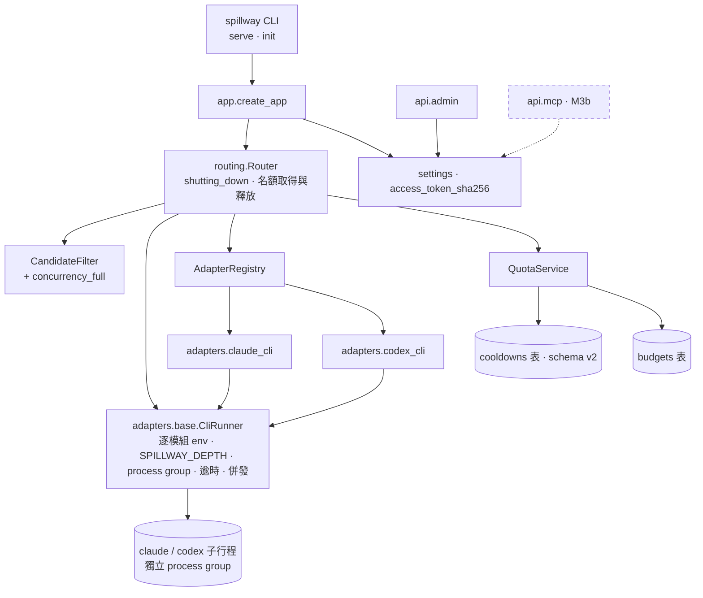
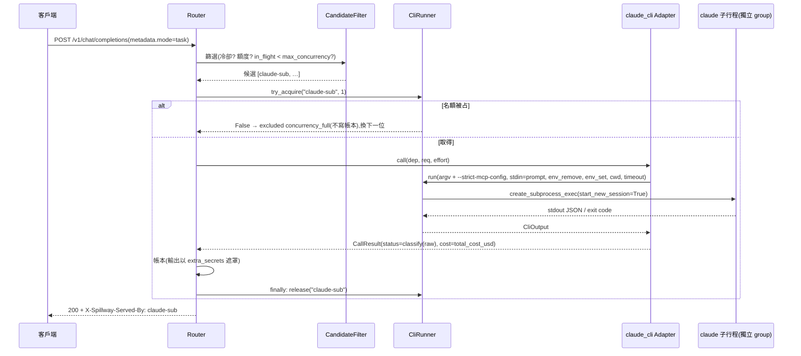
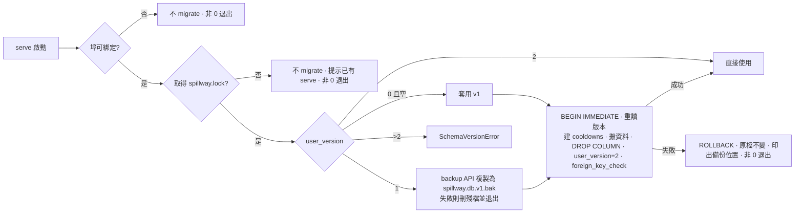
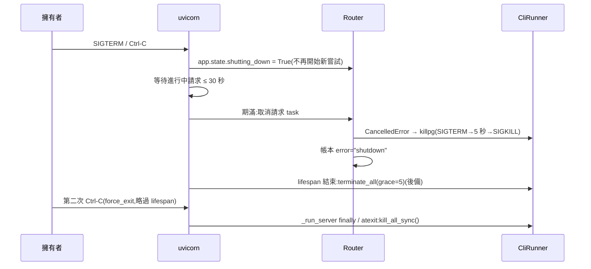
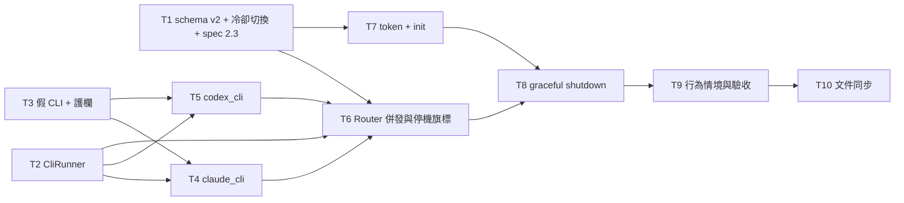

# CHG-20261101-03 — M3a:CLI 成員(CliRunner、claude_cli、codex_cli)、schema v2(冷卻獨立成表)、存取 token 與 init、graceful shutdown

- 專案:spillway
- 分支(Branch):`chg-20261101-03`(自 main fcf020e 分出;驗收通過後依 DIR-4 規則 2、4 自動合回 main 並推送)
- 日期:2026-11-01(UTC+0)
- 類型:新功能(M3 第一部分)+ 資料模型變更
- Template: plan
- 提出者:擁有者(使用者,2026-11-01「Open M3 CHG」;使用者決定 M3 拆為 M3a、M3b 兩筆 CHG)
- 實作者:claude-opus-5-5(主 session agent;平行 task 由其派出的子 agent 施工,見「平行施工」)
- 風險分級:高——命中資料模型(schema v2 與既有資料庫的 migration)、跨模組介面(`AdapterContext.cli_runner`、CliRunner、QuotaService 冷卻存放)、安全(訂閱 CLI 子行程的環境清理與 OAuth token 規則、存取 token 的產生與雜湊)、不可逆(migration 移除 `budgets.exhausted_until` 欄位、停機時終止子行程)
- Commit/PR:`chg-20261101-03` 分支上訊息以 `CHG-20261101-03:` 開頭的 commit(`git log --grep CHG-20261101-03`);合回 main 後回填
- 驗收報告(預留):ACC-20261101-02
- 重複性檢查(Recurrence check):無重複(M3 第一筆;動機與 CHG-20261029-01/02、CHG-20261030-01/02、CHG-20261101-01/02 皆不同)
- Diagrams:見「## 設計圖」節
- Security-impact:見「## 安全影響」節
- Skill: ai-sdlc-autopilot v1.69
- 關聯:Guideline 第 7 節 M3(閘門「4 種工具可連線」於 M3b 結束時驗收);FR-8(CLI)、FR-10(CLI)、FR-15、FR-16、FR-17、FR-25(CLI);AC-1、AC-2、AC-12、AC-16(CLI 版)、AC-17(CLI 版)、AC-19(含 CLI 模組)、NFR-6;spec 1.1.2、2.2、2.3、4.2.3–4.2.6、5.2.2、5.2.3、5.3、5.4.2、5.4.4、6.3、7.3、7.4、7.5、7.6.9、8.1.3、9.2;structure/design.md D1、D5、D9、D15;knowledge DIR-1–DIR-4;CHG-20261101-02 決策 2(schema v2 延到 M3)、決策 18(graceful shutdown 延到 M3)

## 動機

M2 完成了以 api 與 local 成員為主的路由核心。M3 的目標是把擁有者的兩個訂閱 CLI(Claude Code、Codex)納入成員,讓訂閱額度先被用完(G1),並以 MCP 讓 4 種工具連線(G6)。M3 範圍大,使用者決定拆成兩筆:本筆(M3a)做 CLI 成員與它需要的基礎——子行程執行器、兩個 CLI 模組、併發上限、CLI 版的額度與冷卻——以及兩項延到 M3 的整理:冷卻與預算分開存(schema v2,與存取 token 一起處理)、graceful shutdown;另做 MCP 需要的存取 token 與 `spillway init`。MCP server、`mcp-stdio`、設定輸出與 M3 閘門的 AC-9、AC-11 屬 M3b。

## 使用者故事

1. 作為擁有者,我要把 Claude Code 訂閱登記為 cli 成員(provider `claude-cli`),task 模式的請求由它以 `claude -p` 子行程處理,花費依回應的 `total_cost_usd` 扣抵 `credit_pool` 額度,以便訂閱額度先被用完(AC-1、FR-15、5.2.2)。
2. 作為擁有者,我要把 Codex 訂閱登記為 cli 成員(provider `codex-cli`),以 `codex exec` 子行程處理,花費記為 NULL、可用性只依上游訊號判斷(FR-16、5.2.3)。
3. 作為擁有者,我要 CLI 子行程不帶任何 API 金鑰與改道變數、不載入任何 MCP、帶 `SPILLWAY_DEPTH=1`,且閘道不讀取、不轉發訂閱的 OAuth token,以便訂閱以官方登入方式使用且不會遞迴呼叫自己(spec 1.1.2、7.3.2、7.3.3、7.4.3)。
4. 作為擁有者,我要每個 CLI 成員同時只跑設定數量的子行程(預設 1),額滿時由下一個成員接手而不是排隊,以便請求不卡在單一訂閱(FR-17、NFR-6)。
5. 作為擁有者,我要 CLI 成員在上游回報額度用完時冷卻到下一個重置點、限流時冷卻 60 秒、勾選預估檢查時預估花費超過剩餘就跳過,與 api 成員行為一致(AC-16、AC-17 的 CLI 版)。
6. 作為擁有者,我要第二個 claude-cli 或 codex-cli 成員建立時被拒絕(409 `provider_single`),以便每個訂閱只有一個成員(AC-12、FR-25)。
7. 作為擁有者,我要冷卻狀態與額度設定分開存放,沒有設定額度的成員遇到限流時不再自動產生假的額度列,以便額度畫面只顯示我設定的內容(CHG-20261101-02 決策 2)。
8. 作為擁有者,我要升級時資料庫自動從 v1 遷移到 v2,遷移前先備份,失敗時原檔不變,以便我的冒煙資料庫可以直接沿用(使用者決定 2026-11-01)。
9. 作為擁有者,我要以 `spillway init` 或首次啟動產生 MCP 存取 token,只印出一次、資料庫只存雜湊,並可經管理 API 重新產生,以便 M3b 的 MCP 端點有驗證依據(spec 8.1.3、D9)。
10. 作為擁有者,我要按 Ctrl-C 或送 SIGTERM 時閘道停止接新請求、最多等 30 秒讓進行中的請求完成,之後終止仍在跑的 CLI 子行程(連同它們啟動的程式),以便停機不會卡十分鐘也不留下殘留行程(使用者決定 2026-11-01)。

## 決策與取捨

| # | 決策 | 選項 | 前提假設(此決策建立在什麼之上) | 為何這樣選 |
|---|------|------|----------------------------------|------------|
| 1 | **(使用者決定 2026-11-01)** M3 拆為兩筆 CHG:本筆 M3a(CliRunner、claude_cli、codex_cli、併發上限、schema v2、存取 token 與 init、graceful shutdown);M3b(MCP server、`mcp-stdio`、設定輸出;M3 閘門於 M3b 結束時驗收) | (a) 兩筆 / (b) 一筆 | M3 涵蓋三類性質不同的工作,且 schema migration 是永遠停點 | 使用者選 (a)。Guideline M3 列與變更歷史記錄拆分(T10)。 |
| 2 | **(使用者決定 2026-11-01)** 存取 token 依 spec:`/mcp/*` 一律驗證 Bearer token(M3b 實作,比對以 `hmac.compare_digest`);綁 127.0.0.1 時 `/v1`、`/api` 不驗證;M3 仍只允許綁 127.0.0.1(D16 不放寬) | (a) 依 spec / (b) 全部端點一律驗證 | spec 8.1.3、9.1.1 | 使用者選 (a)。loopback 呼叫者可經 `/api/settings/token/rotate` 取得有效的新 token,因此 M3b 的 `/mcp/*` 驗證可被本機程式繞過——列為已知限制(DIR-2 範圍外)。 |
| 3 | **(使用者決定 2026-11-01)** schema v2:新增表 `cooldowns(deployment_id TEXT PRIMARY KEY REFERENCES deployments(id) ON DELETE CASCADE, exhausted_until TEXT NOT NULL, reason TEXT NOT NULL CHECK (reason IN ('quota_exhausted','rate_limited')))`;`budgets` 移除 `exhausted_until` 欄 | (a) 新表 / (b) `deployments` 加欄 | 冷卻是執行期狀態,額度是設定;M4 匯出入只處理設定 | 使用者選 (a)。spec 2.2、2.3、4.5.2、5.3.2、5.3.3、9.2 隨之修訂。 |
| 4 | v1→v2 migration 內容:在單一交易內 ① 建 `cooldowns`;② 把 `budgets.exhausted_until` 非 NULL 的列搬到 `cooldowns`(`reason` 由該成員帳本最近一筆 `quota_exhausted`/`rate_limited` 推得,找不到時記 `quota_exhausted`);③ 以 `ALTER TABLE budgets DROP COLUMN exhausted_until`(SQLite 3.53.1 支援)移除欄位;④ `PRAGMA user_version = 2`;完成後 `PRAGMA foreign_key_check` 必須為空。**不刪除**任何 `budgets` 列(含 CHG-20261030-02 決策 59 的 `type=none, window=none, limit_amount=NULL` 暫行列) | 刪除暫行列 vs 保留 | 暫行列與擁有者手動建立的 `type=none` 額度無法區分;刪除屬不可逆 | 保留最安全;暫行列語意等同「無上限」,擁有者可自行以 PUT `budget: null` 移除。**代使用者決定**(於確認閘揭露)。 |
| 5 | **(使用者決定 2026-11-01)** migration 於開啟資料庫時自動執行(`serve`、`init`);順序:① `serve` 先確認埠可綁定(以暫時 socket 試綁後關閉),失敗則不 migrate、以非 0 退出;② 取得資料目錄鎖檔 `spillway.lock`(非阻塞,取不到則退出並提示已有 serve 在跑);③ `user_version = 1` 且非空時,以 SQLite backup API 複製為 `spillway.db.v1.bak`(已存在則加 UTC 時間戳記後綴、不覆寫),在 `BEGIN IMMEDIATE` 之前、每個資料庫只做一次;備份失敗則刪除殘檔、不 migrate、非 0 退出;④ `BEGIN IMMEDIATE` 後重讀 `user_version`,仍為 1 才執行決策 4;失敗回滾、原檔不變、非 0 退出並印出備份位置 | (a) 自動 + 備份 / (b) 只以 `spillway migrate` 明確執行 | 擁有者的 `~/spillway-smoke` 已有真實資料;新 serve 若在舊 serve 仍執行時 migrate 會讓舊 serve 失效 | 使用者選 (a);埠與鎖檢查是決策審議補上的前置條件。**對擁有者實際資料目錄執行 migration 屬永遠停點**,見停點與 Acceptance operation。 |
| 6 | 冷卻與 API 形狀:QuotaService `mark` 寫入 `cooldowns`(取較晚時間)、`is_cooling` 讀、`clear` 刪除;不再為沒有 budgets 列的成員建立暫行列(取代決策 59);`domain.Budget` 移除 `exhausted_until`;`GET/POST/PUT /api/deployments` 回應移除 `budget.exhausted_until`,成員物件頂層新增 `cooling_until`(ISO 字串或 null)與 `cooling_reason`;`/api/dashboard` 同樣以 `cooling_until`、`cooling_reason` 呈現(兩者只在冷卻未到期時有值,到期後為 null,與路由「到期即不冷卻」一致;`cooldowns` 列本身保留到下次 mark 或 clear——施工審議 T1 補記);`PUT` 的 `budget: null` 只刪除 budgets 列;`_cooling_only` 合成邏輯移除,`_is_cooling_only`(把舊暫行列在 dashboard 視為無額度)保留 | 頂層欄位 vs 保留 `budget.exhausted_until` 投影 vs 移除欄位 | M4 UI-1、UI-2 會讀此形狀;`budget: null` 時冷卻必須仍可見 | 冷卻不再屬於額度,放頂層才一致。**公開形狀變更,於確認閘揭露**。**代使用者決定**。 |
| 7 | **(使用者決定 2026-11-01)** 併發上限:CLI 成員進行中的子行程數達 `params.max_concurrency`(預設 1)時於候選篩選排除,原因 `concurrency_full`(加入 `EXCLUDE_REASONS`,排在 `cooling` 之後);**名額由 Router 取得**:Router 對 `kind == "cli"` 的候選在呼叫 adapter 前 `cli_runner.try_acquire(dep.id, limit)`,失敗則把該成員加入 `excluded`(原因 `concurrency_full`)、不寫帳本、換下一位;成功則在 `finally`(含 CancelledError)`release`;模組不碰名額 | (a) 篩除不寫帳本 / (b) 帳本 error / (c) 新狀態 | NFR-6「超過視為不可用,不排隊」;單一事件迴圈、`try_acquire` 為同步,篩選到取得之間沒有 await | 使用者選 (a)。「篩選後被搶走」的嘗試不寫帳本,記為 spec 4.5.1(每次嘗試一列)的明列例外(design D29)。 |
| 8 | `CliRunner`(`adapters.base.cli_runner`;經 `AdapterContext.cli_runner` 交給模組;修訂 design.md 既有的 `run(argv, stdin, env, cwd, timeout) -> ProcResult` 介面):`async run(argv, *, stdin=None, env_remove=(), env_set={}, cwd, timeout, max_output_bytes=8 MiB) -> CliOutput(exit_code, stdout, stderr, timed_out, killed_reason)`;以 `asyncio.create_subprocess_exec(..., start_new_session=True)` 啟動(不經 shell、子行程自成 process group,終端 Ctrl-C 不會直接打到它);`stdin` 未給時為 `DEVNULL`;逾時、取消(`CancelledError`)、停機一律 `os.killpg` 整個 group:SIGTERM、5 秒後 SIGKILL,之後以有限時間(2 秒)收尾讀取管線;stdout/stderr 超過上限截斷並標記;`try_acquire(key, limit)`、`release(key)`、`in_flight(key)`;`kill_all_sync()`(同步,給 atexit 與強制退出用)與 `async terminate_all(grace)` | 共用執行器 vs 各模組自行起子行程 | spec 7.6.3;D1、D5;uvicorn 先取消請求 task 再跑 lifespan 結束(已核對 `.venv` uvicorn `server.py`) | 子行程的清理不依賴 lifespan:取消路徑本身就殺 group,孫行程一併結束。**代使用者決定**。 |
| 9 | 子行程環境(逐模組):以目前環境為底;claude 移除 `ANTHROPIC_API_KEY`、`ANTHROPIC_AUTH_TOKEN`、`ANTHROPIC_BASE_URL`、`CLAUDE_CODE_USE_BEDROCK`、`CLAUDE_CODE_USE_VERTEX`、`CLAUDE_CODE_USE_FOUNDRY`;codex 移除 `OPENAI_API_KEY`、`CODEX_API_KEY`、`OPENAI_BASE_URL`;兩者另移除所有成員 `credential_ref` 為 `env:<名>` 的變數,並把這些變數的值作為 `extra_secrets` 交給 Router 遮罩該次 CLI 輸出(施工審議補記:模組只負責決策 9 的固定清單;「所有成員 `env:` 憑證變數」由 Router 在每次 CLI 嘗試前從成員清單算出,寫入 `CliRunner.extra_env_remove`(集合,`run` 一律併入 `env_remove`),值同時作為該次嘗試的 `extra_secrets`;實作歸 T6);兩者設 `SPILLWAY_DEPTH=1`;`CLAUDE_CODE_OAUTH_TOKEN` 等官方登入變數照常繼承、閘道不讀取(src 中不得出現此名稱,由測試檢查) | 只移除 spec 7.3.2 的兩個 vs 逐模組擴充 | spec 7.3.2 的目的是「確保使用訂閱登入」;改道變數(base URL、Bedrock/Vertex/Foundry 開關)與 OpenAI 金鑰同樣會讓計費或連線偏離訂閱,`OPENAI_BASE_URL` 指向本閘道 `/v1` 會繞過深度檢查 | 擴充後才達成 7.3.2 的目的;spec 7.3.2 修訂為列出完整清單。**代使用者決定**。 |
| 10 | `claude_cli` 模組:命令 `claude -p --output-format json --model <model>` + `effort_args` + **固定附加** `--strict-mcp-config` + `extra_args`,prompt 經 stdin(7.5 轉換);隔離旗標由模組固定附加,不在 `extra_args` 內,擁有者自訂 `extra_args` 不會移除它;`default_params`:`timeout` 600、`effort_args` `["--effort", "{effort}"]`(屬 7.6.2 `default_params` 的範例用法;spec 6.3.2「未設定時不傳」解讀為成員與模組預設皆未設定時不傳,於 spec 修訂行註明)、`extra_args` `[]`、`cwd` 未設定時為 `AdapterContext.data_dir / "work" / "claude"`(`data_dir` 為 None 且未設定 `params.cwd` 時 `call` 回 `error`);`effort_map`:`none`→不傳、`low`/`medium`/`high`/`max` 對應同名值;回應取 JSON `result`、`usage.input_tokens`/`output_tokens`、`total_cost_usd`;`default_signals` 依 spec 5.3.1;`default_capabilities` `tools`、`vision` 為 false;`create()` 容忍 `cli_runner=None`(此時 `call` 回 `error`),`list_models` 不起子行程 | 依 spec 與實機 `claude --help` | 本機 `claude --help`(2.1.308)確認 `--effort` 接受 low、medium、high、xhigh、max,`--strict-mcp-config` 存在;不採用 `--bare`(會改用 API 金鑰登入) | **代使用者決定**。 |
| 11 | **(使用者決定 2026-11-01,決策審議 B2)** `codex_cli` 模組:命令 `codex exec --json --skip-git-repo-check -m <model> -o <暫存檔>` + `-c model_reasoning_effort=<值>` + **固定附加** `-c mcp_servers={}`(停用 codex 全部 MCP 伺服器,擁有者無法經 `extra_args` 移除)+ `extra_args` + `--` + prompt;暫存檔以 `tempfile.mkstemp`(0600)建立、`finally` 刪除;`effort_map` 依 spec 6.3;`default_params`:`timeout` 600、`extra_args` `[]`、`cwd` 未設定時為 `AdapterContext.data_dir / "work" / "codex"`(同上);回應取暫存檔內容、token 取 JSONL 最後一個含 usage 的事件;`cost_usd` 為 NULL;prompt 過大導致 `OSError`(E2BIG)時回 `error`;`create()` 容忍 `cli_runner=None` | (a) 停用全部且強制 / (b) 停用全部但可覆寫 / (c) 只停用閘道的條目 | 本機 `codex exec --help`(0.163.0)確認 `--json`、`--skip-git-repo-check`、`-m`、`-o`、`-c key=value`(TOML);`-c mcp_servers={}` 為覆寫或合併由擁有者冒煙以 `codex mcp list -c mcp_servers={}` 確認 | 使用者選 (a)。spec 7.4.3 修訂為「固定停用全部 MCP」。 |
| 12 | CLI 結果判定沿用 `adapters.base.classify`:claude raw 為 JSON(`is_error`、訊息);codex raw 為結束碼與 stderr;逾時、非 JSON、找不到執行檔、`OSError` 為 `error`;被停機終止為 `error`(`killed_reason="shutdown"`) | 同左 | spec 5.3.1;CHG-20261030-02 決策 12 | **代使用者決定**。 |
| 13 | 估算維持現況:`estimate.py`(`src/spillway/estimate.py`)已有實作 `cli_overhead_tokens`(5.4.2)與 codex 花費 NULL(`NO_PRICE_PROVIDERS`,5.4.4);claude-cli 查價依現行順序 `claude-cli/<model>` 再裸 `model`,不改為 `anthropic/<model>`;本筆只補回歸測試 | 維持 vs 改查價字串 | 已核對 `estimate.py:51、71-96、120-130` | 不改既有行為。**代使用者決定**。 |
| 14 | **(使用者決定 2026-11-01)** 存取 token:`spillway init` 產生;已存在時印出「已存在,未變更」並以 0 退出(冪等),`spillway init --rotate` 才重新產生;`serve` 啟動時沒有 `settings.access_token_sha256` 則產生並以單行印到 stderr(只印一次);`POST /api/settings/token/rotate` 回應 `{"token": "..."}`(只此一次);token 為 `secrets.token_urlsafe(32)`,資料庫只存 SHA-256 十六進位;本筆不以 token 做任何驗證 | (a) init 或首次啟動 / (b) 只有 init | spec 8.1.3、D9 | 使用者選 (a)。token 明文不寫日誌檔、資料庫、帳本;uvicorn access log 不含 body。 |
| 15 | `spillway init`:建立資料目錄、`work/claude`、`work/codex`、執行 migration(含決策 5 的鎖與備份;不做埠檢查)、產生 token | 同左 | D9 | **代使用者決定**。 |
| 16 | **(使用者決定 2026-11-01)** graceful shutdown:① 收到第一個 SIGTERM/SIGINT 時設 `app.state.shutting_down = True`,Router 之後不再開始新的嘗試(回 503 `no_candidate`,原因 `shutting_down`)也不再啟動子行程;② uvicorn `timeout_graceful_shutdown=30` 期滿後取消請求 task,CliRunner 在取消路徑殺 process group(決策 8),Router 的取消路徑在 `shutting_down` 時寫帳本 `status=error`、`error="shutdown"`(否則維持既有 `cancelled`);③ lifespan 結束時 `terminate_all(grace=5)` 為後備;④ `_run_server` 的 `finally` 與 `atexit` 呼叫 `kill_all_sync()`,處理第二次 Ctrl-C(uvicorn `force_exit` 會略過 lifespan);`_run_server` 接受測試用的 `graceful_timeout` 參數(預設 30) | (a) 等 30 秒再終止 / (b) 等到完成 / (c) 立即終止 | CHG-20261101-02 決策 18;已核對 uvicorn 先取消請求 task 再跑 lifespan | 使用者選 (a);機制依決策審議改寫。M3b 須就 `/mcp` 長連線重新檢查 30 秒上限。 |
| 17 | settings 層開始讀 settings 表的 `access_token_sha256`;`bind_host`、`port` 鍵仍不讀(D16 不變);`cli.py` 的拒絕訊息與 `settings.py` 註解改為「M3 仍只允許 127.0.0.1」 | 同左 | 決策 2 | **代使用者決定**。 |
| 18 | 自動測試的 CLI 一律用假執行檔 `tests/fakes/cli_upstream/`:`claude`、`codex` 為以 `sys.executable` 產生的 wrapper(避開 macOS `/usr/bin/python3` stub);情境由 `$SPILLWAY_HOME/fake_cli/<claude|codex>.json` 控制檔切換(支援長駐的 serve),內容含 `scenario`(ok、quota、rate_limit、error、timeout、non_json、hold_until_release、grandchild_holds_stdout)、`delay_seconds`;每次呼叫寫一個獨立記錄檔(argv、stdin、cwd、`SPILLWAY_DEPTH` 值、指定變數是否存在——不寫值);`tests/fakes/claude_cli/__init__.py`、`codex_cli/__init__.py` 提供 `call_status_harness` 供 `tests/contract/test_call_status.py` | 假執行檔 vs mock CliRunner | Guideline Q1;D5;`test_call_status.py` 對沒有 harness 的模組直接 fail | 走真實子行程路徑。**代使用者決定**。 |
| 19 | 真實 CLI 護欄:`tests/conftest.py`(autouse)、`tests/features/environment.py` 與測試啟動的 serve 子行程環境三處,都把 PATH 中解析到真實 `claude`、`codex` 的目錄移除,並斷言 `shutil.which` 只會找到假執行檔;找到真實執行檔即 fail | 同左 | 本機 `~/.local/bin` 有真實 claude、codex | 測試不可能誤用訂閱額度。**代使用者決定**。 |
| 20 | **(使用者決定 2026-11-01,決策審議 B1)** 合回順序:自動化驗收(ACC)通過後**停下**,由擁有者以本分支建置對 `~/spillway-smoke` 執行 migration 並各以 claude-cli、codex-cli 做一次真實呼叫,agent 把遮罩後的結果記入 ACC 後才依 DIR-4 合回 main 並推送 | (a) 合回前停下 / (b) 先合回、擁有者步驟為追蹤項 | 合回後擁有者下一次啟動即 migrate 真實資料庫(永遠停點) | 使用者選 (a)。這是 DIR-4 規則 2 自動合回在本筆的揭露差異:依規則 3b、3c 先停。 |

## 設計圖

### 圖 1:本筆範圍的架構(實線為本筆新增或變更,虛線為 M3b)



### 圖 2:一次 task 請求由 claude-cli 成員處理



### 圖 3:啟動與 schema v1 → v2 migration



### 圖 4:停機



### 圖 5:平行施工波次



## 安全影響

範圍依 knowledge DIR-2:威脅模型只有擁有者本人在本機使用;下表回答四類永遠停點是否被本筆觸及。

| 類別 | 是否觸及 | 影響範圍 / 理由 |
|------|----------|-----------------|
| irreversible-delete | 是 | (1) v1→v2 migration 以 `DROP COLUMN` 移除 `budgets.exhausted_until`(資料先搬到 `cooldowns`;執行前備份為 `spillway.db.v1.bak`,失敗回滾)。(2) 停機時終止仍在跑的 CLI 子行程與其孫行程(使用者決定 16),該次請求失敗並記帳本。(3) `cooldowns` 對成員 `ON DELETE CASCADE`。不刪除任何 `budgets` 列(決策 4)。施工與測試只在 pytest 暫存 `SPILLWAY_HOME`;agent 不對擁有者資料目錄執行任何操作。 |
| payments | 否(條件:決策 9 成立) | 不發起付款;CLI 成員花費只讀取上游回報。決策 9 移除 API 金鑰與改道變數,避免子行程改走按量計費的 API 路徑。自動測試只用假執行檔(決策 18、19);真實 claude/codex 只在擁有者冒煙時執行。 |
| prod-migration | **是(永遠停點)** | schema v1→v2 作用於擁有者實際資料庫。本筆只在測試資料庫驗證;自動化驗收後 agent 停下(決策 20),由擁有者以本分支建置先停舊 serve、再啟動新版觸發 migration 並回報;回滾:停 serve、刪除 `spillway.db`、`spillway.db-wal`、`spillway.db-shm`,把 `spillway.db.v1.bak` 改名為 `spillway.db`,回退程式版本;v2 期間寫入的帳本列會遺失。 |
| security-boundary | 是 | (a) 訂閱 CLI:決策 9 的逐模組 env 清理、`SPILLWAY_DEPTH=1`、claude 固定 `--strict-mcp-config`、codex 固定 `-c mcp_servers={}`;閘道不讀取、不解析、不轉發任何 OAuth token 或 CLI 憑證檔(spec 1.1.2;DIR-2 規則 2c),只呼叫官方 CLI。(b) 子行程以 argv 陣列啟動、不經 shell;claude 的 prompt 經 stdin,codex 的 prompt 前加 `--`;stdin 預設 DEVNULL。(c) 子行程自成 process group,逾時、取消、停機殺整個 group。(d) 存取 token 只存 SHA-256;明文只在 `init`、首次啟動(stderr 一行)與 rotate 回應中出現一次。(e) 綁定仍只允許 127.0.0.1(決策 2)。(f) CLI 輸出以 Redactor 加成員憑證值(`extra_secrets`)遮罩後才寫帳本與 payload。 |

已知限制(DIR-2 範圍內,只記錄、不實作):
- 本機其他程式可對 127.0.0.1:8787 發請求(CSRF、DNS rebinding);其中 `POST /api/settings/token/rotate` 會把有效的新 token 回給呼叫者,因此 M3b 的 `/mcp/*` token 驗證可被本機程式經 `/api` 繞過。
- token 首次啟動時印到 stderr;若擁有者把 `serve` 的 stderr 導到檔案,檔案中會有一次明文。
- CLI 子行程仍繼承決策 9 清單以外的環境變數;CLI 可執行指令,理論上能讀到這些變數並印出;Redactor 只遮罩已知樣式與成員憑證值。
- codex 的 `-c mcp_servers={}` 會停用 codex 全部 MCP(使用者決定);是否為「取代」而非「合併」由擁有者冒煙確認。claude 的 plugin 或 claude.ai connector 提供的 MCP 是否也被 `--strict-mcp-config` 排除,由擁有者冒煙確認。
- prompt 經 `ps` 可見(codex 為 argv),超過系統 ARG_MAX 時該次回 `error`。
- 真實 claude/codex 的輸出格式以本機 2.1.308 / 0.163.0 版確認;版本更新後由擁有者冒煙發現。
- 延續 CHG-20261101-02 的已知限制。

## 修改指引

### 目標

M3a 完成:CLI 成員可用(AC-1、AC-2、AC-12、AC-16 與 AC-17 的 CLI 版、AC-19 含 CLI 模組、NFR-6 通過,以假執行檔驗證);schema v2 與 migration 在測試資料庫驗證;存取 token 與 `init` 可用;graceful shutdown 30 秒上限與子行程清理;擁有者真實冒煙與擁有者資料庫 migration 於合回前由擁有者執行並回報(決策 20)。

### 影響範圍

| 受影響項 | 類型 | 改動 | 連帶影響 |
|----------|------|------|----------|
| `src/spillway/store/`(`schema.sql` 不改;`db.py` v2 migration、備份、鎖;`repo.py` 冷卻函式與 budget SQL) | 資料 | schema v2 | 擁有者資料庫(永遠停點) |
| `src/spillway/domain.py`(`Budget` 移除 `exhausted_until`;`EXCLUDE_REASONS` 相關常數)、`quota.py`、`api/admin/deployments.py`、`api/admin/dashboard.py`、`api/admin/models.py`、`api/admin/common.py` | 邏輯/介面 | 冷卻改存 `cooldowns`;API 頂層 `cooling_until`、`cooling_reason` | `/api/deployments`、`/api/dashboard` 形狀(M4 UI-1、UI-2) |
| `src/spillway/adapters/base/`(`cli_runner.py` 新增、`contract.py` 分層規則、`__init__` 匯出、`AdapterContext.cli_runner` 注入) | 設計 | CliRunner | M3b 不受影響 |
| `src/spillway/adapters/claude_cli/`、`adapters/codex_cli/`(新增) | 設計 | 兩個 CLI 模組 | `GET /api/adapters`;M4 UI-2 |
| `src/spillway/routing/router.py`、`routing/filter.py` | 邏輯 | 名額取得與釋放、`concurrency_full`、`_cooling_now` 改讀 cooldowns、停機旗標與 `error="shutdown"` | dry-run 與 503 body |
| `src/spillway/settings.py`、`cli.py`、`app.py`、`api/admin/settings.py` | 介面 | token、`init`、rotate、埠與鎖檢查、graceful shutdown | M3b `/mcp/*` 讀同一雜湊 |
| `tests/fakes/cli_upstream/`、`tests/fakes/claude_cli/`、`tests/fakes/codex_cli/`、`tests/conftest.py`、`tests/features/environment.py`、`tests/acceptance/seed.py` | 測試 | 新增或修改 | regression.md |
| `docs/spec.md` 2.2、2.3、4.2.4、4.5.2、5.3.2、5.3.3、6.3.2(註明)、7.3.2、7.4.3、9.2 | 規格 | 見「規格書與結構文件更新」 | 修訂行 |
| `sdlc_docs/ai-guideline.md` M3 列與變更歷史 | 文件 | M3a/M3b 拆分 | 無 |
| sdlc_docs/structure/design.md、logical.md、data.md、directory.md、README | 文件 | 見「規格書與結構文件更新」 | 無 |

### Global Constraints(全域約束——每個 task 都要遵守)

- 語言與版本:Python ≥ 3.11(驗收平台 3.13,SQLite 3.53.1);src layout;路徑一律 `pathlib`。
- 相依套件:不新增任何相依(子行程用標準庫 `asyncio`、`os`、`signal`;token 用 `secrets`、`hashlib`;鎖用 `fcntl`)。要新增時停下回報。
- 規格依據:行為以 `docs/spec.md`、本 CHG 決策表、CHG-20261030-02 與 CHG-20261101-02 決策表為準;只可做「規格書與結構文件更新」列出的 spec 修訂;不修改 `docs/proposal.md`。
- 分層與模組:`spillway.adapters.<module>` 只可 import `spillway.adapters.base`、標準庫與 `pyyaml`,且不可使用 `subprocess`、`asyncio.create_subprocess_*`、`os.system`、`os.popen`、`os.spawn*`、`os.exec*`、`pty`(擴充 `adapters/base/contract.py` 的 `layering_violations`;`import asyncio`、`tempfile`、`os` 本身仍允許);CLI 模組只能經 `AdapterContext.cli_runner` 起子行程;SQL 只在 `src/spillway/store/`。
- 子行程:一律 argv 陣列、不經 shell、`start_new_session=True`;環境依決策 9 逐模組清理並設 `SPILLWAY_DEPTH=1`;不可讀取、解析、複製或轉發任何 CLI 的憑證檔或 OAuth token(`~/.claude`、`~/.codex` 一律不碰;src 中不得出現 `CLAUDE_CODE_OAUTH_TOKEN` 字串)。
- 測試上游:自動測試只用 `tests/fakes/`;護欄依決策 19 放在三處;不可執行真實 `claude`、`codex`(施工者也不可在任何環境執行,`--help` 除外),不可連任何真實上游。
- 秘密:沿用 CHG-20261030-02 Global Constraints「秘密」條;存取 token 明文不可出現在日誌檔、資料庫、帳本、payload、測試輸出與 `artifacts/`(`artifacts/m3a/http-log.jsonl` 不記 body,測試斷言 rotate 回應的 token 不在任何產物中)。
- 資料目錄:測試一律以 `tmp_path` 為 `SPILLWAY_HOME`;不可讀寫擁有者的實際資料目錄;migration 只在測試資料庫驗證。
- 時間與亂數:經 `Clock`/`Rng` 注入;token 用 `secrets`。
- 網路:只綁 127.0.0.1,預設埠 8787(D16 不變)。
- 錯誤回應:spec 9.1.2 格式;新錯誤碼與排除原因只用本 CHG 列出的值(`concurrency_full`、`shutting_down`)。
- 既有測試斷言不可修改,除非屬下列逐檔允許清單(只限與 `exhausted_until`、schema 版本、暫行列、`EXCLUDE_REASONS`、管理 API 路徑集合相關的斷言,改寫內容於施工審議逐條核對):`tests/contract/test_adapter_contract.py`(`Budget` 欄位清單)、`tests/unit/store/test_schema.py`(版本、表數、與 spec DDL 一致性、`MIGRATIONS` 索引)、`tests/unit/store/test_migration_nonempty.py`(版本常數)、`tests/unit/store/test_repo.py`、`tests/unit/store/test_repo_queries.py`(dashboard 查詢)、`tests/unit/test_quota.py`、`tests/unit/routing/test_router.py`、`tests/unit/routing/test_filter.py`、`tests/features/steps/common_steps.py`(冷卻斷言)、`tests/features/steps/routing_steps.py`(`mark_exhausted_until` 呼叫)、`tests/acceptance/test_operation.py`(冷卻欄位)、`tests/integration/test_review_final_u10.py`(決策 59 暫行列)、`tests/integration/admin/test_admin_deployments.py`、`tests/integration/admin/test_admin_dashboard.py`、`tests/contract/test_public_imports_admin.py`(rotate 路徑)、`tests/contract/test_public_imports_routing.py`(`EXCLUDE_REASONS`)、`tests/integration/admin/test_admin_app_state.py`(`CREATE_APP_EXTRA` 加入本筆新增的 `app.state` 屬性 `cli_runner`、`shutting_down`;施工審議 T2 補列)、`tests/unit/adapters_base/test_effort_and_protocol.py`(`AdapterContext` 欄位清單加 `data_dir`;施工審議補列)、`tests/integration/admin/test_admin_adapters.py`(內建模組 cardinality:CLI 模組為 single;施工審議補列)。其他既有斷言需修改時停下回報。
- 每個 task 的測試必須能以該 task 的 `test:` 指令獨立執行並全綠;每個 task 完成時另跑全量 `python -m pytest -q`(必須全綠)。
- 既有 feature 檔的情境文字只能經修改治理變更;施工者只寫步驟檔。
- commit 訊息以 `CHG-20261101-03:` 開頭,結尾加 Co-Authored-By 行。
- 驗收平台為 macOS;Linux、Windows 在 ACC 標「未涵蓋」。

### 契約清單

| 契約 | 提供方 | 讀取方 | 本筆變更 | 契約測試(路徑/無) |
|------|--------|--------|----------|----------------------|
| 資料庫 schema v2(`cooldowns`;`budgets` 無 `exhausted_until`;`user_version=2`)與 spec 2.3 DDL | T1 | `store.repo`、QuotaService、dashboard;M3b、M4 | 變更 | tests/unit/store/test_schema.py(允許改寫);tests/unit/store/test_migration_v1_v2.py(新增) |
| migration 前置條件與備份(埠、`spillway.lock`、`spillway.db.v1.bak` 命名與不覆寫、失敗清理) | T1(備份與鎖)、T7(埠檢查接在 serve) | 擁有者 | 新增 | tests/unit/store/test_migration_v1_v2.py;tests/integration/test_init_token.py |
| `store.repo` 冷卻函式與 dashboard 查詢(LEFT JOIN cooldowns,查詢數不變) | T1 | QuotaService、dashboard、Router | 新增/變更 | tests/unit/store/test_repo_cooldowns.py(新增);tests/integration/admin/test_admin_dashboard.py(查詢數) |
| `domain.Budget`(移除 `exhausted_until`) | T1 | repo、admin、M4 | 變更 | tests/contract/test_adapter_contract.py(允許改寫) |
| 管理 API 成員物件 `cooling_until`、`cooling_reason`;`budget` 無 `exhausted_until`;`budget: null` 語意 | T1 | M4 UI-1、UI-2 | 變更(公開形狀) | tests/integration/admin/test_admin_deployments.py;test_admin_dashboard.py |
| `CliRunner`(`run`、`try_acquire`、`release`、`in_flight`、`terminate_all`、`kill_all_sync`;`CliOutput`) | T2 | claude_cli、codex_cli、Router、app/cli 停機 | 新增(修訂 design.md 既有列) | tests/unit/adapters_base/test_cli_runner.py(新增) |
| `AdapterContext.cli_runner`(預設仍為 None)、`AdapterContext.data_dir`(預設 None;app 注入資料庫所在目錄,CLI 模組以它推得 `work/<模組>`;施工審議補記,新增欄位依 CHG-20261030-02 決策 13 不升 `contract_version`) | T2(`data_dir` 由主 session 補上) | CLI 模組 | 變更(由 app 注入) | tests/unit/adapters_base/test_effort_and_protocol.py;tests/contract/test_adapter_contract.py |
| 假 CLI 協定(控制檔、情境、延遲、記錄檔)與 `call_status_harness` | T3、T4、T5 | T4–T9 | 新增 | tests/fakes/test_cli_upstream.py(新增);tests/contract/test_call_status.py |
| `claude_cli` MANIFEST、`models.yaml`、CallResult 對應、固定隔離旗標 | T4 | Registry、Router、`/api/adapters` | 新增 | tests/contract/test_adapter_contract.py;tests/contract/test_call_status.py;tests/unit/adapters/test_claude_cli.py(新增) |
| `codex_cli` MANIFEST、`models.yaml`、CallResult 對應、固定隔離旗標、`--` | T5 | 同上 | 新增 | 同上;tests/unit/adapters/test_codex_cli.py(新增) |
| 排除原因 `concurrency_full`、`shutting_down`;Router 名額協定;帳本 `error="shutdown"` | T6 | dry-run、503 body、M4 UI-4 | 新增 | tests/unit/routing/test_filter.py;tests/unit/routing/test_router.py;tests/contract/test_exclude_reasons.py(新增,值快照) |
| `settings.access_token_sha256`、`spillway init`、`POST /api/settings/token/rotate` 回應 `{"token": "..."}` | T7 | M3b `/mcp/*`、M4 UI-7 | 新增 | tests/integration/test_init_token.py(新增);tests/integration/admin/test_admin_token_rotate.py(新增) |
| 停機行為(旗標、30 秒、殺 group、`error="shutdown"`、double Ctrl-C) | T8 | 擁有者 | 新增 | tests/integration/test_graceful_shutdown.py(新增) |

### Tasks(checkbox=續作點)

- [ ] T1. schema v2、migration 與冷卻切換(含 API 形狀與 spec 2.3)
  - interfaces: consumes 決策 3、4、5、6 / produces `store/db.py`(`MIGRATIONS` 第 2 版、備份、`spillway.lock`)、`store/repo.py`(冷卻函式、budget SQL 去除 `exhausted_until`、`dashboard_members` LEFT JOIN cooldowns)、`domain.py` `Budget`、`quota.py`、`api/admin/{deployments,dashboard,models,common}.py`、`docs/spec.md` 2.2 與 2.3、允許清單內既有測試的改寫、`tests/unit/store/test_migration_v1_v2.py`、`tests/unit/store/test_repo_cooldowns.py`
  - test: `python -m pytest tests/unit/store tests/unit/test_quota.py tests/integration/admin tests/integration/test_review_final_u10.py tests/contract -q && python -m behave tests/features/m2_quota.feature tests/features/m2_routing.feature`
  - L1: 空資料庫開啟後 `user_version=2`、`cooldowns` 欄位與約束如決策 3、`budgets` 無 `exhausted_until`、與 spec 2.3 DDL 一致;冷卻函式往返正確且取較晚時間;`QuotaService.mark` 不建 budgets 列、`clear` 刪 cooldowns 列
  - L2: v1 測試資料庫(一般列、含冷卻的列、決策 59 暫行列、帳本含兩種狀態)開啟後:`spillway.db.v1.bak` 與原檔內容相同;`cooldowns` 有對應列且 `reason` 依帳本推得;暫行列與其他 budgets 列逐欄保留;遷移後 budgets DDL 等於全新 v2;`PRAGMA foreign_key_check` 為空;備份已存在時另存時間戳記檔;注入備份失敗時無殘檔且 `user_version` 仍為 1;注入 migration 失敗時回滾;鎖被占時不 migrate;`/api/deployments` 冷卻成員回 `cooling_until`、`cooling_reason`,`budget: null` 時冷卻仍可見;`/api/dashboard` 查詢數與搬移前相同
  - L3: `m2_quota.feature`、`m2_routing.feature` 的冷卻與恢復情境不改文字全過
  - L4: 不適用(擁有者資料庫的實際 migration 屬 Acceptance operation 擁有者步驟;子行程啟動的 migration 由 T9 L4 覆蓋)

- [ ] T2. `CliRunner`
  - interfaces: consumes 決策 8 / produces `adapters/base/cli_runner.py`、`adapters/base/__init__.py` 匯出、`adapters/base/contract.py` 子行程禁用規則、`app.py` 只新增一行建立 CliRunner 並注入 `AdapterContext.cli_runner`、`tests/unit/adapters_base/test_cli_runner.py`
  - test: `python -m pytest tests/unit/adapters_base tests/contract -q`
  - L1: 以 `sys.executable -c` 小腳本為子行程:`env_remove` 的變數不存在、`env_set` 生效;stdin 送達,未給時為空;cwd 正確;子行程為新 session(`os.getsid` 不同);逾時時 `timed_out=True`,子行程與其孫行程皆結束(SIGTERM 不理會時 5 秒內 SIGKILL);孫行程持有 stdout 時 `run` 仍在逾時加 2 秒內回傳;輸出超過上限截斷並標記;`run` 所在 task 被取消時 group 被殺;`try_acquire(key,1)` 第二次為 False、`release` 後恢復;`kill_all_sync` 與 `terminate_all` 結束全部進行中子行程;結束後 `pgrep` 找不到測試子行程
  - L2: `create_app()` 的 `AdapterContext.cli_runner` 為同一實例;layering 檢查在 adapters 模組放入 `os.system`、`subprocess`、`asyncio.create_subprocess_exec` 時各自失敗,放入 `import asyncio`、`tempfile.mkstemp` 時不失敗
  - L3: 不適用(執行器沒有使用者看得到的行為;CLI 成員行為於 T9 情境驗證)
  - L4: 不適用(由 T8、T9 的子行程測試覆蓋)

- [ ] T3. 假 CLI 執行檔與真實 CLI 護欄
  - interfaces: consumes 決策 18、19 / produces `tests/fakes/cli_upstream/`(以 `sys.executable` 產生的 `claude`、`codex` wrapper、控制檔與記錄檔協定)、fixture `fake_cli`、`tests/conftest.py` autouse 護欄、`tests/features/environment.py` 護欄、`tests/fakes/test_cli_upstream.py`
  - test: `python -m pytest tests/fakes/test_cli_upstream.py -q`
  - L1: 每個情境下假 `claude` 的 JSON 與 spec 7.3.5 欄位一致、假 `codex` 的 JSONL 與 `-o` 檔內容一致;`delay_seconds`、`hold_until_release`(等控制檔放行)、`grandchild_holds_stdout` 生效;每次呼叫一個記錄檔,含 argv、stdin、cwd、`SPILLWAY_DEPTH`、指定變數是否存在(不含值);兩個併發呼叫的記錄互不覆蓋
  - L2: `fake_cli` 啟用時 `shutil.which("claude")`、`which("codex")` 指向假執行檔且 PATH 中已無解析到真實執行檔的目錄;以 PATH 指向一個模擬「真實」執行檔(非假執行檔)的暫存目錄時,pytest 護欄與 behave 護欄都讓測試失敗
  - L3: 不適用(測試工具)
  - L4: 不適用(測試工具)

- [ ] T4. `claude_cli` 模組
  - interfaces: consumes T2、T3、決策 9、10、12 / produces `adapters/claude_cli/`(`__init__.py`、`adapter.py`、`models.yaml`、`README.md`)、`tests/fakes/claude_cli/__init__.py`(`call_status_harness`)、`tests/unit/adapters/test_claude_cli.py`
  - test: `python -m pytest tests/unit/adapters/test_claude_cli.py tests/contract -q`
  - L1: messages 依 7.5.1 轉為 prompt;argv 為 `claude -p --output-format json --model <m>` + `--effort <level>`(none 不傳)+ `--strict-mcp-config` + `extra_args`;成員設 `extra_args=["--verbose"]` 時 `--strict-mcp-config` 仍在;env_remove 清單如決策 9;回應 `result`、`usage`、`total_cost_usd` 對應到 CallResult;四種上游輸出對應 `ok`、`quota_exhausted`、`rate_limited`、`error`;逾時、非 JSON、找不到執行檔為 `error`;`cli_runner=None` 時 `create()` 成功、`call` 回 `error`
  - L2: 合約測試(`test_adapter_contract.py`、`test_call_status.py`)對 `claude_cli` 全綠;`GET /api/adapters` 列出 `claude-cli`(access `subscription-cli`、cardinality `single`)且不起子行程;第二個 `claude-cli` 成員 409 `provider_single`(AC-12)
  - L3: 不適用(m3a 情境的步驟由 T9 撰寫並執行)
  - L4: 不適用(真實 claude 只在擁有者冒煙執行)

- [ ] T5. `codex_cli` 模組
  - interfaces: consumes T2、T3、決策 9、11、12 / produces `adapters/codex_cli/`、`tests/fakes/codex_cli/__init__.py`、`tests/unit/adapters/test_codex_cli.py`
  - test: `python -m pytest tests/unit/adapters/test_codex_cli.py tests/contract -q`
  - L1: argv 為 `codex exec --json --skip-git-repo-check -m <m> -o <tmp>` + `-c model_reasoning_effort=<值>`(none→minimal、max→xhigh)+ `-c mcp_servers={}` + `extra_args` + `--` + prompt;自訂 `extra_args` 時 `mcp_servers={}` 仍在;`argv[-2] == "--"`;以 `-` 或 `resume` 開頭的 prompt 原樣出現在 `--` 之後;env_remove 清單如決策 9;回應取 `-o` 檔、token 取 JSONL usage;`cost_usd` 為 NULL;四種上游輸出對應正確;`-o` 檔權限 0600 且呼叫後(含錯誤與逾時)已刪除;注入 `OSError(E2BIG)` 時回 `error`
  - L2: 合約測試對 `codex_cli` 全綠;第二個 `codex-cli` 成員 409 `provider_single`
  - L3: 不適用(m3a 情境的步驟由 T9 撰寫並執行)
  - L4: 不適用(真實 codex 只在擁有者冒煙執行)

- [ ] T6. Router 的併發名額、冷卻來源與停機旗標
  - interfaces: consumes T1、T2、T4、T5、決策 7、9、16 / produces `routing/filter.py`(`concurrency_full` 篩選)、`routing/router.py`(名額取得與 `finally` 釋放、`_cooling_now` 改讀 cooldowns、`shutting_down` 時不開始新嘗試與取消路徑寫 `error="shutdown"`、CLI 輸出以成員憑證值為 `extra_secrets`)、`domain.py` 排除原因常數、`tests/contract/test_exclude_reasons.py`、估算回歸測試
  - test: `python -m pytest tests/unit/routing tests/unit/test_estimate.py tests/contract tests/integration/test_openai_api.py -q`
  - L1: `in_flight >= max_concurrency` 的 CLI 成員被篩除、原因 `concurrency_full`、無帳本列;篩選後 `try_acquire` 失敗時加入 excluded、無帳本列、換下一位;呼叫拋出或被取消時名額已釋放;`shutting_down` 為真時不開始嘗試;取消時 `shutting_down` 為真寫 `error="shutdown"`、否則 `cancelled`;`EXCLUDE_REASONS` 值快照;`cli_overhead_tokens` 與 codex NULL 估算回歸
  - L2: 兩個 task 請求、claude-sub `max_concurrency=1`、假 claude `hold_until_release`:第二個由 deepseek-api 處理、帳本無 claude-sub 第二列、放行後第一個完成;dry-run 顯示 `concurrency_full`;CLI 輸出含成員憑證值時帳本與 payload 已遮罩
  - L3: 不適用(情境由 T9 撰寫並執行)
  - L4: 不適用(由 T9 覆蓋)

- [ ] T7. 存取 token、`spillway init` 與啟動前置檢查
  - interfaces: consumes T1、決策 5、14、15、17 / produces `settings.py` token 讀寫與註解、`cli.py` 的 `init` 子命令與拒絕訊息更新、`cli.py` 抽出 `_preflight(host, port, data_dir)`(埠試綁與鎖)由 `_run_server` 一行呼叫、`app.py` 抽出 `_ensure_token(app)` 由 lifespan 一行呼叫、`api/admin/settings.py` rotate 端點、`tests/integration/test_init_token.py`、`tests/integration/admin/test_admin_token_rotate.py`
  - test: `python -m pytest tests/integration/test_init_token.py tests/integration/admin/test_admin_token_rotate.py tests/unit/test_settings.py tests/contract -q`
  - L1: token 由 `secrets.token_urlsafe(32)` 產生、只存 SHA-256 十六進位;`init` 第二次執行印「已存在,未變更」、退出碼 0、雜湊不變;`init --rotate` 改變雜湊;`init` 建立 `work/claude`、`work/codex`
  - L2: 以子行程執行 `spillway init`:stdout 印 token 一次、資料庫雜湊相符;首次 `serve` 沒有雜湊時 stderr 印一行並寫入;埠被占用時 `serve` 不 migrate(v1 測試資料庫 `user_version` 仍為 1)並非 0 退出;鎖被占用時同;rotate 回應帶新 token、雜湊更新;caplog、capfd、access log、帳本與 `artifacts` 中找不到任何 token 明文
  - L3: 不適用(token 只在 M3b 的 MCP 情境被使用;`init` 與 rotate 的擁有者操作由本 task L2 與 T9 L4 的子行程覆蓋)
  - L4: 子行程 `spillway init` 與 `spillway serve` 各執行一次(T9 的 Acceptance operation 一併記錄)

- [ ] T8. graceful shutdown
  - interfaces: consumes T2、T6、T7、決策 16 / produces `cli.py` `_run_server(graceful_timeout=30)`、訊號處理設 `app.state.shutting_down`、`finally` 與 `atexit` 的 `kill_all_sync()`、`app.py` lifespan 結尾一行 `terminate_all(grace=5)`、`tests/integration/test_graceful_shutdown.py`
  - test: `python -m pytest tests/integration/test_graceful_shutdown.py -q`
  - L1: `_run_server` 傳給 uvicorn 的 `timeout_graceful_shutdown` 預設 30;第一個訊號後 `shutting_down` 為真
  - L2: `spillway serve` 子行程(`graceful_timeout=2`)+ 假 claude(`hold_until_release`,不放行):① 送 task 請求後對 serve 送 SIGTERM,serve 在 2 + 5 + 3 秒內結束、帳本有該成員一列 `error="shutdown"`、`pgrep` 找不到假 claude 與其孫行程;② 以 `os.killpg` 對 serve 所在 process group 送 SIGINT(模擬終端 Ctrl-C),假 claude 不因此立即結束(獨立 group),其後行為同 ①;③ 連送兩次 SIGINT(force_exit),serve 結束後 `pgrep` 仍找不到假行程;停機期間新進請求回 503
  - L3: 不適用(停機沒有情境層操作)
  - L4: 同 L2(真實子行程與訊號)

- [ ] T9. 行為情境、驗收測試與操作驗收
  - interfaces: consumes T1–T8 / produces `tests/features/steps/m3a_steps.py`、`tests/acceptance/test_m3a_operation.py`、`tests/acceptance/seed.py`(加入 2 個 cli 成員,NFR-1/2 量測用)、`artifacts/m3a/`(不進版控)
  - test: `python -m pytest -q && python -m behave tests/features`
  - L1: 不適用(本 task 不新增程式單元)
  - L2: `pytest tests/acceptance -q -rs` 0 skipped;NFR-1 dry-run P95 < 20 ms、NFR-2 dashboard P95 < 200 ms(100 成員含 2 個 cli 成員、10,000 列帳本)
  - L3: `m3a_cli.feature` 全部情境通過(AC-1、AC-2、AC-12、AC-16 CLI 版、AC-17 CLI 版、NFR-6、codex 花費與狀態、子行程環境與隔離旗標、chat route 不選 CLI);既有六個 feature 不改文字全過
  - L4: 執行「Acceptance operation」的自動部分,`http-log.jsonl`(只含 method、path、status、elapsed_ms)存到 `artifacts/m3a/`

- [ ] T10. 規格書、Guideline 與結構文件同步
  - interfaces: consumes T1–T9 / produces 見「規格書與結構文件更新」(spec 2.2、2.3 已於 T1 完成)
  - test: `python -m pytest -q && python -m behave tests/features`
  - L1: 不適用(文件)
  - L2: 不適用(文件;一致性由末端審議 docs 席核對)
  - L3: 不適用(文件)
  - L4: 不適用(文件)

### Behaviour spec

- feature: tests/features/m2_routing.feature
- feature: tests/features/m2_context.feature
- feature: tests/features/m2_estimate.feature
- feature: tests/features/m2_adapters.feature
- feature: tests/features/m2_quota.feature
- feature: tests/features/m2c_cleanup.feature
- feature: tests/features/m3a_cli.feature

### Interaction spec

產物供 ACC-20261101-02 引用。

- kind: service-protocol
- cmd: python -m pytest tests/integration -q --junitxml=artifacts/m3a/integration.xml
- artifacts: artifacts/m3a/integration.xml
- kind: cli
- cmd: python -m pytest tests/acceptance/test_m3a_operation.py -q
- artifacts: artifacts/m3a/http-log.jsonl
- kind: library-api
- cmd: python -m pytest tests/contract -q --junitxml=artifacts/m3a/contract.xml
- artifacts: artifacts/m3a/contract.xml

### Acceptance operation

- operate:(macOS,自動部分)建立暫存 `SPILLWAY_HOME` 並放入一份 v1 測試資料庫(含冷卻與暫行列);PATH 只含假 CLI(護欄確認);執行 `python -m spillway init`;啟動 `python -m spillway serve` 與 api 假端點;以管理 API 建立 claude-sub(claude-cli,credit_pool 額度)、codex-sub(codex-cli,budget none)、deepseek-api(api)與 task route `review`;送 10 次 task 請求;拖曳 deepseek-api 到 slot 1 再送 10 次;建立第二個 claude-cli 成員;以控制檔讓假 claude 停住並送 2 個 task 請求(claude-sub `max_concurrency=1`);以控制檔讓假 claude 回額度用完;送 codex route 請求;送一次 chat route 請求;dry-run;rotate token;對 serve 送 SIGTERM 並計時;檢查 `lsof` 監聽位址。
- observe: `spillway.db.v1.bak` 存在、`user_version=2`、冷卻搬到 `cooldowns`、暫行列保留;init 只印一次 token、rotate 回應帶新 token;前 10 次 Served-By 皆為 claude-sub,拖曳後 10 次皆為 deepseek-api;第二個 claude-cli 成員 409 `provider_single`;並發時第二個請求由 deepseek-api 處理、帳本無 claude-sub 第二列;額度用完後 claude-sub 冷卻、`/api/deployments` 與 `/api/dashboard` 的 `cooling_until` 有值;codex 帳本 `cost_usd` 為 NULL;chat route 不選 CLI 成員;假 CLI 記錄顯示決策 9 的變數皆不存在、`SPILLWAY_DEPTH=1`、claude 帶 `--strict-mcp-config`、codex 帶 `-c mcp_servers={}` 與 `--`;serve 在上限內結束且無殘留假行程;只聽 127.0.0.1;日誌、帳本與產物無 token 明文。
- operate(擁有者,於自動化驗收通過後、合回前;agent 不執行,決策 20):① 停止任何正在執行的舊版 `serve`;② 以本分支建置對 `~/spillway-smoke` 啟動 `spillway serve`,確認 migration 成功與 `spillway.db.v1.bak` 存在;③ 執行 `codex mcp list -c mcp_servers={}` 確認列表為空;④ 建立 claude-cli 與 codex-cli 成員(已以官方 CLI 登入的訂閱),各送一次 task 請求;⑤ 回報:HTTP 狀態、`X-Spillway-Served-By`、帳本列狀態、claude 的 `cost_usd` 是否有值、codex MCP 列表是否為空、claude 是否未載入任何 MCP(含 plugin 與 connector)。
- pass: 自動部分觀察全部成立且 `artifacts/m3a/` 留有遮罩後的紀錄;擁有者回報 migration 成功、兩個 CLI 成員各一次真實呼叫成功,結果遮罩後記入 ACC-20261101-02;ACC 標明驗收平台 macOS、Linux 與 Windows 未涵蓋。擁有者步驟完成且 ACC 結論為「通過」後,才依 DIR-4 合回 main 並推送(決策 20)。

### 本機閘

- cmd: python -m pytest -q && python -m behave tests/features
- pass: 兩者 exit 0

### 平行施工

依「設計圖」圖 5 的相依分波次。同一波次內的 task 不改同一個檔案,各自在由 `chg-20261101-03` 分出的 worktree 由子 agent 施工。

| 波次 | task | 前置 |
|------|------|------|
| 1 | T1、T2、T3 | — |
| 2 | T4、T5、T7 | T4、T5:T2、T3;T7:T1 |
| 3 | T6 | T1、T2、T4、T5 |
| 4 | T8 | T2、T6、T7 |
| 5 | T9 | T1–T8 |
| 6 | T10 | T9 |

共用檔案擁有者:
- `store/`、`domain.py`(`Budget`)、`quota.py`、`api/admin/{deployments,dashboard,models,common}.py`、`docs/spec.md` 2.2 與 2.3、允許清單內與冷卻/schema 相關的既有測試:T1。
- `adapters/base/cli_runner.py`(T6 另加 `extra_env_remove`)、`adapters/base/__init__.py`、`adapters/base/contract.py`、`app.py`(建立 CliRunner、存為 `app.state.cli_runner` 並注入 `AdapterContext`):T2;`tests/integration/admin/test_admin_app_state.py` 的 `cli_runner`:T2,`shutting_down`:T8。
- `tests/fakes/cli_upstream/`、`tests/conftest.py`、`tests/features/environment.py`:T3。`adapters/claude_cli/`、`tests/fakes/claude_cli/`:T4。`adapters/codex_cli/`、`tests/fakes/codex_cli/`:T5。
- `settings.py`、`cli.py`(`init` 子命令、`_preflight`、拒絕訊息)、`app.py`(`_ensure_token` 與 lifespan 一行呼叫)、`api/admin/settings.py`、`tests/contract/test_public_imports_admin.py`:T7。
- `routing/filter.py`、`routing/router.py`、`domain.py`(排除原因常數)、`tests/contract/test_public_imports_routing.py`、`tests/unit/routing/`:T6。
- `cli.py`(`_run_server` 的停機參數、訊號、`finally`/`atexit`)、`app.py`(lifespan 結尾一行):T8(排在 T7 之後,不同波次)。
- `tests/features/m3a_cli.feature`:治理;`tests/features/steps/m3a_steps.py`、`tests/acceptance/test_m3a_operation.py`、`tests/acceptance/seed.py`:T9。
- `docs/spec.md`(2.2、2.3 以外)、`sdlc_docs/ai-guideline.md`、sdlc_docs/structure/*、README:T10。

審議與停點:
- 逐 task review:依 DIR-1,3 席(conformance、defect、idiom)只給位置與意見、不交叉互讀;由未參與該 task 的新 agent 擔任獨立審議席裁決。高風險:DIR-1 規則 1 的交叉互讀例外本筆不採用(與 CHG-20261030-02 相同,於確認閘揭露)。
- 子 agent 遇到停下回報的情況(新增相依、規格衝突、範圍外相依、需要改允許清單外的既有測試斷言、需要碰擁有者資料目錄或執行真實 CLI)時交回主 agent;屬分歧決策者由主 agent 向使用者提問。
- 合回方式:worktree 分支以 cherry-pick 合回 `chg-20261101-03`。
- 停點:① 開工前確認閘;② 自動化驗收通過後停下,等擁有者執行 migration 與真實冒煙並回報(決策 20;DIR-4 規則 3b、3c);③ 擁有者回報成功、ACC 為「通過」後依 DIR-4 規則 2、4 以 merge commit 合回 main 並推送(不 force push、推送被拒時停下)。

### 規格書與結構文件更新

- [ ] docs/spec.md(T1):2.2 `budgets` 用途改為「成員的額度設定」並新增 `cooldowns` 列;2.3 DDL 移除 `budgets.exhausted_until`、新增 `cooldowns`
- [ ] docs/spec.md(T10):4.2.4 註明 CLI 成員另檢查併發上限(NFR-6;決策 7);4.5.2 冷卻寫入 `cooldowns`;5.3.2、5.3.3、9.2(clear-cooldown)改指 `cooldowns`;9.2 註明成員與 dashboard 回應的 `cooling_until`、`cooling_reason` 到期後為 null;6.3.2 註明模組 `default_params.effort_args` 視為已設定;7.3.2 列出決策 9 的完整移除清單;7.4.3 改為「固定以 `-c mcp_servers={}` 停用全部 MCP」;修訂行加「CHG-20261101-03」
- [ ] sdlc_docs/ai-guideline.md:M3 列與變更歷史記錄 M3a/M3b 拆分(閘門仍於 M3b 結束時驗收)
- [ ] sdlc_docs/structure/data.md:schema v2、`cooldowns`、migration 前置條件與備份、`access_token_sha256` 產生時機
- [ ] sdlc_docs/structure/design.md:CliRunner 列改為決策 8 的介面(修訂 :25)、:22 與 :112 的 `cli_runner` 說明、:117 分層規則加子行程禁用清單;元件表加 `claude_cli`/`codex_cli`、QuotaService 冷卻存放;新增 D28(schema v2、migration 前置條件與備份)、D29(CLI 子行程規則、併發名額協定與 spec 4.5.1 例外)、D30(token 產生與 rotate)、D31(graceful shutdown 機制;M3b 須就 `/mcp` 長連線重新檢查);補 CHG-20261101-02 決策 14 的 2×poll 條目
- [ ] sdlc_docs/structure/logical.md:`adapters.base.cli_runner`、兩個 CLI 模組、`cli.init`;序列圖(:126 一帶)與狀態圖(:153–156 一帶)改為 `cooldowns`
- [ ] sdlc_docs/structure/directory.md:`adapters/claude_cli/`、`adapters/codex_cli/`、`tests/fakes/cli_upstream/`、`tests/fakes/claude_cli/`、`tests/fakes/codex_cli/`、`tests/features/m3a_cli.feature`、`artifacts/m3a/`、資料目錄下 `work/claude`、`work/codex`、`spillway.lock`、`spillway.db.v1.bak`
- [ ] README:CLI 成員的使用方式(先以官方 CLI 登入訂閱;閘道不讀取 OAuth token;子行程移除的環境變數)、`spillway init`、升級時自動 migration、備份與回滾步驟

### 風險與回滾

- 風險:migration 在擁有者資料庫上失敗或資料遺失。埠與鎖前置檢查、單一交易、執行前備份、失敗回滾;以 v1 測試資料庫在 T1 驗證;合回前由擁有者在本分支執行(決策 20)。
- 風險:真實 CLI 輸出格式與假執行檔不同。依 spec 與本機 `--help` 設計;擁有者冒煙確認;不一致時回到修改治理。
- 風險:子行程或孫行程殘留。獨立 process group、取消路徑殺 group、`kill_all_sync` 後備;T2、T8 以 `pgrep` 斷言。
- 風險:測試誤用真實 CLI 與訂閱額度。決策 19 的三處護欄。
- 風險:API 形狀變更影響 M4。於確認閘揭露;契約測試釘住新形狀。
- 回滾方式:合回前不合併即可。合回後:revert merge commit 並推送;擁有者停 serve,刪除 `spillway.db`、`spillway.db-wal`、`spillway.db-shm`,把 `spillway.db.v1.bak` 改名為 `spillway.db`(v2 期間的帳本列會遺失;v2 資料庫無法被 v1 程式開啟)。

## 審議紀錄

### 決策審議(2026-11-01,依 DIR-1)

- 席位:高風險六席(risk、impact、drift、compliance、security、consistency),各自獨立作答,每席只給位置與意見;模型分布:risk、security、consistency 為 claude-opus-5-5,impact、drift、compliance 為 claude-sonnet-5-5。
- 交叉互讀:未進行(DIR-1 規則 1 對高風險的例外本筆不採用,於確認閘揭露)。
- 獨立審議席:claude-opus-5-5 的新 agent,未參與撰寫、不屬任何一席。限制:與實作者同模型。
- 審議判決:

```
[verdict] arbiter | claude-opus-5-5 | concern | 本節 E1–E43(A 類 37 項、B 類 2 項、不採納 3 項、確認 1 項) | 須完成 A 類修正並由使用者決定 B1、B2 後才能開工
[verdict] arbiter | claude-opus-5-5 | pass | A 類修正與 B1、B2 使用者決定已併入本 CHG(2026-11-01) | 待使用者於確認閘確認後開工
```

- 最終判決:**修正 A 類後可進確認閘**。理由:方向與使用者決定一致;但已核對 uvicorn 先取消請求 task 再跑 lifespan、終端 Ctrl-C 會打到子行程,原停機機制無效;併發名額協定未定義;T1/T2 分波會讓全量測試在波次間全紅;允許清單用「等」含糊;`test_call_status.py` 需要 CLI harness;子行程 env 清理只涵蓋兩個變數;護欄只在 pytest。
- B 類使用者決定(2026-11-01):B1 (a) 自動化驗收後、合回前停下由擁有者 migration 與冒煙(決策 20);B2 (a) codex 固定停用全部 MCP(決策 11)。
- 主要 A 類修正落點:停機機制(決策 8、16,圖 4,T8);名額由 Router 取得(決策 7,圖 2,T6);T1+T2 合併為新 T1、spec 2.3 移入 T1;允許清單逐檔列出;CLI harness(決策 18,T4、T5);逐模組 env 清理(決策 9);固定隔離旗標與 codex `--`(決策 10、11);三處護欄與假 CLI 控制檔(決策 18、19,T3);migration 前置條件(決策 5,圖 3);API 頂層 `cooling_until`(決策 6);估算維持現況(決策 13);spec 4.5.2、7.3.2、7.4.3、Guideline 拆分與 design 既有列的修訂(規格書與結構文件更新);擁有者步驟加停舊 serve、回滾刪 WAL/SHM、`codex mcp list` 檢查(Acceptance operation、風險與回滾)。
- 不採納:E40(刪除暫行列,維持保留)、E41(高風險交叉互讀,維持不採用並揭露)、E42(AC-19 另立情境,合約測試參數化已涵蓋);E43 確認安全影響表分類正確。
- 確認閘揭露事項:暫行列保留(決策 4);`/api/deployments` 與 `/api/dashboard` 形狀變更(決策 6);不採交叉互讀;合回前停下(決策 20)。

### 施工審議

(施工時填入)

## 結構異動摘要

(收尾時填)

## 狀態

施工中——使用者於 2026-11-01 在確認閘確認(「Approve and start」),含確認閘揭露事項(暫行列保留、API 形狀變更、不採交叉互讀、合回前停下)。
