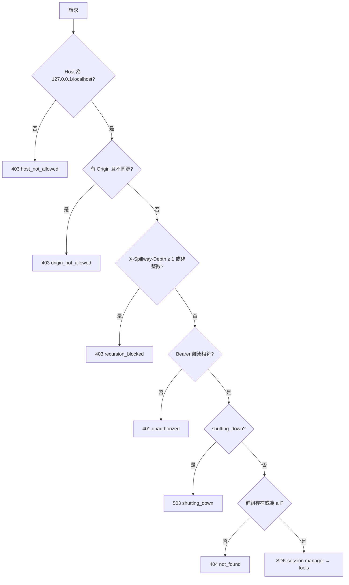
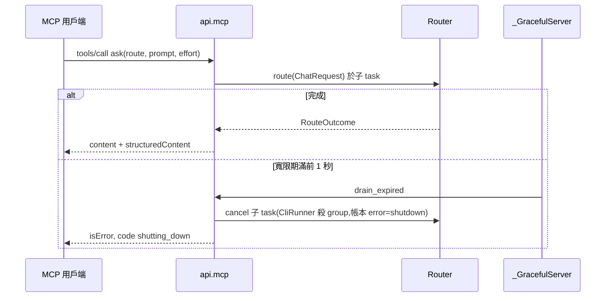
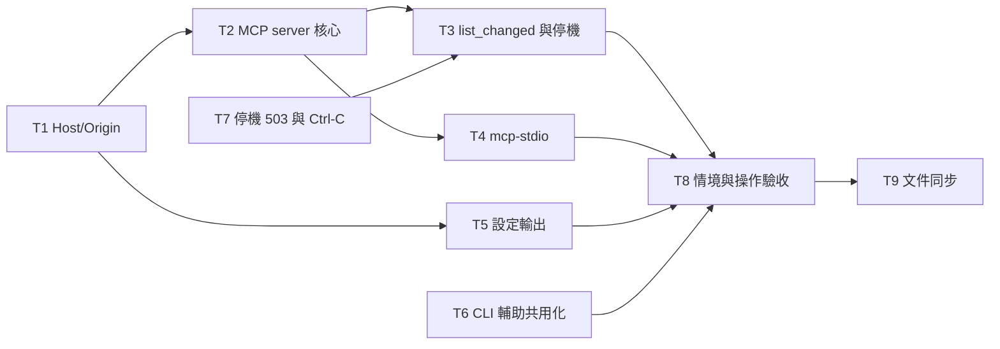

# CHG-20261102-01 — M3b:MCP server、`mcp-stdio`、MCP 設定輸出、Host/Origin 檢查,與 M3a 帶入項

- 專案:spillway
- 分支(Branch):`chg-20261102-01`(自 main 07f9601 分出;擁有者步驟通過後依 DIR-4 規則 2、4 自動合回 main 並推送)
- 日期:2026-11-02(UTC+0)
- 類型:新功能(M3 第二部分)+ 安全強化 + 需求登記(M4 UI-8)
- Template: plan
- 提出者:擁有者(使用者,2026-11-02「Open M3b CHG」;同日於對話中提出 Web UI「API 標籤」需求)
- 實作者:claude-opus-5-5(主 session agent;平行 task 由其派出的子 agent 施工,見「平行施工」)
- 風險分級:高——命中安全邊界(`/mcp/*` Bearer 驗證、全端點 Host/Origin 檢查、遞迴防護)、跨模組介面(Router 被 MCP `ask` 呼叫、`app.state` 事件通知、graceful shutdown 與長連線)、新增外部相依(`mcp` SDK);不改資料模型
- Commit/PR:`chg-20261102-01` 分支上訊息以 `CHG-20261102-01:` 開頭的 commit(`git log --grep CHG-20261102-01`);合回 main 後回填
- 驗收報告(預留):ACC-20261102-01
- 重複性檢查(Recurrence check):無重複(M3 第二筆;CHG-20261101-03 已明列 MCP、`mcp-stdio`、設定輸出屬本筆;Host/Origin 為 CHG-20261101-03 已知限制第 1 條的落實)
- Diagrams:見「## 設計圖」節
- Security-impact:見「## 安全影響」節
- Skill: ai-sdlc-autopilot v1.69
- 關聯:Guideline 第 7 節 M3(閘門於本筆結束時驗收:AC-1、AC-2、AC-9、AC-11、AC-12、AC-16、AC-17、NFR-6);FR-9(MCP 部分)、FR-18、FR-19;新增 FR-26(M4 UI-8);spec 8、9.1、9.2、10、AC-9、AC-11;structure/design.md D6、D9、D16、D29–D31;CHG-20261101-03 決策 2、16 與已知限制;ACC-20261101-02 發現 F2、F3、F4、F6、F8;knowledge DIR-1–DIR-4

## 動機

M3a 讓訂閱 CLI 成為成員;M3 的另一半目標 G6 是讓 4 種工具(Claude Code、Codex、Cursor、Gemini CLI)經 MCP 使用閘道。本筆做 MCP server(每群組一個端點、Bearer 驗證、三個工具、`list_changed`、遞迴防護)、給不支援 HTTP 的工具用的 `spillway mcp-stdio` 橋接、與 `GET /api/mcp/config` 設定輸出,並落實 M3a 留下的 Host/Origin 檢查。另依使用者 2026-11-02 決定收入 M3a 的四項帶入(CLI 模組輔助函式共用化、文件與測試小修、Ctrl-C traceback、停機期滿的回應形狀),並把使用者同日提出的 Web UI「API 標籤」登記為 M4 需求 UI-8(本筆只登記需求並提供資料來源 `mcp_catalog`,只限 MCP 介面,不做畫面)。

## 使用者故事

1. 作為擁有者,我要把 Claude Code 接到 `http://127.0.0.1:8787/mcp/coding`,以 `ask` 讓 coding 群組的 route 處理 prompt,並看到實際處理的成員、slot 與花費(spec 8.1;AC-9)。
2. 作為擁有者,我要以 `list_routes`、`quota_status` 查看群組內 route 的成員順序與各成員額度、冷卻(spec 8.1)。
3. 作為擁有者,我要在新增、修改、刪除 route 或群組後,已連線的工具自動重新取得工具清單(spec 8.1.5)。
4. 作為擁有者,我要讓不支援 HTTP 的工具以 `spillway mcp-stdio --group coding` 連線,且該命令在 `SPILLWAY_DEPTH ≥ 1` 的環境中被閘道拒絕(spec 8.1.2、8.1.6;AC-11)。
5. 作為擁有者,我要以 `GET /api/mcp/config?group=coding&tool=<tool>` 取得 Claude Code、Codex、Cursor、Gemini CLI 與通用 stdio 可直接套用的設定、放置路徑與所需環境變數,token 一律以 `SPILLWAY_TOKEN` 參照(spec 8.2)。
6. 作為擁有者,我要沒有正確 token 的 `/mcp` 請求被拒,且本機網頁無法以跨站請求或 DNS rebinding 呼叫閘道的任何端點(spec 8.1.3、9.1)。
7. 作為擁有者,我要停機時 MCP 長連線不會讓 serve 等滿 30 秒,寬限期滿仍在處理的請求收到 spec 9.1.2 格式的 503,Ctrl-C 不再印出 traceback(ACC-20261101-02 F2、F6)。
8. 作為擁有者,我要 M4 的 Web UI 有一個列出 MCP 介面(連線、工具、通知、錯誤碼)的標籤(名稱待定),依類型分大類、索引可折疊;不列前後端之間的 `/api`(UI-8,本筆只登記並提供資料來源)。

## 決策與取捨

| # | 決策 | 選項 | 依據 | 結論 |
|---|------|------|------|------|
| 1 | **(使用者決定 2026-11-02)** AC-11 改為直接驗證遞迴防護:`/mcp/*` 請求帶 `X-Spillway-Depth` ≥ 1 → 拒絕 `recursion_blocked`;`spillway mcp-stdio` 在 `SPILLWAY_DEPTH` ≥ 1 的環境把它轉成 header 並得到拒絕。spec AC-11 改寫(見「規格書與結構文件更新」) | (a) 直接驗證防護 / (b) 允許 CLI 成員載入本閘道 MCP 以字面驗證 | M3a 決策 10、11 與使用者 B2「全部停用並強制」:CLI 子行程不載入任何 MCP,AC-11 原前置條件不可能成立 | 使用者選 (a);B2 不變 |
| 2 | **(使用者決定 2026-11-02)** AC-9 由擁有者安裝 Cursor 與 Gemini CLI 後,以 4 種工具各做一次真實冒煙(列出並呼叫 `ask`);M3 閘門於此後驗收 | (a) 安裝四種 / (b) 只驗 Claude Code、Codex | Guideline Q1:每個里程碑閘門由擁有者真實冒煙;本機目前未安裝 Cursor、Gemini CLI | 使用者選 (a);屬擁有者步驟,agent 停在合回前(決策 21) |
| 3 | **(使用者決定 2026-11-02)** 設定輸出一律以環境變數 `SPILLWAY_TOKEN` 參照 token,不提供內嵌明文;spec 8.2.2 與 UI-5「內嵌 token 切換」刪除 | (a) 只用環境變數 / (b) 內嵌時 rotate / (c) 呼叫端帶 token | M3a D30:資料庫只存 SHA-256,閘道無法事後取得明文 | 使用者選 (a)。Gemini CLI 官方文件未記載 `headers` 內的環境變數展開(研究結果,中信心)→ gemini 模板輸出 `Bearer $SPILLWAY_TOKEN` 並在回應 `notes` 註明「若 Gemini CLI 不展開,改用通用 stdio 設定」;以擁有者冒煙確認 |
| 4 | **(使用者決定 2026-11-02)** 全端點 Host/Origin 檢查:每個請求的 `Host`(去掉埠號後)必須是 `127.0.0.1` 或 `localhost`,否則 403 `host_not_allowed`;請求帶 `Origin` 時必須等於 `http://127.0.0.1:<埠>` 或 `http://localhost:<埠>`(`<埠>` 為 serve 綁定埠),否則 403 `origin_not_allowed`;沒有 `Origin` 一律放行(CLI、SDK 不送)。以單一 ASGI middleware 實作於最外層(先於路由與 `/mcp`),錯誤格式依 spec 9.1.2;`mcp` SDK 內建的 DNS rebinding 檢查關閉,避免兩套規則與兩種錯誤格式 | (a) 全端點 / (b) 只 `/mcp` 與 rotate | CHG-20261101-03 已知限制第 1 條;MCP 規格要求 server 驗證 Origin;研究結果:四種原生工具不送 Origin | 使用者選 (a)。埠號只比對 Origin 不比對 Host(Host 的威脅是 DNS rebinding 的網域名,比對主機名即可;測試與反向代理不在範圍) |
| 5 | **(使用者決定 2026-11-02)** 收入 M3a 四項帶入:① 兩個 CLI 模組的輔助函式共用化;② 文件與測試小修(README codex 模型 ID、directory.md `adapters/base` 檔名、NFR-1 補 task route 變體);③ Ctrl-C 停機後不印 traceback;④ 寬限期滿仍在處理的請求回 503 `shutting_down`(spec 9.1.2 JSON) | 各項收入 / 留帶入清單 | ACC-20261101-02 F3、F4、F6、F8、F2;CHG-20261101-03 終審 idiom 席 I2、I3 | 使用者全選 |
| 6 | **(使用者決定 2026-11-02)** 新增相依 `mcp>=1.30,<2`(官方 Python SDK,驗收時 1.30.0,已以 `uv pip` 裝入 `.venv`);`jinja2>=3`(模板,已為間接相依)改為明列 | (a) SDK / (b) 自寫 JSON-RPC | design D6 | 使用者選 (a) |
| 7 | **(使用者決定 2026-11-02)** Web UI 新增 UI-8(標籤名稱**待使用者決定**,候選:「API」「API 參考」「API 文件」「介面目錄」「開發者」),M4 實作。**內容只限 MCP 介面**,不列前後端之間的 `/api/*`,也不列 `/v1`(使用者 2026-11-02 補充:「API 內容部分只針對 MCP,frontend–backend 之間的不提供」)。內容於執行期產生、與程式一致,依類型分大類、索引可折疊:① 連線(各群組端點 URL、傳輸、驗證方式、`mcp-stdio`)② 工具(`ask`、`list_routes`、`quota_status` 的說明與 inputSchema/outputSchema)③ 通知(`tools/list_changed`)④ 錯誤碼。本筆只登記 Guideline FR-26、spec UI-8 與 AC-22,並提供資料來源(決策 8) | (a) M4 的 UI-8 / (b) 本筆先做頁面;(a) 執行期產生 / (b) 抄 spec | 使用者 2026-11-02 提出與補充;Web UI 屬 M4 | 使用者選 M4、執行期產生、只限 MCP;名稱待定 |
| 8 | UI-8 的資料來源:`spillway.api.mcp` 提供 `mcp_catalog(app) -> dict`(純資料、無副作用):`connection`(群組清單與各自 URL、`all`、傳輸 `streamable-http`、驗證 `Bearer`、`mcp-stdio` 用法)、`tools`(與 `tools/list` 同一份工具定義產生,含 inputSchema/outputSchema;不另寫一份)、`notifications`、`errors`(決策 10 的錯誤碼與 HTTP 狀態);M4 的 UI-8 以它渲染,本筆不加 HTTP 端點(M4 決定掛在哪) | 由工具定義產生 vs 另寫說明 | 執行期與程式一致(決策 7);避免第二份工具定義 | 代使用者決定 |
| 9 | MCP 傳輸:官方 SDK 低階 `mcp.server.lowlevel.Server` 單一實例 + `StreamableHTTPSessionManager(stateful=True, json_response=False)`,以單一 ASGI app 掛在 `/mcp`,由路徑 `/mcp/<group>` 取得群組並在 session 建立時綁定;同一 session id 打到別的群組回 404 `not_found`。群組 `all` 暴露全部 route;不存在的群組(且不是 `all`)回 404 `not_found`(JSON-RPC 前,HTTP 層)。session 閒置逾時沿用 SDK 預設 1800 秒;`max_sessions` 100 | stateful vs stateless | `list_changed`(spec 8.1.5)需要伺服器推送通道,stateless 無法推送;D6 已定低階 server 單一 app | 代使用者決定;修訂 D6 補上掛載方式 |
| 10 | 驗證順序(`/mcp/*`):① Host/Origin(決策 4)→ ② `X-Spillway-Depth` 為整數且 ≥ 1 → 403 `recursion_blocked`(非整數視為 ≥ 1 拒絕)→ ③ `Authorization: Bearer <t>`:`hmac.compare_digest(sha256(t), settings.access_token_sha256)`;缺 header、格式錯、雜湊不符或尚未產生 token → 401 `unauthorized`,帶 `WWW-Authenticate: Bearer`;④ 停機中 → 503 `shutting_down`;⑤ 群組存在性。皆為 spec 9.1.2 JSON。token 雜湊每次請求從資料庫讀(rotate 立即生效,舊 token 下一次請求即失效) | 先驗 token 再驗深度 / 先驗深度 | 遞迴防護不應依賴呼叫端有無 token;rotate 必須立即生效 | 代使用者決定 |
| 11 | `ask`:輸入 `route`(enum,該群組可見的 route 名稱;群組無 route 時工具仍列出、enum 為空陣列會違反 JSON Schema → 改為 `type: string` 並在說明列出「目前無 route」)、`prompt`(string,非空)、`effort`(選填,enum 五級)。執行:組 `ChatRequest(model=<route>, messages=[{"role":"user","content":prompt}], effort)` 交 `Router.route`(route 的 mode 決定是否選 CLI 成員,spec 4.2.3;帳本 `route_name` 照常),route 不在該群組 → 工具錯誤 `route_not_found`。成功:`content` 一段文字(回應文字),`structuredContent` `{text, served_by, slot, cost_usd, tokens_in, tokens_out}`;`no_candidate` → `isError: true`,`structuredContent` `{error: {code, message}, attempts: [...]}`(與 503 body 的 attempts 相同形狀)。工具的 `outputSchema` 依此宣告 | 回傳 JSON 字串 vs structuredContent | spec 8.1 表格;design「RouteOutcome.attempts 用於 MCP ask 輸出」 | 代使用者決定 |
| 12 | `list_routes`:群組可見 route 的 `{name, mode, slots: [{slot, members: [{id, effort, weight}]}]}`,順序取已儲存順序,無則預設順序(spec 4.3,與 `GET /api/routes/{name}` 的 order 同源);`quota_status`:群組可見 route 的 target 所涵蓋成員(去重、依 id 排序)的 `{id, kind, provider, budget_type, remaining, window, cooling_until, cooling_reason}`,`remaining` 與 `/api/dashboard` 同源(同一個 repo 查詢,不重算) | 自算 vs 重用 dashboard 查詢 | 一致性;NFR-2 查詢數不增加 | 代使用者決定 |
| 13 | `list_changed`:`api.admin` 的 route 與群組 CRUD、`PUT/DELETE /api/routes/{name}/order` 成功後呼叫 `app.state.mcp_events.changed()`;MCP 模組對**所有**開啟的 session 送 `notifications/tools/list_changed`(不區分群組,實作單純;工具清單在用戶端重取時才依群組重算)。沒有開啟 GET SSE 串流的 session 收不到推送(SDK 行為),用戶端下次 `tools/list` 仍得到新清單 | 依群組過濾 / 全部送 | spec 8.1.5 只要求變更後發送;過量通知只造成一次多餘的 `tools/list` | 代使用者決定 |
| 14 | MCP 與 graceful shutdown(修訂 M3a 決策 16 / D31):第一個訊號設 `shutting_down` 時,MCP 模組立即關閉所有 session 的 SSE 串流與 session(SDK session manager 的結束流程),之後的 `/mcp` 請求回 503 `shutting_down`;進行中的 `tools/call` 與 `/v1` 請求相同,適用 30 秒寬限與決策 18 的 503。M3a D31 的「M3b 須就 `/mcp` 長連線重新檢查 30 秒上限」由本決策結案 | 關閉串流 vs 等串流自然結束 | uvicorn 的寬限會等所有連線,SSE 長連線會讓每次停機等滿 30 秒 | 代使用者決定 |
| 15 | `spillway mcp-stdio --group <g> [--port 8787]`:stdio(換行分隔 JSON-RPC)↔ `http://127.0.0.1:<port>/mcp/<g>` 的透明轉送,以 SDK 的 `stdio_server()` 與 `streamablehttp_client()` 兩組 stream 雙向搬移訊息(不解析工具內容);token 讀環境變數 `SPILLWAY_TOKEN`,未設定 → stderr 一行說明、結束碼 2,不連線;`SPILLWAY_DEPTH` 有值時原樣放進 `X-Spillway-Depth` header(spec 8.1.6);不開資料庫、不取 `spillway.lock`;閘道未啟動或連線失敗 → stderr 一行、結束碼 1;日誌不記 token 與訊息內容 | 透明轉送 vs 在橋接內重建 server | 橋接只負責傳輸;工具邏輯單一實作 | 代使用者決定 |
| 16 | 設定輸出 `GET /api/mcp/config?group=<g>&tool=<t>`:`tool` ∈ `claude-code`、`codex`、`cursor`、`gemini`、`stdio`,其他 → 422 `validation_error`;`group` 不存在且不是 `all` → 404 `not_found`。回應 `{group, tool, format, path, content, env: ["SPILLWAY_TOKEN"], notes: []}`;`content` 由 `src/spillway/templates/mcp/<tool>.j2` 以 Jinja2(`StrictUndefined`、不自動跳脫)渲染,變數只有 `name`(`spillway-<group>`)、`url`、`group`、`port`(serve 綁定埠;`app.state.port`,預設 8787);新增工具只新增模板檔與一行 `tool → (format, path)` 對應。各工具格式依 2026-11-02 官方文件(見決策 17) | 模板檔 vs 程式內字串 | spec 8.2.3 | 代使用者決定 |
| 17 | 各工具格式(研究結果,來源見審議紀錄):Claude Code 以命令 `claude mcp add --transport http spillway-<g> <url> --header "Authorization: Bearer ${SPILLWAY_TOKEN}"`(`format: command`,`path` null,`notes` 註明命令由 shell 展開後會把明文存入 Claude Code 設定,要避免時改用專案 `.mcp.json` 的 `{"type":"http","url","headers":{"Authorization":"Bearer ${SPILLWAY_TOKEN}"}}`——兩者都放進 `content`);Codex `~/.codex/config.toml` `[mcp_servers.spillway-<g>]` `url`、`bearer_token_env_var = "SPILLWAY_TOKEN"`;Cursor `~/.cursor/mcp.json` `mcpServers.<name>.{url, headers.Authorization = "Bearer ${env:SPILLWAY_TOKEN}"}`;Gemini CLI `~/.gemini/settings.json` `mcpServers.<name>.{httpUrl, headers.Authorization = "Bearer $SPILLWAY_TOKEN"}`(決策 3 的註記);通用 stdio `{"command":"spillway","args":["mcp-stdio","--group","<g>"],"env":{"SPILLWAY_TOKEN":"${SPILLWAY_TOKEN}"}}` 並註明各工具的環境變數寫法不同 | — | spec 8.2.4「以實作當時官方文件為準」 | 代使用者決定;spec 8.2.4 表格與範例同步更新 |
| 18 | 停機期滿回應(決策 5 ④):`/v1/chat/completions` 與 MCP `tools/call` 由 handler 以子 task 執行路由並等待「完成」或 app 的 `drain_expired` 事件;`_GracefulServer` 在寬限期滿前 1 秒設 `drain_expired`,handler 取消子 task(CliRunner 照常殺 group、帳本 `error="shutdown"`)後回 503 `shutting_down`(MCP 為 JSON-RPC 錯誤結果 `isError`,code `shutting_down`)。寬限 ≤ 1 秒(測試用)時於寬限期滿當下設定 | handler 自行逾時 vs 依賴 uvicorn 取消 | ACC-20261101-02 F2:uvicorn 取消後回 500 純文字 | 代使用者決定 |
| 19 | Ctrl-C traceback(決策 5 ③):`spillway.cli.main` 對 serve 捕捉 uvicorn 重發訊號造成的 `KeyboardInterrupt`,不印 traceback,結束碼 130(SIGINT);SIGTERM 維持現行(uvicorn 重發後以訊號結束,結束碼 -15/143)。只改結束時的表現,不改停機流程 | 130 vs 0 | 慣例:被 SIGINT 結束的程式以 130 結束 | 代使用者決定 |
| 20 | CLI 模組輔助函式共用化(決策 5 ①):新增 `adapters/base/cli_common.py`——`cli_cwd(params, context, subdir) -> Path`(失敗 raise `ValueError`,兩模組一致)、`tail(text, limit)` 與 `head(text, limit)`、`nonneg_int(v)`、`CLI_WORK_SUBDIRS`(`cli.py` 的 `WORK_SUBDIRS` 改由它取得,三處合一);兩模組改用之,錯誤訊息改用 `EXECUTABLE` 組字串。**行為差異只限**:codex 的 token 欄位負數改為 None(與 claude 一致);錯誤訊息截斷長度維持各模組現值(claude 2000 取頭、codex 1000 取尾,以常數保留)。`messages_to_prompt` 別名保留(測試由模組匯入) | 共用 vs 維持兩份 | CHG-20261101-03 終審 I2、I3:下一個 CLI 模組會再複製一次 | 代使用者決定 |
| 21 | 停點:自動化驗收(含 4 種工具的模板輸出、假 CLI 與真實 SDK 用戶端端到端)通過後停下;擁有者以本分支建置執行 Acceptance operation 的擁有者步驟(安裝 Cursor、Gemini CLI;4 種工具各列出並呼叫 `ask`;`mcp-stdio`;rotate 後舊 token 失效;瀏覽器跨站請求被拒)並回報後,才依 DIR-4 合回並推送 | 停 / 不停 | 決策 2;DIR-4「需要手動測試時停下」 | 依使用者決定 2、DIR-4 |

## 設計圖

### 圖 1:本筆範圍的架構(實線為本筆新增或變更)

```mermaid
flowchart LR
  subgraph Clients
    CC[Claude Code]:::ext
    CX[Codex]:::ext
    CU[Cursor]:::ext
    GE[Gemini CLI]:::ext
    ST[stdio 工具]:::ext
  end
  ST --> BR[spillway mcp-stdio]
  CC & CX & CU & GE --> HO
  BR -- HTTP + Bearer + X-Spillway-Depth --> HO
  HO[HostOriginMiddleware<br/>全端點] --> MCP[/mcp/&lt;group&gt;<br/>api.mcp]
  HO --> V1[/v1/*]
  HO --> ADM[/api/*]
  MCP -- ask --> R[Router]
  MCP -- list_routes / quota_status --> REPO[store.repo]
  ADM -- route/group 變更 --> EV[app.state.mcp_events]
  EV -- tools/list_changed --> MCP
  ADM -- /api/mcp/config --> TPL[templates/mcp/*.j2]
  classDef ext fill:#eee,stroke:#999
```

### 圖 2:`/mcp` 請求的檢查順序(決策 4、10)



### 圖 3:`ask` 與停機期滿(決策 11、18)



### 圖 4:平行施工波次



## 安全影響

| 類別 | 命中 | 說明 |
|------|------|------|
| auth | 是 | `/mcp/*` Bearer 驗證(決策 10):常數時間比對 SHA-256;rotate 立即生效;`/v1`、`/api` 在綁 127.0.0.1 時仍不驗證 token(CHG-20261101-03 決策 2 不變) |
| security-boundary | 是 | 全端點 Host/Origin(決策 4)封住 DNS rebinding 與跨站 POST(含 rotate);遞迴防護(決策 10 ②、15);設定輸出不含 token 明文(決策 3) |
| new-dependency | 是 | `mcp>=1.30,<2`(官方 SDK);`jinja2` 明列(已為間接相依) |
| secrets | 是 | token 明文不出現在日誌、帳本、payload、設定輸出、測試輸出與 `artifacts/`;`mcp-stdio` 只從環境讀 token、不記錄;MCP `ask` 的 prompt 與回應依既有 payload 設定記錄(與 `/v1` 相同) |
| prod-migration | 否 | 不改 schema |
| irreversible | 否 | — |

已知限制(DIR-2 範圍內,只記錄、不實作):
- 本機其他程式(非瀏覽器)仍可不帶 Origin 呼叫 `/api`,包括 rotate 取得新 token(CHG-20261101-03 決策 2:綁 127.0.0.1 時 `/api` 不驗證);Host/Origin 只擋瀏覽器發起的跨站與 DNS rebinding。
- `notifications/tools/list_changed` 只送達已開啟 GET SSE 串流的 session。
- Gemini CLI 的 `headers` 環境變數展開未見官方記載,以擁有者冒煙確認(決策 3)。
- Claude Code 以命令加入時 shell 會展開 token 並存入其設定檔(決策 17 的 notes)。
- MCP session 存在記憶體,serve 重啟後用戶端須重新 initialize(SDK 行為)。
- 延續 CHG-20261101-03 的已知限制。

## 修改指引

### 目標

M3 結束:4 種工具可經 MCP 使用閘道,閘門 AC-1、AC-2、AC-9、AC-11、AC-12、AC-16、AC-17、NFR-6 於本筆驗收;全端點 Host/Origin;M3a 帶入四項結案;UI-8 登記為 M4 需求。

### 影響範圍

| 位置 | 類型 | 內容 | 下游 |
|------|------|------|------|
| `src/spillway/api/host_origin.py`(新增)、`app.py` | 介面 | 決策 4 middleware;`create_app(port=8787)` 參數存入 `app.state.port` | 全部端點 |
| `src/spillway/api/mcp/`(新增:`__init__.py`、`server.py`、`tools.py`、`auth.py`、`events.py`、`catalog.py`) | 介面 | 決策 8–14 | M4 UI-8 |
| `src/spillway/api/admin/{routes,groups}.py` | 介面 | 變更後呼叫 `mcp_events.changed()` | MCP |
| `src/spillway/api/admin/mcp_config.py`(新增)、`src/spillway/templates/mcp/*.j2`(新增 5 檔) | 介面 | 決策 16、17 | M4 UI-5 |
| `src/spillway/cli.py` | 介面 | `mcp-stdio` 子命令(決策 15)、Ctrl-C(決策 19)、`serve` 把埠傳給 `create_app`、`drain_expired`(決策 18)、`WORK_SUBDIRS` 改來源(決策 20) | 擁有者 |
| `src/spillway/api/openai.py` | 行為 | 決策 18 的 503 | 用戶端 |
| `src/spillway/adapters/base/cli_common.py`(新增)、`claude_cli`、`codex_cli` | 設計 | 決策 20 | 未來 CLI 模組 |
| `pyproject.toml` | 相依 | 決策 6 | — |
| `docs/spec.md`、`sdlc_docs/ai-guideline.md`、`sdlc_docs/structure/*.md`、`README.md` | 文件 | 見「規格書與結構文件更新」 | — |

### Global Constraints(全域約束——每個 task 都要遵守)

- 語言與版本:Python ≥ 3.11(驗收平台 3.13);src layout;路徑一律 `pathlib`。
- 相依套件:只新增決策 6 的 `mcp>=1.30,<2` 與明列 `jinja2>=3`;其他新增時停下回報。測試用 MCP 用戶端一律用同一 SDK(`mcp.client`)。
- 規格依據:行為以 `docs/spec.md`、本 CHG 決策表、CHG-20261030-02、CHG-20261101-02、CHG-20261101-03 決策表為準;只可做「規格書與結構文件更新」列出的 spec 修訂;不修改 `docs/proposal.md` 與 `docs/ui/*`。
- 分層:`spillway.api.mcp` 只可經 `Router`(`route`)、`store.repo` 公開函式與 `app.state`(`mcp_events`、`shutting_down`、`drain_expired`、`port`)取得資料;不直接呼叫 adapter;SQL 仍只在 `src/spillway/store/`(R25)。`adapters.*` 的分層規則不變(`cli_common.py` 屬 `adapters.base`,只用標準庫)。
- 子行程與真實 CLI:沿用 CHG-20261101-03 Global Constraints(不可執行真實 `claude`、`codex`、`cursor`、`gemini`,`--help` 除外;護欄三處);`mcp-stdio` 的子行程測試以 `sys.executable -m spillway mcp-stdio` 啟動。
- 測試上游與網路:只打本機假上游與測試中啟動的 serve(127.0.0.1、隨機埠);不連任何外部網站。
- 秘密:沿用既有「秘密」條;token 明文不可出現在日誌、資料庫、帳本、payload、設定輸出、測試輸出與 `artifacts/`(`artifacts/m3b/http-log.jsonl` 只記 method、path、status、elapsed_ms;測試斷言設定輸出與日誌不含 token)。
- 資料目錄:測試一律以 `tmp_path` 為 `SPILLWAY_HOME`;不可讀寫擁有者的實際資料目錄或任何工具的設定檔(`~/.claude*`、`~/.codex`、`~/.cursor`、`~/.gemini`)。
- 時間與亂數:經 `Clock`/`Rng` 注入;token 用 `secrets`。
- 錯誤回應:spec 9.1.2 格式;新錯誤碼只用本 CHG 列出的值(`host_not_allowed`、`origin_not_allowed`、`unauthorized`、`recursion_blocked`;`not_found`、`route_not_found`、`shutting_down`、`validation_error` 沿用)。
- 既有測試斷言不可修改,除非屬下列逐檔允許清單(改寫內容於施工審議逐條核對):① 測試用 HTTP 用戶端的 `base_url` 改為 `http://127.0.0.1:8787`(決策 4;`tests/integration/conftest.py`、`tests/integration/admin/conftest.py`、`tests/features/support/gateway.py`、`tests/features/environment.py`、`tests/integration/test_review_w6_openai.py`、`tests/unit/adapters/test_claude_cli.py`、`tests/unit/adapters/test_codex_cli.py`,以及施工中發現的其他 `base_url`,逐檔記入施工審議);② `tests/unit/adapters/test_codex_cli.py` 中 token 欄位負數的期望(決策 20);③ `tests/integration/test_graceful_shutdown.py` 中寬限期滿的狀態碼與結束碼(決策 18、19);④ 管理 API 路徑集合相關斷言(決策 16)。
- 每個 task 的測試必須能以該 task 的 `test:` 指令獨立執行並全綠;每個 task 完成時另跑全量 `python -m pytest -q` 與 `python -m behave tests/features`(必須全綠)。
- 既有 feature 檔的情境文字只能經修改治理變更;施工者只寫步驟檔與本 CHG「Behaviour spec」列出的新 feature。
- commit 訊息以 `CHG-20261102-01:` 開頭,結尾加 Co-Authored-By 行。
- 驗收平台為 macOS;Linux、Windows 在 ACC 標「未涵蓋」。

### 契約清單

| 契約 | 提供方 | 讀取方 | 本筆變更 | 契約測試(路徑/無) |
|------|--------|--------|----------|----------------------|
| Host/Origin 規則與錯誤碼 `host_not_allowed`、`origin_not_allowed`;`create_app(port=...)`、`app.state.port` | T1 | 全端點、T2、T5 | 新增 | tests/integration/test_host_origin.py(新增) |
| `api.mcp.mcp_catalog(app)`(決策 8) | T2 | M4 UI-8 | 新增 | tests/integration/mcp/test_mcp_catalog.py(新增) |
| `/mcp/<group>` Streamable HTTP;驗證順序與錯誤碼 `unauthorized`、`recursion_blocked`;tools `ask`、`list_routes`、`quota_status` 的 input/outputSchema | T2 | 4 種工具、T4、M4 UI-8 | 新增 | tests/integration/mcp/test_mcp_auth.py、tests/integration/mcp/test_mcp_tools.py(新增) |
| `app.state.mcp_events.changed()` 與 `notifications/tools/list_changed` | T3 | admin routes/groups | 新增 | tests/integration/mcp/test_mcp_list_changed.py(新增) |
| 停機:`/mcp` session 關閉、`drain_expired`、503 `shutting_down`、結束碼 130 | T3、T7 | 擁有者 | 變更(修訂 D31) | tests/integration/test_graceful_shutdown.py(允許改寫 ③)、tests/integration/mcp/test_mcp_shutdown.py(新增) |
| `spillway mcp-stdio` 命令列、環境變數、結束碼 | T4 | stdio 工具 | 新增 | tests/integration/test_mcp_stdio.py(新增) |
| `GET /api/mcp/config` 回應形狀、工具名、模板變數 | T5 | M4 UI-5、擁有者 | 新增 | tests/integration/admin/test_admin_mcp_config.py(新增) |
| `adapters.base.cli_common` | T6 | claude_cli、codex_cli、`cli.py` | 新增 | tests/unit/adapters_base/test_cli_common.py(新增) |

### Tasks(checkbox=續作點)

- [ ] T1. 全端點 Host/Origin
  - interfaces: consumes 決策 4 / produces `api/host_origin.py`、`app.py`(最外層 middleware、`create_app(port: int = 8787)`、`app.state.port`)、允許清單 ① 的 `base_url` 改寫、`tests/integration/test_host_origin.py`
  - test: `python -m pytest tests/integration/test_host_origin.py tests/integration -q`
  - L1: Host `127.0.0.1:8787`、`localhost:1234`、`127.0.0.1` 放行;`evil.example:8787`、`127.0.0.1.evil.example`、空 Host 回 403 `host_not_allowed`;無 Origin 放行;Origin `http://127.0.0.1:<port>`、`http://localhost:<port>` 放行;`http://evil.example`、`http://127.0.0.1:9999`、`null` 回 403 `origin_not_allowed`;`/v1`、`/api`、`/mcp` 皆適用;錯誤 body 為 spec 9.1.2
  - L2: middleware 在所有路由與 `/mcp` 掛載之前執行(未知路徑與 `/mcp/x` 帶非本機 Host 時回 403 而非 404)
  - L3: 既有 behave 與整合測試在 `base_url` 改寫後全過
  - L4: 不適用(T8 以子行程 serve 驗證)

- [ ] T2. MCP server 核心(驗證、群組、三個工具)
  - interfaces: consumes 決策 8–12 / produces `api/mcp/{__init__,server,tools,auth,catalog}.py`、`app.py` 掛載 `/mcp` 與 lifespan 內啟停 session manager、`pyproject.toml`(決策 6)、`tests/integration/mcp/`(以 SDK 用戶端經 ASGI 或子行程 serve)
  - test: `python -m pytest tests/integration/mcp -q`
  - L1: 驗證順序 ①–⑤ 各一例(含非整數 depth、rotate 後舊 token 401、未產生 token 401);`tools/list` 對 `coding` 只含 `target.group == coding` 的 route、`all` 含全部;`ask` 成功的 structuredContent 欄位、`no_candidate` 的 isError 與 attempts、不屬群組的 route → `route_not_found`;chat route 不選 CLI 成員(假 CLI);`list_routes` 與 `GET /api/routes/{name}` 的順序一致;`quota_status` 與 `/api/dashboard` 的 remaining、cooling 一致;同一 session 改打別的群組 → 404;`mcp_catalog` 的 tools 與 `tools/list` 的定義逐欄相同、errors 與決策 10 一致
  - L2: 帳本列與 `/v1` 同一路徑寫入(`route_name`、slot、花費);payload 設定開啟時記錄 prompt;日誌不含 token
  - L3: 不適用(T8 寫 feature)
  - L4: 不適用

- [ ] T3. `list_changed` 與 MCP 停機
  - interfaces: consumes 決策 13、14 / produces `api/mcp/events.py`、`api/admin/{routes,groups}.py` 呼叫點、`api/mcp/server.py` 停機掛鉤、`tests/integration/mcp/test_mcp_list_changed.py`、`tests/integration/mcp/test_mcp_shutdown.py`
  - test: `python -m pytest tests/integration/mcp tests/integration/test_graceful_shutdown.py -q`
  - L1: 開啟 GET 串流的 session 在 route 建立、改名、刪除、order 變更、群組變更後各收到一次 `tools/list_changed`,其他 session 也收到;重取 `tools/list` 反映變更
  - L2: 子行程 serve 有一個開啟中的 MCP 串流時送 SIGTERM → 3 秒內結束(對照組:不關串流會等滿寬限);停機中新的 `/mcp` 請求 503 `shutting_down`
  - L3: 不適用
  - L4: 不適用(T8)

- [ ] T4. `spillway mcp-stdio`
  - interfaces: consumes 決策 15 / produces `cli.py` 子命令、`api/mcp/bridge.py`(或 `spillway/mcp_stdio.py`)、`tests/integration/test_mcp_stdio.py`
  - test: `python -m pytest tests/integration/test_mcp_stdio.py -q`
  - L1: 以子行程 serve + 子行程 `mcp-stdio`,用 SDK 的 stdio 用戶端 initialize、`tools/list`、呼叫 `ask`(假上游)成功;未設 `SPILLWAY_TOKEN` → 結束碼 2、未連線;serve 未啟動 → 結束碼 1;`SPILLWAY_DEPTH=1` → 呼叫得到 `recursion_blocked`(AC-11 新文字)
  - L2: `mcp-stdio` 的 stderr 不含 token;不建立或鎖定資料目錄
  - L3: 不適用
  - L4: 不適用(T8)

- [ ] T5. MCP 設定輸出
  - interfaces: consumes 決策 3、16、17 / produces `api/admin/mcp_config.py`、`templates/mcp/{claude-code,codex,cursor,gemini,stdio}.j2`(package data,`pyproject.toml` 納入)、`tests/integration/admin/test_admin_mcp_config.py`
  - test: `python -m pytest tests/integration/admin/test_admin_mcp_config.py -q`
  - L1: 5 種工具各一例:回應欄位齊全、`content` 依決策 17(JSON 與 TOML 可被 `json`/`tomllib` 解析;命令可被 `shlex.split`)、URL 用 `app.state.port`、名稱 `spillway-<group>`;`all` 可用;未知工具 422、未知群組 404;`content` 不含 token(以已產生的 token 斷言)
  - L2: 新增一個模板檔即可多一種工具的對應表測試(以測試用模板目錄驗證「只加檔案 + 一行對應」)
  - L3: 不適用
  - L4: 不適用(擁有者步驟)

- [ ] T6. CLI 模組輔助函式共用化
  - interfaces: consumes 決策 20 / produces `adapters/base/cli_common.py`、`adapters/base/__init__.py` 匯出、`claude_cli/adapter.py`、`codex_cli/adapter.py`、`cli.py` `WORK_SUBDIRS`、`tests/unit/adapters_base/test_cli_common.py`、允許清單 ②
  - test: `python -m pytest tests/unit/adapters tests/unit/adapters_base tests/contract tests/fakes -q && python -m behave tests/features/m3a_cli.feature`
  - L1: `cli_cwd` 兩模組行為一致(未設 → `data_dir/work/<模組>`、設定值不可用 → `ValueError` → 該次 `error`);截斷常數維持現值;負數 token → None
  - L2: 既有 claude_cli、codex_cli 單元測試除允許清單 ② 外不改而全過
  - L3: `m3a_cli.feature` 不改文字全過
  - L4: 不適用

- [ ] T7. 停機期滿 503 與 Ctrl-C
  - interfaces: consumes 決策 18、19 / produces `cli.py`(`drain_expired`、`main` 的 `KeyboardInterrupt`)、`app.py`(`app.state.drain_expired`)、`api/openai.py`、`tests/integration/test_graceful_shutdown.py`(允許清單 ③ 與新增案例)
  - test: `python -m pytest tests/integration/test_graceful_shutdown.py -q`
  - L1: 寬限 2 秒的子行程 serve、hold 住的假 claude:SIGTERM 後進行中請求得到 503 JSON `shutting_down`(不是 500 純文字)、帳本 `error="shutdown"`、無殘留子行程;對 process group 送 SIGINT → stderr 無 `Traceback`、結束碼 130
  - L2: 既有雙 SIGINT、SIGTERM→SIGINT 案例不變(仍快速結束、無殘留)
  - L3: 不適用
  - L4: 不適用(T8)

- [ ] T8. 行為情境與操作驗收
  - interfaces: consumes T1–T7 / produces `tests/features/m3b_mcp.feature`(Behaviour spec)、`tests/features/steps/m3b_steps.py`、`tests/acceptance/test_m3b_operation.py`、`tests/acceptance/test_nfr1_dry_run_p95.py` 補 task route 變體(決策 5 ②;既有斷言不改,只新增案例)、`artifacts/m3b/`
  - test: `python -m behave tests/features/m3b_mcp.feature && python -m pytest tests/acceptance -q -rs`
  - L1: 不適用(T2–T5 已涵蓋)
  - L2: 不適用
  - L3: `m3b_mcp.feature` 全過
  - L4: 執行「Acceptance operation」自動部分,`http-log.jsonl`(只含四鍵)與 `operation-results.json` 存到 `artifacts/m3b/`;NFR-1 task route 變體 P95 < 20 ms

- [ ] T9. 文件同步
  - interfaces: consumes T1–T8 / produces「規格書與結構文件更新」所列文件
  - test: `python -m pytest tests -q -k "doc or readme" ; true`(以 doc-integrity lint 為準)
  - L1–L4: 不適用(文件);由 doc-integrity 與終審 docs 席核對

### Behaviour spec

`tests/features/m3b_mcp.feature`(新增;情境文字於確認閘一併確認):

1. 群組端點只列出該群組的 route,`all` 列出全部(spec 8.1.4)。
2. `ask` 由 route 處理並回報成員、slot 與花費;CLI 成員只用於 task route(spec 8.1、4.2.3)。
3. 沒有或錯誤的 token 被拒 `unauthorized`;rotate 後舊 token 被拒(spec 8.1.3)。
4. 帶 `X-Spillway-Depth: 1` 的請求被拒 `recursion_blocked`;以 `SPILLWAY_DEPTH=1` 執行的 `mcp-stdio` 呼叫被拒(spec 8.1.6;AC-11 新文字)。
5. 新增 route 後已連線的 session 收到 `tools/list_changed`,重新列出含新 route(spec 8.1.5)。
6. 跨站 Origin 與非本機 Host 的請求被拒(決策 4)。
7. 設定輸出 5 種工具皆以 `SPILLWAY_TOKEN` 參照 token(spec 8.2.2 新文字)。

### Interaction spec

| 介面 | 驗證方式 | 產物 |
|------|----------|------|
| MCP(Streamable HTTP) | 官方 SDK 用戶端(`mcp.client.streamable_http`)對子行程 serve | `artifacts/m3b/http-log.jsonl` |
| MCP(stdio) | 官方 SDK stdio 用戶端對子行程 `mcp-stdio` | `artifacts/m3b/operation-results.json` |
| 管理 API | httpx 對子行程 serve | `artifacts/m3b/http-log.jsonl` |

### Acceptance operation

- operate:(macOS,自動部分)暫存 `SPILLWAY_HOME`;PATH 只含假 CLI;`spillway init` 取得 token(只存在測試行程記憶體);啟動子行程 serve 與 api 假端點;以管理 API 建立 claude-sub(claude-cli)、deepseek-api(api)、群組 `coding`、task route `review`(target group coding)與 chat route `chat-x`(不屬 coding);以 SDK 用戶端連 `/mcp/coding`:initialize、`tools/list`、開 GET 串流、`ask review`、`list_routes`、`quota_status`;以管理 API 新增 route `review2`(group coding)並等待 `list_changed`;錯誤 token、帶 depth、跨站 Origin、非本機 Host 各送一次;rotate 後舊 token 再送一次;以 stdio 用戶端經 `mcp-stdio --group coding` 呼叫 `ask`,再以 `SPILLWAY_DEPTH=1` 呼叫一次;`GET /api/mcp/config` 5 種工具;hold 假 claude 時送 SIGTERM 並計時;對 process group 送 SIGINT 的另一次 serve 檢查 stderr;`lsof` 檢查監聽位址。
- observe:`tools/list` 只含 `review`(不含 `chat-x`);`ask review` 由 claude-sub 處理且 structuredContent 有 served_by、slot、cost_usd;`list_routes` 與 `GET /api/routes/review` 順序一致;`quota_status` 與 dashboard 一致;新增 `review2` 後收到 `tools/list_changed` 且重取含 `review2`;錯誤 token 401 `unauthorized`、depth 403 `recursion_blocked`、Origin 403 `origin_not_allowed`、Host 403 `host_not_allowed`、rotate 後舊 token 401;stdio 呼叫成功、depth 時 `recursion_blocked`;5 種設定輸出可解析且不含 token;SIGTERM 時進行中的 `ask` 得到 `shutting_down`、serve 在寬限內結束、無殘留子行程;SIGINT 後 stderr 無 traceback、結束碼 130;只聽 127.0.0.1;日誌、帳本、產物無 token 明文。
- operate(擁有者,於自動化驗收通過後、合回前;agent 不執行,決策 21):① 安裝 Cursor 與 Gemini CLI;② 以本分支建置對 `~/spillway-smoke` 啟動 serve(若 token 已無人知道則先 `init --rotate` 並 `export SPILLWAY_TOKEN=...`,不貼到對話);③ 建立群組 `coding` 與一個 task route;④ 以 `GET /api/mcp/config` 取得 Claude Code、Codex、Cursor、Gemini CLI 設定並套用,各自列出工具並呼叫一次 `ask`;⑤ 以通用 stdio 設定在任一工具或 SDK inspector 以 `mcp-stdio` 呼叫一次;⑥ 在瀏覽器開一個非本機頁面對 `http://127.0.0.1:8787/api/settings/token/rotate` 送 `fetch` POST,確認被拒且 token 未變;⑦ 回報:各工具是否列出 `ask`、`ask` 回應的 served_by、Gemini CLI 的 `$SPILLWAY_TOKEN` 是否被展開、步驟 ⑥ 的結果。
- pass:自動部分觀察全部成立且 `artifacts/m3b/` 留有遮罩後紀錄;擁有者回報 4 種工具皆列出並呼叫 `ask` 成功(AC-9)、stdio 成功、跨站 rotate 被拒;結果遮罩後記入 ACC-20261102-01;M3 閘門(AC-1、AC-2、AC-9、AC-11、AC-12、AC-16、AC-17、NFR-6)於該 ACC 全數通過後,Guideline M3 閘門打勾;之後才依 DIR-4 合回 main 並推送。

### 本機閘

`python -m pytest -q && python -m behave tests/features`(全綠,`pytest tests/acceptance -q -rs` 0 skipped)。

### 平行施工

| 波次 | Task | 檔案所有權(互不重疊) |
|------|------|------------------------|
| 1 | T1 | `api/host_origin.py`、`app.py`(middleware 與 `port`)、允許清單 ① |
| 1 | T6 | `adapters/base/cli_common.py`、`adapters/base/__init__.py`、兩個 CLI 模組、`cli.py` 的 `WORK_SUBDIRS` 一行、允許清單 ② |
| 1 | T7 | `cli.py`(`_GracefulServer`、`main`)、`app.py`(`drain_expired` 一行)、`api/openai.py`、`test_graceful_shutdown.py` |
| 2 | T2 | `api/mcp/{__init__,server,tools,auth,catalog}.py`、`app.py`(掛載與 lifespan)、`pyproject.toml`、`tests/integration/mcp/` |
| 3 | T3 | `api/mcp/events.py`、`api/mcp/server.py` 停機掛鉤、admin routes/groups 呼叫點 |
| 3 | T4 | `cli.py` 子命令、`api/mcp/bridge.py`、`tests/integration/test_mcp_stdio.py` |
| 3 | T5 | `api/admin/mcp_config.py`、`templates/mcp/`、`pyproject.toml` package data |
| 4 | T8 | feature、steps、acceptance |
| 5 | T9 | 文件 |

同波次共用檔(`app.py`、`cli.py`、`pyproject.toml`)只改各自列出的區段;合併時由主 session 依波次順序 cherry-pick 並解衝突。

### 規格書與結構文件更新

- [ ] docs/spec.md:8.1.3 補「錯誤 401 `unauthorized`、帶 `WWW-Authenticate: Bearer`;token 雜湊每次請求讀取,rotate 立即生效」;8.1.6 補「HTTP 403,在驗證 token 之前判斷;非整數視為 ≥ 1」;8.1 補群組不存在 404、`all`、session 綁定群組(決策 9);8.1 工具表補 `ask` 的 structuredContent 與 `no_candidate` 錯誤形狀(決策 11)、`list_routes`/`quota_status` 欄位(決策 12);8.2.1 補 `tool` 值與回應欄位(決策 16);8.2.2 改為「一律以環境變數 `SPILLWAY_TOKEN` 參照 token,不輸出明文」(決策 3);8.2.4 表格與範例依決策 17 更新;9.1 新增 9.1.4 Host/Origin 規則與兩個錯誤碼(決策 4);9.2 `/api/mcp/config` 列補參數;10 UI-5 刪除「內嵌 token 切換」;10 新增 UI-8 列(名稱待定;只列 MCP 介面:連線、工具、通知、錯誤碼,可折疊索引);第 11 節 AC-11 改為「`/mcp` 請求帶 `X-Spillway-Depth: 1`,或以 `SPILLWAY_DEPTH=1` 執行 `mcp-stdio` 呼叫 `ask` → 被拒,錯誤碼 `recursion_blocked`」;新增 AC-22(UI-8);修訂行記錄本 CHG
- [ ] sdlc_docs/ai-guideline.md:新增 FR-26(UI-8,M4,P1;只限 MCP 介面;名稱待定與候選);FR-20 改為 8 個畫面;M3 列標 M3b 範圍完成;M3 閘門打勾(驗收通過後);M4 列「7 個畫面」改 8 個;變更歷史 v1.6
- [ ] sdlc_docs/structure/design.md:D6 補掛載與 session 綁定(決策 9);D9 補 `/mcp` 驗證(決策 10);新增 D33(Host/Origin,決策 4)、D34(MCP 工具、`list_changed`、停機,決策 11–14)、D35(`mcp-stdio`,決策 15)、D36(設定輸出與模板,決策 16、17)、D37(OpenAPI tag 與 UI-8,決策 7、8);D31 補決策 14、18、19;元件表 `McpApp` 列改為實作後的介面;錯誤碼表補四個碼
- [ ] sdlc_docs/structure/logical.md:MCP 請求流程、`list_changed` 事件、停機期滿流程
- [ ] sdlc_docs/structure/directory.md:`api/mcp/`、`api/host_origin.py`、`api/admin/mcp_config.py`、`templates/mcp/`、`adapters/base/cli_common.py`、`adapters/base` 現有檔名(ACC-20261101-02 F3)、新測試檔
- [ ] sdlc_docs/structure/data.md:無 schema 變更;`settings.access_token_sha256` 的讀取方補 `/mcp`
- [ ] README.md:MCP 連線(群組端點、`SPILLWAY_TOKEN`、`mcp-stdio`、`/api/mcp/config`)、Host/Origin、codex 成員 `model` 須用小寫模型 ID(ACC-20261101-02 F8)、Ctrl-C 結束碼

### 風險與回滾

| 風險 | 影響 | 對策 |
|------|------|------|
| Host 檢查擋到擁有者既有用法(例如以 `0.0.0.0` 以外的名稱連線) | `/v1` 用戶端 403 | 只允許 127.0.0.1/localhost,與只綁 127.0.0.1 一致;README 說明;回滾:revert T1 |
| SDK 版本行為差異(session、SSE、通知) | MCP 不穩 | 鎖 `<2`;整合測試以同一 SDK 的用戶端;擁有者以 4 種工具冒煙 |
| 停機期滿 503 的時序與 uvicorn 取消競態 | 偶發 500 | 寬限前 1 秒先由 app 結束;測試以 2 秒寬限重複 5 次 |
| Gemini CLI 不展開 header 環境變數 | Gemini 連線 401 | notes 指引改用 stdio 設定;擁有者冒煙確認後於 ACC 記錄 |

回滾:本筆不改 schema;revert 合併 commit 即回到 M3a。

## 審議紀錄

### 決策審議

(待派出;高風險,依 DIR-1 六席 + 仲裁)

### 施工審議

(施工時填)

## 結構異動摘要

(收尾時填)

## 狀態

草稿——待決策審議與確認閘。
