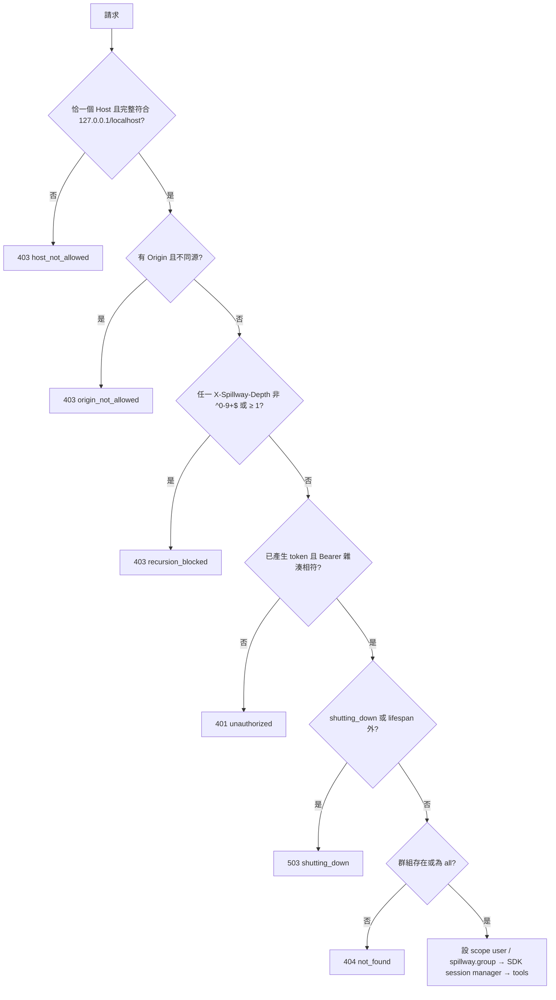
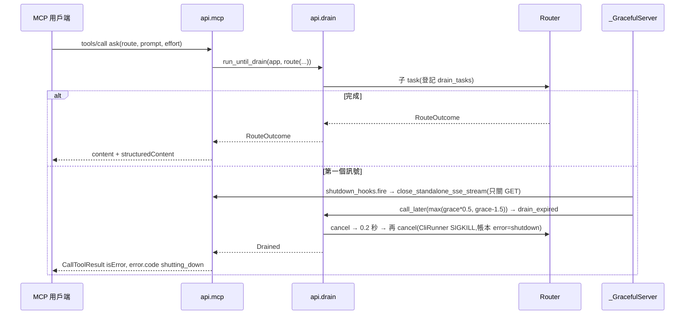
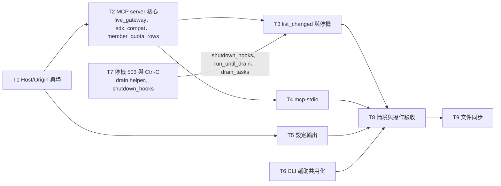

# CHG-20261102-01 — M3b:MCP server、`mcp-stdio`、MCP 設定輸出、Host/Origin 檢查,與 M3a 帶入項

- 專案:spillway
- 分支(Branch):`chg-20261102-01`(自 main 07f9601 分出;擁有者步驟通過後依 DIR-4 規則 2、4 自動合回 main 並推送)
- 日期:2026-11-02(UTC+0)
- 類型:新功能(M3 第二部分)+ 安全強化 + 需求登記(M4 UI-8)
- Template: plan
- 提出者:擁有者(使用者,2026-11-02「Open M3b CHG」;同日於對話中提出 Web UI「API 標籤」需求)
- 實作者:claude-opus-5-5(主 session agent;平行 task 由其派出的子 agent 施工,見「平行施工」)
- 風險分級:高——命中安全邊界(`/mcp/*` Bearer 驗證、全端點 Host/Origin 檢查、遞迴防護)、跨模組介面(Router 被 MCP `ask` 呼叫、`app.state` 事件通知、graceful shutdown 與長連線)、新增外部相依(`mcp` SDK);不改資料模型
- Commit/PR:`chg-20261102-01` 分支上訊息以 `CHG-20261102-01:` 開頭的 commit(`git log --grep CHG-20261102-01`);合回 main 後回填
- 驗收報告(預留):ACC-20261102-01
- 重複性檢查(Recurrence check):無重複(M3 第二筆;CHG-20261101-03 已明列 MCP、`mcp-stdio`、設定輸出屬本筆;Host/Origin 為 CHG-20261101-03 已知限制第 1 條的落實)
- Diagrams:見「## 設計圖」節
- Security-impact:見「## 安全影響」節
- Skill: ai-sdlc-autopilot v1.69
- 關聯:Guideline 第 7 節 M3(閘門於本筆結束時驗收:AC-1、AC-2、AC-9、AC-11、AC-12、AC-16、AC-17、NFR-6);FR-9(MCP 部分)、FR-18、FR-19;新增 FR-26(M4 UI-8);spec 8、9.1、9.2、10、AC-9、AC-11;structure/design.md D6、D9、D16、D29–D31;CHG-20261101-03 決策 2、16 與已知限制;ACC-20261101-02 發現 F2、F3、F4、F6、F8;knowledge DIR-1–DIR-4

## 動機

M3a 讓訂閱 CLI 成為成員;M3 的另一半目標 G6 是讓 4 種工具(Claude Code、Codex、Cursor、Gemini CLI)經 MCP 使用閘道。本筆做 MCP server(每群組一個端點、Bearer 驗證、三個工具、`list_changed`、遞迴防護)、給不支援 HTTP 的工具用的 `spillway mcp-stdio` 橋接、與 `GET /api/mcp/config` 設定輸出,並落實 M3a 留下的 Host/Origin 檢查。另依使用者 2026-11-02 決定收入 M3a 的四項帶入(CLI 模組輔助函式共用化、文件與測試小修、Ctrl-C traceback、停機期滿的回應形狀),並把使用者同日提出的 Web UI「API 標籤」登記為 M4 需求 UI-8(本筆只登記需求並提供資料來源 `mcp_catalog`,只限 MCP 介面,不做畫面)。

## 使用者故事

1. 作為擁有者,我要把 Claude Code 接到 `http://127.0.0.1:8787/mcp/coding`,以 `ask` 讓 coding 群組的 route 處理 prompt,並看到實際處理的成員、slot 與花費(spec 8.1;AC-9)。
2. 作為擁有者,我要以 `list_routes`、`quota_status` 查看群組內 route 的成員順序與各成員額度、冷卻(spec 8.1)。
3. 作為擁有者,我要在新增、修改、刪除 route 或群組後,已連線的工具自動重新取得工具清單(spec 8.1.5)。
4. 作為擁有者,我要讓不支援 HTTP 的工具以 `spillway mcp-stdio --group coding` 連線,且該命令在 `SPILLWAY_DEPTH ≥ 1` 的環境中被閘道拒絕(spec 8.1.2、8.1.6;AC-11)。
5. 作為擁有者,我要以 `GET /api/mcp/config?group=coding&tool=<tool>` 取得 Claude Code、Codex、Cursor、Gemini CLI 與通用 stdio 可直接套用的設定、放置路徑與所需環境變數,token 一律以 `SPILLWAY_TOKEN` 參照(spec 8.2)。
6. 作為擁有者,我要沒有正確 token 的 `/mcp` 請求被拒,且本機網頁無法以跨站請求或 DNS rebinding 呼叫閘道的任何端點(spec 8.1.3、9.1)。
7. 作為擁有者,我要停機時 MCP 長連線不會讓 serve 等滿 30 秒,寬限期滿仍在處理的請求收到 spec 9.1.2 格式的 503,Ctrl-C 不再印出 traceback(ACC-20261101-02 F2、F6)。
8. 作為擁有者,我要 M4 的 Web UI 有一個列出 MCP 介面(連線、工具、通知、錯誤碼)的標籤(名稱待定),依類型分大類、索引可折疊;不列前後端之間的 `/api`(UI-8,本筆只登記並提供資料來源)。

## 決策與取捨

| # | 決策 | 選項 | 依據 | 結論 |
|---|------|------|------|------|
| 1 | **(使用者決定 2026-11-02)** AC-11 改為直接驗證遞迴防護:`/mcp/*` 請求帶 `X-Spillway-Depth` ≥ 1 → 拒絕 `recursion_blocked`;`spillway mcp-stdio` 在 `SPILLWAY_DEPTH` ≥ 1 的環境把它轉成 header 並得到拒絕。spec AC-11 改寫(見「規格書與結構文件更新」) | (a) 直接驗證防護 / (b) 允許 CLI 成員載入本閘道 MCP 以字面驗證 | M3a 決策 10、11 與使用者 B2「全部停用並強制」:CLI 子行程不載入任何 MCP,AC-11 原前置條件不可能成立 | 使用者選 (a);B2 不變。已知限制補記:真實工具通常不把 `SPILLWAY_DEPTH` 傳給 stdio server,實際有效的防線是 B2(決策審議修訂 AM-1) |
| 2 | **(使用者決定 2026-11-02)** AC-9 由擁有者安裝 Cursor 與 Gemini CLI 後,以 4 種工具各做一次真實冒煙(列出並呼叫 `ask`);M3 閘門於此後驗收 | (a) 安裝四種 / (b) 只驗 Claude Code、Codex | Guideline Q1:每個里程碑閘門由擁有者真實冒煙;本機目前未安裝 Cursor、Gemini CLI | 使用者選 (a);屬擁有者步驟,agent 停在合回前(決策 21)。**(使用者決定 2026-11-02,決策審議 UD-1)** 若 Gemini CLI 的 HTTP headers 路徑失敗而 stdio variant(`mcp-stdio`)列出並呼叫 `ask` 成功,AC-9 算通過;ACC 記錄 Gemini 採用的路徑與 headers 的結果 |
| 3 | **(使用者決定 2026-11-02)** 設定輸出一律以環境變數 `SPILLWAY_TOKEN` 參照 token,不提供內嵌明文;spec 8.2.2 與 UI-5「內嵌 token 切換」刪除 | (a) 只用環境變數 / (b) 內嵌時 rotate / (c) 呼叫端帶 token | M3a D30:資料庫只存 SHA-256,閘道無法事後取得明文 | 使用者選 (a)。Gemini CLI 官方文件未記載 `headers` 內的環境變數展開(研究結果,中信心)→ gemini 的 `variants[0]` 輸出 `Bearer $SPILLWAY_TOKEN`,`notes[0]`(warn)註明「若 401 或 `gemini mcp list` 顯示未連線,改用 variants[1]」(stdio);以擁有者冒煙確認(決策審議修訂 AM-14)。Claude Code 命令改用單引號,避免 shell 展開後明文存入 `~/.claude.json`(決策審議修訂 AM-14,M40) |
| 4 | **(使用者決定 2026-11-02)** 全端點 Host/Origin 檢查:每個請求的 `Host`(去掉埠號後)必須是 `127.0.0.1` 或 `localhost`,否則 403 `host_not_allowed`;請求帶 `Origin` 時必須等於 `http://127.0.0.1:<埠>` 或 `http://localhost:<埠>`(`<埠>` 為 serve 綁定埠),否則 403 `origin_not_allowed`;沒有 `Origin` 一律放行(CLI、SDK 不送)。以單一 ASGI middleware 實作於最外層(先於路由與 `/mcp`),錯誤格式依 spec 9.1.2;`mcp` SDK 內建的 DNS rebinding 檢查關閉(`security_settings=None`),避免兩套規則與兩種錯誤格式 | (a) 全端點 / (b) 只 `/mcp` 與 rotate | CHG-20261101-03 已知限制第 1 條;MCP 規格要求 server 驗證 Origin;研究結果:四種原生工具不送 Origin | 使用者選 (a)。埠號只比對 Origin 不比對 Host(Host 的威脅是 DNS rebinding 的網域名,比對主機名即可;測試與反向代理不在範圍)。**實作精確化(決策審議修訂 AM-11)**:純 ASGI(不用 `BaseHTTPMiddleware`/`@app.middleware`),只檢查 `http`/`websocket` scope,`lifespan` 原樣通過;拒絕時直接送出 `error_response(...)` 的 ASGI 回應、不 raise(websocket 送 `websocket.close`)。Host:依 raw `scope["headers"]`,`host` 必須剛好一個,完整比對 `^(127\.0\.0\.1\|localhost)(:[0-9]{1,5})?$`(不分大小寫),其他一律 403(含 `[::1]`、`localhost.`、`evil.localhost`、HTTP/1.0 無 Host)。Origin:完整字串比對、不分大小寫,結尾斜線視為不符。D33 寫明不變式「所有 GET 不得改變狀態」 |
| 5 | **(使用者決定 2026-11-02)** 收入 M3a 四項帶入:① 兩個 CLI 模組的輔助函式共用化;② 文件與測試小修(README codex 模型 ID、directory.md `adapters/base` 檔名、NFR-1 補 task route 變體);③ Ctrl-C 停機後不印 traceback;④ 寬限期滿仍在處理的請求回 503 `shutting_down`(spec 9.1.2 JSON) | 各項收入 / 留帶入清單 | ACC-20261101-02 F3、F4、F6、F8、F2;CHG-20261101-03 終審 idiom 席 I2、I3 | 使用者全選 |
| 6 | **(使用者決定 2026-11-02)** 新增相依 `mcp>=1.30,<2`(官方 Python SDK,驗收時 1.30.0,已以 `uv pip` 裝入 `.venv`);`jinja2>=3`(模板,已為間接相依)改為明列 | (a) SDK / (b) 自寫 JSON-RPC | design D6 | 使用者選 (a) |
| 7 | **(使用者決定 2026-11-02)** Web UI 新增 UI-8(標籤名稱**待使用者決定**,候選:「API」「API 參考」「API 文件」「介面目錄」「開發者」),M4 實作。**內容只限 MCP 介面**,不列前後端之間的 `/api/*`,也不列 `/v1`(使用者 2026-11-02 補充:「API 內容部分只針對 MCP,frontend–backend 之間的不提供」)。內容於執行期產生、與程式一致,依類型分大類、索引可折疊:① 連線(各群組端點 URL、傳輸、驗證方式、`mcp-stdio`)② 工具(`ask`、`list_routes`、`quota_status` 的說明與 inputSchema/outputSchema)③ 通知(`tools/list_changed`)④ 錯誤碼。本筆只登記 Guideline FR-26、spec UI-8 與 AC-22,並提供資料來源(決策 8) | (a) M4 的 UI-8 / (b) 本筆先做頁面;(a) 執行期產生 / (b) 抄 spec | 使用者 2026-11-02 提出與補充;Web UI 屬 M4 | 使用者選 M4、執行期產生、只限 MCP;名稱待定 |
| 8 | UI-8 的資料來源:`spillway.api.mcp` 提供 `mcp_catalog(app, group: str = "all") -> dict`(純資料、無副作用):`connection`(群組清單與各自 URL、`all`、傳輸 `streamable-http`、驗證 `Bearer`、`mcp-stdio` 用法)、`tools`(與該群組 `tools/list` 同一份工具定義產生,含 inputSchema/outputSchema;不另寫一份;`catalog(app, g)["tools"]` 與 `/mcp/g` 的 `tools/list` 逐欄相同)、`notifications`、`errors` 分三類:`http`(host_not_allowed 403、origin_not_allowed 403、recursion_blocked 403、unauthorized 401、shutting_down 503、not_found 404)、`tool`(route_not_found、no_candidate、shutting_down、validation_error)、`sdk_transport`(400 Invalid Content-Type / Missing session、404 Session not found、406、413、503 Too many sessions;標明格式為 JSON-RPC 或純文字,不是 9.1.2);M4 的 UI-8 以它渲染,本筆不加 HTTP 端點(M4 決定掛在哪) | 由工具定義產生 vs 另寫說明 | 執行期與程式一致(決策 7);避免第二份工具定義;UI-8 的「錯誤碼」大類需要完整(M21) | 代使用者決定(決策審議修訂 AM-3、AM-13) |
| 9 | MCP 傳輸:官方 SDK 低階 server 的子類 `api/mcp/server.py` `SpillwayServer(mcp.server.lowlevel.Server)`(決策 13)+ `StreamableHTTPSessionManager(app=server, json_response=False, stateless=False, security_settings=None, max_sessions=100)`,以單一 ASGI wrapper 掛在 `/mcp`。**manager 生命週期**:`create_app` 不建立 manager;每次進 lifespan 才新建並存到 `app.state.mcp_manager`(`run()` 每個實例只能呼叫一次);`server` 可在 `create_app` 建立,若持有逐 session 狀態則也改為每次 lifespan 新建;`mgr.run()` 由 lifespan 以 `asyncio.create_task` 啟動的**專用持有 task** 執行(task 內 `async with mgr.run(): await stop_event.wait()`;lifespan 關閉時 set 事件並 await 該 task),使 lifespan 的 enter/exit 可在不同 task(behave `Gateway` 的兩次 `Runner.run`,`gateway.py` 不必改);wrapper 在**處理請求時**才讀 `app.state.mcp_manager`,lifespan 外收到請求 → 503 `shutting_down`。**session 與群組綁定**:驗證通過後設 `scope["user"] = AuthenticatedUser(AccessToken(token="", client_id=f"spillway-group:{group}", scopes=[]))` 與 `scope["spillway.group"] = group`,handler 由 `request_context.request.scope["spillway.group"]` 取得;跨群組沿用同一 session id → SDK 回 404(body 為 SDK 的 JSON-RPC 格式,例外於 9.1.2,spec 8.1 註明);不自寫對照表;群組名以 `starlette.routing.get_route_path(scope)` 解析。群組 `all` 暴露全部 route;不存在的群組(且不是 `all`)回 404 `not_found`(JSON-RPC 前,HTTP 層)。群組在 session 期間被刪:`tools/list` 回空清單,`ask` 回 `route_not_found`。session 閒置逾時沿用 SDK 預設 1800 秒 | stateful vs stateless | `list_changed`(spec 8.1.5)需要伺服器推送通道,stateless 無法推送;D6 已定低階 server 單一 app;SDK `scope["user"]` 擁有者機制比自寫對照表少一個競態(M13);`run()` 只能跑一次、behave 跨 task 進出 lifespan(M5) | 代使用者決定;修訂 D6 補上掛載方式(決策審議修訂 AM-4、AM-10) |
| 10 | 驗證順序(`/mcp/*` 的**每一個方法**:POST、GET、DELETE):① Host/Origin(決策 4)→ ② depth:所有 `x-spillway-depth` 值中只要有任一個不符 `^[0-9]+$`,或數值 ≥ 1 → 403 `recursion_blocked`;只有全部為 `0`(或未帶)才放行 → ③ `Authorization: Bearer <t>`:scheme 比對不分大小寫;`settings.access_token_sha256` 為 None(尚未產生 token)時先回 401 再做比對;`hmac.compare_digest(sha256(t), settings.access_token_sha256)`;缺 header、格式錯、雜湊不符或尚未產生 token → 401 `unauthorized`,帶 `WWW-Authenticate: Bearer`(不帶 `resource_metadata`);④ 停機中 → 503 `shutting_down`;⑤ 群組存在性。皆為 spec 9.1.2 JSON。token 雜湊每次請求從資料庫讀(rotate 立即生效,舊 token 下一次請求即失效) | 先驗 token 再驗深度 / 先驗深度 | 遞迴防護不應依賴呼叫端有無 token;rotate 必須立即生效;`int()` 會放行 `-1`、`+1`(M34);None 雜湊會讓 `compare_digest` TypeError(M39) | 代使用者決定(決策審議修訂 AM-10、AM-11)。擁有者冒煙時記錄錯誤 token 下各工具的提示(`WWW-Authenticate` 可能觸發 OAuth 探索) |
| 11 | `ask`:輸入 `route`(enum,該群組可見的 route 名稱;群組無 route 時工具仍列出,改為 `type: string` 並在說明列出「目前無 route」)、`prompt`(string,非空)、`effort`(選填,enum 五級)。**輸入驗證**:以 `@server.call_tool(validate_input=False)` 註冊(SDK `_tool_cache` 跨群組共用,會拿錯群組的 enum 驗證),handler 依「本請求群組」以 pydantic(既有相依)或手寫檢查自行驗證:`route` 必須是該群組當下可見的 route、`prompt` 為非空字串、`effort` ∈ 五級;不可直接 import `jsonschema`(不在決策 6 相依清單);驗證失敗 → `validation_error`。執行:組 `ChatRequest(model=f"route:{name}", messages=[{"role":"user","content":prompt}], effort)` 交 `Router.route`,並以解析出的 route 確認 `target.group`(`all` 不檢查;不可退回同名成員的隱含 route);route 的 mode 決定是否選 CLI 成員(spec 4.2.3;帳本 `route_name` 照常);route 不在該群組 → `route_not_found`。成功:`content` 一段文字(回應文字),`structuredContent` `{text, served_by, slot, cost_usd, tokens_in, tokens_out}`。**錯誤結果**(`route_not_found`、`no_candidate`、`shutting_down`、`validation_error`)一律直接回 `types.CallToolResult(isError=True, content=[TextContent(json)], structuredContent={"error":{code,message}, "attempts":[...]?})`(attempts 與 503 body 同形狀,僅 `no_candidate` 帶)。**outputSchema**:單一 `type: object`、`required: []` 的寬鬆 schema,兩種結果都相容;properties:`text`、`served_by`、`slot`、`cost_usd: ["number","null"]`、`tokens_in`/`tokens_out: ["integer","null"]`、`error`、`attempts`;不用 anyOf。預估值不經 MCP 露出 | 回傳 JSON 字串 vs structuredContent | spec 8.1 表格;design「RouteOutcome.attempts 用於 MCP ask 輸出」;空 enum 不可滿足,且 Draft-4/OpenAPI 子集的用戶端會拒絕;SDK 以 dict 回傳錯誤會被 outputSchema 驗成 "Output validation error"(M4、M14) | 代使用者決定(決策審議修訂 AM-3、AM-10、AM-15) |
| 12 | `list_routes`:回 `{"routes":[…]}`,每項為群組可見 route 的 `{name, mode, slots: [{slot, members: [{id, effort, weight}]}]}`;有手動排序時與 admin 的 `order` 同源,沒有時依 spec 4.3.2 以 `spillway.routing` 公開純函式(`members_of`、`OrderPlanner`)產生預設順序並帶 `"ordered": "default"` 標記。`quota_status`:回 `{"members":[…]}`,範圍為「群組選擇器涵蓋的成員」(與 `GET /api/groups/{name}` 的預覽同源;`all` 為全部成員),依 id 排序,每項 `{id, kind, provider, budget_type, remaining, window, cooling_until, cooling_reason}`。**共用推導**:把 dashboard 的成員額度推導(remaining、unlimited、冷卻、U10 只記冷卻列;含 `_is_cooling_only`)抽到 `spillway/quota.py` 的 `member_quota_rows(conn, clock, now) -> list[dict]`(SQL 仍只在 repo),`/api/dashboard` 與 `quota_status` 都呼叫它 | 自算 vs 重用 dashboard 推導 | 一致性;NFR-2 查詢數不增加;SDK 規定結構化結果必須是 object;推導寫在 admin 層,MCP 依分層不可引用(M18);無手動排序時 admin `order` 為 `[]`(M19);spec 字面為「群組內各成員」 | 代使用者決定(決策審議修訂 AM-3、AM-12) |
| 13 | `list_changed`:`SpillwayServer` 覆寫 `create_initialization_options(self, notification_options=None, experimental_capabilities=None)`,預設 `NotificationOptions(tools_changed=True)`,initialize 宣告 `tools.listChanged=true`。`create_app` 先放 no-op 的 `app.state.mcp_events`,由 T3 取代。session 登記:在 `list_tools` 與 `call_tool` handler 內以公開的 `server.request_context.session` 加入 `WeakSet`(沒列過工具的 session 沒有工具清單要更新,不覆寫私有 `_handle_message`)。`changed()` 是同步函式:對每個 session 以背景 task 執行 `send_tool_list_changed()`,外包 `anyio.move_on_after(2)` 並保留 task 參照;吞掉 `ClosedResourceError`/`BrokenResourceError`,例外只記類型;不拖住管理 API。`api.admin` 的 route 與群組 CRUD、`PUT/DELETE /api/routes/{name}/order` 一律在交易 commit 之後才呼叫。對**所有**登記的 session 送 `notifications/tools/list_changed`(不區分群組;工具清單在用戶端重取時才依群組重算)。沒有開啟 GET SSE 串流的 session 收不到推送(SDK 行為),用戶端下次 `tools/list` 仍得到新清單 | 依群組過濾 / 全部送 | spec 8.1.5 只要求變更後發送;過量通知只造成一次多餘的 `tools/list`;SDK 預設 `tools_changed=False`,真實用戶端可能忽略通知(M3) | 代使用者決定(決策審議修訂 AM-2、AM-9) |
| 14 | MCP 與 graceful shutdown(修訂 M3a 決策 16 / D31):① serve 啟動時(`cli._run_server`,`server.run()` 之前)呼叫 `sse_starlette.sse.AppStatus.disable_automatic_graceful_drain()`;不可設 `AppStatus.should_exit`(行程全域、不會重置)。② 第一個訊號時,`_GracefulServer.handle_exit` 以 `loop.call_soon_threadsafe(app.state.shutdown_hooks.fire)` 觸發 `app.state.shutdown_hooks`(T7 在 `create_app` 建立的回呼清單,預設為空)。③ T3 註冊的掛鉤只對每個 transport 呼叫 `close_standalone_sse_stream()`,**不 terminate session、不取消進行中的 POST**;之後的 `/mcp` 請求(包括 GET 重連)由驗證層 ④ 回 503。④ 進行中的 `tools/call` 照常享有寬限期並走決策 18。**私有 API 集中管理**:所有對 SDK 私有屬性的存取(`_server_instances`、`_request_streams`)集中在 `api/mcp/sdk_compat.py`,各有一個絆線測試(SDK 版本變動時失敗)。**lifespan 關閉順序**(寫入 D31):1. set 持有 task 的停止事件,await `mgr.run()` 結束(取消剩餘工具 task:Router 寫 `shutdown`、CliRunner 殺 group);2. 等待 drain 登記表(決策 18)裡的 task,有上限;3. `retention.stop()`;4. `terminate_all`。M3a D31 的「M3b 須就 `/mcp` 長連線重新檢查 30 秒上限」由本決策結案 | 只關 GET 串流 vs terminate session vs 等串流自然結束 | uvicorn 的寬限會等所有連線,SSE 長連線會讓每次停機等滿 30 秒;sse-starlette 的 auto-drain 約 0.5 秒後關掉**所有** SSE(含 POST 回應),SDK terminate 也會砍掉進行中的 `tools/call`,與決策 18 矛盾(M7);仲裁以探針驗證:只關 GET 時 GET 立刻結束、進行中 `tools/call` 完整回應 | 代使用者決定(決策審議修訂 AM-6) |
| 15 | `spillway mcp-stdio --group <g> [--port 8787]`:stdio(換行分隔 JSON-RPC)↔ `http://127.0.0.1:<port>/mcp/<g>` 的轉送,不解析工具內容。**傳輸**:`mcp.client.streamable_http.streamable_http_client(url, http_client=client)`,`client = httpx.AsyncClient(headers={"Authorization": f"Bearer {tok}", **depth_hdr}, trust_env=False, timeout=httpx.Timeout(30, read=660), follow_redirects=False)`;不使用 `streamablehttp_client`(已棄用),也不使用 `mcp.shared._httpx_utils`。URL 主機固定 `127.0.0.1`,不提供 `--host`/`--url`;`<g>` 以 `urllib.parse.quote(g, safe="")` 編碼。stdio 端用 `mcp.server.stdio.stdio_server()`;兩個 read stream 若吐出 `Exception` 物件,只在 stderr 記類型、不轉送;stdout 只能寫 JSON-RPC。**錯誤對應層**:bridge 記錄從 stdin 進來、尚未回應的 request id;以 `except* httpx.HTTPStatusError` 捕捉後依 `exc.response.status_code` 對應:401 → `unauthorized`、403 → `recursion_blocked`(bridge 固定 Host 且不送 Origin,403 只可能是這個)、404 → `not_found`、503 → `shutting_down`;對每個 pending id 寫出 `{"jsonrpc":"2.0","id":<id>,"error":{"code":-32000,"message":"<code>: rejected by gateway (HTTP <s>)","data":{"code":"<code>","http_status":<s>}}}`,stderr 印一行固定字串,**結束碼 3**(被閘道拒絕);`httpx.ConnectError`(閘道未啟動)→ 對 pending id 寫出錯誤(不帶 data.code),結束碼 1。**token**:讀 `SPILLWAY_TOKEN` 後 `strip()`;未設定、空值或含 CR/LF → stderr 一行說明、結束碼 2,不連線。**depth**:`SPILLWAY_DEPTH` 為空或未設定時不送 header;有值時原樣放進 `X-Spillway-Depth`(spec 8.1.6);含 CR/LF → 結束碼 2。不開資料庫、不取 `spillway.lock`。**日誌**:`logging.getLogger("mcp")`、`logging.getLogger("httpx")` 設為 ERROR;自己的錯誤只輸出固定字串,不帶例外內容;不記 token、prompt 與回應。`KeyboardInterrupt` → 結束碼 130,不印 traceback | 透明轉送 vs 在橋接內重建 server | 橋接只負責傳輸;工具邏輯單一實作;SDK 用戶端遇非 2xx 就 `raise_for_status()`,task group 崩潰、stdio 端收不到 JSON-RPC 錯誤(M1,仲裁重現);httpx 預設 `trust_env=True`,macOS 系統代理會收到明文 Bearer;預設 read 300 秒不足 600 秒的 `ask`(M2);SDK logger 會印 prompt 與回應(M38) | 代使用者決定(決策審議修訂 AM-1) |
| 16 | 設定輸出 `GET /api/mcp/config?group=<g>&tool=<t>`:`tool` ∈ `claude-code`、`codex`、`cursor`、`gemini`、`stdio`,其他 → 422 `validation_error`;`group` 不存在且不是 `all` → 404 `not_found`。回應 `{group, tool, variants: [{label, scope: "user"\|"project", format: "command"\|"json"\|"toml", path, filename, content}], env: ["SPILLWAY_TOKEN"], notes: [{severity: "info"\|"warn", text}]}`;頂層的 `format`、`path`、`content` 等於 `variants[0]`,保持相容。程式內固定 `TOOL_FORMATS: dict[str, list[VariantSpec]]`;`render_config(tool, ctx, template_dir: Path = DEFAULT_TEMPLATE_DIR)` 是測試注入點。`content` 由 `src/spillway/templates/mcp/` 下的模板以 Jinja2(`StrictUndefined`、不自動跳脫)渲染,變數 `name`(`spillway-<group>`)、`url`、`group`、`port`(serve 綁定埠;`app.state.port`,預設 8787)、`command`、`args_prefix`(stdio 用;`shutil.which("spillway")` 的絕對路徑,找不到時 `sys.executable` 加 `["-m","spillway"]`,notes 註明這是此台機器的絕對路徑)。**跳脫**依格式套過濾器:JSON `tojson`;TOML 帶引號的鍵與基本字串跳脫;命令 `shlex.quote`;URL 片段 `quote(g, safe="")`。新增工具只新增模板檔與一行 `TOOL_FORMATS`。各工具格式依 2026-11-02 官方文件(見決策 17) | 模板檔 vs 程式內字串;單一 content vs variants | spec 8.2.3;claude-code 的命令與 JSON 塞同一字串無法單一斷言、UI-5 需要多種放置方式(M28);群組名未跳脫會注入 shell、JSON、TOML、URL(M35);`spillway` 不在 GUI 啟動工具的 PATH 上(M42) | 代使用者決定(決策審議修訂 AM-14) |
| 17 | 各工具格式(研究結果,來源見審議紀錄):**claude-code** `variants[0]` 為專案 `.mcp.json`:`{"mcpServers":{"spillway-<g>":{"type":"http","url":...,"headers":{"Authorization":"Bearer ${SPILLWAY_TOKEN}"}}}}`;`variants[1]` 為命令 `claude mcp add --transport http spillway-<g> <url> --header 'Authorization: Bearer ${SPILLWAY_TOKEN}'`(**單引號**,shell 不展開);notes(warn)說明 local/user scope 是否在執行期展開未見官方記載,以冒煙確認 `claude mcp get` 顯示字面 `${SPILLWAY_TOKEN}`。**codex** `variants[0]` 為 `~/.codex/config.toml` `[mcp_servers.spillway-<g>]` `url`、`bearer_token_env_var = "SPILLWAY_TOKEN"`、`tool_timeout_sec = 600`;`variants[1]` 為 `codex mcp add spillway-<g> --url <url> --bearer-token-env-var SPILLWAY_TOKEN`。**cursor** `~/.cursor/mcp.json` `mcpServers.<name>.{url, headers.Authorization = "Bearer ${env:SPILLWAY_TOKEN}"}`。**gemini** `variants[0]` 為 `~/.gemini/settings.json` `mcpServers.<name>.{httpUrl, headers.Authorization = "Bearer $SPILLWAY_TOKEN"}`;`notes[0]`(warn)「若 401 或 `gemini mcp list` 顯示未連線,改用 variants[1]」;`variants[1]` 為完整 stdio `mcpServers` JSON(含 `env:{"SPILLWAY_TOKEN":"$SPILLWAY_TOKEN"}`)。**stdio** 為每個工具各給一個 variant,`env` 寫法分別為 Claude Code `${SPILLWAY_TOKEN}`、Cursor `${env:SPILLWAY_TOKEN}`、Codex `env_vars = ["SPILLWAY_TOKEN"]`、Gemini `$SPILLWAY_TOKEN`;`command` 為絕對路徑(決策 16);模板**不含** `SPILLWAY_DEPTH` | — | spec 8.2.4「以實作當時官方文件為準」;雙引號命令讓 shell 展開明文存入 `~/.claude.json`,違反使用者決定 3(M40);單一 stdio `env` 寫法無法跨工具(M41);Codex `tool_timeout_sec` 預設 60 秒(M44);claude-code JSON 缺 `type=http` 會被當成 stdio(M45) | 代使用者決定(決策審議修訂 AM-14);spec 8.2.4 表格與範例由 T9 改為 T5 的實際輸出(單一來源) |
| 18 | 停機期滿回應(決策 5 ④):新增 `spillway/api/drain.py` `async def run_until_drain(app, coro) -> T \| Drained`:建立子 task 並登記在 `app.state.drain_tasks`(set);等待「子 task 完成」或 `app.state.drain_expired`;到期時 `child.cancel()` → 等 0.2 秒 → 未結束再 `child.cancel()`(觸發 CliRunner「重複取消 → 同步 SIGKILL」)→ 再等最多 0.5 秒 → 不論子 task 是否收尾完畢都回 `Drained`(子 task 留在登記表,由 lifespan 收尾);外層被取消時 `finally: child.cancel()` 轉發取消。`api/openai.py` 的 `/v1/chat/completions` 與 MCP `ask` 都經它;收到 `Drained` 時分別回 503 JSON `shutting_down`(spec 9.1.2)/ `CallToolResult(isError=true)`、`structuredContent.error.code="shutting_down"`(不是 JSON-RPC error);CliRunner 照常殺 group、帳本 `error="shutdown"`。`drain_expired` 由第一個訊號時以 `loop.call_later(max(grace*0.5, grace-1.5), ev.set)` 排定(不再保留「寬限 ≤ 1 秒時於期滿當下設定」)。force_exit 的 `_cancel_inflight` 除 `server_state.tasks` 外也取消 `app.state.drain_tasks` | handler 自行逾時 vs 依賴 uvicorn 取消 | ACC-20261101-02 F2:uvicorn 取消後回 500 純文字;原設計的子 task 收不到上層取消,1 秒寬限短於 CliRunner shielded 收尾(SIGTERM→5 秒→SIGKILL),500 會重現(M10);MCP 工具 task 不在 uvicorn `server_state.tasks`(M8) | 代使用者決定(決策審議修訂 AM-3、AM-7) |
| 19 | Ctrl-C traceback(決策 5 ③):`spillway.cli.main` 在呼叫 `_run_server` 的外層捕捉 uvicorn 重發訊號造成的 `KeyboardInterrupt`,不印 traceback,結束碼 130(SIGINT);SIGTERM 維持現行(uvicorn 重發後以訊號結束,結束碼 -15/143)。`mcp-stdio` 同樣捕捉 Ctrl-C、結束碼 130(決策 15)。cli.py 的 docstring、README、D31 記載結束碼 130。只改結束時的表現,不改停機流程 | 130 vs 0 | 慣例:被 SIGINT 結束的程式以 130 結束 | 代使用者決定(決策審議修訂 AM-16) |
| 20 | CLI 模組輔助函式共用化(決策 5 ①):新增 `adapters/base/cli_common.py`——`cli_cwd(params, context, subdir) -> Path`(失敗 raise `ValueError`,兩模組一致)、`tail(text, limit)` 與 `head(text, limit)`、`nonneg_int(v)`、`CLI_WORK_SUBDIRS`(`cli.py` 的 `WORK_SUBDIRS` 改由它取得,三處合一);兩模組改用之。**行為差異只限**:codex 的 token 欄位負數改為 None(與 claude 一致);錯誤訊息改以 `EXECUTABLE` 組字串;錯誤訊息截斷長度維持各模組現值(claude 2000 取頭、codex 1000 取尾,以常數保留)。`messages_to_prompt` 別名保留(測試由模組匯入)。取捨記入 D:`CLI_WORK_SUBDIRS` 在 `adapters.base` 寫死具體模組名,與 Registry(D11)方向相反;本筆照做,不改為 manifest | 共用 vs 維持兩份;寫死清單 vs manifest | CHG-20261101-03 終審 I2、I3:下一個 CLI 模組會再複製一次 | 代使用者決定(決策審議修訂 AM-15、AM-16) |
| 21 | 停點:自動化驗收(含 4 種工具的模板輸出、假 CLI 與真實 SDK 用戶端端到端)通過後停下;擁有者以本分支建置執行 Acceptance operation 的擁有者步驟(安裝 Cursor、Gemini CLI;4 種工具各列出並呼叫 `ask`;`mcp-stdio`;rotate 後舊 token 失效;瀏覽器跨站請求被拒)並回報後,才依 DIR-4 合回並推送 | 停 / 不停 | 決策 2;DIR-4「需要手動測試時停下」 | 依使用者決定 2、DIR-4 |
| 22 | 群組名 `all` 保留:管理 API 建立或改名為 `all` 的群組時回 422 `validation_error`;spec 8.1 與 9.2 列入修訂。本筆新增的行為限制,列入影響範圍與允許清單 ④ | 保留 `all` / 允許同名(`/mcp/all` 語意衝突) | `_ID_PATTERN` 允許建立名為 `all` 的群組,與 `/mcp/all`、`mcp_catalog(app, "all")` 衝突(M20) | **代使用者決定(決策審議修訂 AM-10;於確認閘提出)** |

## 設計圖

### 圖 1:本筆範圍的架構(實線為本筆新增或變更)

```mermaid
flowchart LR
  subgraph Clients
    CC[Claude Code]:::ext
    CX[Codex]:::ext
    CU[Cursor]:::ext
    GE[Gemini CLI]:::ext
    ST[stdio 工具]:::ext
  end
  ST --> BR[spillway mcp-stdio<br/>錯誤對應層]
  CC & CX & CU & GE --> HO
  BR -- HTTP + Bearer + X-Spillway-Depth<br/>trust_env=False --> HO
  HO[HostOriginMiddleware<br/>純 ASGI、全端點] --> MCP[/mcp/&lt;group&gt;<br/>api.mcp SpillwayServer]
  HO --> V1[/v1/*]
  HO --> ADM[/api/*]
  MCP -- ask --> DR[api.drain.run_until_drain]
  V1 --> DR
  DR --> R[Router]
  MCP -- list_routes --> RT[spillway.routing<br/>members_of / OrderPlanner]
  MCP -- quota_status --> Q[spillway.quota<br/>member_quota_rows]
  ADM -- /api/dashboard --> Q
  Q --> REPO[store.repo]
  MCP -. 私有屬性 .-> SC[api.mcp.sdk_compat]
  ADM -- commit 後 route/group 變更 --> EV[app.state.mcp_events]
  EV -- tools/list_changed --> MCP
  ADM -- /api/mcp/config --> TPL[templates/mcp/*.j2<br/>TOOL_FORMATS]
  classDef ext fill:#eee,stroke:#999
```

### 圖 2:`/mcp` 請求的檢查順序(決策 4、10;POST/GET/DELETE 皆適用)



### 圖 3:`ask` 與停機期滿(決策 11、14、18)



### 圖 4:平行施工波次(每波合併後全量驗證全綠才進下一波)



## 安全影響

| 類別 | 命中 | 說明 |
|------|------|------|
| auth | 是 | `/mcp/*` 每個方法的 Bearer 驗證(決策 10):常數時間比對 SHA-256、未產生 token 時先 401、scheme 不分大小寫;rotate 立即生效;`/v1`、`/api` 在綁 127.0.0.1 時仍不驗證 token(CHG-20261101-03 決策 2 不變) |
| security-boundary | 是 | 全端點 Host/Origin(決策 4,純 ASGI、fail-closed 的精確規則)封住 DNS rebinding 與跨站 POST(含 rotate);遞迴防護(決策 10 ②、15);session 以 SDK 擁有者機制綁群組(決策 9);`ask` 以 `route:` 前綴解析並檢查群組(決策 11);設定輸出不含 token 明文、各格式跳脫群組名(決策 3、16) |
| new-dependency | 是 | `mcp>=1.30,<2`(官方 SDK);`jinja2` 明列(已為間接相依);SDK 私有屬性只經 `api/mcp/sdk_compat.py` 並有絆線測試 |
| secrets | 是 | token 明文不出現在日誌、帳本、payload、設定輸出、測試輸出與 `artifacts/`;`mcp-stdio` 只從環境讀 token、`trust_env=False`(系統代理收不到 Bearer)、`mcp`/`httpx` logger 設 ERROR、不記錄;Claude Code 命令以單引號避免明文寫入其設定;MCP `ask` 的 prompt 與回應依既有 payload 設定記錄(與 `/v1` 相同) |
| prod-migration | 否 | 不改 schema |
| irreversible-delete | 否 | 不刪除任何資料;MCP session 只在記憶體 |
| payments | 否 | 不涉及付款;`ask` 的花費沿用既有額度與帳本 |

已知限制(DIR-2 範圍內,只記錄、不實作):
- 本機其他程式(非瀏覽器)仍可不帶 Origin 呼叫 `/api`,包括 rotate 取得新 token(CHG-20261101-03 決策 2:綁 127.0.0.1 時 `/api` 不驗證);Host/Origin 只擋瀏覽器發起的跨站與 DNS rebinding。Sec-Fetch 縱深防禦不在本筆(M4 再議)。
- 真實工具通常不把 `SPILLWAY_DEPTH` 傳給它啟動的 stdio server,`mcp-stdio` 的 depth 轉送在真實環境多半不生效;實際有效的遞迴防線是 M3a B2(CLI 子行程不載入任何 MCP)。stdio 模板不加 depth(決策 1、15、17)。
- `notifications/tools/list_changed` 只送達已開啟 GET SSE 串流、且列過工具或呼叫過工具的 session(決策 13)。
- Gemini CLI 的 `headers` 環境變數展開未見官方記載,以擁有者冒煙確認;失敗時依 UD-1 改用 stdio variant(決策 2、3)。
- Claude Code local/user scope 的 `${SPILLWAY_TOKEN}` 是否在執行期展開未見官方記載;以冒煙確認 `claude mcp get` 顯示字面值(決策 17 的 notes)。
- 錯誤 token 時的 `WWW-Authenticate: Bearer` 可能讓部分工具嘗試 OAuth 探索;擁有者冒煙記錄各工具的提示(決策 10)。
- rotate 不主動關閉既有 session 與串流;每次請求都重驗 Bearer,舊 token 下一次請求即 401。
- 跨群組沿用 session id 的 404、SDK 傳輸層的 400/404/406/413/503 由 SDK 產生,body 為 JSON-RPC 或純文字,不是 9.1.2(決策 8、9)。
- 依賴 SDK 私有屬性(`_server_instances`、`_request_streams`),集中於 `sdk_compat.py`,SDK 升版時由絆線測試發現(決策 14)。
- force_exit 時 MCP 工具 task 由 drain 登記表取消(決策 18;D31)。
- MCP session 存在記憶體,serve 重啟後用戶端須重新 initialize(SDK 行為)。
- 延續 CHG-20261101-03 的已知限制。

## 修改指引

### 目標

M3 結束:4 種工具可經 MCP 使用閘道,閘門 AC-1、AC-2、AC-9、AC-11、AC-12、AC-16、AC-17、NFR-6 於本筆驗收;全端點 Host/Origin;M3a 帶入四項結案;UI-8 登記為 M4 需求。

### 影響範圍

| 位置 | 類型 | 內容 | 下游 |
|------|------|------|------|
| `src/spillway/api/host_origin.py`(新增)、`app.py` | 介面 | 決策 4 純 ASGI middleware;`create_app(port=8787)` 參數存入 `app.state.port` | 全部端點 |
| `src/spillway/api/mcp/`(新增:`__init__.py`、`server.py`(`SpillwayServer`)、`tools.py`、`auth.py`、`events.py`、`catalog.py`、`sdk_compat.py`、`bridge.py`) | 介面 | 決策 8–15 | M4 UI-8、stdio 工具 |
| `src/spillway/api/drain.py`(新增) | 介面 | 決策 18 `run_until_drain`、`Drained` | `/v1`、MCP `ask` |
| `src/spillway/quota.py`(新增)、`src/spillway/api/admin/dashboard.py` | 設計 | 決策 12 `member_quota_rows` 抽出;dashboard 改呼叫(回應不變) | `/api/dashboard`、`quota_status` |
| `src/spillway/api/admin/{routes,groups}.py` | 介面/行為 | commit 後呼叫 `mcp_events.changed()`;群組名 `all` 建立或改名 → 422(決策 22,新增行為限制) | MCP、管理 API 用戶端 |
| `src/spillway/api/admin/mcp_config.py`(新增)、`src/spillway/templates/mcp/*.j2`(新增) | 介面 | 決策 16、17(`variants`、`TOOL_FORMATS`) | M4 UI-5 |
| `src/spillway/cli.py` | 介面 | `mcp-stdio` 子命令(決策 15);Ctrl-C(決策 19);`_run_server` 的 `create_app(issue_token=True, port=port)`;`disable_automatic_graceful_drain()`、`handle_exit` 觸發 `shutdown_hooks` 與排定 `drain_expired`、`_cancel_inflight` 取消 `drain_tasks`(決策 14、18);`WORK_SUBDIRS` 改來源(決策 20) | 擁有者 |
| `src/spillway/api/openai.py` | 行為 | 決策 18 的 503(經 `run_until_drain`) | 用戶端 |
| `src/spillway/adapters/base/cli_common.py`(新增)、`claude_cli`、`codex_cli` | 設計 | 決策 20 | 未來 CLI 模組 |
| `tests/helpers/live_gateway.py`、`tests/integration/mcp/conftest.py`(新增) | 測試 | `live_gateway` harness(背景 thread 的 `uvicorn.Server`,127.0.0.1 隨機埠) | T3、T4、T8 |
| `pyproject.toml` | 相依 | 決策 6;templates package data | — |
| `docs/spec.md`、`sdlc_docs/ai-guideline.md`、`sdlc_docs/structure/*.md`、`README.md` | 文件 | 見「規格書與結構文件更新」 | — |

### Global Constraints(全域約束——每個 task 都要遵守)

- 語言與版本:Python ≥ 3.11(驗收平台 3.13);src layout;路徑一律 `pathlib`。
- 執行:所有指令以 `.venv/bin/python` 執行(`test:`、本機閘、Interaction spec、每波合併後的全量驗證)。
- 相依套件:只新增決策 6 的 `mcp>=1.30,<2` 與明列 `jinja2>=3`;其他新增時停下回報(不可直接 import `jsonschema`)。測試用 MCP 用戶端一律用同一 SDK(`mcp.client`);斷言 401/403/404 的 HTTP body 時用原生 httpx。
- 規格依據:行為以 `docs/spec.md`、本 CHG 決策表、CHG-20261030-02、CHG-20261101-02、CHG-20261101-03 決策表為準;只可做「規格書與結構文件更新」列出的 spec 修訂;不修改 `docs/proposal.md` 與 `docs/ui/*`。
- 分層:`spillway.api.mcp` 只可經 `Router`(`route`)、`api.drain.run_until_drain`、`spillway.routing` 的公開純函式(`members_of`、`OrderPlanner`)、`spillway.quota.member_quota_rows`、`store.repo` 公開函式與 `app.state`(`mcp_events`、`mcp_manager`、`shutting_down`、`drain_expired`、`drain_tasks`、`shutdown_hooks`、`port`)取得資料;不直接呼叫 adapter;不引用 `api.admin` 內部;SDK 私有屬性只可在 `api/mcp/sdk_compat.py` 存取;SQL 仍只在 `src/spillway/store/`(R25)。`adapters.*` 的分層規則不變(`cli_common.py` 屬 `adapters.base`,只用標準庫)。
- 子行程與真實 CLI:沿用 CHG-20261101-03 Global Constraints(不可執行真實 `claude`、`codex`、`cursor`、`gemini`,`--help` 除外;護欄三處);`mcp-stdio` 的子行程測試以 `sys.executable -m spillway mcp-stdio` 啟動。
- 測試 harness:凡需要 GET SSE、`list_changed`、stdio 或停機的測試與 behave 步驟,一律用 `live_gateway` 或子行程 serve;httpx `ASGITransport` 會緩衝整個回應,只用於 HTTP 層的 401/403/404 與 POST 類工具呼叫,並在 conftest 註明原因。等待以真實時間 `asyncio.wait_for` 計時。
- 測試上游與網路:只打本機假上游與測試中啟動的 serve(127.0.0.1、隨機埠);不連任何外部網站。
- 秘密:沿用既有「秘密」條;token 明文不可出現在日誌、資料庫、帳本、payload、設定輸出、測試輸出與 `artifacts/`(`artifacts/m3b/http-log.jsonl` 只記 method、path、status、elapsed_ms;測試斷言設定輸出與日誌不含 token)。
- 資料目錄:測試一律以 `tmp_path` 為 `SPILLWAY_HOME`;不可讀寫擁有者的實際資料目錄或任何工具的設定檔(`~/.claude*`、`~/.codex`、`~/.cursor`、`~/.gemini`)。
- 時間與亂數:經 `Clock`/`Rng` 注入;token 用 `secrets`。
- 錯誤回應:spec 9.1.2 格式(SDK 傳輸層錯誤與跨群組 session 404 例外,見決策 8、9);新錯誤碼只用本 CHG 列出的值(`host_not_allowed`、`origin_not_allowed`、`unauthorized`、`recursion_blocked`;`not_found`、`route_not_found`、`no_candidate`、`shutting_down`、`validation_error` 沿用)。
- 既有測試斷言不可修改,除非屬下列逐檔允許清單(改寫內容於施工審議逐條核對):
  - ① 測試用 HTTP 用戶端的 base_url(決策 4):`BASE_URL` 常數 2 處(`tests/integration/conftest.py:40`、`tests/features/support/gateway.py:36`,`http://spillway.test` → `http://127.0.0.1:8787`)+ `http://test` 3 處(`tests/integration/admin/conftest.py:64`、`tests/unit/adapters/test_claude_cli.py:349`、`tests/unit/adapters/test_codex_cli.py:427`);base_url 的埠不必等於 `create_app(port)`(Host 不比對埠)。施工中發現的其他 base_url 逐檔記入施工審議。
  - ② `tests/unit/adapters/test_codex_cli.py` 中 token 欄位負數的期望(決策 20)。
  - ③ `tests/integration/test_graceful_shutdown.py`(決策 18、19):第 356 行 `assert s.proc.returncode == -signal.SIGINT` → `== 130`;第 326–327 行寬限期滿的 `box["resp"].status_code != 200` 只可收緊為 `== 503` 且 body 為 9.1.2 `shutting_down`(不可放寬)。第 340、399 行 SIGTERM 結束碼不變。
  - ④ 管理 API 路徑集合(決策 16):`tests/contract/test_public_imports_admin.py:25` 的 `EXPECTED_OPENAPI` 常數新增 `/api/mcp/config`(GET;200、404、422)一項,影響第 128–130 行(`test_all_routes_registered_on_single_router`)與第 133–137 行(`test_openapi_paths_methods_status_codes_unchanged`)兩個斷言;群組名 `all` 的 422(決策 22)以新增測試涵蓋——既有測試(grep 核對)未建立名為 `all` 的群組(`"all"` 只作 selector 鍵),若施工發現既有斷言受影響,逐條記入施工審議。
- 每個 task 的測試必須能以該 task 的 `test:` 指令獨立執行並全綠;每個 task 完成時另跑全量 `.venv/bin/python -m pytest -q` 與 `.venv/bin/python -m behave tests/features`(必須全綠)。
- 既有 feature 檔的情境文字只能經修改治理變更;施工者只寫步驟檔與本 CHG「Behaviour spec」列出的新 feature。
- commit 訊息以 `CHG-20261102-01:` 開頭,結尾加 Co-Authored-By 行。
- 驗收平台為 macOS;Linux、Windows 在 ACC 標「未涵蓋」。

### 契約清單

| 契約 | 提供方 | 讀取方 | 本筆變更 | 契約測試(路徑/無) |
|------|--------|--------|----------|----------------------|
| Host/Origin 規則與錯誤碼 `host_not_allowed`、`origin_not_allowed`;`create_app(port=...)`、`app.state.port`;GET 不變式 | T1 | 全端點、T2、T5 | 新增 | tests/integration/test_host_origin.py(新增) |
| `api.mcp.mcp_catalog(app, group="all")`(決策 8;errors 三類) | T2 | M4 UI-8 | 新增 | tests/integration/mcp/test_mcp_catalog.py(新增) |
| `/mcp/<group>` Streamable HTTP;驗證順序與錯誤碼 `unauthorized`、`recursion_blocked`;tools `ask`、`list_routes`、`quota_status` 的 input/outputSchema;`listChanged=true` | T2 | 4 種工具、T4、M4 UI-8 | 新增 | tests/integration/mcp/test_mcp_auth.py、tests/integration/mcp/test_mcp_tools.py(新增) |
| `tests/helpers/live_gateway.py` 與 `live_gateway` fixture(背景 thread `uvicorn.Server`、127.0.0.1 隨機埠、`create_app(port=...)` 同埠) | T2 | T3、T4、T8(含 behave 步驟) | 新增 | tests/integration/mcp/test_live_gateway.py(新增) |
| `api/mcp/sdk_compat.py`(`get_stream_open(app, session_id) -> bool`;T3 追加 transport 列舉)SDK 私有屬性存取 | T2(T3 追加) | T3、T8 步驟 | 新增 | tests/integration/mcp/test_sdk_compat.py(絆線,新增) |
| `spillway.quota.member_quota_rows(conn, clock, now) -> list[dict]` | T2 | `/api/dashboard`、`quota_status` | 新增(dashboard 回應不變) | tests/unit/test_quota_rows.py(新增)+ 既有 dashboard 測試不改全過 |
| `app.state.mcp_events.changed()` 與 `notifications/tools/list_changed` | T3(T2 先放 no-op) | admin routes/groups | 新增 | tests/integration/mcp/test_mcp_list_changed.py(新增) |
| `app.state.shutdown_hooks`(回呼清單,`fire()`) | T7 | T3 | 新增 | tests/integration/mcp/test_mcp_shutdown.py(新增) |
| `api.drain.run_until_drain(app, coro) -> T \| Drained`、`app.state.drain_expired`、`app.state.drain_tasks` | T7 | `api/openai.py`、T3 MCP `ask`、`_cancel_inflight` | 新增 | tests/unit/api/test_drain.py(新增)、tests/integration/test_graceful_shutdown.py |
| 停機:只關 GET 串流、`drain_expired`、503 `shutting_down`、結束碼 130、lifespan 關閉順序 | T3、T7 | 擁有者 | 變更(修訂 D31) | tests/integration/test_graceful_shutdown.py(允許改寫 ③)、tests/integration/mcp/test_mcp_shutdown.py(新增) |
| `spillway mcp-stdio` 命令列、環境變數、結束碼(0/1/2/3/130)、JSON-RPC 錯誤 `data.code` | T4 | stdio 工具 | 新增 | tests/integration/test_mcp_stdio.py(新增) |
| `GET /api/mcp/config` 回應形狀(`variants`)、工具名、`TOOL_FORMATS`、`render_config(template_dir=)`、模板變數 | T5 | M4 UI-5、擁有者 | 新增 | tests/integration/admin/test_admin_mcp_config.py(新增) |
| `adapters.base.cli_common` | T6 | claude_cli、codex_cli、`cli.py` | 新增 | tests/unit/adapters_base/test_cli_common.py(新增) |

### Tasks(checkbox=續作點)

- [x] T1. 全端點 Host/Origin 與埠的傳遞
  - interfaces: consumes 決策 4 / produces `api/host_origin.py`(純 ASGI)、`app.py`(最外層 middleware、`create_app(port: int = 8787)`、`app.state.port`)、`cli.py` `_run_server` 一行 `create_app(issue_token=True, port=port)`、允許清單 ① 的 base_url 改寫、`tests/integration/test_host_origin.py`
  - test: `.venv/bin/python -m pytest tests/integration/test_host_origin.py -q`
  - L1: Host `127.0.0.1:8787`、`localhost:1234`、`127.0.0.1`、`LOCALHOST:8787` 放行;`evil.example:8787`、`127.0.0.1.evil.example`、`evil.localhost`、`localhost.evil.example`、`127.0.0.1:8787:x`、`[::1]:8787`、`localhost.`、空 Host、重複 Host、HTTP/1.0 無 Host 回 403 `host_not_allowed`;無 Origin 放行;Origin `http://127.0.0.1:<port>`、`http://localhost:<port>` 放行;`http://evil.example`、`http://127.0.0.1:9999`、`null`、結尾斜線回 403 `origin_not_allowed`;拒絕時狀態碼是 403、不是 500;`/v1`、`/api`、`/mcp` 皆適用;錯誤 body 為 spec 9.1.2;lifespan 正常啟動;列舉全部 GET 路由斷言不改變狀態(D33 不變式)
  - L2: middleware 在所有路由與 `/mcp` 掛載之前執行(未知路徑與 `/mcp/x` 帶非本機 Host 時回 403 而非 404);以非 8787 埠啟動的子行程 serve:`Origin: http://127.0.0.1:8787` 回 403、同埠的 Origin 放行、`app.state.port` 等於該埠
  - L3: 既有 behave 與整合測試在 base_url 改寫後全過
  - L4: 不適用(T8 以子行程 serve 驗證)

- [x] T2. MCP server 核心(驗證、群組、三個工具、harness)
  - interfaces: consumes 決策 8–12、22 / produces `api/mcp/{__init__,server,tools,auth,catalog,sdk_compat}.py`(`SpillwayServer`;`sdk_compat.get_stream_open`)、`app.py` 掛載 `/mcp` 的 ASGI wrapper、no-op `app.state.mcp_events`、lifespan 內每次新建 manager 與專用持有 task、`spillway/quota.py` `member_quota_rows`、`api/admin/dashboard.py` 改呼叫、`api/admin/groups.py` 群組名 `all` → 422、`pyproject.toml`(決策 6)、`tests/helpers/live_gateway.py`、`tests/integration/mcp/`(含 conftest 的 `live_gateway` fixture 與 ASGITransport 適用範圍註明)、`tests/unit/test_quota_rows.py`
  - test: `.venv/bin/python -m pytest tests/integration/mcp tests/integration/admin tests/unit/test_quota_rows.py -q`
  - L1: 驗證順序 ①–⑤ 各一例(depth `-1`、`+1`、`""`、`abc`、重複 header 皆 403;rotate 後舊 token 401;未產生 token 401;scheme `bearer` 放行;不帶 token 的 GET 與 DELETE 都回 401);`InitializeResult.capabilities.tools.listChanged is True`;`tools/list` 對 `coding` 只含 `target.group == coding` 的 route、`all` 含全部;兩個群組交錯 `tools/list` 與 `ask`,結果不互相污染;route 改名後立即 `ask` 新名稱成功;`ask` 成功的 structuredContent 欄位;`no_candidate`、`route_not_found`、`validation_error`(route 不在群組 enum、空 prompt、非法 effort)皆為 `CallToolResult(isError)` 且 `structuredContent.error.code` 正確、不是 "Output validation error";`model=<成員名>` 不會繞過群組(以 `route:` 解析);chat route 不選 CLI 成員(假 CLI);`list_routes` 回 object,「手動排序」與 `GET /api/routes/{name}` 的 order 一致、「預設順序」依 4.3.2 且帶 `"ordered": "default"`;`quota_status` 回 object、範圍為群組選擇器涵蓋的成員,與 `/api/dashboard` 的 remaining、cooling 一致,且以 `set_trace_callback` 斷言兩邊查詢數相同;同一 session 改打別的群組 → 404;群組在 session 期間被刪 → `tools/list` 空、`ask` `route_not_found`;建立或改名為 `all` 的群組 → 422;`catalog(app, g)["tools"]` 與 `/mcp/g` 的 `tools/list` 逐欄相同、errors 三類與 design 錯誤碼表一致
  - L2: 帳本列與 `/v1` 同一路徑寫入(`route_name`、slot、花費);payload 設定開啟時記錄 prompt;日誌不含 token;同一個 app 進兩次 lifespan 都正常;以 `asyncio.Runner` 分兩次 `run()` 進出 lifespan 不丟例外;lifespan 外的 `/mcp` 請求 → 503 `shutting_down`;`live_gateway` 能啟停並經 middleware 收到未緩衝的 SSE;`sdk_compat` 絆線測試;既有 dashboard 測試不改而全過
  - L3: 既有 7 個 feature 不改文字全過(lifespan 變更的回歸)
  - L4: 不適用(子行程端到端由 T8 的 Acceptance operation 涵蓋)

- [x] T3. `list_changed` 與 MCP 停機
  - interfaces: consumes 決策 13、14、18;T7 的 `app.state.shutdown_hooks`、`api.drain.run_until_drain`、`app.state.drain_tasks`;T2 的 `live_gateway`、`sdk_compat` / produces `api/mcp/events.py`(取代 no-op `mcp_events`)、`app.py` 的 `mcp_events` 區段、`api/mcp/server.py` 的 `create_initialization_options` 覆寫與停機掛鉤註冊(只呼叫 `close_standalone_sse_stream()`)、`api/mcp/tools.py` `ask` 經 `run_until_drain`、`sdk_compat` 追加 transport 列舉、lifespan 關閉順序(D31 四步)、`api/admin/{routes,groups}.py` commit 後呼叫點、`tests/integration/mcp/test_mcp_list_changed.py`、`tests/integration/mcp/test_mcp_shutdown.py`
  - test: `.venv/bin/python -m pytest tests/integration/mcp tests/integration/test_graceful_shutdown.py -q`
  - L1: 以 `live_gateway`:session 先呼叫一次 `tools/list`,再以 `get_stream_open` 輪詢到 GET 串流就緒,之後 route 建立、改名、刪除、order 變更、群組變更各收到一次 `tools/list_changed`,其他登記的 session 也收到;重取 `tools/list` 反映變更;`changed()` 不拖住管理 API(關閉中的 session 不使請求失敗)
  - L2: 子行程 serve 有一條開啟中的 GET 串流時送 SIGTERM:3 秒內結束,且同時進行中的 `tools/call`(假工具 hold 2 秒)完整回應;對照組「停用 auto-drain 且不關 GET」:等滿寬限才結束;寬限 2 秒、hold 住假 claude 的 MCP `ask` → `isError`、`structuredContent.error.code == "shutting_down"`、帳本 `error="shutdown"`、無殘留子行程;停機中新的 `/mcp` 請求(含 GET 重連)503 `shutting_down`
  - L3: 不適用(行為情境集中由 T8 的 m3b_mcp.feature 撰寫)
  - L4: 不適用(子行程端到端由 T8 的 Acceptance operation 涵蓋)

- [x] T4. `spillway mcp-stdio`
  - interfaces: consumes 決策 15;T2 的 `live_gateway` / produces `cli.py` 子命令、`api/mcp/bridge.py`(stdio ↔ `streamable_http_client`、自建 `httpx.AsyncClient`、錯誤對應層、結束碼 0/1/2/3/130)、`tests/integration/test_mcp_stdio.py`
  - test: `.venv/bin/python -m pytest tests/integration/test_mcp_stdio.py -q`
  - L1: 以子行程 serve(或 `live_gateway`)+ 子行程 `mcp-stdio`,用 SDK 的 stdio 用戶端 initialize、`tools/list`、呼叫 `ask`(假上游)成功;未設 `SPILLWAY_TOKEN`(或空白、含 CR/LF)→ 結束碼 2、未連線;serve 未啟動 → 結束碼 1;`SPILLWAY_DEPTH=1` → stdio 用戶端的 `initialize` 丟 `McpError` 且 `error.data.code == "recursion_blocked"`、bridge 結束碼 3、stderr 含 `recursion_blocked`(AC-11 新文字);錯誤 token → `data.code == "unauthorized"`、結束碼 3
  - L2: `HTTP_PROXY`/`ALL_PROXY` 指向本機計數 listener,斷言它收到 0 個連線;stderr 不含 token、prompt 與回應文字;stdout 只有 JSON-RPC;不建立或鎖定資料目錄;SIGINT → 結束碼 130、無 traceback
  - L3: 不適用(行為情境集中由 T8 的 m3b_mcp.feature 撰寫)
  - L4: 不適用(子行程端到端由 T8 的 Acceptance operation 涵蓋)

- [x] T5. MCP 設定輸出
  - interfaces: consumes 決策 3、16、17 / produces `api/admin/mcp_config.py`(`TOOL_FORMATS`、`render_config(tool, ctx, template_dir=DEFAULT_TEMPLATE_DIR)`)、`templates/mcp/` 下各 variant 模板(package data,`pyproject.toml` 納入)、`tests/integration/admin/test_admin_mcp_config.py`
  - test: `.venv/bin/python -m pytest tests/integration/admin/test_admin_mcp_config.py -q`
  - L1: 5 種工具各一例:回應欄位齊全、頂層 `format`/`path`/`content` 等於 `variants[0]`;每個 variant 依其 format 可被解析(`json`/`tomllib`/`shlex.split`);claude-code 的 JSON 含 `type=http`、命令為單引號 header;codex TOML 含 `tool_timeout_sec = 600`;gemini `notes[0]` 為 warn 且 `variants[1]` 為 stdio;stdio 各工具 env 寫法正確、`command` 是絕對路徑、不含 `SPILLWAY_DEPTH`;URL 用 `app.state.port`、名稱 `spillway-<group>`;群組 `a"b;$(x)` 的輸出仍可解析且 `shlex.split` 沒有多出的 token;`all` 可用;未知工具 422、未知群組 404;所有 variant 都不含 token(以已產生的 token 斷言)
  - L2: 以 `template_dir` 注入測試模板目錄,驗證「只加檔案 + 一行 `TOOL_FORMATS`」即可多一種工具
  - L3: 不適用(行為情境集中由 T8 的 m3b_mcp.feature 撰寫)
  - L4: 不適用(擁有者步驟)

- [x] T6. CLI 模組輔助函式共用化
  - interfaces: consumes 決策 20 / produces `adapters/base/cli_common.py`、`adapters/base/__init__.py` 匯出、`claude_cli/adapter.py`、`codex_cli/adapter.py`、`cli.py` `WORK_SUBDIRS` 一行、`tests/unit/adapters_base/test_cli_common.py`、允許清單 ②
  - test: `.venv/bin/python -m pytest tests/unit/adapters tests/unit/adapters_base tests/contract tests/fakes -q && .venv/bin/python -m behave tests/features/m3a_cli.feature`
  - L1: `cli_cwd` 兩模組行為一致(未設 → `data_dir/work/<模組>`、設定值不可用 → `ValueError` → 該次 `error`);截斷常數維持現值;負數 token → None;錯誤訊息以 `EXECUTABLE` 組字串
  - L2: 既有 claude_cli、codex_cli 單元測試除允許清單 ② 外不改而全過
  - L3: `m3a_cli.feature` 不改文字全過
  - L4: 不適用(子行程端到端由 T8 的 Acceptance operation 涵蓋)

- [x] T7. 停機期滿 503、drain helper 與 Ctrl-C
  - interfaces: consumes 決策 14 ①②、18、19 / produces `api/drain.py`(`run_until_drain`、`Drained`)、`app.py`(`app.state.drain_expired`、`drain_tasks`、`shutdown_hooks` 初始化)、`cli.py`(`_run_server` 的 `disable_automatic_graceful_drain()` 一行、`_GracefulServer.handle_exit` 觸發 `shutdown_hooks.fire` 與以 `call_later(max(grace*0.5, grace-1.5))` 排定 `drain_expired`、`_cancel_inflight` 取消 `drain_tasks`;捕捉 `KeyboardInterrupt` 的位置在 `main` 呼叫 `_run_server` 的外層;docstring 記載結束碼 130)、`api/openai.py` 經 `run_until_drain`、`tests/unit/api/test_drain.py`、`tests/integration/test_graceful_shutdown.py`(允許清單 ③ 與新增案例)
  - test: `.venv/bin/python -m pytest tests/integration/test_graceful_shutdown.py tests/unit/api/test_drain.py -q`
  - L1: 寬限 2 秒的子行程 serve、hold 住的假 claude:SIGTERM 後進行中請求得到 503 JSON `shutting_down`(不是 500 純文字)、帳本 `error="shutdown"`、無殘留子行程;假 claude 忽略 SIGTERM 時仍在寬限內回 503 JSON,該案例以 `pytest.mark.parametrize("run", range(5))` 重複 5 次;對 process group 送 SIGINT → stderr 無 `Traceback`、結束碼 130;`run_until_drain` 單元:完成、到期(兩次 cancel 後回 `Drained`)、外層取消轉發給子 task
  - L2: 既有雙 SIGINT、SIGTERM→SIGINT 案例不變(仍快速結束、無殘留);`shutdown_hooks` 預設為空時停機行為不變
  - L3: 不適用(行為情境集中由 T8 的 m3b_mcp.feature 撰寫)
  - L4: 不適用(子行程端到端由 T8 的 Acceptance operation 涵蓋)

- [x] T8. 行為情境與操作驗收
  - interfaces: consumes T1–T7;m3b 步驟凡涉及 GET SSE、stdio、停機一律以 `live_gateway`(或子行程 serve)為準 / produces `tests/features/m3b_mcp.feature`(Behaviour spec)、`tests/features/steps/m3b_steps.py`、`tests/acceptance/test_m3b_operation.py`(4 個測試函式:認證/工具、list_changed、stdio、停機)、`tests/acceptance/test_nfr1_dry_run_p95.py` 補 task route 變體(決策 5 ②;既有斷言不改,只新增案例)、`artifacts/m3b/`
  - test: `.venv/bin/python -m behave tests/features/m3b_mcp.feature && .venv/bin/python -m pytest tests/acceptance -q -rs`
  - L1: 不適用(T2–T5 已涵蓋)
  - L2: 不適用(該層由前序 task 的整合測試涵蓋)
  - L3: `m3b_mcp.feature` 全過
  - L4: 執行「Acceptance operation」自動部分,`http-log.jsonl`(只含四鍵,含 MCP 請求)與 `operation-results.json` 存到 `artifacts/m3b/`;NFR-1 task route 變體 P95 < 20 ms

- [ ] T9. 文件同步
  - interfaces: consumes T1–T8 / produces「規格書與結構文件更新」所列文件;spec 8.2.4 表格與範例取自 T5 的實際輸出
  - test: ai-sdlc 的 doc-integrity lint(MCP 工具 `doc_integrity_check`,`repo=.`;等同該 skill 的 `scripts/doc_integrity_check.py --repo .`)回 ok / exit 0
  - L1: 不適用(文件變更,無程式行為;由 doc-integrity lint 核對)
  - L2: 不適用(文件變更,無整合行為)
  - L3: 不適用(文件變更,無使用者情境)
  - L4: 不適用(文件變更;由終審 docs 席對照程式核對)

### Behaviour spec

- feature: tests/features/m2_routing.feature
- feature: tests/features/m2_context.feature
- feature: tests/features/m2_estimate.feature
- feature: tests/features/m2_adapters.feature
- feature: tests/features/m2_quota.feature
- feature: tests/features/m2c_cleanup.feature
- feature: tests/features/m3a_cli.feature
- feature: tests/features/m3b_mcp.feature

`m3b_mcp.feature`(新增,9 個情境;情境文字於確認閘一併確認;步驟檔由 T8 撰寫;需要 GET SSE、stdio 或停機的情境以 `live_gateway` 或子行程 serve 執行):群組端點只列該群組的 route、`all` 列全部;`ask` 回報成員、slot 與花費;`list_routes` 的順序與 `GET /api/routes/review` 一致;token 缺失、錯誤與 rotate 後舊 token 被拒;遞迴被拒(header 403;`mcp-stdio` 的 stdio 用戶端收到 `data.code` `recursion_blocked`、bridge 結束碼 3,AC-11 新文字);`list_changed`;跨站 Origin 與非本機 Host 被拒(先記錄 token 雜湊);設定輸出 5 種工具以 `SPILLWAY_TOKEN` 參照;停機中進行中的 `ask` 得到 `shutting_down`。涵蓋故事 1、2(`list_routes`)、3–7;`quota_status` 由 T2 整合測試涵蓋,故事 8 只登記需求。既有 7 個 feature 不改文字全過(T1 改 base_url 後亦同)。

### Interaction spec

產物供 ACC-20261102-01 引用。MCP 兩種傳輸以官方 SDK 用戶端實際連線(Streamable HTTP 對子行程 serve 或 `live_gateway`、stdio 對子行程 `mcp-stdio`)。

- kind: service-protocol
- cmd: .venv/bin/python -m pytest tests/integration -q --junitxml=artifacts/m3b/integration.xml
- artifacts: artifacts/m3b/integration.xml
- kind: service-protocol
- cmd: .venv/bin/python -m pytest tests/acceptance/test_m3b_operation.py -q
- artifacts: artifacts/m3b/http-log.jsonl
- kind: cli
- cmd: .venv/bin/python -m pytest tests/integration/test_mcp_stdio.py tests/integration/test_graceful_shutdown.py -q --junitxml=artifacts/m3b/cli.xml
- artifacts: artifacts/m3b/cli.xml
- kind: library-api
- cmd: .venv/bin/python -m pytest tests/contract tests/unit/adapters_base/test_cli_common.py tests/unit/api/test_drain.py tests/integration/mcp/test_sdk_compat.py -q --junitxml=artifacts/m3b/contract.xml
- artifacts: artifacts/m3b/contract.xml

### Acceptance operation

- operate:(macOS,自動部分;`tests/acceptance/test_m3b_operation.py` 拆成 4 個測試函式:認證/工具、list_changed、stdio、停機,各自啟動子行程 serve,設 `SPILLWAY_TEST_GRACEFUL_TIMEOUT=2`;MCP 用戶端的 `http_client` 掛 httpx event hook 寫入 `http-log.jsonl`(四鍵))暫存 `SPILLWAY_HOME`;PATH 只含假 CLI;`spillway init` 取得 token(只存在測試行程記憶體);啟動子行程 serve 與 api 假端點;以管理 API 建立 claude-sub(claude-cli)、deepseek-api(api)、群組 `coding`、task route `review`(target group coding)與 chat route `chat-x`(不屬 coding);以 SDK 用戶端連 `/mcp/coding`:initialize、`tools/list`、開 GET 串流(輪詢到伺服器端就緒)、`ask review`、`list_routes`、`quota_status`;以管理 API 新增 route `review2`(group coding)並等待 `list_changed`;錯誤 token、帶 depth、跨站 Origin、非本機 Host 各送一次;rotate 後舊 token 再送一次;以 stdio 用戶端經 `mcp-stdio --group coding` 呼叫 `ask`,再以 `SPILLWAY_DEPTH=1` 執行一次;`GET /api/mcp/config` 5 種工具;hold 假 claude 時送 SIGTERM 並計時;對 process group 送 SIGINT 的另一次 serve 檢查 stderr;`lsof` 檢查監聽位址。
- observe:initialize 宣告 `tools.listChanged=true`;`tools/list` 只含 `review`(不含 `chat-x`);`ask review` 由 claude-sub 處理且 structuredContent 有 served_by、slot、cost_usd;`list_routes` 與 `GET /api/routes/review` 順序一致;`quota_status` 與 dashboard 一致;新增 `review2` 後收到 `tools/list_changed` 且重取含 `review2`;錯誤 token 401 `unauthorized`、depth 403 `recursion_blocked`、Origin 403 `origin_not_allowed`、Host 403 `host_not_allowed`、rotate 後舊 token 401;stdio 呼叫成功;`SPILLWAY_DEPTH=1` 時 stdio 用戶端收到 JSON-RPC 錯誤 `error.data.code == "recursion_blocked"`、bridge 結束碼 3;5 種設定輸出的每個 variant 可解析且不含 token;SIGTERM 時 GET 串流立即結束、進行中的 `ask` 得到 `isError` 且 `structuredContent.error.code == "shutting_down"`、serve 在寬限內結束、無殘留子行程;SIGINT 後 stderr 無 traceback、結束碼 130;只聽 127.0.0.1;日誌、帳本、產物無 token 明文;`http-log.jsonl` 含 MCP 請求且只有四鍵。
- operate(擁有者,於自動化驗收通過後、合回前;agent 不執行,決策 21):
  - ① 安裝 Cursor 與 Gemini CLI。
  - ② 以本分支建置對 `~/spillway-smoke` 準備 token:先停 serve,再 `export SPILLWAY_TOKEN=$(spillway init --rotate)`,再啟動 serve;serve 運行中時改用 `curl -s -X POST http://127.0.0.1:8787/api/settings/token/rotate | python3 -c 'import json,sys;print(json.load(sys.stdin)["token"])'` 取得並 export。以 `echo ${#SPILLWAY_TOKEN}` 確認已設定(不印出值、不貼到對話)。
  - ③ 建立群組 `coding` 與一個 task route。
  - ④ 以 `GET /api/mcp/config` 取得 Claude Code、Codex、Cursor、Gemini CLI 設定並套用(優先採用 `.mcp.json` / 設定檔 variant),各自列出工具並呼叫一次 `ask`:Claude Code、Codex、Gemini 從同一個 export 過的 shell 啟動;Cursor 以該 shell 的 `cursor .` 啟動;回報時不貼設定檔,只確認檔內是字面 `$`/`${…}`;注意 rotate 會讓其他已設定的工具立即 401。Gemini 的 headers 路徑失敗時改用 `variants[1]`(stdio,UD-1)。
  - ⑤ 以通用 stdio 設定在任一工具或 SDK inspector 以 `mcp-stdio` 呼叫一次。
  - ⑥ 在 `https://example.com` 的 devtools 執行 `fetch('http://127.0.0.1:8787/api/settings/token/rotate',{method:'POST',mode:'no-cors'})`;判準為伺服器端證據:serve 日誌出現該請求的 403 `origin_not_allowed`(瀏覽器先擋下而伺服器無紀錄不算通過);「token 未變」以 `curl` 帶舊 token 打 `/mcp/coding` 仍為 200 確認。
  - ⑦ 回報:各工具是否列出 `ask`、`ask` 回應的 served_by、Gemini CLI 採用的路徑與 `$SPILLWAY_TOKEN` 在 headers 是否被展開、`claude mcp get` 是否顯示字面 `${SPILLWAY_TOKEN}`、錯誤 token 時各工具的提示、步驟 ⑥ 的結果。
- M3 閘門對照表:

  | 閘門 | 驗證來源 |
  |---|---|
  | AC-1、AC-2、AC-12、AC-16、AC-17、NFR-6 | 既有 feature 或測試的路徑 + ACC-20261101-02 的擁有者冒煙結果(註明沿用、本筆全量回歸) |
  | AC-9 | 擁有者步驟 ④(Gemini 依 UD-1:headers 或 stdio variant 任一成功即通過,ACC 記錄採用路徑與 headers 結果) |
  | AC-11 | T2 L1 + T4 L1 + operation |

- pass:自動部分觀察全部成立且 `artifacts/m3b/` 留有遮罩後紀錄;擁有者回報 4 種工具皆列出並呼叫 `ask` 成功(AC-9;Gemini 依 UD-1)、stdio 成功、跨站 rotate 被拒(伺服器端 403 紀錄);結果遮罩後記入 ACC-20261102-01;M3 閘門(AC-1、AC-2、AC-9、AC-11、AC-12、AC-16、AC-17、NFR-6)依上表於該 ACC 全數通過後,Guideline M3 閘門打勾;之後才依 DIR-4 合回 main 並推送。

### 本機閘

`.venv/bin/python -m pytest -q && .venv/bin/python -m behave tests/features`(全綠,`.venv/bin/python -m pytest tests/acceptance -q -rs` 0 skipped)。

### 平行施工

| 波次 | Task | 檔案所有權(互不重疊;同檔列出區段) |
|------|------|------------------------|
| 1 | T1 | `api/host_origin.py`;`app.py`(middleware 掛載、`port` 參數與 `app.state.port`);`cli.py`(`_run_server` 的 `create_app(...)` 一行);允許清單 ①(`tests/integration/conftest.py:40`、`tests/features/support/gateway.py:36`、`admin/conftest.py:64`、`test_claude_cli.py:349`、`test_codex_cli.py:427`);`tests/integration/test_host_origin.py` |
| 1 | T6 | `adapters/base/cli_common.py`、`adapters/base/__init__.py`、兩個 CLI 模組;`cli.py`(`WORK_SUBDIRS` 一行);允許清單 ②(`test_codex_cli.py` 的 token 負數期望區段,與 T1 的第 427 行不同區段);`tests/unit/adapters_base/` |
| 1 | T7 | `api/drain.py`;`app.py`(`drain_expired`、`drain_tasks`、`shutdown_hooks` 初始化區段);`cli.py`(`_GracefulServer.handle_exit`、`_cancel_inflight`、`_run_server` 的 disable-drain 一行、`main` 的 `KeyboardInterrupt`、docstring);`api/openai.py`;`test_graceful_shutdown.py`;`tests/unit/api/test_drain.py` |
| 2 | T2 | `api/mcp/{__init__,server,tools,auth,catalog,sdk_compat}.py`;`app.py`(`/mcp` 掛載、no-op `mcp_events`、lifespan 的 manager 與持有 task);`spillway/quota.py`、`api/admin/dashboard.py`;`api/admin/groups.py`(`all` 名稱驗證區段);`pyproject.toml`(dependencies);`tests/helpers/live_gateway.py`、`tests/integration/mcp/`、`tests/unit/test_quota_rows.py` |
| 3 | T3 | `api/mcp/events.py`;`app.py`(`mcp_events` 區段,取代 no-op);`api/mcp/server.py`(初始化選項覆寫、停機掛鉤註冊)、`api/mcp/tools.py`(`ask` 經 `run_until_drain`)、`api/mcp/sdk_compat.py`(追加 transport 列舉)、lifespan 關閉順序;admin routes/groups 呼叫點;`tests/integration/mcp/test_mcp_list_changed.py`、`test_mcp_shutdown.py` |
| 3 | T4 | `cli.py`(`mcp-stdio` 子命令註冊區段);`api/mcp/bridge.py`;`tests/integration/test_mcp_stdio.py` |
| 3 | T5 | `api/admin/mcp_config.py`、`templates/mcp/`;`pyproject.toml`(package data 區段);`tests/integration/admin/test_admin_mcp_config.py`;允許清單 ④(`tests/contract/test_public_imports_admin.py:25`) |
| 4 | T8 | feature、steps、acceptance |
| 5 | T9 | 文件 |

規則:
- 每個子 agent 用獨立 worktree 施工;同檔(`app.py`、`cli.py`、`pyproject.toml`、`test_claude_cli.py`、`test_codex_cli.py`)只改上表列出的區段。
- 每波合併後,主 session 依表列順序合併並解衝突,再跑 `.venv/bin/python -m pytest -q && .venv/bin/python -m behave tests/features`,全綠才進下一波。

### 規格書與結構文件更新

- [x] docs/spec.md:
  - 8.1.3 補「錯誤 401 `unauthorized`、帶 `WWW-Authenticate: Bearer`(不帶 `resource_metadata`);scheme 不分大小寫;token 雜湊每次請求讀取,rotate 立即生效;適用於 POST/GET/DELETE」。
  - 8.1.6 補「HTTP 403,在驗證 token 之前判斷;任一 `X-Spillway-Depth` 值不符 `^[0-9]+$` 或 ≥ 1 即拒絕」。
  - 8.1 補群組不存在 404、`all`、session 綁定群組(決策 9);群組名 `all` 為保留字(決策 22);session 群組不符時的 404 body 為 SDK JSON-RPC 格式(例外於 9.1.2);`quota_status` 範圍依群組選擇器(決策 12)。
  - 8.1 工具表補 `ask` 的 structuredContent、錯誤結果 `CallToolResult(isError)` 與 `structuredContent.error` 形狀、`validation_error`(決策 11);`list_routes`(`{"routes":[…]}`、`ordered: default`)/`quota_status`(`{"members":[…]}`)欄位(決策 12)。
  - 8.1.5 補「僅送至已開啟 GET 通知串流的 session」。
  - 8.2.1 補 `tool` 值與回應欄位(`variants`、`notes` 物件;決策 16)。
  - 8.2.2 改為「一律以環境變數 `SPILLWAY_TOKEN` 參照 token,不輸出明文」(決策 3)。
  - 8.2.4 表格與範例改為 T5 的實際輸出(決策 17,單一來源)。
  - 9.1 新增 9.1.4 Host/Origin 規則與兩個錯誤碼(決策 4 的精確規則)。
  - 9.2 `/api/mcp/config` 列補參數;群組建立/改名為 `all` → 422(決策 22)。
  - 第 10 節開頭「7 個畫面」改為 8 個,並註明 UI-8 沒有 layout 稿、版面於 M4 CHG 決定;UI-5 刪除「內嵌 token 切換」;新增 UI-8 列(名稱待定;只列 MCP 介面:連線、工具、通知、錯誤碼,可折疊索引)。
  - 第 12 節 AC-9 的操作欄改為「將 `GET /api/mcp/config`(UI-5 的資料來源)輸出套用到 Claude Code、Codex、Cursor、Gemini CLI」。
  - 第 12 節 AC-11 改為「`/mcp` 請求帶 `X-Spillway-Depth: 1`,或以 `SPILLWAY_DEPTH=1` 執行 `mcp-stdio` 呼叫 `ask` → 被拒,錯誤碼 `recursion_blocked`」。
  - 第 12 節新增 AC-22(UI-8):前置「M4 Web UI 已啟動」;操作「開啟 UI-8」;預期「四大類(連線、工具、通知、錯誤碼)與可折疊索引;內容與 `mcp_catalog(app)` 一致;不含 `/api/*` 與 `/v1`」。
  - 修訂行記錄本 CHG。
- [ ] sdlc_docs/ai-guideline.md:新增 FR-26(UI-8,M4,P1;只限 MCP 介面;名稱待定與候選);FR-20 維持 UI-1–7,UI-8 由 FR-26 獨立描述(避免重複計數);§0 與 logical.md 的畫面數同步為 8;§1 的 AC 範圍改為 AC-1–22;§7 M3 列標 M3b 範圍完成,「前置條件皆用到 claude-sub」的括註依新的 AC-11 改寫;M3 閘門打勾(驗收通過後);M4 列「7 個畫面」改 8 個,M4 閘門加 AC-22;變更歷史 v1.6
- [x] sdlc_docs/structure/design.md:D6 補掛載、`SpillwayServer`、每次 lifespan 新建 manager 與持有 task、`scope["user"]` session 綁定(決策 9、13);D9 補 `/mcp` 驗證(決策 10);新增 D33(Host/Origin 精確規則、純 ASGI、GET 不變式,決策 4)、D34(MCP 工具、`validate_input=False`、錯誤結果、`list_changed`、停機、`sdk_compat`,決策 11–14)、D35(`mcp-stdio` 與錯誤對應層、結束碼,決策 15)、D36(設定輸出、`variants`、模板與跳脫,決策 16、17)、D37(UI-8 只限 MCP 與 `mcp_catalog`,決策 7、8);D31 補決策 14、18、19:disable auto-drain、`shutdown_hooks` 只關 GET、`run_until_drain` 與 `drain_expired` 時間點、lifespan 關閉順序(停 manager 持有 task → 等 drain 登記表 → `retention.stop()` → `terminate_all`)、force_exit 時取消 `drain_tasks`、結束碼 130;記錄 `CLI_WORK_SUBDIRS` 放在 `adapters.base` 的取捨(決策 20);元件表 `McpApp` 列改為實作後的介面;錯誤碼表依決策 8 分 `http`(host_not_allowed、origin_not_allowed、recursion_blocked、unauthorized、shutting_down、not_found)、`tool`(route_not_found、no_candidate、shutting_down、validation_error)、`sdk_transport`(400/404/406/413/503,JSON-RPC 或純文字,非 9.1.2)三類,與 `mcp_catalog()["errors"]` 一致
- [x] sdlc_docs/structure/logical.md:MCP 請求流程、`list_changed` 事件、停機期滿流程(drain helper);畫面數 8
- [x] sdlc_docs/structure/directory.md:`api/mcp/`(含 `sdk_compat.py`、`bridge.py`)、`api/host_origin.py`、`api/drain.py`、`quota.py`、`api/admin/mcp_config.py`、`templates/mcp/`、`adapters/base/cli_common.py`、`adapters/base` 現有檔名(ACC-20261101-02 F3)、`tests/helpers/live_gateway.py`、新測試檔
- [x] sdlc_docs/structure/data.md:無 schema 變更;`settings.access_token_sha256` 的讀取方補 `/mcp`
- [x] README.md:MCP 連線(群組端點、`SPILLWAY_TOKEN`、`mcp-stdio` 與結束碼、`/api/mcp/config` 的 variants)、Host/Origin、群組名 `all` 保留、codex 成員 `model` 須用小寫模型 ID(ACC-20261101-02 F8)、Ctrl-C 結束碼 130

### 風險與回滾

| 風險 | 影響 | 對策 |
|------|------|------|
| Host 檢查擋到擁有者既有用法(例如以 `0.0.0.0` 以外的名稱連線) | `/v1` 用戶端 403 | 只允許 127.0.0.1/localhost,與只綁 127.0.0.1 一致;README 說明;回滾:revert T1 |
| SDK 版本行為差異(session、SSE、通知、私有屬性) | MCP 不穩 | 鎖 `<2`;私有屬性集中於 `sdk_compat.py` 並有絆線測試;整合測試以同一 SDK 的用戶端;擁有者以 4 種工具冒煙 |
| 停機期滿 503 的時序與 uvicorn 取消競態 | 偶發 500 | `drain_expired` 於 `max(grace*0.5, grace-1.5)` 先由 app 結束,`run_until_drain` 兩次 cancel 觸發 CliRunner 同步 SIGKILL;測試以 2 秒寬限重複 5 次 |
| Gemini CLI 不展開 header 環境變數 | Gemini 連線 401 | notes 指引改用 stdio variant;依 UD-1 仍可通過 AC-9;擁有者冒煙後於 ACC 記錄 |

回滾:本筆不改 schema;revert 合併 commit 即回到 M3a。

## 審議紀錄

### 決策審議

- 日期:2026-11-02;規則:DIR-1(高風險,六席 + 獨立仲裁)。
- 席次:security(opus)、protocol(opus)、architecture(opus)、traceability(sonnet)、executability(sonnet)、clients(sonnet);各席報告與仲裁書存於 session scratchpad `m3b-dr/`,不納入版本控制。
- 仲裁:opus,未參與撰寫計畫、非審議席;親自核對 mcp 1.30.0、sse-starlette 3.6、httpx 原始碼與 repo,並重跑/自寫探針(SDK 用戶端 403 時 stdio 端無回應、`asyncio.Runner` 跨 task 進出 `mgr.run()` 丟 `RuntimeError`、停用 auto-drain 只關 GET 時進行中 `tools/call` 完整回應)。
- 結果:各席發現合併為 M1–M49 共 49 筆;A 級 16 筆(M1–M10、M15、M16、M30、M40、M41、M42),其餘 B/C;修訂清單 AM-1–AM-17。
- 主要 A 級修正摘要:`mcp-stdio` 改自建 `httpx.AsyncClient`(`trust_env=False`、read 660 秒)與已非棄用的 `streamable_http_client`,並加錯誤對應層,使 403/401 以 JSON-RPC `data.code` 回到 stdio 端、結束碼 3(AM-1);以 `SpillwayServer` 宣告 `listChanged=true`(AM-2);`ask` 停用 SDK 的跨群組輸入驗證快取、錯誤一律 `CallToolResult(isError)`、outputSchema 寬鬆化(AM-3);manager 每次 lifespan 新建並由專用持有 task 執行,修正 behave 跨 task 與重入 lifespan(AM-4);新增 `live_gateway` harness,因 ASGITransport 緩衝 SSE(AM-5);停機改為停用 sse-starlette auto-drain、只關 GET 串流,進行中 `tools/call` 照常寬限(AM-6);新增 `run_until_drain` 與 drain 登記表,修正子 task 取消與寬限時序(AM-7);`_run_server` 傳埠由 T1 擁有(AM-8);M3 閘門逐項對應驗證來源、spec 修訂清單節號與 AC-9/AC-22 文字修正(AM-15);設定輸出改 `variants`、Claude Code 命令單引號、各工具 stdio env 寫法、`command` 絕對路徑(AM-14);擁有者步驟改為可複製且不會假通過的命令(AM-17)。
- 需使用者決定 UD-1(M43,AC-9 判準):Gemini CLI 的 headers 路徑失敗而 stdio variant 列出並呼叫 `ask` 成功時,AC-9 是否算通過?(a) 算通過,ACC 記錄採用路徑與 headers 結果(仲裁建議);(b) 不算,需另開 CHG。**使用者 2026-11-02 選 (a)**,寫入決策 2。
- 代使用者決定、於確認閘提出:群組名 `all` 保留(決策 22,AM-10)。

[verdict] decision-review CHG-20261102-01 | pass after amendments | 方向與使用者決定 1–7 一致,但停機(sse-starlette auto-drain 與 session terminate)、stdio 錯誤回報、SDK 生命週期與工具快取、listChanged、測試 harness、埠的擁有權、設定模板的 token 處理等 16 項 A 級問題,須依 AM-1–AM-17 修訂後才可進確認閘。

修訂 AM-1–AM-17 已全數套用於本 CHG 與 `tests/features/m3b_mcp.feature`(2026-11-02,施工前)。

### 施工審議

- 施工審議補記(2026-11-02,T6 施工回報):`tests/features/m3b_mcp.feature` 已於計畫階段入版,步驟檔屬 T8;T8 合入前各 task 的 behave 全量閘改為 `behave tests/features --exclude m3b_mcp`(其餘 7 個 feature 必須全過),T8 起恢復全量。
- 施工審議補記(2026-11-02,T1 施工回報):允許清單新增 ⑤ `tests/integration/admin/test_admin_app_state.py` 的 `CREATE_APP_EXTRA` 常數——各 task 只可加入自己新增的 `app.state` 名稱(T1 `port`;T2 `mcp_manager` 等;T3 `mcp_events`;T7 `drain_expired`、`drain_tasks`、`shutdown_hooks`),不可移除既有名稱。原因:該測試逐名釘住 `app.state`,而本 CHG 契約清單本就新增這些名稱。
- 施工審議補記(2026-11-02,T7 施工回報):允許清單 ③ 擴充——決策 18 讓進行中的請求在 `drain_expire_delay(g) = max(g*0.5, g-1.5)` 時收到 503,serve 因此早於寬限期滿結束;下列「等滿寬限」下界斷言改為「自送出訊號起 `>= drain_expire_delay(GRACEFUL) - 0.5`」(仍證明 serve 等到 drain 期滿):`tests/integration/test_graceful_shutdown.py:346`、`:362`、`tests/acceptance/test_m3a_operation.py:491`。計時起點改為送出訊號當下。
- 施工審議補記(2026-11-02,T1 審議修正):GET 不變式測試改為列舉 `app.routes`(含 Mount)並與 `tests/integration/test_host_origin.py` 的 `KNOWN_GETS`、`KNOWN_MOUNTS` 比對;允許清單新增 ⑥——T2 只可在 `KNOWN_MOUNTS` 加入 `/mcp`,T5 只可在 `KNOWN_GETS` 加入 `/api/mcp/config`,不可移除既有項目。
- 施工審議補記(2026-11-02,T2 施工回報):允許清單新增 ⑦——`tests/integration/test_host_origin.py` `test_middleware_runs_before_routing` 的本機 Host 對照組,在 `/mcp` 掛載後 `/mcp/x` 期望改為 401(決策 10:Bearer 先於群組檢查)、`/mcp` 改為允許 307(Starlette Mount 轉址);其餘案例不變。另確認 T2 的施工判斷:`tests/helpers.py` 改為套件 `tests/helpers/__init__.py`(內容不變);群組存在性只檢查沒有 `Mcp-Session-Id` 的請求(session 期間群組被刪依決策 9);route 不在群組 enum → `validation_error`、群組或 route 於路由前消失 → `route_not_found`;工具內未預期例外 → `isError`、沿用既有 `internal_error`(訊息只含例外型別),併入決策 8 的工具錯誤類;`quota.is_cooling_only` 由 admin 匯入;`sse-starlette>=3.5.0` 為 `disable_automatic_graceful_drain` 可靠生效的下限。
- 施工審議補記(2026-11-02,T2 審議):`list_routes` 的 `ordered` 值為 `default`(無手動排序)或 `manual`(有手動排序);`manual` 時只列已儲存的 slot 順序,與 `GET /api/routes/{name}` 的 `order` 同源(L1 依據),而 Router 實際路由另會把未列入的成員依預設順序接在後面、略過已不屬 route 的成員(`OrderPlanner.plan`)——兩者可能不同。仲裁不列為本 task 必改,列入已知限制,於終審決定是否以 `OrderPlanner.plan` 統一。
- 施工審議補記(2026-11-02,T5 審議):群組名稱規則(`api/admin/models.py` `_ID_PATTERN` `^[^\s/]+$`)允許 `.`、`..` 與控制/雙向字元;`/mcp/..` 會被用戶端正規化成別的路徑,該群組的端點不可用,複製貼上命令會含原始控制字元。仲裁判定不在本筆擴大範圍(收緊規則屬新的建立限制,需另行治理並經使用者確認;既有群組可能已用此類名稱),列為已知限制與後續項目「群組名稱專用規則 + 422 測試」。
- 施工審議補記(2026-11-02,T4 施工與審議):`mcp-stdio` 施工判斷確認並併入決策 15(T9 寫入 D35)——SDK 對 POST 404 不丟例外,故以只掛 POST 的 httpx response hook 記錄 401/403/404/503 並丟 `HTTPStatusError`;`stdio_server()` 改傳自訂 stdin(daemon thread `os.read(0)`,可取消)與 stdout(`os.write(1)`,SDK context 結束後仍可寫錯誤回應);決策 15 未列的 HTTP 狀態、傳輸錯誤與「閘道關閉時仍有未回應請求」一律結束碼 1 並只輸出固定字串;`httpcore` logger 一併壓低。審議必改:HTTP 端結束時一併停止讀 stdin(曾可懸掛至 stdin EOF)、SDK logger 改 `propagate=False` + `NullHandler`(ERROR 等級仍會經 lastResort 印出 traceback 與回應片段)。不採納(列已知限制):無法解析的 stdin 行不回 JSON-RPC 錯誤、GET/DELETE 的拒絕不對應錯誤碼、id 型別碰撞、SIGTERM 未對應結束碼。


| Task | Commit | 施工審議重點 | 修正 commit | 判定 |
|------|--------|--------------|-------------|------|
| T6 | 6785458 | 三席;defect 席:`tail(text, 0)` 回整段;必要修正:adapter 層 `data_dir=None` 與 mkdir 失敗回 `error` 的測試(新檔,不改既有斷言);選擇性:`cli_cwd` 併入套件 import、`head`/`tail` 非正數 limit、`EXECUTABLE ∈ CLI_WORK_SUBDIRS` 與截斷常數測試、註解整理 | 84fd870 | pass |
| T1 | dedb2ff、3b8c4a5 | 施工中發現 `test_admin_app_state.py` 逐名釘住 `app.state` → 允許清單 ⑤;defect 席:`src` 無缺陷;必要修正:子行程測試的 httpx 關閉 `trust_env`;選擇性:子行程輸出改 DEVNULL/檔案、GET 不變式改列舉 `app.routes`(含 Mount,未知路由即失敗 → 允許清單 ⑥)、websocket 1008、`starlette.types` 與 ascii 解碼整併 | db5a098 | pass |
| T7 | 939a863 | 施工中發現決策 18 使三個「等滿寬限」下界斷言失效 → 允許清單 ③ 擴充(改以 `drain_expire_delay` 自訊號起計);defect 席:pre-lifespan 等待漏了 `app.state.drain_tasks`、docstring 與實作不符;必要修正兩項並補「Drained 後仍在收尾的子 task 於 lifespan 前被等待、無殘留 process group」測試;不採納:`getattr` 防護(決策 14 為無條件呼叫,改由 T2 釘 sse-starlette 下限後移除 ImportError 防護) | 7a817de、1d02ef7 | pass |
| T2 | 387ece0 | 施工中:`/mcp` 掛載後 T1 對照組改為 401/307(允許清單 ⑦);T2 施工判斷九項於施工審議補記確認;defect+security 席以 SDK 用戶端對 live_gateway 實測:驗證順序、常數時間比對、rotate 於既有 session 立即生效、跨群組 session 404、工具快取不外洩皆無缺陷;必要修正:超過 4300 位數的 depth 造成 500(改為字元集合判斷並補 GET/DELETE 案例)、`internal_error` 缺於 catalog 工具錯誤;選擇性:工具錯誤碼單一來源、`live_gateway.stop()` 失敗即報、移除失效別名;不採納:`list_routes` manual 與 Router 實際順序差異(L1 以管理 API 同源為準,列入已知限制於終審再議) | 57803f3、fd59278 | pass |
| T5 | 821446f | 施工中依允許清單 ④ 於 `test_public_imports_admin.py` 補 `/api/mcp/config`;defect+security 席以 21 個合法但惡意的群組名對全部格式驗證可解析且不注入、wheel 含模板;必要修正:四個 stdio 模板未帶 `--port`(serve 非 8787 時連錯埠)、import 次序與重用 `RESERVED_GROUP_NAME`;選擇性:移除 `_v()`、跳脫測試參數化 7 個名稱;不採納(列已知限制):群組名稱規則允許 `.`、`..` 與控制字元(另開後續項) | 0f837ce | pass |
| T4 | 02dfb2a | 施工判斷(POST 回應 hook、自訂 stdin/stdout、額外結束碼 1 路徑)併入決策 15;defect 席實測:HTTP 端因被拒通知結束時 bridge 懸掛至 stdin EOF、SDK `logger.exception` 經 lastResort 印出 traceback 與回應片段;必要修正兩項(HTTP 端結束即停讀 stdin 並回錯誤、logger `propagate=False` + `NullHandler`);選擇性:stdin EOF 時等待未回應請求最多 5 秒後回錯誤、非 JSON-RPC 行測試補斷言;審議 probe 遺留的 bridge 行程由主 session 結束 | 706121e | pass |
| T3 | ee13270 | 施工中把停機掛鉤註冊在 lifespan(保留 T7「create_app 後掛鉤為空」斷言);defect 席確認 lifespan 順序不使 drain 失效、`close_standalone_sse_stream` 只關 GET 串流;必要修正:移除失效的 `NoopMcpEvents` 與過時 docstring、新增 D31 四步驟順序測試、消除 GET 重連 1 秒的測試競態;選擇性:drain 逾時常數單一定義(`api/drain.py`)、`tools_changed` 移至 `admin/common.py`、`iter_transports` 直接斷言、list_changed 測試去除空斷言 | 79f956e | pass |
| T8 | 777d290 | 9 個情境步驟皆依文字實作(feature 文字未改);conformance 席逐步核對無弱化斷言、操作驗收涵蓋全部 operate/observe 與 M3 閘門對照;defect 席 3× 穩定、無殘留行程、產物無 token 與 prompt;必要修正:http-log teardown 須斷言非空且含 `/mcp`、`operation-results.json` 寫入後掃描整個 `artifacts/m3b/` 無 token;選擇性:list_changed 等待排除舊通知、結束碼檔原子寫入、`wait_ready` 確認埠屬本 serve、移除重複 `free_port`、斷言訊息不印 token。NFR-1 task route 變體 P95 11.8 ms(HTTP)/ 11.1 ms(直呼) | d4e98e0 | pass |

```
[task-review] T6 | pass | 兩個 CLI 模組共用 cli_common,行為只依決策 20 變動;adapter 層 cwd 失敗回 error 有測試
[task-review] T1 | pass | 全端點 Host/Origin 為純 ASGI 最外層、拒絕回 403 不 raise;埠由 serve 傳入;GET 不變式涵蓋全部路由
[task-review] T8 | pass | m3b_mcp 9 情境與 4 個操作驗收函式全過且 3× 穩定;產物只含四鍵、全目錄無 token;NFR-1 task route 達標
[task-review] T5 | pass | 5 種工具設定以 SPILLWAY_TOKEN 參照、stdio 帶 --port;惡意群組名不注入任何格式
[task-review] T4 | pass | mcp-stdio 把閘道拒絕轉成帶 data.code 的錯誤並以 3 結束;HTTP 端結束即退出;不經代理、stderr 無 token 與 traceback
[task-review] T3 | pass | 變更後通知全部 session;停機只關 GET 串流、進行中 tools/call 完成或得 shutting_down;lifespan 依 D31 順序
[task-review] T2 | pass | /mcp 驗證順序與群組綁定正確、三個工具與 catalog 同源、depth 任意長度皆 403;session manager 每次 lifespan 新建
[task-review] T7 | pass | 停機期滿回 503 JSON、Ctrl-C 結束碼 130;Drained 後的子 task 於 lifespan 前被有界等待,不留子行程
```

波次 4(T8)合併後全量閘(behave 不再排除):`pytest -q` 2187 passed;`behave tests/features` 8 features、40 scenarios 全過;acceptance 17 passed、0 skipped;無殘留行程。

波次 3(T3、T4、T5)合併後全量閘:`pytest -q` 2182 passed;behave(排除 m3b_mcp)31 scenarios 全過;無殘留 serve、mcp-stdio、假 CLI 行程。

波次 2(T2)合併後全量閘:`pytest -q` 2088 passed;behave(排除 m3b_mcp)31 scenarios 全過。

波次 1 合併後全量閘:`pytest -q` 1990 passed;`behave tests/features --exclude m3b_mcp` 7 features、31 scenarios 全過。

## 結構異動摘要

(收尾時填)

## 狀態

施工中——使用者於 2026-11-02 在確認閘確認(「Approve and start」),含確認閘揭露的代使用者決定(群組名 `all` 保留、`list_changed` 送全部 session、Claude Code 以 `.mcp.json` 為首選與單引號命令、Codex `tool_timeout_sec = 600`、`quota_status` 依群組選擇器)。
