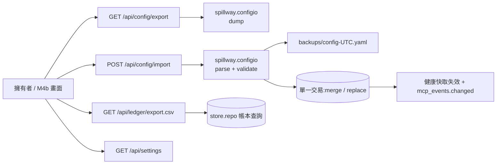
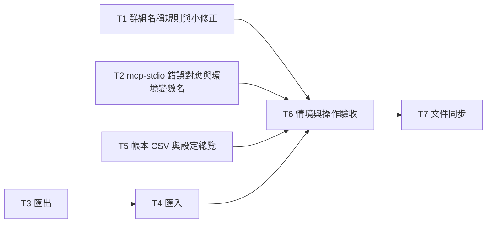

# CHG-20261102-02 — M4a:設定匯入匯出、帳本 CSV、設定總覽、群組名稱規則與 M3b 帶入項

- 專案:spillway
- 分支(Branch):`chg-20261102-02`(自 main 8490384 分出;擁有者步驟通過後依 DIR-4 規則 2、4 自動合回 main 並推送)
- 日期:2026-11-02(UTC+0)
- 類型:新功能(M4 第一部分,後端)+ M3b 帶入項
- Template: plan
- 提出者:擁有者(使用者,2026-11-02「Open M4 CHG」;使用者決定 M4 拆為 M4a(後端)與 M4b(畫面))
- 實作者:claude-opus-5-5(主 session agent;平行 task 由其派出的子 agent 施工,見「平行施工」)
- 風險分級:高——命中不可逆刪除(`replace` 匯入清空設定表)、跨模組介面(設定匯出格式為 M4b 與擁有者版控的契約)、安全(匯出檔不得含憑證值;CSV 注入);不改資料模型
- Commit/PR:`chg-20261102-02` 分支上訊息以 `CHG-20261102-02:` 開頭的 commit(`git log --grep CHG-20261102-02`);合回 main 後回填
- 驗收報告(預留):ACC-20261102-02
- 重複性檢查(Recurrence check):無重複(M4 第一筆;CHG-20261102-01「M4 帶入」所列項目於本筆處理)
- Diagrams:見「## 設計圖」節
- Security-impact:見「## 安全影響」節
- Skill: ai-sdlc-autopilot v1.69
- 關聯:Guideline 第 7 節 M4(閘門於 M4b 結束時驗收:AC-6、AC-8、AC-10、AC-20、AC-21、AC-22、NFR-4);FR-21、FR-22(後端部分)、FR-26(UI-8 名稱);spec 3、9.2、10(UI-6 匯出、UI-7);AC-10;NFR-4;CHG-20261102-01 已知限制與「M4 帶入」;ACC-20261102-01 發現 F1、F2、F6;knowledge DIR-1–DIR-4

## 動機

M4 的目標是 Web UI(G2、G5、G7)。使用者決定先做後端(M4a),讓畫面(M4b)只需呼叫既有 API:本筆實作 spec 3 的 YAML 匯入匯出(FR-21,AC-10 的前提)、UI-6 的帳本 CSV 匯出、UI-7 與首次設定精靈需要的設定總覽,並處理 CHG-20261102-01 留下、使用者選入 M4 的帶入項(群組名稱規則、`mcp-stdio` 區分 SDK 錯誤、小修正、真實冒煙)。另記錄使用者對 UI-8 名稱與 M4b 畫面測試方式的決定。

## 使用者故事

1. 作為擁有者,我要以 `GET /api/config/export` 取得 YAML 設定檔(成員、群組、route、拖曳順序、context 設定),檔案不含任何憑證值,以便版控(spec 3、3.1.1;NFR-4)。
2. 作為擁有者,我要以 `POST /api/config/import?mode=merge|replace` 匯入設定;任一欄位不合法時整批不寫入並回傳欄位路徑;`replace` 前系統自動備份目前設定(spec 3.1.2、3.1.3)。
3. 作為擁有者,我要把匯出檔匯入空資料庫後得到相同的成員、群組、route 與拖曳順序(AC-10)。
4. 作為擁有者,我要依篩選條件把帳本匯出成 CSV(UI-6)。
5. 作為擁有者,我要取得設定總覽(埠號、資料目錄、token 是否已產生、是否首次使用),供 UI-7 與首次設定精靈使用(FR-22)。
6. 作為擁有者,我要新建的群組名稱不能是 `.`、`..` 或含控制/雙向字元,以免 `/mcp/<group>` 不可用(CHG-20261102-01 已知限制)。
7. 作為擁有者,我要 `mcp-stdio` 能分辨閘道拒絕與 SDK 自己的傳輸錯誤(CHG-20261102-01 已知限制)。

## 決策與取捨

| # | 決策 | 選項 | 依據 | 結論 |
|---|------|------|------|------|
| 1 | **(使用者決定 2026-11-02)** M4 拆為兩筆 CHG:本筆 M4a(後端:設定匯入匯出、帳本 CSV、設定總覽、帶入項);M4b(8 個畫面、首次設定精靈畫面、M4 閘門) | (a) 兩筆 / (b) 一筆 / (c) 三筆 | 範圍大;後端可不經瀏覽器驗證 | 使用者選 (a);M4 閘門於 M4b 結束時驗收 |
| 2 | **(使用者決定 2026-11-02)** UI-8 標籤名稱定為「**API 參考**」 | 「API」「API 參考」「API 文件」「介面目錄」「開發者」 | FR-26 名稱待定 | 使用者選「API 參考」;Guideline FR-26、spec 10、design D37 改寫(本筆 T7) |
| 3 | **(使用者決定 2026-11-02)** M4b 畫面以 Playwright 自動測試(dev 相依,下載 Chromium 前另行徵得同意);本筆只記錄,不安裝 | (a) Playwright / (b) 內建瀏覽器手動 / (c) 只測 HTML | gui-web 互動驗證需要點擊、鍵盤、拖曳與截圖 | 使用者選 (a);M4b CHG 實作 |
| 4 | **(使用者決定 2026-11-02)** 收入 CHG-20261102-01 的帶入項:① 群組名稱規則;② `mcp-stdio` 區分 SDK 錯誤;③ 小修正(重複 Host、測試失敗訊息遮罩 token、depth/token 環境變數名單一定義、移除 `mcp_config` 頂層相容欄位);④ 真實冒煙(claude.ai connector MCP、openai_api 真實呼叫)列入本筆擁有者步驟 | 各項收入 / 留帶入清單 | CHG-20261102-01「M4 帶入」 | 使用者全選 |
| 5 | 匯出格式(spec 3.2):頂層 `version: 1`、`settings`(`record_context_default`、`context_retention_days`、`context_max_bytes`)、`deployments`(依 id 排序;`id`、`model_name`、`kind`、`provider`、`model`、`params`、`credential_ref`、`capabilities`、`enabled`、`tags`、`budget`)、`groups`(依名稱排序;`{name: {all, any, none}}`,空清單省略)、`routes`(依名稱排序;`target`、`mode`、`tags`、`record_context`、`budget_precheck`,以及有手動排序時的 `targets`)。值為 null 或預設值的欄位省略,鍵順序固定,輸出可重現(同一資料庫兩次匯出逐位元組相同)。**不含**:存取 token 雜湊、冷卻、帳本、payload、埠號。`GET /api/config/export` 回 `application/yaml; charset=utf-8`、`Content-Disposition: attachment; filename="spillway-config-<UTC yyyymmddThhmmssZ>.yaml"`、`Cache-Control: no-store` | 固定順序 vs 資料庫順序 | AC-10、版控需要可比較的輸出 | 代使用者決定 |
| 6 | 匯入 `POST /api/config/import?mode=merge|replace`:`mode` 必填(缺或不合法 → 422);body 為 YAML 文字(`application/yaml`、`text/yaml`、`application/x-yaml`、`text/plain` 皆可),上限 1 MiB(超過 → 422,訊息註明上限);`yaml.safe_load`;頂層與各實體的未知鍵 → 422;每個實體以管理 API 相同的 Pydantic 模型與規則驗證(憑證鍵名阻擋 R20、`params.signals`、群組名稱規則與 `all` 保留、route target 參照)並以 `deployments[1].kind` 形式回報第一個錯誤路徑;cardinality `single` 違反 → 409 `provider_single`;全部在單一交易內;成功回 `{mode, created, updated, deleted, backup}`(各為 `{deployments, groups, routes}` 計數),之後呼叫健康快取失效與 `mcp_events.changed()` | 嚴格 vs 忽略未知鍵 | spec 3.1.2「回傳錯誤欄位路徑」;匯入是版控檔,不該默默丟欄位 | 代使用者決定 |
| 7 | `replace` 語意:交易內刪除 `deployments`(連帶 `budgets`、`cooldowns`、`route_targets`)、`groups`、`routes` 與三個 context 設定後寫入檔案內容;**保留**帳本、payload、存取 token 雜湊。寫入前把目前設定以決策 5 格式備份到 `<資料目錄>/backups/config-<UTC>.yaml`(0600;同名已存在則加序號,不覆寫;備份失敗 → 不匯入、500),回應 `backup` 為檔名。`merge` 語意:依 `id`(成員)與 `name`(群組、route)新增或整筆取代;route 整筆取代(含 `targets`,檔案未列 `targets` 即回到預設順序,spec 3.1.5);檔案未列的實體不動;被取代成員的冷卻保留 | 自動備份 vs 要求另行確認 | replace 不可逆;擁有者可能誤用 | 代使用者決定 |
| 8 | 往返保證:匯出 → 在空資料庫以 `replace` 匯入 → 再匯出,兩檔逐位元組相同(AC-10 的自動化判準) | — | AC-10 | 代使用者決定 |
| 9 | 帳本 CSV:`GET /api/ledger/export.csv`,篩選參數與 `GET /api/ledger` 相同(`from`、`to`、`deployment`、`route`、`status`),不分頁、上限 100,000 列(超過 → 422 請縮小範圍);欄位為帳本列的公開欄位(不含 payload);UTF-8 加 BOM、`text/csv`、`Content-Disposition: attachment`;**CSV 注入防護**:以 `=`、`+`、`-`、`@`、Tab、CR 開頭的字串欄位前加 `'` | 伺服端 vs 瀏覽器端組 CSV | 資料量可能大;防護集中一處 | 代使用者決定 |
| 10 | 設定總覽 `GET /api/settings`:`{port, data_dir, version, token_issued, first_run, context: {...}}`;`first_run` 為「沒有任何成員也沒有任何 route」;不含 token 與雜湊 | 新端點 vs 讓畫面拼多個端點 | UI-7 與精靈需要單一來源 | 代使用者決定 |
| 11 | 群組名稱規則(決策 4 ①):建立群組與匯入時,名稱不可為 `.`、`..`,不可含 Unicode 類別 Cc、Cf、Zl、Zp、Zs 的字元(控制、格式含雙向、分隔、空白),長度 1–200,不含 `/`,不可為 `all`;違反 → 422。既有群組不受影響(查詢、修改選擇器、刪除照常) | 只擋 `.`/`..` vs 同時擋控制字元 | `/mcp/..` 會被正規化;控制字元會進複製貼上命令 | 代使用者決定(依使用者選入的帶入項) |
| 12 | `mcp-stdio` 錯誤對應(決策 4 ②):只有當回應 body 是 spec 9.1.2 JSON 且 `error.code` 屬於閘道定義的碼(`unauthorized`、`recursion_blocked`、`not_found`、`shutting_down`、`host_not_allowed`、`origin_not_allowed`)時,才以該碼回 JSON-RPC 錯誤並以 3 結束;其他非 2xx(含 SDK 的 503「Too many open sessions」、404「Session not found」)回 `data: {http_status}`(不帶 `code`)並以 1 結束 | 依狀態碼 vs 依 body | 狀態碼相同時無法分辨 | 代使用者決定 |
| 13 | 重複 `Host` header(決策 4 ③,ACC-20261102-01 F1):uvicorn(h11)在進入 ASGI 前即回 400,應用程式無法改寫;spec 9.1.4 補「格式錯誤的請求(如重複 Host)由伺服器以 400 拒絕」,不改程式 | 改程式 vs 改文件 | h11 行為 | 代使用者決定 |
| 14 | 測試失敗訊息遮罩 token(F2):`tests/helpers` 新增 `redact_tokens(text, tokens)`,`test_m3a_operation.py`、`test_m3b_operation.py` 與 m3b 步驟中帶出 serve stderr 的訊息一律經它 | — | DIR-2 | 代使用者決定 |
| 15 | 環境變數名單一定義(決策 4 ③):`spillway.settings` 定義 `TOKEN_ENV = "SPILLWAY_TOKEN"`、`DEPTH_ENV = "SPILLWAY_DEPTH"`、`DEPTH_HEADER = "X-Spillway-Depth"`;`api.mcp.auth`、`bridge`、`mcp_config`、`catalog` 改用之;CLI 模組依分層規則不能 import `settings`,保留字面值,合約測試斷言兩者相等 | — | CHG-20261102-01 終審 idiom | 代使用者決定 |
| 16 | 移除 `GET /api/mcp/config` 頂層 `format`、`path`、`content`(`variants[0]` 的相容複本;M4b UI-5 讀 `variants`,目前無使用者)——公開回應形狀變更 | 保留 vs 移除 | CHG-20261102-01 終審 | 代使用者決定 |
| 17 | 停點:自動化驗收通過後停下;擁有者以本分支建置執行擁有者步驟(實際資料目錄的匯出、`replace` 匯入(自動備份)與再匯出比對;claude.ai connector MCP 檢查;openai_api 真實呼叫)並回報後,才依 DIR-4 合回並推送 | 停 / 不停 | `replace` 作用於實際資料屬不可逆;真實冒煙需擁有者的金鑰與帳號 | 依 DIR-4 |

## 設計圖

### 圖 1:本筆範圍



### 圖 2:replace 匯入

```mermaid
sequenceDiagram
  participant C as 呼叫端
  participant A as /api/config/import
  participant V as configio.parse
  participant D as DB
  C->>A: YAML, mode=replace
  A->>V: safe_load + 驗證(路徑)
  alt 驗證失敗
    V-->>C: 422 validation_error(path)
  else 通過
    A->>D: 讀目前設定 → 寫 backups/config-<UTC>.yaml
    A->>D: BEGIN;刪設定表;寫入;cardinality 檢查;COMMIT
    A-->>C: 200 {created, updated, deleted, backup}
  end
```

### 圖 3:平行施工波次



## 安全影響

| 類別 | 命中 | 說明 |
|------|------|------|
| irreversible-delete | 是 | `replace` 匯入清空成員、群組、route 與 context 設定;以自動備份(決策 7)降低風險;對擁有者實際資料目錄的 `replace` 屬擁有者步驟(決策 17) |
| secrets | 是 | 匯出檔只含 `credential_ref`;成員 `params` 已依 R20 阻擋憑證鍵名;匯出、備份、CSV 不含 token 與雜湊;測試斷言以已知假金鑰搜尋匯出檔、備份檔、CSV、日誌命中為 0(NFR-4 的匯出部分) |
| security-boundary | 是 | 匯入沿用全端點 Host/Origin(瀏覽器跨站不能觸發匯入);CSV 注入防護(決策 9);YAML 以 `safe_load` 解析並設大小上限 |
| auth | 否 | `/api` 在綁 127.0.0.1 時仍不驗證 token(CHG-20261101-03 決策 2 不變) |
| new-dependency | 否 | `pyyaml` 已為相依;Playwright 屬 M4b |
| prod-migration | 否 | 不改 schema |
| payments | 否 | — |

已知限制(DIR-2 範圍內,只記錄、不實作):
- 本機非瀏覽器程式仍可不帶 Origin 呼叫匯入(含 `replace`);備份是唯一的復原手段。
- 備份檔不會自動清理。
- 匯入不驗證 `credential_ref` 指向的環境變數或 keyring 項目是否存在(呼叫時才知道)。
- 延續 CHG-20261102-01 的已知限制。

## 修改指引

### 目標

M4a 結束:spec 3 的匯入匯出、帳本 CSV、設定總覽可由 API 使用並有自動化驗收;AC-10 的自動化判準通過;帶入項結案;M4b 只需畫面。

### 影響範圍

| 位置 | 類型 | 內容 | 下游 |
|------|------|------|------|
| `src/spillway/configio.py`(新增) | 介面 | 決策 5–8 的 dump、parse、apply | M4b UI-7、擁有者版控 |
| `src/spillway/api/admin/configio.py`(新增) | 介面 | `/api/config/export`、`/api/config/import` | M4b UI-7 |
| `src/spillway/api/admin/ledger.py` | 介面 | `/api/ledger/export.csv` | M4b UI-6 |
| `src/spillway/api/admin/settings.py` | 介面 | `GET /api/settings` | M4b UI-7、精靈 |
| `src/spillway/api/admin/{models,groups}.py` | 行為 | 群組名稱規則 | 群組建立、匯入 |
| `src/spillway/api/mcp/{bridge,auth,catalog}.py`、`api/admin/mcp_config.py`、`settings.py` | 行為/設計 | 決策 12、15、16 | stdio 工具、M4b UI-5 |
| `tests/helpers/`、m3a/m3b 操作驗收與步驟 | 測試 | 決策 14 | — |
| `docs/spec.md`、`sdlc_docs/ai-guideline.md`、`sdlc_docs/structure/*.md`、`README.md` | 文件 | 見「規格書與結構文件更新」 | — |

### Global Constraints(全域約束——每個 task 都要遵守)

- 語言與版本:Python ≥ 3.11(驗收平台 3.13);src layout;路徑一律 `pathlib`;所有指令以 `.venv/bin/python` 執行並設 `PYTHONPATH=src`、`LITELLM_LOCAL_MODEL_COST_MAP=True`。
- 相依套件:不新增相依(YAML 用既有 `pyyaml`,CSV 用標準庫 `csv`);要新增時停下回報。
- 規格依據:行為以 `docs/spec.md`、本 CHG 決策表與先前各 CHG 決策表為準;只可做「規格書與結構文件更新」列出的 spec 修訂;不修改 `docs/proposal.md` 與 `docs/ui/*`。
- 分層:SQL 只在 `src/spillway/store/`(R25);`spillway.configio` 經 `store.repo` 讀寫,不寫 SQL;管理 API 只做 HTTP 轉換。
- 真實 CLI 與外部網路:沿用 CHG-20261102-01 Global Constraints(不可執行真實 claude/codex/cursor/gemini;只打本機假上游)。
- 秘密:匯出檔、備份檔、CSV、日誌、測試輸出與 `artifacts/` 不可含憑證值或 token 明文;測試以已知假值搜尋。
- 資料目錄:測試一律以 `tmp_path` 為 `SPILLWAY_HOME`;不可讀寫擁有者的實際資料目錄。
- 錯誤回應:spec 9.1.2;新錯誤碼不新增(沿用 `validation_error`、`provider_single`、`not_found`、`internal_error`)。
- 既有測試斷言不可修改,除非屬下列逐檔允許清單(改寫內容於施工審議逐條核對):① 管理 API 路徑集合與 OpenAPI 快照(`tests/contract/test_public_imports_admin.py`、`tests/integration/test_host_origin.py` 的 `KNOWN_GETS`)只可新增本筆端點;② `tests/integration/admin/test_admin_mcp_config.py` 中頂層 `format`/`path`/`content` 的斷言(決策 16);③ `tests/integration/test_mcp_stdio.py` 中 SDK 錯誤對應的結束碼與 `data`(決策 12);④ 群組名稱相關斷言(決策 11);⑤ 決策 14 的訊息遮罩(只改訊息,不改判斷)。
- 每個 task 的 `test:` 指令可獨立執行並全綠;每個 task 完成時另跑全量 `pytest -q` 與 `behave tests/features --exclude m4a_config`(T6 起為全量 behave)。
- 既有 feature 的情境文字只能經修改治理變更;施工者只寫步驟檔。
- commit 訊息以 `CHG-20261102-02:` 開頭,結尾加 Co-Authored-By 行。
- 驗收平台為 macOS;Linux、Windows 在 ACC 標「未涵蓋」。

### 契約清單

| 契約 | 提供方 | 讀取方 | 本筆變更 | 契約測試(路徑/無) |
|------|--------|--------|----------|----------------------|
| 設定檔格式(決策 5)與 `configio.dump`/`parse`/`apply` | T3(dump、格式)、T4(parse、apply) | 擁有者、M4b UI-7 | 新增 | tests/unit/test_configio_dump.py(新增)、tests/unit/test_configio_parse.py(新增) |
| `GET /api/config/export`、`POST /api/config/import` 請求/回應 | T3、T4 | M4b UI-7 | 新增 | tests/integration/admin/test_admin_config_io.py(新增) |
| `GET /api/ledger/export.csv` 欄位與防護 | T5 | M4b UI-6 | 新增 | tests/integration/admin/test_admin_ledger_csv.py(新增) |
| `GET /api/settings` 形狀 | T5 | M4b UI-7、精靈 | 新增 | tests/integration/admin/test_admin_settings_overview.py(新增) |
| 群組名稱規則 | T1 | 群組建立、匯入 | 變更 | tests/integration/admin/test_admin_groups.py(允許清單 ④) |
| `mcp-stdio` 錯誤對應(決策 12) | T2 | stdio 工具 | 變更 | tests/integration/test_mcp_stdio.py(允許清單 ③) |
| `settings.TOKEN_ENV`/`DEPTH_ENV`/`DEPTH_HEADER` | T2 | api.mcp、CLI 模組 | 新增 | tests/contract/test_env_names.py(新增) |
| `GET /api/mcp/config` 回應(移除頂層相容欄位) | T1 | M4b UI-5 | 變更 | tests/integration/admin/test_admin_mcp_config.py(允許清單 ②) |

### Tasks(checkbox=續作點)

- [ ] T1. 群組名稱規則與小修正
  - interfaces: consumes 決策 11、13、14、16 / produces `api/admin/models.py`、`api/admin/groups.py`(名稱規則)、`api/admin/mcp_config.py`(移除頂層相容欄位)、`tests/helpers`(`redact_tokens`)與 m3a/m3b 操作驗收、步驟的訊息遮罩、相關測試
  - test: `.venv/bin/python -m pytest tests/integration/admin/test_admin_groups.py tests/integration/admin/test_admin_mcp_config.py tests/unit/test_helpers.py -q`
  - L1: `.`、`..`、含 U+202E、U+0000、U+2028、空白、`/`、`all` 的群組名 → 422;`coding`、`中文群組`、`a.b`、`v1-2` → 201;既有(以 SQL 直接寫入的)不合規名稱仍可 GET、PUT 選擇器、DELETE;`/api/mcp/config` 回應無頂層 `format`/`path`/`content`;`redact_tokens` 遮罩全部 token 且不影響其他文字
  - L2: 以注入假 token 的 serve stderr 觸發 m3a/m3b 操作驗收的失敗訊息路徑(單元層模擬),訊息不含 token
  - L3: 不適用(行為情境由 T6 的 m4a_config.feature 撰寫)
  - L4: 不適用(子行程端到端由 T6 的 Acceptance operation 涵蓋)

- [ ] T2. `mcp-stdio` 錯誤對應與環境變數名單一定義
  - interfaces: consumes 決策 12、15 / produces `settings.py`(三個常數)、`api/mcp/{bridge,auth,catalog}.py`、`api/admin/mcp_config.py` 的常數引用(只改引用)、`tests/contract/test_env_names.py`、`tests/integration/test_mcp_stdio.py`(允許清單 ③)
  - test: `.venv/bin/python -m pytest tests/integration/test_mcp_stdio.py tests/contract/test_env_names.py tests/integration/mcp -q`
  - L1: 閘道 9.1.2 body 的 401/403/404/503 → `data.code` 與結束碼 3;以假 HTTP 端點回非 9.1.2 的 503「Too many open sessions」與 404「Session not found」→ `data` 只有 `http_status`、結束碼 1;CLI 模組的 `SPILLWAY_DEPTH` 字面值等於 `settings.DEPTH_ENV`
  - L2: 子行程 `mcp-stdio` 對真的 serve 達到 `max_sessions` 時回結束碼 1(以小上限的測試 serve)
  - L3: 不適用(行為情境由 T6 撰寫)
  - L4: 不適用(T6 涵蓋)

- [ ] T3. 設定匯出
  - interfaces: consumes 決策 5 / produces `spillway/configio.py`(`dump(conn) -> str`、格式常數與 Pydantic 檔案模型)、`api/admin/configio.py`(`GET /api/config/export`)、`store.repo` 需要的讀取函式、`tests/unit/test_configio_dump.py`、`tests/integration/admin/test_admin_config_io.py`(匯出部分)、允許清單 ①
  - test: `.venv/bin/python -m pytest tests/unit/test_configio_dump.py tests/integration/admin/test_admin_config_io.py -q`
  - L1: spec 3.2 範例資料匯出後鍵順序、排序、省略規則如決策 5;兩次匯出逐位元組相同;不含 token 雜湊、冷卻、帳本;以假金鑰值(成員 env 變數設值)搜尋匯出內容命中 0
  - L2: HTTP 回應的 Content-Type、Content-Disposition(UTC 檔名)、Cache-Control;Host/Origin 照常適用
  - L3: 不適用(T6)
  - L4: 不適用(T6)

- [ ] T4. 設定匯入
  - interfaces: consumes 決策 6、7、8 與 T3 的檔案模型 / produces `configio.parse(text) -> ConfigFile`、`configio.apply(conn, cfg, mode, backup_dir) -> ImportResult`、`api/admin/configio.py`(`POST /api/config/import`)、`store.repo` 需要的寫入函式、`tests/unit/test_configio_parse.py`、`tests/integration/admin/test_admin_config_io.py`(匯入部分)
  - test: `.venv/bin/python -m pytest tests/unit/test_configio_parse.py tests/integration/admin/test_admin_config_io.py -q`
  - L1: 缺 `mode`、未知鍵、型別錯誤、憑證鍵名、不合法 signals、不合規群組名、route target 參照不存在的成員 → 422 且訊息含路徑;超過 1 MiB → 422;非 mapping 的 YAML → 422;`single` 違反 → 409;失敗時資料庫完全不變(以全表快照比對)
  - L2: `replace` 交易內清空後寫入、帳本與 token 雜湊不變、備份檔 0600 且內容等於匯入前匯出、同名備份不覆寫、備份寫入失敗時不匯入;`merge` 整筆取代 route(含 `targets`)、未列實體不動、被取代成員的冷卻保留;往返(決策 8)逐位元組相同;成功後健康快取失效且 `tools/list_changed` 送出
  - L3: 不適用(T6)
  - L4: 不適用(T6)

- [ ] T5. 帳本 CSV 與設定總覽
  - interfaces: consumes 決策 9、10 / produces `api/admin/ledger.py`(`GET /api/ledger/export.csv`)、`api/admin/settings.py`(`GET /api/settings`)、`store.repo` 不分頁查詢、`tests/integration/admin/test_admin_ledger_csv.py`、`tests/integration/admin/test_admin_settings_overview.py`、允許清單 ①
  - test: `.venv/bin/python -m pytest tests/integration/admin/test_admin_ledger_csv.py tests/integration/admin/test_admin_settings_overview.py -q`
  - L1: 篩選與 `/api/ledger` 相同的列集合;標題列固定;BOM;以 `=1+1`、`@x`、`-2`、`+3`、Tab 開頭的值前置 `'`;超過上限 → 422;總覽的 `first_run` 在空資料庫為 true、建一個成員後為 false;`token_issued` 與 settings 表一致;不含 token 或雜湊
  - L2: 10,000 列帳本匯出時間 < 2 秒(記錄,非閘門)且記憶體不隨列數線性成長(以串流實作)
  - L3: 不適用(T6)
  - L4: 不適用(T6)

- [ ] T6. 行為情境與操作驗收
  - interfaces: consumes T1–T5 / produces `tests/features/steps/m4a_steps.py`、`tests/acceptance/test_m4a_operation.py`、`artifacts/m4a/`
  - test: `.venv/bin/python -m behave tests/features && .venv/bin/python -m pytest tests/acceptance -q -rs`
  - L1: 不適用(T1–T5 已涵蓋)
  - L2: 不適用(T1–T5 已涵蓋)
  - L3: `m4a_config.feature` 9 個情境全過(文字不改)
  - L4: 執行「Acceptance operation」自動部分,`http-log.jsonl`(只含四鍵)與 `operation-results.json` 存到 `artifacts/m4a/`;以假金鑰與 token 搜尋資料庫、匯出檔、備份檔、CSV、serve 日誌命中皆為 0(NFR-4)

- [ ] T7. 文件同步
  - interfaces: consumes T1–T6 / produces「規格書與結構文件更新」所列文件
  - test: ai-sdlc 的 doc-integrity lint(MCP 工具 `doc_integrity_check`,`repo=.`)回 ok / exit 0
  - L1: 不適用(文件變更,無程式行為;由 doc-integrity lint 核對)
  - L2: 不適用(文件變更,無整合行為)
  - L3: 不適用(文件變更,無使用者情境)
  - L4: 不適用(文件變更;由終審 docs 席對照程式核對)

### Behaviour spec

- feature: tests/features/m2_routing.feature
- feature: tests/features/m2_context.feature
- feature: tests/features/m2_estimate.feature
- feature: tests/features/m2_adapters.feature
- feature: tests/features/m2_quota.feature
- feature: tests/features/m2c_cleanup.feature
- feature: tests/features/m3a_cli.feature
- feature: tests/features/m3b_mcp.feature
- feature: tests/features/m4a_config.feature

`m4a_config.feature`(新增,9 個情境;情境文字於確認閘一併確認;步驟檔由 T6 撰寫):匯出內容與不含憑證;往返;merge;驗證失敗整批不寫並回路徑;replace 自動備份;single 409;帳本 CSV;設定總覽;群組名稱規則。既有 8 個 feature 不改文字全過。

### Interaction spec

產物供 ACC-20261102-02 引用。

- kind: service-protocol
- cmd: .venv/bin/python -m pytest tests/integration -q --junitxml=artifacts/m4a/integration.xml
- artifacts: artifacts/m4a/integration.xml
- kind: service-protocol
- cmd: .venv/bin/python -m pytest tests/acceptance/test_m4a_operation.py -q
- artifacts: artifacts/m4a/http-log.jsonl
- kind: cli
- cmd: .venv/bin/python -m pytest tests/integration/test_mcp_stdio.py -q --junitxml=artifacts/m4a/cli.xml
- artifacts: artifacts/m4a/cli.xml
- kind: library-api
- cmd: .venv/bin/python -m pytest tests/contract tests/unit/test_configio_dump.py tests/unit/test_configio_parse.py -q --junitxml=artifacts/m4a/contract.xml
- artifacts: artifacts/m4a/contract.xml

### Acceptance operation

- operate:(macOS,自動部分)暫存 `SPILLWAY_HOME`;子行程 serve 與 api 假端點;以管理 API 建立 2 個 api 成員(其一 `credential_ref: env:SPILLWAY_TEST_KEY` 並設假值)、1 個 claude-cli 成員(假 CLI)、群組 `coding`、task route `review`(手動順序)與 chat route;送 3 次請求產生帳本;匯出 → 存檔 A;第二個暫存資料目錄的 serve 以 `replace` 匯入 A → 再匯出 B;對第一個 serve 以 `merge` 匯入修改一個成員 tags 的檔案;以 `replace` 匯入縮小後的檔案並檢查備份;匯入不合法檔案;匯入兩個 claude-cli;匯出帳本 CSV(帶 route 篩選);取得設定總覽;建立名為 `..` 的群組;`mcp-stdio` 對 `max_sessions` 已滿的 serve。
- observe:A 不含假金鑰值與 token;A 與 B 逐位元組相同,第二個 serve 的 dry-run 第一順位與第一個相同;merge 只改該成員;replace 後 backups 有備份且等於匯入前匯出、帳本列數不變;不合法檔案 422 帶路徑且資料不變;兩個 claude-cli 409 `provider_single`;CSV 列數與篩選相同且無 prompt;總覽無 token;`..` 422;`mcp-stdio` 對 SDK 503 回 `data.http_status`、結束碼 1;資料庫、匯出檔、備份、CSV、serve 日誌以假金鑰與 token 搜尋命中 0;只聽 127.0.0.1。
- operate(擁有者,於自動化驗收通過後、合回前;agent 不執行,決策 17):① 以本分支建置對 `~/spillway-smoke` 啟動 serve;② `curl` 匯出設定為檔案 A;③ 以 `replace` 匯入 A(會自動備份);④ 再匯出 B 並 `diff A B`;⑤ claude.ai 已啟用 connector 時,以 `claude -p --strict-mcp-config` 詢問可用 MCP 工具(預期 NONE),未啟用則回報「未啟用」;⑥ 設定 `OPENAI_API_KEY` 後以 openai_api 成員送一次真實呼叫(或回報仍暫緩);⑦ 回報:`diff` 是否為空、備份檔名、⑤ 與 ⑥ 的結果(不貼金鑰)。
- pass:自動部分觀察全部成立且 `artifacts/m4a/` 留有紀錄;擁有者回報 `diff` 為空與 ⑤ ⑥ 的結果,遮罩後記入 ACC-20261102-02;之後才依 DIR-4 合回 main 並推送。M4 閘門於 M4b 驗收。

### 本機閘

`.venv/bin/python -m pytest -q && .venv/bin/python -m behave tests/features`(全綠,`pytest tests/acceptance -q -rs` 0 skipped)。T6 合入前 behave 排除 `m4a_config`。

### 平行施工

| 波次 | Task | 檔案所有權(互不重疊) |
|------|------|------------------------|
| 1 | T1 | `api/admin/models.py`、`api/admin/groups.py`、`api/admin/mcp_config.py`(移除相容欄位)、`tests/helpers/`、m3a/m3b 操作驗收與 `m3b_steps.py` 的訊息遮罩、允許清單 ②④⑤ |
| 1 | T2 | `settings.py`(三個常數)、`api/mcp/{bridge,auth,catalog}.py`、`api/admin/mcp_config.py` 的常數引用一行、`tests/integration/test_mcp_stdio.py`、`tests/contract/test_env_names.py`、允許清單 ③ |
| 1 | T3 | `spillway/configio.py`(dump 與檔案模型)、`api/admin/configio.py`(export)、`api/admin/__init__.py` 註冊一行、`store/repo.py` 新增讀取函式、允許清單 ①(export 路徑) |
| 1 | T5 | `api/admin/ledger.py`、`api/admin/settings.py`、`store/repo.py` 新增查詢函式、允許清單 ①(CSV、settings 路徑) |
| 2 | T4 | `spillway/configio.py`(parse、apply)、`api/admin/configio.py`(import)、`store/repo.py` 新增寫入函式 |
| 3 | T6 | 步驟、操作驗收、`environment.py` 只可新增 |
| 4 | T7 | 文件 |

同波次共用檔(`api/admin/mcp_config.py`、`store/repo.py`、`api/admin/__init__.py`、允許清單 ① 的測試檔)只改各自列出的區段;每個子 agent 用獨立 worktree;每波合併後主 session 跑全量閘,全綠才進下一波。

### 規格書與結構文件更新

- [ ] docs/spec.md:3.1 補決策 5(欄位、排序、省略、不含項目)、決策 6(上限、未知鍵、路徑格式、回應)、決策 7(replace 刪除範圍與保留項、自動備份、merge 整筆取代);3.2 範例補 `enabled`、`params`、`context_max_bytes`;9.1.4 補重複 Host 由伺服器回 400(決策 13);9.2 補 `/api/ledger/export.csv`、`GET /api/settings`,`/api/config/import` 列註明 `mode` 必填;8.1.2 `mcp-stdio` 錯誤對應改為依 body(決策 12);8.2.1 移除頂層相容欄位(決策 16);9.2.5 群組名稱規則(決策 11);10 UI-8 名稱改為「API 參考」;修訂行
- [ ] sdlc_docs/ai-guideline.md:FR-26 名稱定案「API 參考」;M4 列註明拆為 M4a(本筆)與 M4b;FR-21 標 M4a;FR-22 後端標 M4a;變更歷史 v1.7
- [ ] sdlc_docs/structure/design.md:新增 D38(設定檔格式與匯入匯出,決策 5–8)、D39(帳本 CSV 與注入防護,決策 9)、D40(設定總覽,決策 10);D35 改寫錯誤對應(決策 12);D36 移除相容欄位(決策 16);D37 名稱「API 參考」;D22 或群組相關列補名稱規則(決策 11);常數單一定義(決策 15)
- [ ] sdlc_docs/structure/logical.md:匯入匯出流程
- [ ] sdlc_docs/structure/directory.md:`configio.py`(移出「M4 預計新增」)、`api/admin/configio.py`、`backups/`(資料目錄)、新測試檔
- [ ] sdlc_docs/structure/data.md:資料目錄 `backups/`;匯出不含的表
- [ ] README.md:設定匯入匯出與備份、帳本 CSV、`mcp-stdio` 結束碼 1 的新情形

### 風險與回滾

| 風險 | 影響 | 對策 |
|------|------|------|
| `replace` 誤用 | 設定遺失 | 自動備份;擁有者步驟以備份還原演練(以 `replace` 匯入備份即可) |
| 往返不一致(欄位遺漏或預設值處理) | 版控差異、AC-10 不過 | 決策 8 的逐位元組測試;spec 3.2 範例全欄位資料 |
| 匯入驗證與管理 API 規則分歧 | 匯入可寫入 API 會擋的資料 | 共用同一組 Pydantic 模型與檢查函式;測試對照 |

回滾:本筆不改 schema;revert 合併 commit 即回到 M3b;`replace` 的資料以備份檔還原。

## 審議紀錄

### 決策審議

(待派出;高風險,依 DIR-1 六席 + 仲裁)

### 施工審議

(施工時填)

## 結構異動摘要

(收尾時填)

## 狀態

草稿——待決策審議與確認閘。
