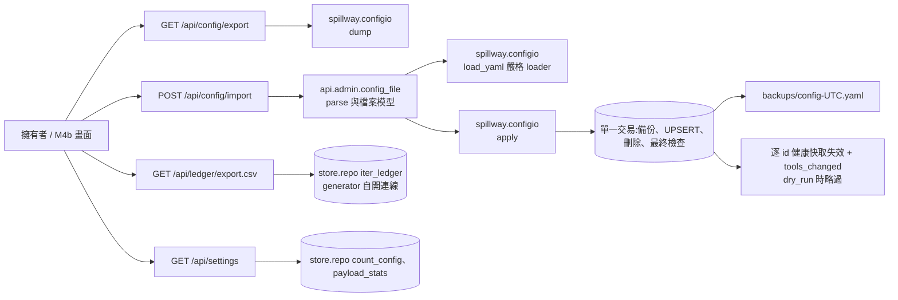
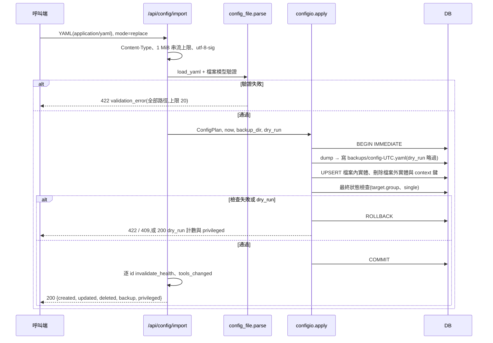
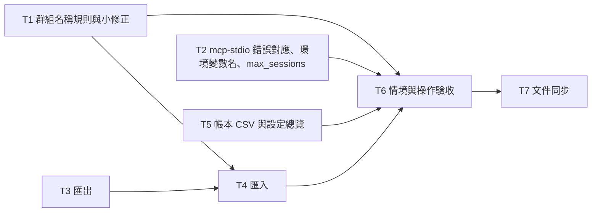

# CHG-20261102-02 — M4a:設定匯入匯出、帳本 CSV、設定總覽、群組名稱規則與 M3b 帶入項

- 專案:spillway
- 分支(Branch):`chg-20261102-02`(自 main 8490384 分出;擁有者步驟通過後依 DIR-4 規則 2、4 自動合回 main 並推送)
- 日期:2026-11-02(UTC+0)
- 類型:新功能(M4 第一部分,後端)+ M3b 帶入項
- Template: plan
- 提出者:擁有者(使用者,2026-11-02「Open M4 CHG」;使用者決定 M4 拆為 M4a(後端)與 M4b(畫面))
- 實作者:claude-opus-5-5(主 session agent;平行 task 由其派出的子 agent 施工,見「平行施工」)
- 風險分級:高——命中不可逆刪除(`replace` 匯入刪除檔案外的成員、群組、route 與 context 設定)、跨模組介面(設定匯出格式為 M4b 與擁有者版控的契約)、安全(匯出檔不得含憑證值;CSV 注入;匯入檔等同程式碼);不改資料模型
- Commit/PR:`chg-20261102-02` 分支上訊息以 `CHG-20261102-02:` 開頭的 commit(`git log --grep CHG-20261102-02`);合回 main 後回填
- 驗收報告(預留):ACC-20261102-02
- 重複性檢查(Recurrence check):無重複(M4 第一筆;CHG-20261102-01「M4 帶入」所列項目於本筆處理)
- Diagrams:見「## 設計圖」節
- Security-impact:見「## 安全影響」節
- Skill: ai-sdlc-autopilot v1.69
- 關聯:Guideline 第 7 節 M4(閘門於 M4b 結束時驗收:AC-6、AC-8、AC-10、AC-20、AC-21、AC-22、NFR-4);FR-21、FR-22(後端部分)、FR-26(UI-8 名稱);spec 3、8.1.2、9.1.4、9.2、10(UI-6 匯出、UI-7);AC-10;NFR-4;CHG-20261102-01 已知限制與「M4 帶入」;ACC-20261102-01 發現 F1、F2、F6;knowledge DIR-1–DIR-4

## 動機

M4 的目標是 Web UI(G2、G5、G7)。使用者決定先做後端(M4a),讓畫面(M4b)只需呼叫既有 API:本筆實作 spec 3 的 YAML 匯入匯出(FR-21,AC-10 的前提)、UI-6 的帳本 CSV 匯出、UI-7 與首次設定精靈需要的設定總覽,並處理 CHG-20261102-01 留下、使用者選入 M4 的帶入項(群組名稱規則、`mcp-stdio` 區分 SDK 錯誤、小修正、真實冒煙)。另記錄使用者對 UI-8 名稱與 M4b 畫面測試方式的決定。

## 使用者故事

1. 作為擁有者,我要以 `GET /api/config/export` 取得 YAML 設定檔(成員、群組、route、拖曳順序、context 設定),檔案不含任何憑證值,以便版控(spec 3、3.1.1;NFR-4)。
2. 作為擁有者,我要以 `POST /api/config/import?mode=merge|replace` 匯入設定;任一欄位不合法時整批不寫入並回傳欄位路徑;`replace` 前系統自動備份目前設定;可先以 `dry_run=true` 預覽計數與會變更 privileged 欄位的成員(spec 3.1.2、3.1.3)。
3. 作為擁有者,我要把匯出檔匯入空資料庫後得到相同的成員、群組、route 與拖曳順序(AC-10)。
4. 作為擁有者,我要依篩選條件把帳本匯出成 CSV(UI-6)。
5. 作為擁有者,我要取得設定總覽(埠號、資料目錄、token 是否已產生、是否首次使用、計數),供 UI-7 與首次設定精靈使用(FR-22)。
6. 作為擁有者,我要新建的群組名稱不能是 `.`、`..` 或含控制/雙向字元,以免 `/mcp/<group>` 不可用(CHG-20261102-01 已知限制)。
7. 作為擁有者,我要 `mcp-stdio` 能分辨閘道拒絕與 SDK 自己的傳輸錯誤(CHG-20261102-01 已知限制)。

## 決策與取捨

| # | 決策 | 選項 | 依據 | 結論 |
|---|------|------|------|------|
| 1 | **(使用者決定 2026-11-02)** M4 拆為兩筆 CHG:本筆 M4a(後端:設定匯入匯出、帳本 CSV、設定總覽、帶入項);M4b(8 個畫面、首次設定精靈畫面、M4 閘門) | (a) 兩筆 / (b) 一筆 / (c) 三筆 | 範圍大;後端可不經瀏覽器驗證 | 使用者選 (a);M4 閘門於 M4b 結束時驗收 |
| 2 | **(使用者決定 2026-11-02)** UI-8 標籤名稱定為「**API 參考**」 | 「API」「API 參考」「API 文件」「介面目錄」「開發者」 | FR-26 名稱待定 | 使用者選「API 參考」;Guideline FR-26、spec 10、design D37 改寫(本筆 T7) |
| 3 | **(使用者決定 2026-11-02)** M4b 畫面以 Playwright 自動測試(dev 相依,下載 Chromium 前另行徵得同意);本筆只記錄,不安裝 | (a) Playwright / (b) 內建瀏覽器手動 / (c) 只測 HTML | gui-web 互動驗證需要點擊、鍵盤、拖曳與截圖 | 使用者選 (a);M4b CHG 實作 |
| 4 | **(使用者決定 2026-11-02)** 收入 CHG-20261102-01 的帶入項:① 群組名稱規則;② `mcp-stdio` 區分 SDK 錯誤;③ 小修正(重複 Host、測試失敗訊息遮罩 token、depth/token 環境變數名單一定義、移除 `mcp_config` 頂層相容欄位、F6 token 去空白的 spec 措辭);④ 真實冒煙(claude.ai connector MCP、openai_api 真實呼叫)列入本筆擁有者步驟 | 各項收入 / 留帶入清單 | CHG-20261102-01「M4 帶入」、ACC-20261102-01 F6 | 使用者全選。③ 的落地項目補 F6(只改 spec 8.1.2、9.2.5 文字,不改程式)(決策審議修訂 AM-17) |
| 5 | 匯出格式(spec 3.1、3.2),逐欄定死:**頂層** `version: 1`、`settings`、`deployments`、`groups`、`routes` 一律輸出,空值寫 `{}`/`[]`。**deployment**(依 id 排序)欄位順序 `id, model_name, kind, provider, model, params, credential_ref, capabilities, enabled, tags, budget`;省略條件 `params == {}`、`credential_ref is None`、`capabilities == {}`、`enabled is True`、`tags == []`、沒有 budget 列;`budget` 子鍵 `{type, limit_amount, window, reset_anchor}`,`limit_amount`/`reset_anchor` 為 None 時省略,`type: none`、`window: none` 不省略;`params`、`capabilities` 為不透明 JSON,照 DB 原樣輸出、不遞迴剝除;成員 tags 依存放排序。**group**(依名稱排序)`{all, any, none}`,空清單省略。**route**(依名稱排序)欄位順序 `target, mode, tags, record_context, budget_precheck, targets`;省略條件 `mode == "chat"`、`tags == []`、`record_context is None`、`budget_precheck is False`、沒有手動排序;`record_context: false` 不省略;`target` 為 `{group: <name>}` 或 `{tags: {all, any, none}}`(空 `{tags: {}}` 不省略);`targets` 為 list(slot)of list(position),項目 `{deployment, effort?, weight?}`(`weight == "medium"` 省略,`effort` 為 None 省略,`effort: none` 不省略),slot 空洞輸出時重新編號;route tags 保留原順序與重複值。**settings** 只輸出和 `SETTING_DEFAULTS` 不同的鍵,鍵順序固定。dump 參數 `sort_keys=False, allow_unicode=True, default_flow_style=False, width=float("inf")`,行尾 `\n`。**不含**:存取 token 雜湊、冷卻、帳本、payload、埠號。`GET /api/config/export` 回 `application/yaml; charset=utf-8`、`Content-Disposition: attachment; filename="spillway-config-<UTC yyyymmddThhmmssZ>.yaml"`(時間取自 `app.state.clock`)、`Cache-Control: no-store`、`X-Content-Type-Options: nosniff`。匯出前 handler 對每列 `params`/`capabilities` 跑 `secrets._secret_paths`,命中 → 422 `validation_error`,訊息為 `deployments[<id>].params.<path>` 清單(不含值);備份不掃描 | 固定順序 vs 資料庫順序;「null 或預設值省略」vs 逐欄表 | AC-10 逐位元組判準需要逐欄定死;`BudgetIn`(`models.py:41-47`,`extra="forbid"`)、DB、domain 皆為 `limit_amount`;舊列可能含後來才列入的憑證鍵名;匯出檔進版控,備份只留本機(0600) | 代使用者決定(決策審議修訂 AM-5、AM-9、AM-10) |
| 6 | 匯入 `POST /api/config/import?mode=merge\|replace[&dry_run=true]`:`mode` 必填(缺或不合法 → 422)。**請求邊界**:Content-Type 只接受 `application/yaml`、`application/x-yaml`、`text/yaml`(可帶 `charset=utf-8`),其他或沒帶 → 422 `validation_error`「Content-Type 必須為 application/yaml」;`Content-Length` 超過 1 MiB(1,048,576 bytes)不讀直接 422;body 以 `async for chunk in request.stream()` 累計,超過上限立刻 422;`utf-8-sig` 解碼,失敗 → 422。**解析**:`spillway.configio.load_yaml`(嚴格 loader,見決策 18)→ `api.admin.config_file.parse`(Pydantic 檔案模型 `ConfigFileIn`,`extra="forbid"`,組合 `DeploymentIn`、`BudgetIn`、`RouteIn`、`OrderEntryIn`、`ContextSettingsIn`,不另寫一份;憑證鍵名 R20、`params.signals`、群組名稱規則(決策 11)、`targets` 重複成員(沿用 `OrderIn._no_duplicates`)、重複 deployment id)。解析與模型驗證階段回全部錯誤(上限 20 筆,以「; 」串接,格式同 `validation_message`,不回顯輸入值);寫入後的檢查回第一筆。路徑格式:list 用 0 起算 `[i]`;鍵符合 `^[A-Za-z0-9_-]+$` 用 `.key`,否則 `["..."]`(JSON 跳脫後經 `redact_echo`),例 `deployments[1].kind`、`routes["a.b"].targets[0][1].deployment`。**套用**:`configio.apply`(決策 7),cardinality `single` 違反 → 409 `provider_single`(列出衝突 id)。**settings**:merge 只覆寫檔案中出現的鍵。成功回 `{mode, dry_run, created, updated, deleted, backup, privileged}`(計數各為 `{deployments, groups, routes}`;`privileged` 見決策 20);COMMIT 之後(dry_run 除外)對 `affected_ids`(交易前 id ∪ 交易後 id)逐一 `request.app.state.router.invalidate_health(id)`,再呼叫一次 `tools_changed(request)`;不修改 `router.py` | 嚴格 vs 忽略未知鍵;收 `text/plain` vs 只收 yaml 型別;回第一個錯誤 vs 全部 | spec 3.1.2「回傳錯誤欄位路徑」;`text/plain` 可由 `<form enctype=text/plain>` 不經 preflight 跨站送出,`host_origin.py:52` 不帶 Origin 時放行;yaml 型別不在 CORS safelist,強制 preflight;`await request.body()` 先讀完整個 body;健康快取只能逐 id 失效(`router.py:315`) | 代使用者決定(決策審議修訂 AM-2、AM-6、AM-7、AM-8) |
| 7 | 套用語意:同一個 `transaction(conn)`(BEGIN IMMEDIATE)內依序執行:① `dump` 並寫備份(只限 replace、非 dry_run;見下);② 寫入實體:merge 與 replace 一律經 `repo.save_deployment`、`save_group`、`save_route` 的 UPSERT;每條檔案中的 route 都呼叫 `repo.replace_route_targets(conn, name, rows or [])`(檔案沒列 `targets` 即回到預設順序,spec 3.1.5);寫 route_targets **之前**以「檔案 ∪(merge 時)DB」的 id 集合檢查 `targets` 內每個 deployment 存在(否則 422 帶路徑,不撞 FK 變 500);③ 只限 replace:刪除檔案外的 routes → groups → deployments(連帶其 budgets、cooldowns、route_targets),並以 `repo.delete_settings` 刪除檔案中沒有的三個 `SETTING_DEFAULTS` 鍵(回到預設);禁止整表 DELETE settings;④ 寫入後對最終狀態檢查:route `target.group` 必須存在(否則 422,路徑 `routes.<name>.target.group`);對每個 `cardinality_of(provider, kind) == "single"` 的 provider 最終至多 1 筆(`repo.deployment_ids_by_provider`),否則 `ImportConflict(409, "provider_single")`;**不檢查**成員是否屬於 route 目標(與 `PUT /order` 有意的差異:stale targets 由 Router 過濾,`routes.py:82-83`);⑤ 任一步失敗 ROLLBACK。**保留**:帳本、payload、存取 token 雜湊與其他非 context 設定鍵;id 仍存在的成員冷卻保留(merge、replace 一致),只有被刪成員的冷卻跟著消失。**備份**:`<資料目錄>/backups/` 以 `mkdir(mode=0o700, exist_ok=True)` 建立後 `lstat`,是 symlink 或不是目錄 → 500 `internal_error`、不匯入;檔案以 `os.open(p, O_WRONLY\|O_CREAT\|O_EXCL\|O_NOFOLLOW, 0o600)` 建立,`FileExistsError` 時改 `config-<UTC>-<n>.yaml`(n 從 2 遞增),寫完 `fsync`;寫鎖內、刪除之前完成;失敗 ROLLBACK 並回 500;回應 `backup` 為檔名(merge 與 dry_run 為 null) | 刪除再插入 vs UPSERT + 刪除檔案外實體;交易前備份 vs 寫鎖內備份;逐筆檢查 vs 最終狀態檢查 | 刪除再插入會經 FK 串聯刪掉其他 route 的排序與冷卻;`save_deployment`/`save_route` 已是 UPSERT 且「既有的 route_targets 不受影響」;`transaction` 可巢狀(SAVEPOINT);交易前讀出有 TOCTOU;exists→write、write→chmod 有空窗;逐筆檢查結果受寫入順序影響;`repo.get_setting` 缺鍵時取預設,token 雜湊與 context 設定同表 | 代使用者決定(決策審議修訂 AM-2、AM-4、AM-6) |
| 8 | 往返保證:匯出 → 在空資料庫以 `replace` 匯入 → 再匯出,兩檔逐位元組相同(AC-10 的自動化判準);另以黃金檔 `tests/unit/data/config_golden.yaml`(每欄都有一組非預設值,含同 slot 兩成員帶 weight、內嵌 tag target、`type: none` 的 budget)以 replace 匯入空 DB 後,**DB 全表快照**等於原 DB;含 stale target 與 slot 空洞的資料也往返 | 只比檔案 vs 加比 DB | AC-10;省略規則若有誤,只比檔案可能兩邊一起錯 | 代使用者決定(決策審議修訂 AM-5、AM-21) |
| 9 | 帳本 CSV:`GET /api/ledger/export.csv`,篩選參數與 `GET /api/ledger` 相同(`from`、`to`、`deployment`、`route`、`status`),不分頁、上限 100,000 列(handler 先在 `request_conn` 內以 `count_ledger` 預檢,超過 → 422 請縮小範圍)。欄位與順序同 `_ledger_out`:`id, ts, route_name, deployment_id, effort, tokens_in, tokens_out, cost_usd, status, slot, fallback_depth, latency_ms, est_tokens_in, est_tokens_out_p50, est_tokens_out_p90, est_cost_usd_p90, error`;`ts` 為 UTC ISO 8601;None 輸出空字串;不含 payload。**注入防護**只套用在 `str` 型別欄位(含 `deployment_id`、`route_name`、`error`):以 `= + - @ \t \r` 開頭時前置 `'`;數字欄不加。回應 `text/csv; charset=utf-8`、UTF-8 BOM、`Content-Disposition: attachment; filename="spillway-ledger-<UTC yyyymmddThhmmssZ>.csv"`(時間取自 clock)、`Cache-Control: no-store`、`X-Content-Type-Options: nosniff`。實作:`StreamingResponse(async_gen())`;**async** generator 在事件迴圈執行緒內以 `request.app.state.conn_factory()` 自行開連線、`try/finally` 關閉;以 repo 新增的 `iter_ledger(conn, *, filters…, limit: int, batch: int = 1000) -> Iterator[list[LedgerRow]]`(內部 `BEGIN` 讀交易、`fetchmany`、`LIMIT`,結束 COMMIT)逐批 yield,批次之間 `await asyncio.sleep(0)`;不修改 `list_ledger`。D27 補「CSV 串流例外:連線在 generator 內開關」 | 伺服端 vs 瀏覽器端組 CSV;同步 vs async generator | 資料量可能大;防護集中一處;同步 generator 經 `iterate_in_threadpool`(starlette 1.10.0)在別的執行緒碰 `check_same_thread=True`;`request_conn` 在 handler 返回時關閉;串流開始後無法再回 422;`_ID_PATTERN` 允許 `=HYPERLINK(` | 代使用者決定(決策審議修訂 AM-10) |
| 10 | 設定總覽 `GET /api/settings`:`{port, data_dir, version, token_issued, first_run, counts: {deployments, groups, routes, ledger_ok}, context: {record_context_default, context_retention_days, context_max_bytes, payload_count, payload_bytes}}`。`port` = `app.state.port`(唯讀,顯示用;不含 host,D16 規定 settings 表的 `bind_host` 不讀);`data_dir` 見決策 19;`token_issued` = `settings.get_access_token_hash(conn) is not None`;`first_run` = `counts.deployments == 0 and counts.routes == 0`(replace 匯入空檔案之後會再次為 true);counts 用 repo 新增的 `count_config(conn) -> dict[str, int]`,payload 用 `payload_stats(conn) -> tuple[int, int]`;不含 token 與雜湊 | 新端點 vs 讓畫面拼多個端點 | UI-7 與精靈需要單一來源;各一個 COUNT 或 SUM;用 list 會載入整份成員清單 | 代使用者決定(決策審議修訂 AM-3、AM-11) |
| 11 | 群組名稱規則(決策 4 ①):純函式 `group_name_problem(name: str) -> str \| None` 放在 `api/admin/models.py`;名稱不可為 `.`、`..`、`all`(`all` 保留移進此函式,`groups.py` 的 create 改呼叫它),不可含 Unicode 類別 Cc、Cf、Cs、Co、Cn、Zl、Zp、Zs 的字元,不含 `/`,長度 1–200,必須 `unicodedata.is_normalized("NFC", name)`(不默默正規化);違反 → 422。只套用在 `POST /api/groups` 的 body 與匯入;**不改**共用的 `_ID_PATTERN`(`models.py:34`,成員與群組共用),不作用於 PUT、GET、DELETE 的路徑參數;既有群組照常查詢、修改選擇器、刪除 | 只擋 `.`/`..` vs 同時擋控制字元;改 `_ID_PATTERN` vs 獨立函式 | `/mcp/..` 會被正規化;控制字元會進複製貼上命令;孤立代理字元寫入 SQLite 會 500;改 `_ID_PATTERN` 會波及成員 id;`.`/`..` 無法經 HTTP 路徑測 | 代使用者決定(依使用者選入的帶入項)(決策審議修訂 AM-14) |
| 12 | `mcp-stdio` 錯誤對應(決策 4 ②):只在 POST 且非 2xx 時讀 body(2xx 絕不讀),上限 64 KiB,Content-Type 必須為 `application/json`;body 必須是 9.1.2 形狀(`error.code` 為 str),且狀態碼與錯誤碼成對:401 ↔ `unauthorized`;403 ↔ `recursion_blocked` \| `host_not_allowed` \| `origin_not_allowed`;404 ↔ `not_found`;503 ↔ `shutting_down`。符合時以該碼回 JSON-RPC 錯誤並以 3 結束;其他一律(含 SDK 的 503「Too many open sessions」、404「Session not found」、整數錯誤碼的 JSON-RPC body、非 JSON、不成對)回 `data: {http_status}`(不帶 `code`)並以 1 結束;不轉印對方的 `message` | 依狀態碼 vs 依 body;只看碼 vs 碼與狀態成對 | 狀態碼相同時無法分辨;`bridge.py:240` 現依 `REJECT_CODES` 狀態碼判斷;SDK body 為 JSON-RPC、錯誤碼為整數 | 代使用者決定(決策審議修訂 AM-13) |
| 13 | 重複 `Host` header(決策 4 ③,ACC-20261102-01 F1):uvicorn(h11)在進入 ASGI 前即回 400,應用程式無法改寫;**改寫** spec 9.1.4:從 403 清單移除「重複的 `Host`」,另加「經 uvicorn(h11)到達的重複 `Host` 由伺服器以 400 拒絕;直接送進 ASGI 的重複 `Host` 由 middleware 回 403(縱深防禦,`test_duplicate_host_rejected` 不變)」;不改程式 | 改程式 vs 改文件;補一句 vs 改寫 | h11 行為;`spec.md:750` 同句已寫重複 Host 回 403,只補 400 會自相矛盾 | 代使用者決定(決策審議修訂 AM-17) |
| 14 | 測試失敗訊息遮罩 token(F2):`tests/helpers` 新增 `redact_tokens(text, tokens)`,`test_m3a_operation.py`、`test_m3b_operation.py` 與 m3b 步驟中帶出 serve stderr 的訊息一律經它 | — | DIR-2 | 代使用者決定 |
| 15 | 環境變數名單一定義(決策 4 ③):`spillway.settings` 定義 `TOKEN_ENV = "SPILLWAY_TOKEN"`、`DEPTH_ENV = "SPILLWAY_DEPTH"`、`DEPTH_HEADER = "X-Spillway-Depth"`;`api.mcp.auth`(以 `DEPTH_HEADER.lower().encode()` 取得 bytes,不再寫字面值)、`bridge`、`mcp_config`、`catalog` 改用之。adapters 依分層規則保留字面值(`claude_cli`、`codex_cli` 的 `ENV_SET`),由合約測試釘住:`ENV_SET` 的鍵 == `settings.DEPTH_ENV`;`templates/mcp/*.j2` 與 `catalog.py` 中的 token 變數名 == `settings.TOKEN_ENV`(grep 掃描,或由 `build_context` 傳入 `token_env`) | 定義在 `settings` vs 搬到 domain | CHG-20261102-01 終審 idiom;搬到 domain 會增加 adapter 檔的所有權與分層變動 | 代使用者決定(決策審議修訂 AM-16) |
| 16 | 移除 `GET /api/mcp/config` 頂層 `format`、`path`、`content`(`variants[0]` 的相容複本;M4b UI-5 讀 `variants`,目前無使用者)——公開回應形狀變更;既有讀取頂層 `content` 的測試(`m3b_steps.py:412,420,437`、`test_m3b_operation.py:381-382`)改讀 `cfg["variants"][0]["content"]`(只改讀取位置,判斷不變) | 保留 vs 移除 | CHG-20261102-01 終審;不改這些測試就無法施工 | 代使用者決定(決策審議修訂 AM-15) |
| 17 | 停點:自動化驗收通過後停下;擁有者以本分支建置執行擁有者步驟(實際資料目錄的複製、匯出、`dry_run` 預覽、`replace` 匯入(自動備份)、再匯出比對、備份還原演練;claude.ai connector MCP 檢查;openai_api 真實呼叫)並回報後,才依 DIR-4 合回並推送 | 停 / 不停 | `replace` 作用於實際資料屬不可逆;真實冒煙需擁有者的金鑰與帳號 | 依 DIR-4(決策審議修訂 AM-19) |
| 18 | 模組位置與分層:`src/spillway/configio.py`(應用層)只 import `store`、`domain`、`clock`、`yaml` 與標準庫,**不可** import `spillway.api*`;提供 `dump(conn) -> str`(呼叫端已在交易內時沿用,否則自行在單一讀交易內讀取)、`FORMAT_VERSION = 1`、`_Dumper(yaml.SafeDumper)`、`load_yaml(text) -> Any`、`ConfigPlan`、`apply`、`ImportResult`、`ImportConflict`、`ConfigSyntaxError(path, reason)`。**嚴格 loader** `_StrictLoader(yaml.SafeLoader)`:anchor/alias 事件 → 422「不支援 anchor/alias」;巢狀深度上限 32;mapping 重複鍵 → 422 帶路徑;鍵必須是 `str`;移除 timestamp implicit resolver(日期當字串);bool 只認 `true`/`false`(含大小寫變體),`on`、`yes` 保持字串;任何明確 tag(含 `!!binary`、`!!set`)→ 422;`RecursionError` 轉 422;頂層必須是 mapping 且 `version == 1`。YAML 語法錯誤只回 `yaml: line {problem_mark.line+1} column {column+1}: {problem}`,不用 `str(exc)`、不取 snippet;`ConfigSyntaxError` 只帶 line/column/problem,`redact_echo` 由介面層(`config_file.parse`)套用(configio 不可 import `spillway.api`)。介面層 `src/spillway/api/admin/config_file.py` 放 Pydantic 檔案模型與 `parse(text) -> ConfigPlan`;管理端路由模組名為 `src/spillway/api/admin/config_io.py`(避免和應用層同名) | (a) 搬動 `models.py` 到應用層 / (b) parse 與檔案模型放介面層 | `api/admin/models.py:23` import `spillway.api`(fastapi),應用層 import 它是反向依賴;`api/admin/__init__.py:51` 會先載入 configio 子模組造成循環 import;(a) 在波次 1 衝突太大;alias 炸彈(271 B → 0.9 s,每層 ×9)、自我參照、深層巢狀丟 `RecursionError`;`str(YAMLError)` 帶出原始行片段(實測含 `sk-…`) | 代使用者決定(決策審議修訂 AM-1、AM-8) |
| 19 | 來源:資料目錄一律為 `Path(request.app.state.db_path).parent`,備份放其下 `backups/`,總覽 `data_dir` 用同一值;**不可**呼叫 `settings.data_dir()`。匯出檔名、CSV 檔名、備份檔名的時間取自 `request.app.state.clock.now()`,由 handler 傳入 `apply(now=…)`。`version` 用 `importlib.metadata.version("spillway")`,取不到時用 `spillway.__version__`(相等測試)。`create_app(..., mcp_max_sessions: int = MAX_SESSIONS)` 傳入 McpRuntime(`server.py:154`);`cli.py serve` 讀測試專用環境變數 `SPILLWAY_TEST_MCP_MAX_SESSIONS`(先例 `TEST_GRACEFUL_TIMEOUT_ENV`,`cli.py:87`;docstring 標「僅供測試」) | `settings.data_dir()` vs `db_path` 同源 | `app.py:236,282` 已有 `db_path` 與 `data_dir=path.parent` 同源;`create_app(db_path=…)` 的測試若用 `settings.data_dir()` 可能把備份寫進擁有者實際目錄;`MAX_SESSIONS = 100` 寫死(`server.py:54,154`),serve 沒有旋鈕 | 代使用者決定(決策審議修訂 AM-3、AM-12) |
| 20 | **(使用者決定 2026-11-02,決策審議 U1)** 匯入檔等同程式碼:採 (b)「Flag + dry run」。① 文件:安全影響表加列、README 與 spec 3.1 寫明「設定檔是可信輸入,等同以擁有者權限執行的設定;只匯入可信來源」。② 回應 `privileged: [<成員 id>…]`(依 id 排序,不含值):最終狀態相對交易前,新增或變更了 privileged 欄位的成員;被刪成員不列。**privileged 欄位**:`credential_ref`;`params.api_base` 與其他 URL 類 `params` 頂層鍵(鍵名為 `base_url`、`url`、`endpoint`,或以 `_url`、`_base`、`_endpoint` 結尾);CLI 成員的 `params.extra_args`、`params.effort_args`、`params.cwd`。`params.timeout` 不列(不改外送目的地或執行內容)。③ `dry_run=true`:同樣解析、驗證、套用(含寫入後檢查)後 ROLLBACK;不寫備份、不讓健康快取失效、不發 `tools/list_changed`;回同一份計數與 `privileged`、`backup: null`、`dry_run: true`;驗證失敗時回與非 dry_run 相同的 422/409。`apply(..., dry_run: bool = False)`;`ImportResult` 加 `privileged: tuple[str, ...]`、`dry_run: bool`。M4b 據此顯示確認對話框 | (a) 只寫文件 / (b) (a) + `privileged` + `dry_run` / (c) (b) + 伺服端 `acknowledge_privileged=true` 強制 | `credentials.py:24` 接受任意變數名、`api_adapter.py:134`:`api_base` 指向外部主機 + `credential_ref: env:<任意>` 會在第一次呼叫時外送該變數值;單一使用者本機工具,AM-7 已讓瀏覽器無法跨站送出匯入;(c) 擋不住本機程式,只增加摩擦;`apply` 本就在單一交易內 | 使用者選 (b)(仲裁建議) |

## 設計圖

### 圖 1:本筆範圍



### 圖 2:replace 匯入



### 圖 3:平行施工波次



## 安全影響

| 類別 | 命中 | 說明 |
|------|------|------|
| irreversible-delete | 是 | `replace` 匯入刪除檔案外的成員、群組、route 與檔案中沒有的 context 設定鍵;以寫鎖內自動備份(決策 7)降低風險;`dry_run` 可先預覽(決策 20);對擁有者實際資料目錄的 `replace` 屬擁有者步驟,先複製資料目錄並做還原演練(決策 17)。replace 可能使 `context_retention_days` 回到預設 7,下一次清理就刪除較舊的 payload;備份不含 payload |
| secrets | 是 | 匯出檔只含 `credential_ref`;成員 `params` 已依 R20 阻擋憑證鍵名,匯出時再掃描舊列(決策 5);匯出、備份、CSV 不含 token 與雜湊;YAML 錯誤與驗證訊息不回顯值(決策 6、18);`privileged` 只含 id;測試斷言以已知假金鑰搜尋匯出檔、備份檔、CSV、422 body、日誌命中為 0(NFR-4 的匯出部分) |
| security-boundary | 是 | 匯入沿用全端點 Host/Origin,且只收 yaml 型別(強制 preflight,跨站表單送不出);1 MiB 串流上限與嚴格 loader(無 alias、深度 32、無明確 tag);CSV 注入防護(決策 9);匯出與 CSV 加 nosniff |
| config-as-code | 是 | 匯入檔可改 `credential_ref`、`params.api_base`、CLI `extra_args`/`effort_args`/`cwd`,等同以擁有者權限執行的設定;只匯入可信來源。回應 `privileged` 列出受影響成員,`dry_run` 可先預覽(決策 20,使用者決定 U1 (b));伺服端不強制確認 |
| auth | 否 | `/api` 在綁 127.0.0.1 時仍不驗證 token(CHG-20261101-03 決策 2 不變) |
| new-dependency | 否 | `pyyaml` 已為相依;Playwright 屬 M4b |
| prod-migration | 否 | 不改 schema |
| payments | 否 | — |

已知限制(DIR-2 範圍內,只記錄、不實作):
- 本機非瀏覽器程式仍可不帶 Origin 呼叫匯入(含 `replace`,也不需 `dry_run`);備份是唯一的復原手段。
- 備份檔不會自動清理。
- 匯入不驗證 `credential_ref` 指向的環境變數或 keyring 項目是否存在(呼叫時才知道)。
- 設定檔等同程式碼:伺服端不強制確認 privileged 變更(使用者決定 U1 選 (b),不選 (c))。
- 舊列含現行規則不允許的鍵名、不合規群組名或 cardinality 違反時,匯出會被拒(鍵名),或備份無法以 replace 還原(422/409),須先以管理 API 修正。
- 帳本 `error` 寫入時只遮罩 `sk-`、`Bearer` 樣式和當次呼叫的憑證;CSV 照原樣輸出(加注入防護)。
- 群組名稱不處理混淆字(例如 Cyrillic「о」)。
- (i) serve 以 DEBUG 執行時,`sse_starlette.sse`、`mcp.*` 會記錄含回應內容的 SSE 片段 → 留到 M4b 之後的 hardening CHG(預設 INFO 不受影響)。
- (ii) Sec-Fetch 縱深防禦 → 留到 M4b(畫面上線時一併評估);匯入已只收 yaml 型別,跨站表單送不出。
- (iii) 匯入檔等同程式碼(見上表 config-as-code)。
- (iv) `data_dir` 會揭露使用者名稱;資料目錄與 db 依 umask 建立。
- (v) 跨站 GET 只能觸發下載(已加 nosniff)。
- `mcp-stdio`:埠被冒用時,token 會送到冒用的行程(延續)。
- 延續 CHG-20261102-01 的已知限制。

## 修改指引

### 目標

M4a 結束:spec 3 的匯入匯出(含 `dry_run`、`privileged`)、帳本 CSV、設定總覽可由 API 使用並有自動化驗收;AC-10 的自動化判準通過;帶入項結案;M4b 只需畫面與「M4b 帶入」所列的小型讀取端點。

### 影響範圍

| 位置 | 類型 | 內容 | 下游 |
|------|------|------|------|
| `src/spillway/configio.py`(新增,應用層) | 介面 | `dump`、`FORMAT_VERSION`、`load_yaml`、`ConfigPlan`、`apply`、`ImportResult`、`ImportConflict`(決策 5–8、18、20) | M4b UI-7、擁有者版控 |
| `src/spillway/api/admin/config_file.py`(新增,介面層) | 介面 | 檔案模型 `ConfigFileIn`、`parse(text) -> ConfigPlan` | 匯入 |
| `src/spillway/api/admin/config_io.py`(新增) | 介面 | `/api/config/export`、`/api/config/import` | M4b UI-7 |
| `src/spillway/api/admin/ledger.py` | 介面 | `/api/ledger/export.csv` | M4b UI-6 |
| `src/spillway/api/admin/settings.py` | 介面 | `GET /api/settings` | M4b UI-7、精靈 |
| `src/spillway/api/admin/{models,groups}.py` | 行為 | `group_name_problem`(決策 11) | 群組建立、匯入 |
| `src/spillway/store/repo.py` | 設計 | 新增 config 讀取、`iter_ledger`、`payload_stats`、`count_config`、`delete_settings`、`deployment_ids_by_provider`、刪除函式 | configio、管理 API |
| `src/spillway/api/mcp/{bridge,auth,catalog,server}.py`、`api/admin/mcp_config.py`、`settings.py`、`app.py`、`cli.py` | 行為/設計 | 決策 12、15、16、19(`mcp_max_sessions`) | stdio 工具、M4b UI-5 |
| `tests/helpers/`、m3a/m3b 操作驗收與步驟 | 測試 | 決策 14、16 | — |
| `docs/spec.md`、`sdlc_docs/ai-guideline.md`、`sdlc_docs/structure/*.md`、`README.md` | 文件 | 見「規格書與結構文件更新」 | — |

### Global Constraints(全域約束——每個 task 都要遵守)

- 語言與版本:Python ≥ 3.11(驗收平台 3.13);src layout;路徑一律 `pathlib`;所有指令以 `.venv/bin/python` 執行並設 `PYTHONPATH=src`、`LITELLM_LOCAL_MODEL_COST_MAP=True`。
- 相依套件:不新增相依(YAML 用既有 `pyyaml`,CSV 用標準庫 `csv`);要新增時停下回報。
- 規格依據:行為以 `docs/spec.md`、本 CHG 決策表與先前各 CHG 決策表為準;只可做「規格書與結構文件更新」列出的 spec 修訂;不修改 `docs/proposal.md` 與 `docs/ui/*`。
- 分層:SQL 只在 `src/spillway/store/`(R25);`spillway.configio` 經 `store.repo` 讀寫,不寫 SQL,只 import `store`、`domain`、`clock`、`yaml` 與標準庫,**不可** import `spillway.api*`(L1:`import spillway.configio` 之後 `"spillway.api" not in sys.modules`);管理 API 負責 HTTP 轉換與請求、檔案模型驗證;`configio` 負責格式與套用。
- 資料目錄與時間:資料目錄一律 `Path(request.app.state.db_path).parent`,**不可**呼叫 `settings.data_dir()`;時間一律 `request.app.state.clock.now()`。
- 真實 CLI 與外部網路:沿用 CHG-20261102-01 Global Constraints(不可執行真實 claude/codex/cursor/gemini;只打本機假上游)。
- 秘密:匯出檔、備份檔、CSV、422 body、日誌、測試輸出與 `artifacts/` 不可含憑證值或 token 明文;測試以已知假值搜尋。
- 資料目錄:測試一律以 `tmp_path` 為 `SPILLWAY_HOME`;不可讀寫擁有者的實際資料目錄。
- 錯誤回應:spec 9.1.2;新錯誤碼不新增(沿用 `validation_error`、`provider_single`、`not_found`、`internal_error`)。
- 既有測試斷言不可修改,除非屬下列逐檔允許清單(改寫內容於施工審議逐條核對):
  - ① 管理 API 路徑集合與 OpenAPI 快照:`tests/contract/test_public_imports_admin.py`(OpenAPI 快照整表相等比對;`SUBMODULES`(:17)加 `config_io`、`config_file`)、`tests/integration/test_host_origin.py:231` 的 `KNOWN_GETS`,只可新增本筆端點。預期快照列:export GET 200/422;import POST 200/403/409/422;csv GET 200/422;settings GET 200(T3、T5 依 `responses=` 宣告寫入本 CHG 施工審議)。子 agent 不改快照檔與 `KNOWN_GETS`,由主 session 在每波合併時統一加入,並在施工審議逐條核對。
  - ② 頂層 `format`/`path`/`content` 的讀取(決策 16):`tests/integration/admin/test_admin_mcp_config.py` 的頂層斷言;`tests/features/steps/m3b_steps.py:412,420,437`、`tests/acceptance/test_m3b_operation.py:381-382` 改讀 `cfg["variants"][0]["content"]`(只改讀取位置,判斷不變)。T1 先 `grep -rn '"content"\]' tests` 列出消費者清單。
  - ③ `tests/integration/test_mcp_stdio.py` 中 SDK 錯誤對應的結束碼與 `data`(決策 12);既有 `test_rejected_by_gateway_exit_3` 照常通過。
  - ④ 群組名稱相關斷言(決策 11):`tests/integration/admin/test_admin_groups.py` 的名稱斷言;`tests/integration/admin/test_admin_mcp_config.py:144-150`(`HOSTILE`、`test_hostile_group_name_stays_parseable`)把 `"."`、`".."` 改以 `repo.save_group` 種入(保留「怪名稱仍可輸出設定」的覆蓋),其他項目照舊用 POST。
  - ⑤ 決策 14 的訊息遮罩(只改訊息,不改判斷)。
- 每個 task 的 `test:` 指令可獨立執行並全綠;每個 task 完成時另跑全量 `pytest -q` 與 `behave tests/features --exclude m4a_config`(T6 起為全量 behave)。
- 既有 feature 的情境文字只能經修改治理變更;施工者只寫步驟檔。
- commit 訊息以 `CHG-20261102-02:` 開頭,結尾加 Co-Authored-By 行。
- 驗收平台為 macOS;Linux、Windows 在 ACC 標「未涵蓋」。

### 契約清單

| 契約 | 提供方 | 讀取方 | 本筆變更 | 契約測試(路徑/無) |
|------|--------|--------|----------|----------------------|
| 設定檔格式(決策 5)與 `configio.dump` | T3 | 擁有者、M4b UI-7 | 新增 | tests/unit/test_configio_dump.py(新增,從 `spillway.configio` 匯入;黃金檔 tests/unit/data/config_golden.yaml) |
| `configio.load_yaml`/`apply`、`config_file.parse`(決策 6、7、18、20) | T4 | 匯入端點 | 新增 | tests/unit/test_configio_parse.py(新增,從 `spillway.api.admin.config_file` 匯入) |
| 匯入與管理 API 規則一致(憑證鍵名、signals、群組名、single) | T4 | 匯入端點 | 新增 | tests/contract/test_import_admin_parity.py(新增) |
| `configio` 不 import `spillway.api` | T3、T4 | 分層 | 新增 | tests/unit/test_configio_dump.py(`sys.modules` 斷言) |
| `GET /api/config/export`、`POST /api/config/import`(含 `dry_run`、`privileged`)請求/回應 | T3、T4 | M4b UI-7 | 新增 | tests/integration/admin/test_admin_config_io.py(新增) |
| `GET /api/ledger/export.csv` 欄位、順序、防護、標頭 | T5 | M4b UI-6 | 新增 | tests/integration/admin/test_admin_ledger_csv.py(新增) |
| `GET /api/settings` 形狀 | T5 | M4b UI-7、精靈 | 新增 | tests/integration/admin/test_admin_settings_overview.py(新增) |
| 群組名稱規則 `group_name_problem` | T1 | 群組建立、匯入 | 變更 | tests/integration/admin/test_admin_groups.py(允許清單 ④) |
| `mcp-stdio` 錯誤對應(決策 12) | T2 | stdio 工具 | 變更 | tests/integration/test_mcp_stdio.py(允許清單 ③) |
| `settings.TOKEN_ENV`/`DEPTH_ENV`/`DEPTH_HEADER` 與 adapters `ENV_SET`、模板、catalog 相等 | T2 | api.mcp、CLI 模組、模板 | 新增 | tests/contract/test_env_names.py(新增) |
| `create_app(mcp_max_sessions=…)`、`SPILLWAY_TEST_MCP_MAX_SESSIONS` | T2 | 測試 | 新增 | tests/integration/test_mcp_stdio.py |
| `GET /api/mcp/config` 回應(移除頂層相容欄位) | T1 | M4b UI-5 | 變更 | tests/integration/admin/test_admin_mcp_config.py(允許清單 ②) |

### Tasks(checkbox=續作點)

- [x] T1. 群組名稱規則與小修正
  - interfaces: consumes 決策 11、13、14、16 / produces `api/admin/models.py`(`group_name_problem(name: str) -> str | None`)、`api/admin/groups.py`(create 改呼叫它)、`api/admin/mcp_config.py`(移除頂層相容欄位;只動 variants 組裝與頂層欄位)、`tests/helpers`(`redact_tokens`)、m3a/m3b 操作驗收與步驟的訊息遮罩與 `variants[0]` 讀取(允許清單 ②)、`test_admin_groups.py`、`test_admin_mcp_config.py`(允許清單 ④)
  - test: `.venv/bin/python -m pytest tests/integration/admin/test_admin_groups.py tests/integration/admin/test_admin_mcp_config.py tests/unit/test_helpers.py -q`
  - L1: POST body 名稱 `.`、`..`、含 U+202E、U+0000、U+2028、空白、`/`、`all`、`"\ud800"`、U+E000、NFD「é」→ 422(不可 500);`coding`、`中文群組`、`a.b`、`v1-2` → 201;以 `repo.save_group` 種入 U+202E、U+2028 的既有名稱,以 `%` 編碼路徑 GET、PUT 選擇器、DELETE 照常;成員 id 規則不變;`/api/mcp/config` 回應無頂層 `format`/`path`/`content`;`redact_tokens` 遮罩全部 token 且不影響其他文字
  - L2: 以注入假 token 的 serve stderr 觸發 m3a/m3b 操作驗收的失敗訊息路徑(單元層模擬),訊息不含 token;`test_hostile_group_name_stays_parseable` 以 `save_group` 種入的 `.`、`..` 仍可輸出設定
  - L3: 不適用(行為情境由 T6 的 m4a_config.feature 撰寫)
  - L4: 不適用(子行程端到端由 T6 的 Acceptance operation 涵蓋)

- [x] T2. `mcp-stdio` 錯誤對應、環境變數名單一定義與 `max_sessions` 旋鈕
  - interfaces: consumes 決策 12、15、19 / produces `settings.py`(三個常數)、`api/mcp/{bridge,auth,catalog}.py`、`api/mcp/server.py` 與 `app.py`(`create_app(..., mcp_max_sessions: int = MAX_SESSIONS)`,只加 kwarg 與傳遞)、`cli.py`(只加讀 `SPILLWAY_TEST_MCP_MAX_SESSIONS` 的函式)、`api/admin/mcp_config.py` 的 import 行與 `ENV_VARS`、`tests/contract/test_env_names.py`、`tests/integration/test_mcp_stdio.py`(允許清單 ③)
  - test: `.venv/bin/python -m pytest tests/integration/test_mcp_stdio.py tests/contract/test_env_names.py tests/integration/mcp -q`
  - L1: 閘道 9.1.2 body 的 401/403/404/503 且碼與狀態成對 → `data.code` 與結束碼 3;以假 HTTP 端點回非 9.1.2 的 503「Too many open sessions」、404「Session not found」、錯誤碼為整數的 JSON-RPC body、非 JSON、不成對(503 帶 `unauthorized`)、超過 64 KiB → `data` 只有 `http_status`、結束碼 1、不轉印 `message`;2xx 不讀 body;`claude_cli`/`codex_cli` 的 `ENV_SET` 鍵 == `settings.DEPTH_ENV`;`auth.py` 無 depth header 字面值;模板與 catalog 的 token 變數名 == `settings.TOKEN_ENV`;既有 `test_rejected_by_gateway_exit_3` 通過
  - L2: 子行程 `SPILLWAY_TEST_MCP_MAX_SESSIONS=1` 的 serve,第二個 `mcp-stdio` 回 `data.http_status` 503、結束碼 1
  - L3: 不適用(行為情境由 T6 撰寫)
  - L4: 不適用(T6 涵蓋)

- [x] T3. 設定匯出
  - interfaces: consumes 決策 5、18、19 / produces `spillway/configio.py`(`dump(conn: sqlite3.Connection) -> str`、`FORMAT_VERSION = 1`、`_Dumper(yaml.SafeDumper)`)、`api/admin/config_io.py`(`GET /api/config/export`,含舊列憑證鍵名掃描)、`api/admin/__init__.py` 註冊一行、`store/repo.py` 檔尾新段「# config 匯出讀取」、`tests/unit/data/config_golden.yaml`、`tests/unit/test_configio_dump.py`、`tests/integration/admin/test_admin_config_io.py`(匯出部分)、`docs/spec.md` §3.2(`limit` → `limit_amount`、範例補 `enabled`/`params`/`context_max_bytes`、加註「範例是合法輸入;匯出時省略預設值」)、允許清單 ① 預期列(寫入 CHG)
  - test: `.venv/bin/python -m pytest tests/unit/test_configio_dump.py tests/integration/admin/test_admin_config_io.py -q`
  - L1: 黃金檔對應的 DB 匯出逐位元組等於黃金檔;鍵順序、排序、逐欄省略規則如決策 5(`record_context: false`、`type: none`、`effort: none` 不省略;`params`/`capabilities` 不遞迴剝除);兩次匯出逐位元組相同;不含 token 雜湊、冷卻、帳本;以 SQL 種入 `params: {access_token: "x"}` → 匯出 422 且回應不含 `x`;`import spillway.configio` 之後 `"spillway.api" not in sys.modules`
  - L2: HTTP 回應的 Content-Type、Content-Disposition(UTC 檔名,時間取自注入的 clock)、Cache-Control、nosniff;Host/Origin 照常適用
  - L3: 不適用(T6)
  - L4: 不適用(T6)

- [ ] T4. 設定匯入(含 `dry_run`、`privileged`)
  - interfaces: consumes 決策 6、7、8、11、18、19、20 與 T3 的 `dump`、T1 的 `group_name_problem` / produces `spillway/configio.py`(`load_yaml(text: str) -> Any`、`ConfigSyntaxError(path: str, reason: str)`、`@dataclass(frozen=True) ConfigPlan(deployments: tuple[Deployment, ...], groups: tuple[Group, ...], routes: tuple[tuple[Route, tuple[RouteTarget, ...] | None], ...], settings: Mapping[str, Any])`、`apply(conn, plan: ConfigPlan, mode: Literal["merge","replace"], *, cardinality_of: Callable[[str, str], str], backup_dir: Path, now: datetime, dry_run: bool = False) -> ImportResult`、`@dataclass ImportResult(mode, created, updated, deleted, backup: str | None, affected_ids: frozenset[str], privileged: tuple[str, ...], dry_run: bool)`、`class ImportConflict(Exception)`(`code`、`path`、`message`))、`api/admin/config_file.py`(`ConfigFileIn`、`parse(text: str) -> ConfigPlan`)、`api/admin/config_io.py`(`POST /api/config/import`)、`store/repo.py` 檔尾新段「# config 匯入寫入」(`delete_settings(conn, keys: Iterable[str])`、`deployment_ids_by_provider(conn) -> dict[str, list[str]]`、刪除函式)、`tests/unit/test_configio_parse.py`、`tests/integration/admin/test_admin_config_io.py`(匯入部分)、`tests/contract/test_import_admin_parity.py`
  - test: `.venv/bin/python -m pytest tests/unit/test_configio_parse.py tests/integration/admin/test_admin_config_io.py tests/contract/test_import_admin_parity.py -q`
  - L1: 缺 `mode`、未知鍵、型別錯誤、憑證鍵名、不合法 signals、不合規群組名、route `target.group` 不存在、`targets` 重複成員、`targets` 參照不存在的成員 → 422 且訊息含路徑(不是 500);多個錯誤一次回(上限 20);Content-Type `text/plain` 搭配 `Origin: http://evil.example` → 403,`text/plain` 不帶 Origin → 422,兩者全表快照不變;超過 1 MiB(含 Content-Length 與 chunked 2 MiB)→ 422;alias 炸彈、自我參照、`"["*50000` 各在 1 秒內回 422(不可 500);重複鍵、非字串鍵、`!!binary`、日期值、`on`、`version: 2`、非 mapping 各一案;錯誤行帶 `AIza…` 假金鑰時 422 body 與 caplog 命中 0;params 內假金鑰被拒時不回顯;merge 把既有成員改成第二個 claude-cli → 409,同一檔案新增兩個 claude-cli → 409;失敗時資料庫完全不變(全表快照);`privileged`:新增帶 `credential_ref` 的成員、改 `params.api_base`、改 `params.base_url`、改 CLI 成員 `extra_args`/`effort_args`/`cwd` 各列入,只改 tags 或 `params.timeout` 不列入,被刪成員不列入,只含 id(以假值搜尋命中 0);`dry_run=true` 之後 DB 全表快照、備份目錄、`mcp_events` 皆無變化,回應計數與 `privileged` 等於隨後同檔案非 dry_run 匯入的回應,驗證失敗時與非 dry_run 同碼
  - L2: replace:帳本、`access_token_sha256` 與其他非 context 鍵不變;檔案沒有的 context 鍵回到預設;id 仍存在的成員冷卻保留、被刪成員的冷卻與健康快取清除;備份檔 0600、內容等於匯入前匯出、預先建立同名檔案時不覆寫(`-2` 序號)、`backups` 是 symlink 時回 500 且 DB 不變;merge:只含成員 X 的檔案之後,檔案外 route 的 targets 仍有 X、X 的冷卻仍在;merge 一份沒有 settings 的檔案,非預設值保持;route 整筆取代(含 `targets`),未列實體不動;往返(決策 8):逐位元組相同、黃金檔 replace 匯入空 DB 後全表快照等於原 DB、含 stale target 的資料與 slot 空洞的資料往返;成功後逐 id 健康快取失效且 `tools/list_changed` 送出;合約測試:同一份被管理 API 拒絕的 fixture(憑證鍵名、signals、群組名、single)匯入也拒絕,錯誤碼相同
  - L3: 不適用(T6)
  - L4: 不適用(T6)

- [x] T5. 帳本 CSV 與設定總覽
  - interfaces: consumes 決策 9、10、19 / produces `api/admin/ledger.py`(`GET /api/ledger/export.csv`)、`api/admin/settings.py`(`GET /api/settings`)、`store/repo.py` 在 `count_ledger` 之後新增 `iter_ledger(conn, *, filters…, limit: int, batch: int = 1000) -> Iterator[list[LedgerRow]]`、`payload_stats(conn) -> tuple[int, int]`、`count_config(conn) -> dict[str, int]`、`tests/integration/admin/test_admin_ledger_csv.py`、`tests/integration/admin/test_admin_settings_overview.py`、允許清單 ① 預期列(寫入 CHG)
  - test: `.venv/bin/python -m pytest tests/integration/admin/test_admin_ledger_csv.py tests/integration/admin/test_admin_settings_overview.py -q`
  - L1: 篩選與 `/api/ledger` 相同的列集合;標題列逐字比對決策 9 欄位順序;BOM;Content-Disposition(UTC 檔名)、no-store、nosniff;`str` 欄位以 `=1+1`、`@x`、`-2`、`+3`、Tab、CR 開頭前置 `'`,數字欄不加;以 SQL 種入 `deployment_id = "=HYPERLINK(x)"` 的成員被前置 `'`;`error` 欄以假金鑰搜尋命中 0;超過 100,000 → 422;總覽形狀如決策 10,`first_run` 在空資料庫為 true、建一個成員後為 false,`token_issued` 與 settings 表一致,`port` 等於 `app.state.port`,`data_dir` 等於 `db_path.parent`,`version` 相等測試;不含 token 或雜湊;單元層斷言 `iter_ledger` 使用 `fetchmany`
  - L2: 連線開關數相等且都在事件迴圈執行緒(延伸 R23 的測試),含用戶端中途斷線;`tracemalloc` 峰值 50,000 列與 10,000 列的差距 < 5 MB、10,000 列匯出時間 < 2 秒(記錄,非閘門)
  - L3: 不適用(T6)
  - L4: 不適用(T6)

- [ ] T6. 行為情境與操作驗收
  - interfaces: consumes T1–T5 / produces `tests/features/steps/m4a_steps.py`、`tests/features/support/gateway.py`(只新增:支援第二個 home 與 Gateway)、`tests/acceptance/test_m4a_operation.py`、`artifacts/m4a/`
  - test: `.venv/bin/python -m behave tests/features && .venv/bin/python -m pytest tests/acceptance -q -rs`
  - L1: 不適用(T1–T5 已涵蓋)
  - L2: 不適用(T1–T5 已涵蓋)
  - L3: `m4a_config.feature` 10 個情境全過(文字於確認閘確認後不改);情境 merge 的檔案由現有 api-b 匯出後只改 tags 組成;「已匯出…檔案 A」與備份比對共用同一個步驟
  - L4: 執行「Acceptance operation」自動部分,`http-log.jsonl`(只含四鍵)與 `operation-results.json` 存到 `artifacts/m4a/`;以假金鑰與 token 搜尋資料庫、匯出檔、備份檔、CSV、serve 日誌命中皆為 0(NFR-4)

- [ ] T7. 文件同步
  - interfaces: consumes T1–T6 / produces「規格書與結構文件更新」所列文件(spec §3.2 已由 T3 完成,不重複)
  - test: ai-sdlc 的 doc-integrity lint(MCP 工具 `doc_integrity_check`,`repo=.`)回 ok / exit 0;由主 session 執行(子 agent 無 MCP 工具)
  - L1: 不適用(文件變更,無程式行為;由 doc-integrity lint 核對)
  - L2: 不適用(文件變更,無整合行為)
  - L3: 不適用(文件變更,無使用者情境)
  - L4: 不適用(文件變更;由終審 docs 席對照程式核對)

### Behaviour spec

- feature: tests/features/m2_routing.feature
- feature: tests/features/m2_context.feature
- feature: tests/features/m2_estimate.feature
- feature: tests/features/m2_adapters.feature
- feature: tests/features/m2_quota.feature
- feature: tests/features/m2c_cleanup.feature
- feature: tests/features/m3a_cli.feature
- feature: tests/features/m3b_mcp.feature
- feature: tests/features/m4a_config.feature

`m4a_config.feature`(新增,10 個情境;情境文字於確認閘一併確認;步驟檔由 T6 撰寫):匯出內容與不含憑證;往返;merge;驗證失敗整批不寫並回路徑;replace 自動備份;dry_run 不寫入並列出 privileged 成員;single 409;帳本 CSV;設定總覽(含 counts);群組名稱規則(名稱放在 POST body)。既有 8 個 feature 不改文字全過。

### Interaction spec

產物供 ACC-20261102-02 引用。

- kind: service-protocol
- cmd: .venv/bin/python -m pytest tests/integration -q --junitxml=artifacts/m4a/integration.xml
- artifacts: artifacts/m4a/integration.xml
- kind: service-protocol
- cmd: .venv/bin/python -m pytest tests/acceptance/test_m4a_operation.py -q
- artifacts: artifacts/m4a/http-log.jsonl
- kind: cli
- cmd: .venv/bin/python -m pytest tests/integration/test_mcp_stdio.py -q --junitxml=artifacts/m4a/cli.xml
- artifacts: artifacts/m4a/cli.xml
- kind: library-api
- cmd: .venv/bin/python -m pytest tests/contract tests/unit/test_configio_dump.py tests/unit/test_configio_parse.py -q --junitxml=artifacts/m4a/contract.xml
- artifacts: artifacts/m4a/contract.xml

`kind: library-api` 涵蓋 `configio` 公開函式與 `test_import_admin_parity.py`;T7 的 doc-integrity lint 由主 session 執行,結果記入施工審議。

### Acceptance operation

- operate:(macOS,自動部分)暫存 `SPILLWAY_HOME`;子行程 serve 與 api 假端點;以管理 API 建立 2 個 api 成員(其一 `credential_ref: env:SPILLWAY_TEST_KEY` 並設假值)、1 個 claude-cli 成員(假 CLI)、群組 `coding`、task route `review`(手動順序)與 chat route;送 3 次請求產生帳本,其中一列 `error` 以 `=1+1` 開頭;匯出 → 存檔 A;第二個暫存資料目錄的 serve 以 `replace` 匯入 A → 再匯出 B;以黃金檔(決策 8)全欄位資料做第二組往返;對第一個 serve 以 `merge` 匯入「由現有 api-b 匯出後只改 tags」的檔案;以 `dry_run=true` 匯入改 `params.api_base` 的檔案;以 `replace` 匯入縮小後的檔案並檢查備份;匯入不合法檔案;匯入兩個 claude-cli;匯出帳本 CSV(帶 route 篩選);取得設定總覽;以 POST body 建立名為 `..` 的群組;`SPILLWAY_TEST_MCP_MAX_SESSIONS=1` 的 serve 上第二個 `mcp-stdio`。
- observe:A 不含假金鑰值與 token;A 與 B 逐位元組相同,第二個 serve 的 dry-run 第一順位與第一個相同;黃金檔往返後 DB 全表快照相等;merge 只改該成員;dry_run 回 `privileged` 含該成員 id、DB 與 backups 不變;replace 後 backups 有備份(0600)且等於匯入前匯出、帳本列數不變;不合法檔案 422 帶路徑且資料不變;兩個 claude-cli 409 `provider_single`;CSV 列數與篩選相同、無 prompt、`=1+1` 那列的 `error` 欄有前置 `'`;總覽無 token;`..` 422;`mcp-stdio` 對 SDK 503 回 `data.http_status`、結束碼 1;資料庫、匯出檔、備份、CSV、serve 日誌以假金鑰與 token 搜尋命中 0;只聽 127.0.0.1。
- operate(擁有者,於自動化驗收通過後、合回前;agent 不執行,決策 17;於 repo 根目錄、另開終端機執行):
  - ① `cp -R ~/spillway-smoke ~/spillway-smoke.pre-m4a`;`SPILLWAY_HOME=~/spillway-smoke PYTHONPATH=src .venv/bin/python -m spillway serve --port 8787`
  - ② `curl -fsS -o A.yaml http://127.0.0.1:8787/api/config/export`;`grep -c 'sk-' A.yaml`,預期 `0`
  - ③a(預覽)`curl -fsS -X POST --data-binary @A.yaml -H 'Content-Type: application/yaml' 'http://127.0.0.1:8787/api/config/import?mode=replace&dry_run=true'`:預期 `"dry_run": true`、`"backup": null`、`"privileged": []`;`ls ~/spillway-smoke/backups 2>/dev/null` 無新檔
  - ③ `curl -fsS -X POST --data-binary @A.yaml -H 'Content-Type: application/yaml' 'http://127.0.0.1:8787/api/config/import?mode=replace'`(不可用 `-d`,會剝掉換行);記下回應中的 `backup`
  - ④ `curl -fsS -o B.yaml http://127.0.0.1:8787/api/config/export && diff A.yaml B.yaml && echo SAME`
  - ④b(還原演練)`diff A.yaml ~/spillway-smoke/backups/<backup> && echo SAME`;`curl -fsS -X POST --data-binary @$HOME/spillway-smoke/backups/<backup> -H 'Content-Type: application/yaml' 'http://127.0.0.1:8787/api/config/import?mode=replace'`;`curl -fsS -o C.yaml http://127.0.0.1:8787/api/config/export && diff A.yaml C.yaml && echo SAME`
  - ⑤ `claude -p --strict-mcp-config --output-format text "List every MCP tool you can call. If none, reply exactly NONE."`:預期輸出 `NONE`;出現任何 `mcp__*` 工具名視為失敗,只貼工具名;會消耗訂閱額度;claude.ai connector 未啟用時回報「未啟用」
  - ⑥ `read -rs OPENAI_API_KEY; export OPENAI_API_KEY`,重啟 serve;`curl -fsS -X POST http://127.0.0.1:8787/api/deployments/<id>/test`;`curl -fsS 'http://127.0.0.1:8787/api/ledger?deployment=<id>&page_size=1'`,回報 status、tokens、cost(或回報仍暫緩)
  - ⑦ 回報範本:③a 回應的 `privileged` 與 `backup`、② 的計數、④ 結果、備份檔名、④b 兩個結果、⑤ 輸出、⑥ 的狀態碼與帳本欄位(不貼金鑰);失敗時以 `~/spillway-smoke.pre-m4a` 復原
- pass:自動部分觀察全部成立且 `artifacts/m4a/` 留有紀錄;擁有者回報 ④ 與 ④b 皆 `SAME`、③a 無寫入與 ⑤ ⑥ 的結果,遮罩後記入 ACC-20261102-02;之後才依 DIR-4 合回 main 並推送。M4 閘門於 M4b 驗收。

### 本機閘

`.venv/bin/python -m pytest -q && .venv/bin/python -m behave tests/features`(全綠,`pytest tests/acceptance -q -rs` 0 skipped)。T6 合入前 behave 排除 `m4a_config`。

### 平行施工

| 波次 | Task | 檔案所有權(互不重疊) |
|------|------|------------------------|
| 1 | T1 | `api/admin/models.py`(`group_name_problem`)、`api/admin/groups.py`、`api/admin/mcp_config.py`(variants 組裝與頂層欄位)、`tests/helpers/`、m3a/m3b 操作驗收與 `m3b_steps.py`(訊息遮罩、`variants[0]` 讀取)、`test_admin_groups.py`、`test_admin_mcp_config.py`、允許清單 ②④⑤ |
| 1 | T2 | `settings.py`(三個常數)、`api/mcp/{bridge,auth,catalog,server}.py`、`app.py`(`mcp_max_sessions` kwarg 與傳遞)、`cli.py`(讀測試 env 的函式)、`api/admin/mcp_config.py` 的 import 行與 `ENV_VARS`、`tests/integration/test_mcp_stdio.py`、`tests/contract/test_env_names.py`、允許清單 ③ |
| 1 | T3 | `spillway/configio.py`(dump、格式常數)、`api/admin/config_io.py`(export)、`api/admin/__init__.py` 註冊一行、`store/repo.py` 檔尾新段「# config 匯出讀取」、`tests/unit/data/config_golden.yaml`、`docs/spec.md` §3.2 |
| 1 | T5 | `api/admin/ledger.py`、`api/admin/settings.py`、`store/repo.py`(`count_ledger` 之後:`iter_ledger`、`payload_stats`、`count_config`) |
| 2 | T4 | `spillway/configio.py`(load_yaml、ConfigPlan、apply)、`api/admin/config_file.py`(新增)、`api/admin/config_io.py`(import)、`store/repo.py` 檔尾新段「# config 匯入寫入」、`tests/contract/test_import_admin_parity.py` |
| 3 | T6 | 步驟、操作驗收、`tests/features/support/gateway.py` 與 `environment.py` 只可新增 |
| 4 | T7 | 文件(spec §3.2 除外) |

同波次共用檔(`api/admin/mcp_config.py`、`store/repo.py`、`api/admin/__init__.py`)只改各自列出的區段,衝突由主 session 合併;允許清單 ① 的快照檔與 `KNOWN_GETS` 子 agent 不改,由主 session 每波合併時統一加入。每個子 agent 用獨立 worktree;每波合併後主 session 跑全量閘,全綠才進下一波。

### 規格書與結構文件更新

- [ ] docs/spec.md:3.1 補決策 5 逐欄表(欄位、排序、省略、不含項目)、決策 6(Content-Type、上限、嚴格 loader、未知鍵、路徑格式、錯誤上限 20、回應)、決策 7(UPSERT + 刪除檔案外實體、settings 語意、保留項、冷卻、寫鎖內自動備份、merge 整筆取代 route)、決策 20(設定檔是可信輸入、`privileged` 欄位集、`dry_run`);3.1.4 補 `targets` 形狀;3.2(T3 完成)`limit` → `limit_amount`、範例補 `enabled`、`params`、`context_max_bytes`、加註「範例是合法輸入;匯出時省略預設值」;8.1.2 `mcp-stdio` 錯誤對應改為依 body 且碼與狀態成對(決策 12),並寫明「token 比對前先去除前後空白(含結尾換行)」(F6);8.2.1 移除頂層相容欄位(決策 16);9.1.4 **改寫**(決策 13:移除 403 清單中的重複 Host,另加 400/403 兩路徑說明);9.2 補 `/api/ledger/export.csv`、`GET /api/settings`,`/api/config/import` 列註明 `mode` 必填與 `dry_run`;9.2.5 群組名稱規則(決策 11)、措辭改為「建立或改名」(與 CHG-20261102-01 決策 22 一致)、token 去空白(F6);新增 9.2.6(CSV:欄位、上限、防護、標頭)與 9.2.7(總覽:形狀、`first_run` 定義、port 唯讀);10 UI-8 名稱改為「API 參考」;修訂行
- [ ] sdlc_docs/ai-guideline.md:FR-26 名稱定案「API 參考」;M4 列註明拆為 M4a(本筆)與 M4b;FR-21 標 M4a;FR-22 後端標 M4a;修訂行加「M4 閘門(含 AC-10、NFR-4)於 M4b 驗收;M4b 以 Playwright(dev 相依,下載 Chromium 前另徵同意)」;變更歷史 v1.7
- [ ] sdlc_docs/structure/design.md:新增 D38(設定檔格式與匯入匯出,決策 5–8、18、20)、D39(帳本 CSV 與注入防護,決策 9)、D40(設定總覽,決策 10);D27 補「CSV 串流例外:連線在 generator 內開關」;D35 改寫錯誤對應(決策 12);D36 移除相容欄位(決策 16);D37 名稱「API 參考」;D22 或群組相關列補名稱規則(決策 11);常數單一定義與 adapters 字面值由合約測試釘住(決策 15)
- [ ] sdlc_docs/structure/logical.md:匯入匯出流程;`configio` 依賴只有 `store`、`domain`、`clock`;`api.admin.config_file` 屬介面層
- [ ] sdlc_docs/structure/directory.md:`configio.py`(移出「M4 預計新增」)、`api/admin/config_io.py`、`api/admin/config_file.py`、`backups/`(資料目錄)、新測試檔與黃金檔
- [ ] sdlc_docs/structure/data.md:資料目錄 `backups/`;匯出不含的表
- [ ] README.md:設定匯入匯出、`dry_run` 與 `privileged`、「設定檔等同程式碼,只匯入可信來源」、備份與還原、curl 需 `--data-binary` 與 `Content-Type: application/yaml`、帳本 CSV、`mcp-stdio` 結束碼 1 的新情形

### M4b 帶入

- `POST /api/groups/preview {selector}` → members。
- `GET /api/routes/{name}` 加 `effective_order`(共用 `OrderPlanner.plan`)。
- dashboard 每列加 `daily_spend_7d`。
- 帳本與 CSV 共用的篩選加 `min_depth`。
- UI-1「期間」切換為設計差異。
- 匯入確認對話框依 `privileged` 與 `dry_run` 結果顯示(後端已於本筆提供)。
- 已知限制 (i)(DEBUG 記錄 SSE 片段,M4b 之後的 hardening CHG)、(ii)(Sec-Fetch 縱深防禦)。
- 帳本孤兒列在畫面上顯示原 id。
- 給 M4b 的註記:token 只顯示「已產生/未產生」,明文只在 rotate 回應出現一次;埠號與綁定位址唯讀,附可複製的 `spillway serve --port N`;KB 換算由 M4b 負責。

### 風險與回滾

| 風險 | 影響 | 對策 |
|------|------|------|
| `replace` 誤用 | 設定遺失 | `dry_run` 預覽;寫鎖內自動備份;擁有者步驟先複製資料目錄,並以 ④b 做備份還原演練(以 `replace` 匯入備份) |
| 往返不一致(欄位遺漏或預設值處理) | 版控差異、AC-10 不過 | 決策 5 逐欄表;決策 8 的逐位元組測試與黃金檔 DB 全表快照 |
| 匯入驗證與管理 API 規則分歧 | 匯入可寫入 API 會擋的資料 | 共用同一組 Pydantic 模型與檢查函式;`test_import_admin_parity.py` 對照 |
| 惡意或來源不明的設定檔 | 憑證外送、CLI 執行內容被改 | 文件寫明等同程式碼;`privileged` 與 `dry_run`(決策 20) |

回滾:本筆不改 schema;revert 合併 commit 即回到 M3b;`replace` 的資料以備份檔還原。

## 審議紀錄

### 決策審議

- 日期:2026-11-02;規則:DIR-1(高風險,六席 + 獨立仲裁)。
- 席次:security(opus)、data-integrity(opus)、architecture(opus)、traceability(sonnet)、executability(sonnet)、M4b-consumer(sonnet);各席報告與仲裁書存於 session scratchpad `m4a-dr/`,不納入版本控制。
- 仲裁:opus,未參與撰寫計畫、非審議席;對有爭議的項目核對程式(`host_origin.py`、`models.py`、`routes.py`、`deployments.py`、`server.py`、`deps.py`、starlette 1.10.0)並重跑 YAML 探針(alias 炸彈、重複鍵、`str(YAMLError)` 帶出金鑰片段)。
- 結果:各席發現合併為 F1–F43 共 43 筆;A 級 14 筆採納(F1、F2、F4–F15),F3 屬 A 但交使用者決定;其餘 B/C;修訂清單 AM-1–AM-22。
- 主要修正摘要:應用層 `spillway.configio` 不再 import `spillway.api`,檔案模型與 parse 移到介面層 `api/admin/config_file.py`,路由模組改名 `config_io.py`(AM-1);匯入改為單一 `BEGIN IMMEDIATE` 交易內「寫鎖內備份 → UPSERT → 刪除檔案外實體 → 最終狀態檢查」,`apply` 收 `cardinality_of`,不再以刪除再插入誤刪其他 route 的排序與冷卻,不檢查成員屬於目標以免 stale targets 無法往返(AM-2、AM-4、AM-6);資料目錄與時間改由 `db_path`、`app.state.clock` 取得(AM-3);匯出格式改為逐欄表加黃金檔,spec 3.2 改 `limit_amount`(AM-5);匯入只收 yaml 型別、串流 1 MiB 上限、嚴格 loader(無 alias、深度 32、無明確 tag、不回顯片段)(AM-7、AM-8);CSV 改 async generator 自開連線、欄位與防護逐欄定死(AM-10);總覽加計數(AM-11);`max_sessions` 旋鈕(AM-12);stdio 對應要求碼與狀態成對(AM-13);群組名稱規則改為獨立函式並補 Cs/Co/Cn 與 NFC(AM-14);spec 9.1.4 改寫而非補句(AM-17);允許清單補列 m3b 步驟與 `HOSTILE` 測試(AM-14、AM-15);擁有者步驟改為可貼上指令並加還原演練(AM-19)。
- 需使用者決定 U1(F3/F30,匯入檔等同程式碼):(a) 只寫文件;(b) (a) + 回應 `privileged` + `dry_run`(仲裁建議);(c) (b) + 伺服端 `acknowledge_privileged=true` 強制。**使用者 2026-11-02 選 (b)「Flag + dry run」**,寫入決策 20、安全影響 config-as-code 列、T4 L1、擁有者步驟 ③a 與 feature 情境。

[verdict] decision-review CHG-20261102-02 | pass after amendments | 方向與使用者決定一致,但模組位置與循環 import、交易內的最終狀態檢查與備份、CSV 串流的連線生命週期、匯入的請求與 YAML 邊界、spec 3.2 的 `limit_amount`、9.1.4 的自相矛盾,以及允許清單漏列等 14 項 A 級問題,須依 AM-1–AM-22 修正(並由使用者決定 U1)後才能進確認閘。

修訂 AM-1–AM-22 已全數套用於本 CHG 與 `tests/features/m4a_config.feature`(2026-11-02,施工前)。

### 施工審議

- 施工審議補記(2026-11-02):T6 合入前 behave 全量閘排除 `m4a_config`;允許清單 ① 的快照檔與 `KNOWN_GETS` 由主 session 於每波合併時加入新端點,子 agent 的全量 pytest 只可因這兩者對新端點失敗(須在回報中列出)。
- 施工審議補記(2026-11-02,T5 審議):CSV 回應以 `StreamingResponse` 子類別在結束時 `aclose()` generator(Starlette 1.10 在用戶端中斷時不關閉 generator,連線會留到 GC;審議以替換類別證實);下載期間持有讀快照,用戶端停滯時 WAL 無法 checkpoint、`-wal` 持續成長;計數預檢與讀快照之間插入的列可能使 `LIMIT 100000` 靜默截掉最舊的列;`first_run` 只看成員與 route,不看群組——以上列入 D39 與 spec(T7)。T5 的兩個新端點由主 session 合併時加入 OpenAPI 快照與 `KNOWN_GETS`(允許清單 ①)。
- 施工審議補記(2026-11-02,T2 審議):`mcp-stdio` 只檢查 POST 且狀態 ≥ 400 的回應(3xx 交給 SDK 的同源轉址;`REJECT_CODES` 無 3xx);GET 通知串流被拒(如停機時重連)因此以 1 結束、不再是 3——依決策 12「只在 POST」,spec 8.1.2 由 T7 寫明。測試用 `SPILLWAY_TEST_MCP_MAX_SESSIONS` 只在設定時生效,沿用決策 19 的先例。


| Task | Commit | 施工審議重點 | 修正 commit | 判定 |
|------|--------|--------------|-------------|------|
| T1 | e37743d | 三席;idiom 席:`test_m3b_operation.py` 用到 `redact_tokens` 卻未 import(失敗路徑 NameError);defect 席:`redact_tokens` 重疊 token 洩漏後綴、裸字串逐字元替換;必要修正四項(import、最長優先與裸字串、刪除超出允許清單 ② 的不存在斷言、移除未用的 `RESERVED_GROUP_NAME`);選擇性:`mcp_proc.redact` 改委派 | 9304488 | pass |
| T5 | 9bb95d9 | conformance 席以替換類別證實 `StreamingResponse` 子類別必要(用戶端中斷時連線才會關);defect 席:下載期間持有讀快照(停滯用戶端使 `-wal` 成長)、預檢與快照間插入列可能被 LIMIT 截掉、`first_run` 不看群組——列入施工審議補記與 T7;無必改 | — | pass |
| T2 | aba16bc | conformance 席採納「只檢查 POST ≥ 400」;defect 席:深層巢狀 JSON 使 `json.loads` 丟 `RecursionError` 逃出錯誤對應(必改,補 30000 層測試);選擇性:docstring 改用 settings 常數;GET 被拒改以 1 結束(依決策 12,T7 寫入 spec) | 3fb43cd | pass |
| T3 | 6386bb1 | defect 席實測:字串含 U+0085 往返後改變(必改:含 U+0085/U+2028/U+2029 的字串強制雙引號);conformance 席:黃金檔同 slot 只有一個成員帶 weight(必改);仲裁:`utc_stamp_filename` 移入 `configio`、黃金檔與 seed 移至 `tests/helpers/config_golden.py`(T4 共用);選擇性:縮小 `__all__`、import 期 assert 改單元測試 | b6f1325 | pass |

```
[task-review] T1 | pass | 新群組名稱規則依決策 11;mcp/config 移除頂層相容欄位;測試失敗訊息以 redact_tokens 遮罩(最長優先)
[task-review] T5 | pass | 帳本 CSV 串流以自有連線分批讀、注入防護與上限;設定總覽不含 token
[task-review] T2 | pass | mcp-stdio 只在 9.1.2 body 成對時以 3 結束,其餘(含 SDK 錯誤與深層 JSON)回 http_status 以 1 結束;環境變數名單一定義
[task-review] T3 | pass | 匯出涵蓋全部設定欄位且可重現;含行分隔字元的字串安全往返;不含 token 雜湊、冷卻、帳本
```

波次 1 合併後全量閘:`pytest -q` 2362 passed;`behave tests/features --exclude m4a_config` 8 features、40 scenarios 全過;無殘留行程。快照與 `KNOWN_GETS` 由主 session 加入 `/api/ledger/export.csv`、`/api/settings`、`/api/config/export`;`SUBMODULES` 加入 `config_io`。

## 結構異動摘要

(收尾時填)

## 狀態

施工中——使用者於 2026-11-02 在確認閘確認(「Approve and start」),含確認閘揭露的代使用者決定(匯出格式與省略規則、`limit_amount`、匯入不檢查 route target 是否為成員、replace 刪除冷卻並保留帳本與 token、備份位置與 0600 不覆寫、CSV 上限 10 萬列、configio 不 import api 層)。
