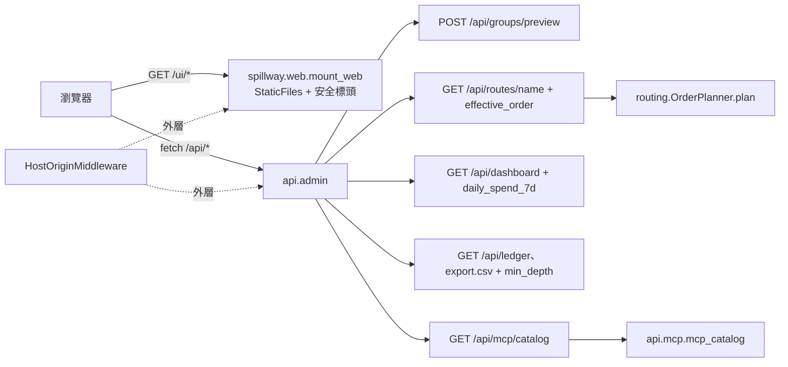
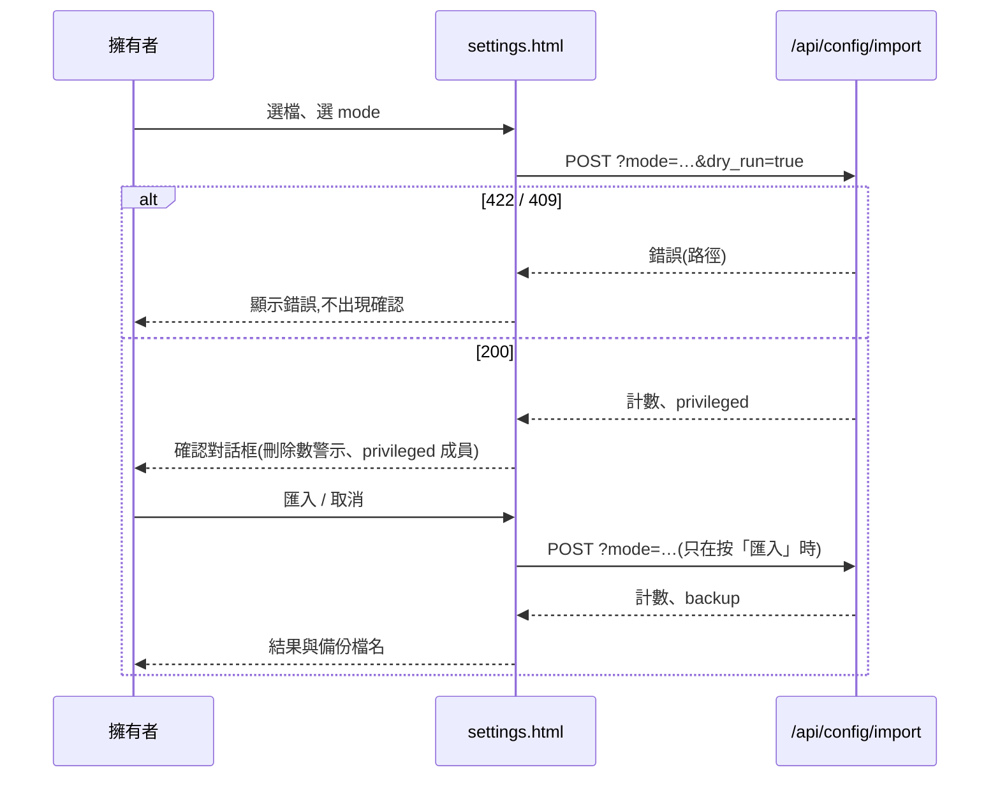
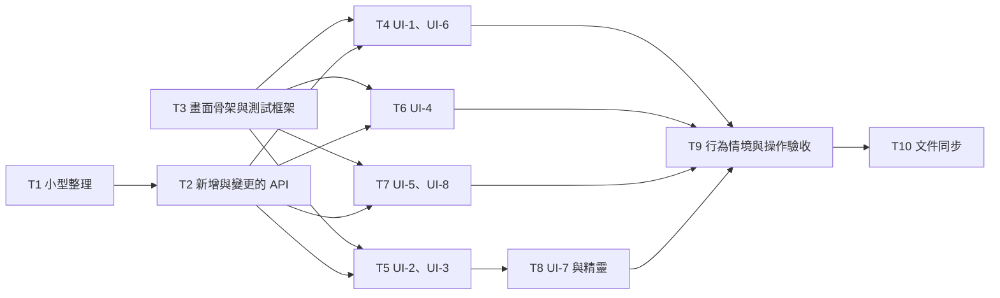

# CHG-20261103-01 — M4b:Web UI 8 個畫面、首次設定精靈、UI-8「API 參考」與 M4 閘門

- 專案:spillway
- 分支(Branch):`chg-20261103-01`(自 main 846d549 分出;擁有者步驟通過後依 DIR-4 規則 2、4 自動合回 main 並推送)
- 日期:2026-11-03(UTC+0)
- 類型:新功能(M4 第二部分,畫面)+ M4a 帶入項(畫面需要的讀取端點與小型整理)
- Template: plan
- 提出者:擁有者(使用者,2026-11-03「Open M4b CHG」;同日決定:一筆 CHG、帶入範圍、Playwright 沿用已快取的 Chromium、UI-8 版面;並指示「不限定 python,之後可以改用 rust;先把現在的需求處理完以後再評估 rust,最後才決定是否處理」)
- 實作者:claude-opus-5-5(主 session agent;平行 task 由其派出的子 agent 施工,見「平行施工」)
- 風險分級:高——命中安全邊界(新增 HTML 頁面與瀏覽器執行環境:XSS、CSP、外部資源;帳本內容檢視器顯示 prompt 與回應)、不可逆刪除(畫面提供成員、群組、route 刪除與 `replace` 匯入的操作入口)、跨模組介面(新增與變更 4 個 `/api` 回應形狀與 2 個端點)、新相依(dev:`playwright`);不改資料模型
- Commit/PR:`chg-20261103-01` 分支上訊息以 `CHG-20261103-01:` 開頭的 commit(`git log --grep CHG-20261103-01`);合回 main 後回填
- 驗收報告(預留):ACC-20261103-01
- 重複性檢查(Recurrence check):無重複(M4 第二筆;CHG-20261102-02「M4b 帶入」所列項目依使用者決定 2 處理)
- Diagrams:見「## 設計圖」節
- Security-impact:見「## 安全影響」節
- Skill: ai-sdlc-autopilot v1.69
- 關聯:Guideline 第 2 節 M4、第 7 節 M4 閘門(AC-6、AC-8、AC-10、AC-20、AC-21、AC-22、NFR-4);FR-20、FR-22(畫面)、FR-24(畫面)、FR-26;spec 9.2、10、10.1、10.2、12;CHG-20261102-02 決策 2–3、20 與「M4b 帶入」;ACC-20261102-02 F1、F3;knowledge DIR-1–DIR-4;UI layout `docs/ui/*.dc.html`

## 動機

M4 的目標是 Web UI(G2、G5、G7)。M4a(CHG-20261102-02)已提供畫面需要的後端(設定匯入匯出、帳本 CSV、設定總覽)。本筆實作 spec 10 的 8 個畫面(UI-1–UI-8)與首次設定精靈,補上畫面需要、目前沒有的 4 項讀取能力與 UI-8 的資料端點,處理 M4a 終審延後的小型整理,並以 Playwright 自動驗收 M4 閘門。

使用者另指示實作語言不限定 Python、之後可能改用 Rust(先完成目前需求,再評估,最後才決定)。本筆因此讓畫面與後端語言無關:畫面是靜態 HTML、CSS、JS,只經 HTTP 呼叫 `/api/*`(決策 5)。

## 使用者故事

1. 作為擁有者,我要在 UI-1 總覽看到每個成員的剩餘額度或冷卻至、預估可用天數、近 7 天日均花費與近 24 小時請求數,並可清除冷卻(AC-6;spec 10 UI-1)。
2. 作為擁有者,我要在 UI-2 以連動選單(類型 → 供應商 → 模型)新增與編輯成員,不可用或已達上限的模組顯示原因,並可測試呼叫、啟用切換、刪除(AC-20、AC-21;spec 10.2)。
3. 作為擁有者,我要在 UI-3 以 all/any/none 編輯群組選擇器並即時預覽符合的成員(spec 10 UI-3)。
4. 作為擁有者,我要在 UI-4 以拖曳調整 route 的 slot 與成員順序、逐成員選 effort 與優先權重、還原預設、dry-run,且未儲存的變更有標示與離開提示(spec 10.1、10.2.6;AC-2 經畫面)。
5. 作為擁有者,我要在 UI-5 選群組與工具,看到各放置方式的設定內容、路徑與注意事項,並可複製、下載(spec 8.2.1、10 UI-5)。
6. 作為擁有者,我要在 UI-6 篩選帳本、分頁、匯出 CSV,點選列查看該次的請求與回應內容(spec 10 UI-6)。
7. 作為擁有者,我要在 UI-7 看到設定總覽、調整 context 記錄設定、匯出與匯入設定(匯入前顯示 `dry_run` 計數與 privileged 成員並要我確認)、重新產生存取 token(新 token 只顯示一次)(spec 10 UI-7;CHG-20261102-02 決策 20)。
8. 作為擁有者,我要在空資料庫第一次開啟畫面時被帶到首次設定精靈,10 分鐘內加入 1 個 API 成員並完成呼叫(AC-8;FR-22)。
9. 作為擁有者,我要在 UI-8「API 參考」以可折疊索引瀏覽 MCP 介面的連線、工具、通知、錯誤碼,內容與程式一致,不含 `/api/*` 與 `/v1`(AC-22;FR-26)。

## 決策與取捨

| # | 決策 | 選項 | 依據 | 結論 |
|---|------|------|------|------|
| 1 | **(使用者決定 2026-11-03)** M4b 為一筆 CHG(8 個畫面、精靈、帶入項、M4 閘門) | (a) 一筆 / (b) 兩筆(M4b1、M4b2) | M4 閘門需要全部畫面;拆兩筆使審議與驗收輪數加倍 | 使用者選 (a) |
| 2 | **(使用者決定 2026-11-03)** 帶入範圍:**收入**畫面需要的端點(群組選擇器預覽、`effective_order`、`daily_spend_7d`、`min_depth`)、匯入確認對話框、小型整理(422 建構函式整併、`api/admin/config_io.py` 更名、`_version` 回退一致、`read_snapshot`/`iter_ledger` 交易處理整併、時間戳記 helper);**延後**到 M4b 之後的 hardening CHG:事件迴圈阻塞、`backups` 目錄權限與 fsync、DEBUG 等級記錄 SSE 片段(已知限制 (i))、Sec-Fetch 縱深防禦(已知限制 (ii))、限制 `SPILLWAY_TEST_MCP_MAX_SESSIONS`(ACC-20261102-02 F1) | (a) 畫面需要 + 整理 / (b) 全部 | 範圍集中在畫面 | 使用者選 (a) |
| 3 | **(使用者決定 2026-11-03)** 畫面測試用 Python `playwright==1.64.1`(dev 相依;其瀏覽器版本 Chromium 1248 已在 `~/Library/Caches/ms-playwright/chromium-1248` 與 `chromium_headless_shell-1248`,不下載瀏覽器;套件可由 uv 快取安裝)。不加 `pytest-playwright`,fixture 自寫。施工前以 `.venv/bin/python -m playwright install --dry-run chromium` 確認目標路徑為 1248 且已安裝;不符時停下詢問,不自行下載。瀏覽器不存在時畫面測試**失敗**(不可 skip) | (a) 沿用快取 Chromium / (b) 本機 Google Chrome / (c) 重新下載 | 不下載;版本固定不隨 Chrome 自動更新漂移 | 使用者選 (a) |
| 4 | **(使用者決定 2026-11-03)** UI-8 版面:頂端群組選單(預設 `all`);左側可折疊索引(連線、工具、通知、錯誤碼四大類,各類下列項目);右側顯示所選項目的內容 | (a) 索引 + 內容窗格 / (b) 單頁手風琴 | 使用者 2026-11-02「有索引(可折疊,依據類型分出大類)」 | 使用者選 (a) |
| 5 | **畫面與後端語言無關**:畫面是 `src/spillway/web/` 下的靜態 HTML、CSS、JS(ES module,不經建置、不用 Jinja、不用第三方前端套件);所有資料由瀏覽器以同源 `fetch` 呼叫 `/api/*` 取得;UI-8 的資料由新端點 `GET /api/mcp/catalog`(決策 10 ⑤)提供。後端只負責以 `spillway.web.mount_web(app)` 提供這些檔案與安全標頭(決策 7)。企劃書第六節「伺服端渲染加少量 JavaScript」改為「靜態頁加少量 JavaScript,資料經 `/api`」;企劃書不改(Global Constraints),由 logical.md、design.md 記錄此差異 | (a) 靜態頁 + `/api` / (b) Jinja 伺服端渲染 / (c) 前端框架加建置流程 | 使用者 2026-11-03 指示之後可能改用 Rust:靜態檔換後端時可原樣沿用;logical.md 已規定 UI-1–UI-7 只經 HTTP 呼叫 `/api`;(c) 違反企劃書「不引入前端建置流程」 | 代使用者決定(依使用者 2026-11-03 指示) |
| 6 | 網址配置:`GET /` → 302 `/ui/`;`/ui/`(UI-1,`index.html`)、`/ui/members.html`(UI-2)、`/ui/groups.html`(UI-3)、`/ui/routes.html`(UI-4 清單)、`/ui/route.html?name=<route>`(UI-4 編輯頁)、`/ui/mcp.html`(UI-5)、`/ui/ledger.html`(UI-6)、`/ui/settings.html`(UI-7)、`/ui/wizard.html`(精靈)、`/ui/api-reference.html`(UI-8);資源在 `/ui/assets/`(`app.css`、`js/*.js`)。以 Starlette `StaticFiles(directory=…, html=True)` 提供;不列目錄;路徑穿越由 StaticFiles 拒絕;`/ui` 位於 `HostOriginMiddleware` 之內(`mount_web` 在 `add_middleware` 之前呼叫)。只允許 GET、HEAD。左側導覽的 8 個項目在每個 HTML 檔內以相同標記寫死(由 L1 測試核對一致),目前頁面以 `aria-current="page"` 標示;底部顯示 `127.0.0.1:<port>`(由 JS 依 `location.host` 填入) | 單頁應用(hash 路由) vs 多頁 | 多頁不需前端路由;每頁可單獨以 Playwright 開啟 | 代使用者決定 |
| 7 | 安全標頭:`/ui/*` 與 `/` 的回應加 `Content-Security-Policy: default-src 'none'; script-src 'self'; style-src 'self'; img-src 'self' data:; connect-src 'self'; font-src 'self'; base-uri 'none'; form-action 'none'; frame-ancestors 'none'`、`X-Content-Type-Options: nosniff`、`Referrer-Policy: no-referrer`、`Cache-Control: no-cache`;HTML 不可有 inline `<script>`、inline 事件屬性、`style` 屬性(設計稿的 inline 樣式改成 class);JS 以 CSSOM(`el.style.x = …`)設定樣式不受 CSP 限制 | 有 / 無 CSP | 帳本內容與成員資料可能含任意字串;CSP 為 XSS 的第二道防線 | 代使用者決定 |
| 8 | 顯示資料的規則:動態資料只以 `textContent`、`value` 或 `setAttribute`(只限 `href` 以外的非事件屬性;`href` 只用同源相對路徑並以 `encodeURIComponent` 組 query)放入 DOM;**禁止** `innerHTML`、`outerHTML`、`insertAdjacentHTML`、`document.write`、`eval`、`new Function`、`setTimeout`/`setInterval` 的字串參數。共用 `assets/js/dom.js` 提供 `h(tag, attrs, ...children)`(字串子節點一律成為 text node)。帳本內容(`request_json`、`response_text`)以 `<pre>` 的 `textContent` 顯示。L1 以靜態掃描(禁用字樣命中 0)與 Playwright 注入 ``、`<script>` 字串驗證 | 逐處跳脫 vs 全面禁止 HTML 插入 | 一條規則可機械檢查 | 代使用者決定 |
| 9 | 不連外:不用 Google Fonts 與任何外部資源(設計稿的 Noto Sans TC、IBM Plex Mono 改為系統字型堆疊 `system-ui, "PingFang TC", "Noto Sans TC", sans-serif` 與 `ui-monospace, SFMono-Regular, Menlo, monospace`);L1 以 Playwright 攔截所有請求,非 `127.0.0.1:<port>` 的請求數為 0 | 自帶字型檔 / 系統字型 / Google Fonts | 本機工具,離線可用;自帶字型增加約 10 MB | 代使用者決定(與設計稿的差異,記入 design.md) |
| 10 | 新增與變更的 `/api`(決策 2 的帶入項與 UI-8 資料):① `POST /api/groups/preview`,body `{selector: {all, any, none}}`(同 `SelectorIn`),回 `{members: [...]}`,形狀與 `GET /api/groups` 的 `members` 相同(含停用成員、依 id 排序),不寫入;② `GET /api/routes/{name}` 加 `effective_order`:以 Router 使用的同一個 `OrderPlanner.plan` 算出的 slot 清單 `[[{deployment, effort, weight}]]`(手動順序為空時即預設順序;stale target 已濾除),`order` 不變;清單端點不加;③ `GET /api/dashboard` 每列加 `daily_spend_7d`(近 7 天日均花費,USD,與 `est_days_left` 用的同一個計算,數值相等測試);④ `GET /api/ledger` 與 `GET /api/ledger/export.csv` 加篩選 `min_depth`(整數 0–100,`fallback_depth >= min_depth`);⑤ `GET /api/mcp/catalog?group=<name>`(預設 `all`)回 `mcp_catalog(app, group)`;群組不存在回 404 `not_found`(與 `/api/mcp/config` 一致)。新端點都在 `/api` 前綴之下,沿用 9.1.2 錯誤格式與 Host/Origin;不新增錯誤碼 | 各端點 vs 畫面自行組合 | 畫面不重算路由順序與額度;① 讓編輯中的選擇器不必先存檔就能預覽 | 代使用者決定(① ② ③ ④ 為 CHG-20261102-02「M4b 帶入」所列) |
| 11 | UI-1 總覽:每列顯示成員 id(連到 UI-2 該成員)、類型標籤、剩餘額度(`unlimited` 時「不限」;`credit_pool` 顯示點數)或「冷卻至 <本地時間>」與原因、預估可用天數、近 7 天日均、近 24 小時請求數,冷卻中的列有「清除冷卻」按鈕(`POST …/clear-cooldown` 後重讀)。設計稿的「期間(本月/本週/今日)」切換**不實作**:額度期間由各成員的 `window` 決定,spec 10 UI-1 也沒有此操作(設計差異,記入 design.md)。`GET /api/settings` 的 `first_run` 為 true 時導向 `wizard.html`;精靈的「略過」連到 `/ui/?skip_wizard=1`,該次不導向 | 實作期間切換 / 不實作 | 後端沒有任意期間的額度計算;spec 未要求 | 代使用者決定(CHG-20261102-02「M4b 帶入」:「UI-1『期間』切換為設計差異」) |
| 12 | UI-2 成員:清單(id、類型、供應商、模型、啟用、tags、額度、冷卻)與編輯表單。表單規則依 spec 10.2(類型 → 供應商 → 模型連動;模型以 `label` 顯示、以 `id` 寫入;選定模型帶入 `capabilities`;不可用模組與已有成員的 `single` 模組停用並顯示原因或「已有 1 個,僅限 1 個」;最後一項「其他(手動輸入)」)。編輯既有成員時供應商若不在選單(模組已移除)仍顯示原值並標「模組不可用」。憑證欄只收參照(`env:NAME`、`keyring:svc:acct`),欄位說明寫明「填環境變數名或 keyring 項目,不要填金鑰本身」,不提供金鑰輸入框。`params` 以 JSON 文字框編輯,送出前在瀏覽器以 `JSON.parse` 檢查,伺服端拒絕(憑證鍵名等)時顯示 422 訊息。啟用切換以 `PUT` 全量送回;刪除前以確認對話框列出會一併刪除的項目(tags、額度、route 排序;帳本保留)。表單元件 `assets/js/member-form.js` 由 UI-2 與精靈共用 | — | spec 10.2;DIR-3 規則 3 | 代使用者決定 |
| 13 | UI-3 群組與 Tag:群組清單(名稱、選擇器、符合的成員);編輯器以 all/any/none 三列 tag 輸入(輸入後 Enter 加入、× 移除),每次變更後 300 ms 以 `POST /api/groups/preview` 即時預覽;新增群組時名稱違反 9.2.5 時顯示 422 訊息;刪除被 route 引用的群組顯示 409 訊息(含 route 名)。「編輯 tag」:列出全部 tag 與各 tag 的成員,點選成員開啟 UI-2 編輯表單 | 在 UI-3 直接改成員 tags / 連到 UI-2 | tags 屬於成員,UI-2 已有完整編輯與驗證 | 代使用者決定 |
| 14 | UI-4 Route:清單頁(名稱、mode、target、預估檢查、記錄 context;新增、刪除)與編輯頁。編輯頁初始以 `effective_order` 建立 slot;依 spec 10.1 拖曳(成員卡片拖到既有 slot 或「新 slot」區;slot 整列可拖曳;拖曳後空的 slot 自動移除;頂端顯示「有未儲存的變更」並以 `beforeunload` 提示;每個 slot 顯示成員類型標籤與剩餘額度,額度取自 `/api/dashboard`)。拖曳以 HTML5 Drag and Drop 實作;另提供鍵盤操作:每張卡片的「移到…」選單(slot 1…N、新 slot)與每個 slot 的上移、下移按鈕(無障礙與測試穩定)。effort 選單只列 `capabilities.efforts` 與「不指定」,權重為高、中、低(spec 10.2.6)。儲存 `PUT …/order`(422 `member_not_in_target` 顯示訊息);「還原預設」先確認再 `DELETE …/order`;dry-run 面板以範例訊息呼叫 `POST …/dry-run` 顯示候選、順序與排除原因。route 層級:「預估額度檢查」勾選框;「記錄 context」三態(依全域預設/開/關,對應 `null`/`true`/`false`) | 拖曳套件 / 原生 DnD | 不用第三方前端套件(決策 5) | 代使用者決定 |
| 15 | UI-5 MCP 設定:群組選單(`all` 與各群組)、工具選單(5 種);顯示 `variants`(標籤、scope、放置路徑、內容)、`env` 與 `notes`;「複製」用 Clipboard API(失敗時選取文字並提示按 ⌘C/Ctrl+C);「下載」以 Blob 與 `filename` 下載。畫面不顯示 token,只顯示需設定的環境變數名 | — | spec 8.2.1、10 UI-5 | 代使用者決定 |
| 16 | UI-6 帳本:篩選(起訖、成員、route、狀態、「只看 fallback」= `min_depth=1`)、分頁、欄位依設計稿(時間以本地時間顯示並附 UTC tooltip);「匯出 CSV」為帶相同篩選的 `/api/ledger/export.csv` 連結;點選列在側欄顯示內容:`GET …/payload`,410 顯示「已過保存期限」,404 顯示「此次未記錄內容」,`redacted`/`truncated` 時加標示。成員已刪除的列(孤兒列)照原值顯示 `deployment_id` 並加「(已刪除)」 | — | spec 10 UI-6;CHG-20261102-02「M4b 帶入」 | 代使用者決定 |
| 17 | UI-7 設定:① 總覽(版本、資料目錄、埠號唯讀並附可複製的 `spillway serve --port <N>`、token「已產生/未產生」);② context 設定表單(`context_max_bytes` 以 KB 顯示與輸入,1 KB = 1024 bytes,送出時換回 bytes;另顯示內容筆數與總大小);③ 匯出:連到 `/api/config/export` 的下載;④ 匯入:選檔(瀏覽器先檢查 ≤ 1 MiB)與 mode(merge/replace,預設 merge)→ 先送 `dry_run=true` → 確認對話框顯示新增/更新/刪除計數(replace 的刪除數以警示樣式)與 `privileged` 成員 id 清單與說明「這些成員的憑證參照、上游網址或 CLI 參數會改變」→ 按「匯入」才送非 dry_run → 顯示結果與備份檔名;dry_run 的 422/409 直接顯示錯誤、不出現確認;⑤ 重新產生 token:確認對話框 → `POST /api/settings/token/rotate` → 在對話框顯示新 token 一次(含複製按鈕與「關閉後無法再次查看」),關閉時清除 DOM 中的值;token 不寫入 `localStorage`/`sessionStorage`/網址 | 匯入不預覽 / 一律預覽 | CHG-20261102-02 決策 20(M4b 據此顯示確認對話框);「M4b 帶入」:token 只在 rotate 回應出現一次、埠號唯讀、KB 換算由 M4b 負責 | 代使用者決定 |
| 18 | 首次設定精靈(`wizard.html`):四步——① 加入成員(共用 `member-form.js`;預設類型 `api`;tags 預填 `default`);② 測試呼叫(`POST …/test`,失敗時顯示錯誤並可回上一步);③ 建立 route(名稱預設 `chat`,mode `chat`,target `{tags: {any: [<步驟 ① 的第一個 tag>]}}`);④ 完成:顯示可複製的 `curl http://127.0.0.1:<port>/v1/chat/completions -d '{"model": "<route>", …}'` 範例與「前往總覽」。每步完成即寫入(中途離開不回滾,下次開啟時依現況從第一個未完成的步驟繼續:無成員 → ①;有成員無 route → ③) | 一次送出 / 逐步寫入 | 逐步寫入讓測試呼叫用的是真的成員 | 代使用者決定 |
| 19 | UI-8 API 參考:資料來自 `GET /api/mcp/catalog?group=`;索引四大類——連線(端點 URL 與各群組 URL、傳輸、驗證方式與環境變數名、`mcp-stdio` 指令)、工具(每個工具一項:說明、inputSchema、outputSchema 以縮排 JSON 顯示)、通知(每個 method 一項)、錯誤碼(HTTP、工具、SDK 傳輸三組);大類以 `<details>`/`<summary>` 折疊(預設展開),點選項目在右側顯示並更新網址 hash(可直接連結);不顯示 `/api/*` 與 `/v1`(L1 以畫面文字斷言) | — | 決策 4;AC-22;spec 10 UI-8 | 代使用者決定 |
| 20 | 共用前端模組(T3 提供):`assets/js/api.js`(`getJSON`、`sendJSON`、`sendText`;非 2xx 時解析 9.1.2 為 `ApiError{status, code, message}`,非 JSON 時以狀態碼顯示)、`dom.js`(決策 8)、`ui.js`(頂端訊息列、確認對話框 `confirmDialog({title, body, confirmLabel, danger})` 以 `<dialog>` 實作、載入中狀態、時間格式化)。畫面文字為繁體中文,與設計稿一致 | — | 各畫面共用 | 代使用者決定 |
| 21 | 小型整理(決策 2):① 422 建構函式整併為 `api/admin/common.invalid(path: str, reason: str) -> ApiError`,取代 `common._invalid`、`config_io._bad_request`、`config_file._invalid`(訊息逐字不變,既有測試不改);② `api/admin/config_io.py` 更名為 `api/admin/config_http.py`(只改檔名與 import;路由、函式名不變);③ 版本字串單一定義 `spillway.settings.package_version()`:`importlib.metadata.version("spillway")`,取不到時 `spillway.__version__`;`GET /api/settings` 與 MCP `serverInfo.version` 都用它;④ `store.repo` 新增 `read_tx(conn)` context manager(`BEGIN` 唯讀交易、結束 `ROLLBACK`),`read_snapshot` 改用它;`iter_ledger` 仍在 generator 內自行 `BEGIN`(D27 串流例外),兩者以註解互相參照;⑤ 時間戳記檔名 helper 移到基礎層 `spillway.clock.utc_stamp(now: datetime) -> str`(`%Y%m%dT%H%M%SZ`),`configio.utc_stamp_filename`、帳本 CSV 檔名與 `store/db.py` 的 migration 備份檔名都改用它(格式逐字不變);⑥ 單一 provider 檢查兩處(`deployments._check_cardinality` 與 `configio._apply_tx`)只加互相參照註解(查詢有意不同) | 整併 / 延後 | M4a 終審 I1–I6 | 代使用者決定(行為不變) |
| 22 | 測試結構:畫面測試在 `tests/ui/`(pytest);`tests/ui/conftest.py` 提供 `ui_gateway`(`tests/helpers/live_gateway.start_live_gateway` + 假 API 上游,`tmp_path` 資料目錄)、`browser`(session 範圍,headless Chromium)、`page`(每測試一個 context;攔截並記錄非本機請求;收集 `console` 的 error 與 `pageerror`,測試結束時有任何一筆即失敗;`dialog` 事件記錄後 dismiss)。共用的頁面操作 helper 放 `tests/helpers/ui.py`(behave 步驟與 pytest 共用)。全量 `pytest -q` 包含 `tests/ui/`;`tests/ui` 全部執行時間目標 < 3 分鐘(記錄,非閘門) | pytest-playwright / 自寫 | 決策 3 | 代使用者決定 |
| 23 | 停點:自動化驗收通過後停下;擁有者以本分支建置在瀏覽器實際操作(UI-1–UI-8 各開一次;以一個新的空資料目錄走精靈並計時;在 `~/spillway-smoke` 拖曳一條 route 並儲存;匯入確認對話框按「取消」)並回報後,才依 DIR-4 合回並推送 | 停 / 不停 | AC-8 的計時與畫面目視屬手動測試(DIR-4 規則 3 (b)) | 依 DIR-4 |

## 設計圖

### 圖 1:本筆範圍



### 圖 2:匯入確認流程(UI-7)



### 圖 3:平行施工波次



## 畫面草稿

UI-1–UI-7 的版面以 `docs/ui/*.dc.html` 為準(與設計稿的差異:決策 9 系統字型、決策 11 不做期間切換)。沒有設計稿的部分如下(ASCII 線框,於確認閘一併確認):

UI-8 API 參考(決策 4、19;使用者 2026-11-03 選定):

```
┌ 導覽 ┐┌ API 參考 ─────────────── 群組:[ all ▾ ] ─────────────┐
│ 總覽 ││ ▾ 連線            │ ask                                   │
│ 成員 ││   端點 URL        │ 說明:依 route 呼叫模型 …               │
│ …    ││   驗證方式        │ inputSchema                           │
│ API  ││   mcp-stdio       │ { "type": "object", … }               │
│ 參考 ││ ▾ 工具            │ outputSchema                          │
│      ││   ask        ◀    │ { … }                                 │
│      ││   list_routes     │                                       │
│      ││   quota_status    │                                       │
│      ││ ▸ 通知            │                                       │
│      ││ ▸ 錯誤碼          │                                       │
└──────┘└────────────────────────────────────────────────────────────┘
```

首次設定精靈(決策 18):

```
┌ 首次設定 ──────────────────────────────── [略過] ┐
│ ① 加入成員 ─ ② 測試呼叫 ─ ③ 建立 route ─ ④ 完成   │
│                                                    │
│ 類型   [ api ▾ ]   供應商 [ openai ▾ ]             │
│ 模型   [ gpt-… ▾ ]  成員 id [ openai-1 ]            │
│ 憑證參照 [ env:OPENAI_API_KEY ]                    │
│   填環境變數名或 keyring 項目,不要填金鑰本身        │
│ tags   [ default ]                                 │
│                                   [ 下一步 → ]     │
└────────────────────────────────────────────────────┘
④ 完成:curl http://127.0.0.1:8787/v1/chat/completions … [複製]  [前往總覽]
```

UI-7 匯入確認對話框(決策 17;dry_run 成功後才出現):

```
┌ 確認匯入(replace)────────────────────────────┐
│ 預覽結果(尚未寫入):                            │
│   成員  新增 1 · 更新 3 · 刪除 2   ← 刪除以警示色 │
│   群組  新增 0 · 更新 1 · 刪除 0                  │
│   route 新增 0 · 更新 2 · 刪除 1                  │
│ ⚠ 下列成員的憑證參照、上游網址或 CLI 參數會改變: │
│   api-b, openai-1                                 │
│ replace 會先自動備份目前設定。                    │
│                          [ 取消 ]  [ 匯入 ]       │
└──────────────────────────────────────────────────┘
```

UI-7 重新產生 token(決策 17):

```
┌ 新的存取 token ──────────────────────────────┐
│ spw_••••(完整顯示於此,只顯示這一次) [複製] │
│ 舊 token 已失效;關閉後無法再次查看。          │
│                                    [ 關閉 ]   │
└──────────────────────────────────────────────┘
```

UI-4 編輯頁的鍵盤替代操作(決策 14;設計稿已有拖曳把手與 slot 版面,此處只示新增的控制):

```
slot 1  [↑][↓]  ┌ api-b  API  剩餘 $6.00 ────────────┐
                │ effort [不指定▾] 權重 [高▾] 移到 [slot 2 ▾] │
                └──────────────────────────────────────┘
┄┄┄┄┄┄┄┄ 拖到這裡建立新 slot ┄┄┄┄┄┄┄┄
```

## 安全影響

| 類別 | 命中 | 說明 |
|------|------|------|
| irreversible-delete | 是 | 畫面提供既有的刪除操作入口(成員、群組、route、還原預設順序)與 `replace` 匯入;一律先以確認對話框說明影響(決策 12–14、17);匯入一律先 `dry_run`,`replace` 的刪除數以警示樣式顯示,且後端在寫鎖內自動備份(CHG-20261102-02 決策 7)。不新增後端刪除能力 |
| secrets | 是 | 畫面不提供金鑰輸入,只收憑證參照(決策 12);token 只在 rotate 對話框顯示一次,不寫入任何瀏覽器儲存或網址(決策 17);UI-5、UI-8 只顯示環境變數名;測試以已知假金鑰與 token 搜尋全部畫面的 HTML、畫面呼叫的 API 回應、資料庫、匯出檔、serve 日誌,命中 0(NFR-4) |
| security-boundary | 是 | 新增瀏覽器執行環境:CSP 與 nosniff 等標頭(決策 7);禁止以 HTML 插入資料(決策 8);不連外(決策 9);`/ui` 位於 Host/Origin 檢查之內、只收 GET/HEAD;帳本內容檢視器以純文字顯示 prompt 與回應 |
| new-dependency | 是 | dev 相依 `playwright==1.64.1`(PyPI;使用已快取的 Chromium 1248,不下載瀏覽器,決策 3);不新增執行期相依(靜態檔由既有 Starlette `StaticFiles` 提供) |
| auth | 否 | `/api` 與 `/ui` 在綁 127.0.0.1 時不驗證 token(CHG-20261101-03 決策 2 不變);畫面與 `/api` 同源,瀏覽器帶的 Origin 通過檢查 |
| prod-migration | 否 | 不改 schema |
| payments | 否 | — |

已知限制(DIR-2 範圍內,只記錄、不實作):
- 任何本機程式都能開啟 `/ui` 並操作(與 `/api` 相同,無登入)。
- Sec-Fetch 縱深防禦、DEBUG 記錄 SSE 片段、`backups` 權限與 fsync、事件迴圈阻塞、測試旋鈕限制 → M4b 之後的 hardening CHG(決策 2)。
- `effective_order` 與 dry-run 反映讀取當下的健康與冷卻狀態,畫面不即時推送更新(重新整理才更新)。
- 設計稿的「期間」切換不實作(決策 11);字型改系統字型(決策 9)。
- 畫面只在 macOS 的 Chromium 1248 驗證;Safari、Firefox、Linux、Windows 未涵蓋。
- 延續 CHG-20261102-02 與先前各 CHG 的已知限制。

## 修改指引

### 目標

M4b 結束:spec 10 的 8 個畫面與首次設定精靈可在 `http://127.0.0.1:<port>/ui/` 使用;M4 閘門(AC-6、AC-8、AC-10、AC-20、AC-21、AC-22、NFR-4)通過;M4a 帶入項(決策 2 收入部分)結案。

### 影響範圍

| 位置 | 類型 | 內容 | 下游 |
|------|------|------|------|
| `src/spillway/web/`(新增,介面層) | 介面 | `__init__.py`(`mount_web(app)`、`SECURITY_HEADERS`)、`static/*.html`、`static/assets/app.css`、`static/assets/js/*.js`(決策 5–9、20) | 瀏覽器 |
| `src/spillway/app.py` | 設計 | 呼叫 `mount_web(app)`(在 `add_middleware` 之前) | 全部畫面 |
| `src/spillway/api/admin/{groups,routes,dashboard,ledger,mcp_config}.py`、`store/repo.py`、`quota.py` | 介面 | 決策 10 | 畫面 |
| `src/spillway/api/admin/{common,config_http(原 config_io),config_file,settings}.py`、`api/mcp/server.py`、`settings.py`、`clock.py`、`configio.py`、`store/db.py` | 設計 | 決策 21(行為不變) | — |
| `pyproject.toml` | 設定 | dev 加 `playwright==1.64.1`;package-data 加 `web/static/**` 的 `*.html`、`*.css`、`*.js` | 安裝 |
| `tests/ui/`、`tests/helpers/ui.py`、`tests/features/m4b_ui.feature` 與步驟、`tests/acceptance/test_m4b_operation.py` | 測試 | 決策 22 | — |
| `docs/spec.md`、`docs/ui/README.md`、`sdlc_docs/ai-guideline.md`、`sdlc_docs/structure/*.md`、`README.md` | 文件 | 見「規格書與結構文件更新」 | — |

### Global Constraints(全域約束——每個 task 都要遵守)

- 語言與版本:Python ≥ 3.11(驗收平台 3.13);src layout;路徑一律 `pathlib`;所有指令以 `.venv/bin/python` 執行並設 `PYTHONPATH=src`、`LITELLM_LOCAL_MODEL_COST_MAP=True`。
- 前端:只寫 `src/spillway/web/static/` 下的 HTML、CSS 與 ES module JS;不用 Jinja、不加前端建置流程、不引入第三方前端套件或 CDN(決策 5、9);每頁只以 `<script type="module" src="assets/js/<page>.js">` 載入;不寫 inline script、inline 事件屬性、`style` 屬性(決策 7);遵守決策 8 的禁用清單。
- 相依套件:只新增 dev 相依 `playwright==1.64.1`(由主 session 在 T3 前以 `uv pip install --python .venv/bin/python playwright==1.64.1` 安裝,子 agent 不安裝任何套件、不執行 `playwright install`);要再新增時停下回報。
- 規格依據:行為以 `docs/spec.md`、本 CHG 決策表與先前各 CHG 決策表為準;版面以 `docs/ui/*.dc.html` 為依據(數值為示意;決策 9、11 為已知差異);只可做「規格書與結構文件更新」列出的 spec 修訂;不修改 `docs/proposal.md` 與 `docs/ui/*.dc.html`。
- 分層:`web` 只提供靜態檔與標頭,不 import `api.admin`、`store`、`routing`;畫面資料一律經 `/api`;SQL 只在 `src/spillway/store/`(R25)。
- 資料目錄與時間:沿用 CHG-20261102-02 決策 19(`app.state.db_path`、`app.state.clock`)。
- 真實 CLI 與外部網路:沿用 CHG-20261102-01 Global Constraints(不可執行真實 claude/codex/cursor/gemini;只打本機假上游);畫面測試攔截所有非本機請求。
- 秘密:畫面 HTML、API 回應、日誌、測試輸出、截圖與 `artifacts/` 不可含憑證值或 token 明文(rotate 對話框的一次性顯示除外,測試截圖不可拍到該對話框);測試以已知假值搜尋。
- 資料目錄:測試一律以 `tmp_path` 為資料目錄;不可讀寫擁有者的實際資料目錄。
- 錯誤回應:spec 9.1.2;不新增錯誤碼。
- 既有測試斷言不可修改,除非屬下列逐檔允許清單(改寫內容於施工審議逐條核對):
  - ① 管理 API 路徑集合與 OpenAPI 快照:`tests/contract/test_public_imports_admin.py`(OpenAPI 快照與 `SUBMODULES`:`config_io` 改 `config_http`)、`tests/integration/test_host_origin.py` 的 `KNOWN_GETS`,只可新增本筆端點與 `/`、`/ui/` 路徑。子 agent 不改快照與 `KNOWN_GETS`,由主 session 在每波合併時統一加入並在施工審議逐條核對。
  - ② 決策 21 ② 的更名:各測試檔中 `spillway.api.admin.config_io` 的 import 路徑改為 `config_http`(只改 import)。
  - ③ 決策 21 ③:`tests` 中 MCP `serverInfo.version` 的期望值若寫死 `"0"`,改為 `package_version()`(只改期望值來源)。
- 每個 task 的 `test:` 指令可獨立執行並全綠;每個 task 完成時另跑全量 `pytest -q` 與 `behave tests/features --exclude m4b_ui`(T9 起為全量 behave)。
- 既有 feature 的情境文字只能經修改治理變更;施工者只寫步驟檔。
- commit 訊息以 `CHG-20261103-01:` 開頭,結尾加 Co-Authored-By 行。
- 驗收平台為 macOS;Linux、Windows 與其他瀏覽器在 ACC 標「未涵蓋」。

### 契約清單

| 契約 | 提供方 | 讀取方 | 本筆變更 | 契約測試(路徑/無) |
|------|--------|--------|----------|----------------------|
| `POST /api/groups/preview` 請求/回應 | T2 | UI-3 | 新增 | tests/integration/admin/test_admin_groups.py(新增案例) |
| `GET /api/routes/{name}` 的 `effective_order` 與 Router 順序一致 | T2 | UI-4 | 變更(加欄位) | tests/integration/admin/test_admin_routes.py(新增案例) |
| `/api/dashboard` 的 `daily_spend_7d` | T2 | UI-1 | 變更(加欄位) | tests/integration/admin/test_admin_dashboard.py(新增案例) |
| `/api/ledger`、`export.csv` 的 `min_depth` | T2 | UI-6 | 變更(加篩選) | tests/integration/admin/test_admin_ledger.py、test_admin_ledger_csv.py(新增案例) |
| `GET /api/mcp/catalog` 等於 `mcp_catalog(app, group)` | T2 | UI-8 | 新增 | tests/integration/admin/test_admin_mcp_catalog.py(新增) |
| `mount_web` 的路徑、標頭、方法限制 | T3 | 瀏覽器 | 新增 | tests/integration/test_web_static.py(新增) |
| 前端禁用字樣、無 inline script/style、8 頁導覽一致 | T3 | 全部畫面 | 新增 | tests/unit/test_web_assets.py(新增;T4–T8 新增檔案自動納入) |
| 決策 21 的整理行為不變 | T1 | — | 變更(內部) | 既有測試全綠;tests/unit/test_clock.py(`utc_stamp` 新增案例) |

### Tasks(checkbox=續作點)

- [ ] T1. 小型整理(行為不變)
  - interfaces: consumes 決策 21 / produces `api/admin/common.py`(`invalid(path: str, reason: str) -> ApiError`)、`api/admin/config_http.py`(由 `config_io.py` 以 `git mv` 更名)、`api/admin/__init__.py`(import 一行)、`api/admin/config_file.py`、`settings.py`(`package_version() -> str`)、`api/admin/settings.py`、`api/mcp/server.py`(版本來源)、`clock.py`(`utc_stamp(now: datetime) -> str`)、`configio.py`、`api/admin/ledger.py`(只改檔名 stamp 一行)、`store/db.py`(`_backup_target` 的 stamp 一行)、`store/repo.py`(`read_tx(conn)`、`read_snapshot` 改用)、`api/admin/deployments.py` 與 `configio.py` 的互相參照註解、允許清單 ②③
  - test: `.venv/bin/python -m pytest tests/unit tests/integration/admin tests/contract -q`
  - L1: `utc_stamp(datetime(2026,11,3,1,13,20,tzinfo=UTC)) == "20261103T011320Z"`;非 UTC 時區輸入先換成 UTC;`configio.utc_stamp_filename`、CSV 檔名、migration 備份檔名格式與改前逐字相同;`package_version()` 已安裝時等於 metadata,模擬 `PackageNotFoundError` 時等於 `spillway.__version__`;`GET /api/settings` 的 `version` 與 MCP initialize 的 `serverInfo.version` 相等;`invalid()` 產生的 422 body 與改前逐字相同(既有 422 測試不改即全綠);`grep -rn "_bad_request\|def _invalid" src/spillway/api/admin` 命中 0;`grep -rn "config_io" src tests` 只剩 `spillway.configio` 模組名相關命中
  - L2: `read_snapshot` 在另一條連線同時寫入時仍回一致快照(既有測試);匯入匯出全部整合測試全綠
  - L3: 不適用(行為不變,無新情境)
  - L4: 不適用(行為不變;T9 操作驗收照常涵蓋匯入匯出)

- [ ] T2. 新增與變更的 API
  - interfaces: consumes 決策 10 / produces `api/admin/groups.py`(`POST /api/groups/preview`;路由須宣告在 `/api/groups/{name}` 之前)、`api/admin/routes.py`(`GET /api/routes/{name}` 加 `effective_order`)、`quota.py`(`member_quota_rows` 每列加 `daily_spend_7d`)、`api/admin/ledger.py` 與 `store/repo.py`(`min_depth` 篩選:`list_ledger`/`count_ledger`/`iter_ledger` 加參數)、`api/admin/mcp_config.py`(`GET /api/mcp/catalog`)、對應整合測試、允許清單 ① 預期列(寫入 CHG 施工審議)
  - test: `.venv/bin/python -m pytest tests/integration/admin tests/unit/test_quota_rows.py -q`
  - L1: preview:`{selector:{any:["coding"]}}` 回符合成員(含停用、依 id 排序),與以同一選擇器建立群組後 `GET /api/groups/{name}` 的 `members` 相等;未知鍵、非字串 tag → 422;不寫入(全表快照不變);`effective_order`:手動順序為空時等於預設順序,手動順序存在時等於 `order` 去除 stale target 之後的結果,並與同一時點 `POST …/dry-run` 的 slot 成員順序相同(冷卻與 unsorted 的處理依 `OrderPlanner.plan`);`daily_spend_7d` 與 `est_days_left` 的計算來源相同(以 7 天帳本種入資料,數值相等);`min_depth=1` 只回 `fallback_depth >= 1` 的列,CSV 同;`min_depth=-1`、`101`、`x` → 422;`GET /api/mcp/catalog` 回應 == `mcp_catalog(app, "all")`(JSON 相等),`?group=coding` == `mcp_catalog(app, "coding")`,不存在的群組 → 404 `not_found`;回應不含 token 與雜湊
  - L2: 以 `start_live_gateway` 子行程確認新端點的 Host/Origin 檢查照常(錯誤 Origin → 403);`GET` 端點不改變狀態(全表快照)
  - L3: 不適用(畫面情境由 T9 撰寫)
  - L4: 不適用(T9 涵蓋)

- [ ] T3. 畫面骨架與測試框架
  - interfaces: consumes 決策 3、5–9、20、22 / produces `src/spillway/web/__init__.py`(`mount_web(app) -> None`、`SECURITY_HEADERS: Mapping[str, str]`、`WEB_ROOT: Path`)、`web/static/` 下 10 個 HTML 骨架(導覽、標題、空的 `<main>`;各頁的內容由 T4–T8 填入)、`web/static/assets/app.css`(由設計稿共用樣式整理,系統字型)、`web/static/assets/js/{api,dom,ui}.js`、`app.py`(呼叫 `mount_web`)、`pyproject.toml`(dev 相依、package-data)、`tests/ui/conftest.py`、`tests/ui/test_shell.py`、`tests/helpers/ui.py`、`tests/integration/test_web_static.py`、`tests/unit/test_web_assets.py`
  - test: `.venv/bin/python -m pytest tests/ui/test_shell.py tests/integration/test_web_static.py tests/unit/test_web_assets.py -q`
  - L1: `GET /` → 302 `Location: /ui/`;10 個 HTML 各 200 且帶決策 7 的全部標頭;`/ui/assets/js/api.js` 的 Content-Type 為 JavaScript;`/ui/../app.py`、`/ui/%2e%2e/`、`/ui/assets/`(目錄)→ 404;`POST /ui/` → 405;錯誤 Host → 403(9.1.4);靜態掃描:`web/static/**/*.js` 中決策 8 禁用字樣命中 0,`*.html` 無 `<script>` 內文、無 `on*=` 屬性、無 `style=` 屬性、無 `http://`/`https://` 外部網址;10 個 HTML 的導覽區塊(8 個連結的文字與 href)逐字相同,且各頁 `aria-current` 指向自己(精靈指向「總覽」、route 編輯頁指向「Route」);`api.js` 與 `dom.js` 以 Playwright 在頁面中驗證(不依賴 Node):非 2xx 9.1.2 body → `ApiError` 帶 code,非 JSON → `ApiError` 帶 status;`h()` 的字串子節點成為 text node(`h("p", {}, "<b>x</b>").innerHTML == "&lt;b&gt;x&lt;/b&gt;"`)
  - L2: Playwright 開啟 10 個頁面:無 console error、無 pageerror、非本機請求數 0;導覽 8 個連結逐一點擊到達對應頁;`.venv/bin/python -m playwright install --dry-run chromium` 的安裝路徑為 `chromium-1248`(測試內斷言,不符即失敗並提示)
  - L3: 不適用(T9 撰寫行為情境)
  - L4: 不適用(T9 涵蓋)

- [ ] T4. UI-1 總覽與 UI-6 帳本
  - interfaces: consumes T2(`daily_spend_7d`、`min_depth`)、T3 / produces `web/static/index.html`(內容)、`ledger.html`(內容)、`assets/js/{overview,ledger}.js`、`assets/overview.css`、`assets/ledger.css`(如需)、`tests/ui/test_overview.py`、`tests/ui/test_ledger.py`
  - test: `.venv/bin/python -m pytest tests/ui/test_overview.py tests/ui/test_ledger.py -q`
  - L1: 不適用(畫面行為由 L2 的 Playwright 驗證;共用函式的單元測試在 T3)
  - L2: 總覽:每個成員一列,有額度者顯示剩餘額度(數值與 `/api/dashboard` 相同,格式 `$x.xx`)、冷卻中者顯示「冷卻至」本地時間與原因、`unlimited` 顯示「不限」、預估天數、近 7 天日均、近 24 小時請求數;「清除冷卻」後該列不再顯示冷卻;成員 id 連到 `members.html#<id>`(`encodeURIComponent`);空資料庫導向 `wizard.html`,`?skip_wizard=1` 不導向;帳本:篩選每個欄位改變後 URL query 與 API 請求參數一致,「只看 fallback」送 `min_depth=1`;分頁;「匯出 CSV」連結的 query 與目前篩選相同;點選列顯示 payload(`request_json` 與 `response_text` 為純文字),410 顯示「已過保存期限」、404 顯示「此次未記錄內容」;孤兒列顯示原 id 與「(已刪除)」;成員 tags、帳本 `error` 含 ``、`<script>…</script>` 時以文字顯示且頁面無新增 img/script 元素、無 dialog
  - L3: 不適用(T9)
  - L4: 不適用(T9)

- [ ] T5. UI-2 成員與 UI-3 群組與 Tag
  - interfaces: consumes T2(`/api/groups/preview`)、T3 / produces `members.html`、`groups.html`(內容)、`assets/js/{members,groups,member-form}.js`(`member-form.js` 匯出 `mountMemberForm(container, {initial, onSaved, defaults}) -> {destroy()}`,供 T8 精靈使用)、相關 CSS、`tests/ui/test_members.py`、`tests/ui/test_groups.py`
  - test: `.venv/bin/python -m pytest tests/ui/test_members.py tests/ui/test_groups.py -q`
  - L1: 不適用(畫面行為由 L2 驗證)
  - L2: 連動選單:選類型 `cli` 後供應商只列 `kinds` 含 `cli` 的模組;選 `claude-cli` 後模型選單項目與 `claude_cli/models.yaml` 的 `label` 順序相同、最後一項「其他(手動輸入)」;選定模型後能力欄位等於該模型 `capabilities`;「其他」可輸入模型 id 且能力欄位空白可填;以 `extra_adapter_paths` 加入一個無法 import 的模組時其供應商選項 `disabled` 且顯示 `unavailable_reason`;已有 claude-cli 成員時該選項停用並顯示「已有 1 個,僅限 1 個」;新增、編輯(PUT 全量)、啟用切換、刪除(確認對話框;取消不刪)、測試呼叫(顯示 status、延遲、tokens);`params` 非法 JSON 不送出並提示;`params` 含 `api_key` 鍵 → 顯示 422 訊息且畫面不回顯值;憑證欄只接受 `env:`/`keyring:` 參照(伺服端 422 訊息顯示);群組:選擇器三列加入/移除 tag 後 300 ms 內預覽更新,且預覽成員集合等於 `POST /api/groups/preview` 回應;新增 `..` → 顯示 422 訊息;刪除被引用的群組顯示 409 訊息含 route 名;tag 清單列出全部 tag 與成員,點成員開啟 UI-2 編輯
  - L3: 不適用(T9)
  - L4: 不適用(T9)

- [ ] T6. UI-4 Route
  - interfaces: consumes T2(`effective_order`)、T3 / produces `routes.html`、`route.html`(內容)、`assets/js/{routes,route-editor}.js`、相關 CSS、`tests/ui/test_routes.py`
  - test: `.venv/bin/python -m pytest tests/ui/test_routes.py -q`
  - L1: 不適用(畫面行為由 L2 驗證;拖曳狀態轉換函式 `applyMove(slots, move) -> slots` 為純函式,於 L2 以 `page.evaluate` 逐案驗證)
  - L2: 編輯頁初始 slot 等於 `effective_order`;以 Playwright `drag_to` 把卡片拖到既有 slot、拖到「新 slot」區、整列拖曳 slot,畫面 slot 結構正確;拖空的 slot 自動移除;鍵盤替代操作(「移到…」選單、上移/下移)得到與拖曳相同的結果;變更後頂端顯示「有未儲存的變更」,`beforeunload` 有註冊(離開頁面觸發 dialog);儲存送出的 body 等於畫面狀態(含 effort、weight),之後 `GET …` 的 `order` 相等;effort 選單只含該成員 `capabilities.efforts` 與「不指定」;權重選單高、中、低;每個 slot 顯示類型標籤與剩餘額度;「還原預設」確認後 `order` 為空、畫面回到預設順序;dry-run 面板顯示候選順序與排除原因;`member_not_in_target`(另一分頁先改了 route target)顯示 422 訊息;清單頁新增(mode、target 為群組或 tags)、刪除(確認);「記錄 context」三態對應 null/true/false
  - L3: 不適用(T9)
  - L4: 不適用(T9)

- [ ] T7. UI-5 MCP 設定與 UI-8 API 參考
  - interfaces: consumes T2(`/api/mcp/catalog`)、T3 / produces `mcp.html`、`api-reference.html`(內容)、`assets/js/{mcp,api-reference}.js`、相關 CSS、`tests/ui/test_mcp.py`、`tests/ui/test_api_reference.py`
  - test: `.venv/bin/python -m pytest tests/ui/test_mcp.py tests/ui/test_api_reference.py -q`
  - L1: 不適用(畫面行為由 L2 驗證)
  - L2: UI-5:5 種工具 × (`all`、`coding`)各組合顯示的 variants 數、路徑、內容與 `GET /api/mcp/config` 相同;「複製」後剪貼簿內容等於該 variant 的 `content`(Playwright 授與 clipboard 權限);「下載」的檔名等於 `filename`、內容相等;畫面不含 token;UI-8:四大類標題依序為連線、工具、通知、錯誤碼;收合「工具」後其項目不可見,展開恢復;工具項目名稱集合等於 catalog 的 `tools[].name`;點選 `ask` 顯示說明與 inputSchema(與 catalog 的 JSON 相等);網址 hash 直接開啟對應項目;切換群組後內容等於該群組的 catalog;畫面文字不含 `/api/` 與 `/v1`(連線類別中的 `/mcp/` URL 允許)
  - L3: 不適用(T9)
  - L4: 不適用(T9)

- [ ] T8. UI-7 設定與首次設定精靈
  - interfaces: consumes T3、T5(`member-form.js`)/ produces `settings.html`、`wizard.html`(內容)、`assets/js/{settings,wizard,import-dialog}.js`、相關 CSS、`tests/ui/test_settings.py`、`tests/ui/test_wizard.py`
  - test: `.venv/bin/python -m pytest tests/ui/test_settings.py tests/ui/test_wizard.py -q`
  - L1: 不適用(畫面行為由 L2 驗證;KB 換算函式於 L2 以 `page.evaluate` 驗證 1024 對應)
  - L2: 總覽欄位等於 `GET /api/settings`(token 只顯示已產生/未產生);`spillway serve --port <N>` 可複製;context 表單以 KB 顯示,存檔後 `GET /api/settings/context` 的 bytes = KB × 1024;小於 1 KB 時顯示 422 訊息;匯出連結下載的內容等於 `GET /api/config/export`;匯入:先只送出一次 `dry_run=true`(以請求記錄斷言),確認對話框顯示計數與 privileged id;按「取消」後資料庫全表快照不變且沒有非 dry_run 請求;按「匯入」後結果顯示備份檔名(replace)或無備份(merge);dry_run 回 422 時顯示錯誤且無確認對話框;選 > 1 MiB 的檔案不送出;重新產生 token:確認後對話框顯示新 token(與 DB 雜湊相符),關閉後 DOM 中不含該 token,`localStorage`、`sessionStorage`、`location.href` 不含;精靈:空資料庫走完四步(假 API 上游)後 `/v1/chat/completions` 以步驟 ③ 的 route 呼叫成功;測試呼叫失敗時顯示錯誤並可回上一步;中途離開後再開啟從第一個未完成步驟繼續;「略過」到 `/ui/?skip_wizard=1`
  - L3: 不適用(T9)
  - L4: 不適用(T9)

- [ ] T9. 行為情境與操作驗收(M4 閘門)
  - interfaces: consumes T1–T8 / produces `tests/features/steps/m4b_steps.py`、`tests/features/environment.py`(只新增 Playwright 的 before/after 掛鉤,限 `m4b_ui` feature)、`tests/acceptance/test_m4b_operation.py`、`artifacts/m4b/`
  - test: `.venv/bin/python -m behave tests/features && .venv/bin/python -m pytest tests/acceptance -q -rs`
  - L1: 不適用(T1–T8 已涵蓋)
  - L2: 不適用(T1–T8 已涵蓋)
  - L3: `m4b_ui.feature` 9 個情境全過(文字於確認閘確認後不改);步驟與 `tests/ui` 共用 `tests/helpers/ui.py`
  - L4: 執行「Acceptance operation」自動部分;截圖(1280×800,每個畫面一張,不含 token 對話框)、`operation-results.json`、AC-8 計時存到 `artifacts/m4b/`;AC-10 以 M4a 的往返判準再跑一次(經畫面匯出、經畫面 replace 匯入到第二個資料目錄);NFR-4:以假金鑰與 token 搜尋資料庫、匯出檔、serve 日誌、全部畫面的 HTML 與畫面期間的 API 回應,命中皆為 0

- [ ] T10. 文件同步
  - interfaces: consumes T1–T9 / produces「規格書與結構文件更新」所列文件
  - test: ai-sdlc 的 doc-integrity lint(MCP 工具 `doc_integrity_check`,`repo=.`)回 ok / exit 0;由主 session 執行(子 agent 無 MCP 工具)
  - L1: 不適用(文件變更,無程式行為;由 doc-integrity lint 核對)
  - L2: 不適用(文件變更,無整合行為)
  - L3: 不適用(文件變更,無使用者情境)
  - L4: 不適用(文件變更;由終審 docs 席對照程式核對)

### Behaviour spec

- feature: tests/features/m2_routing.feature
- feature: tests/features/m2_context.feature
- feature: tests/features/m2_estimate.feature
- feature: tests/features/m2_adapters.feature
- feature: tests/features/m2_quota.feature
- feature: tests/features/m2c_cleanup.feature
- feature: tests/features/m3a_cli.feature
- feature: tests/features/m3b_mcp.feature
- feature: tests/features/m4a_config.feature
- feature: tests/features/m4b_ui.feature

`m4b_ui.feature`(新增,9 個情境;情境文字於確認閘一併確認;步驟檔由 T9 撰寫):總覽額度與清除冷卻(AC-6);首次設定精靈與計時(AC-8);成員連動選單(AC-20);不可用模組停用(AC-21);API 參考四大類、折疊與一致性(AC-22);Route 拖曳儲存後改由該成員處理(spec 10.1;AC-2 經畫面);匯入前 dry_run 確認與取消;使用者資料以純文字顯示;畫面不含 token 與金鑰、token 只顯示一次(NFR-4)。既有 9 個 feature 不改文字全過。

### Interaction spec

產物供 ACC-20261103-01 引用。

- kind: gui-web
- cmd: .venv/bin/python -m pytest tests/ui -q --junitxml=artifacts/m4b/ui.xml
- artifacts: artifacts/m4b/ui.xml
- kind: gui-web
- cmd: .venv/bin/python -m pytest tests/acceptance/test_m4b_operation.py -q
- artifacts: artifacts/m4b/operation-results.json
- kind: service-protocol
- cmd: .venv/bin/python -m pytest tests/integration -q --junitxml=artifacts/m4b/integration.xml
- artifacts: artifacts/m4b/integration.xml
- kind: library-api
- cmd: .venv/bin/python -m pytest tests/contract tests/unit/test_web_assets.py tests/unit/test_clock.py -q --junitxml=artifacts/m4b/contract.xml
- artifacts: artifacts/m4b/contract.xml

`kind: gui-web` 以 Playwright(Chromium 1248,headless)點擊、輸入、拖曳、鍵盤操作與截圖;T10 的 doc-integrity lint 由主 session 執行,結果記入施工審議。

### Acceptance operation

- operate:(macOS,自動部分)暫存資料目錄;子行程 serve(`python -m spillway serve`)與 api 假端點;Playwright headless Chromium 1280×800。① 空資料庫開啟 `/`,經精靈加入 api 成員(`credential_ref: env:SPILLWAY_TEST_KEY`,假值)、測試呼叫、建立 route,以範例呼叫 `/v1/chat/completions`,記錄耗時(AC-8);② 經 UI-2 再加入第二個 api 成員與 1 個 claude-cli 成員(假 CLI),驗證連動選單與 single 停用(AC-20);③ 經 UI-3 建立群組 `coding`、經 UI-4 建立 task route `review` 並拖曳排序、儲存,送 3 次請求;④ 為成員設額度並種入花費與冷卻,開啟 UI-1(AC-6);⑤ UI-5 對 `coding` 的 5 種工具各取一次設定;⑥ UI-6 篩選、開啟一列內容、匯出 CSV;⑦ UI-7 匯出設定 A;在第二個資料目錄的 serve 以 UI-7 `replace` 匯入 A(經 dry_run 確認對話框),再匯出 B(AC-10);⑧ UI-8 開啟四大類並與 `GET /api/mcp/catalog` 比對(AC-22);⑨ 以含無法 import 模組的 `extra_adapter_paths` 重啟 serve,開啟 UI-2(AC-21);⑩ UI-7 重新產生 token。
- observe:① 精靈完成且呼叫 200,耗時 < 10 分鐘;② 選單內容與 `/api/adapters`、`models.yaml` 一致,claude-cli 第二次停用;③ 3 次請求由拖到 slot 1 的成員處理;④ 每個成員顯示剩餘額度或冷卻至;⑤ 內容與 `/api/mcp/config` 相同;⑥ CSV 列數與篩選相同、內容以純文字顯示;⑦ A 與 B 逐位元組相同、A 不含假金鑰值;⑧ 四大類、可折疊、一致、不含 `/api/*` 與 `/v1`;⑨ serve 正常啟動、該模組選項停用並顯示原因;⑩ 新 token 只在對話框出現;全程無 console error、無非本機請求;資料庫、匯出檔、serve 日誌、全部畫面 HTML 與畫面期間的 API 回應以假金鑰與 token 搜尋命中 0(NFR-4);只聽 127.0.0.1。
- operate(擁有者,於自動化驗收通過後、合回前;agent 不執行,決策 23;於 repo 根目錄執行):
  - ① 以本分支建置對 `~/spillway-smoke` 啟動 serve,在瀏覽器開啟 `http://127.0.0.1:8787/`,UI-1–UI-8 各開一次,回報有無顯示異常
  - ② 在 UI-4 對一條既有 route 拖曳一張卡片並儲存,再送一次請求確認由新的第一順位處理(之後可按「還原預設」)
  - ③ 在 UI-7 選 A 檔以 `replace` 匯入,確認對話框出現後按「取消」,確認資料未改變
  - ④ 停止 serve;以新的空資料目錄 `SPILLWAY_HOME=$(mktemp -d)` 啟動,在瀏覽器走精靈加入 1 個 api 成員(可用 M4a 擁有者步驟的 openai 成員設定,金鑰以 `read -s` 設定、不貼出),從開啟頁面到呼叫成功計時
  - ⑤ 回報範本:①–③ 結果、④ 的耗時與呼叫狀態(不貼金鑰、不貼 token)
- pass:自動部分觀察全部成立且 `artifacts/m4b/` 留有紀錄;擁有者回報 ①–④ 結果記入 ACC-20261103-01;之後才依 DIR-4 合回 main 並推送,並勾選 Guideline 的 M4 閘門。

### 本機閘

`.venv/bin/python -m pytest -q && .venv/bin/python -m behave tests/features`(全綠,`pytest tests/acceptance -q -rs` 0 skipped)。T9 合入前 behave 排除 `m4b_ui`。

### 平行施工

| 波次 | Task | 檔案所有權(互不重疊) |
|------|------|------------------------|
| 1 | T1 | `api/admin/{common,config_http(更名),config_file,settings,__init__}.py`、`api/admin/ledger.py`(只限檔名 stamp 一行)、`api/admin/deployments.py`(只限註解)、`settings.py`、`api/mcp/server.py`、`clock.py`、`configio.py`、`store/db.py`、`store/repo.py`(`read_tx`、`read_snapshot`)、允許清單 ②③ |
| 1 | T3 | `src/spillway/web/`(新增)、`app.py`(`mount_web` 一行與 import)、`pyproject.toml`、`tests/ui/conftest.py`、`tests/ui/test_shell.py`、`tests/helpers/ui.py`、`tests/integration/test_web_static.py`、`tests/unit/test_web_assets.py` |
| 2 | T2 | `api/admin/{groups,routes,dashboard,ledger,mcp_config}.py`、`quota.py`、`store/repo.py`(ledger 篩選)、對應整合測試 |
| 3 | T4、T5、T6、T7 | 各自的 HTML 內容、`assets/js/<page>.js`、`assets/<page>.css`、`tests/ui/test_<page>.py`;`app.css` 與共用 JS 只可由 T3 修改(需要時回報主 session) |
| 4 | T8 | `settings.html`、`wizard.html`、`assets/js/{settings,wizard,import-dialog}.js`、相關 CSS 與測試 |
| 5 | T9 | 步驟、`environment.py`(只新增)、操作驗收 |
| 6 | T10 | 文件 |

允許清單 ① 的快照與 `KNOWN_GETS` 由主 session 每波合併時統一加入。每個子 agent 用獨立 worktree,不可在主 checkout 執行 `git checkout`;每波合併後主 session 跑全量閘,全綠才進下一波。

### 規格書與結構文件更新

- [ ] docs/spec.md:9.2 表加 `POST /api/groups/preview`、`GET /api/mcp/catalog`;`/api/ledger` 參數加 `min_depth`;`/api/dashboard` 用途加近 7 天日均;新增 9.2.8(`effective_order`、`daily_spend_7d`、`min_depth`、catalog 端點的形狀);10 節首段寫明畫面網址 `/ui/`、靜態頁經 `/api` 取資料、CSP 與不連外;10 UI-1 註明不提供期間切換;10 UI-7 補匯入確認流程與 token 一次顯示;UI-8 註明版面(索引 + 內容);修訂行
- [ ] sdlc_docs/ai-guideline.md:M4 列標 M4b 為本筆(CHG-20261103-01);FR-20、FR-22、FR-24、FR-26 標畫面完成;待閘門通過後勾 M4 閘門;新增「M4 之後:評估改用 Rust(使用者 2026-11-03:先完成目前需求,再評估,最後才決定是否處理)」;變更歷史 v1.8
- [ ] sdlc_docs/structure/design.md:新增 D41(畫面與後端語言無關:靜態頁 + `/api`、`mount_web`、網址)、D42(前端安全:CSP、禁用 HTML 插入、不連外)、D43(新增讀取端點,決策 10);設計稿差異(期間切換、系統字型);決策 21 的 helper 位置
- [ ] sdlc_docs/structure/logical.md:`web` 列改為「靜態檔(`spillway.web`),畫面經 `/api`;UI-8 經 `/api/mcp/catalog`」,依賴只有 Starlette;流程「匯入確認」
- [ ] sdlc_docs/structure/directory.md:`src/spillway/web/` 樹狀(移出「M4b 預計新增」並刪除 `templates/web` 預計項)、`config_http.py` 更名、`tests/ui/`、`tests/helpers/ui.py`、新測試檔、`m4b_ui.feature`、`artifacts/m4b/`
- [ ] sdlc_docs/structure/data.md:不變(確認無 schema 變更)
- [ ] docs/ui/README.md:加 UI-8 列與「實作位於 `src/spillway/web/static/`,與設計稿的差異見 design.md」
- [ ] README.md:Web UI 網址、各畫面、首次設定精靈、`playwright` dev 相依與執行畫面測試的指令

### 風險與回滾

| 風險 | 影響 | 對策 |
|------|------|------|
| 畫面 XSS | 帳本內容或成員資料在瀏覽器執行 | 決策 7、8;靜態掃描與注入測試 |
| 畫面誤操作刪除 | 設定遺失 | 確認對話框;匯入先 dry_run;replace 自動備份 |
| Playwright 與快取瀏覽器版本不符 | 畫面測試無法執行 | 決策 3 的施工前檢查;不符時停下詢問 |
| 畫面測試偶發失敗 | 閘不穩 | 一律以 Playwright 自動等待的 locator 斷言,不用固定 sleep;每個 task 的 UI 測試連跑 3 次全綠才交付 |
| 新欄位影響既有用戶端 | 回應形狀變更 | 只新增欄位與參數,不改既有欄位 |

回滾:revert 本 CHG 的 merge commit 並推送;不涉及資料。

## 審議紀錄

### 決策審議

(待執行)

### 施工審議

| Task | 範圍 | 審議 | 修正 commit | 結論 |
|------|------|------|-------------|------|

## 結構異動摘要

(施工完成後填寫)

## 狀態

草擬中——待決策審議與確認閘。
