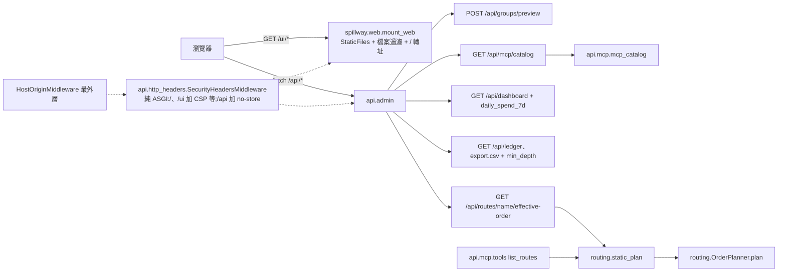
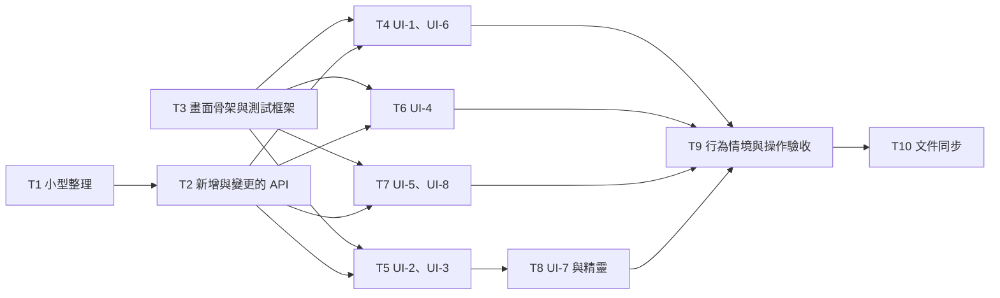

# CHG-20261103-01 — M4b:Web UI 8 個畫面、首次設定精靈、UI-8「API 參考」與 M4 閘門

- 專案:spillway
- 分支(Branch):`chg-20261103-01`(自 main 846d549 分出;擁有者步驟通過後依 DIR-4 規則 2、4 自動合回 main 並推送)
- 日期:2026-11-03(UTC+0)
- 類型:新功能(M4 第二部分,畫面)+ M4a 帶入項(畫面需要的讀取端點與小型整理)
- Template: plan
- 提出者:擁有者(使用者,2026-11-03「Open M4b CHG」;同日決定:一筆 CHG、帶入範圍、Playwright 沿用已快取的 Chromium、UI-8 版面;並指示「不限定 python,之後可以改用 rust;先把現在的需求處理完以後再評估 rust,最後才決定是否處理」)
- 實作者:claude-opus-5-5(主 session agent;平行 task 由其派出的子 agent 施工,見「平行施工」)
- 風險分級:高——命中安全邊界(新增 HTML 頁面與瀏覽器執行環境:XSS、CSP、外部資源;新增純 ASGI 安全標頭 middleware,涵蓋 `/`、`/ui` 與 `/api`;帳本內容檢視器顯示 prompt 與回應)、不可逆刪除(畫面提供成員、群組、route 刪除與 `replace` 匯入的操作入口)、跨模組介面(新增 3 個端點、變更 2 個回應形狀與 2 個參數;`routing.static_plan` 由 `/api` 與 MCP `list_routes` 共用;匯入 `privileged` 加入 `provider` 變更)、新相依(dev:`playwright`);不改資料模型
- Commit/PR:`chg-20261103-01` 分支上訊息以 `CHG-20261103-01:` 開頭的 commit(`git log --grep CHG-20261103-01`);合回 main 後回填
- 驗收報告(預留):ACC-20261103-01
- 重複性檢查(Recurrence check):無重複(M4 第二筆;CHG-20261102-02「M4b 帶入」所列項目依使用者決定 2 處理)
- Diagrams:見「## 設計圖」節
- Security-impact:見「## 安全影響」節
- Skill: ai-sdlc-autopilot v1.69
- 關聯:Guideline 第 2 節 M4、第 7 節 M4 閘門(AC-6、AC-8、AC-10、AC-20、AC-21、AC-22、NFR-4);FR-20、FR-22(畫面)、FR-24(畫面)、FR-26;spec 9.2、10、10.1、10.2、12;CHG-20261102-02 決策 2–3、20 與「M4b 帶入」;ACC-20261102-02 F1、F3;knowledge DIR-1–DIR-4(DIR-5 由 T10 新增);UI layout `docs/ui/*.dc.html`

## 動機

M4 的目標是 Web UI(G2、G5、G7)。M4a(CHG-20261102-02)已提供畫面需要的後端(設定匯入匯出、帳本 CSV、設定總覽)。本筆實作 spec 10 的 8 個畫面(UI-1–UI-8)與首次設定精靈,補上畫面需要、目前沒有的 4 項讀取能力與 UI-8 的資料端點,處理 M4a 終審延後的小型整理,並以 Playwright 自動驗收 M4 閘門。

使用者另指示實作語言不限定 Python、之後可能改用 Rust(先完成目前需求,再評估,最後才決定)。本筆因此讓畫面與後端語言無關:畫面是靜態 HTML、CSS、JS,只經 HTTP 呼叫 `/api/*`(決策 5)。

## 使用者故事

1. 作為擁有者,我要在 UI-1 總覽看到每個成員的剩餘額度或冷卻至、預估可用天數、近 7 天日均花費與近 24 小時請求數,並可清除冷卻(AC-6;spec 10 UI-1)。
2. 作為擁有者,我要在 UI-2 以連動選單(類型 → 供應商 → 模型)新增與編輯成員,不可用或已達上限的模組顯示原因,並可測試呼叫、啟用切換、刪除(AC-20、AC-21;spec 10.2)。
3. 作為擁有者,我要在 UI-3 以 all/any/none 編輯群組選擇器並即時預覽符合的成員(spec 10 UI-3)。
4. 作為擁有者,我要在 UI-4 以拖曳調整 route 的 slot 與成員順序、逐成員選 effort 與優先權重、還原預設、dry-run,且未儲存的變更有標示與離開提示(spec 10.1、10.2.6;AC-2 經畫面)。
5. 作為擁有者,我要在 UI-5 選群組與工具,看到各放置方式的設定內容、路徑與注意事項,並可複製、下載(spec 8.2.1、10 UI-5)。
6. 作為擁有者,我要在 UI-6 篩選帳本、分頁、匯出 CSV,點選列查看該次的請求與回應內容(spec 10 UI-6)。
7. 作為擁有者,我要在 UI-7 看到設定總覽、調整 context 記錄設定、匯出與匯入設定(匯入前顯示 `dry_run` 計數與 privileged 成員並要我確認)、重新產生存取 token(新 token 只顯示一次)(spec 10 UI-7;CHG-20261102-02 決策 20)。
8. 作為擁有者,我要在空資料庫第一次開啟畫面時被帶到首次設定精靈,10 分鐘內加入 1 個 API 成員並完成呼叫(AC-8;FR-22)。
9. 作為擁有者,我要在 UI-8「API 參考」以可折疊索引瀏覽 MCP 介面的連線、工具、通知、錯誤碼,內容與程式一致,不含 `/api/*` 與 `/v1`(AC-22;FR-26)。

## 決策與取捨

| # | 決策 | 選項 | 依據 | 結論 |
|---|------|------|------|------|
| 1 | **(使用者決定 2026-11-03)** M4b 為一筆 CHG(8 個畫面、精靈、帶入項、M4 閘門) | (a) 一筆 / (b) 兩筆(M4b1、M4b2) | M4 閘門需要全部畫面;拆兩筆使審議與驗收輪數加倍 | 使用者選 (a) |
| 2 | **(使用者決定 2026-11-03)** 帶入範圍:**收入**畫面需要的端點(群組選擇器預覽、`effective_order`、`daily_spend_7d`、`min_depth`)、匯入確認對話框、小型整理(422 建構函式整併、`api/admin/config_io.py` 更名、`_version` 回退一致、`read_snapshot`/`iter_ledger` 交易處理整併、時間戳記 helper);**延後**到 M4b 之後的 hardening CHG:事件迴圈阻塞、`backups` 目錄權限與 fsync、DEBUG 等級記錄 SSE 片段(已知限制 (i))、Sec-Fetch 縱深防禦(已知限制 (ii))、限制 `SPILLWAY_TEST_MCP_MAX_SESSIONS`(ACC-20261102-02 F1)、單一 provider 檢查的共用計算(M4a 終審 I3;兩處查詢有意不同,見決策 21 ⑥)。ACC-20261102-02 F3(子行程 `/openapi.json` 404):UI-8 改經 `/api/mcp/catalog`,不需要 OpenAPI,結案 | (a) 畫面需要 + 整理 / (b) 全部 | 範圍集中在畫面 | 使用者選 (a)(決策審議修訂 AM-3、AM-13 只補記延後項與結案項,不改範圍) |
| 3 | **(使用者決定 2026-11-03)** 畫面測試用 Python `playwright==1.64.1`(dev 相依;其瀏覽器版本 Chromium 1248 已在 `~/Library/Caches/ms-playwright/chromium-1248` 與 `chromium_headless_shell-1248`,不下載瀏覽器;套件以 `uv pip install --offline` 由 uv 快取安裝)。不加 `pytest-playwright`,fixture 自寫。施工前以 `.venv/bin/python -m playwright install --dry-run chromium` 確認目標路徑為 1248 且已安裝;不符時停下詢問,不自行下載。瀏覽器不存在時畫面測試**失敗**(不可 skip)。tests/ui 的耗時記入施工審議 | (a) 沿用快取 Chromium / (b) 本機 Google Chrome / (c) 重新下載 | 不下載;版本固定不隨 Chrome 自動更新漂移 | 使用者選 (a)(決策審議修訂 AM-17:安裝加 `--offline`) |
| 4 | **(使用者決定 2026-11-03)** UI-8 版面:頂端群組選單(預設 `all`);左側可折疊索引(連線、工具、通知、錯誤碼四大類,各類下列項目);右側顯示所選項目的內容 | (a) 索引 + 內容窗格 / (b) 單頁手風琴 | 使用者 2026-11-02「有索引(可折疊,依據類型分出大類)」 | 使用者選 (a) |
| 5 | **畫面與後端語言無關**:畫面是 `src/spillway/web/` 下的靜態 HTML、CSS、JS(ES module,不經建置、不用 Jinja、不用第三方前端套件);所有資料由瀏覽器以同源 `fetch` 呼叫 `/api/*` 取得;UI-8 的資料由新端點 `GET /api/mcp/catalog`(決策 10 ⑤)提供。後端只負責以 `spillway.web.mount_web(app)` 提供這些檔案,安全標頭由 `SecurityHeadersMiddleware` 加上(決策 7)。依企劃書第六節「細節於規格書定案」,由 spec 10 首段定案為靜態頁 + `/api`;proposal.md 不改(Global Constraints),由 logical.md、design.md 記錄 | (a) 靜態頁 + `/api` / (b) Jinja 伺服端渲染 / (c) 前端框架加建置流程 | 使用者 2026-11-03 指示之後可能改用 Rust(DIR-5,由 T10 寫入 knowledge):靜態檔換後端時可原樣沿用;logical.md 已規定 UI-1–UI-7 只經 HTTP 呼叫 `/api`;(c) 違反企劃書「不引入前端建置流程」 | 代使用者決定(依使用者 2026-11-03 指示,DIR-5)(決策審議修訂 AM-11) |
| 6 | 網址配置:`GET /` 與 `HEAD /` → 302 `/ui/`(`@app.api_route("/", methods=["GET","HEAD"], include_in_schema=False)`,不進 OpenAPI);`/ui/`(UI-1,`index.html`)、`/ui/members.html`(UI-2)、`/ui/groups.html`(UI-3)、`/ui/routes.html`(UI-4 清單)、`/ui/route.html?name=<route>`(UI-4 編輯頁)、`/ui/mcp.html`(UI-5)、`/ui/ledger.html`(UI-6)、`/ui/settings.html`(UI-7)、`/ui/wizard.html`(精靈)、`/ui/api-reference.html`(UI-8);資源在 `/ui/assets/`(`app.css`、`js/*.js`)。以 Starlette `StaticFiles(directory=…, html=True, follow_symlink=False)` 提供;不列目錄;路徑穿越由 StaticFiles 拒絕;點檔與 html/css/js 以外的檔案回 404(決策 7)。Host/Origin 對所有路由一律生效,與註冊順序無關;`SecurityHeadersMiddleware` 必須在 HostOrigin 之前 `add_middleware`,HostOrigin 才會留在最外層。只允許 GET、HEAD。左側導覽的 8 個項目在每個 HTML 檔內以相同標記寫死(文字見決策 20,由 L1 測試核對一致),目前頁面以 `aria-current="page"` 標示;底部顯示 `127.0.0.1:<port>`(由 JS 依 `location.host` 填入) | 單頁應用(hash 路由) vs 多頁 | 多頁不需前端路由;每頁可單獨以 Playwright 開啟;FastAPI 對 `/` 預設回 307 且 HEAD 回 405,需明指 302 與 GET/HEAD(仲裁實測) | 代使用者決定(決策審議修訂 AM-2) |
| 7 | 安全標頭:新增 `spillway.api.http_headers.SecurityHeadersMiddleware`。它是**純 ASGI**,不可用 `BaseHTTPMiddleware` 或 `@app.middleware`,在 `http.response.start` 時依 `scope["path"]` 補標頭;同名標頭一律**覆寫**,不重複附加:(a) 路徑為 `/`、`/ui`,或以 `/ui/` 開頭:`Content-Security-Policy: default-src 'none'; script-src 'self'; style-src 'self'; img-src 'self'; connect-src 'self'; font-src 'self'; base-uri 'none'; form-action 'none'; frame-ancestors 'none'; require-trusted-types-for 'script'; trusted-types 'none'`(沒有用到 data URI,不放 `data:`;Trusted Types 的退路見決策 8)、`X-Content-Type-Options: nosniff`、`Referrer-Policy: no-referrer`、`Cross-Origin-Opener-Policy: same-origin`、`Cross-Origin-Resource-Policy: same-origin`、`Cache-Control: no-cache`;(b) 以 `/api/` 開頭:`Cache-Control: no-store` 與 `X-Content-Type-Options: nosniff`;(c) 其他路徑(`/v1`、`/mcp`)不碰。加入方式:`create_app` 在 `app.add_middleware(HostOriginMiddleware, …)` **之前**執行 `app.add_middleware(SecurityHeadersMiddleware)`,讓 HostOrigin 保持最外層,而這個 middleware 位在 ExceptionMiddleware 外側,404、405、307 都會經過它;HostOrigin 自己回的 403 與 ServerErrorMiddleware 的 500 不帶這些標頭(已知限制)。`mount_web(app)` 只負責:以 `StaticFiles` 掛 `/ui`,外面包一層純 ASGI 過濾——路徑中任一段以 `.` 開頭、副檔名不在 `{.html, .css, .js}`(結尾為 `/` 的目錄請求除外,交給 `html=True` 處理 `index.html`)→ 404;註冊 `/` 的轉址(決策 6);不放 `404.html`。HTML 不可有 inline `<script>`、inline 事件屬性、`style` 屬性(設計稿的 inline 樣式改成 class);JS 以 CSSOM(`el.style.x = …`)設定樣式不受 CSP 限制 | 有 / 無 CSP;StaticFiles 外包 wrapper / `BaseHTTPMiddleware` / 純 ASGI 依路徑 middleware | 帳本內容與成員資料可能含任意字串,CSP 為 XSS 的第二道防線;仲裁實測(Starlette 1.10.0):純 ASGI middleware 讓 `GET /`、`HEAD /` 302、`/ui` 307、`/ui/nope.html` 404、`POST /ui/` 405、`/api/nope` 404 都帶到標頭,wrapper 漏掉 404、405、307;`BaseHTTPMiddleware` 會干擾 `/mcp` SSE;帳本 payload 與 `/api/ledger` 沒有 `no-store` 時 prompt 與回應會留在瀏覽器磁碟快取;`/ui/.DS_Store` 實測回 200 | 代使用者決定(決策審議修訂 AM-2) |
| 8 | 顯示資料的規則:動態資料只以 `textContent`、`value` 或 `setAttribute`(只限 `href` 以外的非事件屬性;`href` 只用同源相對路徑並以 `encodeURIComponent` 組 query)放入 DOM;資料值只能放在 `data-*` 或 `textContent`;查找元素一律用 `getElementById`,或用 `CSS.escape` 處理過的選擇器。**靜態掃描禁用**:`innerHTML`、`outerHTML`、`insertAdjacentHTML`、`document.write`、`eval`、`new Function`、`setTimeout`/`setInterval` 的字串參數;`.href =`、`.src =`、`.action =`、`.formAction =`、`.srcdoc`;`location.href =`、`location.assign`、`location.replace`、`window.open(`;`createContextualFragment`、`DOMParser`、`setHTMLUnsafe`、`execCommand`;帶非字面參數的 `import(`。共用 `assets/js/dom.js` 提供 `h(tag, attrs, ...children)`(字串子節點一律成為 text node),在執行期遇到下列情況丟例外:屬性名符合 `/^on/i` 或為 `style`、`srcdoc`、`formaction`;`href`、`src` 的值不以 `./`、`/ui/`、`/api/`、`#`、`?`、`blob:` 開頭;tag 為 `script`、`style`、`iframe`、`object`、`embed`、`base`、`link`、`meta`(denylist,不採 tag 白名單)。帳本內容(`request_json`、`response_text`)以 `<pre>` 的 `textContent` 顯示。api.js、ui.js 不可用 console 輸出請求或回應 body。頁面載入時不可依網址的 query 或 hash 發出非 GET 請求。CSP 的 Trusted Types(決策 7)提供執行期保證;退路:T3 L2 若證實 Playwright 必要的操作(locator、`evaluate` 讀取、`drag_to`、下載)受 TT 阻擋,就移除 `require-trusted-types-for` 與 `trusted-types` 兩個 directive,並記入施工審議。L1 以靜態掃描(禁用字樣命中 0)與 Playwright 注入 ``、`<script>` 字串驗證 | 逐處跳脫 vs 全面禁止 HTML 插入;`h()` tag 白名單 vs denylist | 一條規則可機械檢查;屬性賦值、`location`、`DOMParser` 也是寫入點;白名單會拖慢 4 個並行 task,denylist 加上 CSP 已足夠 | 代使用者決定(決策審議修訂 AM-12) |
| 9 | 不連外:不用 Google Fonts 與任何外部資源(設計稿的 Noto Sans TC、IBM Plex Mono 改為系統字型堆疊 `system-ui, "PingFang TC", "Noto Sans TC", sans-serif` 與 `ui-monospace, SFMono-Regular, Menlo, monospace`);L1 以 Playwright 攔截所有請求,非 `127.0.0.1:<port>` 的請求數為 0 | 自帶字型檔 / 系統字型 / Google Fonts | 本機工具,離線可用;自帶字型增加約 10 MB | 代使用者決定(與設計稿的差異,記入 design.md) |
| 10 | 新增與變更的 `/api`(決策 2 的帶入項與 UI-8 資料):① `POST /api/groups/preview`,body `{selector: {all, any, none}}`(同 `SelectorIn`),回 `{members: [...]}`,形狀與 `GET /api/groups` 的 `members` 相同(含停用成員、依 id 排序),不寫入;空選擇器會符合全部成員(含停用);路由宣告在 `/groups/{name}` 之前只是防範日後新增 `POST /groups/{name}` 的註記(目前 `groups.py` 只有 GET、PUT、DELETE `/{name}`)。② `GET /api/routes/{name}/effective-order`(新端點;`GET /api/routes/{name}` 與 `_route_out` 不變),回應 `{"route": <name>, "mode": "chat"\|"task", "ordered": "manual"\|"default", "slots": [{"slot": <int>, "entries": [{"deployment": <id>, "effort": <str\|null>, "weight": "high"\|"medium"\|"low", "unsorted": <bool>}]}]}`;算法與 MCP `list_routes` 相同,而且是**靜態**的:候選 = `members_of(route.target)` 的全部成員(含停用、冷卻、健康不佳者,不經 `CandidateFilter`),只有 chat route 排除 `cli` 成員;`OrderPlanner().plan(route_targets, candidates, members)`,`slot` 保留 planner 的編號(可能不連號);stale target 不輸出;這段邏輯抽成 `routing` 的公開純函式 `routing.static_plan(route, targets, deployments, groups) -> list[Slot]`,`api/mcp/tools.py` 的 `_list_routes` 改用它(MCP 輸出逐欄不變,不加 `unsorted`);route 不存在 → 404 `not_found`;群組不存在或沒有成員 → `slots: []`;畫面需要的停用、冷卻、剩餘額度、`kind`、`capabilities.efforts` 由 `/api/deployments` 與 `/api/dashboard` 取得。③ `GET /api/dashboard` 每列加 `daily_spend_7d = spend7 / 7`(float,USD,不四捨五入;無活動時為 0.0;沒有上限或沒有 budget 的成員也輸出);`quota.py` 先算一次 `daily`,`est_days_left` 由它推導。④ `GET /api/ledger` 與 `GET /api/ledger/export.csv` 加篩選 `min_depth`(`fallback_depth >= min_depth`):`_ledger_where`、`list_ledger`、`count_ledger`、`iter_ledger` 都加 `min_depth: int \| None = None`,路由以 `Query(ge=0, le=100)` 定義。⑤ `GET /api/mcp/catalog?group=<name>`(預設 `all`)回 `mcp_catalog(app, group)`:先以 `MCP_ALL_GROUP` 或 `repo.get_group` 判斷 404 `not_found`(與 `/api/mcp/config` 一致),再呼叫 `mcp_catalog`;以 `responses={404: …}` 宣告(同 `mcp_config.py:175`)。⑥ M4a 帶入:`configio` 的 `privileged` 判斷加入既有成員的 `provider` 變更(design D38 的已知限制刪除,spec 3.1 同步)。新端點一律掛在 `admin.router`、都在 `/api` 前綴之下,沿用 9.1.2 錯誤格式與 Host/Origin;不新增錯誤碼 | 各端點 vs 畫面自行組合;② 加在 `GET /api/routes/{name}` vs 另開端點;Router 候選 vs 靜態全成員 | 畫面不重算路由順序與額度;① 讓編輯中的選擇器不必先存檔就能預覽;② 照 Router 候選,停用與冷卻的成員會從編輯頁消失,儲存時又被 `PUT order` 全量取代掉(`planner.py:91`),加在 `GET /api/routes/{name}` 會打破 `test_admin_routes.py:39-41` 的整份 dict 相等,`api/mcp/tools.py:362-378` 已示範靜態算法;`SlotEntry.unsorted` 已存在(`planner.py:43`);⑥ 改變 provider 會改變憑證送往何處(CHG-20261102-02 施工審議 T4 ③) | 代使用者決定(① ② ③ ④ 為 CHG-20261102-02「M4b 帶入」所列)(決策審議修訂 AM-1、AM-13) |
| 11 | UI-1 總覽:每列顯示成員 id(連到 `members.html#<id>`)、類型標籤、剩餘額度(`unlimited` 時「不限」;`credit_pool` 與 `usd` 一律以 USD 顯示)或「冷卻至 <本地時間>」與原因、預估可用天數、近 7 天日均、近 24 小時請求數,冷卻中的列有「清除冷卻」按鈕(`POST …/clear-cooldown` 後重讀)。摘要卡只做「冷卻中成員數」與「近 24 小時請求數」(資料取自 `/api/dashboard`);設計稿的「API 花費合計」「依層處理分布」「最近的 fallback」延後。設計稿的「期間(本月/本週/今日)」切換**不實作**:額度期間由各成員的 `window` 決定,spec 10 UI-1 也沒有此操作。`GET /api/settings` 的 `first_run` 為 true 時導向 `wizard.html`;精靈的「略過」連到 `/ui/?skip_wizard=1`,該次不導向;`counts.deployments > 0 且 counts.routes == 0` 時顯示續作橫幅(決策 18)。設計差異見「設計差異」表 #2、#3 | 實作期間切換 / 不實作 | 後端沒有任意期間的額度計算;spec 未要求;`credit_pool` 以 `total_cost_usd` 扣抵(spec:392、`quota.py:249-252`),單位是 USD | 代使用者決定(CHG-20261102-02「M4b 帶入」:「UI-1『期間』切換為設計差異」)(決策審議修訂 AM-10、AM-13) |
| 12 | UI-2 成員:清單(id、類型、供應商、模型、啟用、tags、額度、冷卻)與編輯表單;以 `members.html#<id>` 開啟時直接開啟該成員的編輯表單。**表單欄位**:id;類型 → 供應商 → 模型(連動);`model_name`(必填,預設等於所選模型的 `id`);上游網址(`kind` 為 api 或 local 時顯示,寫入 `params.api_base`;api 可留空,local 必填);憑證參照;能力(`ctx`、`tools`、`vision`、`efforts` 勾選,選定模型時帶入,可修改);額度(類型 `usd`、`credit_pool`、`none`;上限 USD,空白表示無上限;週期每月、每週、每日、不重置;重置日 1–28,只在每月時顯示;不設額度時送 `budget: null`);tags;啟用;`params`(JSON 文字框,含 CLI 的 `effort_args`、`extra_args`、`max_concurrency`、`timeout`;文字框上方列出 CLI 常用鍵的說明)。**連動選單**依 spec 10.2:模型以 `label` 顯示、以 `id` 寫入;不可用模組與已有成員的 `single` 模組停用並顯示原因或「已有 1 個,僅限 1 個」;最後一項「其他(手動輸入)」;adapters 選單在載入時顯示「載入中」,並顯示 `models_error`。編輯既有成員時供應商若不在選單(模組已移除)仍顯示原值並標「模組不可用」。憑證欄只收參照(`env:NAME`、`keyring:svc:acct`),欄位說明寫明「填環境變數名或 keyring 項目,不要填金鑰本身」,不提供金鑰輸入框。**其他規則**:上游網址與 `params.api_base` 雙向同步,同時出現且值不同時以上游網址欄為準並提示;`params` 送出前在瀏覽器以 `JSON.parse` 檢查,伺服端拒絕(憑證鍵名等)時顯示 422 訊息;`params` 與 `credential_ref` 加 `autocomplete="off"`;啟用切換先 `GET /api/deployments/{id}`,改 `enabled` 後再 PUT 全量;送出中停用按鈕;收到 409 `provider_single` 時顯示訊息;刪除前以確認對話框列出會一併刪除的項目(tags、額度、route 排序;帳本保留)。表單元件 `assets/js/member-form.js` 由 UI-2 與精靈共用 | — | spec 10.2、10 UI-2(能力、額度、tag、憑證參照);DIR-3 規則 3;`model_name` 必填(`models.py:93-108`);`api_adapter.py:134` 以 `params.api_base` 決定上游;以清單頁的舊資料全量 PUT 會蓋掉別處的修改 | 代使用者決定(決策審議修訂 AM-7、AM-8、AM-17) |
| 13 | UI-3 群組與 Tag:群組清單(名稱、選擇器、符合的成員);編輯器以 all/any/none 三列 tag 輸入(輸入後 Enter 加入、× 移除),每次變更後 300 ms 以 `POST /api/groups/preview` 即時預覽;新增群組時名稱違反 9.2.5 時顯示 422 訊息;刪除被 route 引用的群組顯示 409 訊息(含 route 名)。「編輯 tag」:列出全部 tag 與各 tag 的成員,點選成員開啟 UI-2 編輯表單;tag 改名不做(決策 24) | 在 UI-3 直接改成員 tags / 連到 UI-2 | tags 屬於成員,UI-2 已有完整編輯與驗證 | 代使用者決定(改名依決策 24 延後) |
| 14 | UI-4 Route:清單頁(名稱、mode、target、route `tags`、預估檢查、記錄 context;新增、刪除)與編輯頁。編輯頁初始 slot 取自 `GET …/effective-order`;頁首標示「順序來源:手動/預設」(`ordered`)與「權重:高 3/中 2/低 1」說明;停用成員的卡片標「停用」,冷卻中的卡片標「冷卻至 <本地時間>」(取自 `/api/dashboard`),`unsorted` 的卡片標「未排序」(spec 4.3.3);chat route 頁首註明「chat route 不使用 CLI 成員」。依 spec 10.1 拖曳(成員卡片拖到既有 slot 或「新 slot」區;slot 整列可拖曳;拖曳後空的 slot 自動移除;拖曳目標在 dragstart 之前就可見且有尺寸;頂端顯示「有未儲存的變更」並以 `beforeunload` 提示,比較基準是載入時的 slot 結構,含 effort 與 weight;每個 slot 顯示成員類型標籤與剩餘額度,額度取自 `/api/dashboard`)。拖曳以 HTML5 Drag and Drop 實作;另提供鍵盤操作:每張卡片的「移到…」選單(slot 1…N、新 slot)與每個 slot 的上移、下移按鈕(無障礙與測試穩定)。effort 選單只列 `capabilities.efforts` 與「不指定」,權重為高、中、低(spec 10.2.6)。儲存 `PUT …/order`:所有卡片都寫入手動順序,包括停用、冷卻、未排序的卡片,所以這些成員的 slot、effort、weight 都會保留;422 `member_not_in_target` 顯示訊息;`PUT …/order` 回應不含 effective order,儲存後重新 GET `effective-order`。「還原預設」先確認再 `DELETE …/order`;把所有卡片拖出、出現 `slots=[]` 時,等同還原預設,走同一個確認對話框。dry-run 面板以範例訊息呼叫 `POST …/dry-run` 顯示候選、順序與排除原因,並註明「slot 內依權重隨機抽選,每次順序可能不同」;P50/P90 與機率延後(設計差異表 #6)。route 層級:「預估額度檢查」勾選框;「記錄 context」三態(依全域預設/開/關,對應 `null`/`true`/`false`) | 拖曳套件 / 原生 DnD | 不用第三方前端套件(決策 5);只送畫面上看得到的成員會讓停用與冷卻成員的排序被 `PUT order` 全量取代掉 | 代使用者決定(決策審議修訂 AM-1、AM-9、AM-10、AM-14、AM-17) |
| 15 | UI-5 MCP 設定:群組選單(`all` 與各群組)、工具選單(5 種);顯示 `variants`(標籤、scope、放置路徑、內容)、`env` 與 `notes`;「複製」用 Clipboard API(失敗或權限被拒時選取文字並提示按 ⌘C/Ctrl+C);「下載」以 Blob 與 `filename` 下載:Blob 的 type 一律用 `text/plain;charset=utf-8` 或 `application/octet-stream`,只經 `<a download>` 觸發,點擊後 `revokeObjectURL`,檔名去除 `/` 與 `\`。畫面不顯示 token,只顯示需設定的環境變數名 | — | spec 8.2.1、10 UI-5;Blob URL 與頁面同源(`blob:http://127.0.0.1:…`) | 代使用者決定(決策審議修訂 AM-12) |
| 16 | UI-6 帳本:篩選(起訖、成員、route、狀態、「只看 fallback」= `min_depth=1`)、分頁、欄位依設計稿(時間以本地時間顯示並附 UTC tooltip)。起訖以本地日期輸入,送出時換算成完整 ISO:起 = 本地 00:00;訖 = 隔日本地 00:00(不含);一律經 `URLSearchParams` 編碼。「匯出 CSV」為帶相同篩選的 `/api/ledger/export.csv` 連結;`total > 100000` 時停用並提示縮小範圍。點選列在側欄顯示內容:`GET …/payload`,410 顯示「已過保存期限」,404 顯示「此次未記錄內容」,`redacted`/`truncated` 時加標示;側欄顯示「保存至 <ts + context_retention_days>」與「複製」;「下載 JSON」與期間快捷延後(設計差異表 #8)。成員已刪除的列(孤兒列)照原值顯示 `deployment_id` 並加「(已刪除)」 | — | spec 10 UI-6;CHG-20261102-02「M4b 帶入」;`_parse_time` 把純日期當 UTC 00:00;以 `<a>` 匯出超過 10 萬列時 422 JSON 會取代整頁 | 代使用者決定(決策審議修訂 AM-14) |
| 17 | UI-7 設定:頁首放「開啟首次設定精靈」連結(`wizard.html`)。① 總覽(版本、資料目錄、埠號唯讀並附可複製的 `spillway serve --port <N>`、token「已產生/未產生」);② context 設定表單:三個欄位為「預設記錄 context(`record_context_default`)、保存天數(`context_retention_days`,0 表示不保存)、單筆上限(KB)」(`context_max_bytes` 以 KB 顯示與輸入,1 KB = 1024 bytes,送出時換回 bytes),另顯示內容筆數與總大小;③ 匯出:連到 `/api/config/export` 的下載;④ 匯入:選檔(瀏覽器先檢查 ≤ 1 MiB)與 mode(merge/replace,預設 merge);選檔與 mode 都就緒後,按「預覽匯入」才送 `dry_run=true`;對話框持有讀入的 bytes 與 mode,按「匯入」時送同一份 bytes;檔案或 mode 改變後,先前的預覽作廢;確認對話框顯示新增/更新/刪除計數(replace 的刪除數以警示樣式)、`privileged` 成員 id 清單與說明「這些成員的憑證參照、上游網址、供應商或 CLI 參數會改變」;replace 的對話框標題與主按鈕使用 danger 樣式,並顯示「會先備份到 backups/」→ 按「匯入」才送非 dry_run → 顯示結果與備份檔名;dry_run 的 422/409 直接顯示錯誤、不出現確認,422 回應的全部錯誤(上限 20 條)都要列出;⑤ token(錨點 `settings.html#token`):確認對話框的文字分兩種——首次為「產生存取 token」,重新產生為「舊 token 立即失效,使用它的 MCP 設定都需更新」→ `POST /api/settings/token/rotate` → 在對話框顯示新 token 一次(含複製按鈕、「關閉後無法再次查看」,以及與 token 同時顯示、同時清除的 `export SPILLWAY_TOKEN=<token>` 範例);複製失敗時選取文字;註明「剪貼簿可能被同步或留存」;關閉時若沒按過複製,再提示一次;在 `close` 與 `pagehide` 時清除 textContent、`input.value` 與 JS 變數參照;token 不寫入 `localStorage`/`sessionStorage`/網址 | 匯入不預覽 / 一律預覽;選檔即送 dry_run / 按「預覽匯入」才送 | CHG-20261102-02 決策 20(M4b 據此顯示確認對話框);「M4b 帶入」:token 只在 rotate 回應出現一次、埠號唯讀、KB 換算由 M4b 負責;spec 10 UI-7「context 記錄預設與保存天數」;HTML 只有 `no-cache`,bfcache 會讓 token 重現 | 代使用者決定(決策審議修訂 AM-8、AM-9、AM-12、AM-13、AM-15) |
| 18 | 首次設定精靈(`wizard.html`,獨立頁;步驟順序依決策 25):四步——① 加入成員:共用 `member-form.js`,預設類型 `api`,tags 預填 `default`,**至少 1 個 tag**(客戶端驗證);說明文字「憑證參照的環境變數必須在啟動 serve 前設定;值不要貼在這裡」。② 測試呼叫:`POST …/test`;按鈕旁註明「會實際呼叫上游一次,並記一列帳本」;失敗時顯示錯誤,並提示檢查環境變數與上游網址,可回上一步。③ 建立 route:名稱預設 `chat`;mode 預設 `chat`,步驟 ① 選了 cli 時預設 `task`,並提示「chat route 不使用 CLI 成員」;target 為 `{tags: {any: [<使用者在本步選定的 tag>]}}`:選單列出步驟 ① 成員的 tags,預設為輸入順序的第一個(由畫面保存,不取 API 回傳的排序);以 `POST /api/groups/preview` 顯示「符合 N 個成員」;route 已存在(409)時改為沿用既有 route,直接進入 ④。④ 完成:顯示可複製的 `curl http://127.0.0.1:<port>/v1/chat/completions -d '{"model": "<route>", …}'` 範例、「前往總覽」,以及「MCP 用戶端需要存取 token:前往設定產生」連到 `settings.html#token`。每步完成即寫入(中途離開不回滾)。續作規則:直接開啟 `wizard.html` 時依現況決定起點——無成員 → ①;有成員無 route → ③;都有 → ④。UI-1 在 `counts.deployments > 0 且 counts.routes == 0` 時顯示橫幅「尚未建立 route — 繼續首次設定」,連到 `wizard.html`;只有群組、沒有成員時,`first_run` 為 true,照常導向精靈。UI-7 頁首放「開啟首次設定精靈」連結。精靈與 UI-2 的 adapters 選單在載入時顯示「載入中」,並顯示 `models_error` | 一次送出 / 逐步寫入 | 逐步寫入讓測試呼叫用的是真的成員;tags 依字母排序(`models.py:147`),「第一個」不等於使用者輸入的第一個;清空 tags 時 `any:[]` 等於全部成員;cli 成員搭配 chat route 會 `no_candidate`;`first_run` 只看成員與 route(`api/admin/settings.py:64`),只做完 ① 就離開的人不會再被導向 | 代使用者決定(決策審議修訂 AM-8;步驟順序依決策 25) |
| 19 | UI-8 API 參考:資料來自 `GET /api/mcp/catalog?group=`;索引四大類——連線(端點 URL 與各群組 URL、傳輸、驗證方式與環境變數名、`mcp-stdio` 指令)、工具(每個工具一項:說明、inputSchema、outputSchema 以縮排 JSON 顯示)、通知(每個 method 一項)、錯誤碼(HTTP、工具、SDK 傳輸三組);大類以 `<details>`/`<summary>` 折疊(預設展開),點選項目在右側顯示並更新網址 hash(可直接連結);不顯示 `/api/*` 與 `/v1`(L1 以畫面文字斷言) | — | 決策 4;AC-22;spec 10 UI-8 | 代使用者決定 |
| 20 | 共用前端模組(T3 提供):`assets/js/api.js`(`getJSON`、`sendJSON`、`sendText`,一律帶 `{cache: "no-store"}`;非 2xx 時解析 9.1.2 為 `ApiError{status, code, message}`,非 JSON 時以狀態碼顯示;fetch 本身失敗時丟 `ApiError{status: 0, code: "network_error"}`(只用於前端,不是新的伺服端錯誤碼))、`dom.js`(決策 8)、`ui.js`(頂端訊息列;`network_error` 顯示「無法連線到 spillway」;確認對話框 `confirmDialog({title, body, confirmLabel, danger})` 以 `<dialog>` 實作,預設焦點放在「取消」,Esc 等於取消;載入中狀態;時間格式化)。畫面只顯示 `error.message`,不解析 9.1.2 的 `path` 格式。**字串對照表**:kind 對應「訂閱 CLI / API / Local」;status、cooling_reason、budget_type、window 各對應繁中標籤,原值放在 `title`;導覽 8 項的文字固定為「總覽、成員、群組與 Tag、Route、MCP 設定、帳本、設定、API 參考」;按鈕統一用「重新產生 token」。畫面文字為繁體中文,與設計稿一致 | — | 各畫面共用;解析 `path` 會把錯誤格式綁進畫面,換後端時要同步 | 代使用者決定(決策審議修訂 AM-2、AM-7、AM-12、AM-16、AM-17) |
| 21 | 小型整理(決策 2):① 422 建構函式整併為 `api/admin/common.invalid(path: str \| None, reason: str) -> ApiError`:`path` 為 None 時訊息就是 `reason`,否則為 `f"{path}: {reason}"`;取代 `common._invalid`(對應呼叫照舊傳 path)與 `config_io._bad_request(message)`(改呼叫 `invalid(None, message)`);`config_file._invalid(errors)` 改名為 `config_file._joined_invalid(errors)`,內部呼叫 `invalid(None, redact_echo("; ".join(errors[:MAX_ERRORS])))`;訊息逐字不變,既有測試不改;② `api/admin/config_io.py` 更名為 `api/admin/config_http.py`(只改檔名與 import;路由、函式名不變);③ 版本字串單一定義 `spillway.settings.package_version()`:`importlib.metadata.version("spillway")`,取不到時 `spillway.__version__`;`GET /api/settings` 與 MCP `serverInfo.version` 都用它;④ `store.repo` 新增 `read_tx(conn)` context manager:已在交易內(`conn.in_transaction`)時直接 yield,不 BEGIN、不 ROLLBACK;否則 `BEGIN`(DEFERRED;SQLite 不會強制唯讀),結束時 `ROLLBACK`;`read_snapshot` 改用它(現在的「結束時 COMMIT」改成 ROLLBACK,因為只讀,結果相同);`iter_ledger` 仍在 generator 內自行 `BEGIN`(D27 串流例外),兩者以註解互相參照;⑤ 新增 `spillway.clock.utc_strftime(now, fmt) -> str`(轉 UTC 後套 `strftime`)與 `utc_stamp(now) = utc_strftime(now, "%Y%m%dT%H%M%SZ")`;`configio.utc_stamp_filename` 改為從 `clock` 重新匯出 `utc_strftime` 的別名,configio 的 `__all__` 不變(`test_configio_dump.py:248` 釘住);帳本 CSV 檔名與 `store/db.py:313` 的 migration 備份檔名改用 `utc_stamp`(格式逐字不變);⑥ I3:互相參照的註解已在 M4a 加上(`deployments.py:90`、`configio.py:696`),本筆不動;共用計算延後到 hardening CHG(決策 2),理由是兩處查詢有意不同(逐列檢查 vs 最終狀態檢查)。對照:I1→⑤、I2→①、I3→⑥、I4→②、I5→③、I6→④ | 整併 / 延後 | M4a 終審 I1–I6;三個舊函式簽名不同(`common.py:39-40`、`config_io.py:112-113`、`config_file.py:128-129`),單一 `invalid(path, reason)` 無法讓訊息逐字不變;`export` 與 `apply` 有巢狀呼叫,`repo.py:770-785` 已有「已在交易內就沿用」分支 | 代使用者決定(行為不變)(決策審議修訂 AM-3) |
| 22 | 測試結構:畫面測試在 `tests/ui/`(pytest,含 `tests/ui/__init__.py`,避免與 `tests/unit/test_ledger.py`、`test_settings.py` 同名衝突);`tests/ui/conftest.py` 提供:`make_ui_gateway(**create_app_kwargs) -> LiveGateway`(函式範圍,可傳 `clock`、`extra_adapter_paths`,內部使用 `start_live_gateway` 與 `tmp_path`);session 範圍的 `fake_api`(沿用 `tests/fakes/plugin.py`),另以 `monkeypatch.setenv("SPILLWAY_TEST_KEY", <假值>)` 設定環境變數;假 CLI 的 fixture;`playwright` 與 `browser` 為 **module 範圍**(headless Chromium),模組結束時 `browser.close()` 與 `playwright.stop()`;autouse 的 module 範圍 teardown 斷言 `asyncio._get_running_loop() is None`;`new_page(*, permissions=(), accept_downloads=True, timezone_id="Asia/Taipei", locale="zh-TW")`(每次一個 context;攔截並記錄非本機請求;收集 `console` 的 error 與 `pageerror`,測試結束時有任何一筆即失敗);`expect_http_errors(*statuses)` marker:只略過同源 `/api/` 且狀態碼在清單內的「Failed to load resource」console 訊息,其他 console error、CSP 違規、`pageerror` 照樣判失敗;預設的 `dialog` 處理器是「記錄後 dismiss」,`beforeunload` 的案例由測試自行處理(先以 click 製造變更,再用 `page.once("dialog")` 斷言 type 後 accept)。種資料 helper 優先經 `/api`;要寫 DB 時集中在 `tests/helpers/ui.py` 的單一 adapter 層。共用頁面操作 helper 放 `tests/helpers/ui.py`(T3);波次 3 各 task 自己需要的 helper 放 `tests/helpers/ui_<area>.py`(各自擁有),behave 步驟只匯入這些 helper、不搬移。`tests/features/environment.py` 只在 `m4b_ui` feature 的 `before_feature`/`after_feature` 啟動與停止 Playwright。全量 `pytest -q` 包含 `tests/ui/`;`tests/ui` 全部執行時間目標 < 3 分鐘(記錄,非閘門) | pytest-playwright / 自寫;Playwright session / module 範圍 | 決策 3;Playwright sync API 會把主 thread 標成「有執行中的事件迴圈」(`_greenlets.py:93-94`),session 範圍下排在後面的 async 測試與 `asyncio.Runner` 全數失敗,module 範圍每個模組多約 1 秒;Chromium 對 fetch 的 4xx 會記一筆 console error,T4–T8 的 L2 有刻意觸發的 404、409、410、422;測試綁 Python 的三處(行程內種資料、DB 斷言、fixture)記入 D41 作為 Rust 評估的輸入 | 代使用者決定(決策審議修訂 AM-5、AM-16) |
| 23 | 停點:自動化驗收通過後停下;擁有者以本分支建置在瀏覽器實際操作(UI-1–UI-8 各開一次;以一個新的空資料目錄走精靈並計時;在 `~/spillway-smoke` 拖曳一條 route 並儲存;匯入確認對話框按「取消」)並回報後,才依 DIR-4 合回並推送 | 停 / 不停 | AC-8 的計時與畫面目視屬手動測試(DIR-4 規則 3 (b)) | 依 DIR-4 |
| 24 | **(使用者決定 2026-11-03,決策審議 U1)** UI-3「編輯 tag」不做改名:編輯 tag = 列出 tag 並連到 UI-2 改成員的 tags(決策 13);設計稿「改名同步更新所有成員與群組」延後,登記於「設計差異」表 #5;spec 10 UI-3 註明(T10) | (a) 不做改名,登記為設計差異 / (b) 本筆做 `POST /api/tags/{tag}/rename`(單一交易改寫成員 tags、群組選擇器與 route `target.tags`,之後 `tools_changed`) / (c) 只在前端逐一 PUT 成員與群組(非原子) | 後端沒有 tag 改名端點;(b) 超出決策 2 的帶入範圍並多一個端點與允許清單項目;改名需要的資料一致性適合放在後續 CHG 以交易處理;(c) 中途失敗會留下半套狀態 | 使用者選 (a)「Defer rename」(仲裁建議) |
| 25 | **(使用者決定 2026-11-03,決策審議 U2)** 首次設定精靈的步驟採計畫的順序:成員 → 測試呼叫 → route → 完成,使用獨立頁 `wizard.html`;步驟 ④ 以「MCP 用戶端需要存取 token:前往設定產生」連到 UI-7(`settings.html#token`)產生 token;與設計稿的差異登記於「設計差異」表 #10 | (a) 計畫的順序(先測成員,較早發現憑證錯誤);④ 連到 UI-7 產生 token / (b) 依設計稿(Settings.dc.html):token(可略過)→ 成員 → route → 測試(dry-run + 實際呼叫),嵌在設定頁;token 在精靈中顯示一次 / (c) (a) + 在 ④ 加可略過的「產生 MCP 存取 token」按鈕 | AC-8 不需要 token(`/v1` 在 127.0.0.1 不驗證);(a) 的 10 分鐘流程最短,token 只在需要 MCP 時才產生,一次性顯示的地方只有一處 | 使用者選 (a)「Plan's order」(仲裁建議) |

## 設計圖

### 圖 1:本筆範圍



### 圖 2:匯入確認流程(UI-7)

```mermaid
sequenceDiagram
  participant U as 擁有者
  participant P as settings.html
  participant X as /api/config/import
  U->>P: 選檔、選 mode,按「預覽匯入」
  P->>X: POST ?mode=…&dry_run=true(檔案或 mode 改變後預覽作廢)
  alt 422 / 409
    X-->>P: 錯誤(路徑)
    P-->>U: 列出全部錯誤(上限 20 條),不出現確認
  else 200
    X-->>P: 計數、privileged
    P-->>U: 確認對話框(刪除數警示、privileged 成員)
    U->>P: 匯入 / 取消
    P->>X: POST ?mode=…(只在按「匯入」時;送同一份 bytes)
    X-->>P: 計數、backup
    P-->>U: 結果與備份檔名
  end
```

### 圖 3:平行施工波次



### 設計差異(確認閘逐項確認)

下表標「做」的項目已寫入對應決策與 L2;其餘由 T10 寫入 design.md「設計差異」小節與 docs/ui/README.md。

| # | 畫面 | 設計稿或 spec | 本筆 | 處置 |
|---|------|---------------|------|------|
| 1 | 全部 | 設計稿用 Google Fonts(Noto Sans TC、IBM Plex Mono) | 系統字型堆疊(決策 9) | 差異,記入 design.md |
| 2 | UI-1 | 設計稿有「期間(本月/本週/今日)」切換 | 不做;額度期間由各成員的 `window` 決定(決策 11) | 差異,記入 design.md |
| 3 | UI-1 | 設計稿有摘要卡 | **做**「冷卻中成員數」與「近 24 小時請求數」(取自 `/api/dashboard`);「API 花費合計」「依層處理分布」「最近的 fallback」延後 | 部分做(決策 11、T4 L2);其餘延後 |
| 4 | UI-2 | 設計稿的 CLI 參數為獨立欄位 | CLI 參數以 `params` JSON 文字框編輯,上方列出常用鍵說明(決策 12) | 差異,記入 design.md |
| 5 | UI-3 | spec 10 UI-3「編輯 tag」;設計稿「改名同步更新所有成員與群組」 | 列出 tag 並連到 UI-2 改成員的 tags;改名延後 | 使用者決定(決策 24,U1 選 (a));spec 10 UI-3 註明(T10) |
| 6 | UI-4 | 設計稿有 route tags、順序來源與權重說明、dry-run 的 P50/P90 與機率 | **做** route 的 `tags` 欄位、「順序來源:手動/預設」(`ordered`)、「權重:高 3/中 2/低 1」說明;P50/P90 與機率延後 | 部分做(決策 14、T6 L2);其餘延後 |
| 7 | UI-5 | 設計稿有「內嵌 token(明文)」 | 不做(CHG-20261102-01 決策 3 已刪) | 差異,記入 design.md |
| 8 | UI-6 | 設計稿有期間快捷、payload 面板「下載 JSON」「複製」「保存至」 | **做**「複製」與「保存至」(= `ts + context_retention_days`);期間快捷與「下載 JSON」延後 | 部分做(決策 16、T4 L2);其餘延後 |
| 9 | UI-7 | 設計稿有 token 遮罩尾碼、拖放上傳、綁定位址、「儲存並重新啟動」 | token 只存雜湊,改為「已產生/未產生」;拖放上傳延後;綁定位址與「儲存並重新啟動」不做(M4a 決策 10:埠號唯讀) | 差異,記入 design.md |
| 10 | 精靈 | 設計稿(Settings.dc.html)嵌在設定頁,四步為 token → 成員 → route → 測試 | 獨立頁 `wizard.html`,UI-7 放連結;四步為成員 → 測試呼叫 → route → 完成,④ 連到 UI-7 產生 token | 使用者決定(決策 25,U2 選 (a));記入 design.md |

## 畫面草稿

UI-1–UI-7 的版面以 `docs/ui/*.dc.html` 為準(與設計稿的差異見上方「設計差異」表)。沒有設計稿的部分如下(ASCII 線框,於確認閘一併確認):

UI-8 API 參考(決策 4、19;使用者 2026-11-03 選定):

```
┌ 導覽 ┐┌ API 參考 ─────────────── 群組:[ all ▾ ] ─────────────┐
│ 總覽 ││ ▾ 連線            │ ask                                   │
│ 成員 ││   端點 URL        │ 說明:依 route 呼叫模型 …               │
│ …    ││   驗證方式        │ inputSchema                           │
│ API  ││   mcp-stdio       │ { "type": "object", … }               │
│ 參考 ││ ▾ 工具            │ outputSchema                          │
│      ││   ask        ◀    │ { … }                                 │
│      ││   list_routes     │                                       │
│      ││   quota_status    │                                       │
│      ││ ▸ 通知            │                                       │
│      ││ ▸ 錯誤碼          │                                       │
└──────┘└────────────────────────────────────────────────────────────┘
```

首次設定精靈(決策 18、25;獨立頁 `wizard.html`):

```
┌ 首次設定 ──────────────────────────────── [略過] ┐
│ ① 加入成員 ─ ② 測試呼叫 ─ ③ 建立 route ─ ④ 完成   │
│                                                    │
│ 類型   [ api ▾ ]   供應商 [ openai ▾ ]             │
│ 模型   [ gpt-… ▾ ]  成員 id [ openai-1 ]            │
│ model_name [ gpt-… ]                               │
│ 上游網址 [ https://… ](api 可留空,local 必填)    │
│ 憑證參照 [ env:OPENAI_API_KEY ]                    │
│   填環境變數名或 keyring 項目,不要填金鑰本身        │
│   環境變數必須在啟動 serve 前設定;值不要貼在這裡    │
│ tags   [ default ×]   (至少 1 個)                │
│                                   [ 下一步 → ]     │
└────────────────────────────────────────────────────┘
② 測試呼叫 [測試呼叫]  會實際呼叫上游一次,並記一列帳本
③ route 名稱 [ chat ]  mode [ chat ▾ ]  tag [ default ▾ ]  符合 1 個成員
④ 完成:curl http://127.0.0.1:8787/v1/chat/completions … [複製]  [前往總覽]
   MCP 用戶端需要存取 token:前往設定產生 → settings.html#token
```

UI-7 匯入區與確認對話框(決策 17;按「預覽匯入」且 dry_run 成功後才出現對話框):

```
匯入設定  [選擇檔案] spillway-config.yaml   mode ( ) merge (•) replace   [ 預覽匯入 ]
          (檔案或 mode 改變後,先前的預覽作廢)

┌ 確認匯入(replace)──────────────── danger 樣式 ┐
│ 預覽結果(尚未寫入):                              │
│   成員  新增 1 · 更新 3 · 刪除 2   ← 刪除以警示色   │
│   群組  新增 0 · 更新 1 · 刪除 0                    │
│   route 新增 0 · 更新 2 · 刪除 1                    │
│ ⚠ 下列成員的憑證參照、上游網址、供應商或 CLI 參數   │
│   會改變:api-b, openai-1                           │
│ 會先備份到 backups/。                               │
│                     [ 取消 ](預設焦點)[ 匯入 ]   │
└────────────────────────────────────────────────────┘
```

UI-7 重新產生 token(決策 17):

```
┌ 新的存取 token ──────────────────────────────────┐
│ spw_••••(完整顯示於此,只顯示這一次)  [複製]    │
│ export SPILLWAY_TOKEN=spw_••••(同時顯示、同時清除)│
│ 舊 token 立即失效,使用它的 MCP 設定都需更新。      │
│ 關閉後無法再次查看;剪貼簿可能被同步或留存。        │
│                                        [ 關閉 ]   │
└──────────────────────────────────────────────────┘
```

UI-4 編輯頁的鍵盤替代操作(決策 14;設計稿已有拖曳把手與 slot 版面,此處只示新增的控制):

```
slot 1  [↑][↓]  ┌ api-b  API  剩餘 $6.00 ────────────┐
                │ effort [不指定▾] 權重 [高▾] 移到 [slot 2 ▾] │
                └──────────────────────────────────────┘
┄┄┄┄┄┄┄┄ 拖到這裡建立新 slot ┄┄┄┄┄┄┄┄
```

## 安全影響

| 類別 | 命中 | 說明 |
|------|------|------|
| irreversible-delete | 是 | 畫面提供既有的刪除操作入口(成員、群組、route、還原預設順序)與 `replace` 匯入;一律先以確認對話框說明影響(決策 12–14、17);匯入一律先 `dry_run`,`replace` 的刪除數以警示樣式顯示,且後端在寫鎖內自動備份(CHG-20261102-02 決策 7)。不新增後端刪除能力 |
| secrets | 是 | 畫面不提供金鑰輸入,只收憑證參照(`autocomplete="off"`,決策 12);token 只在 rotate 對話框顯示一次,`close` 與 `pagehide` 時清除 DOM、`input.value` 與變數參照,不寫入任何瀏覽器儲存或網址,bfcache 返回後也不含(決策 17);帳本 payload 與全部 `/api` 回應 `no-store`,不留在瀏覽器磁碟快取(決策 7);UI-5、UI-8 只顯示環境變數名;測試以已知假金鑰與 token 搜尋全部畫面的 HTML、畫面呼叫的 API 回應、資料庫、匯出檔(設定 YAML A 與 B、帳本 CSV、第二資料目錄的 `backups/`)、serve 日誌,命中 0(NFR-4) |
| security-boundary | 是 | 新增瀏覽器執行環境:純 ASGI `SecurityHeadersMiddleware` 對 `/`、`/ui` 的全部回應(含 302、307、404、405)加 CSP(含 Trusted Types)、nosniff、`no-referrer`、COOP、CORP,對 `/api` 一律 `no-store` 與 nosniff,不碰 `/v1`、`/mcp`(決策 7);點檔與 html/css/js 以外的檔案 404、不跟隨 symlink;禁止以 HTML 插入資料、擴大的靜態掃描與 `h()` 執行期 denylist(決策 8);不連外(決策 9);`/ui` 位於 Host/Origin 檢查之內、只收 GET/HEAD;確認對話框預設焦點在「取消」、頁面載入時不依網址送非 GET;帳本內容檢視器以純文字顯示 prompt 與回應 |
| new-dependency | 是 | dev 相依 `playwright==1.64.1`(PyPI;使用已快取的 Chromium 1248,不下載瀏覽器,決策 3);不新增執行期相依(靜態檔由既有 Starlette `StaticFiles` 提供) |
| auth | 否 | `/api` 與 `/ui` 在綁 127.0.0.1 時不驗證 token(CHG-20261101-03 決策 2 不變);畫面與 `/api` 同源,瀏覽器帶的 Origin 通過檢查 |
| prod-migration | 否 | 不改 schema |
| payments | 否 | — |

已知限制(DIR-2 範圍內,只記錄、不實作):
- 任何本機程式都能開啟 `/ui` 並操作(與 `/api` 相同,無登入)。
- Sec-Fetch 縱深防禦、DEBUG 記錄 SSE 片段、`backups` 權限與 fsync、事件迴圈阻塞、測試旋鈕限制 → M4b 之後的 hardening CHG(決策 2)。
- `effective-order` 為靜態順序(含停用、冷卻成員,以標示呈現);冷卻標示與 dry-run 反映讀取當下的狀態,畫面不即時推送更新(重新整理才更新)。
- 與設計稿的差異見「設計差異」表(期間切換、系統字型、tag 改名、精靈步驟等)。
- 跨站 GET 可觸發 `/api/config/export` 與 `export.csv` 下載(讀不到內容),隨 Sec-Fetch 延後(決策 2)。
- HostOrigin 回的 403 與 ServerErrorMiddleware 回的 500 不帶 CSP。
- `mcp_catalog` 在 async handler 內同步執行。
- 畫面只在 macOS 的 Chromium 1248 驗證;Safari、Firefox、Linux、Windows 未涵蓋。
- 延續 CHG-20261102-02 與先前各 CHG 的已知限制。

## 修改指引

### 目標

M4b 結束:spec 10 的 8 個畫面與首次設定精靈可在 `http://127.0.0.1:<port>/ui/` 使用;M4 閘門(AC-6、AC-8、AC-10、AC-20、AC-21、AC-22、NFR-4)通過;M4a 帶入項(決策 2 收入部分)結案。

### 影響範圍

| 位置 | 類型 | 內容 | 下游 |
|------|------|------|------|
| `src/spillway/web/`(新增,介面層) | 介面 | `__init__.py`(`mount_web(app)`、`WEB_ROOT`、檔案過濾、`/` 轉址)、`static/*.html`、`static/assets/app.css`、`static/assets/js/*.js`(決策 5–9、20) | 瀏覽器 |
| `src/spillway/api/http_headers.py`(新增) | 介面 | `SecurityHeadersMiddleware`(純 ASGI,決策 7) | `/`、`/ui`、`/api` 的全部回應 |
| `src/spillway/app.py` | 設計 | 兩行:`mount_web(app)` 與 `app.add_middleware(SecurityHeadersMiddleware)`(在 HostOrigin 的 `add_middleware` 之前) | 全部畫面、`/api` |
| `src/spillway/api/admin/{groups,routes,dashboard,ledger,mcp_config}.py`、`store/repo.py`、`quota.py`、`routing/static_plan.py`(新增)與 `routing/__init__.py`、`api/mcp/tools.py`(`_list_routes` 改呼叫共用函式)、`configio.py`(`privileged` 加 `provider`) | 介面 | 決策 10 | 畫面、MCP `list_routes`(輸出不變)、匯入對話框 |
| `src/spillway/api/admin/{common,config_http(原 config_io),config_file,settings,groups,routes,mcp_config,planning,ledger,deployments}.py`、`api/mcp/server.py`、`settings.py`、`clock.py`、`configio.py`、`store/db.py`、`store/repo.py` | 設計 | 決策 21(行為不變;`groups`、`routes`、`mcp_config`、`planning`、`ledger`、`deployments` 只改 `_invalid` 的 import 與呼叫處) | — |
| `pyproject.toml` | 設定 | dev 加 `playwright==1.64.1`;package-data 加 `web/static/**` 的 `*.html`、`*.css`、`*.js` | 安裝 |
| `tests/ui/`(含 `__init__.py`)、`tests/helpers/ui.py`、`tests/helpers/ui_<area>.py`、`tests/features/m4b_ui.feature` 與步驟、`tests/features/environment.py`、`tests/acceptance/test_m4b_operation.py` | 測試 | 決策 22 | — |
| `docs/spec.md`、`docs/ui/README.md`、`sdlc_docs/ai-guideline.md`、`sdlc_docs/structure/*.md`、`sdlc_docs/knowledge/knowledge.md`(DIR-5)、`README.md` | 文件 | 見「規格書與結構文件更新」 | — |

### Global Constraints(全域約束——每個 task 都要遵守)

- 語言與版本:Python ≥ 3.11(驗收平台 3.13);src layout;路徑一律 `pathlib`;所有指令以 `.venv/bin/python` 執行並設 `PYTHONPATH=src`、`LITELLM_LOCAL_MODEL_COST_MAP=True`。
- 前端:只寫 `src/spillway/web/static/` 下的 HTML、CSS 與 ES module JS;不用 Jinja、不加前端建置流程、不引入第三方前端套件或 CDN(決策 5、9);每頁只以 `<script type="module" src="assets/js/<page>.js">` 載入;不寫 inline script、inline 事件屬性、`style` 屬性(決策 7);遵守決策 8 的禁用清單。
- 相依套件:只新增 dev 相依 `playwright==1.64.1`(由主 session 在 T3 前以 `uv pip install --offline --python .venv/bin/python playwright==1.64.1` 安裝,子 agent 不安裝任何套件、不執行 `playwright install`);要再新增時停下回報。
- 規格依據:行為以 `docs/spec.md`、本 CHG 決策表與先前各 CHG 決策表為準;版面以 `docs/ui/*.dc.html` 為依據(數值為示意;決策 9、11 為已知差異);只可做「規格書與結構文件更新」列出的 spec 修訂;不修改 `docs/proposal.md` 與 `docs/ui/*.dc.html`。
- 分層:`web` 只提供靜態檔、檔案過濾與 `/` 轉址,`src/spillway/web/**/*.py` 只 import 標準庫與 `starlette`(import `spillway.web` 之後 `sys.modules` 不含 `spillway.api.admin`、`spillway.store`、`spillway.routing`,由 `test_web_assets.py` 檢查);安全標頭在 `spillway.api.http_headers`;畫面資料一律經 `/api`;SQL 只在 `src/spillway/store/`(R25)。
- 事件迴圈:tests/ui 與 m4b 步驟在主 thread 不可使用 `asyncio.run`、anyio、`async def` 測試、`gw.async_http`、`mcp_session`,也不可使用 behave 的 `context.gw`;要查伺服端狀態時,用同步的 `gw.http()` 或 `gw.call_in_loop`(決策 22)。
- 資料目錄與時間:沿用 CHG-20261102-02 決策 19(`app.state.db_path`、`app.state.clock`)。
- 真實 CLI 與外部網路:沿用 CHG-20261102-01 Global Constraints(不可執行真實 claude/codex/cursor/gemini;只打本機假上游);畫面測試攔截所有非本機請求。
- 秘密:畫面 HTML、API 回應、日誌、測試輸出、截圖與 `artifacts/` 不可含憑證值或 token 明文(rotate 對話框的一次性顯示除外,測試截圖不可拍到該對話框);測試以已知假值搜尋。
- 資料目錄:測試一律以 `tmp_path` 為資料目錄;不可讀寫擁有者的實際資料目錄。
- 錯誤回應:spec 9.1.2;不新增錯誤碼。
- 既有測試斷言不可修改,除非屬下列逐檔允許清單(改寫內容於施工審議逐條核對):
  - ① `tests/contract/test_public_imports_admin.py`:`SUBMODULES` 中的 `config_io` 改為 `config_http`;`EXPECTED_OPENAPI` 只可新增 `"/api/groups/preview": {"post": ("200", "422")}`、`"/api/routes/{name}/effective-order": {"get": ("200", "422")}`、`"/api/mcp/catalog": {"get": ("200", "404", "422")}`(端點以 `responses={404: …}` 宣告,同 `mcp_config.py:175`);新端點一律掛在 `admin.router`。`tests/integration/test_host_origin.py`:`KNOWN_GETS` 只可新增 `"/": {}`、`"/api/routes/{name}/effective-order": {"name": "rt"}`、`"/api/mcp/catalog": {}`;`KNOWN_MOUNTS` 只可新增 `"/ui": "/ui/"`。`/` 以 `include_in_schema=False` 註冊,不進 OpenAPI。`tests/integration/admin/test_admin_routes.py` 不在允許清單(`GET /api/routes/{name}` 不變,不需要改)。子 agent 不改快照、`KNOWN_GETS` 與 `KNOWN_MOUNTS`,由主 session 在每波合併時統一加入並在施工審議逐條核對。
  - ② 決策 21 ② 的更名:各測試檔中 `spillway.api.admin.config_io` 的 import 路徑改為 `config_http`(只改 import)。
  - ③ 決策 21 ③:`tests` 中 MCP `serverInfo.version` 的期望值若寫死 `"0"`,改為 `package_version()`(只改期望值來源)。
- 每個 task 的 `test:` 指令可獨立執行並全綠;每個 task 完成時另跑全量 `pytest -q` 與 `behave tests/features --exclude m4b_ui`(T9 起為全量 behave)。
- 既有 feature 的情境文字只能經修改治理變更;施工者只寫步驟檔。
- commit 訊息以 `CHG-20261103-01:` 開頭,結尾加 Co-Authored-By 行。
- 驗收平台為 macOS;Linux、Windows 與其他瀏覽器在 ACC 標「未涵蓋」。

### 契約清單

| 契約 | 提供方 | 讀取方 | 本筆變更 | 契約測試(路徑/無) |
|------|--------|--------|----------|----------------------|
| `POST /api/groups/preview` 請求/回應 | T2 | UI-3 | 新增 | tests/integration/admin/test_admin_groups.py(新增案例) |
| `GET …/effective-order` 與 MCP `list_routes` 的 slots 相等 | T2 | UI-4 | 新增 | `tests/integration/admin/test_admin_routes.py`(新增案例) |
| `/api/dashboard` 的 `daily_spend_7d` | T2 | UI-1 | 變更(加欄位) | tests/integration/admin/test_admin_dashboard.py(新增案例) |
| `/api/ledger`、`export.csv` 的 `min_depth` | T2 | UI-6 | 變更(加篩選) | tests/integration/admin/test_admin_ledger.py、test_admin_ledger_csv.py(新增案例) |
| `GET /api/mcp/catalog` 等於 `mcp_catalog(app, group)` | T2 | UI-8 | 新增 | tests/integration/admin/test_admin_mcp_catalog.py(新增) |
| 匯入 `privileged` 含既有成員的 `provider` 變更 | T2 | UI-7 匯入對話框 | 變更 | tests/integration/admin/test_admin_config_io.py(新增案例) |
| `mount_web` 與 `SecurityHeadersMiddleware` 的路徑、標頭、方法限制、檔案過濾 | T3 | 瀏覽器 | 新增 | tests/integration/test_web_static.py(新增) |
| 前端禁用字樣、無 inline script/style、8 頁導覽一致、`web` 的 import 邊界、package-data glob | T3 | 全部畫面 | 新增 | tests/unit/test_web_assets.py(新增;T4–T8 新增檔案自動納入) |
| 決策 21 的整理行為不變 | T1 | — | 變更(內部) | 既有測試全綠;tests/unit/test_clock.py(`utc_strftime`、`utc_stamp` 新增案例) |
| `members.html#<id>` 開啟該成員的編輯表單 | T5 | T4 | 新增 | tests/ui/test_members.py(hash 開啟案例) |
| `?skip_wizard=1` 該次不導向精靈 | T4 | T8 | 新增 | tests/ui/test_overview.py |
| `mountMemberForm(container, {initial, onSaved, onCancel, defaults, requireTag, submitLabel}) -> {destroy(), element}`(施工審議 T5:相容擴充) | T5 | T8 | 新增 | tests/ui/test_wizard.py |

### Tasks(checkbox=續作點)

- [x] T1. 小型整理(行為不變)
  - interfaces: consumes 決策 21 / produces `api/admin/common.py`(`invalid(path: str | None, reason: str) -> ApiError`)、`api/admin/config_http.py`(由 `config_io.py` 以 `git mv` 更名;`_bad_request` 改為 `invalid(None, message)`)、`api/admin/__init__.py`(import 一行)、`api/admin/config_file.py`(`_invalid` 改名 `_joined_invalid`)、`api/admin/{groups,routes,mcp_config,planning}.py`(只限 `_invalid` → `invalid` 的 import 與呼叫處)、`settings.py`(`package_version() -> str`)、`api/admin/settings.py`、`api/mcp/server.py`(版本來源)、`clock.py`(`utc_strftime(now, fmt) -> str`、`utc_stamp(now: datetime) -> str`)、`configio.py`(`utc_stamp_filename` 改為 `clock.utc_strftime` 的別名,`__all__` 不變)、`api/admin/ledger.py`(只限檔名 stamp 一行與 `_invalid` 的 import/呼叫處)、`api/admin/deployments.py`(只限 `_invalid` 的 import/呼叫處;⑥ 的註解已存在,不動)、`store/db.py`(`_backup_target` 的 stamp 一行)、`store/repo.py`(`read_tx(conn)`、`read_snapshot` 改用)、允許清單 ②③
  - test: `.venv/bin/python -m pytest tests/unit tests/integration/admin tests/contract -q`
  - L1: `utc_stamp(datetime(2026,11,3,1,13,20,tzinfo=UTC)) == "20261103T011320Z"`;非 UTC 時區輸入先換成 UTC;`utc_strftime` 以任意 fmt 輸出 UTC 時間;`configio.utc_stamp_filename is clock.utc_strftime`;`configio.utc_stamp_filename`、CSV 檔名、migration 備份檔名格式與改前逐字相同;`package_version()` 已安裝時等於 metadata,模擬 `PackageNotFoundError` 時等於 `spillway.__version__`;`GET /api/settings` 的 `version` 與 MCP initialize 的 `serverInfo.version` 相等;`invalid(None, "x")` 訊息為 `x`,`invalid("a.b", "x")` 為 `a.b: x`;三類 422 body(原 `common._invalid`、`config_io._bad_request`、`config_file._invalid`)與改前逐字相同(既有 422 測試不改即全綠);`grep -rn "_bad_request\|def _invalid\|import.*_invalid" src/spillway/api/admin` 命中 0;`grep -rn "config_io" src tests` 只剩 `spillway.configio` 模組名相關命中
  - L2: `read_snapshot` 在另一條連線同時寫入時仍回一致快照(既有測試);`read_tx` 巢狀呼叫時只開一個交易;在 `transaction()` 內呼叫 `read_tx` 不會結束外層交易(外層的寫入在 COMMIT 後可見);匯入匯出全部整合測試全綠
  - L3: 不適用(行為不變,無新情境)
  - L4: 不適用(行為不變;T9 操作驗收照常涵蓋匯入匯出)

- [x] T2. 新增與變更的 API
  - interfaces: consumes 決策 10 / produces `api/admin/groups.py`(`POST /api/groups/preview`;宣告在 `/api/groups/{name}` 之前,註記用)、`api/admin/routes.py`(新端點 `GET /api/routes/{name}/effective-order`;`GET /api/routes/{name}` 與 `_route_out` 不變)、`routing/static_plan.py`(新增,`static_plan(route, targets, deployments, groups) -> list[Slot]`)與 `routing/__init__.py`(公開匯出)、`api/mcp/tools.py`(`_list_routes` 只改為呼叫 `static_plan`,輸出逐欄不變)、`quota.py`(`member_quota_rows` 每列加 `daily_spend_7d`,`est_days_left` 由同一個 `daily` 推導)、`api/admin/dashboard.py`、`api/admin/ledger.py` 與 `store/repo.py`(`min_depth`:`_ledger_where`、`list_ledger`、`count_ledger`、`iter_ledger` 加 `min_depth: int | None = None`;路由 `Query(ge=0, le=100)`)、`api/admin/mcp_config.py`(`GET /api/mcp/catalog`,`responses={404: …}`,先判斷群組存在再呼叫 `mcp_catalog`)、`configio.py`(`privileged` 加入既有成員的 `provider` 變更)、對應整合測試、允許清單 ① 預期列(寫入 CHG 施工審議)
  - test: `.venv/bin/python -m pytest tests/integration/admin tests/unit/test_quota_rows.py -q`
  - L1: preview:`{selector:{any:["coding"]}}` 回符合成員(含停用、依 id 排序),與以同一選擇器建立群組後 `GET /api/groups/{name}` 的 `members` 相等;空選擇器回全部成員;未知鍵、非字串 tag → 422;不寫入(全表快照不變);`effective-order`:(a) 手動順序為空時 `ordered == "default"`,slot 編號符合 4.3.2(cli=1、api=2、local 從 3 起);(b) 手動順序存在時,手動 slot 保留原編號,不在 `route_targets` 的成員接在後面並帶 `unsorted: true`;(c) 停用成員與冷卻中的成員仍然出現;(d) chat route 不含 cli 成員;(e) stale target 不出現;(f) 群組不存在時 `slots == []`,route 不存在時 404;(g) 每條 route 的 `[(slot, [ids])]` 等於 MCP `list_routes` 的對應值(契約測試);(h) 在沒有任何成員被篩掉的種子資料下,dry-run 每個 slot 的成員**集合**等於對應 slot 的集合,不比對 slot 內的順序;`daily_spend_7d`:「新成員」「無活動 = 0.0」「credit_pool」三案,且 `== spend7/7`;MCP `quota_status` 的欄位集合不變;`min_depth=1` 只回 `fallback_depth >= 1` 的列,CSV 同;同一組 filters 下 `count == len(list) == sum(len(batch))`;`min_depth=-1`、`101`、`x` → 422;`GET /api/mcp/catalog` 回應 == `mcp_catalog(app, "all")`(JSON 相等),`?group=coding` == `mcp_catalog(app, "coding")`,不存在的群組 → 404 `not_found` 且不呼叫 `mcp_catalog`;catalog 回應不含 `/api/`、`/v1`;preview、effective-order 與 catalog 的回應不含 token 與雜湊;匯入 dry_run 時既有成員只改 `provider` → `privileged` 含該 id
  - L2: 以 `start_live_gateway` 子行程確認新端點的 Host/Origin 檢查照常(錯誤 Origin → 403);`GET` 端點不改變狀態(全表快照)
  - L3: 不適用(畫面情境由 T9 撰寫)
  - L4: 不適用(T9 涵蓋)

- [x] T3. 畫面骨架與測試框架
  - interfaces: consumes 決策 3、5–9、20、22 / produces `src/spillway/web/__init__.py`(`mount_web(app) -> None`、`WEB_ROOT: Path`;`StaticFiles(html=True, follow_symlink=False)` 外包純 ASGI 檔案過濾;`/` 的 302 轉址)、`src/spillway/api/http_headers.py`(`SecurityHeadersMiddleware`,純 ASGI,決策 7)、`web/static/` 下 10 個 HTML 骨架(導覽、標題、空的 `<main>`;各頁的內容由 T4–T8 填入)、`web/static/assets/app.css`(依 UI-1–UI-7 設計稿的共用元件一次整理表格、卡片、badge、dialog、表單、tag chip、按鈕(含 danger)、訊息列,系統字型;完成紀錄列出 class 清單)、`web/static/assets/js/{api,dom,ui}.js`、`app.py`(兩行:`mount_web` 與 `add_middleware(SecurityHeadersMiddleware)`,在 HostOrigin 之前)、`pyproject.toml`(dev 相依、package-data)、`tests/ui/__init__.py`、`tests/ui/conftest.py`(`make_ui_gateway(**create_app_kwargs) -> LiveGateway`、`fake_api`、假 CLI fixture、module 範圍的 `playwright`/`browser`、`new_page(*, permissions=(), accept_downloads=True, timezone_id="Asia/Taipei", locale="zh-TW")`、`expect_http_errors(*statuses)` marker、事件迴圈 teardown 斷言)、`tests/ui/test_shell.py`、`tests/helpers/ui.py`(共用頁面操作與單一 DB adapter 層)、`tests/integration/test_web_static.py`、`tests/unit/test_web_assets.py`
  - test: `.venv/bin/python -m pytest tests/ui/test_shell.py tests/integration/test_web_static.py tests/unit/test_web_assets.py -q`
  - L1: `GET /` 與 `HEAD /` → 302 `Location: /ui/`,`/` 不在 OpenAPI;`GET /` 302、`HEAD /` 302、`/ui` 307、`/ui/nope.html` 404、`POST /ui/` 405、`/ui/assets` 404、304、`HEAD /ui/` 與 10 個 HTML 的 200 都帶決策 7 (a) 的全部標頭,同名標頭各只出現一次;`/api/ledger`、`/api/ledger/{id}/payload`、`/api/nope`(404)帶 `no-store` 與 `nosniff`;`/v1/models` 與 `/mcp/all` 不帶 CSP;`/ui/assets/js/api.js` 的 Content-Type 為 JavaScript;`/ui/.DS_Store`(測試時建立)、`/ui/x.py`、指向外部的 symlink 都回 404;穿越測試以 raw path 送出(`httpx` 指定 `raw_path`):`/ui/../app.py`、`/ui/%2e%2e/`、`/ui/assets/`(目錄)→ 404,且回應內容不是檔案原文;錯誤 Host → 403(9.1.4);既有的 `/mcp` SSE 與停機測試不改,而且全綠;靜態掃描:`web/static/**/*.js` 中決策 8 禁用字樣命中 0,`*.html` 無 `<script>` 內文、無 `on*=` 屬性、無 `style=` 屬性、無 `http://`/`https://` 外部網址;10 個 HTML 的導覽區塊(8 個連結的文字與 href,文字依決策 20)逐字相同,且各頁 `aria-current` 指向自己(精靈指向「總覽」、route 編輯頁指向「Route」);`src/spillway/web/**/*.py` 只 import 標準庫與 `starlette`;import `spillway.web` 之後 `sys.modules` 不含 `spillway.api.admin`、`spillway.store`、`spillway.routing`;`web/static` 下每個檔案都符合 pyproject 的 package-data glob(能離線建置 wheel 時另以 `pip wheel --no-deps --no-build-isolation` 檢查 wheel 內容,不能時記入施工審議,不阻擋);`api.js` 與 `dom.js` 以 Playwright 在頁面中驗證(不依賴 Node):非 2xx 9.1.2 body → `ApiError` 帶 code,非 JSON → `ApiError` 帶 status,fetch 失敗 → `ApiError{status: 0, code: "network_error"}`;請求帶 `cache: "no-store"`;`h()` 的字串子節點成為 text node(`h("p", {}, "<b>x</b>").textContent == "<b>x</b>"` 且無子元素);`h()` 對 `onclick`、`style`、`srcdoc`、`formaction` 屬性、`href="javascript:…"`、tag `script`/`iframe`/`base` 丟例外
  - L2: Playwright 開啟 10 個頁面:無 console error、無 pageerror、無 CSP 違規、非本機請求數 0;導覽 8 個連結逐一點擊到達對應頁;頁面內以 `api.js` 對 `/api` 送 POST、PUT、DELETE 各一次都回 2xx(證實瀏覽器實際帶的 Origin 能通過 HostOrigin);以 `?x=1#y` 開啟 10 頁,非 GET 請求數為 0;`confirmDialog` 預設焦點在「取消」、Esc 等於取消;`expect_http_errors(404)` 只略過同源 `/api/` 的 404,其他 console error 仍判失敗;Trusted Types 下 locator、`evaluate` 讀取、`drag_to`、下載可用(受阻時依決策 8 的退路移除 TT 並記入施工審議);`.venv/bin/python -m playwright install --dry-run chromium` 的安裝路徑為 `chromium-1248`(測試內斷言,不符即失敗並提示);同一個 pytest 行程內 `tests/ui` 之後的 async 測試照常通過(事件迴圈 teardown 斷言)
  - L3: 不適用(T9 撰寫行為情境)
  - L4: 不適用(T9 涵蓋)

- [x] T4. UI-1 總覽與 UI-6 帳本
  - interfaces: consumes 決策 11、16、20,T2(`daily_spend_7d`、`min_depth`)、T3 / produces `web/static/index.html`(內容)、`ledger.html`(內容)、`assets/js/{overview,ledger}.js`(含摘要卡、續作橫幅、`members.html#<id>` 連結、`?skip_wizard=1` 處理)、`assets/overview.css`、`assets/ledger.css`(如需)、`tests/helpers/ui_overview.py`、`tests/helpers/ui_ledger.py`(如需)、`tests/ui/test_overview.py`、`tests/ui/test_ledger.py`
  - test: `.venv/bin/python -m pytest tests/ui/test_overview.py tests/ui/test_ledger.py -q`
  - L1: 不適用(畫面行為由 L2 的 Playwright 驗證;共用函式的單元測試在 T3)
  - L2: 總覽:每個成員一列,有額度者顯示剩餘額度(數值與 `/api/dashboard` 相同,格式 `$x.xx`;`credit_pool` 也以 USD 顯示)、冷卻中者顯示「冷卻至」本地時間與原因、`unlimited` 顯示「不限」、預估天數、近 7 天日均、近 24 小時請求數;摘要卡「冷卻中成員數」「近 24 小時請求數」與 `/api/dashboard` 相符;「清除冷卻」後該列不再顯示冷卻;成員 id 連到 `members.html#<id>`(`encodeURIComponent`);空資料庫導向 `wizard.html`,`?skip_wizard=1` 不導向;`counts.deployments > 0 且 counts.routes == 0` 時顯示「尚未建立 route — 繼續首次設定」橫幅;帳本:篩選每個欄位改變後 URL query 與 API 請求參數一致,「只看 fallback」送 `min_depth=1`;起訖跨日邊界案例(context 固定 `Asia/Taipei`):起 = 本地 00:00、訖 = 隔日本地 00:00 換算的 ISO;分頁;「匯出 CSV」連結的 query 與目前篩選相同,`total > 100000` 時停用並提示;點選列顯示 payload(`request_json` 與 `response_text` 為純文字),payload 回應帶 `no-store`,側欄顯示「保存至」與「複製」;410 顯示「已過保存期限」、404 顯示「此次未記錄內容」(`expect_http_errors(404, 410)`);孤兒列顯示原 id 與「(已刪除)」;成員 tags、帳本 `error` 含 ``、`<script>…</script>` 時以文字顯示且頁面無新增 img/script 元素、無 dialog
  - L3: 不適用(T9)
  - L4: 不適用(T9)

- [x] T5. UI-2 成員與 UI-3 群組與 Tag
  - interfaces: consumes 決策 12、13、20、24,T2(`/api/groups/preview`)、T3 / produces `members.html`、`groups.html`(內容)、`assets/js/{members,groups,member-form}.js`(`member-form.js` 匯出 `mountMemberForm(container, {initial, onSaved, onCancel, defaults, requireTag, submitLabel}) -> {destroy(), element}`(施工審議 T5:相容擴充),供 T8 精靈使用;`members.html#<id>` 開啟該成員)、相關 CSS、`tests/helpers/ui_members.py`(如需)、`tests/ui/test_members.py`、`tests/ui/test_groups.py`
  - test: `.venv/bin/python -m pytest tests/ui/test_members.py tests/ui/test_groups.py -q`
  - L1: 不適用(畫面行為由 L2 驗證)
  - L2: 連動選單:選類型 `cli` 後供應商只列 `kinds` 含 `cli` 的模組;選 `claude-cli` 後模型選單項目與 `claude_cli/models.yaml` 的 `label` 順序相同、最後一項「其他(手動輸入)」;選定模型後能力欄位等於該模型 `capabilities`、`model_name` 預設等於模型 `id`;「其他」可輸入模型 id 且能力欄位空白可填;adapters 載入中顯示「載入中」,有 `models_error` 時顯示;以 `make_ui_gateway(extra_adapter_paths=…)` 加入一個無法 import 的模組時其供應商選項 `disabled` 且顯示 `unavailable_reason`;已有 claude-cli 成員時該選項停用並顯示「已有 1 個,僅限 1 個」;新增、編輯(PUT 全量)、啟用切換(先 GET 再 PUT)、刪除(確認對話框;取消不刪)、測試呼叫(顯示 status、延遲、tokens);送出中按鈕停用;設定 usd 額度(上限 10、每月)後,`GET /api/deployments/{id}` 的 `budget` 相符,UI-1 顯示剩餘額度;不設額度時送 `budget: null`;`model_name` 空白時不送出;上游網址寫入 `params.api_base`,與 `params` 文字框雙向同步;409 `provider_single` 顯示訊息;連線中斷(gateway 停止)時顯示「無法連線到 spillway」;`params` 非法 JSON 不送出並提示;`params` 含 `api_key` 鍵 → 顯示 422 訊息且畫面不回顯值;憑證欄只接受 `env:`/`keyring:` 參照(伺服端 422 訊息顯示);`params` 與 `credential_ref` 有 `autocomplete="off"`;以 `members.html#<id>` 開啟時顯示該成員的編輯表單;群組:選擇器三列加入/移除 tag 後 300 ms 內預覽更新,且預覽成員集合等於 `POST /api/groups/preview` 回應;新增 `..` → 顯示 422 訊息;刪除被引用的群組顯示 409 訊息含 route 名;tag 清單列出全部 tag 與成員,點成員開啟 UI-2 編輯
  - L3: 不適用(T9)
  - L4: 不適用(T9)

- [x] T6. UI-4 Route
  - interfaces: consumes 決策 14,T2(`GET …/effective-order`)、T3 / produces `routes.html`、`route.html`(內容)、`assets/js/{routes,route-editor}.js`、相關 CSS、`tests/helpers/ui_routes.py`(如需)、`tests/ui/test_routes.py`
  - test: `.venv/bin/python -m pytest tests/ui/test_routes.py -q`
  - L1: 不適用(畫面行為由 L2 驗證;拖曳狀態轉換函式 `applyMove(slots, move) -> slots` 為純函式,於 L2 以 `page.evaluate` 逐案驗證)
  - L2: 編輯頁初始 slot 等於 `effective-order`;頁首顯示「順序來源:手動/預設」與權重說明;以 Playwright `drag_to` 把卡片拖到既有 slot、拖到「新 slot」區、整列拖曳 slot,畫面 slot 結構正確(拖曳目標在 dragstart 之前就可見且有尺寸);拖空的 slot 自動移除;鍵盤替代操作(「移到…」選單、上移/下移)得到與拖曳相同的結果;變更後頂端顯示「有未儲存的變更」,`beforeunload` 有註冊(先以 click 製造變更,再以 `page.once("dialog")` 斷言 type 為 beforeunload 後 accept);儲存送出的 body 等於畫面狀態(含 effort、weight),之後重新 GET `effective-order` 且 `GET …` 的 `order` 相等;停用 1 個已排序的成員後開啟編輯頁,該卡片仍在並標示停用,改動其他卡片後儲存,該成員的 slot、effort、weight 不變;冷卻中的卡片標「冷卻至」;目標新增成員後,該成員顯示「未排序」;改了 target 之後,stale 成員不出現,儲存後 DB 的 stale 列被清掉;chat route 頁首顯示「chat route 不使用 CLI 成員」;effort 選單只含該成員 `capabilities.efforts` 與「不指定」;權重選單高、中、低;每個 slot 顯示類型標籤與剩餘額度;「還原預設」確認後 `order` 為空、畫面回到預設順序;把所有卡片拖出(`slots=[]`)時走同一個還原預設確認對話框;dry-run 面板顯示候選順序、排除原因與「slot 內依權重隨機抽選,每次順序可能不同」;`member_not_in_target`(另一分頁先改了 route target)顯示 422 訊息(`expect_http_errors(422)`);清單頁顯示 route `tags`,新增(mode、target 為群組或 tags)、刪除(確認);「記錄 context」三態對應 null/true/false
  - L3: 不適用(T9)
  - L4: 不適用(T9)

- [x] T7. UI-5 MCP 設定與 UI-8 API 參考
  - interfaces: consumes 決策 15、19,T2(`/api/mcp/catalog`)、T3 / produces `mcp.html`、`api-reference.html`(內容)、`assets/js/{mcp,api-reference}.js`、相關 CSS、`tests/helpers/ui_mcp.py`(如需)、`tests/ui/test_mcp.py`、`tests/ui/test_api_reference.py`
  - test: `.venv/bin/python -m pytest tests/ui/test_mcp.py tests/ui/test_api_reference.py -q`
  - L1: 不適用(畫面行為由 L2 驗證)
  - L2: UI-5:5 種工具 × (`all`、`coding`)各組合顯示的 variants 數、路徑、內容與 `GET /api/mcp/config` 相同;「複製」後剪貼簿內容等於該 variant 的 `content`(Playwright 授與 clipboard 權限);剪貼簿權限被拒時,顯示選取文字的替代提示;「下載」的檔名等於 `filename`(已去除 `/` 與 `\`)、內容相等,Blob type 為 `text/plain;charset=utf-8` 或 `application/octet-stream`;畫面不含 token;UI-8:四大類標題依序為連線、工具、通知、錯誤碼;收合「工具」後其項目不可見,展開恢復;工具項目名稱集合等於 catalog 的 `tools[].name`;點選 `ask` 顯示說明與 inputSchema(與 catalog 的 JSON 相等);網址 hash 直接開啟對應項目;切換群組後內容等於該群組的 catalog;以不存在且含 `` 的群組名開啟 UI-8,錯誤以文字顯示(`expect_http_errors(404)`);畫面文字不含 `/api/` 與 `/v1`(連線類別中的 `/mcp/` URL 允許)
  - L3: 不適用(T9)
  - L4: 不適用(T9)

- [x] T8. UI-7 設定與首次設定精靈
  - interfaces: consumes 決策 17、18、20、25,T3、T5(`mountMemberForm`)/ produces `settings.html`(含 `#token` 錨點與精靈連結)、`wizard.html`(內容)、`assets/js/{settings,wizard,import-dialog}.js`、相關 CSS、`tests/helpers/ui_settings.py`(如需)、`tests/ui/test_settings.py`、`tests/ui/test_wizard.py`
  - test: `.venv/bin/python -m pytest tests/ui/test_settings.py tests/ui/test_wizard.py -q`
  - L1: 不適用(畫面行為由 L2 驗證;KB 換算函式於 L2 以 `page.evaluate` 驗證 1024 對應)
  - L2: 總覽欄位等於 `GET /api/settings`(token 只顯示已產生/未產生);`spillway serve --port <N>` 可複製;頁首有「開啟首次設定精靈」連結;context 表單三個欄位(預設記錄 context、保存天數、單筆上限 KB)存檔後 `GET /api/settings/context` 與輸入相符,bytes = KB × 1024;保存天數為 0 時顯示說明;小於 1 KB 時顯示 422 訊息;匯出連結下載的內容等於 `GET /api/config/export`;匯入:選檔與 mode 後不送任何請求,按「預覽匯入」才送出一次 `dry_run=true`(以請求記錄斷言);確認對話框顯示計數與 privileged id,說明含「供應商」;replace 的對話框為 danger 樣式並顯示「會先備份到 backups/」;按「取消」後資料庫全表快照不變且沒有非 dry_run 請求;按「匯入」送出的 bytes 與 dry_run 相同;改檔案或 mode 後先前的預覽作廢;按「匯入」後結果顯示備份檔名(replace)或無備份(merge);dry_run 回 422 時列出全部錯誤(上限 20 條)且無確認對話框;選 > 1 MiB 的檔案不送出;token:首次與重新產生的確認文字不同;確認後對話框顯示新 token(與 DB 雜湊相符)與 `export SPILLWAY_TOKEN=` 範例;關閉後 `document.documentElement.outerHTML` 與全部 `input.value` 都不含 token,`page.go_back()` 加 `go_forward()` 之後也不含;`localStorage`、`sessionStorage`、`location.href` 不含;沒按過複製就關閉時再提示一次;精靈:空資料庫走完四步(假 API 上游)後 `/v1/chat/completions` 以步驟 ③ 的 route 呼叫成功;步驟 ① 填假上游網址,步驟 ② 成功後,假上游的 RecordedRequest 收到該 model;移除所有 tag 時不可前進;`chat` 已存在時沿用並進入 ④;選 cli 時 mode 預設 task;測試呼叫失敗時顯示錯誤並可回上一步;只完成 ① 就離開時,UI-1 顯示繼續橫幅,再開啟精靈從 ③ 繼續;④ 有連到 `settings.html#token` 的連結;「略過」到 `/ui/?skip_wizard=1`
  - L3: 不適用(T9)
  - L4: 不適用(T9)

- [x] T9. 行為情境與操作驗收(M4 閘門)
  - interfaces: consumes 決策 22、23,T1–T8 / produces `tests/features/steps/m4b_steps.py`(只匯入 `tests/helpers/ui.py` 與 `ui_<area>.py`,不搬移)、`tests/features/environment.py`(只新增 Playwright 的 `before_feature`/`after_feature` 掛鉤,限 `m4b_ui` feature)、`tests/acceptance/test_m4b_operation.py`、`artifacts/m4b/`
  - test: `.venv/bin/python -m behave tests/features && .venv/bin/python -m pytest tests/acceptance -q -rs`
  - L1: 不適用(T1–T8 已涵蓋)
  - L2: 不適用(T1–T8 已涵蓋)
  - L3: `m4b_ui.feature` 10 個情境全過(文字於確認閘確認後不改);步驟以行程內 live gateway(`start_live_gateway`)執行並遵守事件迴圈約束;步驟與 `tests/ui` 共用 `tests/helpers/ui.py`;情境 2 的「不超過 10 分鐘」在自動化中只是回歸護欄,AC-8 的計時以擁有者步驟 ④ 為準;情境 6 的 slot 拖曳目標必須在 dragstart 之前就可見且有尺寸(T6 照此實作)
  - L4: 執行「Acceptance operation」自動部分;截圖(1280×800,每個畫面一張,不含 token 對話框)、`operation-results.json`、AC-8 計時存到 `artifacts/m4b/`;AC-10 以 M4a 的往返判準再跑一次(經畫面匯出 A(③ 完成後)、經畫面 replace 匯入到第二個資料目錄、再匯出 B);NFR-4:以假金鑰與 token 搜尋資料庫、匯出檔(設定 YAML A 與 B、帳本 CSV、第二資料目錄的 `backups/`)、serve 日誌、全部畫面的 HTML 與畫面期間的 API 回應,命中皆為 0;ACC 註記 AC-21 第三句(`adapter_unavailable`)由 `m2_adapters.feature` 與 `tests/contract/test_exclude_reasons.py` 涵蓋

- [x] T10. 文件同步
  - interfaces: consumes 決策 5、24、25,T1–T9 / produces「規格書與結構文件更新」所列文件(含 `sdlc_docs/knowledge/knowledge.md` 的 DIR-5 與 INDEX 列)
  - test: ai-sdlc 的 doc-integrity lint(MCP 工具 `doc_integrity_check`,`repo=.`)回 ok / exit 0;由主 session 執行(子 agent 無 MCP 工具);完成判準:`grep -rn "M4b 預計\|M4b 決定\|M4b 的 CHG 決定\|伺服端渲染\|templates/web\|api.admin.config_io\|config_io\.py" docs sdlc_docs README.md` 只剩變更歷史中的命中
  - L1: 不適用(文件變更,無程式行為;由 doc-integrity lint 與上列 grep 完成判準核對)
  - L2: 不適用(文件變更,無整合行為)
  - L3: 不適用(文件變更,無使用者情境)
  - L4: 不適用(文件變更;由終審 docs 席對照程式核對)

### Behaviour spec

- feature: tests/features/m2_routing.feature
- feature: tests/features/m2_context.feature
- feature: tests/features/m2_estimate.feature
- feature: tests/features/m2_adapters.feature
- feature: tests/features/m2_quota.feature
- feature: tests/features/m2c_cleanup.feature
- feature: tests/features/m3a_cli.feature
- feature: tests/features/m3b_mcp.feature
- feature: tests/features/m4a_config.feature
- feature: tests/features/m4b_ui.feature

`m4b_ui.feature`(新增,10 個情境;情境文字於確認閘一併確認;步驟檔由 T9 撰寫,以行程內 live gateway 執行):總覽額度與清除冷卻(AC-6);首次設定精靈(含上游網址、環境變數)與計時(AC-8);成員連動選單(AC-20);不可用模組停用(AC-21,以 `extra_adapter_paths` 啟動);API 參考四大類、折疊與一致性(AC-22);Route 手動順序整列拖曳儲存後改由該成員處理(spec 10.1;AC-2 經畫面);按「預覽匯入」後 dry_run 確認與取消;使用者資料以純文字顯示;畫面不含 token 與金鑰、token 只顯示一次且關閉後 DOM 不含(NFR-4 的畫面部分;資料庫、匯出檔、日誌由操作驗收檢查);經畫面匯出、replace 匯入到另一個空資料目錄、再匯出逐位元組相同(AC-10)。使用者故事 3、5、6 由 `tests/ui` 的 L2 涵蓋。既有 9 個 feature 不改文字全過。

### Interaction spec

產物供 ACC-20261103-01 引用。

- kind: gui-web
- cmd: .venv/bin/python -m pytest tests/ui -q --junitxml=artifacts/m4b/ui.xml
- artifacts: artifacts/m4b/ui.xml
- kind: gui-web
- cmd: .venv/bin/python -m pytest tests/acceptance/test_m4b_operation.py -q
- artifacts: artifacts/m4b/operation-results.json
- kind: service-protocol
- cmd: .venv/bin/python -m pytest tests/integration -q --junitxml=artifacts/m4b/integration.xml
- artifacts: artifacts/m4b/integration.xml
- kind: library-api
- cmd: .venv/bin/python -m pytest tests/contract tests/unit/test_web_assets.py tests/unit/test_clock.py -q --junitxml=artifacts/m4b/contract.xml
- artifacts: artifacts/m4b/contract.xml

`kind: gui-web` 以 Playwright(Chromium 1248,headless)點擊、輸入、拖曳、鍵盤操作與截圖;`tests/ui` 與 m4b 情境以行程內 live gateway(`start_live_gateway`)執行,操作驗收除 ⑨ 外以子行程 serve 執行(見 Acceptance operation);console error 一律判失敗,只有 `expect_http_errors` 宣告的同源 `/api/` 狀態碼例外(決策 22);T10 的 doc-integrity lint 由主 session 執行,結果記入施工審議。

### Acceptance operation

- operate:(macOS,自動部分)暫存資料目錄;子行程 serve(`python -m spillway serve`,環境帶 `SPILLWAY_TEST_KEY=<假值>`)與 api 假端點(成員的上游網址一律填假端點);Playwright headless Chromium 1280×800。① 空資料庫開啟 `/`,經精靈加入 api 成員(`credential_ref: env:SPILLWAY_TEST_KEY`,假值)、測試呼叫、建立 route,以範例呼叫 `/v1/chat/completions`,記錄耗時(AC-8);② 經 UI-2 再加入第二個 api 成員與 1 個 claude-cli 成員(假 CLI),驗證連動選單與 single 停用(AC-20);③ 經 UI-3 建立群組 `coding`、經 UI-4 建立 task route `review` 並拖曳排序、儲存,送 3 次請求;④ 為成員設額度並種入花費與冷卻,開啟 UI-1(AC-6);⑤ UI-5 對 `coding` 的 5 種工具各取一次設定;⑥ UI-6 篩選、開啟一列內容、匯出 CSV;⑦ UI-7 匯出設定 A(A 必須在 ③ 完成後匯出);在第二個資料目錄的 serve 以 UI-7 `replace` 按「預覽匯入」後經確認對話框匯入 A,再匯出 B(AC-10);⑧ UI-8 開啟四大類並與 `GET /api/mcp/catalog` 比對(AC-22);⑨ 以行程內 `start_live_gateway(db, extra_adapter_paths=[tmp])` 啟動,`tmp` 內用 `tests/contract/fakemods.write_module(…, pre_import="import not_a_real_pkg_xyz\n")` 建立模組(同 `test_admin_adapters.py:68-83`),開啟 UI-2(AC-21;第三句 `adapter_unavailable` 由 `m2_adapters.feature` 與 `tests/contract/test_exclude_reasons.py` 涵蓋,ACC 引用);⑩ UI-7 重新產生 token。
- observe:① 精靈完成且呼叫 200,耗時不超過 10 分鐘;② 選單內容與 `/api/adapters`、`models.yaml` 一致,claude-cli 第二次停用;③ 3 次請求由拖到 slot 1 的成員處理;④ 每個成員顯示剩餘額度或冷卻至;⑤ 內容與 `/api/mcp/config` 相同;⑥ CSV 列數與篩選相同、內容以純文字顯示;⑦ A 與 B 逐位元組相同、A 不含假金鑰值;⑧ 四大類、可折疊、一致、不含 `/api/*` 與 `/v1`;⑨ gateway 正常啟動、該模組選項停用並顯示原因;⑩ 新 token 只在對話框出現,關閉後 DOM 不含;全程無 console error(`expect_http_errors` 宣告者除外)、無非本機請求;資料庫、匯出檔(設定 YAML A 與 B、帳本 CSV、第二資料目錄的 `backups/`)、serve 日誌、全部畫面 HTML 與畫面期間的 API 回應以假金鑰與 token 搜尋命中 0(NFR-4);只聽 127.0.0.1。
- operate(擁有者,於自動化驗收通過後、合回前;agent 不執行,決策 23;於 repo 根目錄執行):
  - ① 以本分支建置對 `~/spillway-smoke` 啟動 serve,在瀏覽器開啟 `http://127.0.0.1:8787/`,UI-1–UI-8 各開一次,回報有無顯示異常
  - ② 在 UI-4 對一條既有 route 拖曳一張卡片並儲存,再送一次請求確認由新的第一順位處理(之後可按「還原預設」)
  - ③ 在 UI-7 選 A 檔與 `replace`,按「預覽匯入」,確認對話框出現後按「取消」,確認資料未改變
  - ④ 停止 serve;以新的空資料目錄 `SPILLWAY_HOME=$(mktemp -d)` 啟動(憑證參照的環境變數須在啟動前設定),在瀏覽器走精靈加入 1 個 api 成員(可用 M4a 擁有者步驟的 openai 成員設定,金鑰以 `read -s` 設定、不貼出),從開啟頁面到呼叫成功計時
  - ⑤ 回報範本:①–③ 結果、④ 的耗時與呼叫狀態(不貼金鑰、不貼 token)
- pass:自動部分觀察全部成立且 `artifacts/m4b/` 留有紀錄;擁有者回報 ①–④ 結果記入 ACC-20261103-01;之後才依 DIR-4 合回 main 並推送,並勾選 Guideline 的 M4 閘門。

### 本機閘

`.venv/bin/python -m pytest -q && .venv/bin/python -m behave tests/features`(全綠,`pytest tests/acceptance -q -rs` 0 skipped)。T9 合入前 behave 排除 `m4b_ui`。

### 平行施工

| 波次 | Task | 檔案所有權(互不重疊) |
|------|------|------------------------|
| 1 | T1 | `api/admin/{common,config_http(更名),config_file,settings,__init__}.py`、`api/admin/{groups,routes,mcp_config,planning}.py`(只限 `_invalid` → `invalid` 的 import 與呼叫處)、`api/admin/ledger.py`(只限 stamp 一行與 `_invalid` 的 import/呼叫處)、`api/admin/deployments.py`(只限 `_invalid` 的 import/呼叫處)、`settings.py`、`api/mcp/server.py`、`clock.py`、`configio.py`(`utc_stamp_filename` 別名)、`store/db.py`、`store/repo.py`(`read_tx`、`read_snapshot`)、允許清單 ②③ |
| 1 | T3 | `src/spillway/web/`(新增)、`src/spillway/api/http_headers.py`(新增)、`app.py`(`mount_web` 與 `add_middleware(SecurityHeadersMiddleware)` 兩行與 import)、`pyproject.toml`、`tests/ui/__init__.py`、`tests/ui/conftest.py`、`tests/ui/test_shell.py`、`tests/helpers/ui.py`、`tests/integration/test_web_static.py`、`tests/unit/test_web_assets.py` |
| 2 | T2 | `api/admin/{groups,routes,dashboard,ledger,mcp_config}.py`、`routing/static_plan.py`(新增)與 `routing/__init__.py`(匯出)、`api/mcp/tools.py`(`_list_routes` 只改為呼叫 `static_plan`)、`quota.py`、`store/repo.py`(ledger 篩選)、`configio.py`(`privileged` 判斷)、對應整合測試 |
| 3 | T4、T5、T6、T7 | 各自的 HTML 內容、`assets/js/<page>.js`、`assets/<page>.css`、`tests/ui/test_<page>.py`、`tests/helpers/ui_<area>.py`;`app.css` 與共用 JS 只可由 T3 修改(需要時回報主 session) |
| 4 | T8 | `settings.html`、`wizard.html`、`assets/js/{settings,wizard,import-dialog}.js`、相關 CSS、`tests/helpers/ui_settings.py` 與測試 |
| 5 | T9 | 步驟(只匯入各 helper,不搬移)、`environment.py`(只新增 `m4b_ui` 的 Playwright 掛鉤)、操作驗收 |
| 6 | T10 | 文件(含 `sdlc_docs/knowledge/knowledge.md`) |

波次 1 只有 T1 動 `api/admin`;T1 與 T2 都動 `configio.py`、`api/admin/ledger.py`、`store/repo.py`,分屬波次 1、2,順序執行不衝突。允許清單 ① 的快照、`KNOWN_GETS` 與 `KNOWN_MOUNTS` 由主 session 每波合併時統一加入。每個子 agent 用獨立 worktree,不可在主 checkout 執行 `git checkout`;每波合併後主 session 跑全量閘,全綠才進下一波。

### 規格書與結構文件更新

T10 完成判準:`grep -rn "M4b 預計\|M4b 決定\|M4b 的 CHG 決定\|伺服端渲染\|templates/web\|api.admin.config_io\|config_io\.py" docs sdlc_docs README.md` 只剩變更歷史中的命中。

- [x] docs/spec.md:`:860`(10 節首段)改寫:畫面網址 `/ui/`、靜態頁經 `/api` 取資料、CSP 與不連外,依據寫為「企劃書第六節『細節於規格書定案』」;3.1 的 `privileged` 加入 `provider` 變更;9.2 表加 `POST /api/groups/preview`、`GET /api/routes/{name}/effective-order`、`GET /api/mcp/catalog`;`/api/ledger` 參數加 `min_depth`;`/api/dashboard` 用途加近 7 天日均;新增 9.2.8(`effective-order`、`daily_spend_7d`、`min_depth`、catalog 端點的形狀);10 UI-1 註明不提供期間切換;10 UI-3 註明「編輯 tag = 列出 tag 並連到 UI-2 改成員的 tags;改名延後」(決策 24);10 UI-7 補匯入確認流程(「預覽匯入」)與 token 一次顯示,註明精靈網址 `/ui/wizard.html`;UI-8 註明版面(索引 + 內容);修訂行
- [x] sdlc_docs/ai-guideline.md:`:17`(UI-8 版面已決定);`:99` 改為「前端為靜態頁加少量 JavaScript,經 `/api` 取資料(企劃書第六節授權由規格書定案;spec 10);語言不限定 Python,見 DIR-5」;M4 列標 M4b 為本筆(CHG-20261103-01);FR-20、FR-22、FR-24、FR-26 標畫面完成;待閘門通過後勾 M4 閘門;新增「M4 之後:評估改用 Rust(DIR-5)」;狀態列、版本 v1.8 與日期
- [x] sdlc_docs/structure/design.md:D7 標「由 D41 取代(CHG-20261103-01)」,原文保留;D37 刪掉「本筆不加 HTTP 端點」與「M4b 實作畫面與掛載位置」,改為指向 `GET /api/mcp/catalog`(D43);`:37` 的元件列改名為 `config_http`;D38 的已知限制刪除「改變成員 provider 不列入 privileged」;新增 D41(畫面與後端語言無關:靜態頁 + `/api`、`mount_web`、網址;並記下 Rust 評估的輸入:測試綁 Python 的三處——行程內種資料、DB 斷言、fixture)、D42(前端安全:純 ASGI `SecurityHeadersMiddleware`、CSP 與 Trusted Types、`/api` no-store、禁用 HTML 插入、不連外)、D43(新增讀取端點與 `routing.static_plan`,決策 10);新增「設計差異」小節(本 CHG「設計差異」表);決策 21 的 helper 位置
- [x] sdlc_docs/structure/logical.md:`:11` 子模組名改 `config_http`,依賴欄加 `api.mcp.catalog`(`mcp_config` 經 `mcp_catalog`,單向)與 `routing.static_plan`;`:17` `web` 列改為「靜態檔(`spillway.web`)+ `/api`」,依賴只有 Starlette;`:46` 圖中 `WEB[web M4b]` 改掉;`:298` 改寫;新增 `api.http_headers`;流程「匯入確認」
- [x] sdlc_docs/structure/directory.md:`:78`、`:153` 改 `config_http`;`:134` 移除 M4b 預計項(含 `templates/web`),改為實際樹狀(`src/spillway/web/`、`api/http_headers.py`、`routing/static_plan.py`、`tests/ui/`(含 `__init__.py`)、`tests/helpers/ui.py`、`tests/helpers/ui_*.py`、新測試檔、`m4b_ui.feature`、`artifacts/m4b/`)
- [x] sdlc_docs/structure/data.md:不變(確認無 schema 變更)
- [x] sdlc_docs/knowledge/knowledge.md:新增 **DIR-5**(使用者確認,2026-11-03,全分支,language):原話「不限定 python,之後可以改用 rust;先把現在的需求處理完以後再評估 rust,最後才決定是否處理」;三段順序為完成現有需求 → 評估 → 決定;評估前不做任何遷移;狀態「生效」;INDEX 加一列
- [x] sdlc_docs/acceptance/regression.md:新增 R55 以後的列(m4b 情境 10 個、tests/ui、`test_web_static`、`test_web_assets`、`effective-order` 契約),於 ACC 階段寫入
- [x] CHG-20261102-02 的「M4b 帶入」與 CHG-20261102-01 的「M4 帶入」:accept 階段回填「已於 CHG-20261103-01 結案/延後」(含 ACC-20261102-02 F3 結案)
- [x] docs/ui/README.md:加 UI-8 列與「實作位於 `src/spillway/web/static/`,與設計稿的差異見 design.md」
- [x] README.md:`:11`、`:29`;Web UI 網址、各畫面、首次設定精靈、`playwright` dev 相依與執行畫面測試的指令

### 風險與回滾

| 風險 | 影響 | 對策 |
|------|------|------|
| 畫面 XSS | 帳本內容或成員資料在瀏覽器執行 | 決策 7、8;靜態掃描與注入測試 |
| 畫面誤操作刪除 | 設定遺失 | 確認對話框;匯入先 dry_run;replace 自動備份 |
| Playwright 與快取瀏覽器版本不符 | 畫面測試無法執行 | 決策 3 的施工前檢查;不符時停下詢問 |
| 畫面測試偶發失敗 | 閘不穩 | 一律以 Playwright 自動等待的 locator 斷言,不用固定 sleep;每個 task 的 UI 測試連跑 3 次全綠才交付 |
| Playwright 的事件迴圈標記外洩到其他測試 | 全量 pytest 中後續 async 測試失敗 | module 範圍、模組結束時 stop;teardown 斷言 `asyncio._get_running_loop() is None`;主 thread 禁用 asyncio(Global Constraints) |
| 安全標頭 middleware 干擾 `/mcp` SSE 或停機 | MCP 串流中斷 | 純 ASGI、依路徑判斷、不碰 `/mcp` 與 `/v1`;既有 SSE 與停機測試不改且全綠(T3 L1) |
| Trusted Types 阻擋 Playwright 操作 | 畫面測試無法執行 | 決策 8 的退路:移除 TT 兩個 directive 並記入施工審議 |
| 新欄位與端點影響既有用戶端 | 回應形狀變更 | 只新增欄位、參數與端點,不改既有欄位;`GET /api/routes/{name}` 不變;MCP `list_routes` 改用 `static_plan` 後輸出逐欄不變(契約測試) |

回滾:revert 本 CHG 的 merge commit 並推送;不涉及資料。

## 審議紀錄

### 決策審議

- 日期:2026-11-03;規則:DIR-1(高風險,六席 + 獨立仲裁)。
- 席次:security(opus)、architecture(opus)、consumer(sonnet)、data(sonnet)、executability(opus)、traceability(sonnet);各席報告與仲裁書存於 session scratchpad `m4b-dr/`(`/private/tmp/claude-501/-Users-weiss-Documents-github-spillway/00638923-1f6f-43d1-936e-1ed2d1eb4056/scratchpad/m4b-dr/`),不納入版本控制。
- 仲裁:opus,未參與撰寫計畫、非審議席,全程唯讀;對有爭議的項目核對程式(`planner.py`、`api/mcp/tools.py`、`test_admin_routes.py`、`host_origin.py`、`app.py`、`common.py`、`config_io.py`、`config_file.py`、`repo.py`、`test_host_origin.py`、`test_public_imports_admin.py`、`cli.py`、`live_gateway.py`、`api_adapter.py`、`models.py`、Playwright `_greenlets.py`),並以 Starlette 1.10.0 實測安全標頭的涵蓋方式(純 ASGI middleware 涵蓋 302、307、404、405;StaticFiles 外包 wrapper 漏掉 404、405、307)、`/ui/.DS_Store` 回 200、`/` 以 `include_in_schema=False` 註冊後 HEAD 回 302。
- 結果:各席發現合併為 F1–F55 共 55 筆;A 級 15 筆採納(F1–F15),F16 屬 A 但交使用者決定(U1),F17 為 B 交使用者決定(U2);其餘 B/C;修訂清單 AM-1–AM-17。
- 主要修正摘要:`effective_order` 改為獨立端點 `GET /api/routes/{name}/effective-order`,候選為靜態全成員(含停用、冷卻),帶 slot 編號與 `unsorted`,邏輯抽成 `routing.static_plan` 與 MCP `list_routes` 共用,`GET /api/routes/{name}` 不變(AM-1);安全標頭改由純 ASGI `SecurityHeadersMiddleware` 依路徑加上,涵蓋 404、405、307 與 `/`,`/api` 一律 `no-store`,加 COOP、CORP、Trusted Types,點檔與非 html/css/js 檔 404(AM-2、AM-12);決策 21 ① 改簽名 `invalid(path: str | None, reason)`、`read_tx` 沿用外層交易、新增 `utc_strftime`,T1 所有權擴大到 `_invalid` 的全部匯入處(AM-3);允許清單補 `KNOWN_MOUNTS`、`EXPECTED_OPENAPI` 的 404 宣告(AM-4);Playwright 改 module 範圍並禁用主 thread asyncio,console 錯誤規則加 `expect_http_errors`(AM-5);AC-21 改用行程內 `start_live_gateway(extra_adapter_paths=…)`(AM-6);UI-2 表單補 `model_name`、額度、能力、上游網址(AM-7);精靈的 route target 改由使用者選定 tag、409 沿用、續作橫幅(AM-8);情境 2、4、6、7、9 改寫並新增 AC-10 情境(AM-9);新增設計差異表(AM-10);文件更新清單補齊並新增 DIR-5(AM-11);T2 API 細節、帳本時區、UI-7 context 三欄、架構守門與 C 類註記(AM-13–AM-17)。
- 需使用者決定 U1(F16,UI-3「編輯 tag」改名同步):(a) 不做改名,登記為設計差異(仲裁建議);(b) 本筆新增 `POST /api/tags/{tag}/rename`;(c) 只在前端逐一 PUT。**使用者 2026-11-03 選 (a)「Defer rename」**,寫入決策 24、設計差異表 #5、spec 10 UI-3 註明(T10)。
- 需使用者決定 U2(F17,首次設定精靈的步驟):(a) 計畫的順序,④ 連到 UI-7 產生 token(仲裁建議);(b) 依設計稿 token → 成員 → route → 測試;(c) (a) + ④ 加可略過的產生 token 按鈕。**使用者 2026-11-03 選 (a)「Plan's order」**,寫入決策 18、25 與設計差異表 #10。

[verdict] decision-review CHG-20261103-01 | pass after amendments | 方向與使用者決定一致,但有 15 項 A 級問題,須依 AM-1–AM-17 修正並由使用者決定 U1、U2 後才能進確認閘:`effective_order` 的候選來源與端點形狀、安全標頭漏掉錯誤與轉址回應、帳本內容進瀏覽器快取、決策 21 ① 的簽名與 T1 的所有權、允許清單漏列、Playwright 的事件迴圈外洩、AC-21 與精靈測試無法照文字施工、UI-2 缺額度與 `model_name`、精靈的 route target、拖曳情境與預設順序矛盾、console 錯誤規則、設計差異與文件清單未列齊。

修訂 AM-1–AM-17 已全數套用於本 CHG 與 `tests/features/m4b_ui.feature`(2026-11-03,確認閘前);U1、U2 已由使用者決定(決策 24、25)。

### 施工審議

| Task | 範圍 | 審議 | 修正 commit | 結論 |
|------|------|------|-------------|------|
| T1 小型整理 | 8d69cd8..927e45e | 三席(conformance sonnet、defect opus、idiom sonnet)+ 仲裁 opus;全量 2592 passed、2 failed(皆為允許清單 ① `SUBMODULES` 的 `config_io`,主 session 合併時改 `config_http`);behave 50 scenarios;`_version` 別名之爭(idiom 稱死碼)經仲裁核實 `test_admin_settings_overview.py:102` 仍呼叫,保留;偏差接受:`ledger.py` 刪除只在 stamp 行使用的 `LEDGER_CSV_FILENAME_FORMAT`(輸出逐字相同)、`config_http.py:76` 直接 `ApiError(422)` 不在決策 21 ① 範圍;選擇性採納:`settings.py` 空行;延後(hardening CHG):`read_tx` 一律 ROLLBACK 的邊角情形、`utc_strftime` 接受 naive datetime、migration 備份檔名缺專屬測試;流程事件:conformance 席誤在主 checkout 執行 `git checkout --detach`,已還原並核實,seat brief 加硬性禁止 | 合併時(SUBMODULES、空行) | pass |
| T3 畫面骨架與測試框架 | 8d69cd8..c358ea2、修正 389e90d | 三席(conformance sonnet、defect+security opus、idiom sonnet)+ 仲裁 opus;必修:① 結尾斜線繞過副檔名過濾(`/ui/x.py/`、`/ui/x.py%2f` 回 200 與原始碼)→ 結尾 `/` 只在根目錄下確為非 symlink 目錄時放行;② console 守門在 `ctx.close()` 前收集,漏掉最後一次 Playwright 呼叫之後的錯誤 → `close_and_collect` 先關再收(自測:延遲 console.error 與 throw 皆被回報);選修一併完成:`h()` 單次字串化、`srcset`/`poster`/`ping` 檢查、2xx 非 JSON → `ApiError(bad_response)`、`take` 篩選收窄、`manual_dialogs` 測試、`location =` 掃描不誤判宣告、`Page_` → `PageSpec`;延後:AbortSignal、對話框 id 重複、`/ui/../` 正規化、app.css 色票 token、websocket assert。超出 interfaces 的新增(仲裁認定屬範圍內並記錄):`assets/js/strings.js`(決策 20 字串表,`NAV` 為導覽的正本,HTML 與測試各一份複本由 L1 核對)、`ui.navigate(path)`(決策 8 禁止 `location` 寫入,改經 `h()` 檢查後點擊 anchor)、`html[data-shell="ready"]`(測試同步點;每頁必須呼叫 `initShell()`)、較嚴的靜態掃描(`Function(`、`location =`、CSS `url(`/`@import`、共用 JS 禁 `console.`、`h()` 另拒 `action`/`xlink:href`/`frame`)、`PageGuard.take`/`manual_dialogs`、`make_ui_gateway(db_path=None, **kw)`;非本機請求測試以導覽觸發(CSP `connect-src` 先擋 fetch);事件迴圈外洩以子行程 pytest 代理驗證(UI 測試後接 anyio 模組),行程內由 autouse teardown 斷言;wheel 以 `uv build --wheel --offline` 建置(`pip wheel` 需 setuptools 不在 venv),含 25 個靜態檔;Trusted Types 保留(locator、evaluate、drag_to、Blob 下載皆可)。app.css class 清單:shell、nav、brand、main、head、row、stack、grid2、cards、split、mono、muted、card、stat、bar、banner、badge(b-cli/b-api/b-local/b-ok/b-warn/b-err/b-muted)、chip、btn(sm/primary/danger/ghost)、icon-btn、f、check、radio、switch、seg、selrow、scroll、tr.sel/clickable、plain、glist、tabs、code、drawer、slot、slothead、member、handle、drop、steps、msgbar(msg-*)、dialog(dialog-*)、warn-text、danger-text、loading、empty。主 session 合併:允許清單 ① `KNOWN_GETS` 加 `/`、`KNOWN_MOUNTS` 加 `/ui`;另修 T1 新增的 `test_admin_invalid.py`:以 grep 掃描會命中主 checkout 殘留的 `__pycache__/config_io.*.pyc`,改為只掃 `*.py`(idiom 席曾註記);合併後全量 2811 passed(修前 2 failed 即此項)、behave 50 scenarios | 389e90d;合併時(允許清單 ①、grep 測試) | pass after fixes |
| T2 新增與變更的 API | cd4a0ce..110ff21、修正 de86eed | 三席(conformance sonnet、defect opus、idiom sonnet)+ 仲裁 opus;無行為缺陷;NFR-2 dashboard P95 通過;MCP `list_routes` 改用 `routing.static_plan` 後輸出欄位不變;必修:`static_plan` 的 `groups` 改為必填(省略時原會靜默回 `[]`)、CSV 10 萬列上限與 `min_depth` 合用的測試(上限 3、6 列);選修完成:全部 target 皆 stale 的案例(`ordered == "manual"`、全部 `unsorted`、首 slot = 最大 target slot + 1、與 MCP 相等;行為與 Router、MCP 一致,非缺陷)、`tools.py` 過時註解、長行與測試 helper 命名。偏差接受:`static_plan` 可匯入但不列入 `routing.__all__`(`test_public_imports_routing.py:83` 釘住且不在允許清單,延後)、preview body 沿用 `GroupUpdate`、provider 變更只對既有成員列入 `privileged`(新成員只依 `privileged_view`)、`quota.py` 防除以零的條件由 `spend7 > 0` 改 `daily > 0`(極小值原會 500,改回 None);`test_admin_mcp_catalog.py` 使用 T3 的 `tests/helpers/ui.db_snapshot`;延後:catalog 的群組檢查與讀取分屬兩條連線(與 `/mcp/config` 相同)、T6 對全部 stale 時的頁首提示。主 session 合併:允許清單 ① `EXPECTED_OPENAPI` 加 3 列、`KNOWN_GETS` 加 2 列;T10 待辦:spec 3.1.12/3.1.14 provider 列入 privileged、刪 D38 對應已知限制、D43 記 `static_plan` | de86eed;合併時(允許清單 ①) | pass after fixes |
| T7 UI-5 MCP 設定與 UI-8 API 參考 | 4d82c00..ee91442、修正 3a8b565 | 三席(conformance sonnet、defect+security opus、idiom sonnet)+ 仲裁 opus;無規格或安全違反;T7 測試 3/3 次 20 passed;修正(B1–B8):載入失敗時清空 env/notes/endpoint/工具清單並設 `data-mcp-ready="error"`(測試輔助立即失敗,新增 `test_failed_load_clears_previous_content`)、revoke 輪詢加時間上限、移除未用 import、改用共用 `codeLabel`/`label`、`pre.wrap`、`.split`、`.stack`、入口腳本不 export;突變檢查:`safeFilename` 原樣回傳 → 下載檔名測試失敗、移除 hash 渲染 → UI-8 12 項中 8 項失敗。偏差接受:UI-8 索引用 `<aside>`(靜態掃描與 `test_shell` 規定每頁只有一個 `<nav>`)、剪貼簿拒絕以 init script 模擬、Blob type 以 spy 讀取、檔名去斜線以 `page.route` 改寫回應測試、測試寫在實作之後(以突變檢查補證);決策 19 的分類預設展開,線框圖畫為收合,依決策。延後:hash 於群組切換中的短暫舊內容、0 ms revoke(只驗 Chromium)。共用模組待辦(主 session):`fillGroupSelect` 與 `TEXT.all_group`、共用標籤 class、`.note.info/.warn`、`clearMessage()` 蓋掉先前錯誤 | 3a8b565 | pass after fixes |
| T6 UI-4 Route | 4d82c00..3a0f46e、修正 6e64302 | 三席(conformance sonnet、defect+security opus、idiom sonnet)+ 仲裁 opus;T6 測試 3/3 次 15 passed(修正後 19);必修:① 只改設定時 PUT 帶載入時的 target,會悄悄覆蓋其他分頁改過的 target → 先重新 GET,不同則中止並顯示 `#btn-reload-route`;② `slots=[]` 時先寫設定才出還原預設確認 → 確認先於任何寫入,取消不寫;③ 422 `member_not_in_target` 後無法復原 → 頂端出現重新載入按鈕;④ 編輯頁與 dry-run 的 slot 編號不一致 → dry-run 依編輯頁位置標示,規劃器編號放 `data-slot`/title;⑤ 保留能力清單外的既有 effort 補測試。選修完成:chat 模式下 CLI 卡片標「chat 不使用」、dry-run 未儲存提示、改用 `.banner`、冷卻時間用 `timeEl`、殘留字串移入 `T`、`_drag` 註解、清單頁「關」格斷言。偏差接受:儲存分兩次 PUT(route 與 order;無合併端點,部分失敗時畫面一致)、編輯頁 target 唯讀、dry-run 模擬已儲存狀態並標示、能力清單外的既有 effort 以額外選項保留(決策 14 優先於 spec 10.2.6 字面,T10 於 spec 註明)、拖曳輔助先捲入可視範圍(Chromium 捲動時取消拖曳;測試輔助專用)、`slots=[]` 只在 target 無成員時可達;dry-run 標籤測試要求 planner-2 的 slot,未強制 local slot 出現。延後:slot 內重新排序、成員數、`api_body` 更名、全部 stale 時頁首提示。共用模組待辦:`parseList`、`targetSummary`、`field`、記錄 context 三態、`EXCLUDE_REASON`、拖曳游標 | 6e64302 | pass after fixes |
| T4 UI-1 總覽與 UI-6 帳本 | 4d82c00..26da3c5、修正 52c5908 | 三席(conformance sonnet、defect+security opus、idiom sonnet)+ 仲裁 opus;無 XSS(全部動態欄位經 `h()`/`textContent`,payload 以 `<pre>` 純文字);日期換算於台北、紐約、聖地牙哥等 7 個 DST 時區往返正確;必修:上一頁/下一頁載入中可連點跳頁 → 載入時停用並以 `data.page` 為準;`?page=` 超出範圍不夾回 → 夾到最後一頁;載入中或失敗時 CSV 匯出仍用舊篩選 → 載入開始即停用;成員清單載入失敗時全部列標「(已刪除)」→ 只在清單載入成功時判斷孤兒;設計稿總覽的額度進度條未實作且不在設計差異表 → 以 `<meter>` 實作(inline style 禁用);410 測試明設保存天數。選修完成:關閉側欄與 `pagehide` 清除 payload、保存天數 0 時隱藏「保存至」、錯誤行併入 `renderPayload`、「< 1 天」、`loadDashboard` 加序號防舊回應、頁面 CSS 改 class 並加前綴。偏差接受:帳本網址 query 與 API 參數同鍵同值(`from`/`to` 為完整 ISO)、篩選即時套用(無「套用」鈕,有「清除篩選」)、總覽顯示成員 tags(L2 的 XSS 案例需要)、預估天數取整數、清除冷卻不另確認、「複製」複製目前分頁。主 session 合併:套用 `tests/ui/test_shell.py` 的 fixture 修正(建立 1 條 route 使 `first_run` 為 false;只改 fixture 與 import,不改斷言;T3 檔案,所有權偏差於此記錄)。已知限制:首次導向精靈新增一筆歷史紀錄,在精靈按「上一頁」會再被導回(決策 8 禁 `location.replace`;共用 `navigate(path, {replace})` 列為後續)。共用模組待辦:`fmtUSD` 負值、`statusBadge`/`fmtInt`/`toIsoZ`/`memberHref`、`TEXT.dash`、`a.banner`、測試共用 seed 與 `wait_loaded` | 52c5908;合併時(test_shell fixture) | pass after fixes |
| T5 UI-2 成員與 UI-3 群組與 Tag | 4d82c00..4677b60、修正 3daa87f | 三席(conformance sonnet、defect+security opus、idiom sonnet)+ 仲裁 opus;T5 測試 3/3 次 22 passed(修正後 37);秘密處理正確(只收參照、`autocomplete=off`、422 不回顯值);必修(defect 席以探針重現):① params JSON 無效時輸入上游網址,修好 JSON 後上游網址被清空 → 暫存旗標合併;② `type=number` 錯誤輸入(如 `1e`)變成空值,額度上限被當成「無上限」送出 → `validity.badInput` 時顯示錯誤不送出;③ 清單切換啟用後,同一成員已開啟的編輯表單之後儲存會蓋回舊值 → 切換成功即更新編輯器;④ 預覽失敗時舊預覽留在畫面 → 清除並標示;⑤ 後端接受成員 id `.`、`..`,瀏覽器 fetch 正規化網址後無法管理 → 建立時拒絕,既有者不給連結、停用切換、hash 不開啟;⑥ 補測試:LiteLLM 供應商建立與編輯、模組已移除的成員編輯、`mountMemberForm` 編輯模式與 `onCancel`。選修完成:`page.clock` 決定性防抖測試、類型不符措辭、群組切換防護、XSS 案例、死字串、`.split`/`.f .error`、helper 整理。決策 12 修訂(施工審議):LiteLLM 模組的成員另顯示「LiteLLM provider」欄位(`models.yaml` 每個模型自帶 provider,如 `deepseek`;fallback 模組才顯示,空白即 `litellm`;既有 `hosted_vllm` 等值保留),api/local 成員的模組不在選單時以 litellm fallback 開啟(DIR-3、spec 7.6.9)。與設計稿差異(不新增設計差異表列以免重開確認閘;T10 寫入 design.md 與 spec 10.2.2,ACC 向擁有者回報):成員清單置於表單上方(8 欄寬度不足)、清單欄位(加供應商/額度/冷卻)。偏差接受:額度驗證經 `/api/dashboard`(UI-1 屬 T4)、「300 ms」解為 300 ms 防抖、不可用模組列於所有類型(`kinds: []`,10.2.4、AC-21 需要)、`none` 額度存為 null。合約列 `mountMemberForm` 更新為實作的相容擴充。已知限制:成員 id `.`、`..` 的後端規則延後至 hardening CHG。共用模組待辦:`field`、`tagInput`、`memberHref`、`TEXT` 字串、`.chips`/`.callout`、`seed_group`、頁面字串表命名(`S`/`T`) | 3daa87f;合併時(合約列) | pass after fixes |
| T3 共用模組整理(主 session 委派) | c280297..ce6f087、修正 87531e0 | 三席(conformance sonnet、defect+security opus、idiom sonnet)+ 仲裁 opus;行為中性(既有 tests/ui 斷言未改,154 → 159 passed);內容:ui.js 新增 `field`、`parseList`、`tagInput`、`fillGroupSelect`、記錄 context 三態 helper、`memberHref`、`targetSummary`、`statusBadge`、`fmtInt`、`toIsoZ`、`latest()`、`navigate(path, {replace})`(首次導向改用 replace,解決 T4 記錄的「上一頁」陷阱);strings.js 新增 `EXCLUDE_REASON`、`RECORD_CONTEXT` 與共用 `TEXT`;app.css 新增 `.field-label`、`.note.info/.warn`、`.callout.ok/.err`、`.chips`、`a.banner`、拖曳游標與色票 token;頁面字串表統一為 `T`;tests/helpers/ui.py 集中 `seed_group`、`add_member`/`add_route`/`member_body`、`query_of`、`wait_loaded`、型別別名。必修:有來源的錯誤會被後續訊息覆蓋而遺失 → 以來源保留,清除後一則訊息時重新顯示(`test_sticky_errors` 4 案);`fillGroupSelect` 成功時未清除自己的錯誤;新增共用 helper 缺測試(含首次導向後上一頁與 `history.length`);`fmtUSD` 的 `-0.00`;`ui_overview.py` 的 `Any` import。選修完成:`tagInput` 輸入法組字中的 Enter 不送出、總覽舊錯誤防護、helper docstring。行為差異(接受):UTC tooltip 一律去毫秒、MCP 複製提示文字色加深、群組清單錯誤改為常駐。跳過並記錄:S4(`dl`/`table` 等只有一頁使用)、精靈網址常數、`_drag` 移入 ui.py(待 T9 需要)、F10(兩個 `set_cooldown` 與 route body 形狀合併)與 F11(`deploymentBody` 共用)延後、`seed_member` 不改(送出的 body 不同,含 `budget: null`) | 87531e0 | pass after fixes |
| T8 UI-7 設定與首次設定精靈 | ce6f087..7c9d2df(rebase 至 1995549 為 3d679a6)、修正 eadcbde | 三席(conformance sonnet、defect+security opus、idiom sonnet)+ 仲裁 opus;token 秘密處理正確(只放 input 的 value 屬性與 export 行文字,不進 title、storage、網址、console;關閉與 pagehide 清除值、文字、選取與變數;`autocomplete=off`);匯入只在同一份 bytes 與 mode 的 dry_run 成功後才送,檔案或 mode 變更即作廢(含進行中);1 MiB 檢查與伺服端一致;必修:① 精靈於 409 時沿用既有 route,但該 route 不含新成員時第 ④ 步範例會得到 `no_candidate` → 讀 `effective-order` 檢查,不含時顯示警告與「改用其他名稱」;② 上一步連點會掛兩個表單 → `withBusy` 並於 await 後再清除;③ 回上一步後 tags 依 API 排序,③ 的預設 tag 變動 → 以 `state.tags` 帶入;④ 總覽載入失敗時 rotate 確認顯示首次產生文字而缺少「舊 token 立即失效」警告 → 狀態未知時採 rotate 文字與 danger;⑤ 欄位外的錯誤與提示無樣式 → `callout err`、`muted small`;⑥ `fmtInt`;⑦ 刪除重複 CSS(`wizard.css` 清空後刪除)。選修完成:匯出改為 fetch + Blob(422 顯示錯誤、不存檔)、「00」也顯示 0 天說明、測試回傳型別標註。defect 席複核 F1、F2、F4 皆已解決。偏差接受:第 ② 步「下一步」不以測試成功為前提(決策 18 只要求失敗時顯示錯誤並可回上一步;且測試 cli 預設 task 需真實 CLI);headless Chromium 不使用 bfcache,以合成 `pagehide` 驗證清除(真實 bfcache 還原列入擁有者步驟);rotate 確認採 danger 樣式;未複製時每次關閉都再提示。已知限制(UX):巢狀「尚未複製」確認於 pagehide 後可能留存(不含秘密);連按 Esc 可能略過再次提示(關閉時仍清除 token);422 以「; 」拆行時單一訊息可能分成多行;上一步等待期間「下一步」仍可點。共用模組待辦:`copyToClipboard` 與 `TEXT.copied/copy_failed`、測試 `CLIP` 與 `confirm_dialog` | eadcbde | pass after fixes |
| T9 行為情境與操作驗收(M4 閘門)+ T3 共用模組整理(第二輪) | 8d8b787..abb2fba(第二輪 1e2bbeb、T9 abb2fba)、修正 ecbb8e4 | 三席(conformance sonnet、defect+test-validity opus、idiom sonnet)+ 仲裁 opus;第二輪:`copyToClipboard` 與 `TEXT.copied/copy_failed`(mcp、settings、wizard)、測試 `CLIP`、`confirm_dialog`、`drag` 移入 tests/helpers/ui.py,行為中性;T9:m4b_ui 10 個情境步驟(行程內 live gateway)、`environment.py` 只加 m4b_ui 的 Playwright 掛鉤、`test_m4b_operation.py` 自動操作 ①–⑩(⑨ 行程內 `extra_adapter_paths`)、`artifacts/m4b/`(11 張 1280×800 截圖不含 token 對話框、`operation-results.json`、`ac8-timing.json` 0.49 s 只為回歸護欄)、NFR-4 對 5 個秘密搜尋 9 個檔案、25 頁 HTML、110 個 API 回應命中 0(rotate 回應依 Global Constraints 例外,`no-store` 已由 `test_admin_token_rotate.py:38` 釘住);突變檢查:拿掉儲存 PUT /order → 情境 6 與操作驗收皆失敗;token 關閉後留在 DOM → 情境 9 與操作驗收皆失敗;預覽不帶 `dry_run` → 原本只有情境 7 失敗(必修)。必修:⑦ 預覽前後資料庫快照不變且全部預覽請求帶 `dry_run=true`(修後突變 2 使操作驗收失敗)、NFR-4 讀不到的回應須至少另有一次可讀(原註解誤稱下載,實為導覽競態)、⑥ 斷言 `#payload-text` 為無子元素的 PRE。選修完成:第二個 serve 也只聽 127.0.0.1、供應商選單停用項目須屬不可用模組或已達上限的 single、`environment.py` 只以檔名判斷並註明延遲 import、刪除無效的 `__xss` 檢查、回應監聽用畢移除、命名整理。偏差接受:情境 7 的 When 步驟自行建立成員(確認的情境文字沒有 Given)、AC-21 的類型為 `write_module` 預設 api(不可用模組列於所有類型)、AC-21 第三句由 `m2_adapters` 與 `test_exclude_reasons.py` 涵蓋、帳本頁保留自己的複製邏輯(失敗時顯示錯誤,行為不同)。延後:`_wait_step`、`TPE`/`_local`、下載 helper 的重複(下一輪共用整理);⑨ 行程內 gateway 無日誌檔可搜尋(資料庫已搜尋) | ecbb8e4 | pass after fixes |
| T10 文件同步 | 8d8b787..705ab63 | 文件變更,依 T10 L4 由終審 docs 席對照程式核對;spec(9.2、9.2.8、3.1.12、10 首段、10.2.2、10.2.6、UI-1/3/7/8 註記)、Guideline v1.8(M4 閘門待驗收後勾選)、design v1.7(D7 標示由 D41 取代、D41–D43、設計差異 14 列)、logical v1.6、directory v1.6(與 `git ls-tree` 對齊並列出 T9 檔案)、data v1.5(只升版)、knowledge DIR-5、docs/ui/README、README;AM-11 grep 剩餘命中:`docs/proposal.md:98`(不可修改)、design D7 原文(保留)、directory.md 的檔名 `test_admin_config_io.py`(實際檔名) | 終審修正 f55ea0f(directory、README、spec、D41) | pass after fixes(終審) |
| 終審(整支 branch) | 846d549..ffcf216、修正 f55ea0f | 三席(docs sonnet、defect+security opus、idiom sonnet)+ 仲裁 opus;閘門:pytest 3000 passed、behave 60 scenarios、acceptance 20 passed(0 skipped),NFR-1 P95 12.77 ms、task route 11.91 ms、NFR-2 P95 19.20 ms,M4a 以前的套件未改即通過,無回歸;安全探針(各回應型別的標頭、10 頁 Trusted Types、無外部請求、敵意資料以文字顯示、payload 關閉即清除、token 只出現一次、匯入確認預設焦點於取消)無發現;docs 席抽查 30 項以上與程式一致。必修:① 群組儲存未 `commit()` 輸入中的 tag(靜默遺失)→ 儲存前逐列 commit;② 群組頁 `/mcp/<group>` 連結缺 `?group=` → 補上;③ 成員頁 `openFromHash` 缺 `latest()`,舊回應覆蓋 → 加防護;④ directory.md 殘留「T9 預計」與「尚未建立」→ 改為現在式;⑤ README 與 spec UI-7「開啟畫面即導向」→ 改為「開啟總覽 `/ui/` 時」。選修完成:D41 註明精靈頁導覽標示總覽、刪除死 export 與死字串(含 design.md 的 `queryData`)。修正後 pytest 3003 passed、behave 60、acceptance 20(0 skipped);三項修正的測試先在舊程式失敗、修正後通過。不採納:帳本複製(T9 已接受的偏差)、`skip_wizard` 只管一次載入(符合決策 11,記為已知限制)、未用 export(測試接縫)。延後至 hardening CHG:見「Hardening 帶入」 | f55ea0f | pass after fixes |

[task-review] T1 | pass | 行為不變的整理全數到位,唯一必要修正為主 session 合併時的允許清單 ① 改名。
[task-review] T3 | pass after fixes | 兩項必修(結尾斜線繞過、console 守門時序)已修並以測試釘住;共用前端模組與測試框架可供波次 3 使用。
[task-review] T2 | pass after fixes | 五項 API 與 provider privileged 帶入項完成,兩項必修(`groups` 必填、CSV 上限測試)已修。
[task-review] T7 | pass after fixes | 兩個畫面與 AC-22 測試完整,B1–B8 已修,突變檢查證實測試有效。
[task-review] T6 | pass after fixes | 拖曳、鍵盤替代、未儲存提示與 effective-order 載入完整,五項必修(含跨分頁 target 覆蓋)已修並以測試釘住。
[task-review] T4 | pass after fixes | 總覽(含額度進度條)與帳本的分頁、匯出、孤兒列與 payload 清除問題已修;AC-6 由 L2 測試涵蓋。
[task-review] T5 | pass after fixes | 連動選單、額度、AC-20/21 與群組即時預覽完整,五項經探針重現的缺陷已修並補測試。
[task-review] T3-shared | pass after fixes | 共用模組整理行為中性,常駐錯誤語意與新 helper 測試已補。
[task-review] T8 | pass after fixes | 設定、匯入確認、token 一次顯示與精靈完整,七項必修已修並經 defect 席複核。
[task-review] T9 | pass after fixes | M4 閘門情境與操作驗收經突變檢查證實有效,三項必修已修。
[branch-review] CHG-20261103-01 | pass after fixes | 整支 branch 無回歸、無安全問題;群組儲存遺失輸入中的 tag、群組頁 MCP 連結缺 group、成員 hash 開啟的舊回應競態與三處文件文字已修。

### Hardening 帶入

M4b 之後的 hardening CHG(決策 2 延後項與各 task、終審的延後項):
- 決策 2 延後:事件迴圈阻塞、`backups` 目錄權限與 fsync、DEBUG 等級記錄 SSE 片段、Sec-Fetch 縱深防禦、限制 `SPILLWAY_TEST_MCP_MAX_SESSIONS`。
- T1:`read_tx` 一律 ROLLBACK 的邊角情形、`utc_strftime` 接受 naive datetime、migration 備份檔名缺專屬測試。
- T2:`static_plan` 列入 `routing.__all__`(需修改 `test_public_imports_routing.py`)、catalog 的群組檢查與讀取分屬兩條連線、全部 target 皆 stale 時 UI-4 頁首提示。
- T3 共用模組:`set_cooldown` 兩份同名(F10)、`deploymentBody` 共用(F11)、`TPE`/`_local`/`_wait_step`/下載測試 helper 重複、AbortSignal、對話框 id 重複、`/ui/../` 正規化、websocket 進入 StaticFiles 的 assert。
- T5:成員 id `.`、`..` 的後端規則。
- T6:slot 內重新排序、成員數顯示、`api_body` 更名。
- T8:巢狀「尚未複製」確認於 pagehide 後留存、連按 Esc 略過再提示、422 以「; 」拆行、上一步等待期間「下一步」仍可點(UX)。
- 終審:CSS 前綴統一(`routes.css`、`groups.css`)、帳本複製改用 `copyToClipboard`、`skip_wizard` 跨頁略過(另行設計,前端禁用 storage)、把 T8 UX 限制與 T6、T2 延後項寫入 design.md 已知限制。

已知限制(終審):首次設定期間 `?skip_wizard=1` 只對該次載入有效,從任一頁導覽點「總覽」會再被導向精靈(符合決策 11)。

## 結構異動摘要

- 元件:新增 `spillway.web`(`mount_web`、`WEB_ROOT`;靜態檔 10 頁與 `assets/`)、`spillway.api.http_headers.SecurityHeadersMiddleware`、`spillway.routing.static_plan`;`api.admin.config_io` 更名 `config_http`;`api.admin.common.invalid`、`settings.package_version`、`clock.utc_strftime`/`utc_stamp`、`store.repo.read_tx`;設計 D41–D43、D7 由 D41 取代(design v1.7、logical v1.6、directory v1.6)。
- 介面:新增 `POST /api/groups/preview`、`GET /api/routes/{name}/effective-order`、`GET /api/mcp/catalog`;`/api/dashboard` 每列加 `daily_spend_7d`;`/api/ledger`、`export.csv` 加 `min_depth`;`/api/*` 回應加 `no-store`;匯入 `privileged` 含既有成員 provider 變更(spec 9.2、9.2.8、3.1.12)。
- 資料:無 schema 變更(data v1.5 只升版)。
- 需求:Guideline v1.8(M4b 範圍、畫面完成、M4 之後評估 Rust);knowledge DIR-5。
- 相依:dev `playwright==1.64.1`(使用已快取的 Chromium 1248)。

## 狀態

驗收中(自動化部分通過,待擁有者步驟)——施工、整支 branch 終審與獨立驗收 ACC-20261103-01 完成(驗收發現 F1 已修正);依決策 23 停在合回前。

(歷程)施工中——使用者於 2026-11-03 在確認閘確認(「Approve and start」),含 m4b_ui.feature 10 個情境文字、設計差異表 10 列與代使用者決定的決策 5–23。

(歷程)確認閘待確認——決策審議 pass after amendments(AM-1–AM-17 已套用;U1、U2 使用者已決定)。
