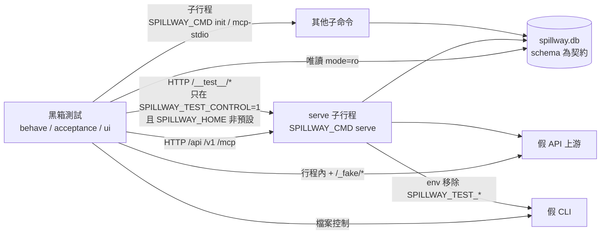

# CHG-20261107-03 — 測試黑箱化(一):測試控制介面、黑箱 harness,轉換 acceptance、behave 與畫面測試

- 專案:spillway
- 分支(Branch):`chg-20261107-03`(自 main 7fadd84 分出);(決策審議修訂 AM-1)本筆命中安全邊界(永遠停點,DIR-4 規則 3(c)、DIR-1 規則 4),驗收通過後**停下**,擁有者確認後才合回 main 並推送
- 日期:2026-11-07(UTC+0)
- 類型:測試基礎與新介面(Rust 改寫的前置,knowledge DIR-5 規則 4 ③)
- Template: plan
- 提出者:擁有者(使用者,2026-11-07「Open it」;同日決定範圍、時間與亂數的控制方式、資料庫的角色)
- 實作者:claude-opus-5-5(主 session agent;平行 task 由其派出的子 agent 施工)
- 風險分級:高——命中安全邊界(正式程式新增可改寫狀態的測試控制介面,須確保一般 `serve` 不會開啟);跨模組介面(控制介面、行程行為與資料庫 schema 成為跨語言契約);測試改寫量大(behave 步驟、acceptance、畫面測試約 1.1 萬行)。(AM-1)高風險:開工前的確認閘照舊(DIR-4 差異說明),合併前停一次(安全邊界)
- Commit/PR:`chg-20261107-03` 分支上訊息以 `CHG-20261107-03:` 開頭的 commit;合回 main 後回填
- 驗收報告(預留):ACC-20261107-03
- 重複性檢查(Recurrence check):無重複(首次黑箱化;Guideline M5 的第二步)
- Diagrams:見「## 設計圖」節
- Security-impact:見「## 安全影響」節
- Skill: ai-sdlc-autopilot v1.69
- 關聯:knowledge DIR-1–DIR-5;Guideline M5;Rust 評估報告(`sdlc_docs/knowledge/rust-evaluation.md`);design D41;spec 2.1.2、9、11、12;regression R1–R65

## 動機

Guideline M5 的順序為:鎖定相依(CHG-20261107-01,已完成)→ 測試黑箱化 → 逐模組移植 → Python 退役。要讓 Rust 版以「通過同一套測試」作為驗收,測試必須只經 HTTP、子行程與唯讀資料庫操作 spillway,不 import `spillway` 內部。目前 behave 的 60 個情境、acceptance 的大部分與 `tests/ui` 都在行程內建立 app,並以 `FakeClock`、`SystemRng(seed)`、`repo.*` 直寫資料庫、`app.state.*` 與 `create_app(...)` 參數控制情境(逐檔盤點見「## 附錄:內部手段盤點」)。

## 使用者故事

1. 作為擁有者,我要 behave、acceptance 與畫面測試只透過 HTTP、子行程與唯讀資料庫操作以命令列啟動的 spillway;同一套測試只要設定 `SPILLWAY_CMD` 就能換成 Rust 版的執行檔來跑(DIR-5 規則 4 ③)。
2. 作為擁有者,我要測試需要的時間、亂數與資料種入透過一個只在測試模式開啟的控制介面完成;一般 `serve` 不會出現這個介面,測試模式也碰不到我的資料目錄(安全)。
3. 作為擁有者,我要資料庫 schema 與資料目錄配置成為跨語言契約,Rust 版能直接沿用我現有的資料目錄,黑箱測試可以唯讀檢查資料庫。

## 決策與取捨

| # | 決策 | 選項 | 依據 | 結論 |
|---|------|------|------|------|
| 1 | **(使用者決定 2026-11-07)** 範圍:只轉換行為層——behave(60 情境)、acceptance、畫面測試、HTTP 層的 integration 測試;unit 與 adapter 合約測試維持 Python 專屬,移植時以 Rust 原生測試另寫 | (a) 只轉行為層 / (b) 能轉的都轉 | unit 測試(解析器、規劃器)沒有可經 HTTP 測的介面 | 使用者選 (a) |
| 2 | **(使用者決定 2026-11-07)** 時間與亂數:`serve` 提供只在測試模式開啟的控制介面(`/__test__/*`),Rust 版必須實作同一組介面 | (a) 測試控制介面 / (b) 只用真實時間 | 保留 AC-14、額度窗口、AC-4 的覆蓋 | 使用者選 (a) |
| 3 | **(使用者決定 2026-11-07)** 資料庫:schema 與資料目錄配置(sdlc_docs/structure/data.md)宣告為跨語言契約;黑箱測試可唯讀開啟資料庫檔案(`sqlite3` URI `mode=ro`),所有寫入一律經 `/api` 或控制介面 | (a) schema 為契約、唯讀 / (b) 只經 HTTP | 現有資料目錄不需遷移;既有測試大量檢查資料庫。(決策審議修訂 AM-2)施作細則:契約對象是 serve 在空資料目錄建出的資料庫(正規化後的 `sqlite_master`、各表 `PRAGMA table_info`/`index_list`/`foreign_key_list`、`user_version`);遷移類案例允許在 serve 啟動前以 sqlite3 從 SQL 檔建立測試資料庫(例如 v1 舊庫、seed_golden) | 使用者選 (a) |
| 4 | 分兩筆 CHG:本筆建立控制介面與黑箱 harness,轉換 acceptance、behave、畫面測試;HTTP 層的 integration 測試於下一筆轉換(範圍見「## 後續 CHG(黑箱化二)範圍」) | 一筆 / 兩筆 | 本筆已約 1.1 萬行測試改寫加新介面;integration 依賴本筆的 harness | 代使用者決定 |
| 5 | (決策審議修訂 AM-3)控制介面的開啟:① 只有 `cli._run_server` 讀取 `SPILLWAY_TEST_CONTROL` 與決策 6 的旋鈕,以明確參數傳給 `create_app(..., test_control=..., ...)`;`create_app` 與 `api/test_control.py` 不讀 `os.environ`;② `SPILLWAY_TEST_CONTROL=1` 時 `SPILLWAY_HOME` 必須明確設定,且解析後不得等於 `platformdirs.user_data_dir("spillway")`,不符即以結束碼 2 結束、不開資料庫;③ 未開啟時不掛載,所有 `/__test__/*`(任何方法、結尾斜線、`%5F` 編碼)回 404,body 與不存在的路徑相同;④ 開啟時 stderr 印一行警告,router 以 `include_in_schema=False` 掛載;⑤ `http_headers.headers_for_path` 對 `/__test__/` 前綴回 `API_HEADERS`(`no-store`、`nosniff`);⑥ 照舊經 HostOrigin,只綁 127.0.0.1;設定檔、管理 API、`init` 無法開啟;⑦ CliRunner 一律把決策 6 列舉的旋鈕名與 `SPILLWAY_TEST_CONTROL` 列入要移除的子行程環境變數(與 `extra_env_remove` 同一機制) | 環境變數 / 命令列旗標 / 編譯期 | 環境變數不會出現在 `serve --help` 與設定檔;既有 `SPILLWAY_TEST_*` 先例;決策審議 security 席核實 `http_headers.py:42-48` 不涵蓋 `/__test__`、`settings.py:60-64` 未設 HOME 時落到擁有者目錄、`cli_runner.py:237` 子行程繼承整包環境 | 代使用者決定 |
| 6 | 啟動期測試旋鈕(只在 `SPILLWAY_TEST_CONTROL=1` 時讀取):`SPILLWAY_TEST_START_TIME`(`YYYY-MM-DDTHH:MM:SSZ`;設定時以可控時鐘從該時刻開始,未設定時用系統時鐘)、`SPILLWAY_TEST_RNG_SEED`(整數)、`SPILLWAY_TEST_ADAPTER_PATHS`(`os.pathsep` 分隔的 adapter 路徑;Python 版為模組路徑,AM-13)、`SPILLWAY_TEST_RETENTION_POLL_SECONDS`(浮點)、(AM-3)`SPILLWAY_TEST_RETENTION_STEPPED=1`(保存排程 `_loop` 的 sleep 換成一道閘,只有 `retention/tick` 會放行)、`SPILLWAY_TEST_NO_TOKEN=1`(不簽發存取 token)、`SPILLWAY_TEST_LOG_LEVEL`(`DEBUG`/`INFO`;在 root logger 掛一個 stderr StreamHandler,等級即該值,每筆紀錄一行、多行內容以固定前綴續行,格式 `SPILLWAY-LOG <levelname> <name> <message>`,args 已代入,含 exc_info 與 stack,不加遮罩 filter)。(AM-3)未開啟時若設了上列名稱,stderr 只印名稱註明「已忽略」、不印值;只比對列舉的名稱,`SPILLWAY_TEST_*` 不是保留前綴。既有 `SPILLWAY_TEST_GRACEFUL_TIMEOUT`、`SPILLWAY_TEST_MCP_MAX_SESSIONS` 是有意的例外,不受 CONTROL 限制、行為不變 | — | 對應盤點中的 `create_app` 參數與 monkeypatch;feasibility 席核實 serve 沒有日誌檔、`cli.py:276-277` 只設 uvicorn `log_level="info"` | 代使用者決定 |
| 7 | (決策審議修訂 AM-5)控制端點(JSON;錯誤沿用 9.1.2 格式;時間一律 `YYYY-MM-DDTHH:MM:SSZ`,其他格式 422;所有 GET 不改變資料庫狀態;完整契約寫入 spec 新節):① 時鐘:可控時鐘凍結,只有 `set` 與 `advance_seconds`(非負整數)讓它前進;`GET /__test__/clock` → 200 `{controllable, now}`;`POST /__test__/clock {"set": t}` 或 `{"advance_seconds": n}` → 200 `{now}`,系統時鐘模式 409;② 亂數:只有 `GET /__test__/rng` → `{seeded, seed}`;seed 為不透明值,同一實作內可重現、跨實作不保證序列相同;無 seed 情境以重啟 serve 取得;③ 帳本與內容:`POST /__test__/ledger {"rows": [...]}`、`POST /__test__/payloads {"rows": [...]}`,upsert(`id` 已存在時整列取代),回 `{ids}`;種入不經 Redactor,驗證遮罩的情境不得使用種入;④ 冷卻:`POST /__test__/cooldowns {"deployment", "until", "reason"}`,覆寫(upsert),未知 deployment 404,`reason` 只接受 `quota_exhausted`、`rate_limited`;⑤ 損壞狀態:`POST /__test__/raw/deployment-params {"id", "params"}`,只更新 `params` 欄、繞過驗證,`id` 不存在 404,回應只回 `{id}`、不回顯 params、不記錄 body,測試值一律 `sk-fake…`;⑥ 保存清理:`POST /__test__/retention/run` → `{deleted: int\|null}`(null 表示失敗);`GET /__test__/retention` → `{runs, next_due}`;`POST /__test__/retention/tick {"advance_seconds"}` 只在 STEPPED 模式可用(否則 409),依序推進時鐘、放行 `_loop` 一次、等 `_loop` 回到閘前,回 `{ran, deleted, runs, now}`;到期判斷 `now >= next_due − 2×poll` 寫入 spec;⑦ 健康快取:`GET /__test__/health-cache` → `{entries: [{deployment, healthy}]}`,過了 TTL 的項目不列出;⑧ CLI 名額:`GET /__test__/cli-slots` → `{slots: [{deployment, in_flight, limit}]}`;`POST /__test__/cli-slots/acquire {"deployment", "n"}` 佔用 n 個,超過 limit 409;`POST /__test__/cli-slots/release {"deployment", "n"}`;⑨ MCP session:`GET /__test__/mcp/sessions/{id}` → `{stream_open}` | 少而精 / 通用 SQL 端點 | 通用 SQL 會把內部實作暴露成契約,Rust 版難以相容;feasibility 席核實只換 `router.rng` 碰不到 `SlotSelector._rng`(`selector.py:42,62`),AC-4 無 seed 本來就靠重啟(`cleanup_ac4_steps.py:18-24`);STEPPED 會真的跑過 `_loop`→`due()`→`run_once()`,保留 nfr5 原本驗證的路徑 | 代使用者決定 |
| 8 | (決策審議修訂 AM-6)黑箱 harness(`tests/blackbox/`):① `SPILLWAY_CMD`(以 shlex 切開的程式前綴,預設 `[sys.executable, "-m", "spillway"]`),`serve`、`init`、`mcp-stdio` 都經它執行;② `Serve`:暫存資料目錄、埠、環境變數;就緒條件為 `GET /api/settings/context` 回 200 且行程存活(不看 pid、lsof);訊號送到行程群組;token 只從 spec 定義的 `TOKEN_NOTICE` 單行解析;`restart(extra_env=…, adapter_paths=…)` 停機前讀 `GET /__test__/clock`,重啟時以該時刻作為 `START_TIME`,rng 重新播種;啟動後要改環境的步驟一律觸發重啟;`stop()` 斷言結束碼符合 spec、stderr 沒有 `Traceback` 與 lifespan 或排程的 ERROR(該測試明確允許的除外)、停機沒有逾時;保存日誌時把 token 換成 `***`;③ `Control`(控制端點 client);④ `FakeApi` 每次 run 啟動一次,允許在行程內(假上游不 import spillway);⑤ `read_db(home)` 唯讀連線;⑥ `assert_only_fakes` 保留,並檢查子行程的 PATH;⑦ 共用零件(AM-15):子行程版 gateway、MCP 行程工具(stdio 與 HTTP)、`free_port`、UI 種資料輔助、遮罩函式與 TEST_KEY 常數 | 每情境一個 serve / 共用 | behave 每個情境資料目錄不同;實測 serve 週期約 1.2 秒(traceability 席);portability 席指出 `init`、`mcp-stdio` 也要經同一前綴才能換實作 | 代使用者決定 |
| 9 | (決策審議修訂 AM-8)黑箱邊界的守門(`tests/contract/test_blackbox_boundary.py`):① 靜態:從每個轉換後的檔案(`tests/blackbox/**`、`tests/features/**`、`tests/acceptance/**`、`tests/ui/**`)出發,計算 `tests.*` import 的遞移閉包,閉包內不得出現 `spillway`;允許的 `tests.*` 只有 `tests.blackbox` 與 `tests.fakes.{api_upstream,cli_upstream}`,`tests.fakes.{claude_cli,codex_cli}` 只能以子行程執行、不可 import;② 字面上指向 `src/spillway/` 的路徑算違規,除非列入允許清單並寫明理由(例如讀 `models.yaml`);③ 允許清單含 litellm 價格 JSON 的**檔案讀取**(不 import litellm);④ 執行期:轉換後的 pytest 套件在 session 結束時、behave 在 `after_all` 時斷言 `sys.modules` 裡沒有 `spillway*`;⑤ 根 `tests/conftest.py` 改成延遲 import(`FakeClock` 移入 fixture 內),HOME 守門保留;⑥ v1 schema 一律用套件內的 `schema.sql`(以檔案讀取,列入允許清單)或契約測試附帶的凍結黃金檔,不新增 `tests/data/schema_v1.sql` | 逐檔直接 import / 遞移閉包加執行期 | coverage、feasibility、traceability 三席核實 `tests/helpers/__init__.py:26` 等間接路徑,單檔掃描抓不到 | 代使用者決定 |
| 10 | (決策審議修訂 AM-11)NFR 量測:NFR-1 改以 HTTP dry-run 計時(移除行程內 `router_direct` 指標;門檻不變,HTTP 計時較嚴);results 記錄傳輸方式;excluded 的 reason 分布與 local 健康狀態要和轉換前的基準相同;`in_flight == 1` 改用 `GET /__test__/cli-slots`。NFR-2 不變。NFR-4 分兩次啟動:INFO 全程 0 命中、DEBUG 憑證 0 命中;以 `SPILLWAY-LOG` 行解析等級;前提斷言:DEBUG 那次啟動全程至少一行 `SPILLWAY-LOG DEBUG`,且請求窗口內至少一行 `SPILLWAY-LOG` 的 logger 名稱以 `LiteLLM` 開頭(任何等級);logger 名稱的斷言列入 `impl_dependent.toml`(spec 14.3.5 宣告名稱為實作相依)。(施工審議修訂 T1)`load_litellm` 把 LiteLLM 等 7 個 logger 的下限設為 INFO(CHG-20261101-02 決策 13),正式輸出沒有 LiteLLM 的 DEBUG 回顯,spillway 成功路徑也沒有日誌,所以原前提做不到;黑箱改掃產品真實輸出,0 命中斷言意義不變。若 T3 實測窗口內沒有 LiteLLM 行,回報主 session 再議,不得放寬 0 命中斷言;窗口以送出請求前後的 stderr 位移界定,等 stderr 排乾後才掃描,以精確前綴排除 `TOKEN_NOTICE` 行;LiteLLM 的 DEBUG 回顯豁免列為實作相依(AM-13);Python 版因 INFO 下限,此豁免窗口預期 0 筆 | — | 黑箱無法直接呼叫 router;沒有前提斷言時 NFR-4 會「沒有東西可掃也通過」 | 代使用者決定 |
| 11 | 測試仍以 Python(pytest、behave、Playwright)撰寫;feature 文字不改;斷言意義不改,只改「如何操作與觀察」;每個被改寫的測試在施工審議逐檔列出「原本用什麼內部手段 → 現在用哪個端點或觀察方式」(以附錄為底稿)。(AM-12)`m3b_mcp.feature:69` 字面上的 `8787` 由步驟替換成 harness 的實際埠,列為「觀察方式改變」,不改 feature 文字、不新增公告埠旋鈕。(AM-9)預期值不取自產品程式:價格讀 litellm 價格 JSON 檔當資料(DIR-5 ②);MCP catalog 以 MCP SDK `tools/list` 作為獨立 oracle;v1 schema 由 Python 合約測試斷言 `schema.sql` 與 `git show d89118c` 相同;`drain_expire_delay` 寫成常數並附 spec 出處,另由 Python 合約測試核對 `cli.drain_expire_delay`;`ACCESS_TOKEN_KEY` 以字面值 `access_token_sha256` 經 `read_db` 讀取(列入 data.md);Redactor 由測試端自帶遮罩函式;seed_golden 的固定 token 雜湊改用 serve 簽發的 token,斷言意義不變 | — | harness 的語言與被測實作無關;feasibility、coverage 席指出多個預期值取自產品程式,換掉實作就變成自證 | 代使用者決定 |

## 設計圖

## 安全影響

| 類別 | 命中 | 說明 |
|------|------|------|
| security-boundary | 是 | 正式程式新增可改寫狀態的 `/__test__/*`(含繞過驗證寫入成員 params);只由 `cli._run_server` 讀 `SPILLWAY_TEST_CONTROL=1` 時掛載,否則所有方法與路徑變形皆 404;開啟時須明確設定非預設的 `SPILLWAY_HOME`(否則結束碼 2、不開資料庫);開啟時 stderr 警告;仍只綁 127.0.0.1、經 HostOrigin、帶 `no-store`;不列入 OpenAPI;設定檔、管理 API、`init` 無法開啟;CLI 子行程不繼承旋鈕;測試(黑箱)斷言以上各項 |
| secrets | 否 | 控制端點不回傳 token 或憑證;`raw` 端點不回顯、不記錄 body;旋鈕忽略提示不印值;harness 保存日誌時遮 token;`SPILLWAY_TEST_NO_TOKEN` 只讓測試能涵蓋「未簽發」狀態(`/mcp` 回 401,安全失敗) |
| new-dependency | 否 | — |
| irreversible-delete | 否 | HOME 硬條件保證控制介面不會碰擁有者資料目錄;`retention/run`、`tick` 刪除的是既有清理規則會刪的內容 |
| prod-migration | 否 | schema 不變;v2 DDL 只從 `db.py` 搬到 `store/migrations/0002.sql`,內容逐字不變;本筆把資料庫宣告為契約 |
| payments | 否 | — |
| auth | 否 | `/api` 與 `/__test__` 在 127.0.0.1 上皆不驗證 token(與現況一致) |

已知限制:
1. 任何能設定 `serve` 環境變數的本機程式都能開啟控制介面(DIR-2 範圍內接受)。
2. unit 與 adapter 合約測試仍綁 Python;integration 測試於下一筆轉換。
3. 行程內 `router_direct` 指標移除,NFR-1 只剩 HTTP 計時。
4. 黑箱 behave 每個情境啟動一個 serve,全量 behave 時間會增加(預算見 T4 L3)。
5. (AM-13)實作相依清單 `tests/blackbox/impl_dependent.toml`:固定 seed 的 AC-4(序列相依)、使用 `SPILLWAY_TEST_ADAPTER_PATHS` 載入 Python 模組的情境與 ui 測試(Rust 改用 manifest,DIR-5 ①;等改寫 AC-19 的 CHG 再換夾具)、NFR-4 的 LiteLLM 豁免窗口(Python 版在 INFO 下限下預期為空)。Python 版照常全跑;清單只供日後替換實作時參考,不改 feature 文字。
6. 種入的帳本與內容不經 Redactor;驗證遮罩的情境只能走真實請求。
7. (施工審議修訂 T1)`SPILLWAY_TEST_LOG_LEVEL` 的輸出依決策 6 不遮罩,DEBUG 時可能含 MCP session id 與 httpx 請求 URL(查詢字串帶金鑰的 provider 會連金鑰一起印出);只在測試模式出現,黑箱測試一律使用 `sk-fake…` 與本機假上游。
8. (施工審議 T2)邊界守門的靜態部分只認得字面值:以變數或執行期組出的模組名、路徑、子行程程式碼字串,以及蓄意刪除 `sys.modules` 項目,靜態部分攔不到。這些情況由執行期守門處理:純執行時,`sys.meta_path` 阻擋器在 import 當下攔下,session 結束時再檢查 `sys.modules`;純執行是指本機閘第二道和驗收的隔離執行。全量 pytest 不啟用執行期守門。
9. (施工審議 T2)HOME 判定的「帳號 home(`pw_dir`)」候選無法以黑箱測試安全驗證(會指向擁有者資料目錄),由 T1 的行程內測試涵蓋。`retention_not_running`、`retention_tick_timeout` 黑箱難以觸發,同樣由 T1 涵蓋。
10. (施工審議 T2)harness 的 stderr 問題掃描在 `SPILLWAY-LOG` 行以外只認得 Python 的 `Traceback`、uvicorn 的 `ERROR:` 與 Rust 的 panic 字樣,屬盡力而為,不是契約。pytest 本身被 SIGKILL 時,serve 另開 session,可能殘留。

## 修改指引

### 目標

behave、acceptance 與 `tests/ui` 全部經 harness 操作子行程 spillway,不 import `spillway`(靜態閉包與執行期皆驗證);以 `SPILLWAY_CMD` 可換成其他實作;控制端點、行程行為、資料庫各有黑箱契約測試;本機閘全綠。

### 影響範圍

| 位置 | 類型 | 內容 | 下游 |
|------|------|------|------|
| `src/spillway/api/test_control.py`(新增)、`src/spillway/app.py`、`src/spillway/cli.py`、`src/spillway/api/http_headers.py`、`src/spillway/adapters/base/cli_runner.py`、`src/spillway/store/db.py`、`src/spillway/store/migrations/0002.sql`(新增) | 介面 | 決策 5–7;v2 DDL 搬檔(AM-4) | 黑箱測試、Rust 版 |
| `tests/blackbox/`(新增) | 測試 | 決策 8;共用零件;控制、行程、schema 契約測試;實作相依清單 | 全部黑箱測試 |
| `artifacts/m5a/baseline/`(新增) | 測試 | 基準清單(AM-10) | 驗收 |
| `tests/contract/test_blackbox_boundary.py`(新增)、`tests/contract/test_schema_python.py`(新增:`MIGRATIONS` 與黃金檔一致、`schema.sql` 與 d89118c 相同、`drain_expire_delay` 常數) | 測試 | 決策 9、11 | 本機閘 |
| `tests/conftest.py` | 測試 | 延遲 import(決策 9 ⑤) | 全部 pytest |
| `tests/features/steps/*`、`tests/features/support/*`、`tests/features/environment.py` | 測試 | 改用 harness | — |
| `tests/acceptance/*` | 測試 | 改用 harness | — |
| `tests/ui/*`;`tests/helpers/ui*.py`(由 T2 複製到 `tests/blackbox/ui/`,舊檔無人使用時 T5 刪除) | 測試 | 改用 harness | — |
| `tests/integration/test_test_control.py`(新增) | 測試 | 只保留 Python 專屬接線:旋鈕只在 cli 讀取、`create_app` 不讀 env | — |
| `docs/spec.md`、`sdlc_docs/structure/{design,data,directory,logical}.md`、`sdlc_docs/ai-guideline.md`、`sdlc_docs/knowledge/knowledge.md`、`README.md`、`sdlc_docs/acceptance/regression.md` | 文件 | 見「規格書與結構文件更新」 | — |

### Global Constraints(全域約束——每個 task 都要遵守)

- 不改 feature 文字;不改任何斷言的意義;不刪測試(合併或移除須逐條列在施工審議並說明等價覆蓋)。
- (AM-4)`src/` 的變更限於 T1:`api/test_control.py`(新增)、`app.py`(掛載與 STEPPED 排程)、`cli.py`(旋鈕、HOME 檢查、日誌 handler)、`api/http_headers.py`(`/__test__/` 標頭)、`adapters/base/cli_runner.py`(移除旋鈕環境變數)、`store/db.py` 與新檔 `store/migrations/0002.sql`(v2 DDL 只搬文字,內容逐字不變)。一般 serve(未設 CONTROL)的行為不改;schema 不改。
- (AM-10)wave 3 開工前,T2 從 7fadd84 產出 `artifacts/m5a/baseline/` 並 commit:pytest node ID 全集(acceptance 20、ui 190)、behave 情境名稱與每情境步驟數(60 個)、每個測試函式與步驟函式的 `assert`/`expect(` 次數。驗收時:node ID 與情境集合相同;每個函式的斷言次數不低於基準,降低的逐條列理由;diff 不可新增 `skip`、`xfail`、`except AssertionError` 或空步驟(grep 檢查);behave 以 json formatter 確認 0 skipped、0 undefined。(施工審議修訂 T2)對照以 `artifacts/m5a/baseline/compare.py` 執行(T2 擁有;內含 `tests/helpers/ui*.py` → `tests/blackbox/ui/` 的函式搬移對照表);T3、T4、T5 收尾時各以 `--roots <自己的目錄>` 執行並附上輸出,全部轉換完成後再對全集執行一次。
- (AM-15)`tests/helpers/__init__.py`、`tests/helpers/live_gateway.py`、`tests/helpers/config_golden.py`、`tests/helpers/mcp_proc.py`、`tests/helpers/procs.py`、`tests/integration/**`(除新增的 `test_test_control.py`)原封不動,留給 unit 與 integration 使用;共用部分由 T2 複製成黑箱版放在 `tests/blackbox/`。wave 3 的 task 只能 import `tests/blackbox/` 的零件,不能修改;需要新零件時回報主 session,由 T2 擁有者補。
- 不新增、不升級相依;新 venv 依 README 以 lock 安裝。
- 不執行真實 claude、codex、cursor、gemini;只打本機假上游。
- 測試一律以暫存資料目錄;不讀寫擁有者的資料目錄。
- 允許清單(既有測試可改寫的範圍):轉換後的檔案只可改「如何操作與觀察」;OpenAPI 快照與 `KNOWN_GETS` 不變(控制介面不列入 OpenAPI;未開啟時不掛載)。
- (AM-14)轉換後的檔案不得比對 `uvicorn`、`INFO:` 字樣(靜態守門,併入邊界守門)。
- 全量 pytest 與 behave 一律在前景執行(SIGINT 類測試)。
- commit 訊息以 `CHG-20261107-03:` 開頭,結尾加 Co-Authored-By 行。

### 契約清單

(決策審議修訂 AM-19)

| 契約 | 提供方 | 讀取方 | 本筆變更 | 契約測試(路徑/無) |
|------|--------|--------|----------|----------------------|
| 測試控制介面 `/__test__/*` 與啟動期旋鈕 | T1 | 黑箱測試、Rust 版 | 新增 | tests/blackbox/test_control_contract.py(新增,經 harness:形狀、錯誤碼、GET 前後資料庫快照相同、STEPPED tick、HOME 檢查) |
| 一般 serve 不暴露控制介面 | T1 | 安全 | 新增 | tests/blackbox/test_control_contract.py(未開啟時各方法與路徑變形 404 且 body 同不存在路徑;開啟時 OpenAPI(若提供)不含 `/__test__`;HostOrigin;`no-store`;CLI 子行程環境不含旋鈕) |
| 旋鈕只在 cli 讀取(Python 專屬接線) | T1 | 安全 | 新增 | tests/integration/test_test_control.py(新增) |
| 行程契約(結束碼 1/2/3/130、SIGTERM、`TOKEN_NOTICE` 單行) | T1(spec) | harness、Rust 版 | 宣告 | tests/blackbox/test_process_contract.py(新增) |
| 黑箱邊界(不 import spillway) | T2 | 全部黑箱測試 | 新增 | tests/contract/test_blackbox_boundary.py(新增:遞移閉包、字面路徑、`uvicorn`/`INFO:` 字樣)+ 執行期 `sys.modules` 斷言 |
| harness `Serve`/`Control`/`FakeApi`/`read_db` 與共用零件 | T2 | T3–T5 | 新增 | tests/blackbox/test_harness.py(新增) |
| 資料庫為跨語言契約 | T2 | Rust 版 | 宣告 | tests/blackbox/test_schema_contract.py(新增:空目錄建庫的正規化快照等於黃金檔、表與欄和 data.md 一致、v1→v2 黑箱遷移與 `.v1.bak`)+ tests/contract/test_schema_python.py(`MIGRATIONS` 與黃金檔一致) |

### Tasks(checkbox=續作點)

- [x] T1. 測試控制介面、啟動期旋鈕與行程契約
  - interfaces: consumes 決策 5–7 / produces `src/spillway/api/test_control.py`、`src/spillway/app.py`(`create_app(..., test_control=..., start_time=..., rng_seed=..., retention_stepped=...)`)、`src/spillway/cli.py`(旋鈕、HOME 檢查、`SPILLWAY-LOG` handler)、`src/spillway/api/http_headers.py`、`src/spillway/adapters/base/cli_runner.py`、`src/spillway/store/db.py`、`src/spillway/store/migrations/0002.sql`、`tests/integration/test_test_control.py`、`docs/spec.md` 新節「測試控制介面」與「行程契約」(AM-7)
  - test: `.venv/bin/python -m pytest tests/integration/test_test_control.py tests/unit -q`
  - L1: 每個端點的請求與回應形狀、錯誤碼(409、404、422)依決策 7;時鐘凍結;`retention/tick` 在 STEPPED 下真的經過 `_loop`→`due()`→`run_once()` 且回到閘前才回應;cli-slots 超過 limit 409;raw 只改 `params`、不回顯;`create_app` 與 `test_control.py` 不讀 `os.environ`(AST 或 monkeypatch 驗證);v2 DDL 搬檔後 `MIGRATIONS` 內容逐字相同
  - L2: 子行程 `serve` 以 `SPILLWAY_TEST_CONTROL=1` 與各旋鈕啟動:stderr 有警告;HOME 未設或等於預設目錄時結束碼 2 且未建資料庫;時鐘、seed、adapter 路徑、保存輪詢、STEPPED、不簽發 token、`SPILLWAY-LOG` 輸出都生效;未設 CONTROL 時設定旋鈕只印名稱註明已忽略;一般 `serve` 行為與現況相同(既有測試全綠)
  - L3: 不適用(行為情境的轉換由 T4 負責)
  - L4: 不適用(由 T3 的操作驗收涵蓋)

- [x] T2. 黑箱 harness、共用零件、契約測試、邊界守門與基準清單
  - interfaces: consumes T1、決策 8、9、11 / produces `tests/blackbox/{__init__,harness,control,fakeapi,db,mcp,ports,mask}.py`、`tests/blackbox/ui/`(由 `tests/helpers/ui*.py` 複製改寫)、`tests/blackbox/test_harness.py`、`tests/blackbox/test_control_contract.py`、`tests/blackbox/test_process_contract.py`、`tests/blackbox/test_schema_contract.py`(含黃金快照)、`tests/blackbox/impl_dependent.toml`、`tests/contract/test_blackbox_boundary.py`、`tests/contract/test_schema_python.py`、`tests/conftest.py`(延遲 import)、`artifacts/m5a/baseline/`
  - test: `.venv/bin/python -m pytest tests/contract/test_blackbox_boundary.py tests/contract/test_schema_python.py -q && SPILLWAY_BLACKBOX_GUARD=1 .venv/bin/python -m pytest tests/blackbox -q`(施工審議修訂 T2)
  - L1: `Serve` 啟動、就緒(HTTP 200 + 存活)、token 只從 `TOKEN_NOTICE` 解析、`restart` 延續時鐘、`stop()` 的結束碼/Traceback/ERROR/逾時斷言、日誌遮 token、`assert_only_fakes` 檢查 PATH;`SPILLWAY_CMD` 覆寫生效且 `init`、`mcp-stdio` 也經它;`read_db` 唯讀(寫入被拒);邊界守門對違規樣本(直接 import、經 `tests.helpers` 間接 import、字面 `src/spillway/` 路徑、`uvicorn` 字樣)失敗、對合規樣本通過;控制、行程、schema 契約測試全綠
  - L2: harness 以假上游完成一次 `/v1/chat/completions` 往返;基準清單在 7fadd84 產出、內容符合 AM-10 列的數量(acceptance 20、ui 190、behave 60)
  - L3: 不適用(T4 負責)
  - L4: 不適用(T3 負責)

- [ ] T3. 轉換 acceptance
  - interfaces: consumes T1、T2 / produces 以「## 附錄:內部手段盤點」中 T3 列為準(`tests/acceptance/*` 全部,含 ac07、nfr1、nfr2、nfr4、nfr5、m3a、m4a、m4b、test_operation、perf、seed、conftest)
  - test: `.venv/bin/python -m pytest tests/acceptance -q -rs`
  - L1: 不適用(acceptance 為整合層級)
  - L2: 每個轉換後的檔案通過且 0 skipped;NFR-1、NFR-2 的 P95 仍在門檻內;NFR-1 excluded reason 分布同基準;nfr5 以 STEPPED `retention/tick` 取代 monkeypatch;NFR-4 前提斷言成立
  - L3: 不適用(T4 負責)
  - L4: 20 個全過、0 skipped,node ID 集合與每函式斷言數對照基準;邊界守門與執行期守門對 `tests/acceptance` 為綠

- [ ] T4. 轉換 behave
  - interfaces: consumes T1、T2 / produces 以附錄中 T4 列為準(`tests/features/steps/*`、`tests/features/support/*`、`tests/features/environment.py`)
  - test: `.venv/bin/python -m behave tests/features`
  - L1: 不適用(行為情境)
  - L2: 不適用(行為情境)
  - L3: 10 個 feature、60 個情境全過,feature 文字未改,步驟數同基準、0 skipped、0 undefined;(AM-17)behave 全量 ≤ 180 秒(實測約 26 秒 → 預估約 100 秒),施工審議記錄實測值;邊界守門與 `after_all` 執行期守門為綠
  - L4: 不適用(由 T3 與本機閘涵蓋)

- [ ] T5. 轉換畫面測試
  - interfaces: consumes T1、T2 / produces 以附錄中 T5 列為準(`tests/ui/*`;`tests/helpers/ui*.py` 無人使用時刪除)
  - test: `.venv/bin/python -m pytest tests/ui -q`
  - L1: 不適用(畫面測試)
  - L2: 190 個全過、0 skipped,斷言未改,node ID 集合與每函式斷言數對照基準;邊界守門與執行期守門對 `tests/ui` 為綠
  - L3: 不適用(T4 負責)
  - L4: 不適用(由本機閘涵蓋)

- [ ] T6. 文件同步
  - interfaces: consumes T1–T5 / produces 「規格書與結構文件更新」所列文件(spec 新節由 T1 寫,T6 只做交叉引用與其餘文件)
  - test: ai-sdlc 的 doc-integrity lint 回 ok
  - L1: 不適用(文件變更;schema 契約測試已在 T2)
  - L2: 不適用(文件變更)
  - L3: 不適用(文件變更)
  - L4: 不適用(文件變更;由終審 docs 席核對)

### Behaviour spec

- feature: tests/features/m2_routing.feature
- feature: tests/features/m2_context.feature
- feature: tests/features/m2_estimate.feature
- feature: tests/features/m2_adapters.feature
- feature: tests/features/m2_quota.feature
- feature: tests/features/m2c_cleanup.feature
- feature: tests/features/m3a_cli.feature
- feature: tests/features/m3b_mcp.feature
- feature: tests/features/m4a_config.feature
- feature: tests/features/m4b_ui.feature

10 個 feature 的文字不改;步驟改為黑箱。

### Interaction spec

- kind: service-protocol
- cmd: SPILLWAY_BLACKBOX_GUARD=1 .venv/bin/python -m pytest tests/blackbox/test_control_contract.py tests/blackbox/test_process_contract.py -q --junitxml=artifacts/m5a/control-process.xml
- artifacts: artifacts/m5a/control-process.xml
- kind: library-api
- cmd: SPILLWAY_BLACKBOX_GUARD=1 .venv/bin/python -m pytest tests/blackbox/test_harness.py tests/blackbox/test_schema_contract.py -q --junitxml=artifacts/m5a/harness.xml
- artifacts: artifacts/m5a/harness.xml
- kind: library-api
- cmd: .venv/bin/python -m pytest tests/contract/test_blackbox_boundary.py tests/contract/test_schema_python.py -q --junitxml=artifacts/m5a/boundary.xml
- artifacts: artifacts/m5a/boundary.xml

### Acceptance operation

(決策審議修訂 AM-14)

- operate:
  1. 新 venv(lock 安裝),以 `SPILLWAY_CMD` 預設值在前景跑全量 pytest、behave、acceptance。
  2. 以包裝腳本作為 `SPILLWAY_CMD` 跑 behave、acceptance、ui。腳本仍啟動 Python 版,但刻意改變所有不屬於契約的東西:(施工審議修訂 T2)不用 exec,讓實作另開行程群組,轉送訊號並依 README「`SPILLWAY_CMD` 的要求」② 重現結束狀態(另跑一條 exec 路徑);以相對路徑指定包裝腳本;cwd 改成暫存目錄;stderr 只轉出契約行;清掉 `PYTHONPATH`。
  3. (施工審議修訂 T2)執行期隔離:(a) 以本機閘第二道(`SPILLWAY_BLACKBOX_GUARD=1`,只收集黑箱範圍)跑轉換後的 pytest 套件,behave 照常(`after_all` 守門);(b) 另建一個**不安裝 spillway** 的 venv(只裝測試相依:pytest、behave、playwright、httpx、mcp 等),以 `SPILLWAY_CMD="<主 venv>/bin/python -m spillway"` 跑轉換後的 pytest 與 behave。spillway 以 editable 安裝(`.pth` 指向 `src`),所以只從 `PYTHONPATH` 拿掉 `src` 不構成隔離。
  4. 未設 `SPILLWAY_TEST_CONTROL` 啟動 `serve`,探測 `/__test__/*` 與 OpenAPI;設了 CONTROL 但不設 `SPILLWAY_HOME` 啟動,確認結束碼 2。
- observe:
  - 三者全綠、0 skipped。
  - 包裝路徑全綠。
  - 執行期隔離 (a)、(b) 皆全綠;(b) 的 venv 內 `python -c "import spillway"` 失敗。
  - 一般 serve 的 `/__test__/*` 全部 404、OpenAPI 不含。
  - HOME 檢查生效。
  - 邊界守門全綠。
  - 基準對照無減少。
- pass:以上成立。通過後停在合併前,交擁有者確認(AM-1)。

### 本機閘

(施工審議修訂 T2)`.venv/bin/python -m pytest -q && SPILLWAY_BLACKBOX_GUARD=1 .venv/bin/python -m pytest -q -p no:cacheprovider tests/blackbox $(grep -v -e '^#' -e '^$' tests/blackbox/converted_roots.txt) && .venv/bin/python -m behave tests/features`(全綠,`pytest tests/acceptance -q -rs` 0 skipped;前景執行)。第二道只收集黑箱範圍(`tests/blackbox` 與 `converted_roots.txt` 列出的目錄),執行期守門與 import 阻擋器一律生效(決策 9 ④);全量 pytest 會收集到 unit 與 integration,守門在那一道不生效。

### 平行施工

(決策審議修訂 AM-15)

| 波次 | Task | 檔案所有權 |
|------|------|------------|
| 1 | T1 | `src/spillway/api/test_control.py`、`app.py`、`cli.py`、`api/http_headers.py`、`adapters/base/cli_runner.py`、`store/db.py`、`store/migrations/0002.sql`、`tests/integration/test_test_control.py`、`docs/spec.md`(新兩節) |
| 2 | T2 | `tests/blackbox/**`、`tests/contract/test_blackbox_boundary.py`、`tests/contract/test_schema_python.py`、`tests/conftest.py`、`artifacts/m5a/baseline/` |
| 3 | T3、T4、T5 | T3 `tests/acceptance/**`;T4 `tests/features/**`;T5 `tests/ui/**`、`tests/helpers/ui*.py`(只刪除)。三者只 import、不修改 `tests/blackbox/` |
| 4 | T6 | 文件 |

### 規格書與結構文件更新

- [ ] docs/spec.md(T1):新增「測試控制介面(僅測試模式)」一節(決策 5–7 的端點、形狀、錯誤碼、旋鈕、開啟條件、HOME 條件、`retention/tick` 判斷式、seed 為不透明值);新增「行程契約」一節(結束碼 2 用法錯誤、1 開啟資料庫前的前置檢查失敗(埠、資料目錄鎖;既有 `_preflight` 行為)、3 啟動失敗或被閘道拒絕、SIGINT 130、SIGTERM 以訊號結束且實作必須重送訊號;`TOKEN_NOTICE` 單行的位元組格式,必須在開始監聽前 flush;stderr 只承諾 token 行、控制介面警告與 `SPILLWAY-LOG` 行);12 節註明 AC 的黑箱驗收方式
- [ ] sdlc_docs/structure/design.md:新增 D44(測試控制介面與黑箱 harness);D41 補「測試已黑箱化的範圍」
- [ ] sdlc_docs/structure/data.md:宣告資料庫為跨語言契約(對象與快照方式,AM-2);`store/migrations/0002.sql`;鎖是 `flock(2) LOCK_EX|LOCK_NB`;`access_token_sha256` 鍵名;不定義日誌檔
- [ ] sdlc_docs/structure/logical.md:`api.test_control` 一列
- [ ] sdlc_docs/structure/directory.md:新檔案與 `tests/blackbox/`
- [ ] sdlc_docs/ai-guideline.md:M5 列補進度(黑箱化分兩筆,本筆為一)
- [ ] sdlc_docs/knowledge/knowledge.md:DIR-5 的應用紀錄
- [ ] README.md:測試段補黑箱 harness 與 `SPILLWAY_CMD`;註明 `SPILLWAY_TEST_CONTROL` 與各旋鈕「僅供測試,正式使用請勿設定」;(施工審議修訂 T2)新增「`SPILLWAY_CMD` 的要求」:`SPILLWAY_CMD` 指向的程式必須擇一:① 以 exec 取代自己成為實作;② 讓實作另開行程群組、轉送 SIGINT/SIGTERM,在實作結束後以相同結束狀態結束——實作以訊號結束時,重設該訊號為預設處置後對自己重送同一訊號(不可改成 `exit 128+n`)。包裝程式與實作的所有子孫行程在停機後不得殘留,也不得繼續持有 stderr;harness 的 `stop()` 會檢查這兩點。同段文字也寫進 `tests/blackbox/harness.py` docstring(T2)
- [ ] sdlc_docs/acceptance/regression.md:新增控制介面、行程契約、邊界守門、schema 契約的 R 列(驗收時)

### 風險與回滾

| 風險 | 影響 | 對策 |
|------|------|------|
| 控制介面在一般 serve 被開啟 | 狀態可被任意改寫 | 只在 cli 讀環境變數;未設定時不掛載;黑箱測試斷言各變形 404 |
| 測試模式誤指向擁有者資料目錄 | 不可逆刪除擁有者資料 | HOME 硬條件(結束碼 2、不開資料庫) |
| 黑箱改寫遺漏覆蓋 | 測試變弱 | 基準清單對照(AM-10);斷言意義不改;施工審議逐檔列出前後手段;不刪測試 |
| 間接 import 讓測試仍在行程內 | 黑箱化名不副實 | 遞移閉包 + 執行期 `sys.modules` + 隔離方式驗收 |
| (AM-17)behave 變慢 | 閘門變長 | 預算 180 秒;超出時另開 CHG 新增重設端點,不在本筆臨時增加 |
| (AM-11)HTTP 計時超過 NFR-1 門檻 | NFR-1 失敗 | 停下,作為分歧決策交擁有者,不得自行放寬門檻 |

回滾:revert 本 CHG 的 merge commit。

## 後續 CHG(黑箱化二)範圍

(決策審議修訂 AM-18)下一筆轉換:
- `tests/integration`(53 檔、9,897 行);
- `tests/integration/test_test_control.py` 的行程內部分;
- `tests/helpers/live_gateway.py`、`tests/helpers/config_golden.py`、`tests/helpers/__init__.py`、`tests/helpers/mcp_proc.py`、`tests/helpers/procs.py`;
- 根 `tests/conftest.py` 的剩餘行程內 fixture;
- `tests/fakes/{claude_cli,codex_cli}`(目前 import spillway);
- 邊界守門的清單擴大到 `tests/integration`;
- AM-13 實作相依清單的處置。

## 附錄:內部手段盤點

(決策審議修訂 AM-16;底稿為 feasibility 席 §一,補上 traceability 席漏列的檔案。施工審議逐檔對照此表。)

| 檔案:行 | 內部手段 | 端點或觀察方式 | Task |
|---------|----------|----------------|------|
| tests/features/support/gateway.py:54-56,85-86 | `create_app(clock=FakeClock(), rng=SystemRng(seed), extra_adapter_paths, db_path, retention_poll_seconds)` over ASGITransport | `Serve` + `START_TIME`、`RNG_SEED`、`ADAPTER_PATHS`、`RETENTION_POLL_SECONDS` | T4 |
| tests/features/support/gateway.py:249 | `retention.run_once()` | `POST /__test__/retention/run` | T4 |
| tests/features/steps/common_steps.py:62-64,88,109,115 | `app.state.rng is`;`clock.set/advance` | `GET /__test__/rng`;`POST /__test__/clock` | T4 |
| tests/features/steps/cleanup_ac4_steps.py:16-24 | 重建 app 後 rng identity 斷言 | 重啟 serve、`GET /__test__/rng`(`seeded=false`) | T4 |
| tests/features/steps/context_steps.py:68-69 | `clock.advance` 後 `retention.run_once()` | `POST /__test__/clock` + `retention/run` | T4 |
| tests/features/steps/m3a_steps.py:80,326 | serve 啟動後改 `os.environ` | `Serve.restart(extra_env=…)` | T4 |
| tests/features/steps/m3a_steps.py:192;quota_steps.py:43 | `load_litellm().cost_per_token` | 讀 litellm 價格 JSON 檔(允許清單) | T4 |
| tests/features/steps/m3a_steps.py:198;quota_steps.py:49;estimate_steps.py:34-41 | `repo.insert_ledger` | `POST /__test__/ledger` | T4 |
| tests/features/steps/m3a_steps.py:226 | `clock.set` | `POST /__test__/clock` | T4 |
| tests/features/steps/m3a_steps.py:267,293 | `cli_runner.in_flight` | `GET /__test__/cli-slots` | T4 |
| tests/features/steps/routing_steps.py:23 | `repo.mark_cooldown` | `POST /__test__/cooldowns` | T4 |
| tests/features/steps/cleanup_health_steps.py:37 | `router.health_cache.get` | `GET /__test__/health-cache` | T4 |
| tests/features/steps/adapters_steps.py:85 | `extra_adapter_paths` + 重啟 | `ADAPTER_PATHS` + `Serve.restart` | T4 |
| tests/features/steps/m3b_steps.py:5,47,77,108,118,348 | 預設埠 8787;`live_gateway`;`token=False`;`get_access_token_hash`;`rotate_access_token`;`sdk_compat.get_stream_open` | 實際埠替換(AM-12);`Serve`;`NO_TOKEN`;`read_db`;`POST /api/settings/token/rotate`;`GET /__test__/mcp/sessions/{id}` | T4 |
| tests/features/steps/m4a_steps.py:85,220,447,458 | `rotate_access_token`;`get_access_token_hash`;`app.state.port` | `/api` 輪替;`read_db`;harness 埠 | T4 |
| tests/features/steps/m4b_steps.py:145,340,364,594 | `insert_ledger`;`extra_adapter_paths`;`mcp_catalog(app, group)` | `ledger`;`ADAPTER_PATHS`;MCP SDK `tools/list`(AM-9) | T4 |
| tests/features/environment.py:49 | 行程內 `FakeApiServer` | `FakeApi`(行程內,允許) | T4 |
| tests/acceptance/conftest.py:16 | `tests.integration.conftest.open_spillway` | `tests/blackbox` 的 `Serve` | T3 |
| tests/acceptance/test_ac07*.py、nfr2 | `open_spillway` | `Serve` | T3 |
| tests/acceptance/nfr1:55,57,84,86,90 | `mark_cooldown`;`try_acquire/release`;`router.dry_run`;`in_flight` | `cooldowns`;`cli-slots/acquire`、`release`;HTTP dry-run;`GET cli-slots` | T3 |
| tests/acceptance/perf.py:77-85 | `router.dry_run` 直接計時 | HTTP dry-run 計時 | T3 |
| tests/acceptance/nfr4:48-174 | `caplog` DEBUG | `SPILLWAY_TEST_LOG_LEVEL` + `SPILLWAY-LOG` 行(決策 10) | T3 |
| tests/acceptance/nfr5:31,56-61,117,123-126,152 | `retention_poll_seconds`;`retention.runs`;根 conftest `clock`;`monkeypatch asyncio`;`clock.advance` | `RETENTION_POLL_SECONDS` + `STEPPED`;`GET /__test__/retention`;`START_TIME`;`retention/tick` | T3 |
| tests/acceptance/seed.py:106-107,130-131 | repo 寫 NFR 資料集;executemany 1 萬列 | `/api` 建成員 + `POST /__test__/ledger`(rng 改 `random.Random(seed)`,序列相同) | T3 |
| tests/acceptance/test_m3a_operation.py:40,105-113,122,272,493 | `cli.TEST_GRACEFUL_TIMEOUT_ENV`、`drain_expire_delay`;`store_db.MIGRATIONS/_split_statements`;`repo.list_deployments` | 字面常數 + `test_schema_python.py` 核對;啟動前 sqlite3 建 v1 庫(套件 `schema.sql` 檔案讀取);`read_db` / `GET /api/members` | T3 |
| tests/acceptance/test_m4a_operation.py:48,167,356 | spillway import;`UPDATE usage_ledger SET error` | `ledger` upsert | T3 |
| tests/acceptance/test_m4b_operation.py:50,560 | `live_gateway`;`extra_adapter_paths`(步驟 ⑨ 行程內) | `Serve` + `ADAPTER_PATHS` | T3 |
| tests/acceptance/test_operation.py:27,48 | `Redactor` | 測試端遮罩函式(`tests/blackbox/mask.py`) | T3 |
| tests/helpers/config_golden.py:31(acceptance、behave 使用) | `repo.set_setting(access_token_sha256 = 固定雜湊)` | 啟動前 sqlite3 建庫,token 改用 serve 簽發 | T2(黑箱版) |
| tests/ui/conftest.py;tests/helpers/live_gateway.py:135,139-151,226,233 | 行程內 uvicorn `live_gateway`;`rotate_access_token`;`get_stream_open` | `tests/blackbox` 子行程版 gateway | T2 提供、T5 使用 |
| tests/ui/test_overview.py:45;test_ledger.py:39 | `FakeClock(NOW)` | `START_TIME` | T5 |
| tests/helpers/ui_ledger.py:34,42,49 | `insert_ledger`;`insert_payload` | `ledger`;`payloads` | T2 複製、T5 使用 |
| tests/helpers/ui_overview.py:20;ui_routes.py:92 | `set_cooldown` / `INSERT OR REPLACE` | `cooldowns`(覆寫) | T2 複製、T5 使用 |
| tests/helpers/ui_settings.py:63 | `get_access_token_hash` | `read_db` | T2 複製、T5 使用 |
| tests/ui/test_settings.py:75,172,408 | `token=False`;`UPDATE deployments SET params` | `NO_TOKEN`;`raw/deployment-params` | T5 |
| tests/ui/test_members.py:105,132,672 | 啟動後改 env;`extra_adapter_paths` | `Serve.restart`;`ADAPTER_PATHS` | T5 |
| tests/conftest.py:45-49 等 | 頂層 import `FakeClock`;HOME 守門 | 延遲 import;守門保留 | T2 |

## 審議紀錄

### 決策審議

2026-11-07(UTC+0),五席(security、feasibility、coverage、portability、traceability)各自唯讀審議,獨立仲裁席逐項核實後裁決(DIR-1)。報告留在主 session 的 scratchpad(`bb-dr/`),不進版控。

| 項目 | 內容 |
|------|------|
| 發現 | 五席共 40 列(A 13、B 22、C 5),合併重複後 36 項 |
| 仲裁核實 | `schema.sql` 只到 v1、v2 在 `db.py:59-86`;`http_headers.py:42-48` 不涵蓋 `/__test__`;`m3b_mcp.feature:69` 寫死 8787;`SlotSelector` 自持 rng(`selector.py:42,62`);serve 無日誌檔、無 DEBUG 輸出(`cli.py:276-277`);AC-4 固定 seed 換序列約 2% 機率落在區間外;`cli_runner.py:237` 子行程繼承整包環境;`settings.py:60-64` 未設 HOME 落到擁有者目錄;`tests/helpers/__init__.py:26` import spillway |
| 採納 | 32 項(含修改後採納),寫成 AM-1–AM-19,已併入上文各處(標「決策審議修訂 AM-n」或「(AM-n)」) |
| 不採納 | 刪除 health-cache 端點(保留並定義形狀);本筆加 rng 序列注入(會把 selector 抽法變成契約,延到移植 CHG);另建無 spillway 的獨立 venv(改以執行期守門加 `PYTHONPATH` 隔離驗收);新增 `SPILLWAY_TOKEN=` 行(會改一般 serve 輸出,改把現有 `TOKEN_NOTICE` 格式寫入 spec) |
| 擁有者問題 | 無;仲裁提醒確認閘請特別過目 AM-3(測試模式 HOME 硬條件)與 AM-4(src 變更擴大到 5 個既有檔加 v2 DDL 搬檔) |

AM 摘要:AM-1 停點;AM-2 資料庫契約對象;AM-3 開啟條件與旋鈕;AM-4 src 範圍;AM-5 端點契約;AM-6 harness;AM-7 spec 行程契約與 data.md;AM-8 邊界守門;AM-9 oracle 替代;AM-10 基準清單;AM-11 NFR;AM-12 埠觀察;AM-13 實作相依清單;AM-14 驗收操作;AM-15 共用檔所有權;AM-16 盤點附錄;AM-17 耗時預算;AM-18 文件與後續範圍;AM-19 契約清單與 Interaction spec。

### 施工審議

| Task | 範圍 | 審議 | 修正 commit | 結論 |
|------|------|------|-------------|------|
| T1 | 01607a7、de78a3e、0d5a253 | 三席(security、contract、defects)唯讀審議,仲裁裁決 21 項:必修 1(F1 HOME 同一目錄判定)、應修 7(F2–F8)、記錄不修 5。施工偏離接受並記錄:① 種入用 SQL 放在 `store/db.py`(`test_sql_only_in_store` 禁止 store 以外出現 SQL;仍在 AM-4 列舉的檔案內);② 不新增 `app.state` 屬性(`test_admin_app_state.py` 釘住),seed 由 `make_router` 閉包持有,「可控」以 `isinstance(clock, FakeClock)` 判定;③ 未規定之選擇(結束碼 2 只印變數名、409 代碼集、帳本列不存在 422、`SPILLWAY-LOG-CONT ` 續行前綴)已寫入 spec §13/§14;④ spec §14 補結束碼 1(既有前置檢查);⑤ LiteLLM INFO 下限使決策 10 前提改寫(見決策 10) | 5b4c1c7(F1–F5、F7、F8)、6eb90bc(F6) | 通過:test_test_control 102 passed;全量 pytest 3159 passed、behave 60 情境(前景);變異 M1 已被 `test_stepped_loop_never_polls_on_its_own` 殺死;M7 存活(仲裁 #13 記錄不修) |
| T2 | 6483151、cb2b809、254f61a | 三席(guard、harness、contract)唯讀審議,仲裁裁決 30 項:必修 6(F1、F2、F4、F6、F9、F13)、應修(F3、F5、F7、F8、F10–F12)、記錄不修/已知限制(H7、H8、G8、G10、C9);新增 `artifacts/m5a/baseline/compare.py`(AM-10 對照) | 942087e(F1–F13)、40bc2f6(F12 鍵集合單元測試) | 通過:contract 58 passed;守門黑箱純執行 155 passed;全量 pytest 3372 passed、behave 60 情境(前景);先前存活的 7 個變異已殺死,存活 3 個屬已知限制 9 |

## 結構異動摘要

(施工完成後填寫)

## 狀態

決策審議完成(AM-1–AM-19 已併入);確認閘通過(使用者 2026-11-07「Approve and start」),施工中。驗收通過後停在合併前,交擁有者確認(AM-1)。
