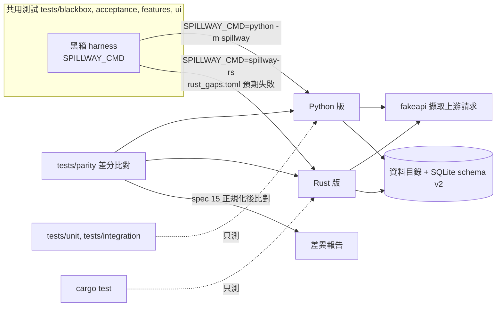

# CHG-20261108-01 — 雙實作基礎:保留 Python 版、新增 Rust 版、跨實作一致性契約

- 專案:spillway
- 分支(Branch):`chg-20261108-01`(自 `chg-20261107-03` 91d959f 分出,疊在黑箱化(一)之上;CHG-20261107-03 合回 main 後改以 main 為基底 rebase);本筆命中安全邊界與供應鏈(永遠停點,DIR-4 規則 3(c)),驗收通過後**停下**,擁有者確認後才合回 main 並推送
- 日期:2026-11-08(UTC+0)
- 類型:方向變更(需求)+ 新實作(Rust 骨架)+ 測試基礎(一致性比對)+ Python 新功能(設定檔驅動 adapter)
- Template: plan
- 提出者:擁有者(使用者,2026-11-08「保留python版本並增加rust版本 / 如果可以則共用測試單元 / 不行的話再各自獨立並且要求兩邊輸出輸入必須一致」;同日決定一致程度、adapter 擴充、上游請求比對、過渡期四項)
- 實作者:claude-opus-5-5(主 session agent;平行 task 由其派出的子 agent 施工)
- 風險分級:高——命中供應鏈(新增 Rust 工具鏈與 crates 相依);命中安全邊界(Rust 版簽發存取 token、實作測試控制介面的開啟條件,須與 spec 13.1 一致);跨模組介面(spec 新增一致性契約,之後每筆 CHG 都受約束);改變既定方向(DIR-5「Python 退役」取消)。
- Commit/PR:`chg-20261108-01` 分支上訊息以 `CHG-20261108-01:` 開頭的 commit;合回 main 後回填
- 驗收報告(預留):ACC-20261108-01
- 重複性檢查(Recurrence check):無重複(首次雙實作;DIR-5 規則 4 的方向改變,不是重做)
- Diagrams:見「## 設計圖」節
- Security-impact:見「## 安全影響」節
- Skill: ai-sdlc-autopilot v1.69
- 關聯:knowledge DIR-1–DIR-5;Guideline M5;Rust 評估報告(`sdlc_docs/knowledge/rust-evaluation.md`);CHG-20261107-03(黑箱 harness、`SPILLWAY_CMD`、`impl_dependent.toml`);spec 7.6、AC-19、13、14;design D11、D41、D44

## 動機

1. 擁有者 2026-11-08 改變 M5 的終點:原本「Rust 版通過同一套測試後,Python 版退役」(DIR-5、Guideline M5),改為兩個實作長期並存。
2. 擁有者要求測試能共用就共用;不能共用的各自獨立,但兩邊的輸入與輸出必須一致。CHG-20261107-03 已讓 behave、acceptance、畫面測試與 `tests/blackbox` 只經 `SPILLWAY_CMD` 操作 spillway,這一部分可直接共用;`tests/unit`、`tests/integration` 會 import `spillway`,不能共用,需要另一種方式保證一致。
3. 兩處先天差異要在規格層處理:adapter 擴充機制(DIR-5 規則 4 ①:Rust 讀設定檔;Python 載入模組)與上游 HTTP client(DIR-5 規則 4 ②:Rust 自寫;Python 用 litellm)。

## 使用者故事

1. 作為擁有者,我要保留現在的 Python 版,同時有一個 Rust 版,兩者可以任選一個啟動,使用同一個資料目錄格式。
2. 作為擁有者,我要同一套黑箱測試以 `SPILLWAY_CMD` 切換後兩邊都跑;不能共用的測試各自寫,另以一致性比對保證兩邊對同一組輸入產生語意相同的輸出。
3. 作為擁有者,我要 Rust 版逐步追上:尚未實作的功能列在差距清單,清單以外的測試必須通過;追齊後,之後每筆 CHG 都要兩邊同時通過才能合併。

## 決策與取捨

| # | 決策 | 選項 | 依據 | 結論 |
|---|------|------|------|------|
| 1 | **(使用者決定 2026-11-08)** 保留 Python 版並新增 Rust 版;測試能共用則共用,不能共用則各自獨立且兩邊輸入輸出必須一致 | — | 使用者原話(見「提出者」) | 使用者決定;取消 DIR-5 / Guideline M5 的「Python 退役」 |
| 2 | **(使用者決定 2026-11-08)** 一致程度:語意一致——狀態碼、契約指定的 header、JSON 內容(鍵順序不計、數值以 JSON 數值比較)、DB 資料列、結構化 log 事件相同;時間戳、request id、token、隨機值等不定值依 spec 15 的正規化規則替換後再比 | 語意一致 / 逐位元組一致 | 逐位元組要對齊 JSON 序列化與錯誤字串細節,成本高、對使用者無差別 | 使用者選語意一致 |
| 3 | **(使用者決定 2026-11-08)** adapter 擴充:兩邊都支援設定檔驅動的 adapter 資料夾(manifest + `models.yaml`,宣告內建協定 openai-compatible / anthropic / gemini / cli 之一);一致性以設定檔 adapter 為準。Python 既有的「載入 Python 模組」保留為 Python 專屬擴充,列入允許差異清單 | 兩邊都支援設定檔 / 兩邊只用設定檔 / 各自保留 | Python 既有擴充不必拆;新的共同機制讓 AC-19 有跨實作版本 | 使用者選兩邊都支援設定檔 |
| 4 | **(使用者決定 2026-11-08)** 送往供應商的請求納入一致性比對:由 fakeapi 擷取兩邊送出的請求,比 method、path、驗證方式(只比 header 名稱與是否存在,不記錄值)、JSON body;litellm 自帶的 `user-agent`、`x-stainless-*` 等 header 列入正規化忽略清單(spec 15.3) | 納入語意比對 / 不納入 | 使用者的金鑰與額度花在上游請求上,兩邊送出的內容不同會造成計費與行為差異 | 使用者選納入 |
| 5 | **(使用者決定 2026-11-08)** 過渡期:Rust 版逐模組移植,未實作的功能列在 `tests/parity/rust_gaps.toml`;共用黑箱測試以 Rust 版執行時,清單內的測試標為預期失敗(strict:預期失敗卻通過時判失敗,強迫刪除清單項);清單清空後,Guideline 與 DIR-5 規則 5 生效「之後每筆 CHG 兩邊同時通過才能合併」 | 差距清單後追齊 / 從現在起兩邊同步 | 一次做到功能齊全的 Rust 版無法分批審議 | 使用者選差距清單後追齊 |
| 6 | 一致性的裁決順序:spec 為準;spec 沒寫到的行為,以 Python 版為參考實作(差分比對的基準側);發現差異時,先判斷是 spec 缺漏(補 spec)還是任一側缺陷(修該側),不得以「改測試迎合 Rust」結案 | spec 優先 / Python 優先 | Python 版是目前實際使用、測試最完整的版本;spec 是跨語言唯一正本 | 代使用者決定 |
| 7 | Rust 位置:同一 repo 的 `rust/`(cargo workspace),執行檔名 `spillway-rs`;以 `SPILLWAY_CMD=rust/target/release/spillway-rs` 跑共用測試 | 同 repo / 另開 repo | 共用測試、spec 與 ledger 在同一 repo,版本對應最單純 | 代使用者決定 |
| 8 | 資料目錄:兩邊讀寫同一種資料目錄配置與 SQLite schema(data.md、`tests/blackbox/golden/schema_v2.json` 已是跨語言契約);任一實作建立的資料目錄可由另一實作開啟;不支援兩個實作同時開同一個 HOME(沿用單一實例鎖,spec 14) | 共用 / 各自格式 | 擁有者可隨時切換實作而不搬資料 | 代使用者決定 |
| 9 | 不能共用的測試:Python 保留 `tests/unit`、`tests/integration`;Rust 以 `cargo test` 撰寫自己的單元與整合測試;兩邊的一致性由 `tests/parity/` 差分比對負責(同一組情境分別送進兩個 `SPILLWAY_CMD`,擷取對外回應、fakeapi 收到的上游請求、DB 資料列、`SPILLWAY-LOG` 事件,依 spec 15 正規化後比對) | — | 單元測試綁語言內部,不能共用;差分比對只經黑箱介面,換實作不用改 | 代使用者決定 |
| 10 | Rust 工具鏈與相依鎖定:`rust/rust-toolchain.toml` 釘住確切版本(stable 確切號,施工時取當日最新 stable 並記錄);`Cargo.lock` 入版控(含 crates.io checksum),建置一律 `cargo build --locked`;相依限 tokio、axum、hyper、serde、serde_json、rusqlite(`bundled`)、reqwest(`rustls-tls`,不用 openssl)、clap、tracing;新增其他 crate 需在 CHG 列出;冷卻期比照 Python(不採用上架未滿 7 天的版本,施工時以 `cargo update --precise` 選版並查 RustSec) | — | 比照 CHG-20261107-01 的供應鏈規則;Cargo.lock 的 checksum 相當於雜湊鎖 | 代使用者決定 |
| 11 | 本筆 Rust 的範圍只到骨架:spec 14 行程契約(結束碼、`TOKEN_NOTICE`、stderr、就緒與綁定、單一實例鎖、SIGINT/SIGTERM)、spec 13.1 測試控制介面開啟條件與 `SPILLWAY_HOME` 檢查、`/__test__/clock` 與健康檢查端點、資料目錄初始化(schema v2)。其餘功能全部列入 `rust_gaps.toml`,於後續移植 CHG 逐模組實作 | 骨架 / 一次移植 | 先打通「同一套測試跑兩邊」與差分比對的管線,再分批移植 | 代使用者決定 |
| 12 | Rust 工具鏈的安裝由擁有者執行(需要從網路下載並執行安裝程式,不由 agent 代為執行);本機目前沒有 `cargo`、`rustc`。T3 開工前的前置條件 | — | 安全規則:下載與執行外部安裝程式需擁有者本人執行 | 前置條件(見「## 狀態」) |

## 設計圖

## 安全影響

| 類別 | 命中 | 說明 |
|------|------|------|
| new-dependency | 是 | 新增 Rust 工具鏈與決策 10 列出的 crates;`Cargo.lock` 含 checksum,`--locked` 建置;冷卻期與 RustSec 查核;Python 端不新增相依(manifest 以既有的 PyYAML/標準庫解析,施工時確認) |
| secrets | 是(有限) | Rust 版會讀取使用者設定的供應商金鑰並送往上游;差分比對只記錄驗證 header 的名稱與是否存在,不記錄值;fakeapi 用測試金鑰;不讀、不轉送訂閱 OAuth token(DIR-2) |
| security-boundary | 是 | Rust 版的 `/__test__/*` 開啟條件必須與 spec 13.1 一致(只在 `SPILLWAY_TEST_CONTROL=1` 且 HOME 檢查通過時掛載;一般 serve 一律 404、不出現在 API 文件);共用的 `test_control_contract.py` 以 Rust 版執行時不得列入差距清單 |
| irreversible-delete | 否 | — |
| prod-migration | 否 | 不改 schema;Rust 版建立 schema v2 須與 golden 相同 |
| payments | 否 | — |
| auth | 是 | Rust 版簽發存取 token(spec 14.2 `TOKEN_NOTICE`);token 只寫入 stdout 單行、DB 只存 sha256,與 Python 版相同,由共用的行程契約測試與 stdout 遮罩檢查驗證 |

已知限制(初稿,審議後補):

1. 語意一致不保證效能一致;Rust 與 Python 的延遲、記憶體不納入一致性比對(只各自有 NFR 門檻)。
2. 差分比對只涵蓋情境語料內的輸入;語料外的差異靠共用黑箱測試與 spec 補足。
3. Python 專屬的模組擴充(決策 3)沒有跨實作版本,AC-19 的模組版本測試留在 `impl_dependent.toml`。
4. 固定 seed 的抽選序列跨實作不保證相同(spec 13.4.2),AC-4 以統計範圍判定,不納入逐筆差分。

## 修改指引

### 目標

- 方向:DIR-5、Guideline M5 改為雙實作並存;spec 新增 §15 跨實作一致性契約。
- Python:新增設定檔驅動 adapter(spec 7.6 增補),既有模組擴充不變。
- Rust:`rust/` workspace 骨架通過共用的行程契約與測試控制開啟條件測試。
- 測試:`tests/parity/` 差分比對與 `rust_gaps.toml`;本機閘兩邊都跑。

### 影響範圍

- 文件:`sdlc_docs/knowledge/knowledge.md`(DIR-5 改寫、DIR-3 註記)、`sdlc_docs/ai-guideline.md`(M5 列、§6 選型)、`docs/spec.md`(7.6 設定檔 adapter、AC-19 增補、新 §15)、design(D45 雙實作、D11 修訂)、data、logical、directory、README。
- Python:`src/spillway/adapters/`(設定檔 adapter 載入與內建協定對應)、`src/spillway/` 的 adapter 註冊處;既有行為不變。
- Rust:新增 `rust/`(Cargo.toml、Cargo.lock、rust-toolchain.toml、`crates/spillway-rs/`)。
- 測試:`tests/parity/`(新增)、`tests/blackbox/harness.py`(辨識實作、套用差距清單)、`tests/blackbox/conftest.py` 與 behave `environment.py`(預期失敗標記)、`impl_dependent.toml`(與差距清單分工說明)。

### Global Constraints(全域約束——每個 task 都要遵守)

- 不改既有 feature 文字與既有斷言的意義;Python 版全量閘維持全綠。
- 共用測試不得因 Rust 版而放寬;差異一律依決策 6 處理,不改測試迎合任一側。
- 不在 repo、log、測試輸出、差分報告中出現金鑰或 token 值;不讀、不轉送訂閱 OAuth token(DIR-2)。
- Rust 建置一律 `--locked`;不新增決策 10 以外的 crate。
- commit 訊息以 `CHG-20261108-01:` 開頭,結尾加 Co-Authored-By 行。

### 契約清單

| 契約 | 提供方 | 讀取方 | 本筆變更 | 契約測試(路徑/無) |
|------|--------|--------|----------|----------------------|
| spec 15 跨實作一致性(正規化規則、比對面:對外回應、上游請求、DB、log 事件) | T1 | T4、後續移植 CHG | 新增 | tests/parity/test_normalize.py(正規化規則自測) |
| 設定檔 adapter 資料夾格式(manifest、`models.yaml`、內建協定清單) | T1、T2 | Python、Rust | 新增 | tests/blackbox/test_config_adapter_contract.py(兩邊共用) |
| spec 13、14(測試控制開啟條件、行程契約) | CHG-20261107-03 | Rust 版(T3) | Rust 版新實作 | tests/blackbox/test_control_contract.py、test_process_contract.py 以 Rust 版執行 |
| DB schema v2 | CHG-20261107-03 | Rust 版(T3) | Rust 版新實作 | tests/blackbox/test_schema_contract.py 以 Rust 版執行 |
| `rust_gaps.toml` 格式與 strict 預期失敗 | T4 | 本機閘 | 新增 | tests/parity/test_gaps_file.py |

### Tasks(checkbox=續作點)

- [ ] T1. 方向與規格
  - interfaces: consumes 決策 1–9 / produces knowledge DIR-5 改寫(規則 3 改寫、新增規則 5 雙實作並存與一致性、規則 4 ① ② 的適用說明)、DIR-3 註記、Guideline M5 列與 §6、spec 7.6 增補、AC-19 增補、spec §15、design D45、D11 修訂
  - test: ai-sdlc doc-integrity lint 回 ok
  - L1: 不適用(文件變更,無程式行為;由 doc-integrity lint 核對)
  - L2: 不適用(文件變更,無整合行為)
  - L3: 不適用(文件變更,無使用者情境)
  - L4: 不適用(文件變更;驗收時以決策 1–5 的使用者原話核對 DIR-5 與 Guideline 文字)
- [ ] T2. Python 設定檔驅動 adapter
  - interfaces: consumes spec 7.6 增補 / produces 設定檔 adapter 載入;四種內建協定對應到既有 adapter 實作
  - test: `.venv/bin/python -m pytest tests/unit tests/integration -q -k config_adapter && SPILLWAY_BLACKBOX_GUARD=1 .venv/bin/python -m pytest tests/blackbox/test_config_adapter_contract.py -q`
  - L1: manifest 解析正反樣本(缺欄位、未知協定、模型清單格式錯)
  - L2: 載入後 `GET /api/adapters` 列出、以該 provider 建立的成員可被路由呼叫
  - L3: AC-19 設定檔版本情境(m2_adapters.feature 新增情境)
  - L4: Python 全量閘綠
- [ ] T3. Rust 骨架(前置:擁有者安裝 Rust 工具鏈,決策 12)
  - interfaces: consumes spec 13.1、13.4(clock)、14、data.md、schema v2 golden / produces `rust/` workspace、`spillway-rs` 執行檔
  - test: `cd rust && cargo test --locked && cargo clippy --locked -- -D warnings` 以及 `SPILLWAY_CMD=rust/target/release/spillway-rs .venv/bin/python -m pytest tests/blackbox/test_process_contract.py tests/blackbox/test_control_contract.py tests/blackbox/test_schema_contract.py -q`(差距清單內的項目為預期失敗)
  - L1: cargo 單元測試(結束碼對應、HOME 檢查、token 雜湊)
  - L2: 共用行程契約、控制開啟條件、schema 契約以 Rust 版執行
  - L3: 不適用(本筆 Rust 尚無使用者功能,決策 11)
  - L4: 全量共用黑箱以 Rust 版執行,清單外全綠、清單內 strict 預期失敗
- [ ] T4. 一致性比對與差距清單
  - interfaces: consumes spec 15、fakeapi 擷取 / produces `tests/parity/`(runner、normalize、情境語料)、`tests/parity/rust_gaps.toml`、harness 與 behave 的預期失敗標記
  - test: `.venv/bin/python -m pytest tests/parity -q`
  - L1: 正規化規則自測
  - L2: Python 對 Python 的自我比對為零差異(證明正規化足夠)
  - L3: 兩邊共同支援的情境(T3 範圍)差分為零
  - L4: 注入一個刻意差異時 runner 判失敗(突變證明)
- [ ] T5. 本機閘與文件收尾
  - interfaces: consumes T1–T4 / produces 本機閘腳本(README 記載)、regression 列、directory 更新
  - test: 本機閘全綠
  - L1: 不適用(只整合腳本與文件,無新邏輯)
  - L2: 不適用(閘腳本只串接 T2–T4 已各自測過的指令,沒有新的整合點)
  - L3: 不適用(沒有新的使用者情境;閘腳本只給開發者執行)
  - L4: 本機閘全段綠

### Behaviour spec

- feature: tests/features/m2_adapters.feature

新增 AC-19 設定檔版本情境;既有情境文字不改。

### Interaction spec

- kind: cli
- cmd: SPILLWAY_CMD=rust/target/release/spillway-rs .venv/bin/python -m pytest tests/blackbox/test_process_contract.py -q --junitxml=artifacts/m5b/rust-process.xml
- artifacts: artifacts/m5b/rust-process.xml
- kind: service-protocol
- cmd: SPILLWAY_CMD=rust/target/release/spillway-rs .venv/bin/python -m pytest tests/blackbox/test_control_contract.py tests/blackbox/test_config_adapter_contract.py -q --junitxml=artifacts/m5b/rust-control.xml
- artifacts: artifacts/m5b/rust-control.xml
- kind: library-api
- cmd: .venv/bin/python -m pytest tests/parity -q --junitxml=artifacts/m5b/parity.xml
- artifacts: artifacts/m5b/parity.xml

`spillway-rs serve` / `init` 的參數與結束碼與 Python 版相同(spec 14);無新畫面。

### Acceptance operation

- operate:(1) 全新 lock venv 跑 Python 全量閘;(2) 擁有者已安裝的工具鏈下 `cargo build --release --locked`;(3) 共用黑箱全集以 `SPILLWAY_CMD=spillway-rs` 執行;(4) `tests/parity` 全集;(5) 一般 `spillway-rs serve` 探測 `/__test__/*` 為 404、`SPILLWAY_TEST_CONTROL=1` 未設 HOME 時結束碼 2;(6) 以 Python 版建立的資料目錄啟動 Rust 版,反之亦然。
- observe:(1) 全綠;(3) 清單外全綠、清單內 strict 預期失敗且無意外通過;(4) 零差異;(5)(6) 與 spec 相同。
- pass:以上成立;DIR-5 與 Guideline 文字與使用者原話一致。通過後停在合併前,交擁有者確認。

### 本機閘

Python 全量閘(CHG-20261107-03 的四段)+ `cargo test --locked` + `cargo clippy --locked -- -D warnings` + 共用黑箱以 Rust 版執行 + `pytest tests/parity`。

### 規格書與結構文件更新

- [ ] sdlc_docs/knowledge/knowledge.md:DIR-5 改寫、DIR-3 註記
- [ ] sdlc_docs/ai-guideline.md:M5 列、§6 選型、§7.1 版本列
- [ ] docs/spec.md:7.6 增補、AC-19 增補、§15
- [ ] sdlc_docs/structure/design.md、data.md、logical.md、directory.md
- [ ] README.md:雙實作、Rust 建置、差距清單
- [ ] sdlc_docs/acceptance/regression.md:一致性比對、Rust 共用黑箱列

#### 刻意不改

| 項目 | 為什麼本筆不改 |
|------|----------------|
| Python 的模組擴充(AC-19 原版) | 決策 3:保留為 Python 專屬 |
| 既有 feature 文字與斷言 | Global Constraints |
| Rust 的功能移植(路由、額度、adapter、MCP、UI API 等) | 決策 11:後續移植 CHG |

### 風險與回滾

| 風險 | 影響 | 對策 |
|------|------|------|
| 正規化規則過寬,掩蓋真實差異 | 一致性形同虛設 | 正規化清單寫在 spec 15,逐項列出欄位;T4 L4 突變證明 |
| 差距清單長期不清 | Rust 版永遠落後 | strict 預期失敗;每筆移植 CHG 須刪除對應項 |
| 兩實作維護成本加倍 | 之後每筆 CHG 變大 | DIR-5 規則 5 寫明;擁有者已接受(決策 1) |
| Rust 測試控制介面開啟條件錯誤 | 一般 serve 暴露可改寫狀態的端點 | 共用控制契約測試不得列入差距清單;驗收 (5) |

回滾:revert 本 CHG 的 merge commit;Python 版不受影響。

## 後續 CHG

- 黑箱化(二)(CHG-20261107-03 已列範圍)。
- Rust 逐模組移植(可再拆):設定與資料目錄 → 路由與額度 → 內建協定 adapter → CLI adapter → MCP → Web UI API;每筆刪除對應的差距清單項。

## 審議紀錄

### 決策審議

(待執行:高風險,全席 + 獨立仲裁,DIR-1)

## 狀態

草稿——待決策審議;確認閘前需擁有者確認代使用者決定的決策 6–11,並完成決策 12 的工具鏈安裝(T3 開工前)。CHG-20261107-03 仍在驗收,與本筆分開進行。
