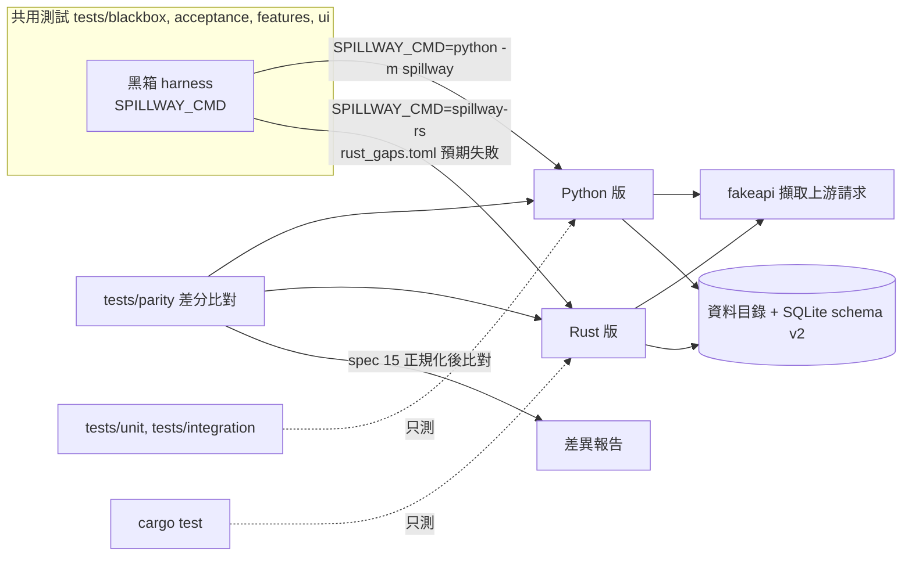

# CHG-20261108-01 — 雙實作基礎:保留 Python 版、新增 Rust 版、跨實作一致性契約

- 專案:spillway
- 分支(Branch):`chg-20261108-01`(自 `chg-20261107-03` 91d959f 分出,疊在黑箱化(一)之上;CHG-20261107-03 合回 main 後改以 main 為基底 rebase);本筆命中安全邊界與供應鏈(永遠停點,DIR-4 規則 3(c)),驗收通過後**停下**,擁有者確認後才合回 main 並推送
- 日期:2026-11-08(UTC+0)
- 類型:方向變更(需求)+ 新實作(Rust 骨架)+ 測試基礎(一致性比對)+ Python 新功能(設定檔驅動 adapter)
- Template: plan
- 提出者:擁有者(使用者,2026-11-08「保留python版本並增加rust版本 / 如果可以則共用測試單元 / 不行的話再各自獨立並且要求兩邊輸出輸入必須一致」;同日決定一致程度、adapter 擴充、上游請求比對、過渡期四項)
- 實作者:claude-opus-5-5(主 session agent;平行 task 由其派出的子 agent 施工)
- 風險分級:高——命中供應鏈(新增 Rust 工具鏈與 crates 相依);命中安全邊界(Rust 版簽發存取 token、實作測試控制介面的開啟條件,須與 spec 13.1 一致);跨模組介面(spec 新增一致性契約,之後每筆 CHG 都受約束);改變既定方向(DIR-5「Python 退役」取消)。
- Commit/PR:`chg-20261108-01` 分支上訊息以 `CHG-20261108-01:` 開頭的 commit;合回 main 後回填
- 驗收報告(預留):ACC-20261108-01
- 重複性檢查(Recurrence check):無重複(首次雙實作;DIR-5 規則 4 的方向改變,不是重做)
- Diagrams:見「## 設計圖」節
- Security-impact:見「## 安全影響」節
- Skill: ai-sdlc-autopilot v1.69
- 關聯:knowledge DIR-1–DIR-5;Guideline M5;Rust 評估報告(`sdlc_docs/knowledge/rust-evaluation.md`);CHG-20261107-03(黑箱 harness、`SPILLWAY_CMD`、`impl_dependent.toml`);spec 7.6、AC-19、13、14;design D11、D41、D44

## 動機

1. 擁有者 2026-11-08 改變 M5 的終點:原本「Rust 版通過同一套測試後,Python 版退役」(DIR-5、Guideline M5),改為兩個實作長期並存。
2. 擁有者要求測試能共用就共用;不能共用的各自獨立,但兩邊的輸入與輸出必須一致。CHG-20261107-03 已讓 behave、acceptance、畫面測試與 `tests/blackbox` 只經 `SPILLWAY_CMD` 操作 spillway,這一部分可直接共用;`tests/unit`、`tests/integration` 會 import `spillway`,不能共用,需要另一種方式保證一致。
3. 兩處先天差異要在規格層處理:adapter 擴充機制(DIR-5 規則 4 ①:Rust 讀設定檔;Python 載入模組)與上游 HTTP client(DIR-5 規則 4 ②:Rust 自寫;Python 用 litellm)。

## 使用者故事

1. 作為擁有者,我要保留現在的 Python 版,同時有一個 Rust 版,兩者可以任選一個啟動,使用同一個資料目錄格式。
2. 作為擁有者,我要同一套黑箱測試以 `SPILLWAY_CMD` 切換後兩邊都跑;不能共用的測試各自寫,另以一致性比對保證兩邊對同一組輸入產生語意相同的輸出。
3. 作為擁有者,我要 Rust 版逐步追上:尚未實作的功能列在差距清單,清單以外的測試必須通過;追齊後,之後每筆 CHG 都要兩邊同時通過才能合併。

## 決策與取捨

| # | 決策 | 選項 | 依據 | 結論 |
|---|------|------|------|------|
| 1 | **(使用者決定 2026-11-08)** 保留 Python 版並新增 Rust 版;測試能共用則共用,不能共用則各自獨立且兩邊輸入輸出必須一致 | — | 使用者原話(見「提出者」) | 使用者決定;取消 DIR-5 / Guideline M5 的「Python 退役」 |
| 2 | **(使用者決定 2026-11-08)** 一致程度:語意一致——狀態碼、契約指定的 header、JSON 內容(鍵順序不計、數值以 JSON 數值比較)、DB 資料列、結構化 log 事件相同;時間戳、request id、token、隨機值等不定值依 spec 15 的正規化規則替換後再比 | 語意一致 / 逐位元組一致 | 逐位元組要對齊 JSON 序列化與錯誤字串細節,成本高、對使用者無差別 | 使用者選語意一致 |
| 3 | **(使用者決定 2026-11-08)** adapter 擴充:兩邊都支援設定檔驅動的 adapter 資料夾(manifest + `models.yaml`,宣告內建協定 openai-compatible / anthropic / gemini / cli 之一);一致性以設定檔 adapter 為準。Python 既有的「載入 Python 模組」保留為 Python 專屬擴充,列入允許差異清單 | 兩邊都支援設定檔 / 兩邊只用設定檔 / 各自保留 | Python 既有擴充不必拆;新的共同機制讓 AC-19 有跨實作版本 | 使用者選兩邊都支援設定檔 |
| 4 | **(使用者決定 2026-11-08)** 送往供應商的請求納入一致性比對:由 fakeapi 擷取兩邊送出的請求,比 method、path、驗證方式(只比 header 名稱與是否存在,不記錄值)、JSON body;litellm 自帶的 `user-agent`、`x-stainless-*` 等 header 列入正規化忽略清單(spec 15.3) | 納入語意比對 / 不納入 | 使用者的金鑰與額度花在上游請求上,兩邊送出的內容不同會造成計費與行為差異 | 使用者選納入 |
| 5 | **(使用者決定 2026-11-08)** 過渡期:Rust 版逐模組移植,未實作的功能列在 `tests/parity/rust_gaps.toml`;共用黑箱測試以 Rust 版執行時,清單內的測試標為預期失敗(strict:預期失敗卻通過時判失敗,強迫刪除清單項);清單清空後,Guideline 與 DIR-5 規則 5 生效「之後每筆 CHG 兩邊同時通過才能合併」 | 差距清單後追齊 / 從現在起兩邊同步 | 一次做到功能齊全的 Rust 版無法分批審議 | 使用者選差距清單後追齊 |
| 6 | 一致性的裁決順序:spec 為準;spec 沒寫到的行為,以 Python 版為參考實作(差分比對的基準側);發現差異時,先判斷是 spec 缺漏(補 spec)還是任一側缺陷(修該側),不得以「改測試迎合 Rust」結案 | spec 優先 / Python 優先 | Python 版是目前實際使用、測試最完整的版本;spec 是跨語言唯一正本 | 代使用者決定 |
| 7 | Rust 位置:同一 repo 的 `rust/`(cargo workspace),執行檔名 `spillway-rs`;以 `SPILLWAY_CMD=rust/target/release/spillway-rs` 跑共用測試 | 同 repo / 另開 repo | 共用測試、spec 與 ledger 在同一 repo,版本對應最單純 | 代使用者決定 |
| 8 | 資料目錄:兩邊讀寫同一種資料目錄配置與 SQLite schema(data.md、`tests/blackbox/golden/schema_v2.json` 已是跨語言契約);任一實作建立的資料目錄可由另一實作開啟;不支援兩個實作同時開同一個 HOME(沿用單一實例鎖,spec 14) | 共用 / 各自格式 | 擁有者可隨時切換實作而不搬資料 | 代使用者決定 |
| 9 | 不能共用的測試:Python 保留 `tests/unit`、`tests/integration`;Rust 以 `cargo test` 撰寫自己的單元與整合測試;兩邊的一致性由 `tests/parity/` 差分比對負責(同一組情境分別送進兩個 `SPILLWAY_CMD`,擷取對外回應、fakeapi 收到的上游請求、DB 資料列、`SPILLWAY-LOG` 事件,依 spec 15 正規化後比對) | — | 單元測試綁語言內部,不能共用;差分比對只經黑箱介面,換實作不用改 | 代使用者決定 |
| 10 | Rust 工具鏈與相依鎖定:`rust/rust-toolchain.toml` 釘住確切版本(stable 確切號,施工時取當日最新 stable 並記錄);`Cargo.lock` 入版控(含 crates.io checksum),建置一律 `cargo build --locked`;相依限 tokio、axum、hyper、serde、serde_json、rusqlite(`bundled`)、reqwest(`rustls-tls`,不用 openssl)、clap、tracing;新增其他 crate 需在 CHG 列出;冷卻期比照 Python(不採用上架未滿 7 天的版本,施工時以 `cargo update --precise` 選版並查 RustSec) | — | 比照 CHG-20261107-01 的供應鏈規則;Cargo.lock 的 checksum 相當於雜湊鎖 | 代使用者決定 |
| 11 | 本筆 Rust 的範圍只到骨架:spec 14 行程契約(結束碼、`TOKEN_NOTICE`、stderr、就緒與綁定、單一實例鎖、SIGINT/SIGTERM)、spec 13.1 測試控制介面開啟條件與 `SPILLWAY_HOME` 檢查、`/__test__/clock` 與健康檢查端點、資料目錄初始化(schema v2)。其餘功能全部列入 `rust_gaps.toml`,於後續移植 CHG 逐模組實作 | 骨架 / 一次移植 | 先打通「同一套測試跑兩邊」與差分比對的管線,再分批移植 | 代使用者決定 |
| 12 | Rust 工具鏈的安裝由擁有者執行(需要從網路下載並執行安裝程式,不由 agent 代為執行);本機目前沒有 `cargo`、`rustc`。T3 開工前的前置條件 | — | 安全規則:下載與執行外部安裝程式需擁有者本人執行 | 前置條件(見「## 狀態」) |

## 設計圖

## 安全影響

| 類別 | 命中 | 說明 |
|------|------|------|
| new-dependency | 是 | 新增 Rust 工具鏈與決策 10 列出的 crates;`Cargo.lock` 含 checksum,`--locked` 建置;冷卻期與 RustSec 查核;Python 端不新增相依(manifest 以既有的 PyYAML/標準庫解析,施工時確認) |
| secrets | 是(有限) | Rust 版會讀取使用者設定的供應商金鑰並送往上游;差分比對只記錄驗證 header 的名稱與是否存在,不記錄值;fakeapi 用測試金鑰;不讀、不轉送訂閱 OAuth token(DIR-2) |
| security-boundary | 是 | Rust 版的 `/__test__/*` 開啟條件必須與 spec 13.1 一致(只在 `SPILLWAY_TEST_CONTROL=1` 且 HOME 檢查通過時掛載;一般 serve 一律 404、不出現在 API 文件);共用的 `test_control_contract.py` 以 Rust 版執行時不得列入差距清單 |
| irreversible-delete | 否 | — |
| prod-migration | 否 | 不改 schema;Rust 版建立 schema v2 須與 golden 相同 |
| payments | 否 | — |
| auth | 是 | Rust 版簽發存取 token(spec 14.2 `TOKEN_NOTICE`);token 只寫入 stdout 單行、DB 只存 sha256,與 Python 版相同,由共用的行程契約測試與 stdout 遮罩檢查驗證 |

已知限制(初稿,審議後補):

1. 語意一致不保證效能一致;Rust 與 Python 的延遲、記憶體不納入一致性比對(只各自有 NFR 門檻)。
2. 差分比對只涵蓋情境語料內的輸入;語料外的差異靠共用黑箱測試與 spec 補足。
3. Python 專屬的模組擴充(決策 3)沒有跨實作版本,AC-19 的模組版本測試留在 `impl_dependent.toml`。
4. 固定 seed 的抽選序列跨實作不保證相同(spec 13.4.2),AC-4 以統計範圍判定,不納入逐筆差分。

## 修改指引

### 目標

- 方向:DIR-5、Guideline M5 改為雙實作並存;spec 新增 §15 跨實作一致性契約。
- Python:新增設定檔驅動 adapter(spec 7.6 增補),既有模組擴充不變。
- Rust:`rust/` workspace 骨架通過共用的行程契約與測試控制開啟條件測試。
- 測試:`tests/parity/` 差分比對與 `rust_gaps.toml`;本機閘兩邊都跑。

### 影響範圍

- 文件:`sdlc_docs/knowledge/knowledge.md`(DIR-5 改寫、DIR-3 註記)、`sdlc_docs/ai-guideline.md`(M5 列、§6 選型)、`docs/spec.md`(7.6 設定檔 adapter、AC-19 增補、新 §15)、design(D45 雙實作、D11 修訂)、data、logical、directory、README。
- Python:`src/spillway/adapters/`(設定檔 adapter 載入與內建協定對應)、`src/spillway/` 的 adapter 註冊處;既有行為不變。
- Rust:新增 `rust/`(Cargo.toml、Cargo.lock、rust-toolchain.toml、`crates/spillway-rs/`)。
- 測試:`tests/parity/`(新增)、`tests/blackbox/harness.py`(辨識實作、套用差距清單)、`tests/blackbox/conftest.py` 與 behave `environment.py`(預期失敗標記)、`impl_dependent.toml`(與差距清單分工說明)。

### Global Constraints(全域約束——每個 task 都要遵守)

- 不改既有 feature 文字與既有斷言的意義;Python 版全量閘維持全綠。
- 共用測試不得因 Rust 版而放寬;差異一律依決策 6 處理,不改測試迎合任一側。
- 不在 repo、log、測試輸出、差分報告中出現金鑰或 token 值;不讀、不轉送訂閱 OAuth token(DIR-2)。
- Rust 建置一律 `--locked`;不新增決策 10 以外的 crate。
- commit 訊息以 `CHG-20261108-01:` 開頭,結尾加 Co-Authored-By 行。

### 契約清單

| 契約 | 提供方 | 讀取方 | 本筆變更 | 契約測試(路徑/無) |
|------|--------|--------|----------|----------------------|
| spec 15 跨實作一致性(正規化規則、比對面:對外回應、上游請求、DB、log 事件) | T1 | T4、後續移植 CHG | 新增 | tests/parity/test_normalize.py(正規化規則自測) |
| 設定檔 adapter 資料夾格式(manifest、`models.yaml`、內建協定清單) | T1、T2 | Python、Rust | 新增 | tests/blackbox/test_config_adapter_contract.py(兩邊共用) |
| spec 13、14(測試控制開啟條件、行程契約) | CHG-20261107-03 | Rust 版(T3) | Rust 版新實作 | tests/blackbox/test_control_contract.py、test_process_contract.py 以 Rust 版執行 |
| DB schema v2 | CHG-20261107-03 | Rust 版(T3) | Rust 版新實作 | tests/blackbox/test_schema_contract.py 以 Rust 版執行 |
| `rust_gaps.toml` 格式與 strict 預期失敗 | T4 | 本機閘 | 新增 | tests/parity/test_gaps_file.py |

### Tasks(checkbox=續作點)

- [ ] T1. 方向與規格
  - interfaces: consumes 決策 1–9 / produces knowledge DIR-5 改寫(規則 3 改寫、新增規則 5 雙實作並存與一致性、規則 4 ① ② 的適用說明)、DIR-3 註記、Guideline M5 列與 §6、spec 7.6 增補、AC-19 增補、spec §15、design D45、D11 修訂
  - test: ai-sdlc doc-integrity lint 回 ok
  - L1: 不適用(文件變更,無程式行為;由 doc-integrity lint 核對)
  - L2: 不適用(文件變更,無整合行為)
  - L3: 不適用(文件變更,無使用者情境)
  - L4: 不適用(文件變更;驗收時以決策 1–5 的使用者原話核對 DIR-5 與 Guideline 文字)
- [ ] T2. Python 設定檔驅動 adapter
  - interfaces: consumes spec 7.6 增補 / produces 設定檔 adapter 載入;四種內建協定對應到既有 adapter 實作
  - test: `.venv/bin/python -m pytest tests/unit tests/integration -q -k config_adapter && SPILLWAY_BLACKBOX_GUARD=1 .venv/bin/python -m pytest tests/blackbox/test_config_adapter_contract.py -q`
  - L1: manifest 解析正反樣本(缺欄位、未知協定、模型清單格式錯)
  - L2: 載入後 `GET /api/adapters` 列出、以該 provider 建立的成員可被路由呼叫
  - L3: AC-19 設定檔版本情境(m2_adapters.feature 新增情境)
  - L4: Python 全量閘綠
- [ ] T3. Rust 骨架(前置:擁有者安裝 Rust 工具鏈,決策 12)
  - interfaces: consumes spec 13.1、13.4(clock)、14、data.md、schema v2 golden / produces `rust/` workspace、`spillway-rs` 執行檔
  - test: `cd rust && cargo test --locked && cargo clippy --locked -- -D warnings` 以及 `SPILLWAY_CMD=rust/target/release/spillway-rs .venv/bin/python -m pytest tests/blackbox/test_process_contract.py tests/blackbox/test_control_contract.py tests/blackbox/test_schema_contract.py -q`(差距清單內的項目為預期失敗)
  - L1: cargo 單元測試(結束碼對應、HOME 檢查、token 雜湊)
  - L2: 共用行程契約、控制開啟條件、schema 契約以 Rust 版執行
  - L3: 不適用(本筆 Rust 尚無使用者功能,決策 11)
  - L4: 全量共用黑箱以 Rust 版執行,清單外全綠、清單內 strict 預期失敗
- [ ] T4. 一致性比對與差距清單
  - interfaces: consumes spec 15、fakeapi 擷取 / produces `tests/parity/`(runner、normalize、情境語料)、`tests/parity/rust_gaps.toml`、harness 與 behave 的預期失敗標記
  - test: `.venv/bin/python -m pytest tests/parity -q`
  - L1: 正規化規則自測
  - L2: Python 對 Python 的自我比對為零差異(證明正規化足夠)
  - L3: 兩邊共同支援的情境(T3 範圍)差分為零
  - L4: 注入一個刻意差異時 runner 判失敗(突變證明)
- [ ] T5. 本機閘與文件收尾
  - interfaces: consumes T1–T4 / produces 本機閘腳本(README 記載)、regression 列、directory 更新
  - test: 本機閘全綠
  - L1: 不適用(只整合腳本與文件,無新邏輯)
  - L2: 不適用(閘腳本只串接 T2–T4 已各自測過的指令,沒有新的整合點)
  - L3: 不適用(沒有新的使用者情境;閘腳本只給開發者執行)
  - L4: 本機閘全段綠

### Behaviour spec

- feature: tests/features/m2_adapters.feature

新增 AC-19 設定檔版本情境;既有情境文字不改。

### Interaction spec

- kind: cli
- cmd: SPILLWAY_CMD=rust/target/release/spillway-rs .venv/bin/python -m pytest tests/blackbox/test_process_contract.py -q --junitxml=artifacts/m5b/rust-process.xml
- artifacts: artifacts/m5b/rust-process.xml
- kind: service-protocol
- cmd: SPILLWAY_CMD=rust/target/release/spillway-rs .venv/bin/python -m pytest tests/blackbox/test_control_contract.py tests/blackbox/test_config_adapter_contract.py -q --junitxml=artifacts/m5b/rust-control.xml
- artifacts: artifacts/m5b/rust-control.xml
- kind: library-api
- cmd: .venv/bin/python -m pytest tests/parity -q --junitxml=artifacts/m5b/parity.xml
- artifacts: artifacts/m5b/parity.xml

`spillway-rs serve` / `init` 的參數與結束碼與 Python 版相同(spec 14);無新畫面。

### Acceptance operation

- operate:(1) 全新 lock venv 跑 Python 全量閘;(2) 擁有者已安裝的工具鏈下 `cargo build --release --locked`;(3) 共用黑箱全集以 `SPILLWAY_CMD=spillway-rs` 執行;(4) `tests/parity` 全集;(5) 一般 `spillway-rs serve` 探測 `/__test__/*` 為 404、`SPILLWAY_TEST_CONTROL=1` 未設 HOME 時結束碼 2;(6) 以 Python 版建立的資料目錄啟動 Rust 版,反之亦然。
- observe:(1) 全綠;(3) 清單外全綠、清單內 strict 預期失敗且無意外通過;(4) 零差異;(5)(6) 與 spec 相同。
- pass:以上成立;DIR-5 與 Guideline 文字與使用者原話一致。通過後停在合併前,交擁有者確認。

### 本機閘

Python 全量閘(CHG-20261107-03 的四段)+ `cargo test --locked` + `cargo clippy --locked -- -D warnings` + 共用黑箱以 Rust 版執行 + `pytest tests/parity`。

### 規格書與結構文件更新

- [ ] sdlc_docs/knowledge/knowledge.md:DIR-5 改寫、DIR-3 註記
- [ ] sdlc_docs/ai-guideline.md:M5 列、§6 選型、§7.1 版本列
- [ ] docs/spec.md:7.6 增補、AC-19 增補、§15
- [ ] sdlc_docs/structure/design.md、data.md、logical.md、directory.md
- [ ] README.md:雙實作、Rust 建置、差距清單
- [ ] sdlc_docs/acceptance/regression.md:一致性比對、Rust 共用黑箱列

#### 刻意不改

| 項目 | 為什麼本筆不改 |
|------|----------------|
| Python 的模組擴充(AC-19 原版) | 決策 3:保留為 Python 專屬 |
| 既有 feature 文字與斷言 | Global Constraints |
| Rust 的功能移植(路由、額度、adapter、MCP、UI API 等) | 決策 11:後續移植 CHG |

### 風險與回滾

| 風險 | 影響 | 對策 |
|------|------|------|
| 正規化規則過寬,掩蓋真實差異 | 一致性形同虛設 | 正規化清單寫在 spec 15,逐項列出欄位;T4 L4 突變證明 |
| 差距清單長期不清 | Rust 版永遠落後 | strict 預期失敗;每筆移植 CHG 須刪除對應項 |
| 兩實作維護成本加倍 | 之後每筆 CHG 變大 | DIR-5 規則 5 寫明;擁有者已接受(決策 1) |
| Rust 測試控制介面開啟條件錯誤 | 一般 serve 暴露可改寫狀態的端點 | 共用控制契約測試不得列入差距清單;驗收 (5) |

回滾:revert 本 CHG 的 merge commit;Python 版不受影響。

## 後續 CHG

- 黑箱化(二)(CHG-20261107-03 已列範圍)。
- Rust 逐模組移植(可再拆):設定與資料目錄 → 路由與額度 → 內建協定 adapter → CLI adapter → MCP → Web UI API;每筆刪除對應的差距清單項。

## 審議紀錄

### 決策審議

2026-11-08(UTC+0),五席(security、feasibility、parity、portability、traceability)各自唯讀審議,獨立仲裁席逐項核實後裁決(DIR-1);全部同一模型。各席與仲裁的完整報告留在主 session 的 scratchpad(`rs-dr/`),不進版控;修訂全文收錄於下方,待擁有者回答後併入本文。

| 項目 | 內容 |
|------|------|
| 發現 | 五席共 197 列,合併重複後 123 項 |
| 採納 | 95 項(含修改後採納),寫成 AM-1–AM-18 |
| 不採納 | 16 項 |
| 延後 | 12 項,已指名移植 CHG |
| 範圍裁定 | 建議拆成三筆(見 §5),待擁有者確認 |
| 擁有者問題 | Q1 log 事件、Q2 cli 協定、Q3 首次建置 |
| 程序偏離 | security 席曾在列目錄時對 `~/.spillway` 執行一次 `ls`,輸出丟棄、未開啟任何檔案;違反審議指示的「不碰使用者資料目錄」,未讀到內容,僅記錄 |

[verdict] decision-review CHG-20261108-01 | pass after amendments (AM-1–AM-18) | 五席 + 獨立仲裁;建議拆成三筆;AM 尚未併入本文,併入前不得施工

#### 仲裁修訂全文(待併入本文)

#### 3. 修訂(AM)

CHG-A = 本筆 CHG-20261108-01 縮小後;CHG-B = Rust 骨架;CHG-C = 設定檔驅動 adapter(詳見 §5)。

##### 適用 CHG-A

**AM-1 拆分與 task 對應。** 標題改為「雙實作方向、跨實作一致性契約與差分管線」。「類型」拿掉「新實作(Rust 骨架)」與「Python 新功能」。決策 3、7、10、11、12 的施作移出,CHG-A 只保留 2 句記錄並指向 CHG-B、CHG-C。Tasks 依下表改寫,T3 與 T2 從本筆刪除:

| 新 task | 內容 | 來源 |
|---------|------|------|
| T1 | 方向與 spec(AM-3–AM-6) | 原 T1,扣除 spec 7.6、AC-19 增補、DIR-3 規則改寫 |
| T4a | 差距機制(AM-9) | 原 T4 拆出 |
| T4b | 差分 runner、正規化、擷取、語料(AM-6–AM-10);第二實作以包裝 Python 的突變 wrapper 充當 | 原 T4 拆出 |
| T5 | 本機閘與文件收尾(AM-4、AM-11) | 原 T5 |

依賴順序 T1 → T4a → T4b → T5。每個 task 加 `files:` 與 wave;`tests/blackbox/harness.py` 只歸 T4a。Interaction spec 只留 `kind: library-api`(`pytest tests/parity`);`cli`、`service-protocol` 兩段移到 CHG-B,`test_config_adapter_contract.py` 從 Rust 指令拿掉。Behaviour spec 依 plan_check 形式標示不適用並寫理由(`m2_adapters.feature` 移到 CHG-C)。契約清單刪除設定檔 adapter 與 Rust 兩列(各移 CHG-C、CHG-B),新增 AM-7 的擷取形狀列。Acceptance operation 改為:①全新 lock venv 跑 Python 全量閘;②`pytest tests/parity`;③突變 wrapper 必判失敗;④DIR-5 與 Guideline 文字對照 AM-3 的逐字。CHG-A 不碰安全邊界,驗收後依 DIR-4 規則 2 處理;風險分級仍為高(方向變更、跨模組契約),確認閘照舊。

**AM-2 標頭與停點更正。** CHG:4 改為「自 main 490c0bf 分出(已含 CHG-20261107-03 merge 05757e7)」;CHG:230 刪「CHG-20261107-03 仍在驗收」。CHG:4、CHG:10 不再把供應鏈寫成永遠停點:CHG-B 停在合併前的依據只有安全邊界(DIR-4 規則 3(c))。「後續 CHG」節加一句判定準則:Rust 實作 token、測試控制開啟條件、Host/Origin、憑證讀取、CLI 環境清除的移植 CHG 算安全邊界,其餘依 DIR-4 自動。

**AM-3 擁有者原話。** 「提出者」逐字補上 2026-11-08 四題的題目、選項與所選文字(主 session 從對話紀錄取得;取不到才回問擁有者),DIR-5 也新增一行原話。決策表的決策 2–5 拆成「擁有者所選」與「agent 展開的細節」兩欄,後者視同代使用者決定,在確認閘呈現。故事 1 註明「依決策 8」;動機 1 把「長期並存」改為「不再退役」。修正條文引用:CHG:13、CHG:21、CHG:23 依實際出處;鎖的出處改為 data.md:15。

**AM-4 文件更新清單逐項列出**(T1、T5 的 interfaces 與「規格書與結構文件更新」節):

- knowledge:`:14` 索引列、`:70` 標題、`:76`–`:77`、`:79` 開頭、`:81` 適用範圍、規則 3 改寫、新增規則 5(內容見 AM-11);DIR-3 只加註記,說明 `:53` 承諾的改寫由 CHG-C 執行。
- Guideline:標頭版本、`:37`(M5 列)、§4 新增一致性 FR、`:95`、§6 選型與 Q1 補充、§7 新增 M5 閘門、§7.1。`:139` 與 FR-11 隨 CHG-C。
- spec:新增 §15;`:394`、`:421`、`:425`、7.1、7.2、`:922`(NFR-7)、`:994`(13.2)、14.3.5 各標「Python 版專屬,Rust 版依 §15.x」或改為行為描述;修訂沿革加一行。
- design:D45、D11 表列與 `:131` 的契約節加註指向 CHG-C、D41、D44(與 `rust_gaps.toml` 分工)。
- `impl_dependent.toml` 註解、`rust-evaluation.md` 開頭加增補行(2026-11-08 改雙實作、本文為當時評估,422 逐字對齊的說法改依 §15)。
- CHG-20261107-03 的後續清單:在本筆逐條寫沿用或承接,特別是「AM-13 實作相依清單的處置」由本筆承接,已知限制 15(`cli.py` 結束碼 1 的後備路徑)留在黑箱化(二)於 Python 修正。
- regression:新增 `parity`、`rust` 標籤,指令經本機閘腳本,不寫 `rust/target` 路徑。
- 每份文件指定唯一 task;T1 consumes 改為決策 1–11;「刻意不改」列 `docs/proposal.md`。

**AM-5 決策 9 改寫。** 「Python 保留 `tests/unit`;`tests/integration` 的 HTTP 層測試經黑箱化(二)併入共用集,其餘留在 Python;Rust 以 `cargo test` 撰寫單元與整合測試。」設計圖 `PU` 節點同步改寫。「後續 CHG」節明定:黑箱化(二)必須在第一筆移植 CHG 前合併(依 DIR-5 規則 4 ③;骨架不是模組移植,不受此限)。每筆移植 CHG 開工前必須完成該模組的 Python 專屬測試去向表(轉黑箱 / 哪個 parity 情境 / `cargo test` 對應 / 不適用及理由);白名單、遮罩、Host 這類安全邊界列必須有黑箱版本。P-35 的 15 列附到 CHG-A 當種子。

**AM-6 §15 草案先行。** 確認閘前把 §15 草案附進 CHG,並由一席 parity 加獨立仲裁審過草案本身。T1 增加一項核對:§15 每個「已定義」的比對面都有對應 parity 情境與突變案例。§15 必須包含:

1. 裁決順序(決策 6);加上「litellm 升版的 CHG 必須重跑 parity 並處理差異」。
2. 比對面狀態表:欄位為比對面、比對單位、方式、狀態(已定義,或待定義並指名 CHG)。已定義:HTTP 狀態碼、契約 header、JSON body、錯誤物件、DB 資料列、API 上游請求。待定義:CLI 呼叫(CLI adapter 移植)、MCP 訊息序列與 `mcp-stdio`(MCP 移植)、CSV 與 YAML 匯出(設定與資料目錄移植、Web UI API 移植)、花費與 token 估算(路由與額度移植)。log 事件依 Q1。
3. 契約 header:只列舉 spec 指定者與 13.1.3 的 `cache-control`、`x-content-type-options`;其他 header 不比。Content-Type、Allow、Content-Disposition 等補進 spec 的工作隨 Web UI API 移植。
4. 相等定義:bool、null、數值、字串、陣列、物件彼此不等;缺鍵與 null 不等;陣列預設有序,無序陣列逐欄列出;數值依決策 2 以 JSON 數值比較(`1` 等於 `1.0`),§15 另列「必須為整數」的欄位再比型別。DB 另比 `typeof()`。
5. 時間:parity 一律以 `SPILLWAY_TEST_START_TIME` 啟動,時間欄逐字比;只有 `latency_ms` 這類真實不定值比型別與 `>= 0`。這項是 agent 對決策 2 的展開,確認閘要特別呈現。
6. 自由文字:`error.code`、HTTP 狀態碼永遠比。spec 明定形狀的訊息(如 `no_candidate`)逐字比。422 只比欄位路徑集合。上游原文(`usage_ledger.error`、5xx 的訊息)只比有無與不含秘密。共用測試既有的子字串斷言不受影響。
7. DB 內 JSON 文字:規範形式即現行 Python 輸出(`_dumps` 用 `ensure_ascii=False, sort_keys=True`、預設分隔符;`request_text` 不排序鍵),逐欄標 literal 或 parse-then-compare,`bytes` 逐值比。
8. 正規化:只依欄位路徑逐項列出,不依值的樣式;替換前驗形狀(regex 寫在 §15);以首次出現順序編號(`<id-1>`);埠、HOME、fake base_url、`version`、`data_dir` 列為環境衍生值。
9. 允許差異:Python 模組擴充(決策 3)、`impl_dependent.toml` 的 `on_rust` 項、MCP stdio 的 command。語料暫限單一候選 slot。

**AM-7 上游擷取。** 影響範圍加 `tests/fakes/api_upstream/server.py`。`RecordedRequest` 新增 `header_names`(全部 header 名稱的小寫集合,不存任何值)、`query_names`(只存參數名)、`auth_headers`(所有驗證 header 的名稱);非 dict 的 JSON 也記錄,非 JSON 記長度。§15.3 兩張表:必須存在清單(驗證 header、`content-type`)與忽略清單(`user-agent`、`x-stainless-*`、`accept`、`accept-encoding`、`connection`、`content-length`、`host` 逐項列出),其餘名稱差異判失敗。`echo_auth` 模式不得進語料。契約清單新增「上游請求擷取形狀(只含 header 名稱)」,測試 `tests/parity/test_capture.py`。

**AM-8 秘密處理(寫入 spec §15 與 T4b)。** ①所有擷取面進比對器前先過 `tests.blackbox.mask.mask_secrets`,原始資料只留記憶體,比較遮罩後的值;②語料金鑰只用 `sk-test-`、`sk-fake` 開頭的假值;③`tests/parity` 自測:含 sentinel 金鑰與 token 的輸入,報告、junit、log 檔位元組掃描 0 命中;④正規化之前先做 sentinel 掃描;⑤`REAL_KEY_VARS` 加 `GEMINI_API_KEY`、`GOOGLE_API_KEY`、`CODEX_API_KEY`、`CLAUDE_CODE_OAUTH_TOKEN`;⑥§15 逐欄列 `settings.access_token_sha256`、`usage_payloads`、`deployments.params` 的處理,雜湊不明列在報告中。

**AM-9 差距機制(T4a)。**

- `tests/parity/rust_gaps.toml`:`[[gap]]` 含 `kind`、`id`、`reason`、`batch`(移植批次)、`since`(CHG)、選填 `expect`(預期失敗特徵)。清單由腳本依實際收集結果產生。`test_gaps_file.py` 以實際收集結果比對,不沿用 `test_impl_dependent_ids_exist` 的凍結基準。
- 受保護清單 `tests/parity/protected.toml`,修改需走安全邊界停點;`test_gaps_file.py` 斷言與 `rust_gaps.toml` 交集為空。內容:`test_control_contract.py` 的 `test_off_every_method_and_variant_is_404_like_unknown_path`、`test_control_values_other_than_1_do_not_enable[*]`、`test_on_not_in_openapi_and_headers_and_host_origin`、`test_home_check_*`、`test_clock_*`、`test_system_clock_mode`;`test_process_contract.py` 的 `test_token_*`、`test_control_warning_line`、`test_ignored_knobs_line_lists_names_only`、`test_exit_2_*`、`test_exit_1_*`、`test_exit_3_on_newer_schema_version`、`test_sigterm_ends_by_signal`、`test_sigint_exit_130_without_traceback`、`test_init_exit_codes_and_streams`、`test_ready_and_bound_to_loopback_only`;`test_schema_contract.py` 的兩個 fresh database 測試。CHG:74、CHG:213 同步改寫為引用此清單。`test_cli_subprocess_does_not_inherit_knobs` 明文暫緩到 CLI adapter 移植。
- `impl_dependent.toml` 每項加 `on_rust`:`replace:<測試 id>`、`not_applicable`(附理由)或 `gap`。`not_applicable` 在 Rust 下 deselect 並計數。`tests/ui/test_shell.py::test_async_tests_after_ui_module_pass` 與 `test_harness.py` 也登記於此。項目不得自動變成 skip 或 xfail。
- 決策 5 的生效條件寫成:`rust_gaps.toml` 清空,且 `on_rust` 的 replace 項都有替代測試、§15 狀態表沒有待定義列。後兩項定義「追齊」的內容,確認閘呈現。
- xfail 一律 `strict=True` 並設 `raises`(限 AssertionError 與 harness 明列的「端點未實作」類例外,施工時列舉);serve 起不來不得算 xfail。冒煙前提放進 CHG-B 的閘。
- 單向規則:`test_gaps_file.py` 比對 `git show main:tests/parity/rust_gaps.toml`,已刪除的 id 不得加回,除非該 CHG 明列理由並經決策 6 判定;新增項只限新測試,由新增測試的 CHG 或下一筆跑 Rust 閘的 CHG 列入。清單條數寫進每筆 ACC。
- behave:`behave -f json` 輸出,由 `tests/parity` 的 wrapper 對照 `rust_gaps.toml` 判定結束碼,並有正反樣本自測;不把 xfail 字樣寫進 `tests/features` 與 converted roots 的 diff(`compare.py`)。
- 實作辨識:`SPILLWAY_IMPL=python|rust`。未設時視為 python;設了非預設 `SPILLWAY_CMD` 卻沒設此變數時失敗。Python 側斷言套用 0 項。`Serve(cmd=...)` 支援每實例命令;第二實作命令由 `SPILLWAY_PARITY_CMD_B` 指定。不新增產品端的實作識別欄位。

**AM-10 parity 自證(T4b)。** L2 的敘述改為「只證明正規化不過窄」。每個情境宣告預期產生的比對面,runner 斷言每一面非空;自我比對重複 2 次。語料情境標所屬模組,用 AM-9 同一機制管理。突變矩陣:comparator 層每個「已定義」比對面與每條正規化規則至少一案(含型別、缺鍵、陣列順序、時間差一秒、錯誤碼換一個);端到端至少三案經 wrapper 改動線上內容(狀態碼或 header、JSON body、DB 資料列);另加「金鑰放進回應欄位」一案。`tests/parity/test_spec_table.py` 解析 §15 表格與程式常數比對,比照 `test_tables_and_columns_match_structure_docs`。`tests/parity` 加入 `converted_roots.txt`(注意 R68)。每筆移植 CHG 必須補對應語料;機器可讀的涵蓋清單在第一筆移植 CHG 決定格式。

**AM-11 閘與規則 5。** 新增 `scripts/local_gate.sh`,CHG-A 版本串接 Python 全量閘四段與 `tests/parity`,輸出 `artifacts/gate/<sha>.json`(git sha、兩側實作標籤、測試 id 集合、各狀態計數、差距條數)。兩側 id 集合的差異必須都已登記;skip 要列出,不要求 0。`tests/acceptance/results.py` 的產物在 `SPILLWAY_IMPL=rust` 時寫入獨立子目錄。DIR-5 規則 5 分項寫明:(a)過渡期只有變更 `rust/` 或 §15 的 CHG 必須跑雙實作閘;(b)清單清空後,會改變程式或測試行為的 CHG 必須跑,純文件 CHG 與 DIR-4 規則 4 的治理 commit 不在此限;(c)找不到 cargo 或 binary 判失敗,不得略過,屬 DIR-4 規則 3(b) 停點;(d)只有一邊通過,不得成為 ACC「通過」或「部分通過」;(e)單側緊急修補的例外在清單清空前由擁有者決定,在此之前沒有例外。

**AM-12 已知限制與回滾。** 已知限制補:骨架階段差分只涵蓋結束碼、時鐘、空資料庫;決策 4 在 CHG-A 只有 Python 對 Python;清單清空不等於功能齊全;fakeapi 不等於真實上游;只在 macOS、無 CI,NFR-7 的 Windows 與 `flock(2)` 關係未定;MCP SDK 傳輸層錯誤不會逐字相同;比對只涵蓋循序請求;兩實作不可同時開同一 HOME;骨架不含 `mcp-stdio`;語料限單一候選。M5 閘門加「Rust 真實冒煙」,屬 DIR-4 規則 3(b),骨架不適用。回滾分三段寫:CHG-A 的測試與程式可 revert;方向文字不隨程式回滾,改以新 CHG 處理;CHG-B、CHG-C 各自 revert。Global Constraints 加例外路徑:既有斷言綁 Python 細節且判定為 spec 缺漏時,依決策 6 補 spec 並在該 CHG 列出。

##### 適用 CHG-B(Rust 骨架)

**AM-13 決策 11 的範圍表。** 「健康檢查端點」刪除,改列:`GET /api/settings/context`(依 data.md 預設值回應)、`GET /api/settings`(`token_issued`)、9.1.4 Host/Origin 與 403 錯誤碼、全域 404 JSON、9.1.2 格式的 405、13.2 全部旋鈕的驗證與 13.2.1 忽略行(含 13.2.2 的兩個例外)、`GET`/`POST /__test__/clock`、`GET /__test__/rng`、`serve`、`init [--rotate]`、TOKEN_NOTICE、就緒與綁定、單一實例鎖、SIGINT/SIGTERM、`init` 建立 `work/<name>`、schema v2 初始化。其餘(含 `/mcp/*`、`mcp-stdio`、`/__test__` 其餘端點、`test_log_level_lines_format`、`test_graceful_shutdown_waits_for_in_flight_request`)列 `rust_gaps.toml`。`/__test__/clock` 依 spec 13.3.4 寫死範圍 `0001-01-01T00:00:00Z` 到 `9999-12-31T23:59:59Z` 並加邊界測試。`SPILLWAY_TEST_GRACEFUL_TIMEOUT` 的文法補進 13.2.2。初始 `rust_gaps.toml` 在本筆產生。

**AM-14 決策 8 改寫。**

- `user_version` 處理表寫入 CHG 與 data.md:0 → 同一 `BEGIN IMMEDIATE` 交易套用 v1、v2;2 → 直接使用;>2 → 結束碼 3,不得列差距清單;1 → 結束碼 3、不寫入、檔案逐位元組不變,並提示用 Python 版升級。遷移測試列差距清單,批次為設定與資料目錄。data.md:10 限定為「schema 版本相同時」。
- 切換保證的前提寫明:只在兩實作支援同一 schema 版本時成立。過渡期 Python 升 schema 時,Rust 以結束碼 3 安全拒絕,該 CHG 列已知限制;清單清空後 schema 升版必須同筆帶兩邊。README 註明遷移單向,切換前要備份。不新增格式標記檔。
- DDL:Rust 以 `include_str!` 讀 `src/spillway/store/schema.sql` 與 `migrations/0002.sql`,不複製;data.md 寫明 SQLite 最低 3.35。
- 新增 `tests/parity/test_cross_open.py`,列入契約清單,雙向:開啟前後 snapshot 不變;Rust `init` 的 token 能通過 Python 的 `/mcp/*`;A 持鎖時 B 的 `serve`、`init` 結束碼 1;A 被 SIGKILL 留下 `-wal`、`-shm` 後 B 可開啟且資料完整;B 不重印 TOKEN_NOTICE。
- 鎖:直接呼叫 `flock(LOCK_EX|LOCK_NB)`;fd close-on-exec;同行程不得重開鎖檔。補進 data.md 鎖段,spec 14.1 加引用。
- 預設資料目錄:spec 把演算法逐步寫出(環境變數優先序、空字串、相對 `HOME`、macOS 也看 XDG、各平台路徑),不引用套件名;Rust 手寫,不用 `dirs`。加一項 Python 測試斷言鎖定的 platformdirs 與 spec 相符;`_home_env` 另加寫死的期望值。
- data.md 列出 `busy_timeout`、autocommit、`foreign_keys`、`synchronous` 與現行檔案權限。
- Acceptance operation (5)(6) 明寫一律用暫存 `SPILLWAY_HOME`;Rust 開真實目錄列為擁有者的另一項手動步驟。

**AM-15 安全影響與測試控制。**

① 安全影響表每個「是」列補影響範圍:new-dependency(`build.rs`、proc-macro 以擁有者權限執行,bundled C 進入持金鑰的執行檔)、secrets(骨架實際上不讀供應商金鑰也不打上游,改寫為「本筆無;自內建協定 adapter 移植起適用」;輸出面列 stdout、stderr、`SPILLWAY-LOG`、panic、差分報告、junit)、security-boundary(開啟時可繞過驗證寫 DB,HOME 檢查是唯一防線)、auth(token 可操作範圍、`init --rotate`)。

② `auth` 列改為「serve 經 stderr 的 TOKEN_NOTICE、`init` 經 stdout」。新增骨架可跑的測試:DB 值等於 token 的 sha256 十六進位、DB 檔案位元組不含 token 明文、serve 的 stdout 與 stderr(TOKEN_NOTICE 行除外)不含 token。

③ T3 L1 逐條列 13.1.2:unset、empty、default、結尾斜線、符號連結、大小寫、`$HOME` 被覆寫時的帳號家目錄、`/System/Volumes/Data` 前綴、目錄不存在時的最近存在上層、Linux `~/.local/share/spillway`。Rust 以可注入的 `account_home()` 寫 `cargo test`;帳號家目錄情況不得改成會碰真實預設位置的黑箱測試。

④ 共用契約擴充(不改既有斷言意義):`OFF_PATHS` 取 `control.ENDPOINTS` 全集;`METHODS` 加 HEAD、OPTIONS;非 1 的值加 `" 1"`、`"1 "`、`"01"`、`"+1"`、`"１"`。

⑤ Global Constraints 加:金鑰與 token 用專用型別,手寫遮罩的 `Debug`,不實作 `Display`;`tracing::instrument` 一律 `skip_all`。

⑥ 控制介面以條件式組 router 實作,不用中介層攔截;`%5F` 變形只在開啟時對 `/__test__` 前綴解碼,未開啟時不存在該路由,一律落到全域 404。

**AM-16 決策 10 與 12。**

- 骨架相依(附用途):tokio、axum、hyper、serde、serde_json、rusqlite(`bundled`,不開 `load_extension`、`buildtime_bindgen`)、clap、tracing、tracing-subscriber、sha2、getrandom、libc、base64、time。**reqwest 移到內建協定 adapter 移植 CHG**。CHG:108 改為「未列於本 CHG 決策 10 者不得新增」。YAML 等後續相依標「移植 CHG 再審」。
- 新增 `rust/supply-chain/lock-audit.toml`:檔頭 `audited_at`,每個 `[[package]]` 一列 name、version、checksum、`published_at`、`yanked`。`tests/contract/test_cargo_lock.py`(只讀檔):每個 package 都有對應列且 checksum 相同;鎖定日不早於上架 7 天;無 yanked;非 workspace 成員的 `source` 都是 crates.io 且有 checksum;repo 內沒有 `.cargo/config.toml` 的 source replacement。公告查核用 OSV 查詢(README:267 流程,不另裝 cargo-audit),為施工時一次性查核,結果記入 CHG。測試列入本機閘。
- 記錄 `SELECT sqlite_version()` 並查 SQLite 官方 CVE 清單;`libsqlite3-sys`、`cc` 明列;已知限制寫明 C 編譯器未釘住、build script 無沙箱。
- 工具鏈:CHG 寫死確切 stable 版本(須上架滿 7 天),擁有者安裝該版本並含 `clippy`;閘門先比對 `rustc -V`,不符判失敗。
- 首次建置依 Q3。`.gitignore` 加 `rust/target`。T3 test 與閘加 `cargo build --release --locked --manifest-path rust/Cargo.toml`,全文統一用含路徑的 `SPILLWAY_CMD`,並帶 `SPILLWAY_BLACKBOX_GUARD=1`;閘門擴充 AM-11:冒煙前提(無法啟動即整段失敗)、Rust 共用根目錄 `tests/blackbox`(排除 `test_harness.py`)、`tests/acceptance`、`tests/ui`、behave wrapper。

##### 適用 CHG-C(設定檔驅動 adapter)

**AM-17 設計先寫清楚。** CHG-C 的 spec 7.6 增補必須定義:

- 位置 `<資料目錄>/adapters/<name>/`(寫入 data.md、directory.md);管理 API 與設定匯入不能寫入;符號連結與路徑穿越的處理;測試旋鈕沿用 `SPILLWAY_TEST_ADAPTER_PATHS`,13.2 文字同步。
- 格式:`manifest.yaml` 與 `models.yaml`,一律走 `_StrictLoader` 等級的同一支 loader;spec 定義語言中立的 YAML 子集,純量文法逐項列出(`017`、`1_000`、`1:30`、`1e3` 的判定),禁止 anchor、tag、merge,並有共用正反樣本。
- 欄位白名單:`providers`、`protocol`、`kinds`、`cardinality`、模型清單等列舉;`command`、`argv`、`env`、`executable`、`extra_args`、`cwd`、自訂 header、`default_signals` 不可由 manifest 提供,出現即載入失敗(7.6.7)。`default_signals` 用協定內建值,藉此把正規式方言問題排除在設定檔之外。`api_base` 只作預設值,由成員設定決定。
- 同資料夾同時有 `__init__.py` 與 manifest 時視為載入失敗,確保設定檔 adapter 不執行程式碼。失敗時 provider 的推得規則寫明。
- 協定對應:`openai-compatible` → `openai_api`、`anthropic` → `anthropic_api`、`gemini` → 既有 litellm 路徑(fakeapi 增 `generateContent` 路由與 `x-goog-api-key`);`cli` 依 Q2。訂閱 Gemini CLI 仍排除(Guideline:45)。協定到 LiteLLM 前綴與 api_base 規則寫入 spec,`model_string` 與 `estimate` 共用。
- `validate_ref` 加封閉拒絕清單(至少 `CLAUDE_CODE_OAUTH_TOKEN` 與 7.3.2 的官方登入變數),回 422,列為跨實作契約。
- 安全影響表增列「設定檔 adapter」。影響範圍含 `harness.py:461`、`registry.py`、`contract.py`、`tests/features/steps/adapters_steps.py`、`.feature`。
- 新增 `tests/blackbox/test_config_adapter_contract.py`:7.6.8 的四種上游輸出黑箱化;反例(manifest 帶 `command` 不註冊且假執行檔未被呼叫);7.6.5、7.6.6、7.6.7(AC-12、AC-21)的設定檔版本夾具;AC-19 新情境不沿用 Python 專屬步驟;`-k config_adapter` 的測試命名。DIR-3 規則 1、4 改為 Python 模組與設定檔資料夾兩種形式(使用者確認層級,確認閘呈現);Guideline FR-11、§8 同步。

CHG-C 有自己的決策審議,因為 7.6 增補的內容尚未寫出,本次裁決只定方向。

##### 適用後續

**AM-18 「後續 CHG」節改寫。** 順序:CHG-A → CHG-B、CHG-C(互不依賴)→ 黑箱化(二)→ 設定與資料目錄 → 路由與額度 → 內建協定 adapter → CLI adapter → MCP → Web UI API。每筆移植 CHG 的義務:刪對應差距項、補語料、填去向表(AM-5)、把 §15 對應列從待定義改為已定義、需要的相依重新審。各筆承接的延後項:

| 移植 CHG | 承接 |
|----------|------|
| 設定與資料目錄 | v1→v2 遷移、JSON 值域(NaN、大整數)、DB JSON 文字測試、設定匯出入互通、YAML 匯出 |
| 路由與額度 | 花費與 token 估算的精確度(屆時回問擁有者)、抽選序列與 AC-4、`SUM` 差異、成員 `params.signals` 的正規式子集、遮罩的語料差分 |
| 內建協定 adapter | 上游 body 對應表、fakeapi 模式擴充、reqwest、`anthropic-version` 等值比對、keyring 實機驗證、Python 專屬模組成員不得靜默走 fallback、NFR-4 預掃移出 `impl_dependent` |
| CLI adapter | CLI 比對面、13.1.5(`test_cli_subprocess_does_not_inherit_knobs` 移出暫緩)、`init`/`mcp-stdio` 的 13.1.1 驗證 |
| MCP | MCP 比對單位、stdio command 規則 |
| Web UI API | 協定邊角(HEAD、結尾斜線、畸形 JSON、9.1.4 去 h11 化)、Strict 型別收斂、CSV、補充 header |

#### 4. 決策 6–12 的狀態

| 決策 | 狀態 | 說明 |
|------|------|------|
| 6 | 維持,補一句 | 加 litellm 升版規則(AM-6) |
| 7 | 維持 | 移到 CHG-B;命令形式統一(AM-16) |
| 8 | 變更 | AM-14 |
| 9 | 變更 | AM-5 |
| 10 | 變更 | AM-16 |
| 11 | 變更 | AM-13,移到 CHG-B |
| 12 | 維持,需擁有者補一題 | Q3 |

決策 6–11 依 CHG:230 本來就要在確認閘給擁有者確認,修訂版一併呈現。決策 1–5 未被推翻:本席對決策 3 的 `cli` 與決策 2 的 log 事件都只提問,對決策 2 的數值與 header 範圍依原文裁定。

#### 5. 範圍裁定:拆成三筆

| CHG | 範圍 | 前置 | 停點 |
|-----|------|------|------|
| **CHG-A:CHG-20261108-01**(保留編號、分支) | 方向文件、spec §15、差距機制、parity 管線、本機閘;不含 Rust 程式與 crate | 確認閘;Q1 | 確認閘;依 DIR-4 自動合併 |
| **CHG-B:Rust 骨架**(開立時取號) | 決策 7、8、10、11、12;原 T3;Rust 差分、跨開測試、初始差距清單 | CHG-A 合併;擁有者安裝工具鏈;Q3 | 確認閘;合併前停(安全邊界) |
| **CHG-C:設定檔驅動 adapter**(開立時取號) | 決策 3 的 Python 施作;原 T2;spec 7.6、AC-19、DIR-3 規則改寫 | CHG-A 合併;Q2;自己的決策審議 | 確認閘;依風險判定 |

理由:T2 與 T3 沒有相依(Rust 骨架沒有 adapter);只有 T3 被工具鏈前置卡住;只有 T3 碰安全邊界與新供應鏈;拆開後 T3/T4 循環消失。CHG-A 的差分管線用突變 wrapper 當第二實作,不必等 Rust。成本是治理輪次增加,所以 CHG-B 沿用本次裁決,AM 併入後只過確認閘,不重開全席審議;CHG-C 因設計內容尚未存在,需要自己的審議。

#### 6. 擁有者問題

**Q1(CHG-A 確認閘前)決策 2、9 要比對的「結構化 log 事件」怎麼處理?** spec 14.3.5 定 logger 名稱與訊息為實作相依,目前也沒有結構化事件。

- (a)定義穩定事件表(事件名、欄位),兩邊實作,修改 14.3.5;會新增 Python 變更。
- (b)log 從比對面移除,只保留「等級格式合法、不含秘密」,修改決策 2 文字。
- 建議 (b)。事件表沒有消費者,成本是 Python 新需求加上每個移植 CHG 的負擔。之後確有需要再開 CHG。

**Q2(CHG-C 開工前,不擋 CHG-A、CHG-B)決策 3 的 `cli` 協定是哪一種?** 現有兩個 CLI adapter 各自寫死,manifest 若能指定指令,等於把訂閱登入變數交給任意程式(DIR-2)。

- (a)保留 `cli`,收窄為封閉方言 `claude-cli` / `codex-cli`,manifest 不能給指令、參數、環境。
- (b)這一輪先從協定清單移除 `cli`,只支援三種 API 協定。
- (c)通用 CLI 模板,manifest 可指定執行檔。本席不建議,違反 spec 1.1.2 的邊界。
- 建議 (a)。保留決策 3 的四協定字面,且不新增執行命令途徑。

**Q3(CHG-B 開工前)誰執行第一次 crate 下載與建置?** `cargo build` 會下載 crate 並以擁有者權限執行 `build.rs` 與 proc-macro,性質與決策 12 擋下的安裝程式相同,Cargo 沒有對等於 `--no-build` 的選項。

- (a)agent 產生 `Cargo.lock` 與 audit 清單(只讀 registry 中繼資料),列出含 `build.rs`、proc-macro 的 crate;擁有者過目後親自執行一次 `cargo fetch --locked && cargo build --release --locked`;之後 agent 只用 `--offline --locked`,lock 變動時重複此流程。
- (b)擁有者過目清單並同意後,由 agent 執行同一組指令。
- 建議 (a),與決策 12 的依據一致,成本是每次 lock 變動一條指令。

## 狀態

草稿——決策審議完成(pass after amendments,AM-1–AM-18),AM 尚未併入本文,待擁有者回答範圍拆分與 Q1–Q3 後併入;併入前不得施工。CHG-20261107-03 已於 05757e7 合回 main。確認閘仍需擁有者確認修訂後的決策 6–11。
