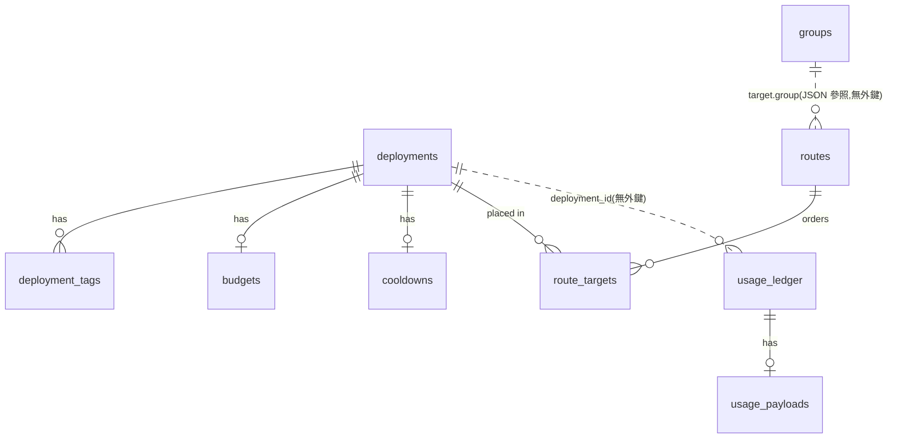

# 資料結構 — Spillway

- 專案:spillway · 分支:main · 版本:v1.2(2026-11-01,CHG-20261101-03:schema v2——冷卻獨立成 `cooldowns` 表、`budgets` 移除 `exhausted_until`;v1→v2 migration 的前置條件、備份與回滾;`access_token_sha256` 由 `spillway init`、serve 首次啟動、rotate 寫入;使用者於 CHG 確認閘確認,2026-11-01) · 前版 v1.1 已確認(2026-10-30,CHG-20261030-02:`access_token_sha256` 產生時機改 M3 起、`bind_host`/`port` 鍵 M2 不讀取;使用者於 CHG 確認閘確認,2026-10-30) · 前前版 v1.0 已確認(2026-10-29,使用者) · 日期:2026-11-01(UTC+0)
- 依據:docs/spec.md 第 2 節(DDL 正本)、第 3 節(YAML);sdlc_docs/structure/design.md D2、D3

**DDL 正本是 `docs/spec.md` 2.3**,本文件不重抄欄位;只記關聯、約束、列舉、設定鍵與本設計新增的部分。實作的 `store/schema.sql` 是 schema v1 基線;v2(`cooldowns` 表、`budgets` 移除 `exhausted_until`)由 `store/db.py` 的 migration `_SCHEMA_V2` 套用,migration 後的結果必須與 spec 2.3 一致,差異走 CHG。

## 實體 / 資料表

| 表 | 主鍵 | 用途 | 回應需求 |
|----|------|------|----------|
| `deployments` | `id` | 成員 | FR-1、FR-3 |
| `deployment_tags` | (`deployment_id`, `tag`) | 成員 tag | FR-3 |
| `budgets` | `deployment_id` | 額度設定(schema v2 起不含冷卻) | FR-8 |
| `cooldowns` | `deployment_id` | 冷卻狀態(執行期狀態:`exhausted_until`、`reason`);schema v2 新增(CHG-20261101-03 決策 3) | FR-4、FR-7、FR-8 |
| `groups` | `name` | 命名選擇器 | FR-18、FR-19 |
| `routes` | `name` | 對外名稱、目標、mode、context 與預估開關 | FR-2、FR-4、FR-14 |
| `route_targets` | (`route_name`, `deployment_id`) | 手動 slot、position、effort、weight | FR-5、FR-6、FR-10 |
| `usage_ledger` | `id` | 每次嘗試(含預估與實際) | FR-7、FR-9 |
| `usage_payloads` | `ledger_id` | 請求與回應內容 | FR-14 |
| `settings` | `key` | 鍵值設定 | NFR-3 |

## 關聯

- `routes.target` 以 JSON 參照 `groups.name`,**沒有外鍵**:刪除群組時,`api.admin` 必須拒絕(仍被 route 參照)或要求先改 route——由應用層保證。
- `usage_ledger.deployment_id`、`route_name` **沒有外鍵**:成員或 route 刪除後帳本保留歷史(匯入 `replace` 也保留帳本,spec 3.1.3)。
- 其他關聯 `ON DELETE CASCADE`(spec 2.3);刪除成員時其 `budgets`、`cooldowns` 列一併刪除。
- 額度與冷卻分開存(CHG-20261101-03 決策 3、6):`QuotaService.mark` 只寫 `cooldowns`(單一 upsert,冷卻只延長不縮短),不再為沒有 `budgets` 列的成員建立 `type=none, window=none` 暫行列(取代 CHG-20261030-02 決策 59);`clear` 刪除 `cooldowns` 列;`PUT /api/deployments/{id}` 的 `budget: null` 只刪除 `budgets` 列。`cooldowns` 列到期後不自動刪除,保留到下次 mark 或 clear;API 只在未到期時回傳 `cooling_until`、`cooling_reason`(spec 9.2.4)。

## 索引 / 約束

- 同 `provider` 的成員數:依 spec 2.1.4,由模組 `cardinality` 決定,應用層在同一交易內檢查(design D15、spec 7.6.5);不建立部分唯一索引。`claude_cli`、`codex_cli` 宣告 single,AC-12 仍成立。
- `ix_ledger_dep_ts`:本期花費加總與 P50/P90 統計(NFR-1、NFR-2)。
- `ix_payloads_ts`:每小時清理(NFR-5)。
- 連線後 `PRAGMA journal_mode=WAL`、`PRAGMA foreign_keys=ON`(spec 2.1.1)。
- **本設計新增**:`PRAGMA user_version` 記 schema 版本(design D3)。v1 為 M2 的 9 張表;**目前為 2**(CHG-20261101-03:新增 `cooldowns`、移除 `budgets.exhausted_until`),升級方式見下方「Schema 版本與 migration」。
- 時間欄位:UTC ISO 8601 字串,精度到秒(spec 2.1.2)。

## 狀態 / 列舉

| 欄位 | 值 |
|------|----|
| `deployments.kind` | `cli`、`api`、`local` |
| `budgets.type` | `usd`、`credit_pool`、`none` |
| `budgets.window` | `monthly`、`weekly`、`daily`、`none` |
| `cooldowns.reason` | `quota_exhausted`、`rate_limited`(與帳本 status 同名;CHECK 約束) |
| `routes.mode` | `chat`、`task` |
| `route_targets.effort` / `usage_ledger.effort` | `none`、`low`、`medium`、`high`、`max` |
| `route_targets.weight` | `high`(3)、`medium`(2)、`low`(1) |
| `usage_ledger.status` | `ok`、`error`、`quota_exhausted`、`rate_limited`、`skipped_precheck` |

成員可用性狀態機見 logical.md 流程 3。

## `settings` 鍵

| 鍵 | 型別 | 初始值 | 來源 |
|----|------|--------|------|
| `access_token_sha256` | hex 字串(SHA-256,64 個小寫字元) | 不預設。寫入時機:`spillway init`(已存在時不變更,`--rotate` 才覆寫)、`spillway serve` 首次啟動且鍵不存在時(`create_app(issue_token=True)`)、`POST /api/settings/token/rotate`(覆寫)。token 為 `secrets.token_urlsafe(32)`,明文不入庫;M3a 不以它驗證任何請求(M3b 的 `/mcp/*` 才比對) | spec 8.1.3;design D9、D30(CHG-20261101-03 決策 14) |
| `bind_host` | 字串 | `127.0.0.1`;**M2 不讀取**,綁定位址唯一來源為 `serve --host` 旗標與 settings.py 常數(design D16) | spec 9.1.1、NFR-3 |
| `port` | 整數 | `8787`;**M2 不讀取**,唯一來源為 `serve --port` 旗標與 settings.py 常數(design D16) | design D9 |
| `record_context_default` | `0`/`1` | `1` | spec 2.4.1 |
| `context_retention_days` | 整數 | `7` | spec 2.4.5 |
| `context_max_bytes` | 整數 | `262144` | spec 2.4.3 |

spec 2 要求「初始化只建表、不寫入資料列」;上表初始值由程式在讀不到鍵時套用預設,**不在建表時寫入**。access token 只在上表所列的三個時機寫入;`create_app()` 預設(測試與內嵌用法)不產生 token。

## Schema 版本與 migration(design D3、D28)

| `user_version` | 開啟時的處理 |
|----------------|--------------|
| 0(空庫) | 單一 `BEGIN IMMEDIATE` 交易內依序套用 v1、v2;不需要鎖與備份 |
| 1(已有資料) | 依下列前置條件升級到 v2 |
| 2 | 直接使用 |
| > 2 | `SchemaVersionError`,不開啟 |

v1 → v2 的內容(單一交易,CHG-20261101-03 決策 4):① 建 `cooldowns`;② 把 `budgets.exhausted_until` 非 NULL 的列搬到 `cooldowns`,`reason` 取該成員帳本最近一筆 `quota_exhausted`/`rate_limited`,找不到時記 `quota_exhausted`;③ `ALTER TABLE budgets DROP COLUMN exhausted_until`;④ `user_version = 2`;完成後 `PRAGMA foreign_key_check` 必須為空。**不刪除任何 `budgets` 列**(含決策 59 的暫行列;其語意等同無上限,擁有者可自行以 `PUT budget: null` 移除)。

升級前置條件與順序(決策 5;`store.db`、`cli._preflight`):

1. `spillway serve` 先以暫時 socket 試綁埠後關閉;失敗則不開資料庫、不 migrate,以非 0 退出(`spillway init` 不做埠檢查)。
2. 取得資料目錄鎖檔 `spillway.lock`(`fcntl.flock` 非阻塞;serve 持有到行程結束,init 只在執行期間持有);取不到則不 migrate、提示已有 serve 在執行,以非 0 退出。舊版程式不使用此鎖,所以升級前必須先停止舊版 serve。
3. 唯讀 `PRAGMA foreign_key_check`:舊庫已有外鍵違反時不備份、不升級(錯誤訊息列出「子表→父表 N 列」),避免每次啟動都多一份必然失敗的備份。
4. 以 SQLite backup API 複製為 `spillway.db.v1.bak`(含尚未 checkpoint 的 WAL 內容;複製後設 `journal_mode=DELETE`,備份為單一自足檔案);已存在時加 UTC 時間戳記後綴 `.YYYYMMDDTHHMMSSZ`(同秒再加序號),一律不覆寫。備份失敗:刪除殘檔(含 `-journal`、`-wal`、`-shm`)、不 migrate、非 0 退出。
5. `BEGIN IMMEDIATE` 後重讀 `user_version`,仍為 1 才套用;失敗回滾、原檔不變,錯誤訊息含備份位置,非 0 退出。

回滾(擁有者手動):停止 serve;刪除 `spillway.db`、`spillway.db-wal`、`spillway.db-shm`;把 `spillway.db.v1.bak` 改名為 `spillway.db`;回退程式版本。v2 期間寫入的資料會遺失;v2 資料庫無法被 v1 程式開啟(`SchemaVersionError`)。

## JSON 欄位形狀

| 欄位 | 形狀 |
|------|------|
| `deployments.provider` | 必須是某個已發現 adapter 模組 `MANIFEST.providers` 中的值;否則依 `kind` 由通用 `litellm` 模組處理(spec 7.1.1);同一 provider 能有幾個成員由該模組 `cardinality` 決定 |
| `deployments.model` | 通常取自該模組可用模型清單的 `id`(後台選單,design D13);手動輸入的值不受清單限制。可用模型清單存在模組的 `models.yaml`,**不入資料庫**,也不進匯出檔 |
| `deployments.params` | `{api_base?, timeout?, cwd?, effort_args?: [str], extra_args?: [str], signals?: {quota: regex, rate_limit: regex}, cli_overhead_tokens?: int, max_concurrency?: int}` |
| `deployments.capabilities` | `{ctx: int, tools: bool, vision: bool, efforts: [effort]}` |
| `groups.selector` | `{all: [tag], any: [tag], none: [tag]}` |
| `routes.target` | `{group: name}` 或 `{tags: {all, any, none}}` |
| `routes.tags` | `[tag]` |
