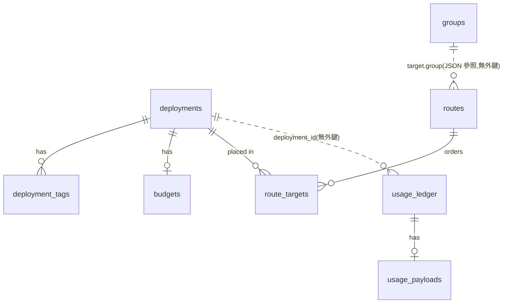

# 資料結構 — Spillway

- 專案:spillway · 分支:main · 版本:v1.0 已確認(2026-10-29,使用者) · 日期:2026-10-29(UTC+0)
- 依據:docs/spec.md 第 2 節(DDL 正本)、第 3 節(YAML);sdlc_docs/structure/design.md D2、D3

**DDL 正本是 `docs/spec.md` 2.3**,本文件不重抄欄位;只記關聯、約束、列舉、設定鍵與本設計新增的部分。實作的 `schema.sql` 必須與 spec 2.3 一致,差異走 CHG。

## 實體 / 資料表

| 表 | 主鍵 | 用途 | 回應需求 |
|----|------|------|----------|
| `deployments` | `id` | 成員 | FR-1、FR-3 |
| `deployment_tags` | (`deployment_id`, `tag`) | 成員 tag | FR-3 |
| `budgets` | `deployment_id` | 額度設定與冷卻(`exhausted_until`) | FR-8 |
| `groups` | `name` | 命名選擇器 | FR-18、FR-19 |
| `routes` | `name` | 對外名稱、目標、mode、context 與預估開關 | FR-2、FR-4、FR-14 |
| `route_targets` | (`route_name`, `deployment_id`) | 手動 slot、position、effort、weight | FR-5、FR-6、FR-10 |
| `usage_ledger` | `id` | 每次嘗試(含預估與實際) | FR-7、FR-9 |
| `usage_payloads` | `ledger_id` | 請求與回應內容 | FR-14 |
| `settings` | `key` | 鍵值設定 | NFR-3 |

## 關聯

- `routes.target` 以 JSON 參照 `groups.name`,**沒有外鍵**:刪除群組時,`api.admin` 必須拒絕(仍被 route 參照)或要求先改 route——由應用層保證。
- `usage_ledger.deployment_id`、`route_name` **沒有外鍵**:成員或 route 刪除後帳本保留歷史(匯入 `replace` 也保留帳本,spec 3.1.3)。
- 其他關聯 `ON DELETE CASCADE`(spec 2.3)。

## 索引 / 約束

- ~~`ux_cli_provider`~~:spec 2.1.4 的部分唯一索引**不建立**。改由應用層依模組 `cardinality` 檢查(design D15);`claude_cli`、`codex_cli` 宣告 single,AC-12 仍成立。**待同步規格書 2.1.4**。
- `ix_ledger_dep_ts`:本期花費加總與 P50/P90 統計(NFR-1、NFR-2)。
- `ix_payloads_ts`:每小時清理(NFR-5)。
- 連線後 `PRAGMA journal_mode=WAL`、`PRAGMA foreign_keys=ON`(spec 2.1.1)。
- **本設計新增**:`PRAGMA user_version` 記 schema 版本(design D3),初始為 1。不新增表。
- 時間欄位:UTC ISO 8601 字串,精度到秒(spec 2.1.2)。

## 狀態 / 列舉

| 欄位 | 值 |
|------|----|
| `deployments.kind` | `cli`、`api`、`local` |
| `budgets.type` | `usd`、`credit_pool`、`none` |
| `budgets.window` | `monthly`、`weekly`、`daily`、`none` |
| `routes.mode` | `chat`、`task` |
| `route_targets.effort` / `usage_ledger.effort` | `none`、`low`、`medium`、`high`、`max` |
| `route_targets.weight` | `high`(3)、`medium`(2)、`low`(1) |
| `usage_ledger.status` | `ok`、`error`、`quota_exhausted`、`rate_limited`、`skipped_precheck` |

成員可用性狀態機見 logical.md 流程 3。

## `settings` 鍵

| 鍵 | 型別 | 初始值 | 來源 |
|----|------|--------|------|
| `access_token_sha256` | hex 字串 | 首次啟動產生 | spec 8.1.3 |
| `bind_host` | 字串 | `127.0.0.1` | spec 9.1.1、NFR-3 |
| `port` | 整數 | `8787` | design D9 |
| `record_context_default` | `0`/`1` | `1` | spec 2.4.1 |
| `context_retention_days` | 整數 | `7` | spec 2.4.5 |
| `context_max_bytes` | 整數 | `262144` | spec 2.4.3 |

spec 2 要求「初始化只建表、不寫入資料列」;上表初始值由程式在讀不到鍵時套用預設,**不在建表時寫入**。access token 在 `spillway init` 或首次啟動時才寫入。

## JSON 欄位形狀

| 欄位 | 形狀 |
|------|------|
| `deployments.provider` | 必須是某個已發現 adapter 模組 `MANIFEST.providers` 中的值;否則依 `kind` 由通用 `litellm` 模組處理(spec 7.1.1);同一 provider 能有幾個成員由該模組 `cardinality` 決定 |
| `deployments.model` | 通常取自該模組可用模型清單的 `id`(後台選單,design D13);手動輸入的值不受清單限制。可用模型清單存在模組的 `models.yaml`,**不入資料庫**,也不進匯出檔 |
| `deployments.params` | `{api_base?, timeout?, cwd?, effort_args?: [str], extra_args?: [str], signals?: {quota: regex, rate_limit: regex}, cli_overhead_tokens?: int, max_concurrency?: int}` |
| `deployments.capabilities` | `{ctx: int, tools: bool, vision: bool, efforts: [effort]}` |
| `groups.selector` | `{all: [tag], any: [tag], none: [tag]}` |
| `routes.target` | `{group: name}` 或 `{tags: {all, any, none}}` |
| `routes.tags` | `[tag]` |
