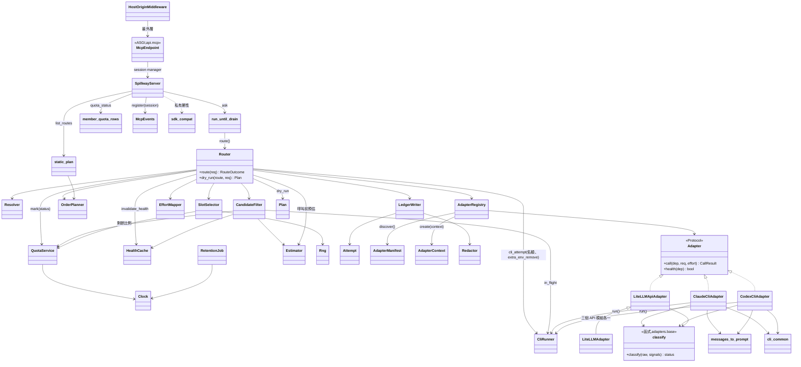

# 設計結構 — Spillway

- 專案:spillway · 分支:main · 版本:v1.9(2026-11-08,CHG-20261108-01:新增 D45(雙實作與跨實作一致性);D11 與「Adapter 模組契約」加註設定檔驅動 adapter 的去向;D41、D44 補雙實作的分工;使用者於 CHG 確認閘確認,2026-11-08) · 前版 v1.8 已確認(2026-11-08,CHG-20261107-03:新增 D44(測試控制介面 `api.test_control` 與黑箱 harness `tests/blackbox/`)、D41 補「測試已黑箱化的範圍」、關鍵元件加測試控制介面、介面契約註明控制介面錯誤碼見 spec 13.3.5、採用模式補黑箱測試縫;使用者於 CHG 確認閘確認,2026-11-07) · 前版 v1.7 已確認(2026-11-03,CHG-20261103-01:M4b——畫面與後端語言無關的靜態 Web UI `spillway.web`(`mount_web`、`/ui/` 網址、`/` 轉址)、純 ASGI 安全標頭 `api.http_headers.SecurityHeadersMiddleware`、畫面用的讀取端點與 `routing.static_plan`、匯入 `privileged` 加入 provider 變更、`api.admin.config_http`(原名 `config_io`)、決策 21 的 helper 位置;D7 由 D41 取代,D34、D37–D40 修訂,新增 D41–D43 與「設計差異」小節;使用者於 CHG 確認閘確認,2026-11-03) · 前版 v1.6 已確認(2026-11-02,CHG-20261102-02:M4a——應用層 `spillway.configio`(設定檔格式、嚴格 loader、單一交易套用與寫鎖內備份)、介面層 `api.admin.config_file`/`config_io`、帳本 CSV、設定總覽 `GET /api/settings`、群組名稱規則、`mcp-stdio` 錯誤對應依 body 且碼與狀態成對、環境變數名單一定義、移除 `/api/mcp/config` 頂層相容欄位、UI-8 名稱「API 參考」;D10、D22、D27、D35–D37 修訂,新增 D38–D40;使用者於 CHG 確認閘確認,2026-11-02) · 前版 v1.5 已確認(2026-11-02,CHG-20261102-01:M3b——MCP server(`api.mcp`)、`mcp-stdio`、設定輸出 `GET /api/mcp/config`、全端點 Host/Origin、`api.drain`、`spillway.quota.member_quota_rows`、`adapters.base.cli_common`;D6、D9、D31 修訂,新增 D33–D37;錯誤碼表分三類;使用者於 CHG 確認閘確認,2026-11-02) · 前版 v1.4 已確認(2026-11-01,CHG-20261101-03:M3a——`CliRunner` 介面改為決策 8、`AdapterContext.data_dir`、`claude_cli`/`codex_cli`、`adapters.base.cli_prompt`、Router 的 `cli_attempt` 守門與停機旗標、冷卻改存 `cooldowns`、新增 D28–D31,補錄 CHG-20261101-02 決策 14 為 D32;使用者於 CHG 確認閘確認,2026-11-01) · 前前版 v1.3 已確認(2026-11-01,CHG-20261101-02:M2 整理——`REDACTOR` 共用實例、`normalize_effort` 移至 effort.py、`LiteLLMApiAdapter` 共用基底、健康快取失效、新增 D25–D27;使用者於 CHG 確認閘確認,2026-11-01) · v1.2 已確認(2026-10-30,CHG-20261030-02:元件表與契約同步 M2 施工設計,SignalMatcher 移至 adapters.base,D9 依使用者決定 B1 修訂,新增 D16–D24) · v1.1 已確認(2026-10-29,使用者;含 D11 adapter 模組化) · 日期:2026-11-08(UTC+0)
- 依據:sdlc_docs/ai-guideline.md v1.11;docs/spec.md;sdlc_docs/structure/logical.md;knowledge DIR-5

## 關鍵元件

| 元件 | 責任 | 對外介面 / 契約 | 規格 |
|------|------|-----------------|------|
| `Router` | 單次請求的完整路由:解析、篩選、排序、選擇、fallback;CLI 嘗試的名額、子行程 env 憑證移除與遮罩、停機時不開始新嘗試(CHG-20261101-03 決策 7、9、16,D29、D31) | `Router(conn_factory, registry, clock, rng, *, close_conn=False, cli_runner=None, shutdown_flag=None, …)`;`shutting_down`(唯讀,讀 `shutdown_flag()`,app 傳入 `lambda: app.state.shutting_down`;讀取失敗視為 False);`cli_attempt(dep, conn=None, *, fallback=()) -> CliAttempt`(context manager,CLI 嘗試的共用守門,路由與管理 API 的 test-call 都經它,見 D29);`async route(req) -> RouteOutcome`;`async dry_run(route_name_or_model, req) -> Plan`(不呼叫 adapter、不寫帳本);conn_factory 每請求呼叫一次、以 contextvar 共用,內建元件只在 route()/dry_run() 期間可用(CHG-20261030-02 施工審議 M19);`invalidate_health(dep_id)` 移除該成員的健康快取結果(CHG-20261101-02 決策 12);回傳型別定義於 `routing.outcome`,`spillway.routing` 與 `spillway.routing.router` 轉匯出(決策 10) | 4 |
| `Resolver` | `model` 字串 → `local/` 直呼 / route / 隱含 route / 404 | `resolve(model) -> Target` | 4.1 |
| `CandidateFilter` | 依 enabled、能力、mode、額度、冷卻、CLI 併發名額、健康、預估篩選 | `CandidateFilter(registry, quota, estimator, clock, health_cache=None, *, cli_runner=None)`;`async filter(target, req, *, probe=True, now=None) -> FilterResult(candidates, excluded)`;local 健康探測上限 2 秒、結果快取 10 秒(D20);cli 成員 `cli_runner.in_flight(dep.id) >= max_concurrency(dep)` 時排除為 `concurrency_full`(排在 `cooling` 之後;`max_concurrency` 取 `params.max_concurrency` 正整數,否則 1)。`EXCLUDE_REASONS` 另含 Router 才會產生的 `shutting_down` | 4.2;NFR-6 |
| `HealthCache` | local 健康結果快取(D20),與 `Router` 共用同一實例;只有經 route 的請求讀寫,`local/` 直呼不讀 | `get(dep_id)`、`put(dep_id, healthy)`、`invalidate(dep_id)`(CHG-20261101-02 決策 12:管理 API 對成員 PUT〔含 `enabled` 變更〕、DELETE 成功後經 `Router.invalidate_health` 呼叫)、`clear()` | 4.2.4 |
| `OrderPlanner` | 手動 slot 或預設層級 → slot 清單;標示「未排序」 | `plan(route_targets, candidates, members=None) -> list[Slot]`;預設層級固定編號:cli 為 base、api 為 base+1、local 自 base+2 起(CHG-20261030-02 決策 38) | 4.3 |
| `SlotSelector` | slot 內加權隨機選雲端(權重 = 優先權重值 × `ratio()`)、失敗重選、再依 position 試 local | `SlotSelector(quota, rng).iterate(slot, now)`(generator,失敗後於剩餘成員重新加權) | 4.4 |
| `QuotaService` | 本期起點、下一重置點、剩餘額度與比例、冷卻判定、設定與清除;不含上游訊號判定(已移至 `adapters.base.classify`,D12 修訂)。額度讀 `budgets`,冷卻讀寫 `cooldowns`(schema v2,D28):`mark` 單一 upsert、冷卻只延長不縮短、不建立或修改 `budgets` 列;`clear` 刪除 `cooldowns` 列 | `period_start(budget, now)`、`next_reset(budget, now)`、`remaining(dep, now)`、`ratio(dep, now)`、`is_cooling(dep, now)`、`mark(dep, status, now)`、`clear(dep)` | 5.1–5.3 |
| `classify`(原 `SignalMatcher`,位於 `adapters.base`) | 純函式:依成員 `params.signals` 或模組 `default_signals` 將上游輸出歸類;由 adapter 在 `call()` 內呼叫並回傳 status(CHG-20261030-02 決策 12) | `classify(raw, signals) -> ok / quota_exhausted / rate_limited / error` | 5.3.1、7.6.3、7.6.8 |
| `Estimator` | 輸入 token、輸出 P50/P90、P90 花費 | `estimate(dep, req, route_name) -> Estimate` | 5.4 |
| `Estimate` | 預估值物件 | `tokens_in`、`out_p50`、`out_p90`、`cost_usd_p90`(無定價時為 None) | 5.4 |
| `EffortMapper`(`spillway/effort.py`) | 來源優先序與降級(通用);同模組另含 `normalize_effort(value) -> str \| None` 與 `InvalidEffort`(CHG-20261101-02 決策 8,自 router 移入;`spillway.routing`、`spillway.routing.router` 轉匯出);上游參數值由各 adapter 模組的 manifest 提供,經 `adapters.base.effort_to_upstream(manifest, level)` 轉換(`none` 對應 None 時不傳) | `pick(route_target_effort, req_effort, caps_efforts) -> str \| None` | 6 |
| `Adapter`(Protocol) | 呼叫上游與健康檢查 | `async call(dep, req, effort) -> CallResult`;`async health(dep) -> bool`(CHG-20261030-02 決策 5,spec 7.1 同步改 async) | 7.1 |
| `AdapterContext` | `create(context)` 注入給模組的物件;新增欄位不算破壞契約、不升 `contract_version`(決策 13) | `credentials`(解析器)、`clock`、`cli_runner`(預設 None;M3a 起 app 注入 `app.state.cli_runner` 同一個 `CliRunner` 實例)、`data_dir`(預設 None;app 注入資料庫所在目錄,CLI 模組以它推得 `work/<模組>`;CHG-20261101-03 施工審議補記) | 7.6 |
| `AdapterManifest` | 每個 adapter 模組的宣告資料(見下方「Adapter 模組契約」) | dataclass,模組層級常數 `MANIFEST` | 6.3、5.3.1、7 |
| `AdapterRegistry` | 啟動時掃描 `spillway.adapters` 下的子套件並註冊;`provider` → adapter;未註冊依 `kind` 用通用 `litellm` 模組;提供 `cardinality_of(provider, kind=None)` | `discover(extra_paths=()) -> list[AdapterManifest]`;`get(dep) -> Adapter`;`module_for(dep) -> ModuleInfo`(不可用時丟 `AdapterUnavailableError`,供 CandidateFilter 判定 `adapter_unavailable`);`unavailable() -> dict[provider, reason]`;`cardinality_of(provider, kind=None)`;`modules()` | 7.1.1 |
| `CliRunner`(`adapters.base.cli_runner`,M3a) | 共用子行程執行器,一個 app 一個實例(`app.state.cli_runner`):argv 陣列、不經 shell、`start_new_session=True`(子行程自成 process group);環境以目前環境為底移除 `env_remove` 與 `extra_env_remove`、再套 `env_set`;`stdin` 未給時為 DEVNULL;逾時、取消、停機一律 `os.killpg` 整個 group(SIGTERM,5 秒後 SIGKILL;重複遞送的取消改為立即 SIGKILL),主行程結束後最多 2 秒讀完管線;stdout/stderr 各自超過上限截斷並標記;不記錄 argv、stdin、環境與輸出。併發名額由 Router 取得,模組不碰(D29) | `async run(argv, *, stdin=None, env_remove=(), env_set=None, cwd, timeout, max_output_bytes=8 MiB) -> CliOutput(exit_code, stdout, stderr, timed_out, killed_reason, stdout_truncated, stderr_truncated)`(`killed_reason` ∈ `timeout`、`cancelled`、`shutdown`;取消時 `CancelledError` 照常往上丟;啟動錯誤如找不到執行檔、E2BIG 以 `OSError` 往上丟);`extra_env_remove: set[str]`(Router 每次 CLI 嘗試前設定,`run` 一律併入);`try_acquire(key, limit) -> bool`(同步、不排隊)、`release(key)`、`in_flight(key)`;`async terminate_all(grace)`、`kill_all_sync(grace)`(同步,不需事件迴圈;兩者設下不撤銷的停機旗標,之後才從 spawn 回來的子行程立即 SIGKILL、`killed_reason="shutdown"`);`active_pids`(唯讀,測試與診斷用)。CHG-20261101-03 決策 8 修訂原 `run(argv, stdin, env, cwd, timeout) -> ProcResult` | 7.3、7.4、7.6.3、NFR-6 |
| `messages_to_prompt`(`adapters.base.cli_prompt`,M3a) | spec 7.5.1 的唯一實作,兩個 CLI 模組共用(CHG-20261101-03 決策 12a):`system`/`developer`→`[System]`、`user`→`[User]`、`assistant`→`[Assistant]`(角色去空白、不分大小寫,保持順序);角色缺漏或空白視為 user;其他角色(tool、function、未知)整則略過;content 為字串照用,為清單時取字串項與 type 為 `text`、`input_text` 或未標 type 的文字項,其他部件略過,以換行連接;去空白後為空的訊息略過;各段 `"{標頭}\n{文字}"` 以空行連接。結果為空時模組回 `error` 且不啟動子行程 | `messages_to_prompt(messages) -> str`;`content_text(content) -> str`;`ROLE_HEADERS` | 7.5 |
| `ClaudeCliAdapter`(`adapters.claude_cli`,M3a) | `claude -p` 子行程:argv `claude -p --output-format json --model <model>` + effort 參數(`default_params.effort_args` `["--effort", "{effort}"]`,`none` 不傳)+ **固定** `--strict-mcp-config` + `params.extra_args`;prompt 經 stdin;移除 `ANTHROPIC_API_KEY`、`ANTHROPIC_AUTH_TOKEN`、`ANTHROPIC_BASE_URL`、`CLAUDE_CODE_USE_BEDROCK`、`CLAUDE_CODE_USE_VERTEX`、`CLAUDE_CODE_USE_FOUNDRY`,設 `SPILLWAY_DEPTH=1`;cwd 為 `params.cwd` 或 `data_dir/work/claude`;`tokens_in` = `input_tokens` + `cache_creation_input_tokens` + `cache_read_input_tokens`(各項只計非負整數,三者皆缺為 None),`tokens_out` = `output_tokens`,`cost_usd` = 有限非負的 `total_cost_usd`;`is_error` 或結束碼 ≠ 0 時以 `classify` 歸類(訊息只在 `is_error` 時取 `result`,否則取 stderr);逾時、停機終止、非 JSON、截斷、`OSError` 為 `error`。`health` 不起子行程、回 True;沒有 `list_models` | `MANIFEST`(provider `claude-cli`、single、`default_params` `timeout` 600、`effort_args`、`extra_args` `[]`)、`create(context)`(容忍 `cli_runner=None`,此時 `call` 回 `error`) | 7.3、5.2.2、5.3.1 |
| `CodexCliAdapter`(`adapters.codex_cli`,M3a) | `codex exec` 子行程:argv `codex exec --json --skip-git-repo-check` + **固定** `--ignore-user-config` + `-m <model> -o <暫存檔>` + `-c model_reasoning_effort=<值>` + `params.extra_args` + **固定** `-c mcp_servers={}`(`--` 前最後一個 `-c`)+ `--` + prompt;`extra_args` 含 `--`、裸位置引數、以 `-c`/`--config` 設定 `mcp_servers`、`profile` 或 `features`,或含 `--enable`、`-p`/`--profile`(含連寫形式)時回 `error`;`-o` 暫存檔 `tempfile.mkstemp`(0600)、`finally` 刪除;移除 `OPENAI_API_KEY`、`CODEX_API_KEY`、`OPENAI_BASE_URL`,設 `SPILLWAY_DEPTH=1`;cwd 為 `params.cwd` 或 `data_dir/work/codex`;回應取 `-o` 檔、token 取 JSONL 最後一個含 usage 的事件,`cost_usd` 為 None;結束碼 ≠ 0 時 stderr 與 stdout JSONL 的錯誤訊息一併交 `classify`;`OSError`(含 E2BIG)、NUL 引數為 `error` | `MANIFEST`(provider `codex-cli`、single、`effort_map` none→minimal、max→xhigh)、`create(context)`(容忍 `cli_runner=None`) | 7.4、5.2.3、5.3.1、6.3 |
| 存取 token(`settings`)與 `create_app(issue_token)` | token 產生、雜湊與寫入(D30) | `settings.generate_access_token()`、`hash_access_token(token)`、`get_access_token_hash(conn)`、`rotate_access_token(conn) -> str`、`ensure_access_token(conn) -> str \| None`(同一 `BEGIN IMMEDIATE` 交易內檢查與寫入);`app.create_app(..., issue_token=False)`:只有 `spillway serve` 傳 True,lifespan 經 `_ensure_token(app)` 在沒有雜湊時產生並以單行印到 stderr | 8.1.3、9.2 |
| `Attempt` | Router 交給 LedgerWriter 的單次嘗試記錄:ts、route_name、deployment_id、effort、tokens、cost、status、slot、fallback_depth、latency_ms、est_*、error、請求與回應內容、`extra_secrets` | 型別,定義於 `ledger.py` | 2.4、4.5.1 |
| `Plan` | dry-run 結果:slots(每個候選含 deployment、kind、weight、effort、`Estimate`、健康狀態)、`excluded[]`(deployment、原因,含 `adapter_unavailable`、`skipped_precheck`)、`unsorted[]`、依 Rng 本次抽出的第一順位 | 型別,由 `Router.dry_run` 回傳 | 4 |
| `LedgerWriter` | 每次嘗試一列(呼叫後與結果同列一次寫入,D24);payload 先遮罩再截斷 | `record(attempt) -> ledger_id`;`payload_status(ledger_id, now) -> ok \| expired \| never_recorded` | 2.4、4.5.1 |
| `RetentionJob` | 每小時刪除過期 payload | `run_once(now)` | 2.4.5 |
| `Redactor` | 遮罩 `sk-…`、`Bearer` 後值、`extra_secrets` 中的每個值;無狀態,全站共用單一實例 `spillway.redact.REDACTOR`(`extra_secrets` 每次呼叫傳入;`LedgerWriter(redactor=None)` 預設用它,測試仍可傳入自己的實例;CHG-20261101-02 決策 7) | `redact(text, extra_secrets=()) -> (text, hit: bool)`;`matches(text) -> bool`(供寫入驗證) | 2.4.4 |
| `spillway.configio`(M4a,應用層;原列 `ConfigIO`) | 設定檔格式(D38):匯出、嚴格 YAML 解析、單一交易套用(UPSERT、replace 刪除檔案外實體、最終狀態檢查)、寫鎖內備份、`privileged` 計算;只 import `store`、`domain`、`clock`、`yaml` 與標準庫,**不可** import `spillway.api*`;SQL 經 `store.repo` | `dump(conn) -> str`;`FORMAT_VERSION = 1`;`load_yaml(text) -> Any`(丟 `ConfigSyntaxError(path, reason)`);`ConfigPlan(deployments, groups, routes, settings)`;`apply(conn, plan, mode, *, cardinality_of, backup_dir, now, dry_run=False) -> ImportResult(mode, created, updated, deleted, backup, affected_ids, privileged, dry_run)`;`ImportConflict(code, path, message)`(`status` 422/409/500);`format_path(parts)`;`privileged_view(dep)`;`is_privileged_change(before, after) -> bool`(`privileged_view` 不同,或既有成員的 `provider` 改變;CHG-20261103-01 決策 10 ⑥);`utc_stamp_filename(now, fmt)`(`clock.utc_strftime` 的別名,CHG-20261103-01 決策 21 ⑤);常數 `TOP_KEYS`、`DEPLOYMENT_KEYS`、`ROUTE_KEYS`、`MAX_DEPTH = 32`、`BACKUP_FILENAME_FORMAT` | 3 |
| `api.admin.config_file`(M4a,介面層) | 設定檔的 Pydantic 檔案模型與解析(D38):組合管理 API 的請求模型,不另寫一份;錯誤經 `redact_echo` | `ConfigFileIn`(`extra="forbid"`)、`DeploymentFileIn`、`RouteFileIn`;`parse(text) -> configio.ConfigPlan`(錯誤丟 `ApiError(422, "validation_error")`,全部錯誤上限 `MAX_ERRORS` = 20) | 3 |
| `api.admin.config_http`(M4a;原名 `config_io`,CHG-20261103-01 決策 21 ② 只改檔名與 import) | `GET /api/config/export`、`POST /api/config/import` 的 HTTP 轉換(D38):Content-Type、1 MiB 串流上限、`utf-8-sig`、舊列憑證鍵名掃描、`ImportConflict` 轉錯誤回應、成功後逐 id 健康快取失效與 `tools_changed` | `IMPORT_MEDIA_TYPES`、`MAX_IMPORT_BYTES = 1_048_576`、`BACKUP_DIRNAME = "backups"`、`EXPORT_FILENAME_FORMAT` | 3、9.2 |
| 帳本 CSV(`api.admin.ledger`,M4a) | `GET /api/ledger/export.csv`(D39):async generator 自開連線、逐批串流、注入防護 | `LEDGER_CSV_COLUMNS`、`LEDGER_CSV_MAX_ROWS = 100_000`、`LEDGER_MIN_DEPTH_MAX = 100`、`CSV_FORMULA_PREFIXES`、`_ClosingStreamingResponse`;檔名 `spillway-ledger-<clock.utc_stamp>.csv`;`repo.iter_ledger(conn, *, filters…(含 `min_depth`), limit, batch=1000) -> Iterator[list[LedgerRow]]` | 9.2.6、9.2.8 |
| 設定總覽(`api.admin.settings`,M4a) | `GET /api/settings`(D40),供 UI-7 與首次設定精靈 | 回應 `{port, data_dir, version, token_issued, first_run, counts, context}`;`version` 取 `settings.package_version()`(CHG-20261103-01 決策 21 ③);`repo.count_config(conn)`、`repo.payload_stats(conn)` | 9.2.7 |
| `api.admin.mcp_config`(M3b,原列 `McpConfigRenderer`) | `GET /api/mcp/config` 的設定輸出(D36):程式內固定 `TOOL_FORMATS`、Jinja2 模板渲染各 variant;token 一律以 `SPILLWAY_TOKEN` 參照(不再有內嵌 token) | `TOOL_FORMATS: dict[str, list[VariantSpec]]`;`VariantSpec(label, scope, format, template, path=None, filename=None)`;`TOOL_NOTES`;`render_config(tool, ctx, template_dir=DEFAULT_TEMPLATE_DIR) -> list[variant]`;`build_context(group, port) -> ctx`;`stdio_command() -> (command, args_prefix)`;過濾器 `toml_str`、`toml_key`、`shq` | 8.2 |
| `api.mcp`(M3b,原列 `McpApp`) | `/mcp/<group>` 的 MCP server(D6、D34):驗證、session 綁群組、三個工具、`list_changed`、停機只關 GET 串流;UI-8 資料來源(D37) | `McpEndpoint(app)`(`app.mount("/mcp", …)` 的純 ASGI wrapper;`auth.check_depth(headers)`、`auth.check_bearer(headers, stored_hash)`);`SpillwayServer(app)`(SDK 低階 `Server` 子類,`create_app` 建立一個,存 `app.state.mcp_server`;`current_group()`;`create_initialization_options()` 預設 `tools_changed=True`);`McpRuntime.start(app)` / `stop()`(每次 lifespan 新建 `StreamableHTTPSessionManager` 與持有 task,`app.state.mcp_manager`);`events.McpEvents`(`app.state.mcp_events`:`register(session)`、同步 `changed()`);`server.install_shutdown_hook(app)`、`close_standalone_streams(app)`;`tools.tool_definitions(conn, group)`、`call_tool(app, group, name, arguments)`、`visible_routes`、`group_exists`、`error_result`;`catalog.mcp_catalog(app, group="all")`、`HTTP_ERRORS`、`TOOL_ERRORS`、`SDK_TRANSPORT_ERRORS`;`sdk_compat.get_stream_open(app, session_id)`、`iter_transports(app)`(SDK 私有屬性的唯一存取點) | 8.1、10(UI-8) |
| `api.mcp.bridge`(M3b) | `spillway mcp-stdio` 的 stdio ↔ Streamable HTTP 轉送與錯誤對應層(D35;M4a 改為依 body 且碼與狀態成對) | `run(group, port, environ=None) -> int`(結束碼 `EXIT_OK` 0、`EXIT_ERROR` 1、`EXIT_CONFIG` 2、`EXIT_REJECTED` 3、`EXIT_SIGINT` 130);`bridge_url(group, port)`;`build_headers(environ)`;`REJECT_CODES`(狀態碼 → 成對的錯誤碼集合);`ERROR_BODY_LIMIT` = 64 KiB;`gateway_code(status, content_type, body) -> str \| None` | 8.1.2、8.1.6 |
| `HostOriginMiddleware`(`api.host_origin`,M3b) | 全端點 Host/Origin 檢查(D33),`create_app` 最外層的純 ASGI middleware | `HostOriginMiddleware(app, *, port)`;`check_host(headers) -> bool`;`check_origin(headers, port) -> bool`;`create_app(port=8787)` 存 `app.state.port` | 9.1.4 |
| `SecurityHeadersMiddleware`(`api.http_headers`,M4b) | 依路徑補安全標頭的純 ASGI middleware(D42);`create_app` 在 `add_middleware(HostOriginMiddleware, …)` 之前加入,HostOrigin 仍在最外層 | `SecurityHeadersMiddleware(app)`;`headers_for_path(path) -> tuple`;常數 `CSP`、`UI_HEADERS`(`/`、`/ui`、`/ui/*`)、`API_HEADERS`(`/api/*`) | 10、9.2 |
| 測試控制介面(`api.test_control`,**僅測試模式**,CHG-20261107-03) | 黑箱測試控制時間、亂數與資料種入的 `/__test__/*`(D44);只有 `create_app(test_control=True)` 掛載,只有 `cli._run_server` 在 `SPILLWAY_TEST_CONTROL=1` 時傳入 | `make_router(rng_seed=None) -> APIRouter`(`include_in_schema=False`);`PREFIX = "/__test__"`;`parse_time(value)`(`YYYY-MM-DDTHH:MM:SSZ`,`cli` 解析 `SPILLWAY_TEST_START_TIME` 共用);本模組不讀 `os.environ` | 13、14 |
| `spillway.web`(M4b,介面層) | Web UI 的靜態檔與掛載(D41):`static/` 下 10 個 HTML(UI-1–UI-8、route 編輯頁、精靈)、`assets/app.css` 與各頁 CSS、`assets/js/*.js`(ES module);檔案過濾與 `/` 轉址;只 import 標準庫與 `starlette` | `mount_web(app) -> None`;`WEB_ROOT: Path`;`ALLOWED_SUFFIXES`(`.html`、`.css`、`.js`);`is_allowed_path(path, is_dir=None) -> bool`;`StaticFilter(app, root)`(純 ASGI) | 10 |
| 前端共用模組(`web/static/assets/js/`,M4b) | 各畫面共用的 JS(D41、D42);各頁的入口腳本不 export | `api.js`:`request`、`getJSON`、`sendJSON`、`sendText`、`withQuery`、`ApiError{status, code, message}`(一律 `cache: "no-store"`;非 JSON 以狀態碼表示;2xx 非 JSON 為 `bad_response`;fetch 本身失敗為 `network_error`——兩者只用於前端,不是伺服端錯誤碼);`dom.js`:`h(tag, attrs, ...children)`(字串子節點一律為 text node;執行期 denylist 見 D42)、`byId`、`setText`、`clear`、`append`、`setAttr`、`isSafeUrl`、`DomError`;`ui.js`:`initShell`(導覽、`html[data-shell="ready"]`)、訊息列 `showMessage`/`showError`/`clearMessage`(依來源保留錯誤)、`confirmDialog({title, body, confirmLabel, danger})`(`<dialog>`,預設焦點「取消」,Esc 等於取消)、`withBusy`、`fmtLocal`/`fmtUTC`/`timeEl`/`toIsoZ`/`fmtUSD`/`fmtInt`、`codeLabel`/`kindBadge`/`statusBadge`、`field`、`parseList`、`tagInput`、`fillGroupSelect`、記錄 context 三態(`recordChoice`/`recordValue`/`recordLabel`/`recordSelect`)、`memberHref`、`targetSummary`、`latest()`、`navigate(path, {replace})`;`strings.js`:`NAV`(導覽正本)、`KIND`、`STATUS`、`COOLING_REASON`、`EXCLUDE_REASON`、`RECORD_CONTEXT`、`BUDGET_TYPE`、`WINDOW`、`TEXT`、`label`;`member-form.js`:`mountMemberForm(container, {initial, onSaved, onCancel, defaults, requireTag, submitLabel}) -> {destroy(), element}`(UI-2 與精靈共用);`import-dialog.js`:`mountImport({onImported})`、`MAX_IMPORT_BYTES`、`MAX_ERRORS`;`route-editor.js`:`applyMove(slots, move) -> slots`(純函式)、`orderKey`、`orderBody` | 10 |
| 畫面用的讀取端點(`api.admin`,M4b) | D43;都掛在 `admin.router`、不寫入 | `POST /api/groups/preview`(`groups.py`,body 沿用 `GroupUpdate`);`GET /api/routes/{name}/effective-order`(`routes.py`;`GET /api/routes/{name}` 與 `_route_out` 不變);`GET /api/mcp/catalog`(`mcp_config.py`,`responses={404: …}`);`/api/dashboard` 的 `daily_spend_7d`(`quota.member_quota_rows`);`/api/ledger` 與 `export.csv` 的 `min_depth`(`repo._ledger_where`、`list_ledger`、`count_ledger`、`iter_ledger` 加 `min_depth: int \| None = None`;路由 `Query(ge=0, le=100)`) | 9.2.8 |
| `static_plan`(`routing.static_plan`,M4b) | 靜態順序計畫(D43):`effective-order` 與 MCP `list_routes` 共用的純函式,不查詢、不讀健康與冷卻 | `static_plan(route, targets, deployments, groups) -> list[Slot]`(`groups` 必填;以 `spillway.routing.static_plan` 取用,不列入 `routing.__all__`——`tests/contract/test_public_imports_routing.py` 寫死) | 4.3、9.2.8 |
| 小型整理的單一定義(M4b,CHG-20261103-01 決策 21,行為不變) | 錯誤建構、版本字串、讀交易、檔名時間戳記的唯一位置 | `api.admin.common.invalid(path: str \| None, reason: str) -> ApiError`(422 `validation_error`;`path` 為 None 時訊息即 `reason`,否則 `f"{path}: {reason}"`;取代 `common._invalid` 與 `_bad_request`);`api.admin.config_file._joined_invalid(errors)`;`settings.package_version() -> str`(`importlib.metadata.version("spillway")`,取不到時 `spillway.__version__`;`GET /api/settings` 與 MCP `serverInfo.version` 共用);`store.repo.read_tx(conn)`(context manager:已在交易內時直接沿用外層,否則 `BEGIN` … 結束時 `ROLLBACK`;`read_snapshot` 改用它;`iter_ledger` 仍自行 `BEGIN`,D27 串流例外);`clock.utc_strftime(now, fmt) -> str`、`clock.utc_stamp(now) -> str`(`yyyymmddThhmmssZ`;帳本 CSV 檔名與 `store/db.py` 的 migration 備份檔名用 `utc_stamp`,設定匯出與匯入備份檔名經 `configio.utc_stamp_filename`) | — |
| `api.drain`(M3b) | 停機期滿的 drain helper 與停機掛鉤清單(D31) | `async run_until_drain(app, coro) -> T \| Drained`;`Drained`;`ShutdownHooks`(`list` 子類,`fire()` 只生效一次;`app.state.shutdown_hooks`);常數 `FIRST_CANCEL_WAIT` 0.2、`SECOND_CANCEL_WAIT` 0.5、`CANCELLED_DRAIN_TIMEOUT`(= `DEFAULT_TERM_GRACE` 5 + `DEFAULT_DRAIN_TIMEOUT` 2 + 1 = 8 秒,`cli.py` 與 `app.py` 共用的單一定義);`app.state.drain_expired`(`asyncio.Event`)、`drain_tasks`(set) | 9.1.2 |
| `member_quota_rows`(`spillway.quota`,M3b) | 成員額度列的共用推導(remaining、unlimited、冷卻、只有冷卻列的成員),`/api/dashboard` 與 MCP `quota_status` 共用;SQL 仍只在 `store.repo` | `member_quota_rows(conn, clock, now) -> list[dict]`;`is_cooling_only` | 8.1、9.2、NFR-2 |
| `cli_common`(`adapters.base`,M3b) | 兩個 CLI 模組共用的輔助函式(CHG-20261102-01 決策 20) | `cli_cwd(params, context, subdir) -> Path`(失敗 `ValueError`);`head(text, limit)`、`tail(text, limit)`;`nonneg_int(v) -> int \| None`;`CLI_WORK_SUBDIRS`(`cli.WORK_SUBDIRS` 的來源) | 7.3、7.4 |
| `Clock` / `Rng` | 時間與亂數來源;實作:`SystemClock`、`FakeClock`(`advance()`)、`SystemRng(seed=None)`、`SeqRng` | `now() -> datetime(UTC)`;`random() -> float` | 測試注入 |
| `domain` 值物件 | `Deployment`、`Budget`、`ChatRequest`、`CallResult` 定義於基礎層 `spillway/domain.py`;`adapters.base` 轉匯出,adapter 模組照舊只 import base | dataclass(frozen) | 7.1;CHG-20261030-02 施工審議 M1 |
| `probe_http` | local 端點健康探測(D18):對 URL 發一次 GET,任何 HTTP 回應即健康 | `async probe_http(url, timeout=2.0) -> bool`(不外拋、不跟隨轉址、不讀 proxy 環境變數) | 4.2.4;CHG-20261030-02 施工審議 M8 |
| `LiteLLMApiAdapter`(`adapters.base.api_adapter`) | anthropic_api、openai_api、litellm 三個模組共用的 adapter 基底(行為與去重前的 adapter.py 相同);各模組 `adapter.py` 保留,內容為 `class LiteLLMAdapter(LiteLLMApiAdapter)`,不覆寫 `call`/`health`,`__init__.py` 不變。**`_seam` 替換點規則**(CHG-20261101-02 決策 11,施工審議修訂):`litellm_call`、`model_string`、`probe_http` 於呼叫當下先查實際類別(`type(self)`)定義所在的那一個模組(只查一層,不沿繼承鏈往上找),該模組有同名屬性且可呼叫就用它,否則退回 `adapters.base` 的實作;各模組 `adapter.py` 轉匯出這三個名稱,所以在某模組替換它們只影響該模組 | `LiteLLMApiAdapter(context, manifest)`;`async call(dep, req, effort) -> CallResult`;`async health(dep) -> bool` | 7.1、7.2 |
| `model_string` / `load_litellm` | 統一的 LiteLLM 模型字串規則(provider 為 `litellm` 時原樣使用 model,其他一律 `<provider>/<model>`,spec 7.2.1);LiteLLM 單一載入點(本地價格表、關閉 verbose 與遙測、不下載 HF tokenizer;`LiteLLM`、`LiteLLM Router`、`LiteLLM Proxy`、`openai`、`anthropic`、`httpx`、`httpcore` 七個 logger 等級低於 INFO〔含 NOTSET、DEBUG、自訂 1–19〕時設為 INFO,INFO 以上與 propagate、handler 不動,CHG-20261101-02 決策 13) | `model_string(dep) -> str`;`load_litellm() -> module` | 7.2.1;CHG-20261030-02 施工審議 M11、M13、M14 |
| `CallResult` 工具呼叫欄位 | `tool_calls`(OpenAI 格式 dict 清單)、`finish_reason`,皆可選 | spec 7.1(CHG-20261030-02 決策 28) | 7.1 |
| litellm 模組 `list_models` | 查 local 端點可用模型;端點取參數 `api_base`,未給時取環境變數 `SPILLWAY_LOCAL_API_BASE`,再無則 Ollama 預設 `http://127.0.0.1:11434/v1`(M2 暫行設定,M4 UI-2 改用既有 local 成員的 api_base) | `list_models(context, api_base=None)` | 7.6.4;CHG-20261030-02 決策 25 |

## 元件關係圖



## Adapter 模組契約(D11)

註記(2026-11-08,CHG-20261108-01):本節描述 Python 模組形式。設定檔資料夾形式(manifest + `models.yaml`)的契約由設定檔驅動 adapter CHG 補入本節(決策 3、AM-17);在此之前本節維持有效。

每個供應商(「一種 AI」)是 `src/spillway/adapters/` 底下的一個子套件,自成一個模組:

```
adapters/<module>/
├── __init__.py      # 匯出 MANIFEST 與 create()
├── adapter.py       # 實作 Adapter Protocol(API 模組為 `class LiteLLMAdapter(LiteLLMApiAdapter)`,CHG-20261101-02 決策 11)
├── models.yaml      # 可用模型清單(D12),純資料,改清單不必改程式
└── README.md        # 這個 AI 的接法、所需 CLI/環境變數、已知限制
```

`__init__.py` 必須提供:

| 名稱 | 內容 |
|------|------|
| `MANIFEST: AdapterManifest` | `providers`(此模組處理的 `provider` 值,如 `["claude-cli"]`)、`kinds`(`cli`/`api`/`local`)、`effort_map`(五級 → 上游值或 `None`,取代 spec 6.3 的共用表)、`default_signals`(`{quota, rate_limit}` 正規式,spec 5.3.1 預設)、`default_capabilities`、`default_params`(如 `timeout`、`effort_args`)、`requires`(需要的執行檔或環境變數,用於健康檢查與 UI 提示)、`fallback_for_kinds`(只有 litellm 模組宣告 `["api","local"]`)、`access`(`subscription-cli` / `api` / `local`,見 D14)、`cardinality`(`single` = 此 provider 全系統只能有 1 個成員;`multiple` = 可建多個,見 D15)、`contract_version`(目前 `1`);另可選 `list_models(context)`,執行期向上游查詢可用模型(例:local 端點的 `/v1/models`) |
| `create(context) -> Adapter` | 建立實例;`context` 為 `AdapterContext`,欄位只有 `credentials` 解析器、`clock`、`cli_runner`(預設 None;M3a 起 app 注入 `CliRunner`)、`data_dir`(預設 None;M3a 起 app 注入資料庫所在目錄)——模組拿不到 `store`、`routing`(決策見 CHG-20261030-02 決策 13)。CLI 模組的 `create()` 必須容忍 `cli_runner=None`(此時 `call` 回 `error`) |

規則:

1. **新增一種 AI = 新增一個子套件資料夾**,不修改任何既有檔案(含 registry)。spec 7.1.2「只可新增 adapter 檔案與註冊一行」的上限因此收緊為零行。
2. 模組只可 import `spillway.adapters.base`(Protocol、`CallResult`、`AdapterManifest`、`AdapterContext`、`classify`、`effort_to_upstream`、`litellm_call`、`model_string`、`probe_http`、`LiteLLMApiAdapter`;M3a 起另有 `CliRunner`、`CliOutput`、`messages_to_prompt`)、標準庫與 `pyyaml`;不可直接 import `litellm`、`spillway.credentials`、`spillway.clock`;**不可 import `routing`、`store`、`api`、`mcp`**。**不可自行起子行程**(CHG-20261101-03 Global Constraints):不可 import `subprocess`、`pty`、`asyncio.subprocess`、`multiprocessing`(含子模組);不可使用 `os`/`posix` 上的 `system`、`popen`、`spawn*`、`exec*`、`posix_spawn*`、`fork`、`forkpty`;不可使用任何物件上的 `create_subprocess_*`、事件迴圈的 `subprocess_exec`/`subprocess_shell`、`ProcessPoolExecutor`(以別名 import 繞過同樣違規);`import asyncio`、`tempfile`、`os` 本身仍允許。CLI 模組只能經 `AdapterContext.cli_runner` 起子行程。由 `tests/contract/test_layering.py` 以 AST 檢查(禁用清單在 `adapters/base/contract.py` 的 `layering_violations`)。
3. 每個模組必須通過共用合約測試(對所有被發現的模組參數化執行):`tests/contract/test_adapter_contract.py` 檢查 manifest 欄位齊全且合法、`effort_map` 五級都有定義、`models.yaml` 可解析;`tests/contract/test_call_status.py` 檢查 `call` 對假上游的成功/用完/429/錯誤四種輸出回傳正確的 `CallResult.status`(adapter 在 `call()` 內以 `classify` 歸類)。新模組另放自己的假上游於 `tests/fakes/<module>/`;三個內建 API 模組共用 `tests/fakes/api_upstream/`(D17)。repo 外的模組(以 `discover(extra_paths)` 載入)以環境變數 `SPILLWAY_CONTRACT_EXTRA_PATHS` 納入合約測試,其 call_status 測試 harness 以 `SPILLWAY_CONTRACT_HARNESS_PATHS` 目錄下的 `<module>_harness.py` 提供(CHG-20261030-02 決策 57)。模組層級的 `list_models(context, …)` 可為同步或 async 函式。
4. 註冊衝突(兩個模組宣告同一 `provider`)→ 啟動失敗並列出兩個模組,不猜哪個優先。
5. 模組載入失敗(import 錯誤、manifest 不合法、`contract_version` 不支援)→ 該模組不註冊,原因記入 `AdapterRegistry.unavailable()`,其 provider 依 D21 推得;使用該 `provider` 的成員在候選篩選時視為不可用(原因 `adapter_unavailable`),並在 UI-2 成員頁顯示。其他模組照常運作。
6. 成員的 `params` 覆寫 manifest 的 `default_params` / `default_signals`(spec 5.3.1「可於 UI 修改」不變)。
7. **可用模型清單(D12)**:每個模組以 `models.yaml` 宣告可用模型,每筆 `{id, label, provider?, capabilities: {ctx, tools, vision, efforts[]}, note?}`。合約測試驗證清單可解析、`efforts` 只含五級值。模組若提供 `list_models`,執行期結果與 `models.yaml` 合併(同 `id` 以 `models.yaml` 的能力為準),查詢失敗只回 `models.yaml` 並標示原因。
8. **訂閱制 CLI 與 API 是不同模組(D14)**:同一家 AI 的訂閱 CLI 與官方 API 各自一個模組,各有自己的 manifest、可用模型清單、effort 對應與上游訊號——例如 `claude_cli`(訂閱,經 `claude -p`)與 `anthropic_api`(API key)。兩者共用的 LiteLLM 呼叫程式放在 `adapters.base.litellm_call`,是共用函式,不是模組。
9. **唯一或多個(D15)**:`cardinality` 由模組宣告。`single` 的 provider 建立第二個成員時,`api.admin` 與 `configio` 匯入在同一交易內拒絕並回傳錯誤碼 `provider_single`;`multiple` 則不限。內建模組:訂閱 CLI 為 `single`(企劃書第七節「每家訂閱只允許一個 CLI 成員」),API 與 local 為 `multiple`。
10. 第一版內建模組:

    | 模組 | provider | access | cardinality |
    |------|----------|--------|-------------|
    | `claude_cli` | `claude-cli` | subscription-cli | single |
    | `codex_cli` | `codex-cli` | subscription-cli | single |
    | `anthropic_api` | `anthropic` | api | multiple |
    | `openai_api` | `openai` | api | multiple |
    | `litellm` | 其他所有 api / local provider(通用後備,如 `deepseek`、`ollama`) | api、local | multiple |

    `anthropic_api`、`openai_api` 兩個專屬 API 模組對應兩個訂閱 CLI,**使用者確認**(2026-10-29);其他供應商先由通用 `litellm` 模組處理,日後要專屬模型清單再各自加模組。
11. 外部套件以 entry point 外掛**不在範圍內**(使用者 2026-10-29 選定)。

## 後台選單(D13)

Web 後台建立與編輯成員時以選單取代自由輸入,資料來源是新增的唯讀端點 `GET /api/adapters`:

```json
{"modules": [{"module": "claude_cli", "providers": ["claude-cli"], "kinds": ["cli"],
  "access": ["subscription-cli"], "cardinality": "single", "existing_members": 0,
  "builtin": true, "fallback_for_kinds": [],
  "available": true, "unavailable_reason": null, "models_error": null,
  "models": [{"id": "claude-sonnet-5-5", "label": "Sonnet 5.5",
              "capabilities": {"ctx": 200000, "tools": true, "vision": false,
                               "efforts": ["low","medium","high","max"]}}]}]}
```

| 畫面欄位 | 選單內容 | 連動 |
|----------|----------|------|
| UI-2 類型(kind) | `cli`、`api`、`local` | 篩選下一個選單 |
| UI-2 供應商(provider) | 支援該 kind 的已發現模組的 `providers`;不可用的模組灰掉並顯示原因;`single` 且已有成員的 provider 灰掉並註明「已有 1 個,僅限 1 個」 | 決定模型選單 |
| UI-2 模型(model) | 該模組的可用模型清單(`label` 顯示、`id` 寫入) | 選定後帶入能力預設(ctx、tools、vision、efforts),仍可修改 |
| UI-4 每成員 effort | 只列該成員 `capabilities.efforts` 有的等級 + 「不指定」 | — |
| UI-4 優先權重 | 高、中、低 | — |

清單沒有的模型:模型選單最後一項「其他(手動輸入)」,允許輸入 `id`,能力需手填。**使用者確認**(2026-10-30):保留手動輸入,上游新出的模型不必等改清單就能用。

## 介面 / API 契約

- HTTP、MCP、YAML、DDL 的契約以 `docs/spec.md` 第 2、3、8、9 節為準,本文件不重抄。
- `CallResult` 依 spec 7.1。adapter **不寫帳本、不設冷卻**——它只回報結果;歸類由 adapter 在 `call()` 內呼叫 `adapters.base.classify(raw, signals)` 完成並回傳 status,狀態更新由 `Router` 經 `QuotaService` 做。這讓 adapter 可以獨立以假上游測試。
- `Router.route` 回傳 `RouteOutcome { result | no_candidate, attempts[] }`;`attempts` 用於 503 body、MCP `ask` 輸出。`Router.dry_run` 回傳 `Plan`(候選順序、`excluded[]`、每個候選的 `Estimate`),不回 `RouteOutcome`。
- 錯誤一律走 spec 9.1.2 格式;錯誤碼:

  | 錯誤碼 | HTTP | 來源 | 說明 |
  |--------|------|------|------|
  | `route_not_found` | 404 | api.openai | 找不到 route |
  | `no_candidate` | 503 | api.openai | 全部 slot 失敗,body 列每次嘗試「成員:狀態」 |
  | `streaming_unsupported` | 400 | api.openai | 請求帶 `stream: true`(CHG-20261030-02 決策 7,使用者決定 B4) |
  | `member_not_in_target` | 422 | api.admin | `PUT /api/routes/{name}/order` body 的成員不屬於該 route 目標(spec 9.3.1) |
  | `recursion_blocked` | 403 | api.mcp(M3b) | `/mcp/*` 任一 `X-Spillway-Depth` 不符 `^[0-9]+$` 或 ≥ 1;在驗證 token 之前判斷(D34) |
  | `host_not_allowed` | 403 | api.host_origin(M3b,全端點) | Host 不是剛好一個 `127.0.0.1`/`localhost`(D33) |
  | `origin_not_allowed` | 403 | api.host_origin(M3b,全端點) | 帶 `Origin` 且不等於 `http://127.0.0.1:<port>` 或 `http://localhost:<port>`(D33) |
  | `unauthorized` | 401 | api.mcp(M3b) | `/mcp/*` 缺少或錯誤的 Bearer token、尚未產生 token;帶 `WWW-Authenticate: Bearer`(D34) |
  | `shutting_down` | 503 | api.openai、api.mcp(M3b) | 停機期滿被取消的 `/v1` 請求(`run_until_drain` 回 `Drained`,D31);`/mcp/*` 在停機中或 lifespan 外 |
  | `payload_expired` | 410 | api.admin | payload 已過保存期限 |
  | `provider_single` | 409 | api.admin | `single` 的 provider 建立第二個成員,或 `PUT` 變更 provider 違反 cardinality(D15、D22);`POST /api/config/import` 套用後的最終狀態違反(D38) |
  | `validation_error` | 422 | api.admin、api.openai | 欄位格式錯誤;欄位路徑寫在 `message`(D22) |
  | `not_found` | 404 | api.admin;全站 | 資源不存在、payload 從未記錄(D22),或任何未知路徑(全站 handler) |
  | `conflict` | 409 | api.admin | 例如刪除仍被 route 參照的群組(D22) |
  | `internal_error` | 500 | api(全站) | 非預期例外(例如帳本寫入失敗,決策 35);message 只含例外型別(CHG-20261030-02 決策 42);`POST /api/config/import` 的備份目錄是 symlink 或備份寫入失敗(D38) |
  | `method_not_allowed` | 405 | api(全站) | HTTP 方法不允許(決策 42) |
  | `http_error` | 其他 | api(全站) | 其餘 HTTPException 的後備(決策 42) |

- 測試控制介面 `/__test__/*`(僅測試模式,D44)的錯誤碼(`clock_not_controllable`、`retention_not_stepped`、`retention_not_running`、`retention_tick_timeout`、`cli_slots_exceeded`、`cli_slots_underflow`,以及沿用的 `not_found`、`validation_error`、`method_not_allowed`)以 spec 13.3.5 為準,不列入上表;一般 serve 不掛載,這些碼不會出現。
- MCP 的錯誤碼分三類(CHG-20261102-01 決策 8;與 `api.mcp.mcp_catalog()["errors"]` 的 `http`、`tool`、`sdk_transport` 一致,單一來源為 `api/mcp/catalog.py` 的 `HTTP_ERRORS`、`TOOL_ERRORS`、`SDK_TRANSPORT_ERRORS`):

  | 類別 | 格式 | 錯誤碼 / 狀態 |
  |------|------|---------------|
  | `http` | spec 9.1.2 JSON | `host_not_allowed` 403、`origin_not_allowed` 403、`recursion_blocked` 403、`unauthorized` 401、`shutting_down` 503、`not_found` 404(群組端點不存在) |
  | `tool` | `CallToolResult(isError=true)` 的 `structuredContent.error.code`(不是 JSON-RPC error) | `route_not_found`、`no_candidate`(帶 `attempts`)、`shutting_down`、`internal_error`(訊息只含例外型別;T2 施工審議補記併入)、`validation_error` |
  | `sdk_transport` | SDK 產生,JSON-RPC 或純文字(不是 9.1.2) | 400 Invalid Content-Type / Missing session ID、404 Session not found(含同一 session id 改打別的群組)、406 Not Acceptable、413 Request body too large(純文字)、503 Too many open sessions(上限 100) |

## 設計決策與取捨

| # | 決策 | 選項 | 取捨理由 |
|---|------|------|----------|
| D1 | 上游呼叫用 async | async(`litellm.acompletion`、`asyncio.create_subprocess_exec`) vs sync + threadpool | CLI 呼叫可達 600 秒;async 不佔執行緒,並行上限用不排隊的名額計數(`CliRunner.try_acquire`/`release`,見 D29)直接表達「滿了視為不可用」(NFR-6)。 |
| D2 | SQLite 用標準庫 `sqlite3`,短交易、每請求一連線 | `sqlite3` vs `aiosqlite` vs ORM | 單人寫入量小、查詢皆 ms 級;WAL 允許讀寫並行。ORM 對 11 張以內的表收益低,且 DDL 已在規格書定案。 |
| D3 | Schema 版本以 `PRAGMA user_version` 管理,啟動時依序套用 migration | user_version vs Alembic | 不引入 ORM 就不需要 Alembic;單檔資料庫用 user_version 足夠。 |
| D4 | 時間與亂數一律注入(`Clock`、`Rng`) | 注入 vs `freezegun` 等 monkeypatch | AC-4、AC-14、AC-17、NFR-5 需要「推進系統時間」與可重現分布;注入比全域 patch 穩定,也能用在背景清理工作。 |
| D5 | 假上游(Guideline Q1):`tests/fakes/cli_upstream/` 產生假的 `claude`、`codex` 執行檔(以 `sys.executable` 寫成的 wrapper,避開 macOS `/usr/bin/python3` stub),測試時放到 `PATH` 最前面;API 的假上游見 D17(位於 `tests/fakes/api_upstream/`) | PATH 注入 vs 在成員設定加「指令路徑」欄位 | PATH 注入不需要改 spec 7.3.1 的命令定義。CHG-20261101-03 決策 18 定案:情境由控制檔 `$SPILLWAY_HOME/fake_cli/<claude\|codex>.json` 切換(每次呼叫重讀,長駐的 serve 也能切換;`scenario` 為 ok、quota、rate_limit、error、timeout、non_json、hold_until_release、grandchild_holds_stdout,另有 `delay_seconds`),每次呼叫寫一個記錄檔(argv、stdin、cwd、`SPILLWAY_DEPTH`、指定變數是否存在,不寫值)。真實 CLI 護欄(決策 19)放在 `tests/conftest.py`(session 起始即清理 PATH,移除解析到真實 claude/codex 的目錄與空、相對、`~` 開頭的項目)、`tests/features/environment.py` 與測試啟動的 serve 子行程環境三處,找到真實執行檔即失敗。API 的 mock 回應 vs 本機假 HTTP 端點在 CHG-20261030-02 定案為後者(D17)。 |
| D6 | MCP 用官方 `mcp` Python SDK(`mcp>=1.30,<2`)的 low-level server,單一 ASGI app 掛在 `/mcp/{group}`,依 path 參數決定暴露的 route。**掛載方式**(CHG-20261102-01 決策 9、13):`SpillwayServer(mcp.server.lowlevel.Server)` 由 `create_app` 建立一個(不持有逐 session 狀態);`app.mount("/mcp", McpEndpoint(app))`,群組名以 `starlette.routing.get_route_path(scope)` 解析;`StreamableHTTPSessionManager(app=server, json_response=False, stateless=False, security_settings=None, max_sessions=100)` **每次進 lifespan 才新建**(`run()` 每個實例只能呼叫一次),由 `McpRuntime` 以 `asyncio.create_task` 啟動的**專用持有 task** 執行(`async with mgr.run(): await stop_event.wait()`),就緒後才存到 `app.state.mcp_manager`,所以 lifespan 的 enter/exit 可在不同 task;wrapper 在處理請求時才讀 `app.state.mcp_manager`,lifespan 外 → 503 `shutting_down`。**session 綁群組**:驗證通過後設 `scope["user"] = AuthenticatedUser(AccessToken(token="", client_id=f"spillway-group:{group}", scopes=[]))` 與 `scope["spillway.group"]`,SDK 以 `scope["user"]` 記錄 session 擁有者,同一 session id 改打別的群組由 SDK 回 404(JSON-RPC body,例外於 9.1.2);不自寫對照表。session 閒置逾時沿用 SDK 預設 1800 秒 | 低階 server vs 每群組一個 FastMCP 實例;stateful vs stateless;SDK 擁有者機制 vs 自寫 session→群組對照表 | 群組會在執行期新增刪除;每群組一個實例要動態掛載與拆除,低階 server 依請求查表較單純,也方便發 `list_changed`;`list_changed` 需要伺服器推送通道,stateless 無法推送;SDK 擁有者機制少一個競態;behave 以兩次 `asyncio.Runner.run` 進出 lifespan,`mgr.run()` 不可跨 task(決策審議 AM-4、AM-10)。**代使用者決定**(CHG-20261102-01 決策 9)。 |
| D7 | **已由 D41 取代(CHG-20261103-01);以下為原文,保留供追溯**:Web UI:Jinja2 伺服端渲染 + 原生 JavaScript(HTML5 拖放、`fetch` 呼叫 `/api/*`),不引入前端建置與框架 | 原生 JS vs htmx vs SPA | 企劃書已定「不引入前端建置流程」;7 個畫面中只有 UI-4 拖曳需要較多互動,原生 DnD 足夠。 |
| D8 | 資料目錄:環境變數 `SPILLWAY_HOME`,未設時用 `platformdirs.user_data_dir("spillway")`;內含 `spillway.db`(與 WAL 的 `-wal`、`-shm`)、`spillway.lock`(D28)、升級備份 `spillway.db.v1.bak[.<UTC 時間戳記>]`(D28)、CLI 模組未設定 `params.cwd` 時的工作目錄 `work/claude/`、`work/codex/`(`spillway init` 建立,模組在不存在時也會建立) | 固定 `~/.spillway` vs platformdirs | 規格書只說「閘道資料目錄」;platformdirs 在三平台各自落在慣例位置(NFR-7)。**使用者確認**(2026-10-30)。原列的 `tmp/` 未實作:codex 的 `-o` 暫存檔用系統暫存目錄(`tempfile.mkstemp`,0600,呼叫後刪除;CHG-20261101-03 決策 11)。 |
| D9 | 預設埠號 8787、綁定 127.0.0.1;存取 token **M3 起**於 `spillway init` 或首次啟動產生,只印一次,資料庫存 SHA-256;M2 不產生也不驗證 token,管理 API 在 M2 無驗證(前提為只綁 127.0.0.1) | (a) 只綁本機、token 延 M3 / (b) M2 完整做 token / (c) 先產生 token 不驗證 | 依 spec 8.1.3、9.1.1 與範例;8787 取自規格書範例。**使用者確認**埠號(2026-10-30)。CHG-20261030-02 依**使用者決定 B1**(2026-10-30)修訂:原文為「token 於 init 或首次啟動產生」,改為 M3 起;spec 9.1.1 只在綁定其他位址時要求 token。M3a(CHG-20261101-03)已實作 token 的產生與 rotate,見 D30;驗證於 M3b 的 `/mcp/*`。M3 仍只允許綁 127.0.0.1(D16 不放寬)。**M3b `/mcp` 驗證**(CHG-20261102-01 決策 10):`/mcp/*` 的每一個方法(POST、GET、DELETE)依序 ① Host/Origin(D33)→ ② depth(D34)→ ③ `Authorization: Bearer <t>`:header 必須剛好一個、scheme 不分大小寫;`settings.access_token_sha256` 每次請求從資料庫讀(rotate 立即生效),為 None(尚未產生)時直接 401 不比對;`hmac.compare_digest(sha256(t), 雜湊)`;失敗 → 401 `unauthorized` 帶 `WWW-Authenticate: Bearer`(不帶 `resource_metadata`)→ ④ 停機中或 lifespan 外 → 503 `shutting_down` → ⑤ 群組存在性(只擋不帶 `Mcp-Session-Id` 的開新 session 請求;帶 session id 的交 SDK)。`/v1`、`/api` 在綁 127.0.0.1 時仍不驗證 token(CHG-20261101-03 決策 2 不變)。已知限制:rotate 不主動關閉既有 session 與串流(下一次請求即 401);錯誤 token 時 `WWW-Authenticate: Bearer` 可能讓部分工具嘗試 OAuth 探索。 |
| D10 | 設定檔 YAML 解析用 `PyYAML`,欄位驗證用 Pydantic 模型(M4a 起解析改為 `SafeLoader` 子類的嚴格 loader `configio._StrictLoader`,見 D38) | Pydantic vs 手寫驗證 | FastAPI 已帶 Pydantic;驗證失敗可直接產生欄位路徑(spec 3.1.2)。 |
| D11 | Adapter 一供應商一個子套件,manifest 宣告 + 啟動時自動發現 + 共用合約測試(見上方「Adapter 模組契約」) | 子套件自動發現 vs 加 entry point 外部外掛 vs 規格書原做法(單檔 + 註冊一行) | 使用者要求不同 AI 能以模組化方式加入。自動發現讓新增 AI 不碰既有檔案;effort 對應與上游訊號預設跟著模組走,不再集中在共用表。entry point 會載入 repo 外的第三方程式,第一版不採用。**使用者決定**(2026-10-29)。註記(2026-11-08,CHG-20261108-01):本決策描述 Python 模組形式,維持有效;兩個實作共同的設定檔形式由設定檔驅動 adapter CHG 補入(決策 3、AM-17),Python 模組載入保留為 Python 專屬(spec 15.11)。 |
| D12 | 可用模型清單放在各模組的 `models.yaml`,可選擇再加執行期查詢(CHG-20261030-02 更正:上游訊號歸類的 `classify` 為 `adapters.base` 的純函式,非應用層 `SignalMatcher`,見決策 12) | 模組內靜態清單 vs 資料庫表 vs 只靠執行期查詢 | 跟模組放在一起才符合「一種 AI 一個模組」:新增 AI 時清單一起帶進來;雲端 API 多半沒有可靠的列模型端點,所以靜態清單為主、執行期查詢為輔(local 端點可查)。**使用者要求**(2026-10-29),檔案形式代使用者決定。 |
| D13 | 後台以連動選單選取 kind → provider → model,資料來自 `GET /api/adapters`;保留「其他(手動輸入)」 | 選單 vs 自由輸入 | 使用者要求。選單直接反映已發現的模組與清單,打錯 provider 或模型名稱的機會降到零。 |
| D14 | 訂閱制 CLI 與 API 拆成不同模組;manifest 宣告 `access` | 同家共用一模組 vs 拆開 | 使用者要求(2026-10-29)。兩者的呼叫方式、計費、可用模型、上游訊號都不同;拆開後各自的清單與預設互不牽動。 |
| D15 | 模組宣告 `cardinality: single \| multiple`,由應用層在建立成員與匯入時強制 | 模組宣告 + 應用層檢查 vs 資料庫部分唯一索引(spec 2.1.4) | 使用者要求模組可限定唯一或允許多個。spec 2.1.4 的索引寫死「kind=cli 即唯一」,無法由模組決定,改為應用層依 manifest 檢查(同一交易內,防止並行建立)。AC-12 仍成立,因為 `claude_cli` 宣告 single。違反時回 HTTP 409、錯誤碼 `provider_single`(spec 7.6.5、9.2.3,CHG-20261029-01 寫入規格書時補定狀態碼)。 |
| D16 | 綁定位址的唯一來源:`serve --host`(預設 127.0.0.1)與 `--port`(預設 8787)加 settings.py 常數;M2 不讀 settings 表的 `bind_host`、`port` 鍵;允許集合只有字面 `127.0.0.1`,`localhost`、`::1`、`::`、`0.0.0.0`、LAN IP 一律拒絕並以非 0 退出 | 單一來源 vs 旗標、常數、settings 表三處 | B1 結論(M2 只綁本機);單一來源避免三處不一致,只接受字面 `127.0.0.1` 讓判斷沒有解析歧義。**代使用者決定**(CHG-20261030-02 決策 21)。 |
| D17 | 假 API 上游用本機假 HTTP 端點(`tests/fakes/api_upstream/`),同時提供 OpenAI 相容 `/v1/chat/completions` 與 Anthropic `/v1/messages`,LiteLLM 以 `api_base` 指向它 | 本機假端點 vs LiteLLM `mock_response`(D5 原列的兩個選項) | `mock_response` 會跳過 LiteLLM 的 HTTP 錯誤對應,402、429、`insufficient_quota` 的分類(spec 5.3.1)就沒被真的走過;anthropic_api 走 Messages 協定,所以兩種協定都要有。**代使用者決定**(CHG-20261030-02 決策 9)。 |
| D18 | 測試與驗收的 local 成員以 provider `hosted_vllm`(LiteLLM 以 OpenAI 相容協定呼叫)指向假端點;local 健康檢查 = 對 `api_base` 發 `GET`,2 秒內收到任何 HTTP 回應即健康 | 指定 `ollama` vs OpenAI 相容 provider | `ollama` 走原生 API,假端點要再多一套協定;健康檢查不依 provider 路徑,任何 local 端點都適用。真實 ollama 由擁有者冒煙驗證。**代使用者決定**(CHG-20261030-02 決策 10)。 |
| D19 | 額度邊界:`usd`/`credit_pool` 成員的 `limit_amount` 為 NULL,或 api 成員沒有 budgets 列時,視為無上限(剩餘無限、比例 1、不因額度被篩);上限為 0 時剩餘 ≤ 0、比例 0、被 spec 4.2.4 篩掉;剩餘 < 0 時比例夾到 0 | (a) 無上限,只記 design / (b) 視為不可用 / (c) 同 (a) 並改 spec | spec 4.4.2 只定義 0–1 與 `none` 以 1 計。**使用者決定 B3**(2026-10-30,CHG-20261030-02 決策 6):選 (a),只記入 design,不改 spec。 |
| D20 | local 健康檢查結果快取 10 秒;冷快取時 `route()` 同步探測一次(2 秒上限),`dry_run()` 不探測、將該成員標「健康未知」並照樣列為候選 | 每次探測 vs 短暫快取 | NFR-1 路由決策 P95 < 20 ms,探測逾時上限 2 秒;每次探測會讓 local 成員多的 route 超過 NFR-1,NFR-1 量測前先暖快取。誤判健康 → 呼叫失敗走 fallback 並寫帳本;誤判不健康 → 最多 10 秒不被選。**代使用者決定**(CHG-20261030-02 決策 20)。 |
| D21 | 無法 import 的模組,其 provider 依序由 (1) 以 `ast` 讀 `__init__.py` 中 `MANIFEST` 的 `providers` 字面值、(2) 資料夾名 `_` 轉 `-` 推得;推得的 provider 列入 `unavailable()`,不落到 litellm 後備 | ast 讀取 vs 只用資料夾名 vs 另加靜態宣告檔 | spec 7.6.7 要求使用其 provider 的成員為 `adapter_unavailable`;資料夾名規則對內建模組不成立(`anthropic_api` 的 provider 是 `anthropic`),所以先讀字面值;不新增檔案,不違反 spec 7.6.1。**代使用者決定**(CHG-20261030-02 決策 14)。 |
| D22 | 管理 API 錯誤碼與寫入驗證:新增 `validation_error`(422)、`not_found`(404)、`conflict`(409),422 一律轉成 spec 9.1.2 格式、欄位路徑寫在 `message`;`GET /api/ledger/{id}/payload` 以 `usage_ledger.ts` + 保存天數判斷,已過期回 410 `payload_expired`,從未記錄回 404 `not_found`;寫入時 `credential_ref` 必須為 `env:…` 或 `keyring:…:…`(否則 422 且不回顯值)、`params` 任何值命中 Redactor 樣式回 422 且不回顯、刪除仍被 route 參照的群組回 409 `conflict`、`PUT` 變更 provider 時於同一交易依 cardinality 檢查(違反回 409 `provider_single`)、`reset_anchor` 須為 1–28 | 新增錯誤碼 vs 沿用 FastAPI 預設 `{"detail": [...]}` | FastAPI 預設格式不符 spec 9.1.2;刪除 payload 後無法以 payload 列是否存在區分「過期」與「從未記錄」,故改以 ts 判斷;擋住金鑰本體被存進資料庫;spec 2.1.4 只寫「建立與匯入」,PUT 變更 provider 也檢查是補漏。**群組名稱規則**(CHG-20261102-02 決策 11,spec 9.2.5):純函式 `api.admin.models.group_name_problem(name) -> str \| None`——不可為 `.`、`..`、`all`(保留給 `/mcp/all`),不可含 `/` 或 Unicode 類別 Cc、Cf、Cs、Co、Cn、Zl、Zp、Zs 的字元,長度 1–200,必須已是 NFC(不默默正規化);違反 → 422 `validation_error`。只套用在 `POST /api/groups` 的 body 與設定匯入(匯入另加 `_ID_PATTERN`);不改成員與群組共用的 `_ID_PATTERN`,不作用於 PUT、GET、DELETE 的路徑參數(既有不合規群組照常查詢、修改選擇器、刪除);不處理混淆字。**代使用者決定**(CHG-20261030-02 決策 16、17、22;群組名稱規則依使用者選入的帶入項,CHG-20261102-02 決策 4、11)。 |
| D23 | `local/` 直呼:`X-Spillway-Slot` 回 `direct`,帳本 `route_name` 為 NULL;隱含 route(spec 4.1.3):帳本 `route_name` 寫入該 `model_name` | — | spec 9.1.3 要求一律帶 Slot header;spec 5.4.3 依「同一 route」統計,隱含 route 需要穩定的統計鍵。**代使用者決定**(CHG-20261030-02 決策 18)。 |
| D24 | 帳本寫入:呼叫前計算預估,呼叫後與結果同列一次寫入 | 先插入再更新 vs 一次寫入 | `usage_ledger.status` 為 NOT NULL,五個值沒有 pending;崩潰時不留下不完整的列。對 spec 5.4.1「呼叫前計算並寫入」的解讀。並行請求可能同時看到同一份剩餘額度而超支,記為已知限制(單人使用)。**代使用者決定**(CHG-20261030-02 決策 19)。 |
| D25 | OpenAI 舊版參數 `functions`、`function_call` 依 U8 白名單丟棄:`/v1/chat/completions` 只轉交 `spillway.api.ALLOWED_CHAT_PARAMS` 內的參數,名單外的鍵(含這兩個)靜默丟棄、不報錯;工具呼叫請用 `tools`/`tool_choice`。此事寫入 README「相容性」小節 | README + design vs spec 9.1 修訂 | spec 9.1 未列舉白名單;白名單是實作細節(U8 = a,使用者決定 2026-10-30) | 不動規格書。**代使用者決定**(CHG-20261101-02 決策 15)。 |
| D26 | 管理 API 寫入時的憑證鍵名比對改為「正規化後比對」:鍵名轉小寫並去掉 `-`、`_`、`.`、空白後,(a) 完全等於 `apikey`、`apikeys`、`xapikey`、`key`、`token`、`secret`、`password`、`passwd`、`passphrase`、`authorization`、`bearer`、`credential`、`credentials` 之一,或 (b) 以複合字根 `apikey`、`apikeys`、`secret`、`password`、`passwd`、`passphrase`、`secretkey`、`privatekey`、`accesskey`、`apitoken`、`accesstoken`、`authtoken`、`sessiontoken`、`refreshtoken`、`idtoken`、`bearertoken` 之一結尾 → 422 `validation_error`,不回顯值(`api.admin.secrets`);`key`、`token` 只做完全比對,不擋 `max_tokens`、`cache_key`。整棵 `params` 含 `params.signals` 一律比對鍵名與值樣式、**不豁免**;寫入 `params` 時另以 `validate_signals(params["signals"], "params.signals")` 驗證格式,不合法回 422;`signals` 為 null 或未給視為不覆寫模組預設,不驗證 | (a) 擋變體 / (b) 維持完全比對;複合字根 (a) 不加 / (b) 加 / (c) 再加 `key` 結尾;signals (a) 不豁免 / (b) 只豁免結構層 / (c) 整棵豁免 | 原規則(D22、U9)只擋 8 個完全相同的鍵名;誤擋的代價只是一次明確的 422;spec 5.3.1 的結構鍵沒有一個會被擋到 | 已知限制:「供應商名 + key/token」(`openai_key`、`hf_token`)不擋;`match`/`equals` 若要比對名稱就叫 `token`、`secret` 的上游欄位會 422。**使用者決定**(2026-11-01,CHG-20261101-02 決策 1、4,含決策審議 B1、B2)。 |
| D27 | 連線取得統一:基礎層 `store.db.ConnSource`(`sqlite3.Connection` 或零參數 callable)與 `store.db.use_conn(source)` context manager 取代 resolver、quota、estimate 各自的 `_conn()`;**`use_conn` 一律不關閉連線**(傳入 Connection 直接交回;傳入 callable 呼叫一次並交回),關閉責任留在開啟者(Router 的 `close_conn`、API 層的 `request_conn`)。API 層以 `api.deps.request_conn(request)` context manager 取得連線:每次呼叫讀 `request.app.state.conn_factory()` 開一條、離開 `with` 時關閉(含例外),在 async handler 內於事件迴圈執行緒執行;不使用 FastAPI `Depends`。SQL 字串只出現在 `src/spillway/store/`(`tests/contract/test_layering.py` 檢查) | `Depends(get_conn)` vs context manager vs 保留現狀 | 連線以預設 `check_same_thread=True` 開啟,同步 generator dependency 會在 threadpool 開連線;既有測試以 `SimpleNamespace(app=app)` 直接呼叫 handler、或在建 app 後替換 `conn_factory` | context manager 與原 admin `_db(request)` 開關時機相同(回應建立前關閉)、執行緒不變。Router 的 contextvar 不動(NFR-1 依賴它);`LedgerWriter`、`RetentionJob` 維持收 Connection。**CSV 串流例外**(CHG-20261102-02 決策 9,D39):`GET /api/ledger/export.csv` 的連線在 async generator 內以 `conn_factory()` 開、`try/finally` 關閉(仍在事件迴圈執行緒),因為 `request_conn` 在 handler 返回時就關閉、串流尚未開始;計數預檢仍在 `request_conn` 內。**代使用者決定**(CHG-20261101-02 決策 5)。 |

| D28 | schema v2 與 migration(CHG-20261101-03 決策 3、4、5):冷卻獨立成 `cooldowns(deployment_id PK → deployments ON DELETE CASCADE, exhausted_until NOT NULL, reason CHECK quota_exhausted/rate_limited)`,`budgets` 移除 `exhausted_until`;migration 於開啟資料庫時自動執行(`serve`、`init`)。前置條件與順序:① serve 以暫時 socket 試綁埠(設 `SO_REUSEADDR`)後關閉,失敗即退出、不開資料庫;② 非阻塞取得 `spillway.lock`(`fcntl.flock`,同行程可重入;serve 持有到行程結束);③ 唯讀 `PRAGMA foreign_key_check`,舊庫已有違反時不備份、不升級;④ SQLite backup API 複製為 `spillway.db.v1.bak`(含未 checkpoint 的 WAL;複製後設 `journal_mode=DELETE` 成為單檔;已存在加 UTC 時間戳記後綴、不覆寫;失敗刪殘檔、不升級);⑤ `BEGIN IMMEDIATE` 後重讀版本,單一交易內建表、搬資料(`reason` 由帳本推得)、`DROP COLUMN`、`user_version=2`,完成後 `foreign_key_check` 必須為空;失敗回滾、訊息含備份位置。空庫不需鎖與備份。不刪除任何 `budgets` 列(含決策 59 暫行列)。API 形狀:成員與總覽回應頂層 `cooling_until`、`cooling_reason`,只在未到期時有值(spec 9.2.4) | (a) 新表 / (b) `deployments` 加欄;自動 migration + 備份 vs 只以明確命令執行 | 冷卻是執行期狀態、額度是設定,M4 匯出入只處理設定;擁有者的冒煙資料庫有真實資料,新 serve 若在舊 serve 仍執行時 migrate 會讓舊 serve 失效,所以先檢查埠與鎖;外鍵預檢放在備份前,否則每次啟動都多一份必然失敗的備份(施工審議 T1)。回滾:停 serve、刪除 `spillway.db`、`-wal`、`-shm`,把 `.v1.bak` 改名為 `spillway.db`、回退程式版本;v2 期間寫入的資料遺失。**使用者決定**(2026-11-01,決策 3、5);決策 4 為代使用者決定。 |
| D29 | CLI 子行程規則與併發名額協定(CHG-20261101-03 決策 7、8、9、10、11、12a):子行程一律經 `CliRunner`(argv 陣列、不經 shell、獨立 process group、逾時/取消/停機殺整個 group);環境逐模組移除固定清單(見「關鍵元件」表的 `ClaudeCliAdapter`、`CodexCliAdapter` 列)並設 `SPILLWAY_DEPTH=1`;官方登入變數照常繼承,src 不出現 OAuth 變數名;隔離旗標由模組固定附加、`extra_args` 無法移除(claude `--strict-mcp-config`;codex `--ignore-user-config` 加 `-c mcp_servers={}`(後者為 `--` 前最後一個 `-c`),`extra_args` 拒絕 `--`、裸位置引數、以 `-c` 設定 `mcp_servers`/`profile`/`features`、`--enable` 與 `-p`/`--profile`;擁有者冒煙證實 `-c mcp_servers={}` 與 config.toml 合併,故須不讀 config.toml)。**共用守門 `Router.cli_attempt(dep, conn, *, fallback)`**,路由與 `POST /api/deployments/{id}/test` 都經它:① `shutting_down` 為真 → 拒絕 `shutting_down`;② `cli_runner.try_acquire(dep.id, max_concurrency(dep))` 失敗 → 拒絕 `concurrency_full`;③ 由全部成員(含停用者)`credential_ref` 為 `env:<名>` 的變數名設 `cli_runner.extra_env_remove`,這些變數目前的值作為該次嘗試的 `extra_secrets`(Redactor 遮罩帳本、payload 與錯誤訊息);離開時(含例外與 `CancelledError`)`release`。拒絕時不呼叫 adapter、不寫帳本、不算 fallback 深度、不設冷卻(test-call 回拒絕結果)。不變式:進入守門到 adapter 呼叫 `cli_runner.run()` 組環境之間不可有 await(單一事件迴圈下名額不會被搶、`extra_env_remove` 不會被改)。CandidateFilter 先以 `in_flight` 篩除已滿者;「篩選後被搶走」的嘗試不寫帳本,是 spec 4.5.1「每次嘗試一列」的明列例外 | 篩除不寫帳本 vs 帳本記 error vs 新狀態;名額由 Router 取得 vs 模組自取 | NFR-6「超過視為不可用,不排隊」;模組不碰名額、不讀成員清單(分層);test-call 原本直呼 adapter 會繞過名額、env 移除、遮罩與停機旗標(施工審議 T6),改經同一守門讓兩條路徑一致。已知限制:CLI 子行程仍繼承清單以外的環境變數,Redactor 只遮罩已知樣式與成員憑證值;codex prompt 在 argv(`ps` 可見,超過 ARG_MAX 回 `error`);claude plugin 的 MCP 經擁有者冒煙確認被 `--strict-mcp-config` 排除,claude.ai connector 未觀察(M3b 補驗);真實 CLI 輸出格式以本機 claude 2.1.308、codex 0.163.0 確認。**使用者決定**(決策 7、11);其餘代使用者決定。**M3b 補記**(CHG-20261102-01 決策 20):兩模組的 `cli_cwd`、`head`/`tail`、`nonneg_int` 收到 `adapters.base.cli_common`;行為差異只限 codex 負數 token 改為 None、錯誤訊息以 `EXECUTABLE` 組字串,截斷長度維持各模組現值(claude 2000 取頭、codex 1000 取尾)。取捨:`CLI_WORK_SUBDIRS = ("claude", "codex")` 在 `adapters.base` 寫死具體模組名,與 Registry 自動發現(D11)方向相反;本筆照做(`cli.WORK_SUBDIRS` 由它取得,三處合一),不改為 manifest 宣告,新增 CLI 模組時須一併更新此常數。 **M3a 修正補記**(CHG-20261107-02):主行程結束以輪詢 `proc.returncode` 判斷(`_wait_exited`,間隔 `_POLL` 0.02 秒),不用 `asyncio.subprocess.Process.wait()`。3.11/3.12 上,結束前登記的 `wait()` 要等管線全部關閉才返回。主行程結束後最多等 `drain_timeout` 讀完管線;group 仍有殘留行程時,再走 SIGTERM → `term_grace` → SIGKILL,所以最壞為 `drain_timeout + term_grace`(預設 2 + 5 秒)。`run` 回傳前,group 的殘留行程一律終止,不論是否持有 stdout;CLI 要保留的背景行程必須自行 `setsid` 脫離 group。SIGKILL 後等待回收的上限維持 `max(1.0, term_grace)`。 |
| D30 | 存取 token(CHG-20261101-03 決策 14、15、17):`secrets.token_urlsafe(32)`,`settings.access_token_sha256` 只存 SHA-256 十六進位;明文只出現一次——`spillway init` 的 stdout(單獨一行,其他提示一律走 stderr)、serve 首次啟動的 stderr 一行、`POST /api/settings/token/rotate` 回應 `{"token": "..."}`。`spillway init`:建立資料目錄與 `work/claude`、`work/codex`,在 `spillway.lock` 內開啟資料庫(migration 含 D28 的備份;不做埠檢查)並產生 token;已存在時於 stderr 印「已存在,未變更」並回 0(冪等),`--rotate` 才重新產生;鎖被占用或 migration 失敗回 1(`EXIT_STARTUP_FAILED`)。`create_app(issue_token=False)`:只有 serve 傳 True(既有測試要求 lifespan 後 settings 表為空,施工審議 T7)。M3a 不以 token 驗證任何請求 | init 或首次啟動 vs 只有 init;init 冪等 vs 每次重新產生 | spec 8.1.3、D9;冪等讓 `TOKEN=$(spillway init)` 重跑不會讓既有 token 失效。已知限制:本機其他程式可對 127.0.0.1 呼叫 rotate 取得有效的新 token(M3b 的 `/mcp/*` 驗證可經 `/api` 繞過),網頁也可經跨站 POST 讓現有 token 失效——Host/Origin 檢查留到 M3b 與 `/mcp` 一起定;擁有者把 serve 的 stderr 導到檔案時,檔案中會有一次明文。**使用者決定**(決策 14);其餘代使用者決定。 |
| D31 | graceful shutdown 機制(CHG-20261101-03 決策 16;`cli._graceful_server`):`uvicorn.Server` 子類別。① 第一個 SIGTERM/SIGINT 先設 `app.state.shutting_down = True`(Router 不再開始新嘗試、不起子行程;嘗試之間開始停機時其餘成員記 `shutting_down`),再交給 uvicorn 原本的 `handle_exit`;② uvicorn 停止接新連線,等待進行中請求至多 `timeout_graceful_shutdown`(`_run_server(graceful_timeout=30)`),期滿取消請求 task——CliRunner 在取消路徑殺 process group,Router 的取消路徑在停機中寫帳本 `status=error`、`error="shutdown"`(否則 `cancelled`);uvicorn 0.54 期滿取消後不等 task 就跑 lifespan 結束,所以覆寫 `shutdown` 在 lifespan 結束前有限時間(SIGTERM 寬限 5 + 讀管線 2 + 1 = 8 秒)等待被取消的 task;③ lifespan 結束時 `terminate_all(grace=5)` 為後備;④ 轉為 `force_exit`(停機中再收到 SIGINT)時以 `call_soon_threadsafe` 立即取消全部請求 task(CliRunner 立即 SIGKILL);覆寫 `capture_signals` 在 uvicorn 重送訊號**之前**同步 `kill_all_sync()`;`_run_server` 的 `finally` 與 `atexit` 也呼叫它。依賴的 uvicorn 0.54.0 內部行為(`server.py`:`handle_exit` 設 `should_exit`/`force_exit`、`shutdown()` 期滿取消 `server_state.tasks` 但不等待、`force_exit` 略過 `lifespan.shutdown()`、`self.lifespan` 於 `_serve` 建立、`capture_signals()` 離開時還原處理器並以相反順序 `signal.raise_signal` 重送)以 `tests/integration/test_graceful_shutdown.py` 的子行程測試為絆線,升級 uvicorn 時必須重跑。環境變數 `SPILLWAY_TEST_GRACEFUL_TIMEOUT` **僅供測試**縮短等待上限,正式使用不設定 | (a) 等 30 秒再終止 / (b) 等到完成 / (c) 立即終止 | 原機制(只靠 lifespan)無效:uvicorn 先取消請求 task 再跑 lifespan,且終端 Ctrl-C 會打到同一 process group 的子行程——子行程因此自成 group,清理改由取消路徑負責。施工審議 T8:SIGTERM 後再 SIGINT 時 force_exit 略過 lifespan,uvicorn 依序重發的 SIGTERM 為預設處置、行程立即結束,`finally`/`atexit` 不執行,所以必須在 `capture_signals` 內同步殺子行程。已知限制:force_exit 不保證寫入該次 `error="shutdown"` 帳本列;子行程自行 `setsid` 脫離 group 時無法被殺;停機期間的新請求在真實 serve 上是連線被拒(監聽 socket 已關),503 `shutting_down` 只在行程內測試驗證。**使用者決定**(2026-11-01,選 (a));機制依決策審議與施工審議改寫。**M3b 修訂**(CHG-20261102-01 決策 14、18、19;原列「M3b 必須就 `/mcp` 長連線重新檢查 30 秒上限」由本修訂結案):⑤ `_run_server` 在 `server.run()` 之前呼叫 `sse_starlette.sse.AppStatus.disable_automatic_graceful_drain()`(不設行程全域的 `AppStatus.should_exit`;pyproject 明列 `sse-starlette>=3.5.0`,較舊版本停用後仍會 auto-drain)——sse-starlette 的 auto-drain 會在約 0.5 秒後關掉**所有** SSE(含 POST 回應的串流);⑥ 第一個訊號時 `handle_exit` 以 `loop.call_soon_threadsafe` 觸發 `app.state.shutdown_hooks.fire`(`api.drain.ShutdownHooks`,預設為空;只生效一次)。lifespan 啟動 MCP session manager 後以 `api.mcp.server.install_shutdown_hook` 登記唯一的掛鉤(lifespan 結束時移除):對每個 transport(`sdk_compat.iter_transports`)呼叫公開的 `close_standalone_sse_stream()`,**只關 GET 通知串流,不 terminate session、不取消進行中的 POST**;之後的 `/mcp` 請求(含 GET 重連)由驗證層 ④ 回 503 `shutting_down`;⑦ 同一時點以 `call_later(drain_expire_delay(g), app.state.drain_expired.set)` 排定期滿事件,`drain_expire_delay(g) = max(g*0.5, g-1.5)`(g=30 → 28.5 秒)。`/v1/chat/completions` 與 MCP `ask` 的 `Router.route` 一律經 `api.drain.run_until_drain(app, coro)`:子 task 登記在 `app.state.drain_tasks`;`drain_expired` 先到時 `cancel` → 0.2 秒 → 再 `cancel`(CliRunner 視重複取消為同步 SIGKILL)→ 至多 0.5 秒 → 回 `Drained`,`/v1` 回 503 JSON `shutting_down`(spec 9.1.2,不再是 uvicorn 期滿取消後的 500 純文字;ACC-20261101-02 F2)、`ask` 回 `CallToolResult(isError)` 的 `shutting_down`,帳本照常 `error="shutdown"`;外層被取消時 `finally` 轉發取消給子 task。寬限小於約 1.2 秒(僅測試用範圍)時 uvicorn 的期滿取消可能先到;⑧ 期滿取消後、lifespan 結束前的有限等待同時涵蓋 `server_state.tasks` 與 `drain_tasks`,上限為 `api.drain.CANCELLED_DRAIN_TIMEOUT`(8 秒,`cli.py` 與 `app.py` 共用的單一定義);force_exit 的 `_cancel_inflight` 除 `server_state.tasks` 外也取消 `drain_tasks`(MCP 工具 task 不在 uvicorn 的 `server_state.tasks`);⑨ **lifespan 關閉順序**(`app.py`,有測試釘住):1. 移除停機掛鉤、`McpRuntime.stop()`——先把 `app.state.mcp_manager` 設回 None(之後 `/mcp` 回 503),再 set 停止事件並等持有 task 結束(上限 `STOP_TIMEOUT` 10 秒,逾時取消;`mgr.run()` 結束時取消剩餘 session 與工具 task,`run_until_drain` 把取消轉給子 task:Router 寫 `shutdown`、CliRunner 殺 group);2. `wait_drain_tasks(app)`:有上限(8 秒)地等 drain 登記表,逾時者再取消一次並等至多 0.5 秒;3. `retention.stop()`;4. `cli_runner.terminate_all(grace=5)`;⑩ 停機時間:進行中的請求在 `drain_expire_delay(g) + 0.7` 秒內得到回應(g=30 約 29.2 秒),連線因此在寬限期滿前結束;各段上限相加的最壞情況約 g + 8(期滿後等待)+ 10(manager)+ 8.5(drain 登記表)+ 5(`terminate_all`)≈ g + 32 秒(g=30 約 62 秒),實際上同一批 task 不會在各段重複耗盡上限;⑪ Ctrl-C:uvicorn 重送的 SIGINT 在 `main` 呼叫 `_run_server` 的外層以 `KeyboardInterrupt` 捕捉,不印 traceback,**結束碼 130**(`EXIT_SIGINT`);SIGTERM 維持以訊號結束(143/−15)。`spillway mcp-stdio` 的 Ctrl-C 同為 130(D35)。已知限制(M3b):停機中的真實 serve 對新連線仍是連線被拒;MCP session 在記憶體,serve 重啟後用戶端須重新 initialize。 |
| D32 | (補錄 CHG-20261101-02 決策 14)payload 清理排程 `RetentionScheduler.due()` 的提前量為 `2 × poll`(poll 預設 30 秒、interval 3600 秒):輪詢抖動 ≤ poll 時,兩次清理間隔 ≤ interval;清理最多提早 2 × poll | 2×poll vs 以單調時鐘排程 | 抖動來自 `asyncio.sleep` 超時與清理耗時,量級遠小於一個 poll;改一個常數即可把 NFR-5 上界拉回 1 小時內,提早 60 秒不違反「每小時」。已知限制:單次清理耗時超過 poll 不在上界內。**代使用者決定**(CHG-20261101-02 決策 14)。 |
| D33 | 全端點 Host/Origin 檢查(CHG-20261102-01 決策 4,spec 9.1.4):`api.host_origin.HostOriginMiddleware` 為**純 ASGI**(不用 `BaseHTTPMiddleware`/`@app.middleware`),由 `create_app` 以最後一個 `add_middleware` 掛在最外層,先於所有路由、`/v1`、`/api`、`/mcp`(未知路徑與 `/mcp/x` 帶非本機 Host 也回 403 而非 404)。只檢查 `http`/`websocket` scope,`lifespan` 原樣通過。Host:依 raw `scope["headers"]`,`host` 必須剛好一個,完整比對 `^(127\.0\.0\.1\|localhost)(:[0-9]{1,5})?$`(不分大小寫;非 ASCII 視為不符),其他一律 403 `host_not_allowed`(含 `[::1]`、`localhost.`、`evil.localhost`、空值、重複、HTTP/1.0 無 Host;經 uvicorn(h11)到達的重複 Host 在進入 ASGI 前即由伺服器回 400,middleware 的 403 為直接送進 ASGI 時的縱深防禦,CHG-20261102-02 決策 13、spec 9.1.4);埠號不比對。Origin:沒有則放行(CLI、SDK 不送);有則必須剛好一個,完整字串(不分大小寫)等於 `http://127.0.0.1:<port>` 或 `http://localhost:<port>`,`<port>` 為 `create_app(port=...)` / `app.state.port`(serve 以實際綁定埠傳入);結尾斜線、`null`、其他埠 → 403 `origin_not_allowed`。拒絕時直接送出 `error_response(...)` 的 ASGI 回應、不 raise(所以不會變 500);websocket 送 `websocket.close`(1008)。SDK 內建的 DNS rebinding 檢查關閉(`security_settings=None`),只留一套規則與一種錯誤格式。**不變式:所有 GET 端點不得改變狀態**(以列舉 `app.routes` 含 Mount 的測試釘住)。不記錄任何 header 值 | (a) 全端點 / (b) 只 `/mcp` 與 rotate;比對 Host 埠 vs 不比對 | 封住 DNS rebinding 與跨站 POST(含 rotate,CHG-20261101-03 已知限制第 1 條);MCP 規格要求驗證 Origin;四種原生工具不送 Origin;Host 的威脅是網域名,比對主機名即可。已知限制:本機其他程式(非瀏覽器)仍可不帶 Origin 呼叫 `/api`(含 rotate);Sec-Fetch 縱深防禦留 M4 再議。**使用者決定**(2026-11-02,決策 4);實作精確化依決策審議 AM-11。 |
| D34 | MCP 工具與事件(CHG-20261102-01 決策 10–14,spec 8.1):**遞迴防護**——所有 `x-spillway-depth` 值中任一個不符 `^[0-9]+$`(以字元集合判斷,不用 `int()`,超長數字不會 500)或不全為 0 → 403 `recursion_blocked`,在驗證 token 之前。**工具定義**依本請求群組在每次 `tools/list` 時產生(`tools.tool_definitions`;群組 `all` 為全部 route,其他為 `target.group` 等於群組名者;群組不存在為空清單);`ask` 的 `route` 為 enum(群組無 route 時改為不設 enum 的字串,空 enum 不可滿足)。**`ask` 以 `@server.call_tool(validate_input=False)` 註冊**(SDK `_tool_cache` 跨群組共用,會拿錯群組的 enum 驗證),handler 依本請求群組自行驗證(`route` ∈ 當下可見 route、`prompt` 非空字串、`effort` ∈ 五級、不可有其他鍵),不 import `jsonschema`;執行 `ChatRequest(model=f"route:{name}", …)` 經 `run_until_drain` 交 `Router.route`(`route:` 前綴不退回同名成員的隱含 route)。route 不在群組 → `validation_error`;群組或 route 於路由前消失 → `route_not_found`。**錯誤結果**一律 `types.CallToolResult(isError=True, content=[TextContent(json)], structuredContent={"error": {code, message}, "attempts"?})`(SDK 以 dict 回傳錯誤會被 outputSchema 驗成 "Output validation error");非預期例外 → `internal_error`(訊息只含例外型別)。三個工具的 outputSchema 為單一 `type: object`、`required: []` 的寬鬆 schema(不用 anyOf)。**`list_routes`**(終審修訂,決策 12):一律以 `OrderPlanner.plan` 與 Router 同一路徑產生——已儲存的 slot 在前,未列入的成員依預設順序接為後面的層級,已不屬 route 目標者略過,chat route 排除 cli 成員;`ordered` 為 `manual`(有已儲存順序)或 `default`(CHG-20261103-01:此算法抽成 `routing.static_plan`,與 `GET /api/routes/{name}/effective-order` 共用,MCP 輸出逐欄不變,見 D43)。**`quota_status`**:範圍為群組選擇器涵蓋的成員,推導經 `spillway.quota.member_quota_rows`(與 `/api/dashboard` 同源、查詢數相同)。**`list_changed`**:`SpillwayServer.create_initialization_options` 預設 `NotificationOptions(tools_changed=True)`(SDK 預設 False);`tools/list` 與 `tools/call` handler 以公開的 `request_context.session` 登記到 `McpEvents`(WeakSet);`changed()` 為同步函式,對**所有**登記 session 各開背景 task 送 `send_tool_list_changed()`(`anyio.move_on_after(2)`、保留 task 參照、吞 `ClosedResourceError`/`BrokenResourceError`、其他例外只記類型);`api.admin` 的 route 與群組 CRUD、`PUT/DELETE /api/routes/{name}/order` 一律在交易 commit 之後經 `admin.common.tools_changed(request)` 呼叫。**停機**見 D31 ⑥。**SDK 私有屬性**(`_server_instances`、`_request_streams`)只在 `api/mcp/sdk_compat.py` 存取,各有絆線測試。分層:`api.mcp` 只經 `Router.route`、`run_until_drain`、`routing` 公開純函式、`member_quota_rows`、`store.repo` 與 `app.state` 取得資料,不引用 `api.admin` 內部 | 回傳 JSON 字串 vs structuredContent;SDK 輸入驗證 vs 自行驗證;依群組過濾通知 vs 全部送;自算額度 vs 共用推導 | spec 8.1 表格;design「`RouteOutcome.attempts` 用於 MCP ask 輸出」;過量通知只造成一次多餘的 `tools/list`;推導原寫在 admin 層,MCP 依分層不可引用(決策審議 M18)。已知限制:① `tools/list_changed` 只送達已開啟 GET SSE 串流、且列過或呼叫過工具的 session,沒開串流的 session 下次 `tools/list` 才取得新清單,真實用戶端也可能忽略通知;② (已於終審解除:`list_routes` 改用 `OrderPlanner.plan`,與 Router 一致);③ 依賴 SDK 私有屬性,SDK 升版由絆線測試發現。**代使用者決定**(決策 10–14,決策審議 AM-2、AM-3、AM-9、AM-10、AM-12)。 |
| D35 | `spillway mcp-stdio --group <g> [--port 8787]`(CHG-20261102-01 決策 15、19,spec 8.1.2;`api.mcp.bridge`):stdio(換行分隔 JSON-RPC)↔ `http://127.0.0.1:<port>/mcp/<g>` 的透明轉送,不解析工具內容。**傳輸**:`mcp.client.streamable_http.streamable_http_client(url, http_client=client)`,`client = httpx.AsyncClient(headers={Authorization, X-Spillway-Depth?}, trust_env=False, timeout=httpx.Timeout(30, read=660), follow_redirects=False)`(系統代理收不到明文 Bearer;read 660 秒涵蓋 600 秒的 `ask`);不用已棄用的 `streamablehttp_client` 與 `mcp.shared._httpx_utils`;主機固定 `127.0.0.1`(無 `--host`/`--url`),群組名 `quote(g, safe="")`。**stdio 轉接物件**(T4 施工判斷):`stdio_server(stdin=, stdout=)` 傳入自訂物件——stdin 由 daemon thread 以 `os.read(0)` 逐行交回事件迴圈(可取消;SDK 預設的 `anyio.wrap_file` 在 thread 中不可取消,被拒時會懸掛到 stdin 下一行),stdout 以 `os.write(1)` 寫出(SDK 的 stdio context 結束後仍可寫錯誤回應);stdout 只寫 JSON-RPC;read stream 吐出的 `Exception` 只在 stderr 記類型、不轉送。**錯誤對應層**(CHG-20261102-02 決策 12 改寫,原為依狀態碼對應):記錄從 stdin 進來、尚未回應的 request id;httpx response hook 只檢查 **POST 且狀態 ≥ 400** 的回應(2xx 絕不讀 body;3xx 交給 SDK 的同 origin redirect;GET 通知串流與 DELETE 由 SDK 自行處理),記下狀態並丟 `HTTPStatusError`(SDK 對 POST 404 不丟例外),以 `except* httpx.HTTPStatusError` 捕捉。狀態碼屬 `REJECT_CODES` 時讀 body(上限 `ERROR_BODY_LIMIT` 64 KiB、Content-Type 必須為 `application/json`),body 必須是 spec 9.1.2 形狀(`error.code` 為 str)且碼與狀態成對——401 ↔ `unauthorized`;403 ↔ `recursion_blocked`、`host_not_allowed`、`origin_not_allowed`;404 ↔ `not_found`;503 ↔ `shutting_down`——才對每個 pending id 寫出 `{"jsonrpc":"2.0","id":<id>,"error":{"code":-32000,"message":"<code>: rejected by gateway (HTTP <s>)","data":{"code":"<code>","http_status":<s>}}}` 並以 3 結束;其他一律(SDK 的 503「Too many open sessions」、404「Session not found」、整數錯誤碼的 JSON-RPC body、非 JSON、不成對、超過上限、深層巢狀 JSON 的 `RecursionError`、其他狀態碼)寫出 `{"code":-32000,"message":"gateway error (HTTP <s>)","data":{"http_status":<s>}}`(不帶 `data.code`)並以 1 結束;一律不轉印對方的 `message`。GET 通知串流被拒(例如停機時重連)因此以 1 結束(CHG-20261102-02 T2 施工審議補記)。HTTP 端結束時一併停讀 stdin、立即結束(審議必改)。**結束碼**:0 stdin EOF 且 5 秒內(`EOF_DRAIN_TIMEOUT`)全部回應;1 `httpx.ConnectError`(閘道未啟動)、不是閘道 9.1.2 拒絕的 HTTP 錯誤(見上)、GET 被拒、其他傳輸錯誤、閘道連線意外結束、EOF 後逾時(錯誤不帶 `data.code`);2 `SPILLWAY_TOKEN`(先 `strip()`)未設定、空值或含 CR/LF,或 `SPILLWAY_DEPTH` 含 CR/LF(不連線、不載入 SDK);3 被閘道拒絕(POST、9.1.2 body 且碼與狀態成對);130 `KeyboardInterrupt`(不印 traceback)。**環境變數名單一定義**(CHG-20261102-02 決策 15):`spillway.settings` 定義 `TOKEN_ENV = "SPILLWAY_TOKEN"`、`DEPTH_ENV = "SPILLWAY_DEPTH"`、`DEPTH_HEADER = "X-Spillway-Depth"`,`api.mcp.auth`(以 `DEPTH_HEADER.lower().encode()` 比對)、`bridge`、`api.admin.mcp_config`、`catalog` 引用之;adapters 依分層規則保留字面值(`claude_cli`、`codex_cli` 的 `ENV_SET`),由 `tests/contract/test_env_names.py` 釘住:`ENV_SET` 的鍵 == `settings.DEPTH_ENV`、`templates/mcp/*.j2` 與 `catalog.py` 的 token 變數名 == `settings.TOKEN_ENV`。`SPILLWAY_DEPTH` 為空或未設定時不送 header,有值時原樣放進 `X-Spillway-Depth`。不開資料庫、不取 `spillway.lock`、不建資料目錄。**日誌**:`mcp`、`httpx`、`httpcore` logger 設 ERROR、`propagate=False`、只掛 `NullHandler`(ERROR 仍會經 `logging.lastResort` 印出 SDK 的 traceback 與回應片段);自己的錯誤只輸出固定字串,不記 token、prompt 與回應 | 透明轉送 vs 在橋接內重建 server;SDK 預設 stdin/stdout vs 自訂轉接物件 | 橋接只負責傳輸,工具邏輯單一實作;SDK 用戶端遇非 2xx 就 `raise_for_status()`、task group 崩潰,stdio 端收不到 JSON-RPC 錯誤(決策審議 M1,仲裁重現);httpx 預設 `trust_env=True`、read 300 秒(M2);SDK logger 會印 prompt 與回應(M38)。已知限制:真實工具通常不把 `SPILLWAY_DEPTH` 傳給 stdio server,實際有效的遞迴防線是 M3a 的 B2(CLI 子行程不載入任何 MCP);無法解析的 stdin 行不回 JSON-RPC 錯誤;GET/DELETE 的拒絕不對應錯誤碼(以 1 結束);id 型別碰撞;SIGTERM 未對應結束碼(T4 施工審議)。**代使用者決定**(決策 15,決策審議 AM-1;T4 施工判斷併入)。 |
| D36 | MCP 設定輸出(CHG-20261102-01 決策 3、16、17,spec 8.2;`api.admin.mcp_config`):`GET /api/mcp/config?group=<g>&tool=<t>`,`tool` ∈ `TOOL_FORMATS` 的鍵(`claude-code`、`codex`、`cursor`、`gemini`、`stdio`),其他 422 `validation_error`;`group` 不存在且不是 `all` → 404 `not_found`。回應 `{group, tool, variants: [{label, scope, format, path, filename, content}], env: ["SPILLWAY_TOKEN"], notes: [{severity, text}]}`;原頂層 `format`/`path`/`content`(`variants[0]` 的相容複本)已於 CHG-20261102-02 決策 16 移除,一律讀 `variants`。**token 一律以 `SPILLWAY_TOKEN` 參照**,不輸出明文(資料庫只存雜湊)。程式內固定 `TOOL_FORMATS: dict[str, list[VariantSpec]]`(模板 `templates/mcp/<tool>.<kind>.j2`,package data,由 `TOOL_FORMATS` 對應,可由多個 variant 共用:`cursor.http.j2` 供 Cursor 兩個 variant,`stdio` 工具沿用各工具的 `*.stdio.j2`)與可選的 `TOOL_NOTES`;`render_config(tool, ctx, template_dir=DEFAULT_TEMPLATE_DIR)` 是測試注入點;新增工具 = 模板檔加 `TOOL_FORMATS` 一行。Jinja2 `StrictUndefined`、不自動跳脫;變數 `name`(`spillway-<group>`)、`url`(`http://127.0.0.1:<port>/mcp/<quote(g)>`)、`group`、`port`(`app.state.port`)、`command`、`args_prefix`(`shutil.which("spillway")` 的絕對路徑,找不到時 `sys.executable` + `["-m","spillway"]`)。**跳脫**:JSON `tojson`、TOML `toml_str`/`toml_key`、命令 `shq`(`shlex.quote`)、URL 路徑段 `quote(g, safe="")`。各工具格式:claude-code `.mcp.json`(`type: http`)+ 單引號 header 的 `claude mcp add` 命令;codex `config.toml`(`bearer_token_env_var`、`tool_timeout_sec = 600`)+ `codex mcp add`;cursor user/project 兩處 `mcpServers`(`${env:SPILLWAY_TOKEN}`);gemini `httpUrl` + headers `Bearer $SPILLWAY_TOKEN`,`variants[1]` 為 stdio;stdio 每個工具一個 variant,env 寫法各自不同,args 帶 `--port`,不含 `SPILLWAY_DEPTH`。實際輸出見 spec 8.2.4(單一來源) | 模板檔 vs 程式內字串;單一 content vs variants;內嵌 token vs 只用環境變數 | spec 8.2.3;claude-code 的命令與 JSON 無法同一字串斷言、UI-5 需要多種放置方式(M28);群組名未跳脫會注入 shell、JSON、TOML、URL(M35);`spillway` 不在 GUI 啟動工具的 PATH 上(M42);雙引號命令讓 shell 展開明文存入 `~/.claude.json`(M40);serve 非 8787 時 stdio 須帶 `--port`(T5 審議)。已知限制:Gemini CLI headers 的環境變數展開、Claude Code local/user scope 的 `${SPILLWAY_TOKEN}` 是否在執行期展開皆未見官方記載,以擁有者冒煙確認(Gemini 失敗時依 UD-1 改用 stdio variant,AC-9 仍算通過);群組名稱規則(`api/admin/models.py` `_ID_PATTERN` `^[^\s/]+$`)允許 `.`、`..` 與控制/雙向字元,`/mcp/..` 會被用戶端正規化成別的路徑、複製的命令會含原始控制字元——已於 CHG-20261102-02 以群組名稱規則收緊(D22;只作用於新建與匯入,既有群組照常可輸出設定)。**使用者決定**(決策 3);其餘代使用者決定(決策審議 AM-14)。 |
| D37 | UI-8(CHG-20261102-01 決策 7、8;Guideline FR-26;spec 10、AC-22):Web UI 的 MCP 介面目錄,**只列 MCP 介面**,不列 `/api/*` 與 `/v1`;標籤名稱「**API 參考**」(使用者 2026-11-02 決定,CHG-20261102-02 決策 2);畫面為 `/ui/api-reference.html`(CHG-20261103-01,D41),瀏覽器經 `GET /api/mcp/catalog?group=` 取資料(D43),版面為頂端群組選單、左側可折疊索引、右側內容(使用者 2026-11-03 決定,CHG-20261103-01 決策 4)。資料來源 `spillway.api.mcp.mcp_catalog(app, group="all") -> dict`(純資料、無副作用,只讀資料庫):`connection`(`transport` `streamable-http`、本群組 `url`、`groups`(`all` 在前,其餘依名稱,各 `{name, url}`)、`auth`(Bearer、`SPILLWAY_TOKEN`)、`stdio`(`spillway mcp-stdio --group <g> --port <p>` 用法))、`tools`(與 `/mcp/<g>` 的 `tools/list` 同一份定義 `tool_definitions`,以 `model_dump(mode="json", by_alias=True, exclude_none=True)` 輸出,逐欄相同)、`notifications`(`notifications/tools/list_changed` 與送達條件)、`errors`(`http`、`tool`、`sdk_transport` 三類,見「介面 / API 契約」的 MCP 錯誤碼表) | 執行期產生 vs 抄 spec;M4 做 vs 本筆先做頁面 | 內容與程式一致、不另寫第二份工具定義;Web UI 屬 M4b。**使用者決定**(2026-11-02,決策 7;名稱為 CHG-20261102-02 決策 2);資料來源形狀代使用者決定(決策 8,決策審議 AM-3、AM-13)。 |
| D38 | 設定檔格式與匯入匯出(CHG-20261102-02 決策 5–8、18、20;spec 3、9.2):**分層**——應用層 `spillway.configio` 負責格式與套用(只 import `store`、`domain`、`clock`、`yaml` 與標準庫,不可 import `spillway.api*`,L1 測試以 `sys.modules` 釘住);介面層 `api.admin.config_file` 放 Pydantic 檔案模型與 `parse`,`api.admin.config_http`(原名 `config_io`,CHG-20261103-01 更名)放兩個端點。**匯出** `dump(conn)`:頂層 `version: 1`、`settings`、`deployments`、`groups`、`routes` 一律輸出;逐欄順序與省略規則見 spec 3.1.6(單一來源為 `configio` 的模組常數,黃金檔 `tests/unit/data/config_golden.yaml` 釘住);`_Dumper(yaml.SafeDumper)` 不產生 anchor/alias,含 U+0085、U+2028、U+2029 的字串強制雙引號(T3 審議);不含 token 雜湊、冷卻、帳本、payload、埠號;端點匯出前在同一讀快照內對每列 `params`/`capabilities` 跑 `secrets._secret_paths`,命中 → 422(只列位置,不含值;備份不掃描);回 `application/yaml; charset=utf-8`、附件檔名 `spillway-config-<UTC>.yaml`(時間取自 `app.state.clock`)、`no-store`、`nosniff`。**請求邊界**:`mode` 必填;Content-Type 只收 `application/yaml`、`application/x-yaml`、`text/yaml`(參數只可為 `charset=utf-8`),yaml 型別不在 CORS safelist、強制 preflight;`Content-Length` 與串流累計皆以 1 MiB 為上限;`utf-8-sig` 解碼。**嚴格 loader** `_StrictLoader(yaml.SafeLoader)`:拒絕 anchor/alias 與任何明確 tag、深度上限 32、重複鍵、非字串鍵、孤立代理字元;不解析 timestamp 與 merge key;bool 只認 true/false;`RecursionError`、超長整數轉 422;語法錯誤只回行列與問題描述,引號內的輸入片段一律換成 `'…'`(T4 審議:未定義的 tag handle 曾帶出假金鑰)。**檔案模型** `ConfigFileIn`(`extra="forbid"`)組合 `DeploymentIn`、`BudgetIn`、`SelectorIn`、`RouteIn`、`OrderEntryIn`(含 `OrderIn._no_duplicates`)、`ContextSettingsIn`,另檢查群組名稱(D22,另加 `_ID_PATTERN`)、route 名稱、重複成員 id;解析與模型驗證回全部錯誤(上限 20),路徑格式 `configio.format_path`。**套用** `apply`:單一 `transaction(conn)`(BEGIN IMMEDIATE)內依序 ① targets 參照的成員須存在於「檔案 ∪(merge 時)DB」(寫 route_targets 之前,不撞外鍵);② replace 時先在寫鎖內對「匯入前設定」跑 `secrets._secret_paths` 掃描(同匯出)與 `config_file.parse`,不合格 → 422 `validation_error`(列位置、不含值;不刪除、不寫備份,`dry_run` 同,使用者決定終審 U2「Refuse replace」),故備份必可還原;通過且非 dry_run 時 `dump` 並寫備份;③ `save_deployment`/`save_group`/`save_route` UPSERT,檔案中的每條 route 以 `replace_route_targets` 整筆取代排序(沒列 `targets` = 預設順序),settings 只覆寫檔案中出現的鍵;④ 只限 replace:逐筆刪除檔案外的 routes → groups → deployments(外鍵串聯其 tags、budget、冷卻、route_targets),以 `repo.delete_settings` 刪除檔案中沒有的三個 context 鍵(不整表 DELETE settings);⑤ 最終狀態檢查:route `target.group` 存在(422)、`single` provider 至多 1 個成員(409 `provider_single`);不檢查成員屬於 route 目標(stale targets 由 Router 過濾,與 `PUT /order` 有意不同);任一步失敗 ROLLBACK 並移除本次寫的備份。保留帳本、payload、token 雜湊、其他 settings 鍵與仍存在成員的冷卻。COMMIT 後(dry_run 除外)對 `affected_ids`(交易前 ∪ 交易後的成員 id)逐一 `router.invalidate_health`,再 `tools_changed` 一次。**備份**:`<db_path 所在目錄>/backups/`,`mkdir(0o700, exist_ok=True)` 後 `lstat`,是 symlink 或不是目錄 → 500 `internal_error`、不匯入;檔案以 `os.open(O_WRONLY\|O_CREAT\|O_EXCL\|O_NOFOLLOW, 0o600)` 建立,同名時改 `config-<UTC>-<n>.yaml`(n 從 2 遞增)、寫完 `fsync`;回應 `backup` 為檔名。**`dry_run` 與 `privileged`**(使用者決定 U1 (b)):dry_run 同樣解析、驗證、套用與檢查後 ROLLBACK,不寫備份、不讓健康快取失效、不發 `list_changed`;`privileged` = 最終狀態相對交易前,新增或變更了 `credential_ref`、URL 類 `params` 頂層鍵(`api_base`、`base_url`、`url`、`endpoint`,或以 `_url`、`_base`、`_endpoint` 結尾)或 CLI 成員 `params.extra_args`/`effort_args`/`cwd`,或既有成員的 `provider`(CHG-20261103-01 決策 10 ⑥,`configio.is_privileged_change`;新成員只看 `privileged_view`)的成員 id(依 id 排序;被刪成員不列;`params.timeout` 不列)。往返:匯出 → 空 DB replace 匯入 → 再匯出逐位元組相同;黃金檔 replace 匯入空 DB 後全表快照相等(AC-10 的自動化判準) | 搬動 `models.py` 到應用層 vs parse 與檔案模型放介面層;刪除再插入 vs UPSERT + 刪除檔案外實體;交易前備份 vs 寫鎖內備份;逐筆檢查 vs 最終狀態檢查;只寫文件 vs `privileged` + `dry_run` vs 伺服端強制確認 | `api/admin/models.py` import fastapi,應用層 import 它是反向依賴且有循環 import;刪除再插入會經外鍵串聯刪掉其他 route 的排序與冷卻;交易前讀出有 TOCTOU;逐筆檢查的結果受寫入順序影響;alias 炸彈與 `str(YAMLError)` 帶出原始行片段(決策審議實測);`text/plain` 可由跨站表單不經 preflight 送出。已知限制(T4 施工審議補記與 CHG 安全影響):解析與套用在 async handler 內同步執行,接近 1 MiB 的惡意輸入可阻塞事件迴圈約 2–5 秒;最終狀態檢查涵蓋整個資料庫,既有資料已違反規則(route 指向不存在的群組、單一 provider 群組有兩個成員)時任何 merge 都會被擋(spec 3.1.14 ②);既有 `backups/` 不會被收緊為 0700、目錄未 fsync;備份不自動清理;不驗證 `credential_ref` 指向的變數或 keyring 項目是否存在;本機非瀏覽器程式可不帶 Origin 直接 replace。**使用者決定**(決策 20 選 (b));其餘代使用者決定(決策審議 AM-1、AM-2、AM-4–AM-10)。 |
| D39 | 帳本 CSV 與注入防護(CHG-20261102-02 決策 9;spec 9.2.6;`api.admin.ledger`):`GET /api/ledger/export.csv`,篩選同 `GET /api/ledger`(CHG-20261103-01 起含 `min_depth`,D43),不分頁、依 `ts DESC, id DESC`;handler 先在 `request_conn` 內以 `count_ledger` 預檢,超過 100,000 列 → 422。欄位與順序同帳本列(`LEDGER_CSV_COLUMNS`);None 為空字串;不含 payload。**注入防護**只套用在 `str` 欄位:以 `= + - @ Tab CR` 開頭時前置 `'`,數字欄不加。回應 `text/csv; charset=utf-8`、UTF-8 BOM、CRLF 行尾、附件檔名 `spillway-ledger-<UTC>.csv`(時間取自 clock)、`no-store`、`nosniff`。**串流**:async generator 在事件迴圈執行緒內以 `conn_factory()` 自開連線、`try/finally` 關閉(D27 的 CSV 串流例外),經 `repo.iter_ledger`(單一 `BEGIN` 讀交易、`fetchmany`、`LIMIT`)逐批 yield,批次之間 `await asyncio.sleep(0)`;回應類別 `_ClosingStreamingResponse`(`StreamingResponse` 子類別)在結束時一定 `aclose()` generator——Starlette 1.10 在用戶端中途斷線時不關閉 generator,連線會留到 GC(T5 審議以替換類別證實) | 伺服端 vs 瀏覽器端組 CSV;同步 vs async generator | 資料量可能大;防護集中一處;同步 generator 經 `iterate_in_threadpool` 在別的執行緒碰 `check_same_thread=True`;`request_conn` 在 handler 返回時關閉;串流開始後無法再回 422;`_ID_PATTERN` 允許 `=HYPERLINK(`。已知限制(T5 施工審議補記):下載期間持有讀快照,用戶端停滯時 WAL 無法 checkpoint、`-wal` 持續成長;計數預檢與讀快照之間插入的列可能使 `LIMIT 100000` 靜默截掉最舊的列;`error` 欄寫入時只遮罩 `sk-`、`Bearer` 樣式與當次呼叫的憑證,CSV 照原樣輸出(加注入防護)。**代使用者決定**(決策審議 AM-10)。 |
| D40 | 設定總覽(CHG-20261102-02 決策 10、19;spec 9.2.7;`api.admin.settings`):`GET /api/settings` 回 `{port, data_dir, version, token_issued, first_run, counts: {deployments, groups, routes, ledger_ok}, context: {record_context_default, context_retention_days, context_max_bytes, payload_count, payload_bytes}}`。`port` = `app.state.port`(唯讀、顯示用;不含綁定位址,D16 不讀 settings 表的 `bind_host`);`data_dir` = `Path(app.state.db_path).parent`(與備份目錄同源;不呼叫 `settings.data_dir()`);`version` = `settings.package_version()`(`importlib.metadata.version("spillway")`,取不到時 `spillway.__version__`;CHG-20261103-01 決策 21 ③ 起與 MCP `serverInfo.version` 共用此單一定義);`token_issued` = token 雜湊存在(不回 token 或雜湊);`first_run` = `counts.deployments == 0 and counts.routes == 0`(不看群組;replace 匯入空檔案後會再次為 true);計數用 `repo.count_config`(各一個 COUNT)、payload 用 `repo.payload_stats` | 新端點 vs 讓畫面拼多個端點 | UI-7 與首次設定精靈需要單一來源;各一個 COUNT 或 SUM,不載入整份成員清單;`create_app(db_path=…)` 的測試若用 `settings.data_dir()` 可能把資料寫進擁有者實際目錄。已知限制:`data_dir` 會揭露使用者名稱。**代使用者決定**(決策審議 AM-3、AM-11)。 |
| D41 | 畫面與後端語言無關(CHG-20261103-01 決策 5、6、9、22;spec 10;取代 D7):畫面是 `src/spillway/web/static/` 下的靜態 HTML、CSS 與 ES module JS,不經建置、不用 Jinja、不用第三方前端套件或 CDN;每頁只以 `<script type="module" src="assets/js/<page>.js">` 載入;資料一律由瀏覽器以同源 `fetch` 呼叫 `/api/*`(UI-8 經 `GET /api/mcp/catalog`,D43)。後端只以 `spillway.web.mount_web(app)` 提供檔案:`StaticFiles(directory=WEB_ROOT, html=True, follow_symlink=False)` 掛在 `/ui`,外包純 ASGI `StaticFilter`(任一段以 `.` 開頭、含 `\` 或 NUL,或副檔名不在 `.html`、`.css`、`.js` → 404;結尾 `/` 只在根目錄下確為非 symlink 目錄時放行,否則 `/ui/x.py/` 會送出原始碼,T3 審議);`GET`/`HEAD /` → 302 `/ui/`(`include_in_schema=False`,不進 OpenAPI);只允許 GET、HEAD;不放 `404.html`、不列目錄。**網址**:`/ui/`(UI-1,`index.html`)、`members.html`(UI-2;`#<id>` 直接開啟該成員)、`groups.html`(UI-3)、`routes.html` 與 `route.html?name=<route>`(UI-4)、`mcp.html`(UI-5)、`ledger.html`(UI-6)、`settings.html`(UI-7;`#token`)、`wizard.html`(首次設定精靈)、`api-reference.html`(UI-8);資源在 `/ui/assets/`。導覽 8 項在每個 HTML 內以相同標記寫死(正本為 `strings.js` 的 `NAV`,L1 核對),目前頁以 `aria-current="page"` 標示(精靈頁不在導覽 8 項內,導覽標示「總覽」)。**首次導向**:`GET /api/settings` 的 `first_run` 為 true 時 UI-1 以 `navigate("/ui/wizard.html", {replace: true})` 導向——決策 8 禁止 `location.replace`,改以 `history.replaceState` 換掉目前的歷史項再重新載入,返回鍵不會回到總覽再被導回;`?skip_wizard=1` 該次不導向;`counts.deployments > 0` 且 `counts.routes == 0` 時顯示續作橫幅。精靈為獨立頁,四步為成員 → 測試呼叫 → route → 完成,每步完成即寫入,直接開啟時依現況決定起點(決策 18、25)。**分層**:`src/spillway/web/**/*.py` 只 import 標準庫與 `starlette`,import 之後 `sys.modules` 不含 `spillway.api.admin`、`spillway.store`、`spillway.routing`(`tests/unit/test_web_assets.py`);pyproject package-data 加 `web/static/**` 的 `*.html`、`*.css`、`*.js`。**字型**:系統字型堆疊,不連外(決策 9)。**測試**:`tests/ui/`(pytest + Playwright `playwright==1.64.1` dev 相依,使用已快取的 Chromium 1248,不下載瀏覽器;瀏覽器不存在時失敗而非 skip);`playwright`/`browser` 為 module 範圍,autouse teardown 斷言主 thread 沒有殘留的事件迴圈;每個 context 攔截非本機請求,console error、`pageerror`、CSP 違規一律判失敗,`expect_http_errors(*statuses)` 只略過宣告的同源 `/api/` 狀態碼;共用 helper 在 `tests/helpers/ui.py`(頁面守門、單一 DB adapter 層、種資料),各畫面的在 `tests/helpers/ui_<area>.py`;behave 只在 `m4b_ui` feature 啟動 Playwright。**Rust 評估的輸入(DIR-5)**:靜態檔與 `/api` 契約在換後端時可原樣沿用;測試綁 Python 的三處——① 行程內種資料(`start_live_gateway` 在同一行程啟動 app,`tests/helpers/ui.py` 的種資料 helper)、② DB 斷言(`db_snapshot` 全表快照、`db_execute` 直接寫 DB)、③ fixture(`tests/ui/conftest.py` 的 `make_ui_gateway`、`fake_api`、假 CLI);Rust 評估結果見 `sdlc_docs/knowledge/rust-evaluation.md`(CHG-20261107-01)。**測試已黑箱化的範圍(CHG-20261107-03 補記,D44)**:behave(10 個 feature、60 個情境)、`tests/acceptance`、`tests/ui` 已改為黑箱——只經 HTTP、`SPILLWAY_CMD` 子行程與唯讀資料庫操作 spillway,上述三處分別改為 ① 經 `/api` 與測試控制介面 `/__test__/*` 種資料(`tests/blackbox/ui/`)、② `db_snapshot` 改為唯讀連線(`tests/blackbox/db.read_db`),`db_execute` 移除(寫入改經 `/__test__/*`)、③ fixture 改用 `tests.blackbox.harness.Serve`;`tests/helpers/ui_<area>.py` 已移到 `tests/blackbox/ui/<area>.py`,`tests/helpers/ui.py` 只留給 integration (`test_admin_mcp_catalog` 的 `db_snapshot`)。尚未黑箱化:`tests/integration`(下一筆 CHG)、unit 與 adapter 合約測試(Python 專屬,移植時另寫 Rust 原生測試,CHG-20261107-03 決策 1)。**雙實作(CHG-20261108-01 補記,D45)**:Python 版不退役,靜態檔與 `/api` 契約由兩個實作沿用;不能共用的測試各自保留,一致性由 `tests/parity` 差分比對負責 | (a) 靜態頁 + `/api` / (b) Jinja 模板由伺服器產生 HTML / (c) 前端框架加建置流程;多頁 vs 單頁(hash 路由) | 使用者 2026-11-03 指示之後可能改用 Rust(DIR-5),靜態檔換後端時可原樣沿用;logical.md 已規定 UI-1–UI-7 只經 HTTP 呼叫 `/api`;(c) 違反企劃書「不引入前端建置流程」;多頁不需前端路由,每頁可單獨以 Playwright 開啟。依企劃書第六節「細節於規格書定案」由 spec 10 首段定案,proposal.md 不改。已知限制:畫面只在 macOS 的 Chromium 1248 驗證(Safari、Firefox、Linux、Windows 未涵蓋);冷卻標示與 dry-run 反映讀取當下的狀態,畫面不即時推送(重新整理才更新);任何本機程式都能開啟 `/ui` 並操作(與 `/api` 相同,無登入)。**代使用者決定**(依使用者 2026-11-03 指示,DIR-5;決策審議 AM-2、AM-5、AM-11、AM-16) |
| D42 | 前端安全(CHG-20261103-01 決策 7、8、9、15、17;spec 10):**安全標頭**——`api.http_headers.SecurityHeadersMiddleware` 為純 ASGI(不用 `BaseHTTPMiddleware`,它會干擾 `/mcp` SSE),在 `http.response.start` 依 `scope["path"]` 補標頭,同名標頭一律覆寫、不重複附加:(a) `/`、`/ui`、`/ui/*` → `Content-Security-Policy: default-src 'none'; script-src 'self'; style-src 'self'; img-src 'self'; connect-src 'self'; font-src 'self'; base-uri 'none'; form-action 'none'; frame-ancestors 'none'; require-trusted-types-for 'script'; trusted-types 'none'`、`X-Content-Type-Options: nosniff`、`Referrer-Policy: no-referrer`、`Cross-Origin-Opener-Policy: same-origin`、`Cross-Origin-Resource-Policy: same-origin`、`Cache-Control: no-cache`;(b) `/api/*` → `Cache-Control: no-store` 與 nosniff(帳本 payload 等回應不留在瀏覽器磁碟快取);(c) `/v1`、`/mcp` 不碰。加在 HostOrigin 之內、ExceptionMiddleware 之外,所以 302、304、307、404、405 都帶標頭。Trusted Types 保留(T3 L2 證實 Playwright 的 locator、`evaluate`、`drag_to`、Blob 下載不受阻)。**禁止以 HTML 插入資料**——動態資料只以 `textContent`、`value` 或 `setAttribute`(`href` 只用同源相對路徑,query 以 `encodeURIComponent`/`URLSearchParams` 組)放入 DOM;HTML 不可有 inline `<script>`、inline 事件屬性、`style` 屬性;靜態掃描(`tests/unit/test_web_assets.py`)禁用 `innerHTML`、`outerHTML`、`insertAdjacentHTML`、`document.write`、`eval`、`new Function`/`Function(`、字串參數的 `setTimeout`/`setInterval`、`.href =`、`.src =`、`.action =`、`.formAction =`、`.srcdoc`、`location.href =`、`location =`、`location.assign`、`location.replace`、`window.open(`、`createContextualFragment`、`DOMParser`、`setHTMLUnsafe`、`execCommand`、非字面參數的 `import(`、CSS `url(` 與 `@import`,共用 JS 另禁 `console.`;`dom.js` 的 `h()`/`setAttr` 在執行期拒絕 `on*`、`style`、`srcdoc`、`formaction` 屬性,網址屬性(`href`、`src`、`action`、`xlink:href`、`poster`,以及 `srcset` 的每個候選、`ping` 的每個網址)不以 `./`、`/ui/`、`/api/`、`#`、`?`、`blob:` 開頭者,以及 tag `script`、`style`、`iframe`、`frame`、`frameset`、`object`、`embed`、`base`、`link`、`meta`(denylist,不採 tag 白名單)。帳本內容以 `<pre>` 的 `textContent` 顯示;頁面載入時不依網址 query 或 hash 送非 GET 請求;確認對話框預設焦點在「取消」。**不連外**:不用 Google Fonts 或任何外部資源;測試攔截非本機請求,數量必須為 0。**秘密**:畫面不提供金鑰輸入,憑證欄只收參照並加 `autocomplete="off"`;UI-5、UI-8 只顯示環境變數名;token 只在 rotate 對話框顯示一次(唯讀 input 與 `export SPILLWAY_TOKEN=` 範例同時顯示、同時清除),`close` 與 `pagehide` 時清除值、文字與變數參照,不寫入 `localStorage`/`sessionStorage`/網址。**下載**:UI-5 下載與 UI-7 設定匯出經 Blob(`text/plain;charset=utf-8` 或 `application/octet-stream`)與 `<a download>`,之後 `revokeObjectURL`,檔名去除 `/` 與 `\`;UI-7 匯出改為 fetch + Blob 後,匯出的 422(既有成員 `params` 含疑似憑證鍵名)以錯誤訊息顯示、不存檔(T8 審議)。帳本 CSV 仍為帶相同篩選的連結,`total > 100000` 時停用 | 逐處跳脫 vs 全面禁止 HTML 插入;`h()` tag 白名單 vs denylist;StaticFiles 外包 wrapper / `BaseHTTPMiddleware` / 純 ASGI 依路徑 middleware;有無 CSP | 帳本內容與成員資料可能含任意字串,CSP 為 XSS 的第二道防線;一條規則可機械檢查;仲裁以 Starlette 1.10.0 實測:wrapper 漏掉 404、405、307,`BaseHTTPMiddleware` 干擾 `/mcp` SSE,`/ui/.DS_Store` 原會回 200;`/api` 沒有 `no-store` 時 prompt 與回應會留在瀏覽器磁碟快取。已知限制:HostOrigin 自己回的 403 與 ServerErrorMiddleware 的 500 不帶這些標頭;跨站 GET 可觸發 `/api/config/export` 與 `export.csv` 下載(讀不到內容),隨 Sec-Fetch 縱深防禦延後到 hardening CHG;headless Chromium 不使用 bfcache,token 清除以合成 `pagehide` 驗證(真實 bfcache 還原列入擁有者步驟)。**代使用者決定**(決策審議 AM-2、AM-12) |
| D43 | 畫面用的讀取端點與 `routing.static_plan`(CHG-20261103-01 決策 2、10;spec 9.2.8):① `POST /api/groups/preview`,body 沿用 `GroupUpdate`(`{selector: {all, any, none}}`,未知鍵 422),回 `{members: [...]}`,形狀同 `GET /api/groups/{name}` 的 `members`(含停用、依 id 排序),空選擇器符合全部成員,不寫入;宣告在 `/groups/{name}` 之前(防範日後新增 `POST /groups/{name}`)。② `GET /api/routes/{name}/effective-order` 回 `{route, mode, ordered: "manual"\|"default", slots: [{slot, entries: [{deployment, effort, weight, unsorted}]}]}`,由 `routing.static_plan(route, targets, deployments, groups)` 產生:候選 = `members_of(route.target)` 的**全部**成員(含停用、冷卻、健康不佳者,不經 `CandidateFilter`),只有 chat route 排除 `cli`;`OrderPlanner().plan` 保留 slot 編號(可能不連號),不在 targets 的成員帶 `unsorted: true`,stale target 不輸出;群組不存在或沒有成員 → `slots: []`;route 不存在 → 404 `not_found`。MCP `list_routes`(`api/mcp/tools.py` 的 `_list_routes`)改呼叫同一函式,輸出逐欄不變(不加 `unsorted`);契約測試核對每條 route 的 `[(slot, [ids])]` 相等。`GET /api/routes/{name}` 與 `_route_out` 不變。③ `GET /api/dashboard` 每列加 `daily_spend_7d = spend7 / 7`(float、USD、不四捨五入,無活動 0.0;沒有上限的成員也輸出),`est_days_left` 由同一個 `daily` 推導(`daily > 0` 才計算,避免極小值除法)。④ `GET /api/ledger` 與 `export.csv` 加 `min_depth`(`fallback_depth >= min_depth`,`Query(ge=0, le=100)`,`LEDGER_MIN_DEPTH_MAX`)。⑤ `GET /api/mcp/catalog?group=`(預設 `all`)先以 `MCP_ALL_GROUP` 或 `repo.get_group` 判斷 404 `not_found`(與 `/api/mcp/config` 一致),再回 `mcp_catalog(app, group)`;以 `responses={404: …}` 宣告。⑥ 匯入 `privileged` 加入既有成員的 `provider` 變更(`configio.is_privileged_change`,D38)。不新增錯誤碼;新端點都在 `admin.router`、`/api` 前綴之下,沿用 9.1.2 與 Host/Origin | 各端點 vs 畫面自行組合;② 加在 `GET /api/routes/{name}` vs 另開端點;Router 候選 vs 靜態全成員 | 畫面不重算路由順序與額度;① 讓編輯中的選擇器不必先存檔就能預覽;② 若照 Router 候選,停用與冷卻的成員會從編輯頁消失,儲存時又被 `PUT order` 全量取代掉;加在 `GET /api/routes/{name}` 會打破既有回應的整份相等斷言;⑥ 改變 provider 會改變憑證送往何處。偏差(T2 施工審議接受):`static_plan` 可匯入但不列入 `routing.__all__`;provider 變更只對既有成員列入 `privileged`。已知限制:`effective-order` 為靜態順序(含停用、冷卻成員,畫面以標示呈現);catalog 的群組檢查與讀取分屬兩條連線(與 `/api/mcp/config` 相同);`mcp_catalog` 在 async handler 內同步執行。**代使用者決定**(①–④ 為 CHG-20261102-02「M4b 帶入」所列;決策審議 AM-1、AM-13) |
| D44 | 測試控制介面與黑箱 harness(CHG-20261107-03 決策 2、5–11;spec 12 首段、13、14;knowledge DIR-5 規則 4 ③):**開啟**——只有 `cli._run_server` 讀 `SPILLWAY_TEST_CONTROL`(字面 `1`)與 spec 13.2 的七個啟動期旋鈕(名稱單一定義在 `adapters.base.cli_runner.TEST_CONTROL_ENV_NAMES`,`cli` 由此 import),再以明確參數 `test_control`、`start_time`、`rng_seed`、`extra_adapter_paths`、`retention_poll_seconds`、`retention_stepped` 傳給 `create_app`(`SPILLWAY_TEST_NO_TOKEN=1` 為 `issue_token=False`);`create_app` 與 `api/test_control.py` 不讀 `os.environ`(`tests/integration/test_test_control.py` 以 AST 檢查)。開啟時 `SPILLWAY_HOME` 必須明確設定且不是預設資料目錄(同一目錄的判定含大小寫、symlink 與帳號家目錄推得的位置),否則結束碼 2、不開資料庫;stderr 印一行警告(spec 14.3.3);router 以 `include_in_schema=False` 掛載,不進 OpenAPI;照舊經 HostOrigin(D33)、只綁 127.0.0.1;`http_headers.headers_for_path` 對 `/__test__/` 前綴回 `API_HEADERS`(`no-store`、`nosniff`,D42)。未開啟時不掛載,所有方法與路徑變形 404,body 同不存在的路徑;設了旋鈕只印名稱註明已忽略。CliRunner 啟動的子行程一律移除 CONTROL 與旋鈕(與 D29 的 `extra_env_remove` 同一處)。**端點**(spec 13.4)——時鐘:給 `start_time` 時為凍結的 `FakeClock`,以 `isinstance(app.state.clock, FakeClock)` 判定可控;亂數:seed 由 `make_router` 的閉包持有(不新增 `app.state` 屬性,`test_admin_app_state.py` 釘住),只回報不重設;帳本與內容種入、冷卻覆寫、`raw/deployment-params`(只改 `params`、不回顯、不記錄 body)——種入用的 SQL 在 `store/db.py`(`seed_ledger_rows`、`seed_payload_rows`、`set_deployment_params_raw`;SQL 只在 store),種入不經 Redactor;保存清理 `run`、`GET` 與 STEPPED 下的 `tick`(`_loop` 的輪詢 sleep 換成閘,tick 依序推進時鐘、放行一輪、等 `_loop` 回到閘前,真的經過 `_loop`→`due()`→`run_once()`);健康快取;CLI 名額(與實際 CLI 呼叫共用名額,路由視為 `concurrency_full`);MCP session 的 GET 串流狀態(經 `sdk_compat.get_stream_open`,D34)。`SPILLWAY_TEST_LOG_LEVEL` 在 uvicorn 設定 logging 之後於 root logger 掛一個 stderr handler,輸出 `SPILLWAY-LOG`/`SPILLWAY-LOG-CONT ` 行(不遮罩;只在測試模式)。**行程契約**——結束碼 1/2/3/130 與 SIGTERM、`TOKEN_NOTICE` 單行的位元組格式(開始監聽前 flush)、stderr 只承諾四種行、就緒條件,寫入 spec 14;harness 只依它操作。**黑箱 harness**(`tests/blackbox/`,不 import spillway)——`harness.Serve`(`SPILLWAY_CMD` 前綴,預設 `python -m spillway`,`serve`、`init`、`mcp-stdio` 都經它;獨立行程群組、訊號送到群組;就緒為 `GET /api/settings/context` 200 且行程存活;token 只從 `TOKEN_NOTICE` 解析;`restart` 延續可控時鐘;`stop()` 斷言結束碼、stderr 沒有 Traceback 與 ERROR、沒有殘留的子孫行程)、`control.Control`、`db.read_db`(`mode=ro`)與 `schema_snapshot`(資料庫契約的正規化快照,data.md)、`fakeapi.FakeApi`(行程內假上游)、`mcp`、`ports`、`mask`、`prices`、`ui/`。預期值不取自產品程式(決策 11):價格讀 litellm 價格 JSON 檔(不 import litellm)、MCP catalog 以 SDK `tools/list` 為 oracle、遮罩函式由測試端自帶;凍結的 v1 DDL、`drain_expire_delay` 與行程契約字面常數由 Python 合約測試 `tests/contract/test_schema_python.py` 核對。**邊界守門**——靜態 `tests/contract/test_blackbox_boundary.py`(`tests.*` import 的遞移閉包不含 `spillway`、`litellm`;字面 `src/spillway/` 路徑與 `uvicorn`、`INFO:` 字樣;例外列在 `tests/blackbox/boundary_allowlist.toml` 並寫明理由)加執行期(`tests/blackbox/plugin.py` 的 `sys.meta_path` 阻擋器與 session 結束時的 `sys.modules` 斷言,純執行或 `SPILLWAY_BLACKBOX_GUARD=1` 時生效;behave 在 `after_all`);範圍為 `tests/blackbox` 加 `tests/blackbox/converted_roots.txt` 列出的目錄。換實作時要改夾具的測試列在 `tests/blackbox/impl_dependent.toml`(AM-13);黑箱化前後的基準對照在 `artifacts/m5a/baseline/`(AM-10)。**與差距清單的分工(CHG-20261108-01 補記,D45)**:`impl_dependent.toml` 列「測試本身綁實作、換實作時要換夾具或不適用」的項目,以 `on_rust`(`replace:<測試 id>`、`not_applicable`、`gap`)標示去向;`tests/parity/rust_gaps.toml` 列「測試不綁實作、Rust 版尚未實作而預期失敗」的項目,strict 預期失敗,追齊時清空;`tests/parity/protected.toml` 列不得進差距清單的安全邊界測試 | 測試控制介面 vs 只用真實時間;環境變數 vs 命令列旗標 vs 編譯期;少而精的端點 vs 通用 SQL 端點;每情境一個 serve vs 共用 | 使用者選測試控制介面(決策 2),保留 AC-4、AC-14、AC-17、NFR-5 的覆蓋;環境變數不出現在 `serve --help` 與設定檔;通用 SQL 會把內部實作暴露成契約,Rust 版難以相容;每情境一個 serve 讓資料目錄互不干擾(behave 全量實測 89 秒,上限 180 秒)。已知限制見 CHG-20261107-03「安全影響」1–15(例如任何能設定 serve 環境變數的本機程式都能開啟控制介面,DIR-2 範圍內接受;`SPILLWAY_TEST_LOG_LEVEL` 的輸出不遮罩;靜態守門只認字面值)。**使用者決定**(決策 1–3,2026-11-07)與**代使用者決定**(決策 4–11;決策審議 AM-1–AM-19) |
| D45 | 雙實作與跨實作一致性(CHG-20261108-01 決策 1、2、4、5、6、7、9;spec 15;knowledge DIR-5):保留 Python 版並新增 Rust 版(同 repo `rust/`,執行檔 `spillway-rs`,由 Rust 骨架 CHG 建立)。adapter 擴充機制見 D11 註記與 spec 15.11。**裁決順序**——spec 為準;spec 未規定的行為以 Python 版為參考實作;差異先判斷是 spec 缺漏(補 spec)或任一側缺陷(修該側),不得以改測試迎合任一側結案;litellm 升版的 CHG 必須重跑 parity(spec 15.1)。**測試分工**——只經黑箱介面的 `tests/blackbox`、`tests/acceptance`、`tests/features`、`tests/ui` 由 `SPILLWAY_CMD` 與 `SPILLWAY_IMPL=python|rust` 切換實作共用;`tests/unit` 與非 HTTP 的 `tests/integration` 留在 Python,Rust 以 `cargo test` 撰寫;兩邊的一致性由 `tests/parity` 差分比對負責。**差分比對**——對同一語料比對狀態碼、契約 header、JSON body、錯誤物件、DB 資料列、API 上游請求(spec 15.2);比對前先遮罩秘密,再依欄位路徑正規化(spec 15.9、15.10);log 事件內容不比。第二實作由 `SPILLWAY_PARITY_CMD_B` 指定,CHG-20261108-01 以包裝 Python 的突變 wrapper 充當,所以只證明管線會抓差異。**過渡期**——Rust 版未實作的測試列 `tests/parity/rust_gaps.toml`(分工見 D44);「追齊」為清單清空、`on_rust = replace` 都有替代測試、spec 15 狀態表沒有待定義列,之後依 DIR-5 規則 5 兩邊同時通過;閘為 `scripts/local_gate.sh` | 語意一致 vs 逐位元組一致;只靠共用黑箱測試 vs 另加差分比對;差距清單後追齊 vs 現在起兩邊同步;log 比事件內容 vs 不比 | 擁有者要求兩邊輸入輸出一致;逐位元組要對齊序列化細節,成本高且對使用者無差別;`tests/unit`、`tests/integration` 綁語言內部,不能共用,需要只經黑箱介面的比對;一次做到功能齊全的 Rust 版無法分批審議。已知限制見 CHG-20261108-01「安全影響」1–9(例如差分比對只涵蓋語料內的輸入、只在 macOS 驗證)。**使用者決定**(決策 1 與決策 2、4、5 的選項,2026-11-08)與**代使用者決定**(決策 2、4、5 的展開與決策 6、7、9;決策審議 AM-1–AM-12、spec 15 草案審議) |

## 設計差異

M4b(CHG-20261103-01)的畫面與 `docs/ui/*.dc.html` 設計稿、spec 第 10 節的差異。標「部分做」者,做的部分已寫入對應決策;其餘延後或不做。

| # | 畫面 | 設計稿或 spec | 實作 | 處置 |
|---|------|---------------|------|------|
| 1 | 全部 | 設計稿用 Google Fonts(Noto Sans TC、IBM Plex Mono) | 系統字型堆疊 `system-ui, "PingFang TC", "Noto Sans TC", sans-serif` 與 `ui-monospace, SFMono-Regular, Menlo, monospace` | 差異(決策 9;不連外,D42) |
| 2 | UI-1 | 設計稿有「期間(本月/本週/今日)」切換 | 不做;額度期間由各成員的 `window` 決定 | 差異(決策 11;spec 10 UI-1 註明) |
| 3 | UI-1 | 設計稿有摘要卡 | 做「冷卻中成員數」與「近 24 小時請求數」;額度以 `<meter>` 顯示進度;「API 花費合計」「依層處理分布」「最近的 fallback」延後 | 部分做(決策 11) |
| 4 | UI-2 | 設計稿的 CLI 參數為獨立欄位 | CLI 參數以 `params` JSON 文字框編輯,上方列出常用鍵說明 | 差異(決策 12) |
| 5 | UI-3 | spec 10 UI-3「編輯 tag」;設計稿「改名同步更新所有成員與群組」 | 列出 tag 與各 tag 的成員,點選成員到 UI-2 改 tags;改名延後 | 使用者決定(決策 24);spec 10 UI-3 註明 |
| 6 | UI-4 | 設計稿有 route tags、順序來源與權重說明、dry-run 的 P50/P90 與機率 | 做 route `tags` 欄位、「順序來源:手動/預設」、「權重:高 3/中 2/低 1」說明;P50/P90 與機率延後 | 部分做(決策 14) |
| 7 | UI-5 | 設計稿有「內嵌 token(明文)」 | 不做(CHG-20261102-01 決策 3 已刪);只顯示環境變數名 | 差異 |
| 8 | UI-6 | 設計稿有期間快捷、payload 面板「下載 JSON」「複製」「保存至」 | 做「複製」與「保存至」(`ts + context_retention_days`);期間快捷與「下載 JSON」延後 | 部分做(決策 16) |
| 9 | UI-7 | 設計稿有 token 遮罩尾碼、拖放上傳、綁定位址、「儲存並重新啟動」 | token 只存雜湊,顯示「已產生/未產生」;拖放上傳延後;綁定位址與「儲存並重新啟動」不做(埠號唯讀,CHG-20261102-02 決策 10) | 差異 |
| 10 | 精靈 | 設計稿(`Settings.dc.html`)嵌在設定頁,四步為 token → 成員 → route → 測試 | 獨立頁 `wizard.html`,UI-7 頁首放連結;四步為成員 → 測試呼叫 → route → 完成,④ 連到 `settings.html#token` 產生 token | 使用者決定(決策 25) |
| 11 | UI-2 | 設計稿的成員清單與編輯區並排,清單欄位較少 | 成員清單置於編輯表單上方(8 欄寬度不足);清單另列供應商、額度、冷卻 | 差異(T5 施工審議;不另開確認閘,ACC 向擁有者回報) |
| 12 | UI-2 | spec 10.2.2 只列類型 → 供應商 → 模型 | 模組為 `litellm` 後備時另顯示「LiteLLM provider」欄位(`models.yaml` 每個模型自帶 provider,如 `deepseek`;空白即 `litellm`;既有 `hosted_vllm` 等值保留);api、local 成員的模組不在選單時以 `litellm` 後備開啟(DIR-3、spec 7.6.9) | 決策 12 修訂(T5 施工審議);spec 10.2.2 註明 |
| 13 | UI-4 | spec 10.2.6 effort 選單只列 `capabilities.efforts` 與「不指定」 | 已存的 effort 不在能力清單時,選單另列該值並標「不在能力清單」,以免儲存時被改掉 | 偏差,決策 14 優先(T6 施工審議);spec 10.2.6 註明 |
| 14 | UI-8 | 決策審議的線框圖把分類畫為收合 | 四大類預設展開(依決策 19);索引用 `<aside>`(每頁只有一個 `<nav>`) | 依決策(T7 施工審議) |

其他已知限制(CHG-20261103-01 安全影響與施工審議):成員 id `.`、`..` 由後端接受,但瀏覽器 fetch 會正規化網址而無法管理——畫面建立時拒絕,既有者不給連結、不可切換啟用、hash 不開啟;後端規則延後到 hardening CHG。route 的儲存分兩次 PUT(route 設定與 order;沒有合併端點),只改設定時先重新 GET,target 已被其他分頁改過則中止並提示重新載入。精靈「下一步」不以測試呼叫成功為前提(失敗時顯示錯誤並可回上一步)。

## 採用模式

- **Strategy + 自動發現的 Registry**:`Adapter` 介面 + 每模組一份 manifest;新增供應商只加一個子套件資料夾(D11)。
- **Pipeline**:`Router` 內部是 Resolver → Filter → Planner → Selector 的固定管線,每段可單獨測試,也直接對應 dry-run 要回傳的中間結果。
- **設定驅動**:CLI 參數(`effort_args`、`extra_args`)、上游訊號規則(`signals`)、MCP 工具格式(模板檔)都是資料,不寫死(企劃書第九節風險對策)。
- **Ports & adapters 的測試縫**:`Clock`、`Rng`、`tests/fakes/api_upstream/` 的假 API 端點(M2);`CliRunner` 加 PATH 上的假 CLI 與控制檔(M3a,D5),讓自動測試不碰真實上游(Guideline Q1)。黑箱化之後(CHG-20261107-03,D44),行為層測試改經行程外的縫:啟動期旋鈕與測試控制介面 `/__test__/*`(僅測試模式)取代行程內注入的 `Clock`、`Rng` 與直寫資料庫。
