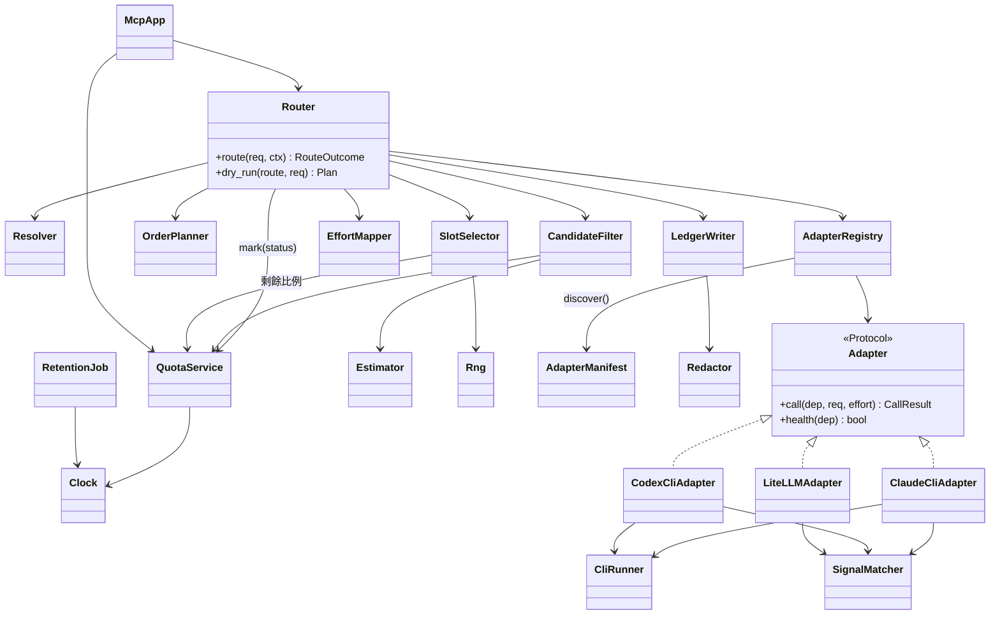

# 設計結構 — Spillway

- 專案:spillway · 分支:main · 版本:v1.0 已確認(2026-10-29,使用者;含 D11 adapter 模組化) · 日期:2026-10-29(UTC+0)
- 依據:sdlc_docs/ai-guideline.md v1.0;docs/spec.md;sdlc_docs/structure/logical.md

## 關鍵元件

| 元件 | 責任 | 對外介面 / 契約 | 規格 |
|------|------|-----------------|------|
| `Router` | 單次請求的完整路由:解析、篩選、排序、選擇、fallback | `route(req, ctx) -> RouteOutcome`;`dry_run(route, req) -> Plan` | 4 |
| `Resolver` | `model` 字串 → `local/` 直呼 / route / 隱含 route / 404 | `resolve(model) -> Target` | 4.1 |
| `CandidateFilter` | 依 enabled、能力、mode、額度、冷卻、健康、預估篩選 | `filter(target, req, now) -> list[Candidate]`(含被篩原因) | 4.2 |
| `OrderPlanner` | 手動 slot 或預設層級 → slot 清單;標示「未排序」 | `plan(route, candidates) -> list[Slot]` | 4.3 |
| `SlotSelector` | slot 內加權隨機選雲端、失敗重選、再依 position 試 local | `iterate(slot, rng) -> Iterator[Candidate]` | 4.4 |
| `QuotaService` | 本期起點、下一重置點、剩餘額度與比例、冷卻設定與清除 | `remaining(dep, now)`、`next_reset(budget, now)`、`mark(dep, status, now)` | 5.1–5.3 |
| `SignalMatcher` | 依成員 `params.signals` 將上游輸出歸類 | `classify(dep, raw) -> ok / quota_exhausted / rate_limited / error` | 5.3.1 |
| `Estimator` | 輸入 token、輸出 P50/P90、P90 花費 | `estimate(dep, req, route) -> Estimate` | 5.4 |
| `EffortMapper` | 來源優先序與降級(通用);上游參數值由各 adapter 模組的 manifest 提供 | `pick(route_target, req, caps) -> str \| None` | 6 |
| `Adapter`(Protocol) | 呼叫上游與健康檢查 | `call(dep, req, effort) -> CallResult`;`health(dep) -> bool` | 7.1 |
| `AdapterManifest` | 每個 adapter 模組的宣告資料(見下方「Adapter 模組契約」) | dataclass,模組層級常數 `MANIFEST` | 6.3、5.3.1、7 |
| `AdapterRegistry` | 啟動時掃描 `spillway.adapters` 下的子套件並註冊;`provider` → adapter;未註冊依 `kind` 用通用 `litellm` 模組;提供 `cardinality_of(provider)` | `discover() -> list[AdapterManifest]`;`get(dep) -> Adapter`;`unavailable() -> dict[provider, reason]` | 7.1.1 |
| `CliRunner` | 啟動 CLI 子行程:環境清理、深度標記、逾時、並行上限(非阻塞取得,滿了視為不可用) | `run(argv, stdin, env, cwd, timeout) -> ProcResult` | 7.3、7.4、NFR-6 |
| `LedgerWriter` | 每次嘗試一列;payload 截斷與遮罩 | `record(attempt) -> ledger_id` | 2.4、4.5.1 |
| `RetentionJob` | 每小時刪除過期 payload | `run_once(now)` | 2.4.5 |
| `Redactor` | 遮罩 `sk-…`、`Bearer` 後值、已解析的憑證值 | `redact(text) -> (text, hit: bool)` | 2.4.4 |
| `ConfigIO` | YAML ↔ 資料庫 | `export() -> str`;`import_(yaml, mode)`,失敗回欄位路徑 | 3 |
| `McpConfigRenderer` | 模板渲染各工具設定 | `render(group, tool, embed_token) -> {content, path, env}` | 8.2 |
| `McpApp` | 依 `<group>` 暴露 route;list_changed | MCP tools `ask`、`list_routes`、`quota_status` | 8.1 |
| `Clock` / `Rng` | 時間與亂數來源 | `now() -> datetime(UTC)`;`random() -> float` | 測試注入 |

## 元件關係圖



## Adapter 模組契約(D11)

每個供應商(「一種 AI」)是 `src/spillway/adapters/` 底下的一個子套件,自成一個模組:

```
adapters/<module>/
├── __init__.py      # 匯出 MANIFEST 與 create()
├── adapter.py       # 實作 Adapter Protocol
├── models.yaml      # 可用模型清單(D12),純資料,改清單不必改程式
└── README.md        # 這個 AI 的接法、所需 CLI/環境變數、已知限制
```

`__init__.py` 必須提供:

| 名稱 | 內容 |
|------|------|
| `MANIFEST: AdapterManifest` | `providers`(此模組處理的 `provider` 值,如 `["claude-cli"]`)、`kinds`(`cli`/`api`/`local`)、`effort_map`(五級 → 上游值或 `None`,取代 spec 6.3 的共用表)、`default_signals`(`{quota, rate_limit}` 正規式,spec 5.3.1 預設)、`default_capabilities`、`default_params`(如 `timeout`、`effort_args`)、`requires`(需要的執行檔或環境變數,用於健康檢查與 UI 提示)、`fallback_for_kinds`(只有 litellm 模組宣告 `["api","local"]`)、`access`(`subscription-cli` / `api` / `local`,見 D14)、`cardinality`(`single` = 此 provider 全系統只能有 1 個成員;`multiple` = 可建多個,見 D15)、`contract_version`(目前 `1`);另可選 `list_models(context)`,執行期向上游查詢可用模型(例:local 端點的 `/v1/models`) |
| `create(context) -> Adapter` | 建立實例;`context` 只提供 `CliRunner`、`credentials` 解析器、`Clock`——模組拿不到 `store`、`routing` |

規則:

1. **新增一種 AI = 新增一個子套件資料夾**,不修改任何既有檔案(含 registry)。spec 7.1.2「只可新增 adapter 檔案與註冊一行」的上限因此收緊為零行。
2. 模組只可 import `spillway.adapters.base`(Protocol、`CallResult`、`AdapterManifest`、`CliRunner`)與第三方套件;**不可 import `routing`、`store`、`api`、`mcp`**。由 `tests/contract/test_layering.py` 以 AST 檢查。
3. 每個模組必須通過共用合約測試 `tests/contract/test_adapter_contract.py`(對所有被發現的模組參數化執行):manifest 欄位齊全且合法、`effort_map` 五級都有定義、`call` 對假上游的成功/用完/429/錯誤四種輸出回傳正確的 `CallResult.status`。新模組另放自己的假上游於 `tests/fakes/<module>/`。
4. 註冊衝突(兩個模組宣告同一 `provider`)→ 啟動失敗並列出兩個模組,不猜哪個優先。
5. 模組載入失敗(import 錯誤、manifest 不合法、`contract_version` 不支援)→ 該模組不註冊,原因記入 `AdapterRegistry.unavailable()`;使用該 `provider` 的成員在候選篩選時視為不可用(原因 `adapter_unavailable`),並在 UI-2 成員頁顯示。其他模組照常運作。
6. 成員的 `params` 覆寫 manifest 的 `default_params` / `default_signals`(spec 5.3.1「可於 UI 修改」不變)。
7. **可用模型清單(D12)**:每個模組以 `models.yaml` 宣告可用模型,每筆 `{id, label, provider?, capabilities: {ctx, tools, vision, efforts[]}, note?}`。合約測試驗證清單可解析、`efforts` 只含五級值。模組若提供 `list_models`,執行期結果與 `models.yaml` 合併(同 `id` 以 `models.yaml` 的能力為準),查詢失敗只回 `models.yaml` 並標示原因。
8. **訂閱制 CLI 與 API 是不同模組(D14)**:同一家 AI 的訂閱 CLI 與官方 API 各自一個模組,各有自己的 manifest、可用模型清單、effort 對應與上游訊號——例如 `claude_cli`(訂閱,經 `claude -p`)與 `anthropic_api`(API key)。兩者共用的 LiteLLM 呼叫程式放在 `adapters.base.litellm_call`,是共用函式,不是模組。
9. **唯一或多個(D15)**:`cardinality` 由模組宣告。`single` 的 provider 建立第二個成員時,`api.admin` 與 `configio` 匯入在同一交易內拒絕並回傳錯誤碼 `provider_single`;`multiple` 則不限。內建模組:訂閱 CLI 為 `single`(企劃書第七節「每家訂閱只允許一個 CLI 成員」),API 與 local 為 `multiple`。
10. 第一版內建模組:

    | 模組 | provider | access | cardinality |
    |------|----------|--------|-------------|
    | `claude_cli` | `claude-cli` | subscription-cli | single |
    | `codex_cli` | `codex-cli` | subscription-cli | single |
    | `anthropic_api` | `anthropic` | api | multiple |
    | `openai_api` | `openai` | api | multiple |
    | `litellm` | 其他所有 api / local provider(通用後備,如 `deepseek`、`ollama`) | api、local | multiple |

    `anthropic_api`、`openai_api` 兩個專屬 API 模組對應兩個訂閱 CLI,**使用者確認**(2026-10-29);其他供應商先由通用 `litellm` 模組處理,日後要專屬模型清單再各自加模組。
11. 外部套件以 entry point 外掛**不在範圍內**(使用者 2026-10-29 選定)。

## 後台選單(D13)

Web 後台建立與編輯成員時以選單取代自由輸入,資料來源是新增的唯讀端點 `GET /api/adapters`:

```json
{"modules": [{"module": "claude_cli", "providers": ["claude-cli"], "kinds": ["cli"],
  "access": "subscription-cli", "cardinality": "single", "existing_members": 0,
  "available": true, "unavailable_reason": null,
  "models": [{"id": "claude-sonnet-5-5", "label": "Sonnet 5.5",
              "capabilities": {"ctx": 200000, "tools": true, "vision": false,
                               "efforts": ["low","medium","high","max"]}}]}]}
```

| 畫面欄位 | 選單內容 | 連動 |
|----------|----------|------|
| UI-2 類型(kind) | `cli`、`api`、`local` | 篩選下一個選單 |
| UI-2 供應商(provider) | 支援該 kind 的已發現模組的 `providers`;不可用的模組灰掉並顯示原因;`single` 且已有成員的 provider 灰掉並註明「已有 1 個,僅限 1 個」 | 決定模型選單 |
| UI-2 模型(model) | 該模組的可用模型清單(`label` 顯示、`id` 寫入) | 選定後帶入能力預設(ctx、tools、vision、efforts),仍可修改 |
| UI-4 每成員 effort | 只列該成員 `capabilities.efforts` 有的等級 + 「不指定」 | — |
| UI-4 優先權重 | 高、中、低 | — |

清單沒有的模型:模型選單最後一項「其他(手動輸入)」,允許輸入 `id`,能力需手填。**代使用者決定**:保留手動輸入是為了上游新出的模型不必等改清單就能用;要強制只能選清單內的,確認時說一聲即可移除。

## 介面 / API 契約

- HTTP、MCP、YAML、DDL 的契約以 `docs/spec.md` 第 2、3、8、9 節為準,本文件不重抄。
- `CallResult` 依 spec 7.1。adapter **不寫帳本、不設冷卻**——它只回報結果;歸類由 `SignalMatcher`,狀態更新由 `Router` 經 `QuotaService` 做。這讓 adapter 可以獨立以假上游測試。
- `Router` 回傳 `RouteOutcome { result | no_candidate, attempts[] }`;`attempts` 同時用於 503 body、dry-run 回應、MCP `ask` 輸出。
- 錯誤一律走 spec 9.1.2 格式;錯誤碼:`route_not_found`、`no_candidate`、`member_not_in_target`、`recursion_blocked`、`payload_expired`。

## 設計決策與取捨

| # | 決策 | 選項 | 取捨理由 |
|---|------|------|----------|
| D1 | 上游呼叫用 async | async(`litellm.acompletion`、`asyncio.create_subprocess_exec`) vs sync + threadpool | CLI 呼叫可達 600 秒;async 不佔執行緒,並行上限用非阻塞 semaphore 直接表達「滿了視為不可用」(NFR-6)。 |
| D2 | SQLite 用標準庫 `sqlite3`,短交易、每請求一連線 | `sqlite3` vs `aiosqlite` vs ORM | 單人寫入量小、查詢皆 ms 級;WAL 允許讀寫並行。ORM 對 11 張以內的表收益低,且 DDL 已在規格書定案。 |
| D3 | Schema 版本以 `PRAGMA user_version` 管理,啟動時依序套用 migration | user_version vs Alembic | 不引入 ORM 就不需要 Alembic;單檔資料庫用 user_version 足夠。 |
| D4 | 時間與亂數一律注入(`Clock`、`Rng`) | 注入 vs `freezegun` 等 monkeypatch | AC-4、AC-14、AC-17、NFR-5 需要「推進系統時間」與可重現分布;注入比全域 patch 穩定,也能用在背景清理工作。 |
| D5 | 假上游(Guideline Q1):`tests/fakes/` 放假的 `claude`、`codex` 可執行腳本,測試時放到 `PATH` 最前面;API 以 LiteLLM 的 mock 回應/本機假 HTTP 端點 | PATH 注入 vs 在成員設定加「指令路徑」欄位 | PATH 注入不需要改 spec 7.3.1 的命令定義;假腳本依環境變數決定回傳成功、用完、429、錯誤或延遲。 |
| D6 | MCP 用官方 `mcp` Python SDK 的 low-level server,單一 ASGI app 掛在 `/mcp/{group}`,依 path 參數決定暴露的 route | 低階 server vs 每群組一個 FastMCP 實例 | 群組會在執行期新增刪除;每群組一個實例要動態掛載與拆除,低階 server 依請求查表較單純,也方便發 `list_changed`。 |
| D7 | Web UI:Jinja2 伺服端渲染 + 原生 JavaScript(HTML5 拖放、`fetch` 呼叫 `/api/*`),不引入前端建置與框架 | 原生 JS vs htmx vs SPA | 企劃書已定「不引入前端建置流程」;7 個畫面中只有 UI-4 拖曳需要較多互動,原生 DnD 足夠。 |
| D8 | 資料目錄:環境變數 `SPILLWAY_HOME`,未設時用 `platformdirs.user_data_dir("spillway")`;內含 `spillway.db`、`work/claude/`、`tmp/` | 固定 `~/.spillway` vs platformdirs | 規格書只說「閘道資料目錄」;platformdirs 在三平台各自落在慣例位置(NFR-7)。**代使用者決定**,可在確認時否決。 |
| D9 | 預設埠號 8787、綁定 127.0.0.1;存取 token 於 `spillway init` 或首次啟動產生,只印一次,資料庫存 SHA-256 | — | 依 spec 8.1.3、9.1.1 與範例;8787 取自規格書範例。**代使用者決定**埠號。 |
| D10 | 設定檔 YAML 解析用 `PyYAML` safe_load,欄位驗證用 Pydantic 模型 | Pydantic vs 手寫驗證 | FastAPI 已帶 Pydantic;驗證失敗可直接產生欄位路徑(spec 3.1.2)。 |
| D11 | Adapter 一供應商一個子套件,manifest 宣告 + 啟動時自動發現 + 共用合約測試(見上方「Adapter 模組契約」) | 子套件自動發現 vs 加 entry point 外部外掛 vs 規格書原做法(單檔 + 註冊一行) | 使用者要求不同 AI 能以模組化方式加入。自動發現讓新增 AI 不碰既有檔案;effort 對應與上游訊號預設跟著模組走,不再集中在共用表。entry point 會載入 repo 外的第三方程式,第一版不採用。**使用者決定**(2026-10-29)。 |
| D12 | 可用模型清單放在各模組的 `models.yaml`,可選擇再加執行期查詢 | 模組內靜態清單 vs 資料庫表 vs 只靠執行期查詢 | 跟模組放在一起才符合「一種 AI 一個模組」:新增 AI 時清單一起帶進來;雲端 API 多半沒有可靠的列模型端點,所以靜態清單為主、執行期查詢為輔(local 端點可查)。**使用者要求**(2026-10-29),檔案形式代使用者決定。 |
| D13 | 後台以連動選單選取 kind → provider → model,資料來自 `GET /api/adapters`;保留「其他(手動輸入)」 | 選單 vs 自由輸入 | 使用者要求。選單直接反映已發現的模組與清單,打錯 provider 或模型名稱的機會降到零。 |
| D14 | 訂閱制 CLI 與 API 拆成不同模組;manifest 宣告 `access` | 同家共用一模組 vs 拆開 | 使用者要求(2026-10-29)。兩者的呼叫方式、計費、可用模型、上游訊號都不同;拆開後各自的清單與預設互不牽動。 |
| D15 | 模組宣告 `cardinality: single \| multiple`,由應用層在建立成員與匯入時強制 | 模組宣告 + 應用層檢查 vs 資料庫部分唯一索引(spec 2.1.4) | 使用者要求模組可限定唯一或允許多個。spec 2.1.4 的索引寫死「kind=cli 即唯一」,無法由模組決定,改為應用層依 manifest 檢查(同一交易內,防止並行建立)。AC-12 仍成立,因為 `claude_cli` 宣告 single。**待同步規格書 2.1.4**。 |

## 採用模式

- **Strategy + 自動發現的 Registry**:`Adapter` 介面 + 每模組一份 manifest;新增供應商只加一個子套件資料夾(D11)。
- **Pipeline**:`Router` 內部是 Resolver → Filter → Planner → Selector 的固定管線,每段可單獨測試,也直接對應 dry-run 要回傳的中間結果。
- **設定驅動**:CLI 參數(`effort_args`、`extra_args`)、上游訊號規則(`signals`)、MCP 工具格式(模板檔)都是資料,不寫死(企劃書第九節風險對策)。
- **Ports & adapters 的測試縫**:`Clock`、`Rng`、`CliRunner`、PATH 上的假 CLI,讓自動測試不碰真實上游(Guideline Q1)。
