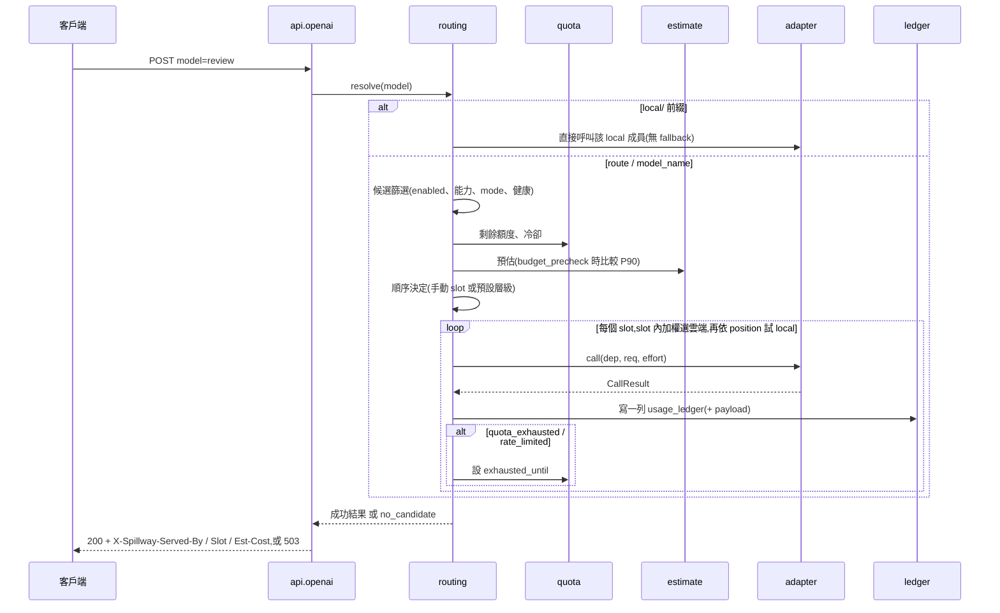
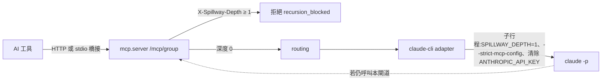
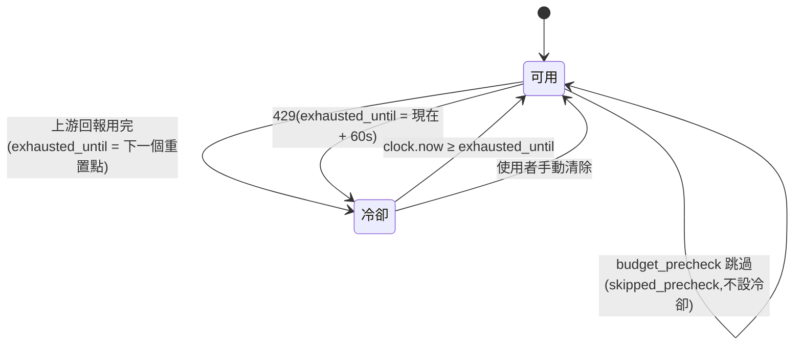

# 邏輯結構 — Spillway

- 專案:spillway · 分支:main · 版本:v1.1(2026-10-30,CHG-20261030-02:quota 移除訊號判定、adapters.base 擴充、M3/M4 標註里程碑;使用者於 CHG 確認閘確認,2026-10-30) · 前版 v1.0 已確認(2026-10-29,使用者) · 日期:2026-10-30(UTC+0)
- 依據:sdlc_docs/ai-guideline.md v1.0;docs/spec.md

## 分層 / 模組

| 層 | 模組 | 職責 | 依賴 | 回應需求 |
|----|------|------|------|----------|
| 介面層 | `api.openai` | `/v1/chat/completions`、`/v1/models`;回應 header(帳本由 Router 寫入,本模組只做 HTTP 轉換) | `routing` | FR-2、FR-13 |
| 介面層 | `api.admin` | `/api/*` 管理端點(CRUD、order、dry-run、estimate、ledger、config〔M4〕、settings、`/api/adapters` 模組與可用模型) | `store`、`routing`、`estimate`、`quota`、`configio`〔M4〕、`mcpconf`〔M4〕、`adapters.base` | FR-13、FR-21、FR-24 |
| 介面層 | `mcp.server`(M3) | `/mcp/<group>` Streamable HTTP;`ask`/`list_routes`/`quota_status`;遞迴防護 | `routing`、`quota`、`store` | FR-18 |
| 介面層 | `mcp.bridge`(M3) | `spillway mcp-stdio`:stdio ↔ HTTP 轉發,`SPILLWAY_DEPTH` → header | (只依 HTTP) | FR-18 |
| 介面層 | `web`(M4) | 7 個畫面(伺服端渲染 + 少量 JS),只呼叫 `/api/*` | `api.admin`(經 HTTP) | FR-20、FR-22 |
| 介面層 | `cli` | `spillway serve`(M2)/ `mcp-stdio`、`init`(M3) | `app`、`mcp.bridge` | — |
| 應用層 | `routing` | 請求解析 → 候選篩選 → 順序決定 → slot 內選擇 → 呼叫與 fallback | `quota`、`estimate`、`effort`、`adapters`、`ledger`、`store` | FR-2–FR-7 |
| 應用層 | `quota` | 計算期間、剩餘額度與比例、冷卻設定與清除(上游訊號判定已移至 `adapters.base` 的 `classify`) | `store`、`clock` | FR-8 |
| 應用層 | `estimate` | token 與花費預估(P50/P90) | `store`、`adapters.base`(`model_string`、`load_litellm`)、LiteLLM | FR-9 |
| 應用層 | `effort` | 五級 effort 的來源優先序與降級 | — | FR-10 |
| 應用層 | `ledger` | 每次嘗試寫入 `usage_ledger`;context 記錄(截斷、遮罩)與保存清理 | `store`、`redact`、`clock` | FR-7、FR-14 |
| 應用層 | `configio`(M4) | YAML 匯入(merge/replace、單一交易)與匯出 | `store` | FR-21 |
| 應用層 | `mcpconf`(M4) | 依群組與工具產生 MCP 設定(模板) | `store` | FR-19 |
| 整合層 | `adapters.base` | `Adapter` 介面、`AdapterContext`、`AdapterManifest`、自動發現的註冊表、上游訊號歸類 `classify`、effort 上游值轉換 `effort_to_upstream`、共用 LiteLLM 呼叫 `litellm_call`、local 健康探測 `probe_http`(httpx)、`CliRunner`〔M3〕(含 CLI 並行上限) | `credentials`、`clock` | FR-11、FR-17 |
| 整合層 | `adapters.<module>` | 一種 AI、一種接入方式一個模組:訂閱 CLI(claude_cli、codex_cli;M3)、API(anthropic_api、openai_api)、通用後備(litellm);各宣告唯一或多個;各帶 manifest(effort 對應、訊號預設、能力預設)與可用模型清單 | 只依 `adapters.base` | FR-12、FR-15、FR-16、FR-23 |
| 基礎層 | `domain` | 跨層共用的值物件:`Deployment`、`Budget`、`ChatRequest`、`CallResult`(CHG-20261030-02 審查修正;`adapters.base` 轉匯出) | — | FR-1、FR-11 |
| 基礎層 | `store` | SQLite 連線(WAL、外鍵)、schema 建立與版本、各表存取 | `domain`、`clock` | FR-1 |
| 基礎層 | `credentials` | 解析 `credential_ref`(`env:`、`keyring:`) | — | FR-1、NFR-4 |
| 基礎層 | `redact` | 疑似金鑰遮罩規則 | `credentials` | FR-14、NFR-4 |
| 基礎層 | `clock` / `rng` | 可注入的時間與亂數來源 | — | AC-4、AC-14、AC-17、NFR-5 |
| 基礎層 | `settings` | 資料目錄、埠號、綁定位址;存取 token 雜湊(M3) | M2 不依賴 `store`;M3 讀 settings 表 | NFR-3 |

## 架構圖

```mermaid
flowchart TD
  subgraph 介面層
    OAI[api.openai]
    ADM[api.admin]
    MCPS[mcp.server<br/>M3]
    BR[mcp.bridge<br/>M3]
    WEB[web<br/>M4]
    CLI[cli]
  end
  subgraph 應用層
    RT[routing]
    QT[quota]
    ES[estimate]
    EF[effort]
    LG[ledger]
    CIO[configio<br/>M4]
    MCF[mcpconf<br/>M4]
  end
  subgraph 整合層
    AD[adapters.base<br/>registry · manifest · AdapterContext<br/>classify · effort_to_upstream · litellm_call<br/>CliRunner〔M3〕]
    AM2[adapters.claude_cli<br/>訂閱 · single · M3]
    AM3[adapters.codex_cli<br/>訂閱 · single · M3]
    AM4[adapters.anthropic_api<br/>API · multiple]
    AM5[adapters.openai_api<br/>API · multiple]
    AM1[adapters.litellm<br/>通用後備 · multiple]
    AMN[adapters.＜新模組＞]
  end
  subgraph 基礎層
    ST[store]
    CR[credentials]
    RD[redact]
    CK[clock / rng]
    SE[settings]
  end

  WEB -. HTTP .-> ADM
  BR -. HTTP .-> MCPS
  CLI --> OAI & ADM & MCPS
  CLI --> BR
  OAI --> RT
  MCPS --> RT
  MCPS --> QT
  ADM --> RT & ES & QT & CIO & MCF & ST
  ADM -->|模組與可用模型| AD
  RT --> QT & ES & EF & AD & LG & ST & CK
  QT --> ST & CK
  ES --> ST
  LG --> ST & RD & CK
  CIO --> ST
  MCF --> ST & SE
  AD --> CR & CK
  AD -. 啟動時自動發現 .-> AM1 & AM2 & AM3 & AM4 & AM5 & AMN
  AM1 & AM2 & AM3 & AM4 & AM5 & AMN --> AD
  EF -. 讀 manifest.effort_map .-> AD
  RD --> CR
  SE -. M3 讀 settings 表 .-> ST

  AM1 & AM2 & AM3 & AM4 & AM5 & AMN ==> UP[(上游:claude / codex CLI、雲端 API、local 端點)]
```

## 主要流程

### 流程 1:一次 `/v1/chat/completions` 呼叫(含 fallback)



錯誤路徑:找不到 route → 404 `route_not_found`;全部 slot 失敗 → 503 `no_candidate`,body 列每次嘗試。

### 流程 2:MCP `ask` 與遞迴防護



### 流程 3:額度用完 → 冷卻 → 自動恢復



## 相依方向

- 單向:介面層 → 應用層 → 整合層 → 基礎層;不得反向 import。
- `web` 與 `mcp.bridge` 只經 HTTP 呼叫,不直接 import 應用層——它們是同一個 API 的客戶端,換掉也不影響核心。
- `routing` 不依賴任何 adapter 的內部細節,只認 `Adapter` 介面與註冊表(spec 7.1.2)。上游輸出的歸類由 adapter 在 `call()` 內以 `adapters.base.classify` 完成,`routing` 與 `quota` 只讀取回傳的 status。
- `adapters.<module>` 只依賴 `adapters.base`;模組之間互不 import。新增一種 AI 不修改任何既有檔案(design D11)。
- 所有讀時間、取亂數的地方都經 `clock` / `rng`,讓「推進系統時間」與「400 次分布」可測(AC-4、AC-14、AC-17)。
