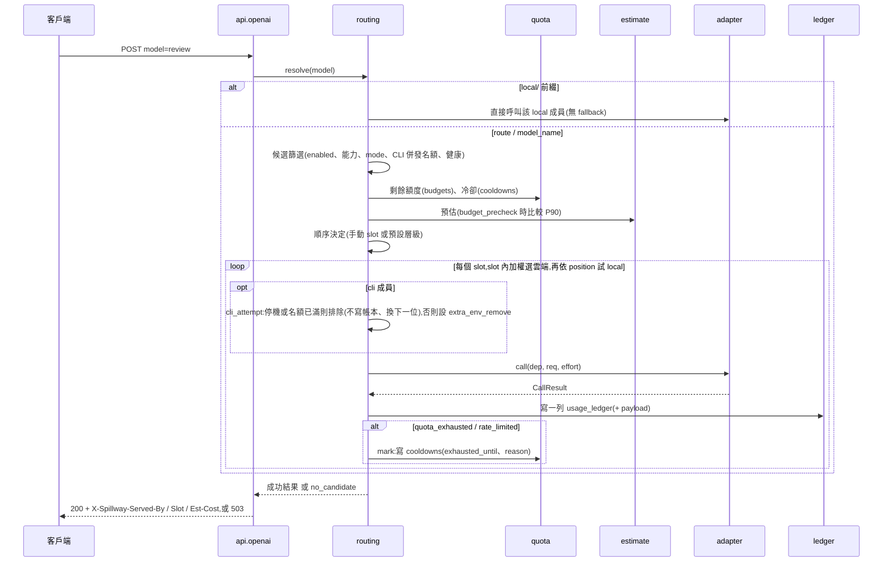
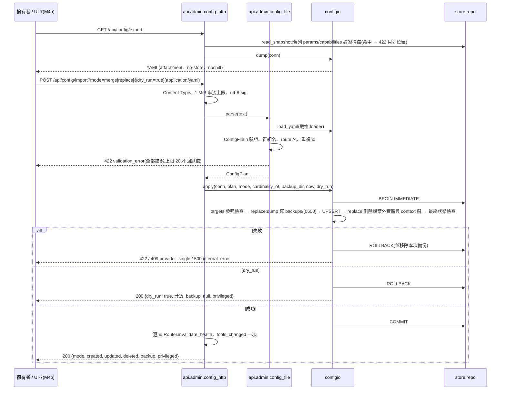
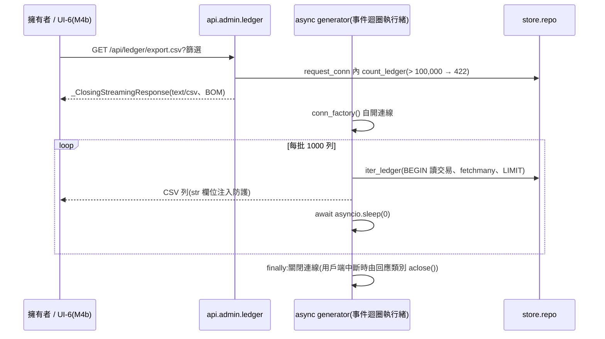
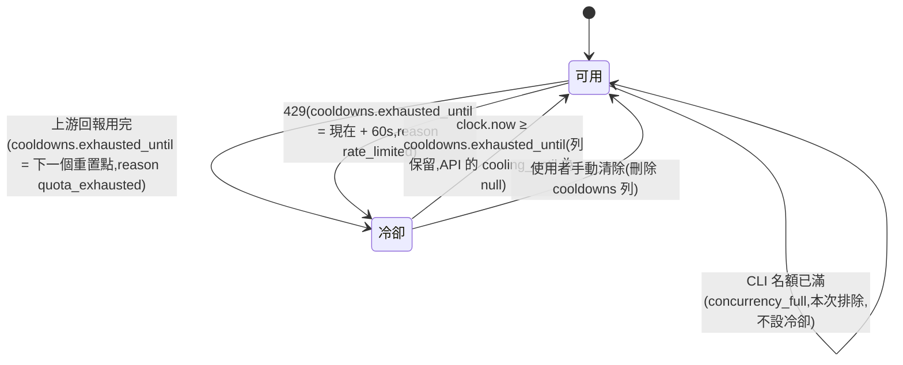

# 邏輯結構 — Spillway

- 專案:spillway · 分支:main · 版本:v1.6(2026-11-03,CHG-20261103-01:`web` 改為靜態檔(`spillway.web`)+ `/api`,Python 端只依賴 Starlette;新增 `api.http_headers`(安全標頭);`api.admin` 子模組 `config_http`(原名 `config_io`)與畫面用的讀取端點,依賴加 `api.mcp.catalog`(單向)與 `routing.static_plan`;`configio` 使用 `clock.utc_strftime`;流程「匯入確認」與「畫面載入」;使用者於 CHG 確認閘確認,2026-11-03) · 前版 v1.5 已確認(2026-11-02,CHG-20261102-02:應用層 `configio`(依賴只有 `store`、`domain`、`clock`、`yaml`)、介面層 `api.admin.config_file`(檔案模型與 parse)與 `api.admin.config_io`(匯入匯出端點)、帳本 CSV、設定總覽、`settings` 的環境變數名常數;設定匯入匯出流程與帳本 CSV 串流;`web` 改屬 M4b;使用者於 CHG 確認閘確認,2026-11-02) · 前版 v1.4 已確認(2026-11-02,CHG-20261102-01:`api.mcp`(MCP server、`mcp-stdio` 的 `api.mcp.bridge`、`mcp_catalog`)、`api.host_origin`、`api.drain`、`api.admin.mcp_config`(取代原 M4 的 `mcpconf`)、`quota.member_quota_rows`、`adapters.base.cli_common`;MCP 請求、`list_changed`、停機期滿流程;畫面數 8;使用者於 CHG 確認閘確認,2026-11-02) · 前版 v1.3 已確認(2026-11-01,CHG-20261101-03:`adapters.base.cli_runner`、`adapters.base.cli_prompt`、`claude_cli`/`codex_cli` 模組、`cli` 的 `init` 與停機、Router 的 CLI 守門與停機旗標、冷卻改存 `cooldowns`、`settings` 讀寫 token 雜湊;使用者於 CHG 確認閘確認,2026-11-01) · 前前版 v1.2 已確認(2026-11-01,CHG-20261101-02:`api.admin` 改為套件、新增 `api.deps`、`routing.outcome`、`adapters.base.api_adapter`、SQL 只在 store、LiteLLM 相關 logger 的 INFO 下限;使用者於 CHG 確認閘確認,2026-11-01) · v1.1 已確認(2026-10-30,CHG-20261030-02) · v1.0 已確認(2026-10-29,使用者) · 日期:2026-11-02(UTC+0)
- 依據:sdlc_docs/ai-guideline.md v1.8;docs/spec.md;knowledge DIR-5

## 分層 / 模組

| 層 | 模組 | 職責 | 依賴 | 回應需求 |
|----|------|------|------|----------|
| 介面層 | `api.openai` | `/v1/chat/completions`、`/v1/models`;回應 header(帳本由 Router 寫入,本模組只做 HTTP 轉換) | `routing`、`effort`(`normalize_effort`)、`api.deps`、`store`(`/v1/models` 讀清單)、`redact`(503 訊息防線)、`domain` | FR-2、FR-13 |
| 介面層 | `api.admin`(套件) | `/api/*` 管理端點(CRUD、order、dry-run、estimate、ledger 與帳本 CSV、config 匯入匯出〔M4a〕、settings 與設定總覽〔M4a〕、`/api/adapters` 模組與可用模型)。子模組(CHG-20261101-02 決策 9):`common`(錯誤工具、`_AdminRoute`、`router` 本體、共用 helper)、`models`(成員、群組、route 的請求 body 模型,含憑證掃描與 `validate_signals` 的 validator)、`secrets`(憑證鍵名與值樣式掃描,design D26)、`deployments`(含 test-call)、`groups`、`routes`(含 order)、`planning`(dry-run、estimate)、`ledger`(含 `GET /api/ledger/export.csv`,M4a,design D39)、`settings`(含 `GET /api/settings`,M4a,design D40)、`dashboard`、`adapters`、`mcp_config`(`GET /api/mcp/config`,M3b,design D36)、`config_file`(設定檔的 Pydantic 檔案模型與 `parse(text) -> configio.ConfigPlan`,組合 `models` 的請求模型,M4a,design D38)、`config_http`(原名 `config_io`,CHG-20261103-01 決策 21 ② 更名;`GET /api/config/export`、`POST /api/config/import`,M4a,design D38);M4b 新增畫面用的讀取端點 `POST /api/groups/preview`(`groups`)、`GET /api/routes/{name}/effective-order`(`routes`)、`GET /api/mcp/catalog`(`mcp_config`),並在 `dashboard` 加 `daily_spend_7d`、`ledger` 加 `min_depth`(design D43);422 一律經 `common.invalid(path, reason)`;`__init__` 組 `router`(`__all__ == ["router"]`);logger 名稱一律 `spillway.api.admin` | `store`、`routing`(含 `static_plan`,M4b)、`effort`(`normalize_effort`)、`api.deps`、`estimate`、`quota`、`ledger`、`credentials`、`redact`、`domain`、`clock`、`settings`、`configio`(M4a)、`adapters.base`;`api.mcp.catalog`(M4b:`mcp_config` 經 `mcp_catalog` 提供 `GET /api/mcp/catalog`,單向,`api.mcp` 不引用 `api.admin`);`mcp_config` 另用 `jinja2` 與 `templates/mcp/`;route、群組、order 寫入後經 `app.state.mcp_events.changed()` 通知 MCP(commit 之後) | FR-13、FR-19、FR-21、FR-24、FR-26 |
| 介面層 | `api.deps` | API 層的連線取得 `request_conn(request)`:每次呼叫以 `request.app.state.conn_factory()` 開一條、離開 `with` 時關閉(design D27);`api.openai` 與 `api.admin` 共用 | —(只用標準庫 `sqlite3`;連線工廠由 `app` 注入於 `app.state`) | FR-13 |
| 介面層 | `api.host_origin`(M3b) | 全端點 Host/Origin 檢查,純 ASGI、最外層(design D33) | `api`(錯誤格式) | FR-18;NFR-3 |
| 介面層 | `api.http_headers`(M4b) | `SecurityHeadersMiddleware`:依路徑補安全標頭,純 ASGI;`/`、`/ui` 加 CSP(含 Trusted Types)、nosniff、`no-referrer`、COOP、CORP、`no-cache`,`/api` 加 `no-store` 與 nosniff,`/v1`、`/mcp` 不碰;位於 HostOrigin 之內(design D42) | —(只用 `starlette.types`) | FR-20;NFR-4 |
| 介面層 | `api.mcp`(套件,M3b) | `/mcp/<group>` Streamable HTTP(`auth.McpEndpoint`:depth → Bearer → 停機 → 群組、session 綁群組);`server.SpillwayServer`、`McpRuntime`(每次 lifespan 新建 session manager 與持有 task)、停機掛鉤;`tools`:`ask`/`list_routes`/`quota_status`;`events.McpEvents`(`list_changed`);`catalog.mcp_catalog`(UI-8 資料來源);`sdk_compat`(SDK 私有屬性的唯一存取點)(design D6、D9、D34、D37) | `routing`(`Router.route`、`members_of`、`OrderPlanner`;M4b 起 `list_routes` 經 `static_plan`)、`api.drain`、`quota`(`member_quota_rows`)、`store.repo`、`settings`(token 雜湊)、`redact`、`domain`、`mcp` SDK;不引用 `api.admin` 內部、不直接呼叫 adapter | FR-18、FR-26 |
| 介面層 | `api.mcp.bridge`(M3b) | `spillway mcp-stdio`:stdio ↔ `http://127.0.0.1:<port>/mcp/<group>` 轉送、錯誤對應層、結束碼 0/1/2/3/130,`SPILLWAY_DEPTH` → header(design D35) | 只經 HTTP 呼叫閘道(`mcp` SDK 用戶端與 stdio、`httpx`);不開資料庫、不 import 應用層 | FR-18 |
| 介面層 | `api.drain`(M3b) | `run_until_drain`(停機期滿取消子 task、回 `Drained`)、`ShutdownHooks`、`CANCELLED_DRAIN_TIMEOUT`(design D31) | `adapters.base`(停機常數) | FR-13、FR-18 |
| 介面層 | `web`(`spillway.web`,M4b) | 8 個畫面與首次設定精靈:靜態檔(`src/spillway/web/static/` 的 HTML、CSS、ES module JS,不經建置、不用模板)+ `/api`——瀏覽器以同源 `fetch` 呼叫 `/api/*` 取得全部資料(UI-8「API 參考」經 `GET /api/mcp/catalog`);Python 端 `mount_web(app)` 只以 `StaticFiles` 掛 `/ui`、純 ASGI 檔案過濾、`/` 轉址(design D41) | Python 端只依賴 Starlette(`StaticFiles`)與標準庫;瀏覽器端只經 HTTP 呼叫 `api.admin`(不 import 任何 spillway 模組) | FR-20、FR-22、FR-24、FR-26 |
| 介面層 | `cli` | `spillway serve`(M2;M3a 加啟動前置檢查 `_preflight`——埠試綁、取得 `spillway.lock`——與 graceful shutdown,design D28、D31)、`spillway init [--rotate]`(M3a:資料目錄、`work/claude`、`work/codex`、migration、存取 token,design D30)、`spillway mcp-stdio --group <g> [--port]`(M3b,design D35);serve 停用 sse-starlette auto-drain、第一個訊號觸發 `shutdown_hooks` 並排定 `drain_expired`、Ctrl-C 結束碼 130(M3b,design D31) | `app`、`settings`、`store`(`db.connect`、資料目錄鎖)、`adapters.base`(`CLI_WORK_SUBDIRS`)、`api.drain`(`CANCELLED_DRAIN_TIMEOUT`)、`api.mcp.bridge`〔延遲 import〕 | FR-17、FR-18 |
| 應用層 | `routing` | 請求解析 → 候選篩選 → 順序決定 → slot 內選擇 → 呼叫與 fallback;回傳型別(`RouteOutcome`、`AttemptInfo`、`Plan`、`PlanSlot`、`PlanEntry`、`PlanExcluded`)在 `routing.outcome`(CHG-20261101-02 決策 10,`spillway.routing` 與 `routing.router` 轉匯出);健康快取失效 `Router.invalidate_health`;CLI 成員的併發名額篩選(`concurrency_full`)與共用守門 `Router.cli_attempt`(停機拒絕、取名額、成員 env 憑證移除與遮罩;管理 API test-call 也經它)、停機旗標 `shutting_down`(CHG-20261101-03,design D29、D31);靜態順序計畫 `routing.static_plan`(純函式,`effective-order` 與 MCP `list_routes` 共用,M4b,design D43) | `quota`、`estimate`、`effort`、`adapters`、`ledger`、`store`、`credentials`(當次憑證值作遮罩用)、`redact`、`domain`、`clock` | FR-2–FR-7 |
| 應用層 | `quota` | 計算期間、剩餘額度與比例(讀 `budgets`)、冷卻設定與清除(讀寫 `cooldowns`,schema v2;上游訊號判定已移至 `adapters.base` 的 `classify`);成員額度列的共用推導 `member_quota_rows`(`/api/dashboard` 與 MCP `quota_status` 共用,M3b) | `store`、`clock` | FR-8 |
| 應用層 | `estimate` | token 與花費預估(P50/P90) | `store`、`adapters.base`(`model_string`、`load_litellm`)、LiteLLM | FR-9 |
| 應用層 | `effort` | 五級 effort 的來源優先序與降級;`normalize_effort`、`InvalidEffort`(CHG-20261101-02 決策 8) | `domain` | FR-10 |
| 應用層 | `ledger` | 每次嘗試寫入 `usage_ledger`;context 記錄(截斷、遮罩)與保存清理 | `store`、`redact`、`clock` | FR-7、FR-14 |
| 應用層 | `configio`(M4a) | 設定檔格式(design D38):匯出 `dump`、嚴格 YAML 解析 `load_yaml`、單一交易套用 `apply`(merge/replace、`dry_run`、寫鎖內備份、最終狀態檢查、`privileged`);**不可** import `spillway.api*`(`tests/unit/test_configio_dump.py` 以 `sys.modules` 檢查),HTTP 轉換與檔案模型驗證在介面層 `api.admin.config_file`/`config_http`;M4b 起 `privileged` 含既有成員的 `provider` 變更(`is_privileged_change`) | `store`(經 `store.repo`,不寫 SQL)、`domain`、`yaml`、標準庫、`clock`(只用 `utc_strftime` 產生檔名,M4b;時間由呼叫端以 `now` 傳入);cardinality 由呼叫端以 `cardinality_of` 傳入(不 import `adapters`) | FR-21 |
| 整合層 | `adapters.base` | `Adapter` 介面、`AdapterContext`、`AdapterManifest`、自動發現的註冊表、上游訊號歸類 `classify`、effort 上游值轉換 `effort_to_upstream`、共用 LiteLLM 呼叫 `litellm_call`、local 健康探測 `probe_http`(httpx)、經 LiteLLM 呼叫上游的共用 adapter 基底 `api_adapter.LiteLLMApiAdapter`(CHG-20261101-02 決策 11)、子行程執行器 `cli_runner.CliRunner`(M3a:獨立 process group、逾時/取消/停機殺 group、併發名額計數 `try_acquire`/`release`/`in_flight`、`extra_env_remove`、`terminate_all`/`kill_all_sync`;design D29、D31)、messages 轉 CLI prompt 的單一實作 `cli_prompt.messages_to_prompt`(M3a;spec 7.5.1);兩個 CLI 模組共用的輔助函式 `cli_common`(`cli_cwd`、`head`/`tail`、`nonneg_int`、`CLI_WORK_SUBDIRS`;M3b);子行程禁用規則 `contract.layering_violations` | `clock`、`domain`(憑證解析器經 `AdapterContext` 注入,不 import `credentials`;資料目錄經 `AdapterContext.data_dir` 注入) | FR-11、FR-15、FR-16、FR-17 |
| 整合層 | `adapters.<module>` | 一種 AI、一種接入方式一個模組:訂閱 CLI(claude_cli、codex_cli;M3a,只經 `AdapterContext.cli_runner` 起子行程,固定附加隔離旗標)、API(anthropic_api、openai_api)、通用後備(litellm);各宣告唯一或多個;各帶 manifest(effort 對應、訊號預設、能力預設)與可用模型清單 | 只依 `adapters.base` | FR-12、FR-15、FR-16、FR-23 |
| 基礎層 | `domain` | 跨層共用的值物件:`Deployment`、`Budget`、`ChatRequest`、`CallResult`(CHG-20261030-02 審查修正;`adapters.base` 轉匯出);共用常數 `KINDS`、`CLOUD_KINDS`、`CALL_STATUSES`、`LEDGER_STATUSES`、`COOLING_STATUSES`、`STATUS_SKIPPED_PRECHECK`(CHG-20261101-02 決策 6) | — | FR-1、FR-11 |
| 基礎層 | `store` | SQLite 連線(WAL、外鍵)、schema 建立與版本、各表存取;連線取得 `db.ConnSource` / `db.use_conn`(不關閉連線,design D27);全專案唯一放 SQL 的位置 | `domain`、`clock` | FR-1 |
| 基礎層 | `credentials` | 解析 `credential_ref`(`env:`、`keyring:`) | — | FR-1、NFR-4 |
| 基礎層 | `redact` | 疑似金鑰遮罩規則(已解析的憑證值由呼叫端以 `extra_secrets` 傳入);共用實例 `REDACTOR` | — | FR-14、NFR-4 |
| 基礎層 | `clock` / `rng` | 可注入的時間與亂數來源;檔名時間戳記 `utc_strftime`、`utc_stamp`(M4b,CHG-20261103-01 決策 21 ⑤) | — | AC-4、AC-14、AC-17、NFR-5 |
| 基礎層 | `settings` | 資料目錄、埠號、綁定位址(M3 仍只允許 127.0.0.1);存取 token 的產生、雜湊與讀寫(M3a:`ensure_access_token`、`rotate_access_token`,design D30);環境變數與 header 名稱的單一定義 `TOKEN_ENV`、`DEPTH_ENV`、`DEPTH_HEADER`(M4a,design D35;adapters 保留字面值,由合約測試核對);版本字串單一定義 `package_version()`(M4b,`GET /api/settings` 與 MCP `serverInfo.version` 共用) | `store`(`repo.get_setting`/`set_setting`、`transaction`;M3a 起);`store` 不可反向 import 本模組 | NFR-3 |

## 架構圖

```mermaid
flowchart TD
  subgraph 介面層
    OAI[api.openai]
    ADM[api.admin<br/>套件]
    DEP[api.deps]
    HO[api.host_origin<br/>最外層]
    MCPS[api.mcp<br/>M3b]
    BR[api.mcp.bridge<br/>mcp-stdio]
    DRN[api.drain]
    WEB[web<br/>靜態檔 + /api<br/>M4b]
    HH[api.http_headers<br/>安全標頭 M4b]
    CLI[cli]
  end
  subgraph 應用層
    RT[routing]
    QT[quota]
    ES[estimate]
    EF[effort]
    LG[ledger]
    CIO[configio<br/>M4a]
  end
  subgraph 整合層
    AD[adapters.base<br/>registry · manifest · AdapterContext<br/>classify · effort_to_upstream · litellm_call<br/>CliRunner〔M3a〕]
    AM2[adapters.claude_cli<br/>訂閱 · single · M3a]
    AM3[adapters.codex_cli<br/>訂閱 · single · M3a]
    AM4[adapters.anthropic_api<br/>API · multiple]
    AM5[adapters.openai_api<br/>API · multiple]
    AM1[adapters.litellm<br/>通用後備 · multiple]
    AMN[adapters.＜新模組＞]
  end
  subgraph 基礎層
    ST[store]
    CR[credentials]
    RD[redact]
    CK[clock / rng]
    SE[settings]
  end

  WEB -. 瀏覽器 fetch /api .-> ADM
  ADM -. GET /api/mcp/catalog:mcp_catalog .-> MCPS
  HO --> HH -.-> WEB & ADM
  BR -. HTTP .-> MCPS
  HO --> OAI & ADM & MCPS
  CLI --> HO
  CLI --> DRN
  CLI --> BR
  CLI -->|init · 鎖 · migration| ST
  CLI --> SE
  OAI --> RT
  OAI & ADM --> DEP
  DEP -. conn_factory .-> ST
  MCPS --> DRN --> RT
  OAI --> DRN
  MCPS --> RT & QT & ST
  ADM -. commit 後 changed() .-> MCPS
  ADM --> RT & ES & QT & CIO & ST
  ADM -->|模組與可用模型| AD
  RT --> QT & ES & EF & AD & LG & ST & CK
  MCPS -->|list_routes:static_plan| RT
  QT --> ST & CK
  ES --> ST
  LG --> ST & RD & CK
  CIO --> ST
  AD --> CR & CK
  AD -. 啟動時自動發現 .-> AM1 & AM2 & AM3 & AM4 & AM5 & AMN
  AM1 & AM2 & AM3 & AM4 & AM5 & AMN --> AD
  EF -. 讀 manifest.effort_map .-> AD
  RD --> CR
  SE -. M3 讀 settings 表 .-> ST

  AM1 & AM2 & AM3 & AM4 & AM5 & AMN ==> UP[(上游:claude / codex CLI、雲端 API、local 端點)]
```

## 主要流程

### 流程 1:一次 `/v1/chat/completions` 呼叫(含 fallback)



錯誤路徑:找不到 route → 404 `route_not_found`;全部 slot 失敗 → 503 `no_candidate`,body 列每次嘗試。停機中(`shutting_down`)不開始新嘗試,回 503 `no_candidate`(excluded 原因 `shutting_down`);停機期滿被取消的嘗試寫帳本 `error="shutdown"`(design D31)。

### 流程 2:MCP 請求(`/mcp/<group>`)與 `ask`

```mermaid
sequenceDiagram
  participant T as AI 工具(HTTP)或 mcp-stdio
  participant H as api.host_origin
  participant E as api.mcp McpEndpoint
  participant S as SDK session manager / SpillwayServer
  participant D as api.drain
  participant R as routing
  T->>H: POST/GET/DELETE /mcp/coding
  H-->>T: 403 host_not_allowed / origin_not_allowed(不符時)
  H->>E: 通過
  E-->>T: 403 recursion_blocked(任一 X-Spillway-Depth 非 0)
  E-->>T: 401 unauthorized + WWW-Authenticate: Bearer(token 雜湊每次從資料庫讀)
  E-->>T: 503 shutting_down(停機中或 lifespan 外)
  E-->>T: 404 not_found(開新 session 而群組不存在且不是 all)
  E->>S: 設 scope user(spillway-group:coding)與 spillway.group
  S-->>T: 404 JSON-RPC(同一 session id 改打別的群組;SDK 產生)
  S->>S: tools/list:依本群組產生工具定義,登記 session(McpEvents)
  S->>S: tools/call ask:依本群組自行驗證(validation_error)
  S->>D: run_until_drain(app, Router.route(route:review))
  D->>R: 子 task(登記 drain_tasks)
  R-->>D: RouteOutcome
  D-->>S: RouteOutcome 或 Drained
  S-->>T: structuredContent {text, served_by, slot, cost_usd, …} 或 CallToolResult(isError) error.code
```

遞迴防護的防線:

```mermaid
flowchart LR
  T[AI 工具] -->|HTTP 或 mcp-stdio:SPILLWAY_DEPTH → X-Spillway-Depth| M[api.mcp /mcp/group]
  M -->|X-Spillway-Depth ≠ 0| X[403 recursion_blocked;mcp-stdio 回 data.code、結束碼 3]
  M -->|深度 0 或未帶| R[routing]
  R --> A[claude-cli adapter]
  A -->|子行程:SPILLWAY_DEPTH=1、--strict-mcp-config、清除 API 金鑰與改道變數(design D29)| CC[claude -p]
  CC -.不載入任何 MCP(實際有效的防線 B2).-x M
```

真實工具通常不把 `SPILLWAY_DEPTH` 傳給它啟動的 stdio server,所以 `mcp-stdio` 的 depth 轉送在真實環境多半不生效;實際有效的遞迴防線是 CLI 子行程不載入任何 MCP(design D29、D35)。

### 流程 2a:`tools/list_changed`

```mermaid
sequenceDiagram
  participant U as 管理 API 呼叫端
  participant A as api.admin(routes / groups)
  participant V as app.state.mcp_events
  participant S as 已登記的 MCP session
  U->>A: POST/PUT/DELETE route、group,或 PUT/DELETE order
  A->>A: 交易 commit
  A->>V: tools_changed(request) → changed()(同步,立即返回)
  A-->>U: 回應(不等通知)
  V-)S: 每個 session 一個背景 task:send_tool_list_changed()(上限 2 秒)
  Note over S: 只有開啟 GET 通知串流的 session 收得到;其他 session 下次 tools/list 取得新清單
  S->>S: 用戶端重取 tools/list(依本群組重算)
```

### 流程 2b:停機期滿(serve 收到 SIGTERM/SIGINT)

```mermaid
sequenceDiagram
  participant G as _GracefulServer(cli)
  participant H as shutdown_hooks
  participant M as api.mcp
  participant D as run_until_drain
  participant L as lifespan
  G->>G: shutting_down = True;uvicorn 停止接新連線
  G->>H: call_soon_threadsafe(fire)
  H->>M: close_standalone_sse_stream()(只關 GET 通知串流;POST 照常)
  G->>G: call_later(max(g*0.5, g-1.5)) → drain_expired.set
  D->>D: cancel → 0.2 秒 → 再 cancel(CliRunner SIGKILL)→ 至多 0.5 秒
  D-->>M: Drained → ask:isError shutting_down;/v1:503 shutting_down
  G->>G: 寬限期滿:取消 server_state.tasks;有限等待(8 秒)server_state.tasks 與 drain_tasks
  G->>L: lifespan 關閉:1 停 manager 持有 task → 2 等 drain_tasks → 3 retention.stop → 4 terminate_all
  G->>G: 重送訊號;SIGINT 時 main 捕捉 KeyboardInterrupt → 結束碼 130
```

### 流程 2c:設定匯入匯出(M4a)



### 流程 2d:帳本 CSV 串流(M4a)



### 流程 2e:畫面載入(M4b)

```mermaid
sequenceDiagram
  participant B as 瀏覽器
  participant H as api.host_origin
  participant S as api.http_headers
  participant W as spillway.web(StaticFiles + 檔案過濾)
  participant A as api.admin
  B->>H: GET /
  H->>S: 通過(Host 與 Origin 檢查)
  S-->>B: 302 /ui/(帶 CSP 等標頭)
  B->>W: GET /ui/、/ui/assets/js/*.js
  W-->>B: 靜態檔(點檔、非 html/css/js、穿越 → 404;只允許 GET、HEAD)
  B->>A: fetch /api/settings(同源;Origin 通過)
  A-->>B: JSON(Cache-Control: no-store)
  alt first_run 且沒有 ?skip_wizard=1
    B->>B: navigate("/ui/wizard.html", {replace: true})
  else
    B->>A: fetch /api/dashboard 等,以 textContent 顯示
  end
```

錯誤路徑:`/api` 回 9.1.2 錯誤時,畫面只顯示 `error.message`;fetch 本身失敗顯示「無法連線到 spillway」(前端的 `network_error`,不是伺服端錯誤碼)。HostOrigin 回的 403 不帶 CSP(design D42 已知限制)。

### 流程 2f:匯入確認(UI-7,M4b)

```mermaid
sequenceDiagram
  participant U as 擁有者
  participant P as settings.html(import-dialog.js)
  participant X as api.admin.config_http
  U->>P: 選檔(瀏覽器先檢查 ≤ 1 MiB)、選 mode,按「預覽匯入」
  P->>X: POST /api/config/import?mode=…&dry_run=true(檔案或 mode 改變後先前的預覽作廢)
  alt 422 / 409
    X-->>P: 9.1.2 錯誤
    P-->>U: 列出全部錯誤(上限 20 條),不出現確認對話框
  else 200
    X-->>P: 計數、privileged(含 provider 變更)
    P-->>U: 確認對話框(replace 為 danger 樣式、刪除數警示、「會先備份到 backups/」、privileged 成員 id)
    U->>P: 匯入 / 取消(預設焦點「取消」)
    P->>X: POST ?mode=…(只在按「匯入」時;送同一份 bytes)
    X-->>P: 計數、backup
    P-->>U: 結果與備份檔名
  end
```

### 流程 3:額度用完 → 冷卻 → 自動恢復



## 相依方向

- 單向:介面層 → 應用層 → 整合層 → 基礎層;不得反向 import。
- `web`(全部 8 個畫面與首次設定精靈)與 `api.mcp.bridge` 只經 HTTP 呼叫,不直接 import 應用層——它們是同一個 API 的客戶端,換掉也不影響核心;靜態檔在換後端時可原樣沿用(knowledge DIR-5,design D41)。UI-8 經 `GET /api/mcp/catalog` 取資料:`api.admin.mcp_config` 呼叫 `api.mcp.mcp_catalog`(純函式、無副作用),方向為 `api.admin` → `api.mcp`,`api.mcp` 不引用 `api.admin`(design D43)。`spillway.web` 的 Python 端只 import 標準庫與 `starlette`(import 之後 `sys.modules` 不含 `spillway.api.admin`、`spillway.store`、`spillway.routing`;`tests/unit/test_web_assets.py` 檢查)。
- `configio`(應用層)只依賴 `store`、`domain`、`clock`、`yaml` 與標準庫,不可 import `spillway.api*`;設定檔的 Pydantic 檔案模型與 `parse` 屬介面層 `api.admin.config_file`(組合 `api.admin.models` 的請求模型,避免應用層反向依賴 fastapi 與循環 import,CHG-20261102-02 決策 18)。YAML 錯誤由 `configio` 丟出、只帶行列與問題描述,`redact_echo` 由介面層套用。
- 資料目錄與時間:`api.admin` 一律以 `Path(app.state.db_path).parent` 為資料目錄(備份、設定總覽)、`app.state.clock.now()` 為時間,不呼叫 `settings.data_dir()`(CHG-20261102-02 決策 19)。
- `api.mcp` 只經 `Router.route`、`api.drain.run_until_drain`、`routing` 的公開純函式(`members_of`、`OrderPlanner`、`static_plan`)、`quota.member_quota_rows`、`store.repo` 公開函式與 `app.state` 取得資料;不直接呼叫 adapter、不引用 `api.admin` 內部;SDK 私有屬性只在 `api/mcp/sdk_compat.py`(design D34)。
- `api.host_origin` 掛在最外層,先於所有路由與 `/mcp`(design D33);`api.http_headers` 緊接在它之內、ExceptionMiddleware 之外,所以 302、307、404、405 都帶安全標頭(design D42)。
- `routing` 不依賴任何 adapter 的內部細節,只認 `Adapter` 介面與註冊表(spec 7.1.2)。上游輸出的歸類由 adapter 在 `call()` 內以 `adapters.base.classify` 完成,`routing` 與 `quota` 只讀取回傳的 status。
- `adapters.<module>` 只依賴 `adapters.base`;模組之間互不 import。新增一種 AI 不修改任何既有檔案(design D11)。
- 所有讀時間、取亂數的地方都經 `clock` / `rng`,讓「推進系統時間」與「400 次分布」可測(AC-4、AC-14、AC-17)。
- **SQL 只在 `store`**:SQL 字串(`SELECT`、`INSERT`、`UPDATE`、`DELETE`、`WITH`、`PRAGMA` 開頭)只可出現在 `src/spillway/store/`;其他模組經 `store.repo` 的函式存取資料(CHG-20261101-02 T3,`tests/contract/test_layering.py::test_sql_only_in_store` 檢查)。
- 連線生命週期:由開啟者關閉——`Router`(`close_conn=True`)與 `api.deps.request_conn`;`store.db.use_conn` 只交回連線、不關閉(design D27)。例外:帳本 CSV 的 async generator 自行以 `conn_factory()` 開連線並在 `finally` 關閉,回應類別在結束時一定 `aclose()` generator(design D27、D39)。
- 日誌:`adapters.base.load_litellm` 把 `LiteLLM`、`LiteLLM Router`、`LiteLLM Proxy`、`openai`、`anthropic`、`httpx`、`httpcore` 七個 logger 的等級下限設為 INFO(低於 INFO〔NOTSET、DEBUG、自訂 1–19〕時改為 INFO),root logger 開到 DEBUG 也不會印出 prompt 原文(CHG-20261101-02 決策 13)。
